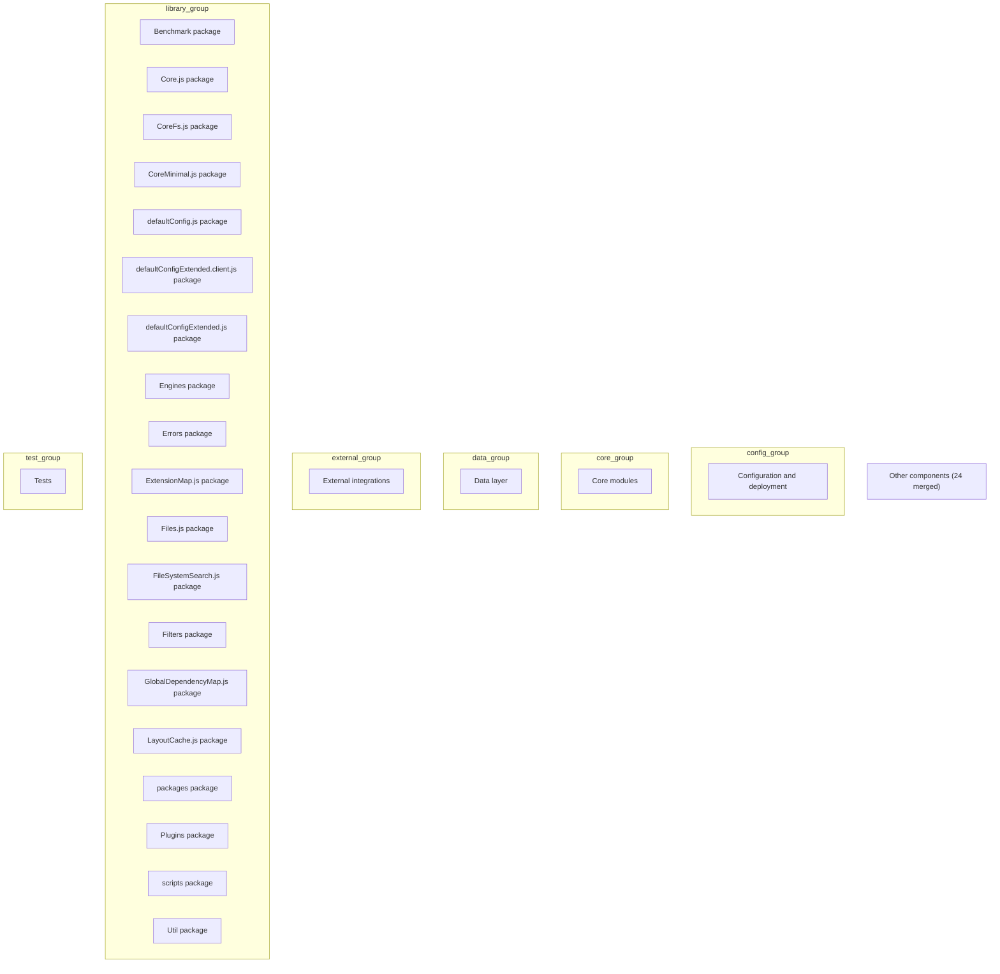

# Architecture report: 11ty/buildawesome

> Automated static analysis. **Observed** = directly seen in files/imports/AST; **Inferred** = interpretation from that evidence. Repository code was not executed.

## 1. Repository at a glance

| Item | Value |
| --- | --- |
| Repository | 11ty/buildawesome |
| Description | A simpler site generator. Transforms a directory of templates (of varying types) into HTML. |
| Language | JavaScript |
| Stars | 20040 |
| Licence | MIT |
| Analysed commit / branch | 3079645e6c43e5c27b486bbf58faf132f34ab4b0 / main |
| Framework(s) | React, Vue |
| Files analysed | 800 |
| Components | 48 |

## 2. Architecture in one minute

11ty/buildawesome - A simpler site generator. Transforms a directory of templates (of varying types) into HTML.. This repository was analysed statically from 800 file(s) (0 Python). Detected technologies (observed from imports/manifests): GitHub Actions, React, Vue, TypeScript, Vitest. Files are grouped into 48 component(s): Benchmark package, Configuration and deployment, Core modules, Core.js package, CoreFs.js package, CoreMinimal.js package, Data layer, defaultConfig.js package. Findings below distinguish observed facts from inferred interpretation.

## 3. High-level block diagram

## 4. Main components

### Benchmark package (`benchmark`)

- **Kind:** library
- **Status:** Observed
- **Confidence:** 0.85
- **Responsibility:** Groups 3 file(s) under benchmark package (observed from repository paths and static analysis).
- **Paths:** `src/Benchmark/Benchmark.js`, `src/Benchmark/BenchmarkGroup.js`, `src/Benchmark/BenchmarkManager.js`
- **Evidence:** [src/Benchmark/Benchmark.js](https://github.com/11ty/buildawesome/blob/3079645e6c43e5c27b486bbf58faf132f34ab4b0/src/Benchmark/Benchmark.js); [src/Benchmark/BenchmarkGroup.js](https://github.com/11ty/buildawesome/blob/3079645e6c43e5c27b486bbf58faf132f34ab4b0/src/Benchmark/BenchmarkGroup.js); [src/Benchmark/BenchmarkManager.js](https://github.com/11ty/buildawesome/blob/3079645e6c43e5c27b486bbf58faf132f34ab4b0/src/Benchmark/BenchmarkManager.js)

### Configuration and deployment (`config`)

- **Kind:** config
- **Status:** Observed
- **Confidence:** 0.85
- **Responsibility:** Groups 4 file(s) under configuration and deployment (observed from repository paths and static analysis).
- **Paths:** `package.json`, `packages/browser/package.json`, `packages/build-awesome/package.json`, `packages/build-awesome/tsconfig.json`
- **Evidence:** [package.json](https://github.com/11ty/buildawesome/blob/3079645e6c43e5c27b486bbf58faf132f34ab4b0/package.json); [packages/browser/package.json](https://github.com/11ty/buildawesome/blob/3079645e6c43e5c27b486bbf58faf132f34ab4b0/packages/browser/package.json); [packages/build-awesome/package.json](https://github.com/11ty/buildawesome/blob/3079645e6c43e5c27b486bbf58faf132f34ab4b0/packages/build-awesome/package.json); [packages/build-awesome/tsconfig.json](https://github.com/11ty/buildawesome/blob/3079645e6c43e5c27b486bbf58faf132f34ab4b0/packages/build-awesome/tsconfig.json)

### Core modules (`core`)

- **Kind:** core
- **Status:** Observed
- **Confidence:** 0.85
- **Responsibility:** Groups 2 file(s) under core modules (observed from repository paths and static analysis).
- **Paths:** `cmd.cjs`, `eslint.config.js`
- **Evidence:** [cmd.cjs](https://github.com/11ty/buildawesome/blob/3079645e6c43e5c27b486bbf58faf132f34ab4b0/cmd.cjs); [eslint.config.js](https://github.com/11ty/buildawesome/blob/3079645e6c43e5c27b486bbf58faf132f34ab4b0/eslint.config.js)

### Core.js package (`core_js`)

- **Kind:** library
- **Status:** Observed
- **Confidence:** 0.85
- **Responsibility:** Groups 1 file(s) under core.js package (observed from repository paths and static analysis).
- **Paths:** `src/Core.js`
- **Evidence:** [src/Core.js](https://github.com/11ty/buildawesome/blob/3079645e6c43e5c27b486bbf58faf132f34ab4b0/src/Core.js)

### CoreFs.js package (`corefs_js`)

- **Kind:** library
- **Status:** Observed
- **Confidence:** 0.85
- **Responsibility:** Groups 1 file(s) under corefs.js package (observed from repository paths and static analysis).
- **Paths:** `src/CoreFs.js`
- **Evidence:** [src/CoreFs.js](https://github.com/11ty/buildawesome/blob/3079645e6c43e5c27b486bbf58faf132f34ab4b0/src/CoreFs.js)

### CoreMinimal.js package (`coreminimal_js`)

- **Kind:** library
- **Status:** Observed
- **Confidence:** 0.85
- **Responsibility:** Groups 1 file(s) under coreminimal.js package (observed from repository paths and static analysis).
- **Paths:** `src/CoreMinimal.js`
- **Evidence:** [src/CoreMinimal.js](https://github.com/11ty/buildawesome/blob/3079645e6c43e5c27b486bbf58faf132f34ab4b0/src/CoreMinimal.js)

### Data layer (`data_layer`)

- **Kind:** data
- **Status:** Observed
- **Confidence:** 0.85
- **Responsibility:** Groups 8 file(s) under data layer (observed from repository paths and static analysis).
- **Paths:** `src/Data/ComputedData.js`, `src/Data/ComputedDataTemplateString.js`, `src/Data/ConfigurationGlobalData.js`, `src/Data/GlobalDataReads.js`, `src/Data/InternalReads.js`, `src/Data/ResolveConfigurationData.js`, `src/Data/Signals.js`, `src/Data/TemplateData.js`
- **Evidence:** [src/Data/ComputedData.js](https://github.com/11ty/buildawesome/blob/3079645e6c43e5c27b486bbf58faf132f34ab4b0/src/Data/ComputedData.js); [src/Data/ComputedDataTemplateString.js](https://github.com/11ty/buildawesome/blob/3079645e6c43e5c27b486bbf58faf132f34ab4b0/src/Data/ComputedDataTemplateString.js); [src/Data/ConfigurationGlobalData.js](https://github.com/11ty/buildawesome/blob/3079645e6c43e5c27b486bbf58faf132f34ab4b0/src/Data/ConfigurationGlobalData.js); [src/Data/GlobalDataReads.js](https://github.com/11ty/buildawesome/blob/3079645e6c43e5c27b486bbf58faf132f34ab4b0/src/Data/GlobalDataReads.js); [src/Data/InternalReads.js](https://github.com/11ty/buildawesome/blob/3079645e6c43e5c27b486bbf58faf132f34ab4b0/src/Data/InternalReads.js); [src/Data/ResolveConfigurationData.js](https://github.com/11ty/buildawesome/blob/3079645e6c43e5c27b486bbf58faf132f34ab4b0/src/Data/ResolveConfigurationData.js); [src/Data/Signals.js](https://github.com/11ty/buildawesome/blob/3079645e6c43e5c27b486bbf58faf132f34ab4b0/src/Data/Signals.js); [src/Data/TemplateData.js](https://github.com/11ty/buildawesome/blob/3079645e6c43e5c27b486bbf58faf132f34ab4b0/src/Data/TemplateData.js)

### defaultConfig.js package (`defaultconfig_js`)

- **Kind:** library
- **Status:** Observed
- **Confidence:** 0.85
- **Responsibility:** Groups 1 file(s) under defaultconfig.js package (observed from repository paths and static analysis).
- **Paths:** `src/defaultConfig.js`
- **Evidence:** [src/defaultConfig.js](https://github.com/11ty/buildawesome/blob/3079645e6c43e5c27b486bbf58faf132f34ab4b0/src/defaultConfig.js)

### defaultConfigExtended.client.js package (`defaultconfigextended_client_js`)

- **Kind:** library
- **Status:** Observed
- **Confidence:** 0.85
- **Responsibility:** Groups 1 file(s) under defaultconfigextended.client.js package (observed from repository paths and static analysis).
- **Paths:** `src/defaultConfigExtended.client.js`
- **Evidence:** [src/defaultConfigExtended.client.js](https://github.com/11ty/buildawesome/blob/3079645e6c43e5c27b486bbf58faf132f34ab4b0/src/defaultConfigExtended.client.js)

### defaultConfigExtended.js package (`defaultconfigextended_js`)

- **Kind:** library
- **Status:** Observed
- **Confidence:** 0.85
- **Responsibility:** Groups 1 file(s) under defaultconfigextended.js package (observed from repository paths and static analysis).
- **Paths:** `src/defaultConfigExtended.js`
- **Evidence:** [src/defaultConfigExtended.js](https://github.com/11ty/buildawesome/blob/3079645e6c43e5c27b486bbf58faf132f34ab4b0/src/defaultConfigExtended.js)

### Engines package (`engines`)

- **Kind:** library
- **Status:** Observed
- **Confidence:** 0.85
- **Responsibility:** Groups 10 file(s) under engines package (observed from repository paths and static analysis).
- **Paths:** `src/Engines/Custom.js`, `src/Engines/FrontMatter/JavaScript.js`, `src/Engines/Html.js`, `src/Engines/JavaScript.js`, `src/Engines/Liquid.js`, `src/Engines/Markdown.js`, `src/Engines/Nunjucks.js`, `src/Engines/TemplateEngine.js`, `src/Engines/TemplateEngineManager.js`, `src/Engines/Util/ContextAugmenter.js`
- **Evidence:** [src/Engines/Custom.js](https://github.com/11ty/buildawesome/blob/3079645e6c43e5c27b486bbf58faf132f34ab4b0/src/Engines/Custom.js); [src/Engines/FrontMatter/JavaScript.js](https://github.com/11ty/buildawesome/blob/3079645e6c43e5c27b486bbf58faf132f34ab4b0/src/Engines/FrontMatter/JavaScript.js); [src/Engines/Html.js](https://github.com/11ty/buildawesome/blob/3079645e6c43e5c27b486bbf58faf132f34ab4b0/src/Engines/Html.js); [src/Engines/JavaScript.js](https://github.com/11ty/buildawesome/blob/3079645e6c43e5c27b486bbf58faf132f34ab4b0/src/Engines/JavaScript.js); [src/Engines/Liquid.js](https://github.com/11ty/buildawesome/blob/3079645e6c43e5c27b486bbf58faf132f34ab4b0/src/Engines/Liquid.js); [src/Engines/Markdown.js](https://github.com/11ty/buildawesome/blob/3079645e6c43e5c27b486bbf58faf132f34ab4b0/src/Engines/Markdown.js); [src/Engines/Nunjucks.js](https://github.com/11ty/buildawesome/blob/3079645e6c43e5c27b486bbf58faf132f34ab4b0/src/Engines/Nunjucks.js); [src/Engines/TemplateEngine.js](https://github.com/11ty/buildawesome/blob/3079645e6c43e5c27b486bbf58faf132f34ab4b0/src/Engines/TemplateEngine.js)

### Errors package (`errors`)

- **Kind:** library
- **Status:** Observed
- **Confidence:** 0.85
- **Responsibility:** Groups 7 file(s) under errors package (observed from repository paths and static analysis).
- **Paths:** `src/Errors/BaseError.js`, `src/Errors/DuplicatePermalinkOutputError.js`, `src/Errors/ErrorHandler.js`, `src/Errors/ErrorUtil.js`, `src/Errors/TemplateContentPrematureUseError.js`, `src/Errors/TemplateContentUnrenderedTemplateError.js`, `src/Errors/UsingCircularTemplateContentReferenceError.js`
- **Evidence:** [src/Errors/BaseError.js](https://github.com/11ty/buildawesome/blob/3079645e6c43e5c27b486bbf58faf132f34ab4b0/src/Errors/BaseError.js); [src/Errors/DuplicatePermalinkOutputError.js](https://github.com/11ty/buildawesome/blob/3079645e6c43e5c27b486bbf58faf132f34ab4b0/src/Errors/DuplicatePermalinkOutputError.js); [src/Errors/ErrorHandler.js](https://github.com/11ty/buildawesome/blob/3079645e6c43e5c27b486bbf58faf132f34ab4b0/src/Errors/ErrorHandler.js); [src/Errors/ErrorUtil.js](https://github.com/11ty/buildawesome/blob/3079645e6c43e5c27b486bbf58faf132f34ab4b0/src/Errors/ErrorUtil.js); [src/Errors/TemplateContentPrematureUseError.js](https://github.com/11ty/buildawesome/blob/3079645e6c43e5c27b486bbf58faf132f34ab4b0/src/Errors/TemplateContentPrematureUseError.js); [src/Errors/TemplateContentUnrenderedTemplateError.js](https://github.com/11ty/buildawesome/blob/3079645e6c43e5c27b486bbf58faf132f34ab4b0/src/Errors/TemplateContentUnrenderedTemplateError.js); [src/Errors/UsingCircularTemplateContentReferenceError.js](https://github.com/11ty/buildawesome/blob/3079645e6c43e5c27b486bbf58faf132f34ab4b0/src/Errors/UsingCircularTemplateContentReferenceError.js)

### ExtensionMap.js package (`extensionmap_js`)

- **Kind:** library
- **Status:** Observed
- **Confidence:** 0.85
- **Responsibility:** Groups 1 file(s) under extensionmap.js package (observed from repository paths and static analysis).
- **Paths:** `src/ExtensionMap.js`
- **Evidence:** [src/ExtensionMap.js](https://github.com/11ty/buildawesome/blob/3079645e6c43e5c27b486bbf58faf132f34ab4b0/src/ExtensionMap.js)

### External integrations (`external_integrations`)

- **Kind:** external
- **Status:** Observed
- **Confidence:** 0.85
- **Responsibility:** Groups 16 file(s) under external integrations (observed from repository paths and static analysis).
- **Paths:** `src/Adapters/Engines/Liquid.core.js`, `src/Adapters/Engines/Liquid.js`, `src/Adapters/Engines/Markdown.core.js`, `src/Adapters/Engines/Markdown.js`, `src/Adapters/Engines/Nunjucks.core.js`, `src/Adapters/Engines/Nunjucks.js`, `src/Adapters/Packages/chalk.client.js`, `src/Adapters/Packages/chalk.js`, `src/Adapters/Packages/inspect.core.js`, `src/Adapters/Packages/inspect.js`, `src/Adapters/Packages/semver.client.js`, `src/Adapters/Packages/semver.js`, `src/Adapters/Packages/url.core.js`, `src/Adapters/Packages/url.js`, `src/Adapters/getDefaultConfig.core.js`, `src/Adapters/getDefaultConfig.js`
- **Evidence:** [src/Adapters/Engines/Liquid.core.js](https://github.com/11ty/buildawesome/blob/3079645e6c43e5c27b486bbf58faf132f34ab4b0/src/Adapters/Engines/Liquid.core.js); [src/Adapters/Engines/Liquid.js](https://github.com/11ty/buildawesome/blob/3079645e6c43e5c27b486bbf58faf132f34ab4b0/src/Adapters/Engines/Liquid.js); [src/Adapters/Engines/Markdown.core.js](https://github.com/11ty/buildawesome/blob/3079645e6c43e5c27b486bbf58faf132f34ab4b0/src/Adapters/Engines/Markdown.core.js); [src/Adapters/Engines/Markdown.js](https://github.com/11ty/buildawesome/blob/3079645e6c43e5c27b486bbf58faf132f34ab4b0/src/Adapters/Engines/Markdown.js); [src/Adapters/Engines/Nunjucks.core.js](https://github.com/11ty/buildawesome/blob/3079645e6c43e5c27b486bbf58faf132f34ab4b0/src/Adapters/Engines/Nunjucks.core.js); [src/Adapters/Engines/Nunjucks.js](https://github.com/11ty/buildawesome/blob/3079645e6c43e5c27b486bbf58faf132f34ab4b0/src/Adapters/Engines/Nunjucks.js); [src/Adapters/Packages/chalk.client.js](https://github.com/11ty/buildawesome/blob/3079645e6c43e5c27b486bbf58faf132f34ab4b0/src/Adapters/Packages/chalk.client.js); [src/Adapters/Packages/chalk.js](https://github.com/11ty/buildawesome/blob/3079645e6c43e5c27b486bbf58faf132f34ab4b0/src/Adapters/Packages/chalk.js)

### Files.js package (`files_js`)

- **Kind:** library
- **Status:** Observed
- **Confidence:** 0.85
- **Responsibility:** Groups 1 file(s) under files.js package (observed from repository paths and static analysis).
- **Paths:** `src/Files.js`
- **Evidence:** [src/Files.js](https://github.com/11ty/buildawesome/blob/3079645e6c43e5c27b486bbf58faf132f34ab4b0/src/Files.js)

### FileSystemSearch.js package (`filesystemsearch_js`)

- **Kind:** library
- **Status:** Observed
- **Confidence:** 0.85
- **Responsibility:** Groups 1 file(s) under filesystemsearch.js package (observed from repository paths and static analysis).
- **Paths:** `src/FileSystemSearch.js`
- **Evidence:** [src/FileSystemSearch.js](https://github.com/11ty/buildawesome/blob/3079645e6c43e5c27b486bbf58faf132f34ab4b0/src/FileSystemSearch.js)

### Filters package (`filters`)

- **Kind:** library
- **Status:** Observed
- **Confidence:** 0.85
- **Responsibility:** Groups 5 file(s) under filters package (observed from repository paths and static analysis).
- **Paths:** `src/Filters/GetCollectionItem.js`, `src/Filters/GetCollectionItemIndex.js`, `src/Filters/GetLocaleCollectionItem.js`, `src/Filters/GetParentDirectory.js`, `src/Filters/Url.js`
- **Evidence:** [src/Filters/GetCollectionItem.js](https://github.com/11ty/buildawesome/blob/3079645e6c43e5c27b486bbf58faf132f34ab4b0/src/Filters/GetCollectionItem.js); [src/Filters/GetCollectionItemIndex.js](https://github.com/11ty/buildawesome/blob/3079645e6c43e5c27b486bbf58faf132f34ab4b0/src/Filters/GetCollectionItemIndex.js); [src/Filters/GetLocaleCollectionItem.js](https://github.com/11ty/buildawesome/blob/3079645e6c43e5c27b486bbf58faf132f34ab4b0/src/Filters/GetLocaleCollectionItem.js); [src/Filters/GetParentDirectory.js](https://github.com/11ty/buildawesome/blob/3079645e6c43e5c27b486bbf58faf132f34ab4b0/src/Filters/GetParentDirectory.js); [src/Filters/Url.js](https://github.com/11ty/buildawesome/blob/3079645e6c43e5c27b486bbf58faf132f34ab4b0/src/Filters/Url.js)

### GlobalDependencyMap.js package (`globaldependencymap_js`)

- **Kind:** library
- **Status:** Observed
- **Confidence:** 0.85
- **Responsibility:** Groups 1 file(s) under globaldependencymap.js package (observed from repository paths and static analysis).
- **Paths:** `src/GlobalDependencyMap.js`
- **Evidence:** [src/GlobalDependencyMap.js](https://github.com/11ty/buildawesome/blob/3079645e6c43e5c27b486bbf58faf132f34ab4b0/src/GlobalDependencyMap.js)

### LayoutCache.js package (`layoutcache_js`)

- **Kind:** library
- **Status:** Observed
- **Confidence:** 0.85
- **Responsibility:** Groups 1 file(s) under layoutcache.js package (observed from repository paths and static analysis).
- **Paths:** `src/LayoutCache.js`
- **Evidence:** [src/LayoutCache.js](https://github.com/11ty/buildawesome/blob/3079645e6c43e5c27b486bbf58faf132f34ab4b0/src/LayoutCache.js)

### packages package (`packages`)

- **Kind:** library
- **Status:** Observed
- **Confidence:** 0.85
- **Responsibility:** Groups 16 file(s) under packages package (observed from repository paths and static analysis).
- **Paths:** `packages/browser/generate-bundle.js`, `packages/browser/src/BundleCoreFs.js`, `packages/browser/src/BundleCoreMinimal.js`, `packages/browser/src/BundleI18nPlugin.js`, `packages/browser/src/BundleLiquid.js`, `packages/browser/src/BundleMarkdown.js`, `packages/browser/src/BundleNunjucks.js`, `packages/browser/src/shims/process.cjs`, `packages/browser/src/shims/shim-core.js`, `packages/browser/update-package-json.js`, `packages/browser/vitest.config.js`, `packages/build-awesome/cmd.js`, `packages/build-awesome/src/Core.js`, `packages/build-awesome/src/UserConfig.js`, `packages/build-awesome/src/Util/Git.js`, `packages/build-awesome/update-package-json.js`
- **Evidence:** [packages/browser/generate-bundle.js](https://github.com/11ty/buildawesome/blob/3079645e6c43e5c27b486bbf58faf132f34ab4b0/packages/browser/generate-bundle.js); [packages/browser/src/BundleCoreFs.js](https://github.com/11ty/buildawesome/blob/3079645e6c43e5c27b486bbf58faf132f34ab4b0/packages/browser/src/BundleCoreFs.js); [packages/browser/src/BundleCoreMinimal.js](https://github.com/11ty/buildawesome/blob/3079645e6c43e5c27b486bbf58faf132f34ab4b0/packages/browser/src/BundleCoreMinimal.js); [packages/browser/src/BundleI18nPlugin.js](https://github.com/11ty/buildawesome/blob/3079645e6c43e5c27b486bbf58faf132f34ab4b0/packages/browser/src/BundleI18nPlugin.js); [packages/browser/src/BundleLiquid.js](https://github.com/11ty/buildawesome/blob/3079645e6c43e5c27b486bbf58faf132f34ab4b0/packages/browser/src/BundleLiquid.js); [packages/browser/src/BundleMarkdown.js](https://github.com/11ty/buildawesome/blob/3079645e6c43e5c27b486bbf58faf132f34ab4b0/packages/browser/src/BundleMarkdown.js); [packages/browser/src/BundleNunjucks.js](https://github.com/11ty/buildawesome/blob/3079645e6c43e5c27b486bbf58faf132f34ab4b0/packages/browser/src/BundleNunjucks.js); [packages/browser/src/shims/process.cjs](https://github.com/11ty/buildawesome/blob/3079645e6c43e5c27b486bbf58faf132f34ab4b0/packages/browser/src/shims/process.cjs)

### Plugins package (`plugins`)

- **Kind:** library
- **Status:** Observed
- **Confidence:** 0.85
- **Responsibility:** Groups 8 file(s) under plugins package (observed from repository paths and static analysis).
- **Paths:** `src/Plugins/HtmlBasePlugin.js`, `src/Plugins/HtmlRelativeCopyPlugin.js`, `src/Plugins/I18nPlugin.js`, `src/Plugins/IdAttributePlugin.js`, `src/Plugins/InputPathToUrl.js`, `src/Plugins/Pagination.js`, `src/Plugins/PreserveClosingTagsPlugin.js`, `src/Plugins/RenderPlugin.js`
- **Evidence:** [src/Plugins/HtmlBasePlugin.js](https://github.com/11ty/buildawesome/blob/3079645e6c43e5c27b486bbf58faf132f34ab4b0/src/Plugins/HtmlBasePlugin.js); [src/Plugins/HtmlRelativeCopyPlugin.js](https://github.com/11ty/buildawesome/blob/3079645e6c43e5c27b486bbf58faf132f34ab4b0/src/Plugins/HtmlRelativeCopyPlugin.js); [src/Plugins/I18nPlugin.js](https://github.com/11ty/buildawesome/blob/3079645e6c43e5c27b486bbf58faf132f34ab4b0/src/Plugins/I18nPlugin.js); [src/Plugins/IdAttributePlugin.js](https://github.com/11ty/buildawesome/blob/3079645e6c43e5c27b486bbf58faf132f34ab4b0/src/Plugins/IdAttributePlugin.js); [src/Plugins/InputPathToUrl.js](https://github.com/11ty/buildawesome/blob/3079645e6c43e5c27b486bbf58faf132f34ab4b0/src/Plugins/InputPathToUrl.js); [src/Plugins/Pagination.js](https://github.com/11ty/buildawesome/blob/3079645e6c43e5c27b486bbf58faf132f34ab4b0/src/Plugins/Pagination.js); [src/Plugins/PreserveClosingTagsPlugin.js](https://github.com/11ty/buildawesome/blob/3079645e6c43e5c27b486bbf58faf132f34ab4b0/src/Plugins/PreserveClosingTagsPlugin.js); [src/Plugins/RenderPlugin.js](https://github.com/11ty/buildawesome/blob/3079645e6c43e5c27b486bbf58faf132f34ab4b0/src/Plugins/RenderPlugin.js)

### Reporters package (`reporters`)

- **Kind:** library
- **Status:** Observed
- **Confidence:** 0.85
- **Responsibility:** Groups 1 file(s) under reporters package (observed from repository paths and static analysis).
- **Paths:** `src/Reporters/NdjsonReporter.js`
- **Evidence:** [src/Reporters/NdjsonReporter.js](https://github.com/11ty/buildawesome/blob/3079645e6c43e5c27b486bbf58faf132f34ab4b0/src/Reporters/NdjsonReporter.js)

### scripts package (`scripts`)

- **Kind:** library
- **Status:** Observed
- **Confidence:** 0.85
- **Responsibility:** Groups 3 file(s) under scripts package (observed from repository paths and static analysis).
- **Paths:** `scripts/prune-types.js`, `scripts/release-dryrun.sh`, `scripts/release.sh`
- **Evidence:** [scripts/prune-types.js](https://github.com/11ty/buildawesome/blob/3079645e6c43e5c27b486bbf58faf132f34ab4b0/scripts/prune-types.js); [scripts/release-dryrun.sh](https://github.com/11ty/buildawesome/blob/3079645e6c43e5c27b486bbf58faf132f34ab4b0/scripts/release-dryrun.sh); [scripts/release.sh](https://github.com/11ty/buildawesome/blob/3079645e6c43e5c27b486bbf58faf132f34ab4b0/scripts/release.sh)

### Serve.js package (`serve_js`)

- **Kind:** library
- **Status:** Observed
- **Confidence:** 0.85
- **Responsibility:** Groups 1 file(s) under serve.js package (observed from repository paths and static analysis).
- **Paths:** `src/Serve.js`
- **Evidence:** [src/Serve.js](https://github.com/11ty/buildawesome/blob/3079645e6c43e5c27b486bbf58faf132f34ab4b0/src/Serve.js)

### Template.js package (`template_js`)

- **Kind:** library
- **Status:** Observed
- **Confidence:** 0.85
- **Responsibility:** Groups 1 file(s) under template.js package (observed from repository paths and static analysis).
- **Paths:** `src/Template.js`
- **Evidence:** [src/Template.js](https://github.com/11ty/buildawesome/blob/3079645e6c43e5c27b486bbf58faf132f34ab4b0/src/Template.js)

### TemplateBehavior.js package (`templatebehavior_js`)

- **Kind:** library
- **Status:** Observed
- **Confidence:** 0.85
- **Responsibility:** Groups 1 file(s) under templatebehavior.js package (observed from repository paths and static analysis).
- **Paths:** `src/TemplateBehavior.js`
- **Evidence:** [src/TemplateBehavior.js](https://github.com/11ty/buildawesome/blob/3079645e6c43e5c27b486bbf58faf132f34ab4b0/src/TemplateBehavior.js)

### TemplateCollection.js package (`templatecollection_js`)

- **Kind:** library
- **Status:** Observed
- **Confidence:** 0.85
- **Responsibility:** Groups 1 file(s) under templatecollection.js package (observed from repository paths and static analysis).
- **Paths:** `src/TemplateCollection.js`
- **Evidence:** [src/TemplateCollection.js](https://github.com/11ty/buildawesome/blob/3079645e6c43e5c27b486bbf58faf132f34ab4b0/src/TemplateCollection.js)

### TemplateConfig.js package (`templateconfig_js`)

- **Kind:** library
- **Status:** Observed
- **Confidence:** 0.85
- **Responsibility:** Groups 1 file(s) under templateconfig.js package (observed from repository paths and static analysis).
- **Paths:** `src/TemplateConfig.js`
- **Evidence:** [src/TemplateConfig.js](https://github.com/11ty/buildawesome/blob/3079645e6c43e5c27b486bbf58faf132f34ab4b0/src/TemplateConfig.js)

### TemplateContent.js package (`templatecontent_js`)

- **Kind:** library
- **Status:** Observed
- **Confidence:** 0.85
- **Responsibility:** Groups 1 file(s) under templatecontent.js package (observed from repository paths and static analysis).
- **Paths:** `src/TemplateContent.js`
- **Evidence:** [src/TemplateContent.js](https://github.com/11ty/buildawesome/blob/3079645e6c43e5c27b486bbf58faf132f34ab4b0/src/TemplateContent.js)

### TemplateFileSlug.js package (`templatefileslug_js`)

- **Kind:** library
- **Status:** Observed
- **Confidence:** 0.85
- **Responsibility:** Groups 1 file(s) under templatefileslug.js package (observed from repository paths and static analysis).
- **Paths:** `src/TemplateFileSlug.js`
- **Evidence:** [src/TemplateFileSlug.js](https://github.com/11ty/buildawesome/blob/3079645e6c43e5c27b486bbf58faf132f34ab4b0/src/TemplateFileSlug.js)

### TemplateGlob.js package (`templateglob_js`)

- **Kind:** library
- **Status:** Observed
- **Confidence:** 0.85
- **Responsibility:** Groups 1 file(s) under templateglob.js package (observed from repository paths and static analysis).
- **Paths:** `src/TemplateGlob.js`
- **Evidence:** [src/TemplateGlob.js](https://github.com/11ty/buildawesome/blob/3079645e6c43e5c27b486bbf58faf132f34ab4b0/src/TemplateGlob.js)

### TemplateLayout.js package (`templatelayout_js`)

- **Kind:** library
- **Status:** Observed
- **Confidence:** 0.85
- **Responsibility:** Groups 1 file(s) under templatelayout.js package (observed from repository paths and static analysis).
- **Paths:** `src/TemplateLayout.js`
- **Evidence:** [src/TemplateLayout.js](https://github.com/11ty/buildawesome/blob/3079645e6c43e5c27b486bbf58faf132f34ab4b0/src/TemplateLayout.js)

### TemplateLayoutPathResolver.js package (`templatelayoutpathresolver_js`)

- **Kind:** library
- **Status:** Observed
- **Confidence:** 0.85
- **Responsibility:** Groups 1 file(s) under templatelayoutpathresolver.js package (observed from repository paths and static analysis).
- **Paths:** `src/TemplateLayoutPathResolver.js`
- **Evidence:** [src/TemplateLayoutPathResolver.js](https://github.com/11ty/buildawesome/blob/3079645e6c43e5c27b486bbf58faf132f34ab4b0/src/TemplateLayoutPathResolver.js)

### TemplateMap.js package (`templatemap_js`)

- **Kind:** library
- **Status:** Observed
- **Confidence:** 0.85
- **Responsibility:** Groups 1 file(s) under templatemap.js package (observed from repository paths and static analysis).
- **Paths:** `src/TemplateMap.js`
- **Evidence:** [src/TemplateMap.js](https://github.com/11ty/buildawesome/blob/3079645e6c43e5c27b486bbf58faf132f34ab4b0/src/TemplateMap.js)

### TemplatePassthrough.js package (`templatepassthrough_js`)

- **Kind:** library
- **Status:** Observed
- **Confidence:** 0.85
- **Responsibility:** Groups 1 file(s) under templatepassthrough.js package (observed from repository paths and static analysis).
- **Paths:** `src/TemplatePassthrough.js`
- **Evidence:** [src/TemplatePassthrough.js](https://github.com/11ty/buildawesome/blob/3079645e6c43e5c27b486bbf58faf132f34ab4b0/src/TemplatePassthrough.js)

### TemplatePassthroughManager.js package (`templatepassthroughmanager_js`)

- **Kind:** library
- **Status:** Observed
- **Confidence:** 0.85
- **Responsibility:** Groups 1 file(s) under templatepassthroughmanager.js package (observed from repository paths and static analysis).
- **Paths:** `src/TemplatePassthroughManager.js`
- **Evidence:** [src/TemplatePassthroughManager.js](https://github.com/11ty/buildawesome/blob/3079645e6c43e5c27b486bbf58faf132f34ab4b0/src/TemplatePassthroughManager.js)

### TemplatePermalink.js package (`templatepermalink_js`)

- **Kind:** library
- **Status:** Observed
- **Confidence:** 0.85
- **Responsibility:** Groups 1 file(s) under templatepermalink.js package (observed from repository paths and static analysis).
- **Paths:** `src/TemplatePermalink.js`
- **Evidence:** [src/TemplatePermalink.js](https://github.com/11ty/buildawesome/blob/3079645e6c43e5c27b486bbf58faf132f34ab4b0/src/TemplatePermalink.js)

### TemplatePipeline.js package (`templatepipeline_js`)

- **Kind:** library
- **Status:** Observed
- **Confidence:** 0.85
- **Responsibility:** Groups 1 file(s) under templatepipeline.js package (observed from repository paths and static analysis).
- **Paths:** `src/TemplatePipeline.js`
- **Evidence:** [src/TemplatePipeline.js](https://github.com/11ty/buildawesome/blob/3079645e6c43e5c27b486bbf58faf132f34ab4b0/src/TemplatePipeline.js)

### TemplatePreprocessors.js package (`templatepreprocessors_js`)

- **Kind:** library
- **Status:** Observed
- **Confidence:** 0.85
- **Responsibility:** Groups 1 file(s) under templatepreprocessors.js package (observed from repository paths and static analysis).
- **Paths:** `src/TemplatePreprocessors.js`
- **Evidence:** [src/TemplatePreprocessors.js](https://github.com/11ty/buildawesome/blob/3079645e6c43e5c27b486bbf58faf132f34ab4b0/src/TemplatePreprocessors.js)

### TemplateRender.js package (`templaterender_js`)

- **Kind:** library
- **Status:** Observed
- **Confidence:** 0.85
- **Responsibility:** Groups 1 file(s) under templaterender.js package (observed from repository paths and static analysis).
- **Paths:** `src/TemplateRender.js`
- **Evidence:** [src/TemplateRender.js](https://github.com/11ty/buildawesome/blob/3079645e6c43e5c27b486bbf58faf132f34ab4b0/src/TemplateRender.js)

### TemplateWriter.js package (`templatewriter_js`)

- **Kind:** library
- **Status:** Observed
- **Confidence:** 0.85
- **Responsibility:** Groups 1 file(s) under templatewriter.js package (observed from repository paths and static analysis).
- **Paths:** `src/TemplateWriter.js`
- **Evidence:** [src/TemplateWriter.js](https://github.com/11ty/buildawesome/blob/3079645e6c43e5c27b486bbf58faf132f34ab4b0/src/TemplateWriter.js)

### Tests (`tests`)

- **Kind:** test
- **Status:** Observed
- **Confidence:** 0.85
- **Responsibility:** Groups 592 file(s) under tests (observed from repository paths and static analysis).
- **Paths:** `packages/browser/test/client-core-fs.test.js`, `packages/browser/test/client-core.test.js`, `packages/browser/test/shared-tests.js`, `test/ArrayUtilTest.js`, `test/BenchmarkTest.js`, `test/BundlePluginTest.js`, `test/CompatibilityTest.js`, `test/ComputedDataTemplateStringTest.js`, `test/ComputedDataTest.js`, `test/ConsoleLoggerTest.js`, `test/ContentPipelineTest.js`, `test/CoreTest-ComputedData.js`, `test/CoreTest-CustomDateParsing.js`, `test/CoreTest-PageData.js`, `test/CoreTest-Preprocessors.js`, `test/CoreTest-Shortcodes.js`, `test/CoreTest-VirtualTemplates.js`, `test/CoreTest.js`, `test/CoreWatchOutputHashesTest.js`, `test/DebugLogUtilTest.js`, `test/DefineConfigTest.js`, `test/DependencyGraphTest.js`, `test/DirContainsTest.js`, `test/EleventyAddGlobalDataTest.js`, `test/EleventyImgTransformTest.js`, `test/EleventyMarkdownTest.js`, `test/EleventyNunjucksTest.js`, `test/ErrorHandlerTest.js`, `test/ErrorUtilTest.js`, `test/ExistsCacheTest.js`, `test/ExtensionMapTest.js`, `test/FileSystemSearchTest.js`, `test/FilesGitIgnoreEleventyIgnoreTest.js`, `test/FilesTest.js`, `test/GetCollectionItemIndexTest.js`, `test/GetCollectionItemTest.js`, `test/GetParentDirectoryTest.js`, `test/GlobMatcherTest.js`, `test/GlobRemapTest.js`, `test/GlobalDependencyMapTest.js`, `test/HtmlBasePluginTest.js`, `test/HtmlRelativeCopyTest.js`, `test/I18nPluginTest.js`, `test/IdAttributePluginTest.js`, `test/ImportJsonSyncTest.js`, `test/IncrementalIncludesTest.js`, `test/InputPathToUrlPluginTest.js`, `test/Issue1469Test.js`, `test/Issue1609Test.js`, `test/Issue1952Test.js`, `test/Issue2109Test.js`, `test/Issue2131Test.js`, `test/Issue2236Test.js`, `test/Issue2325Test.js`, `test/Issue2448Test.js`, `test/Issue2634Test.js`, `test/Issue2806Test.js`, `test/Issue2885Test.js`, `test/Issue3467Test.js`, `test/Issue3543Test.js`, `test/Issue3744Test.js`, `test/Issue3788Test.js`, `test/Issue3797Test.js`, `test/Issue3808Test.js`, `test/Issue3809Test.js`, `test/Issue3816Test.js`, `test/Issue3818Test.js`, `test/Issue3823Test.js`, `test/Issue3824IncrementalTest.js`, `test/Issue3824Test.js`, `test/Issue3825Test.js`, `test/Issue3831Test.js`, `test/Issue3833Test.js`, `test/Issue3850Test.js`, `test/Issue3853Test.js`, `test/Issue3854Test.js`, `test/Issue3860Test.js`, `test/Issue3870IncrementalTest.js`, `test/Issue3870Test.js`, `test/Issue3875Test.js`, `test/Issue3931Test.js`, `test/Issue3953Test.js`, `test/Issue4182Test.js`, `test/Issue4326Test.js`, `test/Issue434Test.js`, `test/Issue4399Test.js`, `test/Issue445Test.js`, `test/Issue775Test.js`, `test/JavaScriptDependenciesTest.js`, `test/JavaScriptFrontMatterTest.js`, `test/JsxTest.js`, `test/LayoutCacheTest.js`, `test/LodashTest.js`, `test/LogFilterTest.js`, `test/MdxTest.js`, `test/MemoizeFunctionTest.js`, `test/NdjsonReporterTest.js`, `test/NunjucksWatchTest.js`, `test/PaginationTest.js`, `test/ParseDateStringFilterTest.js`, `test/PassthroughCopyBehaviorTest.js`, `test/PathNormalizerTest.js`, `test/PathPrefixer.js`, `test/PluralizeTest.js`, `test/PostHtmlAttrsTest.js`, `test/PreserveClosingTagsPluginTest.js`, `test/ProjectDirectoriesTest.js`, `test/ProjectTemplateFormatsTest.js`, `test/ProxyWrapTest.js`, `test/ReservedDataTest.js`, `test/ResolveConfigurationDataTest.js`, `test/SemverCheckTest.js`, `test/ServeTest.js`, `test/SortableTest.js`, `test/TemplateCollectionTest.js`, `test/TemplateConfigTest.js`, `test/TemplateDataTest.js`, `test/TemplateDepGraphTest.js`, `test/TemplateEngineManagerTest.js`, `test/TemplateEngineTest.js`, `test/TemplateFileSlugTest.js`, `test/TemplateGlobTest.js`, `test/TemplateLayoutPathResolverTest.js`, `test/TemplateLayoutTest.js`, `test/TemplateMapTest-ComputedData.js`, `test/TemplateMapTest.js`, `test/TemplatePassthroughManagerTest.js`, `test/TemplatePassthroughTest.js`, `test/TemplatePermalinkTest.js`, `test/TemplatePipelineTest.js`, `test/TemplateQueryTest.js`, `test/TemplateRenderCustomTest.js`, `test/TemplateRenderHTMLTest.js`, `test/TemplateRenderJavaScriptTest.js`, `test/TemplateRenderLiquidTest.js`, `test/TemplateRenderMarkdownPluginTest.js`, `test/TemplateRenderMarkdownTest.js`, `test/TemplateRenderNunjucksTest.js`, `test/TemplateRenderPluginTest.js`, `test/TemplateRenderTest.js`, `test/TemplateTest-CompileOptions.js`, `test/TemplateTest-ComputedData.js`, `test/TemplateTest-CustomExtensions.js`, `test/TemplateTest-DataCascade.js`, `test/TemplateTest-Dates.js`, `test/TemplateTest-JavaScript.js`, `test/TemplateTest.js`, `test/TemplateTest_Permalink.js`, `test/TemplateWriterTest.js`, `test/TestUtilityTest.js`, `test/TransformsUtilTest.js`, `test/TypesTest.js`, `test/UrlTest.js`, `test/UserConfigTest.js`, `test/UserDataExtensionsTest.js`, `test/Util/normalizeNewLines.js`, `test/Util/normalizeSeparators.js`, `test/UtilSetUnionTest.js`, `test/WatchQueueTest.js`, `test/WatchTargetsTest.js`, `test/WatchTest.js`, `test/_generated/.gitignore`, `test/_getNewTemplateForTests.js`, `test/_getRenderedTemplates.js`, `test/_issues/0/content/index.html`, `test/_issues/0/eleventy.config.js`, `test/_issues/0/issue-0-test.js`, `test/_issues/2100/2100-test.js`, `test/_issues/2100/content/_includes/hello.liquid`, `test/_issues/2100/content/index.liquid`, `test/_issues/2100/eleventy.config.js`, `test/_issues/2250/2250-test.js`, `test/_issues/2250/javascript.11ty.cjs`, `test/_issues/2250/liquid.liquid`, `test/_issues/2250/nunjucks.njk`, `test/_issues/2823/2823-test.js`, `test/_issues/2823/no-permalink.txt`, `test/_issues/2823/with-permalink.txt`, `test/_issues/3697/3697-test.js`, `test/_issues/3697/_data/folder/0.json`, `test/_issues/3697/_data/folder/3.json`, `test/_issues/3809/.app/.eleventy.js`, `test/_issues/3809/.app/_data/app.json`, `test/_issues/3809/index.njk`, `test/_issues/3853/deeper/index.njk`, `test/_issues/3854/app/.eleventy.js`, `test/_issues/3854/app/index.njk`, `test/_issues/3854/index.njk`, `test/_issues/3896/eleventy-input-folder/3896.html`, `test/_issues/3896/eleventy-input-folder/_archive/ignored.html`, `test/_issues/3896/test-files/eleventy.config.js`, `test/_issues/3896/test-files/issue3896-test.js`, `test/_issues/3932/1/2025.html`, `test/_issues/3932/eleventy.config.js`, `test/_issues/3932/issue-3932-test.js`, `test/_issues/975/975-test.js`, `test/_issues/975/another-post.md`, `test/_issues/975/index.md`, `test/_issues/975/post.md`, `test/_mdxHooks.js`, `test/_testHelpers.js`, `test/cmdTest.js`, `test/file-system-search/file.txt`, `test/noop/.gitkeep`, `test/noop2/.gitkeep`, `test/proxy-pagination-globaldata/_data/banner.js`, `test/proxy-pagination-globaldata/tmpl.liquid`, `test/proxy-pagination-globaldata/tmpl2.njk`, `test/proxy-pagination-globaldata/tmpl4.11ty.js`, `test/semverCoerceTest.js`, `test/slugify-filter/comma.njk`, `test/slugify-filter/multibyte.njk`, `test/slugify-filter/slug-number.njk`, `test/slugify-filter/slug-options.njk`, `test/slugify-filter/slugify-number.njk`, `test/slugify-filter/slugify-options.njk`, `test/slugify-filter/test.njk`, `test/stubs--to/test.md`, `test/stubs--to/test2.liquid`, `test/stubs-1206/page1.njk`, `test/stubs-1206/page2.njk`, `test/stubs-1242/_data/xyz.dottest.json`, `test/stubs-1242/_data/xyz.dottest/test.json`, `test/stubs-1242/empty.md`, `test/stubs-1325/test.11ty.js`, `test/stubs-1325/test.js`, `test/stubs-142/index.njk`, `test/stubs-1691/_data/str.txt`, `test/stubs-1691/template.data.txt`, `test/stubs-1691/template.njk`, `test/stubs-2109/_data/eleventyComputed.js`, `test/stubs-2145/_includes/layout.njk`, `test/stubs-2145/test.njk`, `test/stubs-2167/paginated.njk`, `test/stubs-2224/index.njk`, `test/stubs-2258-2830-skip-layouts/_includes/layout.njk`, `test/stubs-2258-2830-skip-layouts/eleventy.config.cjs`, `test/stubs-2258-2830-skip-layouts/style.scss`, `test/stubs-2258/_includes/_code.scss`, `test/stubs-2258/_includes/layout.njk`, `test/stubs-2258/eleventy.config.cjs`, `test/stubs-2258/style.scss`, `test/stubs-2261/_includes/block.njk`, `test/stubs-2261/eleventy.config.js`, `test/stubs-2261/index.njk`, `test/stubs-2367/_includes/layout.liquid`, `test/stubs-2367/templateWithLiquidShortcodeMultipleArguments-template2.liquid`, `test/stubs-2367/templateWithLiquidShortcodeMultipleArguments.liquid`, `test/stubs-2602/index.njk`, `test/stubs-2634/computed/computed.11tydata.js`, `test/stubs-2634/fallback/fallback.11tydata.js`, `test/stubs-2634/plain/plain.11tydata.js`, `test/stubs-2634/subtitle/subtitle.11tydata.js`, `test/stubs-2753/_data/global.js`, `test/stubs-2753/page1.njk`, `test/stubs-2753/page2.njk`, `test/stubs-2790/page.11ty.cjs`, `test/stubs-2851/content.njk`, `test/stubs-2851/paginated.njk`, `test/stubs-3013/html/_data/books.json`, `test/stubs-3013/html/_includes/base.html`, `test/stubs-3013/html/book.html`, `test/stubs-3013/liquid/_data/books.json`, `test/stubs-3013/liquid/_includes/base.liquid`, `test/stubs-3013/liquid/book.liquid`, `test/stubs-3013/md/_data/books.json`, `test/stubs-3013/md/_includes/base.md`, `test/stubs-3013/md/book.md`, `test/stubs-3013/njk/_data/books.json`, `test/stubs-3013/njk/_includes/base.njk`, `test/stubs-3013/njk/book.njk`, `test/stubs-3285/src/scripts/hello-world.js`, `test/stubs-3356/.gitkeep`, `test/stubs-337/data/xyz.json`, `test/stubs-337/src/empty.md`, `test/stubs-3543/assets/main.css`, `test/stubs-3807/Issue3807test.js`, `test/stubs-3807/_layouts/base.html`, `test/stubs-3807/_layouts/home.html`, `test/stubs-3807/eleventy.config.js`, `test/stubs-3807/index.md`, `test/stubs-3810/_includes/promo.njk`, `test/stubs-3810/eleventy.config.js`, `test/stubs-3810/index.md`, `test/stubs-3824/_includes/head.tsx`, `test/stubs-3824/_includes/view-props.tsx`, `test/stubs-3824/eleventy.config.js`, `test/stubs-3824/index.11ty.tsx`, `test/stubs-3824/tsconfig-3824.json`, `test/stubs-403/.eleventyignore`, `test/stubs-403/_includes/include.liquid`, `test/stubs-403/template.liquid`, `test/stubs-408-sass/_code.scss`, `test/stubs-408-sass/style.scss`, `test/stubs-413/date-frontmatter.md`, `test/stubs-4311/sub/page.njk`, `test/stubs-4311/sub/sub.json`, `test/stubs-434/_includes/macros-filter.njk`, `test/stubs-434/_includes/macros.njk`, `test/stubs-445/_includes/layout.njk`, `test/stubs-445/blog/blog.json`, `test/stubs-445/blog/post.njk`, `test/stubs-445/with-layout.njk`, `test/stubs-475/_includes/layout.njk`, `test/stubs-475/transform-layout/transform-layout.njk`, `test/stubs-630/_data/globalData0.cjs`, `test/stubs-630/_data/globalData1.cjs`, `test/stubs-630/_data/globalData2.json`, `test/stubs-630/_data/globalData3.yaml`, `test/stubs-630/_data/globalData4.nosj`, `test/stubs-630/_data/mergingGlobalData.cjs`, `test/stubs-630/_data/mergingGlobalData.js`, `test/stubs-630/_data/mergingGlobalData.json`, `test/stubs-630/_data/mergingGlobalData.nosj`, `test/stubs-630/_data/mergingGlobalData.yaml`, `test/stubs-630/_data/subdir/globalDataSubdir.yaml`, `test/stubs-630/component-yaml/component.data.cjs`, `test/stubs-630/component-yaml/component.data.json`, `test/stubs-630/component-yaml/component.data.nosj`, `test/stubs-630/component-yaml/component.data.yaml`, `test/stubs-630/component-yaml/component.json`, `test/stubs-630/component-yaml/component.njk`, `test/stubs-630/component-yaml/component.yaml`, `test/stubs-670/content.njk`, `test/stubs-670/index.njk`, `test/stubs-919/test.data.cjs`, `test/stubs-919/test.njk`, `test/stubs-919/test2.njk`, `test/stubs-absolute/test.md`, `test/stubs-addglobaldata-noop/test.txt`, `test/stubs-addglobaldata/test.liquid`, `test/stubs-autocopy/.gitkeep`, `test/stubs-base-case-sens/index.njk`, `test/stubs-base/index.njk`, `test/stubs-circular-layout/_includes/layout-cycle-a.njk`, `test/stubs-circular-layout/_includes/layout-cycle-b.njk`, `test/stubs-circular-layout/_includes/layout-cycle-c.njk`, `test/stubs-circular-layout/_includes/layout-cycle-self.njk`, `test/stubs-computed-array/test.liquid`, `test/stubs-computed-collections-filter/collections.njk`, `test/stubs-computed-collections-filter/dog.njk`, `test/stubs-computed-collections/collections.njk`, `test/stubs-computed-collections/dog.njk`, `test/stubs-computed-dirdata/dir/dir.data.cjs`, `test/stubs-computed-dirdata/dir/first.11ty.cjs`, `test/stubs-computed-dirdata/dir/second.11ty.cjs`, `test/stubs-computed-global/_data/eleventyComputed.cjs`, `test/stubs-computed-global/intermix.njk`, `test/stubs-computed-pagination/child.11ty.cjs`, `test/stubs-computed-pagination/paginated.njk`, `test/stubs-computed-symbolparse/test.liquid`, `test/stubs-computed-symbolparse/test.njk`, `test/stubs-custom-extension/test.js1`, `test/stubs-data-cascade/global-versus-layout/_data/cascade.cjs`, `test/stubs-data-cascade/global-versus-layout/_includes/base.njk`, `test/stubs-data-cascade/global-versus-layout/test.njk`, `test/stubs-data-cascade/layout-data-files/_includes/base.njk`, `test/stubs-data-cascade/layout-data-files/test.data.cjs`, `test/stubs-data-cascade/layout-data-files/test.njk`, `test/stubs-data-cascade/layout-versus-dirdatafile/src/_includes/base.njk`, `test/stubs-data-cascade/layout-versus-dirdatafile/src/src.data.cjs`, `test/stubs-data-cascade/layout-versus-dirdatafile/src/test.njk`, `test/stubs-data-cascade/layout-versus-tmpldatafile/_includes/base.njk`, `test/stubs-data-cascade/layout-versus-tmpldatafile/test.data.cjs`, `test/stubs-data-cascade/layout-versus-tmpldatafile/test.njk`, `test/stubs-data-esm/_data/commonjs.cjs`, `test/stubs-data-esm/_data/module.mjs`, `test/stubs-dependency-tree/child.cjs`, `test/stubs-dependency-tree/grandchild.cjs`, `test/stubs-dependency-tree/index.cjs`, `test/stubs-empty-json-data/_data/empty.json`, `test/stubs-empty/.gitkeep`, `test/stubs-fancyjs/test.11ty.tsx`, `test/stubs-fancyjs/test.mdx`, `test/stubs-freeze/eleventy-fn/_data/meta.js`, `test/stubs-freeze/eleventy/_data/eleventy.js`, `test/stubs-freeze/page/_data/page.js`, `test/stubs-global-data-config-api-nested/_data/deep.cjs`, `test/stubs-global-data-config-api/empty.txt`, `test/stubs-i18n/en-us/index.11ty.cjs`, `test/stubs-i18n/en/index.liquid`, `test/stubs-i18n/es/index.njk`, `test/stubs-i18n/non-lang-file.njk`, `test/stubs-img-transform/ignored.md`, `test/stubs-img-transform/missing-alt.md`, `test/stubs-img-transform/multiple.md`, `test/stubs-img-transform/single.md`, `test/stubs-incremental/layout-chain/_includes/base.njk`, `test/stubs-incremental/layout-chain/_includes/parent.njk`, `test/stubs-incremental/layout-chain/test.njk`, `test/stubs-layout-cache/_includes/layout.liquid`, `test/stubs-layout-cache/_includes/layout.njk`, `test/stubs-layout-cache/test.liquid`, `test/stubs-layout-cache/test.njk`, `test/stubs-layouts-event/_includes/first.liquid`, `test/stubs-layouts-event/_includes/second.liquid`, `test/stubs-layouts-event/_includes/third.liquid`, `test/stubs-layouts-event/page.md`, `test/stubs-njk-async/_includes/loop.njk`, `test/stubs-pagination-computed-quotes-njk/post.njk`, `test/stubs-pagination-computed-quotes-njk/test.njk`, `test/stubs-pagination-computed-quotes/post.liquid`, `test/stubs-pagination-computed-quotes/test.liquid`, `test/stubs-pathtourl/css.njk`, `test/stubs-pathtourl/filter.njk`, `test/stubs-pathtourl/tmpl.njk`, `test/stubs-pathtourl/transform.njk`, `test/stubs-render-plugin/11tyjs-file-override.njk`, `test/stubs-render-plugin/11tyjs-file.njk`, `test/stubs-render-plugin/11tyjs.liquid`, `test/stubs-render-plugin/_includes/cached.cnt`, `test/stubs-render-plugin/_includes/frontmatter.liquid`, `test/stubs-render-plugin/_includes/include-js.txt`, `test/stubs-render-plugin/_includes/include.11ty.cjs`, `test/stubs-render-plugin/_includes/include.liquid`, `test/stubs-render-plugin/_includes/include.njk`, `test/stubs-render-plugin/bad-data.njk`, `test/stubs-render-plugin/capture-liquid-set.njk`, `test/stubs-render-plugin/capture-liquid.njk`, `test/stubs-render-plugin/capture-njk.liquid`, `test/stubs-render-plugin/data-no-templatelang.liquid`, `test/stubs-render-plugin/false.liquid`, `test/stubs-render-plugin/liquid-direct.njk`, `test/stubs-render-plugin/liquid-eleventy.njk`, `test/stubs-render-plugin/liquid-global.njk`, `test/stubs-render-plugin/liquid-md.11ty.cjs`, `test/stubs-render-plugin/liquid-md.liquid`, `test/stubs-render-plugin/liquid-page.liquid`, `test/stubs-render-plugin/liquid-page.njk`, `test/stubs-render-plugin/liquid.njk`, `test/stubs-render-plugin/md.liquid`, `test/stubs-render-plugin/njk-eleventy.liquid`, `test/stubs-render-plugin/njk-file-not-exist.liquid`, `test/stubs-render-plugin/njk-file.liquid`, `test/stubs-render-plugin/njk-file.njk`, `test/stubs-render-plugin/njk-page.liquid`, `test/stubs-render-plugin/nunjucks-frontmatter.njk`, `test/stubs-render-plugin/nunjucks-global.liquid`, `test/stubs-render-plugin/nunjucks.11ty.cjs`, `test/stubs-render-plugin/nunjucks.liquid`, `test/stubs-render-plugin/using-frontmatter.liquid`, `test/stubs-render-plugin/vue.liquid`, `test/stubs-types/core-options.ts`, `test/stubs-types/define-config.cjs`, `test/stubs-types/define-config.js`, `test/stubs-types/import-type-root.ts`, `test/stubs-types/import-type-subpath.ts`, `test/stubs-types/jsdoc-import-default.js`, `test/stubs-types/jsdoc-import-tag.js`, `test/stubs-types/jsdoc-param-default.cjs`, `test/stubs-types/jsdoc-param-default.js`, `test/stubs-types/jsdoc-param-root.js`, `test/stubs-types/satisfies.ts`, `test/stubs-types/tsconfig.json`, `test/stubs-virtual-nowrite/.gitkeep`, `test/stubs-virtual/.gitkeep`, `test/stubs-virtual/eleventy.config.js`, `test/stubs/.eleventyignore`, `test/stubs/2016-02-01-permalinkdate.liquid`, `test/stubs/_data/globalData.json`, `test/stubs/_data/globalData2.cjs`, `test/stubs/_data/globalDataFn.js`, `test/stubs/_data/globalDataFnCJS.cjs`, `test/stubs/_data/subdir/testDataSubdir.json`, `test/stubs/_data/testData.json`, `test/stubs/_data/testDataLiquid.json`, `test/stubs/_includes/base.njk`, `test/stubs/_includes/custom-filter.liquid`, `test/stubs/_includes/default.liquid`, `test/stubs/_includes/defaultLayout.liquid`, `test/stubs/_includes/defaultLayoutLayoutContent.liquid`, `test/stubs/_includes/imports.njk`, `test/stubs/_includes/included-data.html`, `test/stubs/_includes/included-relative.njk`, `test/stubs/_includes/included.html`, `test/stubs/_includes/included.liquid`, `test/stubs/_includes/included.njk`, `test/stubs/_includes/included.nunj`, `test/stubs/_includes/layout-a.liquid`, `test/stubs/_includes/layout-b.liquid`, `test/stubs/_includes/layoutLiquid.liquid`, `test/stubs/_includes/layouts/div-wrapper-layout.njk`, `test/stubs/_includes/layouts/engineOverrides.njk`, `test/stubs/_includes/layouts/engineOverridesMd.njk`, `test/stubs/_includes/layouts/inasubdir.njk`, `test/stubs/_includes/layouts/issue-115.liquid`, `test/stubs/_includes/layouts/layout-contentdump.njk`, `test/stubs/_includes/layouts/layout-inherit-a.njk`, `test/stubs/_includes/layouts/layout-inherit-b.njk`, `test/stubs/_includes/layouts/layout-inherit-c.njk`, `test/stubs/_includes/layouts/post.liquid`, `test/stubs/_includes/layouts/templateMapCollection.njk`, `test/stubs/_includes/multiple.liquid`, `test/stubs/_includes/multiple.md`, `test/stubs/_includes/mylocallayout.njk`, `test/stubs/_includes/permalink-data-layout.njk`, `test/stubs/_includes/permalink-in-layout/layout-fileslug.liquid`, `test/stubs/_includes/permalink-in-layout/layout.liquid`, `test/stubs/_includes/scopeleak.liquid`, `test/stubs/_includes/subfolder/included.html`, `test/stubs/_includes/subfolder/included.liquid`, `test/stubs/_includes/subfolder/included.nunj`, `test/stubs/_includes/test.js`, `test/stubs/_layouts/layoutsdefault.liquid`, `test/stubs/add-extension/test.njk`, `test/stubs/add-extension/test.txt`, `test/stubs/broken-config.cjs`, `test/stubs/buffer.11ty.cjs`, `test/stubs/cfg-cli-sync/formats-override.config.js`, `test/stubs/cfg-cli-sync/formats.config.js`, `test/stubs/cfg-cli-sync/pathprefix.config.js`, `test/stubs/cfg-directories-export-cjs/eleventy.config.cjs`, `test/stubs/cfg-directories-export-cjs/src/.gitkeep`, `test/stubs/cfg-directories-export/eleventy.config.js`, `test/stubs/cfg-directories-export/src/.gitkeep`, `test/stubs/class-async-data-fn.11ty.cjs`, `test/stubs/class-async-filter.11ty.cjs`, `test/stubs/class-async.11ty.cjs`, `test/stubs/class-buffer.11ty.cjs`, `test/stubs/class-data-filter.11ty.cjs`, `test/stubs/class-data-fn-filter.11ty.cjs`, `test/stubs/class-data-fn-shorthand.11ty.cjs`, `test/stubs/class-data-fn.11ty.cjs`, `test/stubs/class-data-permalink-async-fn.11ty.cjs`, `test/stubs/class-data-permalink-buffer.11ty.cjs`, `test/stubs/class-data-permalink-fn-buffer.11ty.cjs`, `test/stubs/class-data-permalink-fn-filter.11ty.cjs`, `test/stubs/class-data-permalink-fn.11ty.cjs`, `test/stubs/class-data-permalink.11ty.cjs`, `test/stubs/class-data.11ty.cjs`, `test/stubs/class-filter.11ty.cjs`, `test/stubs/class-fns-has-page.11ty.cjs`, `test/stubs/class-fns.11ty.cjs`, `test/stubs/class-norender.11ty.cjs`, `test/stubs/class-with-dep-upstream.js`, `test/stubs/class-with-dep.11ty.cjs`, `test/stubs/class.11ty.cjs`, `test/stubs/classfields-data.11ty.cjs`, `test/stubs/cmd-help-processing/_data/test.js`, `test/stubs/collection-layout-wrap.njk`, `test/stubs/collection-layout/_includes/layout.liquid`, `test/stubs/collection-layout/dog1.liquid`, `test/stubs/collection-layout/template.liquid`, `test/stubs/collection-slug/dog1.njk`, `test/stubs/collection-slug/template.njk`, `test/stubs/collection-template/_includes/layout.liquid`, `test/stubs/collection-template/dog1.liquid`, `test/stubs/collection-template/template.liquid`, `test/stubs/collection/test1.md`, `test/stubs/collection/test10.md`, `test/stubs/collection/test2.md`, `test/stubs/collection/test3.md`, `test/stubs/collection/test4.md`, `test/stubs/collection/test5.md`, `test/stubs/collection/test6.html`, `test/stubs/collection/test7.njk`, `test/stubs/collection/test8.md`, `test/stubs/collection/test9.md`, `test/stubs/collection2/test1.md`, `test/stubs/collection2/test2.md`, `test/stubs/component-async/component.data.cjs`, `test/stubs/component-async/component.data.js`, `test/stubs/component-async/component.njk`, `test/stubs/component/component.data.cjs`, `test/stubs/component/component.data.js`, `test/stubs/component/component.data.json`, `test/stubs/component/component.json`, `test/stubs/component/component.njk`, `test/stubs/config-deps-upstream.cjs`, `test/stubs/config-deps.cjs`, `test/stubs/config-empty-pathprefix.cjs`, `test/stubs/config-promise.js`, `test/stubs/config.cjs`, `test/stubs/custom-extension-no-permalink.txt`, `test/stubs/custom-extension.txt`, `test/stubs/custom-frontmatter/template-excerpt-comment.njk`, `test/stubs/custom-frontmatter/template-newline1.njk`, `test/stubs/custom-frontmatter/template-newline2.njk`, `test/stubs/custom-frontmatter/template-newline3.njk`, `test/stubs/custom-frontmatter/template-nonewline.njk`, `test/stubs/custom-frontmatter/template-toml.njk`, `test/stubs/custom-frontmatter/template.njk`, `test/stubs/data-cascade/template.data.cjs`, `test/stubs/data-cascade/template.njk`, `test/stubs/datafiledoesnotexist/template.njk`, `test/stubs/dates/2018-01-01-file5.md`, `test/stubs/dates/2019-01-01-folder/2020-01-01-file.md`, `test/stubs/dates/file1.md`, `test/stubs/dates/file2.md`, `test/stubs/dates/file2b.md`, `test/stubs/dates/file3.md`, `test/stubs/dates/file4.md`
- **Evidence:** [packages/browser/test/client-core-fs.test.js](https://github.com/11ty/buildawesome/blob/3079645e6c43e5c27b486bbf58faf132f34ab4b0/packages/browser/test/client-core-fs.test.js); [packages/browser/test/client-core.test.js](https://github.com/11ty/buildawesome/blob/3079645e6c43e5c27b486bbf58faf132f34ab4b0/packages/browser/test/client-core.test.js); [packages/browser/test/shared-tests.js](https://github.com/11ty/buildawesome/blob/3079645e6c43e5c27b486bbf58faf132f34ab4b0/packages/browser/test/shared-tests.js); [test/ArrayUtilTest.js](https://github.com/11ty/buildawesome/blob/3079645e6c43e5c27b486bbf58faf132f34ab4b0/test/ArrayUtilTest.js); [test/BenchmarkTest.js](https://github.com/11ty/buildawesome/blob/3079645e6c43e5c27b486bbf58faf132f34ab4b0/test/BenchmarkTest.js); [test/BundlePluginTest.js](https://github.com/11ty/buildawesome/blob/3079645e6c43e5c27b486bbf58faf132f34ab4b0/test/BundlePluginTest.js); [test/CompatibilityTest.js](https://github.com/11ty/buildawesome/blob/3079645e6c43e5c27b486bbf58faf132f34ab4b0/test/CompatibilityTest.js); [test/ComputedDataTemplateStringTest.js](https://github.com/11ty/buildawesome/blob/3079645e6c43e5c27b486bbf58faf132f34ab4b0/test/ComputedDataTemplateStringTest.js)

### UserConfig.js package (`userconfig_js`)

- **Kind:** library
- **Status:** Observed
- **Confidence:** 0.85
- **Responsibility:** Groups 1 file(s) under userconfig.js package (observed from repository paths and static analysis).
- **Paths:** `src/UserConfig.js`
- **Evidence:** [src/UserConfig.js](https://github.com/11ty/buildawesome/blob/3079645e6c43e5c27b486bbf58faf132f34ab4b0/src/UserConfig.js)

### UserConfigExtended.ts package (`userconfigextended_ts`)

- **Kind:** library
- **Status:** Observed
- **Confidence:** 0.85
- **Responsibility:** Groups 1 file(s) under userconfigextended.ts package (observed from repository paths and static analysis).
- **Paths:** `src/UserConfigExtended.ts`
- **Evidence:** [src/UserConfigExtended.ts](https://github.com/11ty/buildawesome/blob/3079645e6c43e5c27b486bbf58faf132f34ab4b0/src/UserConfigExtended.ts)

### Util package (`util`)

- **Kind:** library
- **Status:** Observed
- **Confidence:** 0.85
- **Responsibility:** Groups 65 file(s) under util package (observed from repository paths and static analysis).
- **Paths:** `src/Util/ArrayUtil.js`, `src/Util/AsyncEventEmitter.js`, `src/Util/Compatibility.js`, `src/Util/ConsoleLogger.js`, `src/Util/DateParse.js`, `src/Util/DebugLogUtil.js`, `src/Util/DirContains.js`, `src/Util/EnvironmentVars.cjs`, `src/Util/EsmResolver.js`, `src/Util/EsmResolverPortAdapter.core.js`, `src/Util/EsmResolverPortAdapter.js`, `src/Util/ExistsCache.js`, `src/Util/FilePathUtil.js`, `src/Util/FileSize.js`, `src/Util/FileSystemUtilities.js`, `src/Util/GetJavaScriptData.js`, `src/Util/Git.js`, `src/Util/GlobMatcher.client.js`, `src/Util/GlobMatcher.js`, `src/Util/GlobRemap.js`, `src/Util/HtmlRelativeCopy.js`, `src/Util/HtmlTransformer.js`, `src/Util/ImportAsFunction.js`, `src/Util/ImportJsonSync.js`, `src/Util/IsAsyncFunction.js`, `src/Util/IsBuildAwesome.js`, `src/Util/JavaScriptDependencies.core.js`, `src/Util/JavaScriptDependencies.js`, `src/Util/MemoizeFunction.js`, `src/Util/NewLineAdapter.core.js`, `src/Util/NewLineAdapter.js`, `src/Util/Objects/DeepFreeze.js`, `src/Util/Objects/ObjectFilter.js`, `src/Util/Objects/ProxyWrap.js`, `src/Util/Objects/Sortable.js`, `src/Util/Objects/Unique.js`, `src/Util/OutputHashes.js`, `src/Util/PassthroughCopyBehaviorCheck.js`, `src/Util/PathNormalizer.js`, `src/Util/PathPrefixer.js`, `src/Util/Pluralize.js`, `src/Util/PostHtml/Attrs.js`, `src/Util/ProjectDirectories.js`, `src/Util/ProjectTemplateFormats.js`, `src/Util/Require.js`, `src/Util/RequireUtils.core.js`, `src/Util/RequireUtils.js`, `src/Util/ReservedData.js`, `src/Util/ResolvePlugin.client.js`, `src/Util/ResolvePlugin.js`, `src/Util/RetrieveGlobals.client.js`, `src/Util/RetrieveGlobals.js`, `src/Util/SemverCoerce.js`, `src/Util/SetUtil.js`, `src/Util/TemplateDepGraph.js`, `src/Util/TemplateQuery.js`, `src/Util/TransformsUtil.js`, `src/Util/TypeScriptFeatureTest.cjs`, `src/Util/TypeScriptFeatureTest.core.cjs`, `src/Util/UrlUtil.js`, `src/Util/importer.client.js`, `src/Util/importer.core.js`, `src/Util/importer.js`, `src/Util/spawn.core.js`, `src/Util/spawn.js`
- **Evidence:** [src/Util/ArrayUtil.js](https://github.com/11ty/buildawesome/blob/3079645e6c43e5c27b486bbf58faf132f34ab4b0/src/Util/ArrayUtil.js); [src/Util/AsyncEventEmitter.js](https://github.com/11ty/buildawesome/blob/3079645e6c43e5c27b486bbf58faf132f34ab4b0/src/Util/AsyncEventEmitter.js); [src/Util/Compatibility.js](https://github.com/11ty/buildawesome/blob/3079645e6c43e5c27b486bbf58faf132f34ab4b0/src/Util/Compatibility.js); [src/Util/ConsoleLogger.js](https://github.com/11ty/buildawesome/blob/3079645e6c43e5c27b486bbf58faf132f34ab4b0/src/Util/ConsoleLogger.js); [src/Util/DateParse.js](https://github.com/11ty/buildawesome/blob/3079645e6c43e5c27b486bbf58faf132f34ab4b0/src/Util/DateParse.js); [src/Util/DebugLogUtil.js](https://github.com/11ty/buildawesome/blob/3079645e6c43e5c27b486bbf58faf132f34ab4b0/src/Util/DebugLogUtil.js); [src/Util/DirContains.js](https://github.com/11ty/buildawesome/blob/3079645e6c43e5c27b486bbf58faf132f34ab4b0/src/Util/DirContains.js); [src/Util/EnvironmentVars.cjs](https://github.com/11ty/buildawesome/blob/3079645e6c43e5c27b486bbf58faf132f34ab4b0/src/Util/EnvironmentVars.cjs)

### Watch.js package (`watch_js`)

- **Kind:** library
- **Status:** Observed
- **Confidence:** 0.85
- **Responsibility:** Groups 1 file(s) under watch.js package (observed from repository paths and static analysis).
- **Paths:** `src/Watch.js`
- **Evidence:** [src/Watch.js](https://github.com/11ty/buildawesome/blob/3079645e6c43e5c27b486bbf58faf132f34ab4b0/src/Watch.js)

### WatchQueue.js package (`watchqueue_js`)

- **Kind:** library
- **Status:** Observed
- **Confidence:** 0.85
- **Responsibility:** Groups 1 file(s) under watchqueue.js package (observed from repository paths and static analysis).
- **Paths:** `src/WatchQueue.js`
- **Evidence:** [src/WatchQueue.js](https://github.com/11ty/buildawesome/blob/3079645e6c43e5c27b486bbf58faf132f34ab4b0/src/WatchQueue.js)

### WatchTargets.js package (`watchtargets_js`)

- **Kind:** library
- **Status:** Observed
- **Confidence:** 0.85
- **Responsibility:** Groups 1 file(s) under watchtargets.js package (observed from repository paths and static analysis).
- **Paths:** `src/WatchTargets.js`
- **Evidence:** [src/WatchTargets.js](https://github.com/11ty/buildawesome/blob/3079645e6c43e5c27b486bbf58faf132f34ab4b0/src/WatchTargets.js)

## 5. Execution flow

**Observed** entry point(s):

- [cmd.cjs](https://github.com/11ty/buildawesome/blob/3079645e6c43e5c27b486bbf58faf132f34ab4b0/cmd.cjs)
- [packages/build-awesome/cmd.js](https://github.com/11ty/buildawesome/blob/3079645e6c43e5c27b486bbf58faf132f34ab4b0/packages/build-awesome/cmd.js)
- [src/Core.js](https://github.com/11ty/buildawesome/blob/3079645e6c43e5c27b486bbf58faf132f34ab4b0/src/Core.js)

Representative flow (derived from observed entry points and the import graph; steps beyond the entry point are **Inferred**):

1. Execution starts at an observed entry point listed above, if present.
2. No internal import relationships between components were observed.

## 6. Project structure

### `(root)`

- `.editorconfig` - config (275 bytes)
- `.git-blame-ignore-revs` - other (102 bytes)
- `.gitignore` - other (555 bytes)
- `.npmignore` - other (198 bytes)
- `.nvmrc` - other (3 bytes)
- `.prettierignore` - other (5 bytes)
- `.prettierrc.json` - config (125 bytes)
- `CODE_OF_CONDUCT.md` - docs (3330 bytes)
- `LICENSE` - docs (1089 bytes)
- `README.md` - docs (2376 bytes)
- `SECURITY.md` - docs (471 bytes)
- `cmd.cjs` - source, JavaScript (5401 bytes)
- `eslint.config.js` - source, JavaScript (1057 bytes)
- `package.json` - manifest (3988 bytes)

### `.github`

- `.github/CODEOWNERS` - other (148 bytes)
- `.github/ISSUE_TEMPLATE/config.yml` - config (818 bytes)
- `.github/ISSUE_TEMPLATE/possible-bug.yml` - config (1831 bytes)
- `.github/dependabot.yml` - config (1258 bytes)
- `.github/opencollective.yml` - config (381 bytes)
- `.github/workflows/ci.yml` - ci, YAML (1351 bytes)
- `.github/workflows/codeql.yml` - ci, YAML (1274 bytes)
- `.github/workflows/release.yml` - ci, YAML (1256 bytes)
- `.github/workflows/scorecard.yml` - ci, YAML (3102 bytes)

### `docs`

- `docs/coverage.md` - docs (12572 bytes)
- `docs/coverage.njk` - docs (367 bytes)
- `docs/eleventy.coverage.js` - docs (482 bytes)
- `docs/release-instructions.md` - docs (2882 bytes)

### `packages`

- `packages/browser/README.md` - docs (1160 bytes)
- `packages/browser/generate-bundle.js` - source, JavaScript (2915 bytes)
- `packages/browser/package.json` - manifest (1291 bytes)
- `packages/browser/src/BundleCoreFs.js` - source, JavaScript (1123 bytes)
- `packages/browser/src/BundleCoreMinimal.js` - source, JavaScript (201 bytes)
- `packages/browser/src/BundleI18nPlugin.js` - source, JavaScript (76 bytes)
- `packages/browser/src/BundleLiquid.js` - source, JavaScript (68 bytes)
- `packages/browser/src/BundleMarkdown.js` - source, JavaScript (72 bytes)
- `packages/browser/src/BundleNunjucks.js` - source, JavaScript (72 bytes)
- `packages/browser/src/shims/process.cjs` - source, JavaScript (5506 bytes)
- `packages/browser/src/shims/shim-core.js` - source, JavaScript (421 bytes)
- `packages/browser/test/client-core-fs.test.js` - test, JavaScript (124 bytes)
- `packages/browser/test/client-core.test.js` - test, JavaScript (129 bytes)
- `packages/browser/test/shared-tests.js` - test, JavaScript (3700 bytes)
- `packages/browser/update-package-json.js` - source, JavaScript (805 bytes)
- `packages/browser/vitest.config.js` - source, JavaScript (1236 bytes)
- `packages/build-awesome/cmd.js` - source, JavaScript (159 bytes)
- `packages/build-awesome/package.json` - manifest (884 bytes)
- `packages/build-awesome/src/Core.js` - source, JavaScript (99 bytes)
- `packages/build-awesome/src/UserConfig.js` - source, JavaScript (120 bytes)
- `packages/build-awesome/src/Util/Git.js` - source, JavaScript (120 bytes)
- `packages/build-awesome/tsconfig.json` - config (12140 bytes)
- `packages/build-awesome/update-package-json.js` - source, JavaScript (948 bytes)

### `scripts`

- `scripts/prune-types.js` - source, JavaScript (1654 bytes)
- `scripts/release-dryrun.sh` - source, Shell (252 bytes)
- `scripts/release.sh` - source, Shell (1440 bytes)

### `src`

- `src/Adapters/Engines/Liquid.core.js` - source, JavaScript (68 bytes)
- `src/Adapters/Engines/Liquid.js` - source, JavaScript (51 bytes)
- `src/Adapters/Engines/Markdown.core.js` - source, JavaScript (68 bytes)
- `src/Adapters/Engines/Markdown.js` - source, JavaScript (53 bytes)
- `src/Adapters/Engines/Nunjucks.core.js` - source, JavaScript (68 bytes)
- `src/Adapters/Engines/Nunjucks.js` - source, JavaScript (53 bytes)
- `src/Adapters/Packages/chalk.client.js` - source, JavaScript (122 bytes)
- `src/Adapters/Packages/chalk.js` - source, JavaScript (50 bytes)
- `src/Adapters/Packages/inspect.core.js` - source, JavaScript (77 bytes)
- `src/Adapters/Packages/inspect.js` - source, JavaScript (154 bytes)
- `src/Adapters/Packages/semver.client.js` - source, JavaScript (83 bytes)
- `src/Adapters/Packages/semver.js` - source, JavaScript (119 bytes)
- `src/Adapters/Packages/url.core.js` - source, JavaScript (646 bytes)
- `src/Adapters/Packages/url.js` - source, JavaScript (42 bytes)
- `src/Adapters/getDefaultConfig.core.js` - source, JavaScript (170 bytes)
- `src/Adapters/getDefaultConfig.js` - source, JavaScript (115 bytes)
- `src/Benchmark/Benchmark.js` - source, JavaScript (922 bytes)
- `src/Benchmark/BenchmarkGroup.js` - source, JavaScript (3368 bytes)
- `src/Benchmark/BenchmarkManager.js` - source, JavaScript (1565 bytes)
- `src/Core.js` - source, JavaScript (23232 bytes)
- `src/CoreFs.js` - source, JavaScript (1751 bytes)
- `src/CoreMinimal.js` - source, JavaScript (27999 bytes)
- `src/Data/ComputedData.js` - source, JavaScript (12045 bytes)
- `src/Data/ComputedDataTemplateString.js` - source, JavaScript (2067 bytes)
- `src/Data/ConfigurationGlobalData.js` - source, JavaScript (1255 bytes)
- `src/Data/GlobalDataReads.js` - source, JavaScript (1693 bytes)
- `src/Data/InternalReads.js` - source, JavaScript (317 bytes)
- `src/Data/ResolveConfigurationData.js` - source, JavaScript (2597 bytes)
- `src/Data/Signals.js` - source, JavaScript (2622 bytes)
- `src/Data/TemplateData.js` - source, JavaScript (23863 bytes)
- `src/Engines/Custom.js` - source, JavaScript (9255 bytes)
- `src/Engines/FrontMatter/JavaScript.js` - source, JavaScript (730 bytes)
- `src/Engines/Html.js` - source, JavaScript (364 bytes)
- `src/Engines/JavaScript.js` - source, JavaScript (6828 bytes)
- `src/Engines/Liquid.js` - source, JavaScript (10301 bytes)
- `src/Engines/Markdown.js` - source, JavaScript (1562 bytes)
- `src/Engines/Nunjucks.js` - source, JavaScript (15185 bytes)
- `src/Engines/TemplateEngine.js` - source, JavaScript (5285 bytes)
- `src/Engines/TemplateEngineManager.js` - source, JavaScript (7081 bytes)
- `src/Engines/Util/ContextAugmenter.js` - source, JavaScript (1499 bytes)
- `src/Errors/BaseError.js` - source, JavaScript (759 bytes)
- `src/Errors/DuplicatePermalinkOutputError.js` - source, JavaScript (178 bytes)
- `src/Errors/ErrorHandler.js` - source, JavaScript (3065 bytes)
- `src/Errors/ErrorUtil.js` - source, JavaScript (1725 bytes)
- `src/Errors/TemplateContentPrematureUseError.js` - source, JavaScript (116 bytes)
- `src/Errors/TemplateContentUnrenderedTemplateError.js` - source, JavaScript (122 bytes)
- `src/Errors/UsingCircularTemplateContentReferenceError.js` - source, JavaScript (126 bytes)
- `src/ExtensionMap.js` - source, JavaScript (8350 bytes)
- `src/FileSystemSearch.js` - source, JavaScript (3383 bytes)
- `src/Files.js` - source, JavaScript (12468 bytes)
- `src/Filters/GetCollectionItem.js` - source, JavaScript (460 bytes)
- `src/Filters/GetCollectionItemIndex.js` - source, JavaScript (354 bytes)
- `src/Filters/GetLocaleCollectionItem.js` - source, JavaScript (1743 bytes)
- `src/Filters/GetParentDirectory.js` - source, JavaScript (910 bytes)
- `src/Filters/Url.js` - source, JavaScript (1301 bytes)
- `src/GlobalDependencyMap.js` - source, JavaScript (12741 bytes)
- `src/LayoutCache.js` - source, JavaScript (2593 bytes)
- `src/Plugins/HtmlBasePlugin.js` - source, JavaScript (4725 bytes)
- `src/Plugins/HtmlRelativeCopyPlugin.js` - source, JavaScript (1796 bytes)
- `src/Plugins/I18nPlugin.js` - source, JavaScript (9477 bytes)
- `src/Plugins/IdAttributePlugin.js` - source, JavaScript (3006 bytes)
- `src/Plugins/InputPathToUrl.js` - source, JavaScript (5049 bytes)
- `src/Plugins/Pagination.js` - source, JavaScript (11143 bytes)
- `src/Plugins/PreserveClosingTagsPlugin.js` - source, JavaScript (861 bytes)
- `src/Plugins/RenderPlugin.js` - source, JavaScript (18197 bytes)
- `src/Reporters/NdjsonReporter.js` - source, JavaScript (5068 bytes)
- `src/Serve.js` - source, JavaScript (11765 bytes)
- `src/Template.js` - source, JavaScript (43208 bytes)
- `src/TemplateBehavior.js` - source, JavaScript (916 bytes)
- `src/TemplateCollection.js` - source, JavaScript (2649 bytes)
- `src/TemplateConfig.js` - source, JavaScript (17051 bytes)
- `src/TemplateContent.js` - source, JavaScript (22390 bytes)
- `src/TemplateFileSlug.js` - source, JavaScript (1495 bytes)
- `src/TemplateGlob.js` - source, JavaScript (826 bytes)
- `src/TemplateLayout.js` - source, JavaScript (8097 bytes)
- `src/TemplateLayoutPathResolver.js` - source, JavaScript (3216 bytes)
- `src/TemplateMap.js` - source, JavaScript (26881 bytes)
- `src/TemplatePassthrough.js` - source, JavaScript (11081 bytes)
- `src/TemplatePassthroughManager.js` - source, JavaScript (12988 bytes)
- `src/TemplatePermalink.js` - source, JavaScript (4545 bytes)
- `src/TemplatePipeline.js` - source, JavaScript (4123 bytes)
- `src/TemplatePreprocessors.js` - source, JavaScript (1521 bytes)
- `src/TemplateRender.js` - source, JavaScript (8522 bytes)
- `src/TemplateWriter.js` - source, JavaScript (16460 bytes)
- `src/UserConfig.js` - source, JavaScript (39254 bytes)
- `src/UserConfigExtended.ts` - source, TypeScript (1159 bytes)
- `src/Util/ArrayUtil.js` - source, JavaScript (398 bytes)
- `src/Util/AsyncEventEmitter.js` - source, JavaScript (4526 bytes)
- `src/Util/Compatibility.js` - source, JavaScript (1693 bytes)
- `src/Util/ConsoleLogger.js` - source, JavaScript (3637 bytes)
- `src/Util/DateParse.js` - source, JavaScript (2663 bytes)
- `src/Util/DebugLogUtil.js` - source, JavaScript (269 bytes)
- `src/Util/DirContains.js` - source, JavaScript (319 bytes)
- `src/Util/EnvironmentVars.cjs` - source, JavaScript (404 bytes)
- `src/Util/EsmResolver.js` - source, JavaScript (1835 bytes)
- `src/Util/EsmResolverPortAdapter.core.js` - source, JavaScript (88 bytes)
- `src/Util/EsmResolverPortAdapter.js` - source, JavaScript (883 bytes)
- `src/Util/ExistsCache.js` - source, JavaScript (1430 bytes)
- `src/Util/FilePathUtil.js` - source, JavaScript (932 bytes)
- `src/Util/FileSize.js` - source, JavaScript (291 bytes)
- `src/Util/FileSystemUtilities.js` - source, JavaScript (867 bytes)
- `src/Util/GetJavaScriptData.js` - source, JavaScript (797 bytes)
- `src/Util/Git.js` - source, JavaScript (906 bytes)
- `src/Util/GlobMatcher.client.js` - source, JavaScript (337 bytes)
- `src/Util/GlobMatcher.js` - source, JavaScript (680 bytes)
- `src/Util/GlobRemap.js` - source, JavaScript (1789 bytes)
- `src/Util/HtmlRelativeCopy.js` - source, JavaScript (3399 bytes)
- `src/Util/HtmlTransformer.js` - source, JavaScript (4780 bytes)
- `src/Util/ImportAsFunction.js` - source, JavaScript (667 bytes)
- `src/Util/ImportJsonSync.js` - source, JavaScript (1806 bytes)
- `src/Util/IsAsyncFunction.js` - source, JavaScript (158 bytes)
- `src/Util/IsBuildAwesome.js` - source, JavaScript (117 bytes)
- `src/Util/JavaScriptDependencies.core.js` - source, JavaScript (189 bytes)
- `src/Util/JavaScriptDependencies.js` - source, JavaScript (1408 bytes)
- `src/Util/MemoizeFunction.js` - source, JavaScript (1030 bytes)
- `src/Util/NewLineAdapter.core.js` - source, JavaScript (25 bytes)
- `src/Util/NewLineAdapter.js` - source, JavaScript (31 bytes)
- `src/Util/Objects/DeepFreeze.js` - source, JavaScript (470 bytes)
- `src/Util/Objects/ObjectFilter.js` - source, JavaScript (215 bytes)
- `src/Util/Objects/ProxyWrap.js` - source, JavaScript (3113 bytes)
- `src/Util/Objects/Sortable.js` - source, JavaScript (2906 bytes)
- `src/Util/Objects/Unique.js` - source, JavaScript (74 bytes)
- `src/Util/OutputHashes.js` - source, JavaScript (710 bytes)
- `src/Util/PassthroughCopyBehaviorCheck.js` - source, JavaScript (465 bytes)
- `src/Util/PathNormalizer.js` - source, JavaScript (2096 bytes)
- `src/Util/PathPrefixer.js` - source, JavaScript (483 bytes)
- `src/Util/Pluralize.js` - source, JavaScript (107 bytes)
- `src/Util/PostHtml/Attrs.js` - source, JavaScript (807 bytes)
- `src/Util/ProjectDirectories.js` - source, JavaScript (10570 bytes)
- `src/Util/ProjectTemplateFormats.js` - source, JavaScript (3098 bytes)
- `src/Util/Require.js` - source, JavaScript (6183 bytes)
- `src/Util/RequireUtils.core.js` - source, JavaScript (846 bytes)
- `src/Util/RequireUtils.js` - source, JavaScript (898 bytes)
- `src/Util/ReservedData.js` - source, JavaScript (2850 bytes)
- `src/Util/ResolvePlugin.client.js` - source, JavaScript (235 bytes)
- `src/Util/ResolvePlugin.js` - source, JavaScript (1120 bytes)
- `src/Util/RetrieveGlobals.client.js` - source, JavaScript (491 bytes)
- `src/Util/RetrieveGlobals.js` - source, JavaScript (463 bytes)
- `src/Util/SemverCoerce.js` - source, JavaScript (333 bytes)
- `src/Util/SetUtil.js` - source, JavaScript (151 bytes)
- `src/Util/TemplateDepGraph.js` - source, JavaScript (6635 bytes)
- `src/Util/TemplateQuery.js` - source, JavaScript (6589 bytes)
- `src/Util/TransformsUtil.js` - source, JavaScript (1669 bytes)
- `src/Util/TypeScript/TypeScriptSample.cts` - other (52 bytes)
- `src/Util/TypeScriptFeatureTest.cjs` - source, JavaScript (858 bytes)
- `src/Util/TypeScriptFeatureTest.core.cjs` - source, JavaScript (69 bytes)
- `src/Util/UrlUtil.js` - source, JavaScript (363 bytes)
- `src/Util/importer.client.js` - source, JavaScript (298 bytes)
- `src/Util/importer.core.js` - source, JavaScript (1221 bytes)
- `src/Util/importer.js` - source, JavaScript (71 bytes)
- `src/Util/spawn.core.js` - source, JavaScript (111 bytes)
- `src/Util/spawn.js` - source, JavaScript (628 bytes)
- `src/Watch.js` - source, JavaScript (2072 bytes)
- `src/WatchQueue.js` - source, JavaScript (2631 bytes)
- `src/WatchTargets.js` - source, JavaScript (3377 bytes)
- `src/defaultConfig.js` - source, JavaScript (5017 bytes)
- `src/defaultConfigExtended.client.js` - source, JavaScript (748 bytes)
- `src/defaultConfigExtended.js` - source, JavaScript (4411 bytes)

### `test`

- `test/ArrayUtilTest.js` - test, JavaScript (1971 bytes)
- `test/BenchmarkTest.js` - test, JavaScript (1052 bytes)
- `test/BundlePluginTest.js` - test, JavaScript (5819 bytes)
- `test/CompatibilityTest.js` - test, JavaScript (18450 bytes)
- `test/ComputedDataTemplateStringTest.js` - test, JavaScript (1463 bytes)
- `test/ComputedDataTest.js` - test, JavaScript (15936 bytes)
- `test/ConsoleLoggerTest.js` - test, JavaScript (1352 bytes)
- `test/ContentPipelineTest.js` - test, JavaScript (8365 bytes)
- `test/CoreTest-ComputedData.js` - test, JavaScript (27622 bytes)
- `test/CoreTest-CustomDateParsing.js` - test, JavaScript (15336 bytes)
- `test/CoreTest-PageData.js` - test, JavaScript (4025 bytes)
- `test/CoreTest-Preprocessors.js` - test, JavaScript (11333 bytes)
- `test/CoreTest-Shortcodes.js` - test, JavaScript (592 bytes)
- `test/CoreTest-VirtualTemplates.js` - test, JavaScript (13082 bytes)
- `test/CoreTest.js` - test, JavaScript (69431 bytes)
- `test/CoreWatchOutputHashesTest.js` - test, JavaScript (8418 bytes)
- `test/DebugLogUtilTest.js` - test, JavaScript (715 bytes)
- `test/DefineConfigTest.js` - test, JavaScript (247 bytes)
- `test/DependencyGraphTest.js` - test, JavaScript (1991 bytes)
- `test/DirContainsTest.js` - test, JavaScript (2121 bytes)
- `test/EleventyAddGlobalDataTest.js` - test, JavaScript (3563 bytes)
- `test/EleventyImgTransformTest.js` - test, JavaScript (2632 bytes)
- `test/EleventyMarkdownTest.js` - test, JavaScript (1837 bytes)
- `test/EleventyNunjucksTest.js` - test, JavaScript (3015 bytes)
- `test/ErrorHandlerTest.js` - test, JavaScript (1953 bytes)
- `test/ErrorUtilTest.js` - test, JavaScript (2406 bytes)
- `test/ExistsCacheTest.js` - test, JavaScript (1664 bytes)
- `test/ExtensionMapTest.js` - test, JavaScript (8497 bytes)
- `test/FileSystemSearchTest.js` - test, JavaScript (3650 bytes)
- `test/FilesGitIgnoreEleventyIgnoreTest.js` - test, JavaScript (9904 bytes)
- `test/FilesTest.js` - test, JavaScript (15617 bytes)
- `test/GetCollectionItemIndexTest.js` - test, JavaScript (815 bytes)
- `test/GetCollectionItemTest.js` - test, JavaScript (1118 bytes)
- `test/GetParentDirectoryTest.js` - test, JavaScript (3548 bytes)
- `test/GlobMatcherTest.js` - test, JavaScript (486 bytes)
- `test/GlobRemapTest.js` - test, JavaScript (3785 bytes)
- `test/GlobalDependencyMapTest.js` - test, JavaScript (4651 bytes)
- `test/HtmlBasePluginTest.js` - test, JavaScript (21854 bytes)
- `test/HtmlRelativeCopyTest.js` - test, JavaScript (21615 bytes)
- `test/I18nPluginTest.js` - test, JavaScript (5049 bytes)
- `test/IdAttributePluginTest.js` - test, JavaScript (8015 bytes)
- `test/ImportJsonSyncTest.js` - test, JavaScript (606 bytes)
- `test/IncrementalIncludesTest.js` - test, JavaScript (26003 bytes)
- `test/InputPathToUrlPluginTest.js` - test, JavaScript (8341 bytes)
- `test/Issue1469Test.js` - test, JavaScript (2346 bytes)
- `test/Issue1609Test.js` - test, JavaScript (1122 bytes)
- `test/Issue1952Test.js` - test, JavaScript (1846 bytes)
- `test/Issue2109Test.js` - test, JavaScript (679 bytes)
- `test/Issue2131Test.js` - test, JavaScript (1328 bytes)
- `test/Issue2236Test.js` - test, JavaScript (3603 bytes)
- `test/Issue2325Test.js` - test, JavaScript (1281 bytes)
- `test/Issue2448Test.js` - test, JavaScript (3588 bytes)
- `test/Issue2634Test.js` - test, JavaScript (2344 bytes)
- `test/Issue2806Test.js` - test, JavaScript (1145 bytes)
- `test/Issue2885Test.js` - test, JavaScript (856 bytes)
- `test/Issue3467Test.js` - test, JavaScript (1765 bytes)
- `test/Issue3543Test.js` - test, JavaScript (3348 bytes)
- `test/Issue3744Test.js` - test, JavaScript (4372 bytes)
- `test/Issue3788Test.js` - test, JavaScript (447 bytes)
- `test/Issue3797Test.js` - test, JavaScript (518 bytes)
- `test/Issue3808Test.js` - test, JavaScript (1631 bytes)
- `test/Issue3809Test.js` - test, JavaScript (549 bytes)
- `test/Issue3816Test.js` - test, JavaScript (877 bytes)
- `test/Issue3818Test.js` - test, JavaScript (3500 bytes)
- `test/Issue3823Test.js` - test, JavaScript (834 bytes)
- `test/Issue3824IncrementalTest.js` - test, JavaScript (2358 bytes)
- `test/Issue3824Test.js` - test, JavaScript (2250 bytes)
- `test/Issue3825Test.js` - test, JavaScript (3466 bytes)
- `test/Issue3831Test.js` - test, JavaScript (710 bytes)
- `test/Issue3833Test.js` - test, JavaScript (614 bytes)
- `test/Issue3850Test.js` - test, JavaScript (692 bytes)
- `test/Issue3853Test.js` - test, JavaScript (805 bytes)
- `test/Issue3854Test.js` - test, JavaScript (588 bytes)
- `test/Issue3860Test.js` - test, JavaScript (1088 bytes)
- `test/Issue3870IncrementalTest.js` - test, JavaScript (1255 bytes)
- `test/Issue3870Test.js` - test, JavaScript (1221 bytes)
- `test/Issue3875Test.js` - test, JavaScript (2733 bytes)
- `test/Issue3931Test.js` - test, JavaScript (1507 bytes)
- `test/Issue3953Test.js` - test, JavaScript (1127 bytes)
- `test/Issue4182Test.js` - test, JavaScript (4612 bytes)
- `test/Issue4326Test.js` - test, JavaScript (1346 bytes)
- `test/Issue434Test.js` - test, JavaScript (1191 bytes)
- `test/Issue4399Test.js` - test, JavaScript (1047 bytes)
- `test/Issue445Test.js` - test, JavaScript (880 bytes)
- `test/Issue775Test.js` - test, JavaScript (826 bytes)
- `test/JavaScriptDependenciesTest.js` - test, JavaScript (401 bytes)
- `test/JavaScriptFrontMatterTest.js` - test, JavaScript (3022 bytes)
- `test/JsxTest.js` - test, JavaScript (2673 bytes)
- `test/LayoutCacheTest.js` - test, JavaScript (1729 bytes)
- `test/LodashTest.js` - test, JavaScript (2075 bytes)
- `test/LogFilterTest.js` - test, JavaScript (1968 bytes)
- `test/MdxTest.js` - test, JavaScript (894 bytes)
- `test/MemoizeFunctionTest.js` - test, JavaScript (1380 bytes)
- `test/NdjsonReporterTest.js` - test, JavaScript (7220 bytes)
- `test/NunjucksWatchTest.js` - test, JavaScript (5758 bytes)
- `test/PaginationTest.js` - test, JavaScript (33413 bytes)
- `test/ParseDateStringFilterTest.js` - test, JavaScript (1277 bytes)
- `test/PassthroughCopyBehaviorTest.js` - test, JavaScript (1271 bytes)
- `test/PathNormalizerTest.js` - test, JavaScript (1185 bytes)
- `test/PathPrefixer.js` - test, JavaScript (1790 bytes)
- `test/PluralizeTest.js` - test, JavaScript (434 bytes)
- `test/PostHtmlAttrsTest.js` - test, JavaScript (1955 bytes)
- `test/PreserveClosingTagsPluginTest.js` - test, JavaScript (2640 bytes)
- `test/ProjectDirectoriesTest.js` - test, JavaScript (12916 bytes)
- `test/ProjectTemplateFormatsTest.js` - test, JavaScript (4605 bytes)
- `test/ProxyWrapTest.js` - test, JavaScript (1881 bytes)
- `test/ReservedDataTest.js` - test, JavaScript (6032 bytes)
- `test/ResolveConfigurationDataTest.js` - test, JavaScript (3676 bytes)
- `test/SemverCheckTest.js` - test, JavaScript (1188 bytes)
- `test/ServeTest.js` - test, JavaScript (7985 bytes)
- `test/SortableTest.js` - test, JavaScript (6088 bytes)
- `test/TemplateCollectionTest.js` - test, JavaScript (14399 bytes)
- `test/TemplateConfigTest.js` - test, JavaScript (23823 bytes)
- `test/TemplateDataTest.js` - test, JavaScript (38753 bytes)
- `test/TemplateDepGraphTest.js` - test, JavaScript (1414 bytes)
- `test/TemplateEngineManagerTest.js` - test, JavaScript (4233 bytes)
- `test/TemplateEngineTest.js` - test, JavaScript (580 bytes)
- `test/TemplateFileSlugTest.js` - test, JavaScript (7742 bytes)
- `test/TemplateGlobTest.js` - test, JavaScript (4394 bytes)
- `test/TemplateLayoutPathResolverTest.js` - test, JavaScript (6294 bytes)
- `test/TemplateLayoutTest.js` - test, JavaScript (5248 bytes)
- `test/TemplateMapTest-ComputedData.js` - test, JavaScript (6687 bytes)
- `test/TemplateMapTest.js` - test, JavaScript (47370 bytes)
- `test/TemplatePassthroughManagerTest.js` - test, JavaScript (15738 bytes)
- `test/TemplatePassthroughTest.js` - test, JavaScript (11401 bytes)
- `test/TemplatePermalinkTest.js` - test, JavaScript (14007 bytes)
- `test/TemplatePipelineTest.js` - test, JavaScript (2583 bytes)
- `test/TemplateQueryTest.js` - test, JavaScript (8522 bytes)
- `test/TemplateRenderCustomTest.js` - test, JavaScript (14045 bytes)
- `test/TemplateRenderHTMLTest.js` - test, JavaScript (1974 bytes)
- `test/TemplateRenderJavaScriptTest.js` - test, JavaScript (12492 bytes)
- `test/TemplateRenderLiquidTest.js` - test, JavaScript (43069 bytes)
- `test/TemplateRenderMarkdownPluginTest.js` - test, JavaScript (2757 bytes)
- `test/TemplateRenderMarkdownTest.js` - test, JavaScript (15147 bytes)
- `test/TemplateRenderNunjucksTest.js` - test, JavaScript (34001 bytes)
- `test/TemplateRenderPluginTest.js` - test, JavaScript (14607 bytes)
- `test/TemplateRenderTest.js` - test, JavaScript (4261 bytes)
- `test/TemplateTest-CompileOptions.js` - test, JavaScript (10148 bytes)
- `test/TemplateTest-ComputedData.js` - test, JavaScript (11134 bytes)
- `test/TemplateTest-CustomExtensions.js` - test, JavaScript (14417 bytes)
- `test/TemplateTest-DataCascade.js` - test, JavaScript (2847 bytes)
- `test/TemplateTest-Dates.js` - test, JavaScript (3637 bytes)
- `test/TemplateTest-JavaScript.js` - test, JavaScript (10409 bytes)
- `test/TemplateTest.js` - test, JavaScript (68194 bytes)
- `test/TemplateTest_Permalink.js` - test, JavaScript (8080 bytes)
- `test/TemplateWriterTest.js` - test, JavaScript (23714 bytes)
- `test/TestUtilityTest.js` - test, JavaScript (450 bytes)
- `test/TransformsUtilTest.js` - test, JavaScript (799 bytes)
- `test/TypesTest.js` - test, JavaScript (762 bytes)
- `test/UrlTest.js` - test, JavaScript (11366 bytes)
- `test/UserConfigTest.js` - test, JavaScript (8418 bytes)
- `test/UserDataExtensionsTest.js` - test, JavaScript (12366 bytes)
- `test/Util/normalizeNewLines.js` - test, JavaScript (246 bytes)
- `test/Util/normalizeSeparators.js` - test, JavaScript (299 bytes)
- `test/UtilSetUnionTest.js` - test, JavaScript (658 bytes)
- `test/WatchQueueTest.js` - test, JavaScript (6356 bytes)
- `test/WatchTargetsTest.js` - test, JavaScript (5568 bytes)
- `test/WatchTest.js` - test, JavaScript (935 bytes)
- `test/_generated/.gitignore` - test (14 bytes)
- `test/_getNewTemplateForTests.js` - test, JavaScript (1185 bytes)
- `test/_getRenderedTemplates.js` - test, JavaScript (1236 bytes)
- `test/_issues/0/content/index.html` - test (12 bytes)
- `test/_issues/0/eleventy.config.js` - test, JavaScript (70 bytes)
- `test/_issues/0/issue-0-test.js` - test, JavaScript (541 bytes)
- `test/_issues/2100/2100-test.js` - test, JavaScript (689 bytes)
- `test/_issues/2100/content/_includes/hello.liquid` - test (15 bytes)
- `test/_issues/2100/content/index.liquid` - test (243 bytes)
- `test/_issues/2100/eleventy.config.js` - test, JavaScript (178 bytes)
- `test/_issues/2250/2250-test.js` - test, JavaScript (895 bytes)
- `test/_issues/2250/javascript.11ty.cjs` - test, JavaScript (58 bytes)
- `test/_issues/2250/liquid.liquid` - test (21 bytes)
- `test/_issues/2250/nunjucks.njk` - test (21 bytes)
- `test/_issues/2823/2823-test.js` - test, JavaScript (888 bytes)
- `test/_issues/2823/no-permalink.txt` - test (45 bytes)
- `test/_issues/2823/with-permalink.txt` - test (71 bytes)
- `test/_issues/3697/3697-test.js` - test, JavaScript (718 bytes)
- `test/_issues/3697/_data/folder/0.json` - test (21 bytes)
- `test/_issues/3697/_data/folder/3.json` - test (3 bytes)
- `test/_issues/3809/.app/.eleventy.js` - test, JavaScript (82 bytes)
- `test/_issues/3809/.app/_data/app.json` - test (27 bytes)
- `test/_issues/3809/index.njk` - test (15 bytes)
- `test/_issues/3853/deeper/index.njk` - test (5 bytes)
- `test/_issues/3854/app/.eleventy.js` - test, JavaScript (58 bytes)
- `test/_issues/3854/app/index.njk` - test (11 bytes)
- `test/_issues/3854/index.njk` - test (12 bytes)
- `test/_issues/3896/eleventy-input-folder/3896.html` - test (10 bytes)
- `test/_issues/3896/eleventy-input-folder/_archive/ignored.html` - test (22 bytes)
- `test/_issues/3896/test-files/eleventy.config.js` - test, JavaScript (286 bytes)
- `test/_issues/3896/test-files/issue3896-test.js` - test, JavaScript (619 bytes)
- `test/_issues/3932/1/2025.html` - test (24 bytes)
- `test/_issues/3932/eleventy.config.js` - test, JavaScript (70 bytes)
- `test/_issues/3932/issue-3932-test.js` - test, JavaScript (660 bytes)
- `test/_issues/975/975-test.js` - test, JavaScript (2687 bytes)
- `test/_issues/975/another-post.md` - test (23 bytes)
- `test/_issues/975/index.md` - test (48 bytes)
- `test/_issues/975/post.md` - test (23 bytes)
- `test/_mdxHooks.js` - test, JavaScript (680 bytes)
- `test/_testHelpers.js` - test, JavaScript (3585 bytes)
- `test/cmdTest.js` - test, JavaScript (11194 bytes)
- `test/file-system-search/file.txt` - test (0 bytes)
- `test/noop/.gitkeep` - test (0 bytes)
- `test/noop2/.gitkeep` - test (0 bytes)
- `test/proxy-pagination-globaldata/_data/banner.js` - test, JavaScript (46 bytes)
- `test/proxy-pagination-globaldata/tmpl.liquid` - test (82 bytes)
- `test/proxy-pagination-globaldata/tmpl2.njk` - test (82 bytes)
- `test/proxy-pagination-globaldata/tmpl4.11ty.js` - test, JavaScript (170 bytes)
- `test/semverCoerceTest.js` - test, JavaScript (321 bytes)
- `test/slugify-filter/comma.njk` - test (90 bytes)
- `test/slugify-filter/multibyte.njk` - test (86 bytes)
- `test/slugify-filter/slug-number.njk` - test (79 bytes)
- `test/slugify-filter/slug-options.njk` - test (110 bytes)
- `test/slugify-filter/slugify-number.njk` - test (79 bytes)
- `test/slugify-filter/slugify-options.njk` - test (112 bytes)
- `test/slugify-filter/test.njk` - test (111 bytes)
- `test/stubs--to/test.md` - test (5 bytes)
- `test/stubs--to/test2.liquid` - test (26 bytes)
- `test/stubs-1206/page1.njk` - test (65 bytes)
- `test/stubs-1206/page2.njk` - test (62 bytes)
- `test/stubs-1242/_data/xyz.dottest.json` - test (18 bytes)
- `test/stubs-1242/_data/xyz.dottest/test.json` - test (19 bytes)
- `test/stubs-1242/empty.md` - test (0 bytes)
- `test/stubs-1325/test.11ty.js` - test, JavaScript (0 bytes)
- `test/stubs-1325/test.js` - test, JavaScript (0 bytes)
- `test/stubs-142/index.njk` - test (57 bytes)
- `test/stubs-1691/_data/str.txt` - test (7 bytes)
- `test/stubs-1691/template.data.txt` - test (18 bytes)
- `test/stubs-1691/template.njk` - test (0 bytes)
- `test/stubs-2109/_data/eleventyComputed.js` - test, JavaScript (65 bytes)
- `test/stubs-2145/_includes/layout.njk` - test (47 bytes)
- `test/stubs-2145/test.njk` - test (12 bytes)
- `test/stubs-2167/paginated.njk` - test (104 bytes)
- `test/stubs-2224/index.njk` - test (51 bytes)
- `test/stubs-2258-2830-skip-layouts/_includes/layout.njk` - test (33 bytes)
- `test/stubs-2258-2830-skip-layouts/eleventy.config.cjs` - test, JavaScript (749 bytes)
- `test/stubs-2258-2830-skip-layouts/style.scss` - test (72 bytes)
- `test/stubs-2258/_includes/_code.scss` - test (45 bytes)
- `test/stubs-2258/_includes/layout.njk` - test (33 bytes)
- `test/stubs-2258/eleventy.config.cjs` - test, JavaScript (784 bytes)
- `test/stubs-2258/style.scss` - test (59 bytes)
- `test/stubs-2261/_includes/block.njk` - test (58 bytes)
- `test/stubs-2261/eleventy.config.js` - test, JavaScript (152 bytes)
- `test/stubs-2261/index.njk` - test (126 bytes)
- `test/stubs-2367/_includes/layout.liquid` - test (130 bytes)
- `test/stubs-2367/templateWithLiquidShortcodeMultipleArguments-template2.liquid` - test (29 bytes)
- `test/stubs-2367/templateWithLiquidShortcodeMultipleArguments.liquid` - test (29 bytes)
- `test/stubs-2602/index.njk` - test (530 bytes)
- `test/stubs-2634/computed/computed.11tydata.js` - test, JavaScript (142 bytes)
- `test/stubs-2634/fallback/fallback.11tydata.js` - test, JavaScript (160 bytes)
- `test/stubs-2634/plain/plain.11tydata.js` - test, JavaScript (66 bytes)
- `test/stubs-2634/subtitle/subtitle.11tydata.js` - test, JavaScript (79 bytes)
- `test/stubs-2753/_data/global.js` - test, JavaScript (71 bytes)
- `test/stubs-2753/page1.njk` - test (12 bytes)
- `test/stubs-2753/page2.njk` - test (12 bytes)
- `test/stubs-2790/page.11ty.cjs` - test, JavaScript (86 bytes)
- `test/stubs-2851/content.njk` - test (33 bytes)
- `test/stubs-2851/paginated.njk` - test (71 bytes)
- `test/stubs-3013/html/_data/books.json` - test (255 bytes)
- `test/stubs-3013/html/_includes/base.html` - test (47 bytes)
- `test/stubs-3013/html/book.html` - test (161 bytes)
- `test/stubs-3013/liquid/_data/books.json` - test (255 bytes)
- `test/stubs-3013/liquid/_includes/base.liquid` - test (47 bytes)
- `test/stubs-3013/liquid/book.liquid` - test (161 bytes)
- `test/stubs-3013/md/_data/books.json` - test (255 bytes)
- `test/stubs-3013/md/_includes/base.md` - test (49 bytes)
- `test/stubs-3013/md/book.md` - test (163 bytes)
- `test/stubs-3013/njk/_data/books.json` - test (255 bytes)
- `test/stubs-3013/njk/_includes/base.njk` - test (47 bytes)
- `test/stubs-3013/njk/book.njk` - test (161 bytes)
- `test/stubs-3285/src/scripts/hello-world.js` - test, JavaScript (61 bytes)
- `test/stubs-3356/.gitkeep` - test (0 bytes)
- `test/stubs-337/data/xyz.json` - test (17 bytes)
- `test/stubs-337/src/empty.md` - test (0 bytes)
- `test/stubs-3543/assets/main.css` - test (21 bytes)
- `test/stubs-3807/Issue3807test.js` - test, JavaScript (2161 bytes)
- `test/stubs-3807/_layouts/base.html` - test (63 bytes)
- `test/stubs-3807/_layouts/home.html` - test (111 bytes)
- `test/stubs-3807/eleventy.config.js` - test, JavaScript (164 bytes)
- `test/stubs-3807/index.md` - test (31 bytes)
- `test/stubs-3810/_includes/promo.njk` - test (41 bytes)
- `test/stubs-3810/eleventy.config.js` - test, JavaScript (546 bytes)
- `test/stubs-3810/index.md` - test (24 bytes)
- `test/stubs-3824/_includes/head.tsx` - test, TypeScript (197 bytes)
- `test/stubs-3824/_includes/view-props.tsx` - test, TypeScript (0 bytes)
- `test/stubs-3824/eleventy.config.js` - test, JavaScript (1033 bytes)
- `test/stubs-3824/index.11ty.tsx` - test, TypeScript (439 bytes)
- `test/stubs-3824/tsconfig-3824.json` - test (333 bytes)
- `test/stubs-403/.eleventyignore` - test (14 bytes)
- `test/stubs-403/_includes/include.liquid` - test (0 bytes)
- `test/stubs-403/template.liquid` - test (0 bytes)
- `test/stubs-408-sass/_code.scss` - test (45 bytes)
- `test/stubs-408-sass/style.scss` - test (59 bytes)
- `test/stubs-413/date-frontmatter.md` - test (78 bytes)
- `test/stubs-4311/sub/page.njk` - test (12 bytes)
- `test/stubs-4311/sub/sub.json` - test (41 bytes)
- `test/stubs-434/_includes/macros-filter.njk` - test (99 bytes)
- `test/stubs-434/_includes/macros.njk` - test (128 bytes)
- `test/stubs-445/_includes/layout.njk` - test (71 bytes)
- `test/stubs-445/blog/blog.json` - test (35 bytes)
- `test/stubs-445/blog/post.njk` - test (39 bytes)
- `test/stubs-445/with-layout.njk` - test (58 bytes)
- `test/stubs-475/_includes/layout.njk` - test (46 bytes)
- `test/stubs-475/transform-layout/transform-layout.njk` - test (43 bytes)
- `test/stubs-630/_data/globalData0.cjs` - test, JavaScript (47 bytes)
- `test/stubs-630/_data/globalData1.cjs` - test, JavaScript (47 bytes)
- `test/stubs-630/_data/globalData2.json` - test (67 bytes)
- `test/stubs-630/_data/globalData3.yaml` - test (52 bytes)
- `test/stubs-630/_data/globalData4.nosj` - test (67 bytes)
- `test/stubs-630/_data/mergingGlobalData.cjs` - test, JavaScript (90 bytes)
- `test/stubs-630/_data/mergingGlobalData.js` - test, JavaScript (60 bytes)
- `test/stubs-630/_data/mergingGlobalData.json` - test (111 bytes)
- `test/stubs-630/_data/mergingGlobalData.nosj` - test (169 bytes)
- `test/stubs-630/_data/mergingGlobalData.yaml` - test (112 bytes)
- `test/stubs-630/_data/subdir/globalDataSubdir.yaml` - test (16 bytes)
- `test/stubs-630/component-yaml/component.data.cjs` - test, JavaScript (38 bytes)
- `test/stubs-630/component-yaml/component.data.json` - test (28 bytes)
- `test/stubs-630/component-yaml/component.data.nosj` - test (26 bytes)
- `test/stubs-630/component-yaml/component.data.yaml` - test (103 bytes)
- `test/stubs-630/component-yaml/component.json` - test (86 bytes)
- `test/stubs-630/component-yaml/component.njk` - test (20 bytes)
- `test/stubs-630/component-yaml/component.yaml` - test (108 bytes)
- `test/stubs-670/content.njk` - test (29 bytes)
- `test/stubs-670/index.njk` - test (82 bytes)
- `test/stubs-919/test.data.cjs` - test, JavaScript (75 bytes)
- `test/stubs-919/test.njk` - test (93 bytes)
- `test/stubs-919/test2.njk` - test (0 bytes)
- `test/stubs-absolute/test.md` - test (0 bytes)
- `test/stubs-addglobaldata-noop/test.txt` - test (0 bytes)
- `test/stubs-addglobaldata/test.liquid` - test (0 bytes)
- `test/stubs-autocopy/.gitkeep` - test (0 bytes)
- `test/stubs-base-case-sens/index.njk` - test (530 bytes)
- `test/stubs-base/index.njk` - test (559 bytes)
- `test/stubs-circular-layout/_includes/layout-cycle-a.njk` - test (42 bytes)
- `test/stubs-circular-layout/_includes/layout-cycle-b.njk` - test (42 bytes)
- `test/stubs-circular-layout/_includes/layout-cycle-c.njk` - test (42 bytes)
- `test/stubs-circular-layout/_includes/layout-cycle-self.njk` - test (42 bytes)
- `test/stubs-computed-array/test.liquid` - test (136 bytes)
- `test/stubs-computed-collections-filter/collections.njk` - test (162 bytes)
- `test/stubs-computed-collections-filter/dog.njk` - test (29 bytes)
- `test/stubs-computed-collections/collections.njk` - test (140 bytes)
- `test/stubs-computed-collections/dog.njk` - test (29 bytes)
- `test/stubs-computed-dirdata/dir/dir.data.cjs` - test, JavaScript (109 bytes)
- `test/stubs-computed-dirdata/dir/first.11ty.cjs` - test, JavaScript (108 bytes)
- `test/stubs-computed-dirdata/dir/second.11ty.cjs` - test, JavaScript (110 bytes)
- `test/stubs-computed-global/_data/eleventyComputed.cjs` - test, JavaScript (216 bytes)
- `test/stubs-computed-global/intermix.njk` - test (152 bytes)
- `test/stubs-computed-pagination/child.11ty.cjs` - test, JavaScript (122 bytes)
- `test/stubs-computed-pagination/paginated.njk` - test (207 bytes)
- `test/stubs-computed-symbolparse/test.liquid` - test (79 bytes)
- `test/stubs-computed-symbolparse/test.njk` - test (79 bytes)
- `test/stubs-custom-extension/test.js1` - test (16 bytes)
- `test/stubs-data-cascade/global-versus-layout/_data/cascade.cjs` - test, JavaScript (37 bytes)
- `test/stubs-data-cascade/global-versus-layout/_includes/base.njk` - test (35 bytes)
- `test/stubs-data-cascade/global-versus-layout/test.njk` - test (26 bytes)
- `test/stubs-data-cascade/layout-data-files/_includes/base.njk` - test (22 bytes)
- `test/stubs-data-cascade/layout-data-files/test.data.cjs` - test, JavaScript (43 bytes)
- `test/stubs-data-cascade/layout-data-files/test.njk` - test (24 bytes)
- `test/stubs-data-cascade/layout-versus-dirdatafile/src/_includes/base.njk` - test (35 bytes)
- `test/stubs-data-cascade/layout-versus-dirdatafile/src/src.data.cjs` - test, JavaScript (50 bytes)
- `test/stubs-data-cascade/layout-versus-dirdatafile/src/test.njk` - test (26 bytes)
- `test/stubs-data-cascade/layout-versus-tmpldatafile/_includes/base.njk` - test (35 bytes)
- `test/stubs-data-cascade/layout-versus-tmpldatafile/test.data.cjs` - test, JavaScript (55 bytes)
- `test/stubs-data-cascade/layout-versus-tmpldatafile/test.njk` - test (26 bytes)
- `test/stubs-data-esm/_data/commonjs.cjs` - test, JavaScript (36 bytes)
- `test/stubs-data-esm/_data/module.mjs` - test, JavaScript (77 bytes)
- `test/stubs-dependency-tree/child.cjs` - test, JavaScript (29 bytes)
- `test/stubs-dependency-tree/grandchild.cjs` - test, JavaScript (18 bytes)
- `test/stubs-dependency-tree/index.cjs` - test, JavaScript (56 bytes)
- `test/stubs-empty-json-data/_data/empty.json` - test (9 bytes)
- `test/stubs-empty/.gitkeep` - test (0 bytes)
- `test/stubs-fancyjs/test.11ty.tsx` - test, TypeScript (114 bytes)
- `test/stubs-fancyjs/test.mdx` - test (71 bytes)
- `test/stubs-freeze/eleventy-fn/_data/meta.js` - test, JavaScript (106 bytes)
- `test/stubs-freeze/eleventy/_data/eleventy.js` - test, JavaScript (52 bytes)
- `test/stubs-freeze/page/_data/page.js` - test, JavaScript (91 bytes)
- `test/stubs-global-data-config-api-nested/_data/deep.cjs` - test, JavaScript (40 bytes)
- `test/stubs-global-data-config-api/empty.txt` - test (0 bytes)
- `test/stubs-i18n/en-us/index.11ty.cjs` - test, JavaScript (322 bytes)
- `test/stubs-i18n/en/index.liquid` - test (230 bytes)
- `test/stubs-i18n/es/index.njk` - test (244 bytes)
- `test/stubs-i18n/non-lang-file.njk` - test (189 bytes)
- `test/stubs-img-transform/ignored.md` - test (78 bytes)
- `test/stubs-img-transform/missing-alt.md` - test (24 bytes)
- `test/stubs-img-transform/multiple.md` - test (109 bytes)
- `test/stubs-img-transform/single.md` - test (62 bytes)
- `test/stubs-incremental/layout-chain/_includes/base.njk` - test (26 bytes)
- `test/stubs-incremental/layout-chain/_includes/parent.njk` - test (0 bytes)
- `test/stubs-incremental/layout-chain/test.njk` - test (24 bytes)
- `test/stubs-layout-cache/_includes/layout.liquid` - test (54 bytes)
- `test/stubs-layout-cache/_includes/layout.njk` - test (54 bytes)
- `test/stubs-layout-cache/test.liquid` - test (39 bytes)
- `test/stubs-layout-cache/test.njk` - test (36 bytes)
- `test/stubs-layouts-event/_includes/first.liquid` - test (36 bytes)
- `test/stubs-layouts-event/_includes/second.liquid` - test (42 bytes)
- `test/stubs-layouts-event/_includes/third.liquid` - test (13 bytes)
- `test/stubs-layouts-event/page.md` - test (22 bytes)
- `test/stubs-njk-async/_includes/loop.njk` - test (45 bytes)
- `test/stubs-pagination-computed-quotes-njk/post.njk` - test (22 bytes)
- `test/stubs-pagination-computed-quotes-njk/test.njk` - test (186 bytes)
- `test/stubs-pagination-computed-quotes/post.liquid` - test (22 bytes)
- `test/stubs-pagination-computed-quotes/test.liquid` - test (186 bytes)
- `test/stubs-pathtourl/css.njk` - test (29 bytes)
- `test/stubs-pathtourl/filter.njk` - test (598 bytes)
- `test/stubs-pathtourl/tmpl.njk` - test (0 bytes)
- `test/stubs-pathtourl/transform.njk` - test (498 bytes)
- `test/stubs-render-plugin/11tyjs-file-override.njk` - test (149 bytes)
- `test/stubs-render-plugin/11tyjs-file.njk` - test (140 bytes)
- `test/stubs-render-plugin/11tyjs.liquid` - test (150 bytes)
- `test/stubs-render-plugin/_includes/cached.cnt` - test (5 bytes)
- `test/stubs-render-plugin/_includes/frontmatter.liquid` - test (42 bytes)
- `test/stubs-render-plugin/_includes/include-js.txt` - test (28 bytes)
- `test/stubs-render-plugin/_includes/include.11ty.cjs` - test, JavaScript (28 bytes)
- `test/stubs-render-plugin/_includes/include.liquid` - test (132 bytes)
- `test/stubs-render-plugin/_includes/include.njk` - test (132 bytes)
- `test/stubs-render-plugin/bad-data.njk` - test (72 bytes)
- `test/stubs-render-plugin/capture-liquid-set.njk` - test (199 bytes)
- `test/stubs-render-plugin/capture-liquid.njk` - test (211 bytes)
- `test/stubs-render-plugin/capture-njk.liquid` - test (192 bytes)
- `test/stubs-render-plugin/data-no-templatelang.liquid` - test (113 bytes)
- `test/stubs-render-plugin/false.liquid` - test (102 bytes)
- `test/stubs-render-plugin/liquid-direct.njk` - test (217 bytes)
- `test/stubs-render-plugin/liquid-eleventy.njk` - test (85 bytes)
- `test/stubs-render-plugin/liquid-global.njk` - test (87 bytes)
- `test/stubs-render-plugin/liquid-md.11ty.cjs` - test, JavaScript (315 bytes)
- `test/stubs-render-plugin/liquid-md.liquid` - test (151 bytes)
- `test/stubs-render-plugin/liquid-page.liquid` - test (69 bytes)
- `test/stubs-render-plugin/liquid-page.njk` - test (69 bytes)
- `test/stubs-render-plugin/liquid.njk` - test (270 bytes)
- `test/stubs-render-plugin/md.liquid` - test (143 bytes)
- `test/stubs-render-plugin/njk-eleventy.liquid` - test (82 bytes)
- `test/stubs-render-plugin/njk-file-not-exist.liquid` - test (70 bytes)
- `test/stubs-render-plugin/njk-file.liquid` - test (135 bytes)
- `test/stubs-render-plugin/njk-file.njk` - test (139 bytes)
- `test/stubs-render-plugin/njk-page.liquid` - test (66 bytes)
- `test/stubs-render-plugin/nunjucks-frontmatter.njk` - test (124 bytes)
- `test/stubs-render-plugin/nunjucks-global.liquid` - test (81 bytes)
- `test/stubs-render-plugin/nunjucks.11ty.cjs` - test, JavaScript (288 bytes)
- `test/stubs-render-plugin/nunjucks.liquid` - test (189 bytes)
- `test/stubs-render-plugin/using-frontmatter.liquid` - test (75 bytes)
- `test/stubs-render-plugin/vue.liquid` - test (172 bytes)
- `test/stubs-types/core-options.ts` - test, TypeScript (272 bytes)
- `test/stubs-types/define-config.cjs` - test, JavaScript (186 bytes)
- `test/stubs-types/define-config.js` - test, JavaScript (317 bytes)
- `test/stubs-types/import-type-root.ts` - test, TypeScript (331 bytes)
- `test/stubs-types/import-type-subpath.ts` - test, TypeScript (338 bytes)
- `test/stubs-types/jsdoc-import-default.js` - test, JavaScript (216 bytes)
- `test/stubs-types/jsdoc-import-tag.js` - test, JavaScript (209 bytes)
- `test/stubs-types/jsdoc-param-default.cjs` - test, JavaScript (193 bytes)
- `test/stubs-types/jsdoc-param-default.js` - test, JavaScript (190 bytes)
- `test/stubs-types/jsdoc-param-root.js` - test, JavaScript (182 bytes)
- `test/stubs-types/satisfies.ts` - test, TypeScript (203 bytes)
- `test/stubs-types/tsconfig.json` - test (277 bytes)
- `test/stubs-virtual-nowrite/.gitkeep` - test (0 bytes)
- `test/stubs-virtual/.gitkeep` - test (0 bytes)
- `test/stubs-virtual/eleventy.config.js` - test, JavaScript (59 bytes)
- `test/stubs/.eleventyignore` - test (61 bytes)
- `test/stubs/2016-02-01-permalinkdate.liquid` - test (105 bytes)
- `test/stubs/_data/globalData.json` - test (61 bytes)
- `test/stubs/_data/globalData2.cjs` - test, JavaScript (47 bytes)
- `test/stubs/_data/globalDataFn.js` - test, JavaScript (115 bytes)
- `test/stubs/_data/globalDataFnCJS.cjs` - test, JavaScript (133 bytes)
- `test/stubs/_data/subdir/testDataSubdir.json` - test (33 bytes)
- `test/stubs/_data/testData.json` - test (39 bytes)
- `test/stubs/_data/testDataLiquid.json` - test (63 bytes)
- `test/stubs/_includes/base.njk` - test (57 bytes)
- `test/stubs/_includes/custom-filter.liquid` - test (22 bytes)
- `test/stubs/_includes/default.liquid` - test (0 bytes)
- `test/stubs/_includes/defaultLayout.liquid` - test (118 bytes)
- `test/stubs/_includes/defaultLayoutLayoutContent.liquid` - test (117 bytes)
- `test/stubs/_includes/imports.njk` - test (62 bytes)
- `test/stubs/_includes/included-data.html` - test (37 bytes)
- `test/stubs/_includes/included-relative.njk` - test (15 bytes)
- `test/stubs/_includes/included.html` - test (19 bytes)
- `test/stubs/_includes/included.liquid` - test (19 bytes)
- `test/stubs/_includes/included.njk` - test (19 bytes)
- `test/stubs/_includes/included.nunj` - test (13 bytes)
- `test/stubs/_includes/layout-a.liquid` - test (103 bytes)
- `test/stubs/_includes/layout-b.liquid` - test (102 bytes)
- `test/stubs/_includes/layoutLiquid.liquid` - test (73 bytes)
- `test/stubs/_includes/layouts/div-wrapper-layout.njk` - test (24 bytes)
- `test/stubs/_includes/layouts/engineOverrides.njk` - test (82 bytes)
- `test/stubs/_includes/layouts/engineOverridesMd.njk` - test (98 bytes)
- `test/stubs/_includes/layouts/inasubdir.njk` - test (0 bytes)
- `test/stubs/_includes/layouts/issue-115.liquid` - test (139 bytes)
- `test/stubs/_includes/layouts/layout-contentdump.njk` - test (106 bytes)
- `test/stubs/_includes/layouts/layout-inherit-a.njk` - test (81 bytes)
- `test/stubs/_includes/layouts/layout-inherit-b.njk` - test (114 bytes)
- `test/stubs/_includes/layouts/layout-inherit-c.njk` - test (106 bytes)
- `test/stubs/_includes/layouts/post.liquid` - test (0 bytes)
- `test/stubs/_includes/layouts/templateMapCollection.njk` - test (49 bytes)
- `test/stubs/_includes/multiple.liquid` - test (0 bytes)
- `test/stubs/_includes/multiple.md` - test (0 bytes)
- `test/stubs/_includes/mylocallayout.njk` - test (49 bytes)
- `test/stubs/_includes/permalink-data-layout.njk` - test (80 bytes)
- `test/stubs/_includes/permalink-in-layout/layout-fileslug.liquid` - test (58 bytes)
- `test/stubs/_includes/permalink-in-layout/layout.liquid` - test (49 bytes)
- `test/stubs/_includes/scopeleak.liquid` - test (31 bytes)
- `test/stubs/_includes/subfolder/included.html` - test (19 bytes)
- `test/stubs/_includes/subfolder/included.liquid` - test (19 bytes)
- `test/stubs/_includes/subfolder/included.nunj` - test (14 bytes)
- `test/stubs/_includes/test.js` - test, JavaScript (45 bytes)
- `test/stubs/_layouts/layoutsdefault.liquid` - test (0 bytes)
- `test/stubs/add-extension/test.njk` - test (0 bytes)
- `test/stubs/add-extension/test.txt` - test (0 bytes)
- `test/stubs/broken-config.cjs` - test, JavaScript (211 bytes)
- `test/stubs/buffer.11ty.cjs` - test, JavaScript (46 bytes)
- `test/stubs/cfg-cli-sync/formats-override.config.js` - test, JavaScript (124 bytes)
- `test/stubs/cfg-cli-sync/formats.config.js` - test, JavaScript (176 bytes)
- `test/stubs/cfg-cli-sync/pathprefix.config.js` - test, JavaScript (149 bytes)
- `test/stubs/cfg-directories-export-cjs/eleventy.config.cjs` - test, JavaScript (170 bytes)
- `test/stubs/cfg-directories-export-cjs/src/.gitkeep` - test (0 bytes)
- `test/stubs/cfg-directories-export/eleventy.config.js` - test, JavaScript (164 bytes)
- `test/stubs/cfg-directories-export/src/.gitkeep` - test (0 bytes)
- `test/stubs/class-async-data-fn.11ty.cjs` - test, JavaScript (265 bytes)
- `test/stubs/class-async-filter.11ty.cjs` - test, JavaScript (270 bytes)
- `test/stubs/class-async.11ty.cjs` - test, JavaScript (116 bytes)
- `test/stubs/class-buffer.11ty.cjs` - test, JavaScript (248 bytes)
- `test/stubs/class-data-filter.11ty.cjs` - test, JavaScript (163 bytes)
- `test/stubs/class-data-fn-filter.11ty.cjs` - test, JavaScript (159 bytes)
- `test/stubs/class-data-fn-shorthand.11ty.cjs` - test, JavaScript (529 bytes)
- `test/stubs/class-data-fn.11ty.cjs` - test, JavaScript (147 bytes)
- `test/stubs/class-data-permalink-async-fn.11ty.cjs` - test, JavaScript (368 bytes)
- `test/stubs/class-data-permalink-buffer.11ty.cjs` - test, JavaScript (180 bytes)
- `test/stubs/class-data-permalink-fn-buffer.11ty.cjs` - test, JavaScript (221 bytes)
- `test/stubs/class-data-permalink-fn-filter.11ty.cjs` - test, JavaScript (272 bytes)
- `test/stubs/class-data-permalink-fn.11ty.cjs` - test, JavaScript (208 bytes)
- `test/stubs/class-data-permalink.11ty.cjs` - test, JavaScript (167 bytes)
- `test/stubs/class-data.11ty.cjs` - test, JavaScript (151 bytes)
- `test/stubs/class-filter.11ty.cjs` - test, JavaScript (247 bytes)
- `test/stubs/class-fns-has-page.11ty.cjs` - test, JavaScript (237 bytes)
- `test/stubs/class-fns.11ty.cjs` - test, JavaScript (258 bytes)
- `test/stubs/class-norender.11ty.cjs` - test, JavaScript (92 bytes)
- `test/stubs/class-with-dep-upstream.js` - test, JavaScript (32 bytes)
- `test/stubs/class-with-dep.11ty.cjs` - test, JavaScript (274 bytes)
- `test/stubs/class.11ty.cjs` - test, JavaScript (223 bytes)
- `test/stubs/classfields-data.11ty.cjs` - test, JavaScript (126 bytes)
- `test/stubs/cmd-help-processing/_data/test.js` - test, JavaScript (68 bytes)
- `test/stubs/collection-layout-wrap.njk` - test (77 bytes)
- `test/stubs/collection-layout/_includes/layout.liquid` - test (105 bytes)
- `test/stubs/collection-layout/dog1.liquid` - test (21 bytes)
- `test/stubs/collection-layout/template.liquid` - test (38 bytes)
- `test/stubs/collection-slug/dog1.njk` - test (21 bytes)
- `test/stubs/collection-slug/template.njk` - test (88 bytes)
- `test/stubs/collection-template/_includes/layout.liquid` - test (21 bytes)
- `test/stubs/collection-template/dog1.liquid` - test (21 bytes)
- `test/stubs/collection-template/template.liquid` - test (124 bytes)
- `test/stubs/collection/test1.md` - test (59 bytes)
- `test/stubs/collection/test10.md` - test (103 bytes)
- `test/stubs/collection/test2.md` - test (28 bytes)
- `test/stubs/collection/test3.md` - test (41 bytes)
- `test/stubs/collection/test4.md` - test (35 bytes)
- `test/stubs/collection/test5.md` - test (35 bytes)
- `test/stubs/collection/test6.html` - test (9 bytes)
- `test/stubs/collection/test7.njk` - test (8 bytes)
- `test/stubs/collection/test8.md` - test (99 bytes)
- `test/stubs/collection/test9.md` - test (99 bytes)
- `test/stubs/collection2/test1.md` - test (76 bytes)
- `test/stubs/collection2/test2.md` - test (58 bytes)
- `test/stubs/component-async/component.data.cjs` - test, JavaScript (196 bytes)
- `test/stubs/component-async/component.data.js` - test, JavaScript (187 bytes)
- `test/stubs/component-async/component.njk` - test (17 bytes)
- `test/stubs/component/component.data.cjs` - test, JavaScript (111 bytes)
- `test/stubs/component/component.data.js` - test, JavaScript (94 bytes)
- `test/stubs/component/component.data.json` - test (131 bytes)
- `test/stubs/component/component.json` - test (92 bytes)
- `test/stubs/component/component.njk` - test (17 bytes)
- `test/stubs/config-deps-upstream.cjs` - test, JavaScript (32 bytes)
- `test/stubs/config-deps.cjs` - test, JavaScript (138 bytes)
- `test/stubs/config-empty-pathprefix.cjs` - test, JavaScript (76 bytes)
- `test/stubs/config-promise.js` - test, JavaScript (78 bytes)
- `test/stubs/config.cjs` - test, JavaScript (636 bytes)
- `test/stubs/custom-extension-no-permalink.txt` - test (14 bytes)
- `test/stubs/custom-extension.txt` - test (54 bytes)
- `test/stubs/custom-frontmatter/template-excerpt-comment.njk` - test (74 bytes)
- `test/stubs/custom-frontmatter/template-newline1.njk` - test (60 bytes)
- `test/stubs/custom-frontmatter/template-newline2.njk` - test (59 bytes)
- `test/stubs/custom-frontmatter/template-newline3.njk` - test (60 bytes)
- `test/stubs/custom-frontmatter/template-nonewline.njk` - test (60 bytes)
- `test/stubs/custom-frontmatter/template-toml.njk` - test (44 bytes)
- `test/stubs/custom-frontmatter/template.njk` - test (61 bytes)
- `test/stubs/data-cascade/template.data.cjs` - test, JavaScript (125 bytes)
- `test/stubs/data-cascade/template.njk` - test (89 bytes)
- `test/stubs/datafiledoesnotexist/template.njk` - test (0 bytes)
- `test/stubs/dates/2018-01-01-file5.md` - test (26 bytes)
- `test/stubs/dates/2019-01-01-folder/2020-01-01-file.md` - test (8 bytes)
- `test/stubs/dates/file1.md` - test (53 bytes)
- `test/stubs/dates/file2.md` - test (45 bytes)
- `test/stubs/dates/file2b.md` - test (43 bytes)
- `test/stubs/dates/file3.md` - test (46 bytes)
- `test/stubs/dates/file4.md` - test (40 bytes)

## 7. Key dependencies and integrations

| Name | Category | Status | Confidence | Evidence |
| --- | --- | --- | --- | --- |
| GitHub Actions | ci | Observed | 0.90 | [.github/workflows/ci.yml](https://github.com/11ty/buildawesome/blob/3079645e6c43e5c27b486bbf58faf132f34ab4b0/.github/workflows/ci.yml); [.github/workflows/codeql.yml](https://github.com/11ty/buildawesome/blob/3079645e6c43e5c27b486bbf58faf132f34ab4b0/.github/workflows/codeql.yml); [.github/workflows/release.yml](https://github.com/11ty/buildawesome/blob/3079645e6c43e5c27b486bbf58faf132f34ab4b0/.github/workflows/release.yml); [.github/workflows/scorecard.yml](https://github.com/11ty/buildawesome/blob/3079645e6c43e5c27b486bbf58faf132f34ab4b0/.github/workflows/scorecard.yml) |
| React | framework | Observed | 0.90 | [package.json:108](https://github.com/11ty/buildawesome/blob/3079645e6c43e5c27b486bbf58faf132f34ab4b0/package.json#L108); [package.json:109](https://github.com/11ty/buildawesome/blob/3079645e6c43e5c27b486bbf58faf132f34ab4b0/package.json#L109) |
| Vue | framework | Observed | 0.85 | [package.json:93](https://github.com/11ty/buildawesome/blob/3079645e6c43e5c27b486bbf58faf132f34ab4b0/package.json#L93) |
| TypeScript | tooling | Observed | 0.90 | [package.json:62](https://github.com/11ty/buildawesome/blob/3079645e6c43e5c27b486bbf58faf132f34ab4b0/package.json#L62); [packages/build-awesome/package.json:20](https://github.com/11ty/buildawesome/blob/3079645e6c43e5c27b486bbf58faf132f34ab4b0/packages/build-awesome/package.json#L20) |
| Vitest | tooling | Observed | 0.85 | [packages/browser/package.json:30](https://github.com/11ty/buildawesome/blob/3079645e6c43e5c27b486bbf58faf132f34ab4b0/packages/browser/package.json#L30) |

## 8. Data and state

- Data component `data_layer` (Observed): Groups 8 file(s) under data layer (observed from repository paths and static analysis).

## 9. Configuration and deployment clues

- `.editorconfig` (config)
- `.github/ISSUE_TEMPLATE/config.yml` (config)
- `.github/ISSUE_TEMPLATE/possible-bug.yml` (config)
- `.github/dependabot.yml` (config)
- `.github/opencollective.yml` (config)
- `.github/workflows/ci.yml` (ci)
- `.github/workflows/codeql.yml` (ci)
- `.github/workflows/release.yml` (ci)
- `.github/workflows/scorecard.yml` (ci)
- `.prettierrc.json` (config)
- `package.json` (manifest)
- `packages/browser/package.json` (manifest)
- `packages/build-awesome/package.json` (manifest)
- `packages/build-awesome/tsconfig.json` (config)

## 10. Design observations

- Data-related code is grouped separately, suggesting a data-layer boundary (Inferred).
- Tests are present alongside source code (Observed from test file paths).
- External integrations appear isolated behind a boundary component (Inferred from imports/paths).

These observations are interpretations (**Inferred**) of the observed structure, not guarantees about runtime design.

## 11. Limitations and unknowns

- Static analysis only: repository code was not executed, installed, or imported at runtime.
- Components and relationships are inferred from file paths, imports, and AST structure; runtime behaviour, dynamic imports, and reflection may not be visible.
- No clear application entry point was observed in the analysed files.
- Repository text was treated as untrusted data; no instructions found in repository files were followed, and likely secret values were redacted/excluded.
- JavaScript and TypeScript files were inventoried from paths and package manifests. They were not parsed with a full language AST, and repository code was not executed.

## 12. Source references

- [.github/workflows/ci.yml](https://github.com/11ty/buildawesome/blob/3079645e6c43e5c27b486bbf58faf132f34ab4b0/.github/workflows/ci.yml)
- [.github/workflows/codeql.yml](https://github.com/11ty/buildawesome/blob/3079645e6c43e5c27b486bbf58faf132f34ab4b0/.github/workflows/codeql.yml)
- [.github/workflows/release.yml](https://github.com/11ty/buildawesome/blob/3079645e6c43e5c27b486bbf58faf132f34ab4b0/.github/workflows/release.yml)
- [.github/workflows/scorecard.yml](https://github.com/11ty/buildawesome/blob/3079645e6c43e5c27b486bbf58faf132f34ab4b0/.github/workflows/scorecard.yml)
- [cmd.cjs](https://github.com/11ty/buildawesome/blob/3079645e6c43e5c27b486bbf58faf132f34ab4b0/cmd.cjs)
- [eslint.config.js](https://github.com/11ty/buildawesome/blob/3079645e6c43e5c27b486bbf58faf132f34ab4b0/eslint.config.js)
- [package.json](https://github.com/11ty/buildawesome/blob/3079645e6c43e5c27b486bbf58faf132f34ab4b0/package.json)
- [package.json:62](https://github.com/11ty/buildawesome/blob/3079645e6c43e5c27b486bbf58faf132f34ab4b0/package.json#L62)
- [package.json:93](https://github.com/11ty/buildawesome/blob/3079645e6c43e5c27b486bbf58faf132f34ab4b0/package.json#L93)
- [package.json:108](https://github.com/11ty/buildawesome/blob/3079645e6c43e5c27b486bbf58faf132f34ab4b0/package.json#L108)
- [package.json:109](https://github.com/11ty/buildawesome/blob/3079645e6c43e5c27b486bbf58faf132f34ab4b0/package.json#L109)
- [packages/browser/generate-bundle.js](https://github.com/11ty/buildawesome/blob/3079645e6c43e5c27b486bbf58faf132f34ab4b0/packages/browser/generate-bundle.js)
- [packages/browser/package.json](https://github.com/11ty/buildawesome/blob/3079645e6c43e5c27b486bbf58faf132f34ab4b0/packages/browser/package.json)
- [packages/browser/package.json:30](https://github.com/11ty/buildawesome/blob/3079645e6c43e5c27b486bbf58faf132f34ab4b0/packages/browser/package.json#L30)
- [packages/browser/src/BundleCoreFs.js](https://github.com/11ty/buildawesome/blob/3079645e6c43e5c27b486bbf58faf132f34ab4b0/packages/browser/src/BundleCoreFs.js)
- [packages/browser/src/BundleCoreMinimal.js](https://github.com/11ty/buildawesome/blob/3079645e6c43e5c27b486bbf58faf132f34ab4b0/packages/browser/src/BundleCoreMinimal.js)
- [packages/browser/src/BundleI18nPlugin.js](https://github.com/11ty/buildawesome/blob/3079645e6c43e5c27b486bbf58faf132f34ab4b0/packages/browser/src/BundleI18nPlugin.js)
- [packages/browser/src/BundleLiquid.js](https://github.com/11ty/buildawesome/blob/3079645e6c43e5c27b486bbf58faf132f34ab4b0/packages/browser/src/BundleLiquid.js)
- [packages/browser/src/BundleMarkdown.js](https://github.com/11ty/buildawesome/blob/3079645e6c43e5c27b486bbf58faf132f34ab4b0/packages/browser/src/BundleMarkdown.js)
- [packages/browser/src/BundleNunjucks.js](https://github.com/11ty/buildawesome/blob/3079645e6c43e5c27b486bbf58faf132f34ab4b0/packages/browser/src/BundleNunjucks.js)
- [packages/browser/src/shims/process.cjs](https://github.com/11ty/buildawesome/blob/3079645e6c43e5c27b486bbf58faf132f34ab4b0/packages/browser/src/shims/process.cjs)
- [packages/browser/test/client-core-fs.test.js](https://github.com/11ty/buildawesome/blob/3079645e6c43e5c27b486bbf58faf132f34ab4b0/packages/browser/test/client-core-fs.test.js)
- [packages/browser/test/client-core.test.js](https://github.com/11ty/buildawesome/blob/3079645e6c43e5c27b486bbf58faf132f34ab4b0/packages/browser/test/client-core.test.js)
- [packages/browser/test/shared-tests.js](https://github.com/11ty/buildawesome/blob/3079645e6c43e5c27b486bbf58faf132f34ab4b0/packages/browser/test/shared-tests.js)
- [packages/build-awesome/cmd.js](https://github.com/11ty/buildawesome/blob/3079645e6c43e5c27b486bbf58faf132f34ab4b0/packages/build-awesome/cmd.js)
- [packages/build-awesome/package.json](https://github.com/11ty/buildawesome/blob/3079645e6c43e5c27b486bbf58faf132f34ab4b0/packages/build-awesome/package.json)
- [packages/build-awesome/package.json:20](https://github.com/11ty/buildawesome/blob/3079645e6c43e5c27b486bbf58faf132f34ab4b0/packages/build-awesome/package.json#L20)
- [packages/build-awesome/tsconfig.json](https://github.com/11ty/buildawesome/blob/3079645e6c43e5c27b486bbf58faf132f34ab4b0/packages/build-awesome/tsconfig.json)
- [scripts/prune-types.js](https://github.com/11ty/buildawesome/blob/3079645e6c43e5c27b486bbf58faf132f34ab4b0/scripts/prune-types.js)
- [scripts/release-dryrun.sh](https://github.com/11ty/buildawesome/blob/3079645e6c43e5c27b486bbf58faf132f34ab4b0/scripts/release-dryrun.sh)
- [scripts/release.sh](https://github.com/11ty/buildawesome/blob/3079645e6c43e5c27b486bbf58faf132f34ab4b0/scripts/release.sh)
- [src/Adapters/Engines/Liquid.core.js](https://github.com/11ty/buildawesome/blob/3079645e6c43e5c27b486bbf58faf132f34ab4b0/src/Adapters/Engines/Liquid.core.js)
- [src/Adapters/Engines/Liquid.js](https://github.com/11ty/buildawesome/blob/3079645e6c43e5c27b486bbf58faf132f34ab4b0/src/Adapters/Engines/Liquid.js)
- [src/Adapters/Engines/Markdown.core.js](https://github.com/11ty/buildawesome/blob/3079645e6c43e5c27b486bbf58faf132f34ab4b0/src/Adapters/Engines/Markdown.core.js)
- [src/Adapters/Engines/Markdown.js](https://github.com/11ty/buildawesome/blob/3079645e6c43e5c27b486bbf58faf132f34ab4b0/src/Adapters/Engines/Markdown.js)
- [src/Adapters/Engines/Nunjucks.core.js](https://github.com/11ty/buildawesome/blob/3079645e6c43e5c27b486bbf58faf132f34ab4b0/src/Adapters/Engines/Nunjucks.core.js)
- [src/Adapters/Engines/Nunjucks.js](https://github.com/11ty/buildawesome/blob/3079645e6c43e5c27b486bbf58faf132f34ab4b0/src/Adapters/Engines/Nunjucks.js)
- [src/Adapters/Packages/chalk.client.js](https://github.com/11ty/buildawesome/blob/3079645e6c43e5c27b486bbf58faf132f34ab4b0/src/Adapters/Packages/chalk.client.js)
- [src/Adapters/Packages/chalk.js](https://github.com/11ty/buildawesome/blob/3079645e6c43e5c27b486bbf58faf132f34ab4b0/src/Adapters/Packages/chalk.js)
- [src/Benchmark/Benchmark.js](https://github.com/11ty/buildawesome/blob/3079645e6c43e5c27b486bbf58faf132f34ab4b0/src/Benchmark/Benchmark.js)
- [src/Benchmark/BenchmarkGroup.js](https://github.com/11ty/buildawesome/blob/3079645e6c43e5c27b486bbf58faf132f34ab4b0/src/Benchmark/BenchmarkGroup.js)
- [src/Benchmark/BenchmarkManager.js](https://github.com/11ty/buildawesome/blob/3079645e6c43e5c27b486bbf58faf132f34ab4b0/src/Benchmark/BenchmarkManager.js)
- [src/Core.js](https://github.com/11ty/buildawesome/blob/3079645e6c43e5c27b486bbf58faf132f34ab4b0/src/Core.js)
- [src/CoreFs.js](https://github.com/11ty/buildawesome/blob/3079645e6c43e5c27b486bbf58faf132f34ab4b0/src/CoreFs.js)
- [src/CoreMinimal.js](https://github.com/11ty/buildawesome/blob/3079645e6c43e5c27b486bbf58faf132f34ab4b0/src/CoreMinimal.js)
- [src/Data/ComputedData.js](https://github.com/11ty/buildawesome/blob/3079645e6c43e5c27b486bbf58faf132f34ab4b0/src/Data/ComputedData.js)
- [src/Data/ComputedDataTemplateString.js](https://github.com/11ty/buildawesome/blob/3079645e6c43e5c27b486bbf58faf132f34ab4b0/src/Data/ComputedDataTemplateString.js)
- [src/Data/ConfigurationGlobalData.js](https://github.com/11ty/buildawesome/blob/3079645e6c43e5c27b486bbf58faf132f34ab4b0/src/Data/ConfigurationGlobalData.js)
- [src/Data/GlobalDataReads.js](https://github.com/11ty/buildawesome/blob/3079645e6c43e5c27b486bbf58faf132f34ab4b0/src/Data/GlobalDataReads.js)
- [src/Data/InternalReads.js](https://github.com/11ty/buildawesome/blob/3079645e6c43e5c27b486bbf58faf132f34ab4b0/src/Data/InternalReads.js)
- [src/Data/ResolveConfigurationData.js](https://github.com/11ty/buildawesome/blob/3079645e6c43e5c27b486bbf58faf132f34ab4b0/src/Data/ResolveConfigurationData.js)
- [src/Data/Signals.js](https://github.com/11ty/buildawesome/blob/3079645e6c43e5c27b486bbf58faf132f34ab4b0/src/Data/Signals.js)
- [src/Data/TemplateData.js](https://github.com/11ty/buildawesome/blob/3079645e6c43e5c27b486bbf58faf132f34ab4b0/src/Data/TemplateData.js)
- [src/Engines/Custom.js](https://github.com/11ty/buildawesome/blob/3079645e6c43e5c27b486bbf58faf132f34ab4b0/src/Engines/Custom.js)
- [src/Engines/FrontMatter/JavaScript.js](https://github.com/11ty/buildawesome/blob/3079645e6c43e5c27b486bbf58faf132f34ab4b0/src/Engines/FrontMatter/JavaScript.js)
- [src/Engines/Html.js](https://github.com/11ty/buildawesome/blob/3079645e6c43e5c27b486bbf58faf132f34ab4b0/src/Engines/Html.js)
- [src/Engines/JavaScript.js](https://github.com/11ty/buildawesome/blob/3079645e6c43e5c27b486bbf58faf132f34ab4b0/src/Engines/JavaScript.js)
- [src/Engines/Liquid.js](https://github.com/11ty/buildawesome/blob/3079645e6c43e5c27b486bbf58faf132f34ab4b0/src/Engines/Liquid.js)
- [src/Engines/Markdown.js](https://github.com/11ty/buildawesome/blob/3079645e6c43e5c27b486bbf58faf132f34ab4b0/src/Engines/Markdown.js)
- [src/Engines/Nunjucks.js](https://github.com/11ty/buildawesome/blob/3079645e6c43e5c27b486bbf58faf132f34ab4b0/src/Engines/Nunjucks.js)
- [src/Engines/TemplateEngine.js](https://github.com/11ty/buildawesome/blob/3079645e6c43e5c27b486bbf58faf132f34ab4b0/src/Engines/TemplateEngine.js)
- [src/Errors/BaseError.js](https://github.com/11ty/buildawesome/blob/3079645e6c43e5c27b486bbf58faf132f34ab4b0/src/Errors/BaseError.js)
- [src/Errors/DuplicatePermalinkOutputError.js](https://github.com/11ty/buildawesome/blob/3079645e6c43e5c27b486bbf58faf132f34ab4b0/src/Errors/DuplicatePermalinkOutputError.js)
- [src/Errors/ErrorHandler.js](https://github.com/11ty/buildawesome/blob/3079645e6c43e5c27b486bbf58faf132f34ab4b0/src/Errors/ErrorHandler.js)
- [src/Errors/ErrorUtil.js](https://github.com/11ty/buildawesome/blob/3079645e6c43e5c27b486bbf58faf132f34ab4b0/src/Errors/ErrorUtil.js)
- [src/Errors/TemplateContentPrematureUseError.js](https://github.com/11ty/buildawesome/blob/3079645e6c43e5c27b486bbf58faf132f34ab4b0/src/Errors/TemplateContentPrematureUseError.js)
- [src/Errors/TemplateContentUnrenderedTemplateError.js](https://github.com/11ty/buildawesome/blob/3079645e6c43e5c27b486bbf58faf132f34ab4b0/src/Errors/TemplateContentUnrenderedTemplateError.js)
- [src/Errors/UsingCircularTemplateContentReferenceError.js](https://github.com/11ty/buildawesome/blob/3079645e6c43e5c27b486bbf58faf132f34ab4b0/src/Errors/UsingCircularTemplateContentReferenceError.js)
- [src/ExtensionMap.js](https://github.com/11ty/buildawesome/blob/3079645e6c43e5c27b486bbf58faf132f34ab4b0/src/ExtensionMap.js)
- [src/FileSystemSearch.js](https://github.com/11ty/buildawesome/blob/3079645e6c43e5c27b486bbf58faf132f34ab4b0/src/FileSystemSearch.js)
- [src/Files.js](https://github.com/11ty/buildawesome/blob/3079645e6c43e5c27b486bbf58faf132f34ab4b0/src/Files.js)
- [src/Filters/GetCollectionItem.js](https://github.com/11ty/buildawesome/blob/3079645e6c43e5c27b486bbf58faf132f34ab4b0/src/Filters/GetCollectionItem.js)
- [src/Filters/GetCollectionItemIndex.js](https://github.com/11ty/buildawesome/blob/3079645e6c43e5c27b486bbf58faf132f34ab4b0/src/Filters/GetCollectionItemIndex.js)
- [src/Filters/GetLocaleCollectionItem.js](https://github.com/11ty/buildawesome/blob/3079645e6c43e5c27b486bbf58faf132f34ab4b0/src/Filters/GetLocaleCollectionItem.js)
- [src/Filters/GetParentDirectory.js](https://github.com/11ty/buildawesome/blob/3079645e6c43e5c27b486bbf58faf132f34ab4b0/src/Filters/GetParentDirectory.js)
- [src/Filters/Url.js](https://github.com/11ty/buildawesome/blob/3079645e6c43e5c27b486bbf58faf132f34ab4b0/src/Filters/Url.js)
- [src/GlobalDependencyMap.js](https://github.com/11ty/buildawesome/blob/3079645e6c43e5c27b486bbf58faf132f34ab4b0/src/GlobalDependencyMap.js)
- [src/LayoutCache.js](https://github.com/11ty/buildawesome/blob/3079645e6c43e5c27b486bbf58faf132f34ab4b0/src/LayoutCache.js)
- [src/Plugins/HtmlBasePlugin.js](https://github.com/11ty/buildawesome/blob/3079645e6c43e5c27b486bbf58faf132f34ab4b0/src/Plugins/HtmlBasePlugin.js)
- [src/Plugins/HtmlRelativeCopyPlugin.js](https://github.com/11ty/buildawesome/blob/3079645e6c43e5c27b486bbf58faf132f34ab4b0/src/Plugins/HtmlRelativeCopyPlugin.js)
- [src/Plugins/I18nPlugin.js](https://github.com/11ty/buildawesome/blob/3079645e6c43e5c27b486bbf58faf132f34ab4b0/src/Plugins/I18nPlugin.js)
- [src/Plugins/IdAttributePlugin.js](https://github.com/11ty/buildawesome/blob/3079645e6c43e5c27b486bbf58faf132f34ab4b0/src/Plugins/IdAttributePlugin.js)
- [src/Plugins/InputPathToUrl.js](https://github.com/11ty/buildawesome/blob/3079645e6c43e5c27b486bbf58faf132f34ab4b0/src/Plugins/InputPathToUrl.js)
- [src/Plugins/Pagination.js](https://github.com/11ty/buildawesome/blob/3079645e6c43e5c27b486bbf58faf132f34ab4b0/src/Plugins/Pagination.js)
- [src/Plugins/PreserveClosingTagsPlugin.js](https://github.com/11ty/buildawesome/blob/3079645e6c43e5c27b486bbf58faf132f34ab4b0/src/Plugins/PreserveClosingTagsPlugin.js)
- [src/Plugins/RenderPlugin.js](https://github.com/11ty/buildawesome/blob/3079645e6c43e5c27b486bbf58faf132f34ab4b0/src/Plugins/RenderPlugin.js)
- [src/Reporters/NdjsonReporter.js](https://github.com/11ty/buildawesome/blob/3079645e6c43e5c27b486bbf58faf132f34ab4b0/src/Reporters/NdjsonReporter.js)
- [src/Serve.js](https://github.com/11ty/buildawesome/blob/3079645e6c43e5c27b486bbf58faf132f34ab4b0/src/Serve.js)
- [src/Template.js](https://github.com/11ty/buildawesome/blob/3079645e6c43e5c27b486bbf58faf132f34ab4b0/src/Template.js)
- [src/TemplateBehavior.js](https://github.com/11ty/buildawesome/blob/3079645e6c43e5c27b486bbf58faf132f34ab4b0/src/TemplateBehavior.js)
- [src/TemplateCollection.js](https://github.com/11ty/buildawesome/blob/3079645e6c43e5c27b486bbf58faf132f34ab4b0/src/TemplateCollection.js)
- [src/TemplateConfig.js](https://github.com/11ty/buildawesome/blob/3079645e6c43e5c27b486bbf58faf132f34ab4b0/src/TemplateConfig.js)
- [src/TemplateContent.js](https://github.com/11ty/buildawesome/blob/3079645e6c43e5c27b486bbf58faf132f34ab4b0/src/TemplateContent.js)
- [src/TemplateFileSlug.js](https://github.com/11ty/buildawesome/blob/3079645e6c43e5c27b486bbf58faf132f34ab4b0/src/TemplateFileSlug.js)
- [src/TemplateGlob.js](https://github.com/11ty/buildawesome/blob/3079645e6c43e5c27b486bbf58faf132f34ab4b0/src/TemplateGlob.js)
- [src/TemplateLayout.js](https://github.com/11ty/buildawesome/blob/3079645e6c43e5c27b486bbf58faf132f34ab4b0/src/TemplateLayout.js)
- [src/TemplateLayoutPathResolver.js](https://github.com/11ty/buildawesome/blob/3079645e6c43e5c27b486bbf58faf132f34ab4b0/src/TemplateLayoutPathResolver.js)
- [src/TemplateMap.js](https://github.com/11ty/buildawesome/blob/3079645e6c43e5c27b486bbf58faf132f34ab4b0/src/TemplateMap.js)
- [src/TemplatePassthrough.js](https://github.com/11ty/buildawesome/blob/3079645e6c43e5c27b486bbf58faf132f34ab4b0/src/TemplatePassthrough.js)
- [src/TemplatePassthroughManager.js](https://github.com/11ty/buildawesome/blob/3079645e6c43e5c27b486bbf58faf132f34ab4b0/src/TemplatePassthroughManager.js)
- [src/TemplatePermalink.js](https://github.com/11ty/buildawesome/blob/3079645e6c43e5c27b486bbf58faf132f34ab4b0/src/TemplatePermalink.js)
- [src/TemplatePipeline.js](https://github.com/11ty/buildawesome/blob/3079645e6c43e5c27b486bbf58faf132f34ab4b0/src/TemplatePipeline.js)
- [src/TemplatePreprocessors.js](https://github.com/11ty/buildawesome/blob/3079645e6c43e5c27b486bbf58faf132f34ab4b0/src/TemplatePreprocessors.js)
- [src/TemplateRender.js](https://github.com/11ty/buildawesome/blob/3079645e6c43e5c27b486bbf58faf132f34ab4b0/src/TemplateRender.js)
- [src/TemplateWriter.js](https://github.com/11ty/buildawesome/blob/3079645e6c43e5c27b486bbf58faf132f34ab4b0/src/TemplateWriter.js)
- [src/UserConfig.js](https://github.com/11ty/buildawesome/blob/3079645e6c43e5c27b486bbf58faf132f34ab4b0/src/UserConfig.js)
- [src/UserConfigExtended.ts](https://github.com/11ty/buildawesome/blob/3079645e6c43e5c27b486bbf58faf132f34ab4b0/src/UserConfigExtended.ts)
- [src/Util/ArrayUtil.js](https://github.com/11ty/buildawesome/blob/3079645e6c43e5c27b486bbf58faf132f34ab4b0/src/Util/ArrayUtil.js)
- [src/Util/AsyncEventEmitter.js](https://github.com/11ty/buildawesome/blob/3079645e6c43e5c27b486bbf58faf132f34ab4b0/src/Util/AsyncEventEmitter.js)
- [src/Util/Compatibility.js](https://github.com/11ty/buildawesome/blob/3079645e6c43e5c27b486bbf58faf132f34ab4b0/src/Util/Compatibility.js)
- [src/Util/ConsoleLogger.js](https://github.com/11ty/buildawesome/blob/3079645e6c43e5c27b486bbf58faf132f34ab4b0/src/Util/ConsoleLogger.js)
- [src/Util/DateParse.js](https://github.com/11ty/buildawesome/blob/3079645e6c43e5c27b486bbf58faf132f34ab4b0/src/Util/DateParse.js)
- [src/Util/DebugLogUtil.js](https://github.com/11ty/buildawesome/blob/3079645e6c43e5c27b486bbf58faf132f34ab4b0/src/Util/DebugLogUtil.js)
- [src/Util/DirContains.js](https://github.com/11ty/buildawesome/blob/3079645e6c43e5c27b486bbf58faf132f34ab4b0/src/Util/DirContains.js)
- [src/Util/EnvironmentVars.cjs](https://github.com/11ty/buildawesome/blob/3079645e6c43e5c27b486bbf58faf132f34ab4b0/src/Util/EnvironmentVars.cjs)
- [src/Watch.js](https://github.com/11ty/buildawesome/blob/3079645e6c43e5c27b486bbf58faf132f34ab4b0/src/Watch.js)
- [src/WatchQueue.js](https://github.com/11ty/buildawesome/blob/3079645e6c43e5c27b486bbf58faf132f34ab4b0/src/WatchQueue.js)
- [src/WatchTargets.js](https://github.com/11ty/buildawesome/blob/3079645e6c43e5c27b486bbf58faf132f34ab4b0/src/WatchTargets.js)
- [src/defaultConfig.js](https://github.com/11ty/buildawesome/blob/3079645e6c43e5c27b486bbf58faf132f34ab4b0/src/defaultConfig.js)
- [src/defaultConfigExtended.client.js](https://github.com/11ty/buildawesome/blob/3079645e6c43e5c27b486bbf58faf132f34ab4b0/src/defaultConfigExtended.client.js)
- [src/defaultConfigExtended.js](https://github.com/11ty/buildawesome/blob/3079645e6c43e5c27b486bbf58faf132f34ab4b0/src/defaultConfigExtended.js)
- [test/ArrayUtilTest.js](https://github.com/11ty/buildawesome/blob/3079645e6c43e5c27b486bbf58faf132f34ab4b0/test/ArrayUtilTest.js)
- [test/BenchmarkTest.js](https://github.com/11ty/buildawesome/blob/3079645e6c43e5c27b486bbf58faf132f34ab4b0/test/BenchmarkTest.js)
- [test/BundlePluginTest.js](https://github.com/11ty/buildawesome/blob/3079645e6c43e5c27b486bbf58faf132f34ab4b0/test/BundlePluginTest.js)
- [test/CompatibilityTest.js](https://github.com/11ty/buildawesome/blob/3079645e6c43e5c27b486bbf58faf132f34ab4b0/test/CompatibilityTest.js)
- [test/ComputedDataTemplateStringTest.js](https://github.com/11ty/buildawesome/blob/3079645e6c43e5c27b486bbf58faf132f34ab4b0/test/ComputedDataTemplateStringTest.js)
