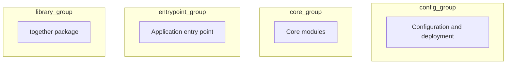

# Architecture report: 1995parham/github-do-not-ban-us

> Automated static analysis. **Observed** = directly seen in files/imports/AST; **Inferred** = interpretation from that evidence. Repository code was not executed.

## 1. Repository at a glance

| Item | Value |
| --- | --- |
| Repository | 1995parham/github-do-not-ban-us |
| Description | GitHub do not ban us from open source world :iran: |
| Language | JavaScript |
| Stars | 11736 |
| Licence | Not detected |
| Analysed commit / branch | 547329f72f8a691524623ea5d64d7996693ccab2 / master |
| Framework(s) | None detected |
| Files analysed | 800 |
| Components | 4 |

## 2. Architecture in one minute

1995parham/github-do-not-ban-us - GitHub do not ban us from open source world :iran:. This repository was analysed statically from 800 file(s) (110 Python). Detected technologies (observed from imports/manifests): Docker Compose. Files are grouped into 4 component(s): Configuration and deployment, Core modules, Application entry point, together package. Observed entry point(s): together/CarvellScott/__main__.py, together/JalanJiang/man.py, together/MarcoBuster/broadcast.py. Findings below distinguish observed facts from inferred interpretation.

## 3. High-level block diagram

## 4. Main components

### Configuration and deployment (`config`)

- **Kind:** config
- **Status:** Observed
- **Confidence:** 0.85
- **Responsibility:** Groups 5 file(s) under configuration and deployment (observed from repository paths and static analysis).
- **Paths:** `supporters.json`, `together/TheDevMinerTV/package.json`, `together/hadi77ir/github-for-everyone/assets/syslinux/syslinux.cfg`, `together/nomis6432/Cargo.toml`, `together/poyaz/docker-compose.yml`
- **Evidence:** [supporters.json](https://github.com/1995parham/github-do-not-ban-us/blob/547329f72f8a691524623ea5d64d7996693ccab2/supporters.json); [together/TheDevMinerTV/package.json](https://github.com/1995parham/github-do-not-ban-us/blob/547329f72f8a691524623ea5d64d7996693ccab2/together/TheDevMinerTV/package.json); [together/hadi77ir/github-for-everyone/assets/syslinux/syslinux.cfg](https://github.com/1995parham/github-do-not-ban-us/blob/547329f72f8a691524623ea5d64d7996693ccab2/together/hadi77ir/github-for-everyone/assets/syslinux/syslinux.cfg); [together/nomis6432/Cargo.toml](https://github.com/1995parham/github-do-not-ban-us/blob/547329f72f8a691524623ea5d64d7996693ccab2/together/nomis6432/Cargo.toml); [together/poyaz/docker-compose.yml](https://github.com/1995parham/github-do-not-ban-us/blob/547329f72f8a691524623ea5d64d7996693ccab2/together/poyaz/docker-compose.yml)

### Core modules (`core`)

- **Kind:** core
- **Status:** Observed
- **Confidence:** 0.85
- **Responsibility:** Groups 1 file(s) under core modules (observed from repository paths and static analysis).
- **Paths:** `sort.js`
- **Evidence:** [sort.js](https://github.com/1995parham/github-do-not-ban-us/blob/547329f72f8a691524623ea5d64d7996693ccab2/sort.js)

### Application entry point (`entrypoint`)

- **Kind:** entrypoint
- **Status:** Observed
- **Confidence:** 0.85
- **Responsibility:** Groups 50 file(s) under application entry point (observed from repository paths and static analysis). Observed top-level functions: any_message, main.
- **Paths:** `together/CarvellScott/__main__.py`, `together/Cygra/main.py`, `together/ItsWajdy/main.py`, `together/JalanJiang/man.py`, `together/KTachibanaM/main.py`, `together/M-Ahadi/main.py`, `together/MarcoBuster/broadcast.py`, `together/MassimoPerini/__main__.py`, `together/Milad/main.py`, `together/MomeniErfan/main.py`, `together/Muhammadyusuf96/main.py`, `together/PyBagheri/main.py`, `together/Rahmanism/main.py`, `together/Roseau/main.py`, `together/Stevelex-elex/main.py`, `together/Tavallaie_Ali/main.py`, `together/YHYJ/support.py`, `together/aliir74/main.py`, `together/alipiry/main.py`, `together/alirezazolanvari/main.py`, `together/amir-yaghoobi/main.py`, `together/amirhoseinaliakbarian/main.py`, `together/bitianist/main.py`, `together/ceiphr/main.py`, `together/codemouse92/message.py`, `together/csprance/github-is-for-everyone.py`, `together/cuamckuu/main.py`, `together/ehsana94/main.py`, `together/erhan/main.py`, `together/gilbertohasnofb/GitHub-is-for-everyone.py`, `together/gkhan496/main.py`, `together/haideralipunjabi/main.py`, `together/hamidrezakp/main.py`, `together/hamids-github/main.py`, `together/ibtehaz-shawon/main.py`, `together/ilteriskeskin/main.py`, `together/jwflory/main.py`, `together/kittinan/main.py`, `together/lazerzes/main.py`, `together/mahuton/main.py`, `together/maoschanz/main.py`, `together/mhmdsmdi/main.py`, `together/mohakhalili71/main.py`, `together/mojdehkarbalaee/main.py`, `together/mostafaasadi/main.py`, `together/mrhalix/main.py`, `together/p208p2002/main.py`, `together/parhambz/main.py`, `together/po_oya/stop_unfair_sanctions.py`, `together/rezanoon/main.py`
- **Evidence:** [together/CarvellScott/__main__.py:3](https://github.com/1995parham/github-do-not-ban-us/blob/547329f72f8a691524623ea5d64d7996693ccab2/together/CarvellScott/__main__.py#L3); [together/Cygra/main.py](https://github.com/1995parham/github-do-not-ban-us/blob/547329f72f8a691524623ea5d64d7996693ccab2/together/Cygra/main.py); [together/ItsWajdy/main.py](https://github.com/1995parham/github-do-not-ban-us/blob/547329f72f8a691524623ea5d64d7996693ccab2/together/ItsWajdy/main.py); [together/JalanJiang/man.py:1](https://github.com/1995parham/github-do-not-ban-us/blob/547329f72f8a691524623ea5d64d7996693ccab2/together/JalanJiang/man.py#L1); [together/KTachibanaM/main.py](https://github.com/1995parham/github-do-not-ban-us/blob/547329f72f8a691524623ea5d64d7996693ccab2/together/KTachibanaM/main.py); [together/M-Ahadi/main.py](https://github.com/1995parham/github-do-not-ban-us/blob/547329f72f8a691524623ea5d64d7996693ccab2/together/M-Ahadi/main.py); [together/MarcoBuster/broadcast.py:7](https://github.com/1995parham/github-do-not-ban-us/blob/547329f72f8a691524623ea5d64d7996693ccab2/together/MarcoBuster/broadcast.py#L7); [together/MassimoPerini/__main__.py](https://github.com/1995parham/github-do-not-ban-us/blob/547329f72f8a691524623ea5d64d7996693ccab2/together/MassimoPerini/__main__.py)

### together package (`together`)

- **Kind:** library
- **Status:** Observed
- **Confidence:** 0.85
- **Responsibility:** Groups 505 file(s) under together package (observed from repository paths and static analysis). Observed top-level classes: Color. Observed top-level functions: cprint.
- **Paths:** `together/0x01h/0x01h.py`, `together/10ngui/index.js`, `together/1995parham/main.go`, `together/3imed-jaberi/main.js`, `together/404cn/github_for_everyone.go`, `together/4lisalehi/main.rs`, `together/7min from IRAN.cs`, `together/7min/7min from IRAN.cs`, `together/7min/Github is for Everyone.cs`, `together/8lueMeth/Main.java`, `together/AHassanabadi_Support.cs`, `together/AMK/Github.java`, `together/AbdolrezaT/abdolrezat.py`, `together/AbdullrahmanAlzeidi/main.cpp`, `together/Abhinaw-Singh/main.js`, `together/AdnanBabakan/main.js`, `together/AidenWallis/github.go`, `together/Ako/support.php`, `together/Alexmitter/for-my-iranian-friends.sh`, `together/AliHaydari/Program.cs`, `together/AliOsm/support.rb`, `together/AliRezaMoradi/github4everyone.cpp`, `together/AliTabatabaeiAT/index.js`, `together/Amirfeqhi/githubForEveryOne.js`, `together/Applicafroguy/support.ts`, `together/BaRRaKudaRain/Program.cs`, `together/BabakBushehr/main.go`, `together/BaseMax/main.c`, `together/BlackHole1/index.js`, `together/BrunoBM16/main.cpp`, `together/CSSunYifeng/Genkidama.py`, `together/CSaratakij/Main.cs`, `together/Carey6918/main.go`, `together/Cerus/together.java`, `together/Codesman/main.java`, `together/Cygra/index.js`, `together/DGKSK8LIFE/index.js`, `together/DaeeHamid/GithubController.php`, `together/Danct12/github-is-for-everyone.sh`, `together/Daniel_Lalasa/index.js`, `together/DidhacK/index.ts`, `together/DimaQiu/support.py`, `together/DiniMad/Program.cs`, `together/Dj0nny/support.ts`, `together/Dkamps18/github.php`, `together/Donghoon759/support.js`, `together/Drichao/Protect.ts`, `together/Dry8r3aD/main.c`, `together/EliasAHH/together.js`, `together/EmilianoJaimes/githubIsForEveryOne.js`, `together/EndureBlaze/GitHubIsForEveryone.java`, `together/Erfan-Ahmadi/main.cpp`, `together/FarzamAmirsalehi.py`, `together/Foxy/freedom.c`, `together/Foxy/freedom.cpp`, `together/Foxy/freedom.go`, `together/Foxy/freedom.java`, `together/Foxy/freedom.js`, `together/Foxy/freedom.php`, `together/Foxy/freedom.py`, `together/Foxy/freedom.rs`, `together/Foxy/freedom.sh`, `together/GameO7er/main.go`, `together/Garamda.py`, `together/GhalamborM/main.js`, `together/Gusted/stopthis.py`, `together/HKalbasi/main.js`, `together/Hajitsu/hajitsu.js`, `together/Hakerh400/together.js`, `together/Hamed_Motallebi/main.js`, `together/HamidNE/main.js`, `together/HannesOberreiter/forevertogether.php`, `together/Hanul/GitHubIsForEveryone.js`, `together/HiddenKn/GithubIsForEveryone.php`, `together/HirbodBehnam/Github.sh`, `together/HosseinJ30/main.js`, `together/HouariZegai/Main.java`, `together/ImanX/GithubMustBeAFree Platform.cs`, `together/ImedAdel/ghifeo.js`, `together/InlineHarper/InlineHarper.cs`, `together/Jachdich/main.java`, `together/JalanJiang/index.js`, `together/JalanJiang/index.php`, `together/JalanJiang/main.go`, `together/JalanJiang/main.sh`, `together/JavaCafe01/Together.java`, `together/JeanMatias/supports.py`, `together/Jinzulen/OSS_IS_FOR_EVERYONE.rs`, `together/Jukoo/its_FOOS.sh`, `together/KL13NT 🇪🇬/together.js`, `together/KRedCell/KRedCell.py`, `together/Kruhlmann/main.js`, `together/LiamKenneth/Together.cs`, `together/Lpmvb/index.ts`, `together/LucasHaddad/githubForEveryone.sh`, `together/MAChitgarha/github-is-for-everyone.php`, `together/MAzarbad/GithubForEveryone.c`, `together/MJFalahi/main.cpp`, `together/MSadeghzadehG/F...ThisShit.sh`, `together/MadStarling/support.py`, `together/Mahdi Salmanzadeh/GitHubIsForEveryOne.cpp`, `together/MahdiGhiasi/together.sh`, `together/MahdiMajidzadeh/php.php`, `together/MarioBinder/Program.cs`, `together/MartinKral/index.php`, `together/MartinX3/main.java`, `together/MatteoPieroni/index.js`, `together/MehdiSoltani/index.php`, `together/MehdiZarei/ByeWorld.py`, `together/Mehrnoush504/main.cpp`, `together/Memitaru/index.js`, `together/Meuss/script.js`, `together/MiladGanjAli/index.php`, `together/Minabsapi/GitHub_is_for_everyone.java`, `together/MohammadRN/index.js`, `together/MohammadSalek/github_for_all.py`, `together/Mohammaddvi/MainActivity.java`, `together/Mohsen/StopDiscriminationGithub.js`, `together/Mozar10/GithubIsForEveryone.java`, `together/MrApr/test.php`, `together/MrM21632/main.c`, `together/Mrloder/Main.java`, `together/Mustapha Limam/message.js`, `together/Nauss/main.js`, `together/Proximyst/proximyst.js`, `together/RMDsection8.py`, `together/Ragty/Ragty.java`, `together/Raika/main.cs`, `together/Raincode/main.cpp`, `together/Rebwar/Program.cs`, `together/RezaBayat/Main.java`, `together/RezaRamezanpour/nuclear.js`, `together/RezaT1994/github.php`, `together/RuChernChong/main.js`, `together/SaeedSpate/GitHubIsForEveryone.cs`, `together/SepidehAbadpour/main.cpp`, `together/ShahinSorkh/index.js`, `together/ShahinSorkh/index.php`, `together/Sheerley/together.go`, `together/SilenceHS/support.py`, `together/Sleepingwaly/index.php`, `together/SnailMann/free.py`, `together/TheDevMinerTV/index.js`, `together/TheErfan/Program.cs`, `together/TravnikovRN/no_borders_for_open-source.js`, `together/Usama-Tahir/index.js`, `together/UsmanPk/GithubForEveryOne.java`, `together/Vloz/main.js`, `together/Webbiii/index.php`, `together/Weikai-Tang/main.java`, `together/WenlongLiu/main.java`, `together/YHYJ/main.go`, `together/YHYJ/main.rs`, `together/YHYJ/my.sh`, `together/YoshiTheChinchilla/main.rs`, `together/YumaTheCompanion/main.cpp`, `together/Zoha/githubForEveryone.js`, `together/Zoranner/githubForEveryone.cs`, `together/a-c-sreedhar-reddy/support.js`, `together/a764934018/main.cpp`, `together/abhijithqb/support.js`, `together/abnud1/message.jsx`, `together/abougouffa/main.c`, `together/abperni/gitforall.c`, `together/adam.cs`, `together/afsharm/Program.cs`, `together/afsharm/obj/Debug/netcoreapp2.2/GitHubIsForEveryone.AssemblyInfo.cs`, `together/ahmadasjad/githubforeveryone.php`, `together/ahmadrezash/ahmad.py`, `together/ahmadsalimi/GithubForEveryone.java`, `together/ainar-g/main.c`, `together/ajithkumarsekar/github.sh`, `together/akhilome/support.go`, `together/akhilome/support_test.go`, `together/alencarlucas/brazil.js`, `together/algope/githubForEveryone.c`, `together/ali-joghataei/Program.cs`, `together/ali77gh/Main.java`, `together/alibakhtiar/main.c`, `together/alibakhtiar/main.cpp`, `together/alibakhtiar/main.php`, `together/alipirpiran/index.js`, `together/alipiry/main.c`, `together/alipiry/main.cpp`, `together/alipiry/main.js`, `together/alipiry/main.ts`, `together/aliprogrammer69/Program.cs`, `together/aliraza7926/c++.cpp`, `together/aliraza7926/python.py`, `together/alireza1219/main.c`, `together/alirezanet/ReadThis.cs`, `together/alirzasahb/github-do-not-ban-us/github-do-not-ban-us/Program.cs`, `together/alisharifi2000/alisharifi2000.py`, `together/allen3039/index.js`, `together/amiceli/main.php`, `together/aminrashidbeigi/main.c`, `together/aminyazdanpanah/GithubIsForEveryone.php`, `together/amir.naderi93/free_github.js`, `together/amir9480/index.php`, `together/amirc901/GitHub is for everyone.java`, `together/amirc901/GitHub is for everyone.js`, `together/amirgi73/github.py`, `together/amirmasud/app.js`, `together/amirshnll/index.php`, `together/amiteshore/main.cpp`, `together/andy-shi88/main.go`, `together/angusmglfraser/GithubIsForEveryone.java`, `together/arctair/index.js`, `together/arctair/script.py`, `together/arctair/script.sh`, `together/arefhosseini/Main.java`, `together/argraur/github-do-not-ban-us.cpp`, `together/arman92/main.go`, `together/arminkz/ruby.rb`, `together/arminmon/main.js`, `together/arnojin.cs`, `together/arthurrochat/github4Everyone.js`, `together/aseemrb/main.sh`, `together/ashfahan/main.cpp`, `together/ashokpoudelap/index.php`, `together/awais-vteams/index.php`, `together/axelrindle/Main.java`, `together/axelrindle/run.sh`, `together/ay2306/ayush.cpp`, `together/babakks/main.js`, `together/bary822/github_is_for_everyone.rb`, `together/barzin144/index.js`, `together/baumannzone/index.js`, `together/benjaminrsherman/together.rs`, `together/berkandirim/index.js`, `together/bishoymelek/index.js`, `together/bkdev98/support-from-vietnam.js`, `together/blackchen/gitHubisForEveryone.sh`, `together/blacksrc/index.js`, `together/blacksrc/index.php`, `together/blacksrc/index.sh`, `together/blogwy/app.js`, `together/boshrahi/gitHubisForEveryone.py`, `together/brainOut/main.php`, `together/brennengreen/GitHubForEveryone.py`, `together/brightening-eyes/do_not_ban_us.c`, `together/brightening-eyes/do_not_ban_us.cpp`, `together/brightening-eyes/do_not_ban_us.php`, `together/brightening-eyes/do_not_ban_us.py`, `together/bruh.py`, `together/brydon/brydon.py`, `together/c0rv07/by.py`, `together/canburaks/world-wide-web.py`, `together/carvalholeo/main.php`, `together/ccxex29/together.c`, `together/ccxex29/together.java`, `together/ccxex29/together.js`, `together/ccxex29/together.py`, `together/ccxex29/together.sh`, `together/ceiphr/index.js`, `together/ceiphr/index.php`, `together/ceiphr/main.java`, `together/chadidi/index.php`, `together/chaharshivam/chaharshivam.cpp`, `together/changjoo-park/main.rb`, `together/channprj/main.go`, `together/charjac/index.ts`, `together/charjac/main.rs`, `together/chiefmb/Free_GitHub.cpp`, `together/chrisx8/message.c`, `together/chrisx8/message.java`, `together/chrisx8/message.js`, `together/chrisx8/message.php`, `together/chrisx8/message.py`, `together/coderkoala/StopThisMadness.cpp`, `together/cosminnechifor/cosmin.py`, `together/cuongw/together.ts`, `together/danielcaldas/github.for.everyone.js`, `together/dannypage/together.rb`, `together/danog/broadcast.php`, `together/danyhm/danyhm.java`, `together/dbisdorf/everyone.py`, `together/deadblackclover/main.rs`, `together/dehghani-mehdi/index.js`, `together/dermohamad/index.ts`, `together/di3goCS/support.c`, `together/dohq/main.go`, `together/donnellan0007/github.py`, `together/droidada/index.js`, `together/edbedbe/together.py`, `together/edgaramirbekian 🇦🇲/donotban.sh`, `together/eghlima/github_for_everyone.py`, `together/ehsansouri23/Main.go`, `together/eigenfoo/message.sh`, `together/el7cosmos/index.php`, `together/elanlb/main.cpp`, `together/electrocoder/github_is_for_everyone.py`, `together/elika/free.js`, `together/emli/free.js`, `together/erayaydin/main.php`, `together/erfan-gh/main.cpp`, `together/erfannf2.js`, `together/erfanr/github-foreveryone.js`, `together/erfanr/github-foreveryone.php`, `together/erfanr/github-foreveryone.py`, `together/excellent-liutong/LT.py`, `together/expandboard/index.js`, `together/extending/main.js`, `together/eyenx/githubfueralli.py`, `together/eziy/github-is-for-everyone.c`, `together/eziy/github-is-for-everyone.js`, `together/f-person/main.go`, `together/faryar76/index.php`, `together/farzinghanbari/main.c`, `together/fdellwing/together.sh`, `together/fengzikaisa/main.js`, `together/finish8/Github is for everyone.js`, `together/firateski/Program.cs`, `together/firefanda/github-for-eyeryone.ts`, `together/flwc/foreveryone.js`, `together/fransafu/main.go`, `together/fridzema/index.js`, `together/fureweb/index.vue`, `together/fzsdi/GitHubIsForEveryone.java`, `together/gabrielpetry/index.php`, `together/gate3/github-for-all.js`, `together/gauravagarwal2704/github_for_all.js`, `together/geminate/index.js`, `together/gerbi/gerbi.go`, `together/ghost1372/Program.cs`, `together/gionuno/dontbanus.cpp`, `together/gn Fur/GithubIsForEveryfoxe.cs`, `together/gokhanettin/main.c`, `together/gonearewe/Github is for everyone.go`, `together/guganems/together.php`, `together/gunhoflash/githubForEveryone.js`, `together/guytzhak/oivavoi.php`, `together/gvko/support.go`, `together/gvko/support.js`, `together/hacker0limbo/index.js`, `together/hadi77ir/github-for-everyone/main.c`, `together/hamdarsi/free-software.sh`, `together/hamidosouli/main.js`, `together/hamiiiiiiid/index.js`, `together/hamyarwoo/index.php`, `together/hanagantig/githubForEveryOne.py`, `together/hello-ajayrawat/index.js`, `together/hemangandhi/everyone.rs`, `together/hesamkaveh/main.js`, `together/hifeamin/Program.cs`, `together/himself65/main.js`, `together/husseinhj/main.cs`, `together/husseinhj/main.java`, `together/iPolyomino/main.rs`, `together/igorp/Program.cs`, `together/ilsko/main.rs`, `together/imachug/main.c`, `together/imanilchaudhari/index.php`, `together/impeiran/together.js`, `together/inquis1t0r/سلام دنیا.cs`, `together/intelligide/main.cpp`, `together/irsama/index.php`, `together/jackkamm/github4everyone.py`, `together/jaffog/message.php`, `together/jamesyangget/main.go`, `together/jangholi/main.js`, `together/janmarkuslanger/open_source_for_everyone.py`, `together/javastation/main.js`, `together/jeromegamez/together.php`, `together/jeyem/main.go`, `together/jgierer12/index.ts`, `together/jjavierdguezas/github_for_everyone.py`, `together/jmonson/solidarity.js`, `together/johnlamontagne/solidarity.cpp`, `together/joway/main.sh`, `together/joxcat/main.go`, `together/joxcat/main.rb`, `together/joxcat/main.rs`, `together/jpita/main.go`, `together/jspuij/Program.cs`, `together/julianooi/main.go`, `together/junbo1991/main.cpp`, `together/jyrno42.py`, `together/kam2yar/index.php`, `together/kataras/together.go`, `together/kepa4/support.js`, `together/kerastinell/githubisforeveryone.java11.sh`, `together/khaqani/index.js`, `together/khashayarghamati/main.cpp`, `together/kirsch.py`, `together/kittenking/together.js`, `together/krmbzds/unroll.rb`, `together/kssioalmeida/index.js`, `together/ku8ar/index.js`, `together/kunjsharma/support.js`, `together/kyawzintun/index.js`, `together/kytwb/index.rs`, `together/l2ig/index.js`, `together/lalosh/message.js`, `together/lichangwei/index.ts`, `together/limaleandro1999/message.js`, `together/llaravell/llaravell.js`, `together/llaravell/llaravell.php`, `together/llaravell/llaravell.py`, `together/lokimonoton/index.php`, `together/lordmulder/GitHub_is_for_everyone.cpp`, `together/lovesora/support.js`, `together/lucasnaja/index.js`, `together/luizmacfilho/index.js`, `together/lukmi15/github_is_for_everyone.cpp`, `together/m-ahmadi/index.js`, `together/m-nemati/GitHub is for everyone.py`, `together/maacpiash/Program.cs`, `together/madiodio/index.js`, `together/mahdinba97/ban_the_banning__.py`, `together/main.cpp`, `together/main.rs`, `together/mariamarab/main.cpp`, `together/marsvet/main.c`, `together/mateusgabi/index.js`, `together/mathieutu/index.ts`, `together/meSingh/index.php`, `together/mehmetakifalp/support.js`, `together/mehradsadeghi/main.php`, `together/mehran75/together.py`, `together/mfaghfoory/main.js`, `together/mgabor6/index.js`, `together/mhf-ir/main.php`, `together/mhf-ir/main.rs`, `together/mhf-ir/main.sh`, `together/mhf-ir/main.ts`, `together/mhtb32/main.c`, `together/miladbarazandeh/index.php`, `together/mindaugasw/main.php`, `together/mirismaili/main.ts`, `together/mishaor/main.js`, `together/mjnaderi/github_is_for_everyone.py`, `together/mjnaderi/github_is_for_everyone.sh`, `together/mohalisad/main.cpp`, `together/mohamedanees/support.java`, `together/mohammad425/main.php`, `together/mohmehdi/Program.cs`, `together/molaeiali/main.rb`, `together/monomarh/index.php`, `together/mortezakarimi/freeGithub.js`, `together/mosi-kha/py.py`, `together/mostafatech/index.js`, `together/mrtarkhan/githubforeveryone.cs`, `together/muhammadyaseen/myaseen.py`, `together/mvakili/together.js`, `together/mwpower/no_ban.sh`, `together/mycodebox/main.go`, `together/nafidurmus/ruby.rb`, `together/naltun/github-is-for-everyone.sh`, `together/nashaofu/main.go`, `together/nataliedeweerd/index.php`, `together/natnij/github4everyone.py`, `together/nekofar/milad.sh`, `together/netapau/githubIsForEveryone.go`, `together/netapau/main.go`, `together/netapau/main_test.go`, `together/nglgzz/main.sh`, `together/nikandlv/index.jsx`, `together/nikp123/support.sh`, `together/nimahkh/freeSoftwares.js`, `together/ninsy/support.js`, `together/nitrohorse/index.js`, `together/nnourani/main.js`, `together/nomis6432/src/main.rs`, `together/novid/github.c`, `together/novid/github.cpp`, `together/novid/github.cs`, `together/novid/github.go`, `together/novid/github.java`, `together/novid/github.js`, `together/novid/github.php`, `together/novid/github.py`, `together/novid/github.rb`, `together/novid/github.rs`, `together/novid/github.sh`, `together/nozkok/index.php`, `together/ondrej23/statement.rb`, `together/paul-15/paul-15.py`, `together/pedroroutaboul/github.py`, `together/pennbauman/together.sh`, `together/peric/main.go`, `together/pesehr/index.js`, `together/pexcn/main.c`, `together/piyush97/message.js`, `together/plainnany/main.sh`, `together/pouyajoon/index.js`, `together/poyynt/githubforeveryone.c`, `together/poyynt/githubforeveryone.cpp`, `together/poyynt/githubforeveryone.java`, `together/poyynt/githubforeveryone.py`, `together/poyynt/githubforeveryone.rb`, `together/pplanel/support.go`, `together/praveen-me/together.js`, `together/pussio/together.go`, `together/qirh/everyone.sh`, `together/rajabiseraji/index.js`, `together/ramezanpour/main.cpp`, `together/ravi-sharma/index.php`, `together/rezaaghajani/script.py`, `together/rezakakhki/main.cpp`, `together/ri7nz/index.js`, `together/rjcortese/foreveryone.py`, `together/rohitjoshi21/name.py`, `together/rohzek/Program.cs`, `together/rotchajunior/app.js`
- **Evidence:** [together/0x01h/0x01h.py](https://github.com/1995parham/github-do-not-ban-us/blob/547329f72f8a691524623ea5d64d7996693ccab2/together/0x01h/0x01h.py); [together/10ngui/index.js](https://github.com/1995parham/github-do-not-ban-us/blob/547329f72f8a691524623ea5d64d7996693ccab2/together/10ngui/index.js); [together/1995parham/main.go](https://github.com/1995parham/github-do-not-ban-us/blob/547329f72f8a691524623ea5d64d7996693ccab2/together/1995parham/main.go); [together/3imed-jaberi/main.js](https://github.com/1995parham/github-do-not-ban-us/blob/547329f72f8a691524623ea5d64d7996693ccab2/together/3imed-jaberi/main.js); [together/404cn/github_for_everyone.go](https://github.com/1995parham/github-do-not-ban-us/blob/547329f72f8a691524623ea5d64d7996693ccab2/together/404cn/github_for_everyone.go); [together/4lisalehi/main.rs](https://github.com/1995parham/github-do-not-ban-us/blob/547329f72f8a691524623ea5d64d7996693ccab2/together/4lisalehi/main.rs); [together/7min from IRAN.cs](https://github.com/1995parham/github-do-not-ban-us/blob/547329f72f8a691524623ea5d64d7996693ccab2/together/7min%20from%20IRAN.cs); [together/7min/7min from IRAN.cs](https://github.com/1995parham/github-do-not-ban-us/blob/547329f72f8a691524623ea5d64d7996693ccab2/together/7min/7min%20from%20IRAN.cs)

## 5. Execution flow

**Observed** entry point(s):

- [together/10ngui/index.js](https://github.com/1995parham/github-do-not-ban-us/blob/547329f72f8a691524623ea5d64d7996693ccab2/together/10ngui/index.js)
- [together/CarvellScott/__main__.py:7](https://github.com/1995parham/github-do-not-ban-us/blob/547329f72f8a691524623ea5d64d7996693ccab2/together/CarvellScott/__main__.py#L7)
- [together/JalanJiang/man.py:4](https://github.com/1995parham/github-do-not-ban-us/blob/547329f72f8a691524623ea5d64d7996693ccab2/together/JalanJiang/man.py#L4)
- [together/MarcoBuster/broadcast.py:11](https://github.com/1995parham/github-do-not-ban-us/blob/547329f72f8a691524623ea5d64d7996693ccab2/together/MarcoBuster/broadcast.py#L11)
- [together/Rahmanism/main.py:7](https://github.com/1995parham/github-do-not-ban-us/blob/547329f72f8a691524623ea5d64d7996693ccab2/together/Rahmanism/main.py#L7)
- [together/TheDevMinerTV/index.js](https://github.com/1995parham/github-do-not-ban-us/blob/547329f72f8a691524623ea5d64d7996693ccab2/together/TheDevMinerTV/index.js)
- [together/YHYJ/support.py:5](https://github.com/1995parham/github-do-not-ban-us/blob/547329f72f8a691524623ea5d64d7996693ccab2/together/YHYJ/support.py#L5)
- [together/codemouse92/message.py:1](https://github.com/1995parham/github-do-not-ban-us/blob/547329f72f8a691524623ea5d64d7996693ccab2/together/codemouse92/message.py#L1)
- [together/csprance/github-is-for-everyone.py:4](https://github.com/1995parham/github-do-not-ban-us/blob/547329f72f8a691524623ea5d64d7996693ccab2/together/csprance/github-is-for-everyone.py#L4)
- [together/gilbertohasnofb/GitHub-is-for-everyone.py:4](https://github.com/1995parham/github-do-not-ban-us/blob/547329f72f8a691524623ea5d64d7996693ccab2/together/gilbertohasnofb/GitHub-is-for-everyone.py#L4)
- [together/mostafaasadi/main.py:8](https://github.com/1995parham/github-do-not-ban-us/blob/547329f72f8a691524623ea5d64d7996693ccab2/together/mostafaasadi/main.py#L8)
- [together/po_oya/stop_unfair_sanctions.py:4](https://github.com/1995parham/github-do-not-ban-us/blob/547329f72f8a691524623ea5d64d7996693ccab2/together/po_oya/stop_unfair_sanctions.py#L4)

Representative flow (derived from observed entry points and the import graph; steps beyond the entry point are **Inferred**):

1. Execution starts at an observed entry point listed above, if present.
2. No internal import relationships between components were observed.

## 6. Project structure

### `(root)`

- `.drone.yml` - config (138 bytes)
- `.gitignore` - other (2205 bytes)
- `README-AR.md` - docs (9167 bytes)
- `README-CN.md` - docs (7155 bytes)
- `README-DE.md` - docs (5740 bytes)
- `README-ES.md` - docs (11310 bytes)
- `README-FR.md` - docs (5501 bytes)
- `README-GR.md` - docs (7285 bytes)
- `README-HY.md` - docs (7854 bytes)
- `README-IT.md` - docs (5261 bytes)
- `README-JA.md` - docs (6465 bytes)
- `README-KO.md` - docs (9149 bytes)
- `README-NL.md` - docs (9571 bytes)
- `README-NP.md` - docs (12658 bytes)
- `README-PER.md` - docs (9588 bytes)
- `README-PT-BR.md` - docs (7677 bytes)
- `README-RU.md` - docs (7197 bytes)
- `README-SR.md` - docs (8305 bytes)
- `README-TR.md` - docs (7588 bytes)
- `README-TW.md` - docs (4876 bytes)
- `README.md` - docs (73866 bytes)
- `sort.js` - source, JavaScript (834 bytes)
- `supporters.json` - config (49449 bytes)

### `together`

- `together/0x01h/0x01h.py` - source, Python (30 bytes)
- `together/0xc0d3d00d/main.bf` - other (253 bytes)
- `together/10ngui/index.js` - source, JavaScript (38 bytes)
- `together/1995parham/main.go` - source, Go (83 bytes)
- `together/3imed-jaberi/main.js` - source, JavaScript (512 bytes)
- `together/404cn/github_for_everyone.go` - source, Go (89 bytes)
- `together/4lisalehi/main.rs` - source, Rust (56 bytes)
- `together/7min from IRAN.cs` - source, C# (493 bytes)
- `together/7min/7min from IRAN.cs` - source, C# (493 bytes)
- `together/7min/Github is for Everyone.cs` - source, C# (493 bytes)
- `together/8lueMeth/Main.java` - source, Java (163 bytes)
- `together/AHassanabadi_Support.cs` - source, C# (366 bytes)
- `together/AMK/Github.java` - source, Java (217 bytes)
- `together/AbdElmomen-Kadhim` - other (38 bytes)
- `together/AbdolrezaT/abdolrezat.py` - source, Python (43 bytes)
- `together/AbdullrahmanAlzeidi/main.cpp` - source, C++ (104 bytes)
- `together/Abhinaw-Singh/main.js` - source, JavaScript (39 bytes)
- `together/Ademking/gdnbu.dart` - other (82 bytes)
- `together/AdnanBabakan/main.js` - source, JavaScript (39 bytes)
- `together/AhmedNourJamalElDin` - other (31 bytes)
- `together/AidenWallis/github.go` - source, Go (114 bytes)
- `together/Ako/support.php` - source, PHP (178 bytes)
- `together/Alexmitter/for-my-iranian-friends.sh` - source, Shell (190 bytes)
- `together/Alexsays/main.v` - other (34 bytes)
- `together/AliHaydari/Program.cs` - source, C# (188 bytes)
- `together/AliOsm/support.rb` - source, Ruby (32 bytes)
- `together/AliRezaMoradi/github4everyone.cpp` - source, C++ (101 bytes)
- `together/AliTabatabaeiAT/index.js` - source, JavaScript (39 bytes)
- `together/Amirfeqhi/githubForEveryOne.js` - source, JavaScript (39 bytes)
- `together/Applicafroguy/support.ts` - source, TypeScript (38 bytes)
- `together/AtakanErmis/githubForEveryone.asm` - other (189 bytes)
- `together/BaRRaKudaRain/Program.cs` - source, C# (173 bytes)
- `together/BabakBushehr/main.go` - source, Go (83 bytes)
- `together/BaseMax/main.c` - source, C (143 bytes)
- `together/BelegCuthalion/free.hs` - other (60 bytes)
- `together/BlackHole1/index.js` - source, JavaScript (38 bytes)
- `together/BrunoBM16/main.cpp` - source, C++ (107 bytes)
- `together/CSSunYifeng/Genkidama.py` - source, Python (33 bytes)
- `together/CSaratakij/Main.cs` - source, C# (205 bytes)
- `together/CaddyDz/freedom.d` - other (72 bytes)
- `together/Carey6918/main.go` - source, Go (83 bytes)
- `together/CarvellScott/__main__.py` - source, Python (111 bytes)
- `together/Cerus/together.emnis` - other (30 bytes)
- `together/Cerus/together.java` - source, Java (130 bytes)
- `together/ChronosX88/together.kt` - other (54 bytes)
- `together/Codesman/main.java` - source, Java (274 bytes)
- `together/CpHaddock/Main.scala` - other (100 bytes)
- `together/Cygra/index.js` - source, JavaScript (39 bytes)
- `together/Cygra/main.dart` - other (51 bytes)
- `together/Cygra/main.py` - source, Python (32 bytes)
- `together/DCtheTall/main.cc` - other (115 bytes)
- `together/DGKSK8LIFE/index.js` - source, JavaScript (59 bytes)
- `together/DOBRO/together.erl` - other (130 bytes)
- `together/DaeeHamid/GithubController.php` - source, PHP (339 bytes)
- `together/Danct12/github-is-for-everyone.sh` - source, Shell (264 bytes)
- `together/Daniel_Lalasa/index.js` - source, JavaScript (249 bytes)
- `together/DarrienG/main.kt` - other (72 bytes)
- `together/DidhacK/index.ts` - source, TypeScript (128 bytes)
- `together/DimaQiu/support.py` - source, Python (32 bytes)
- `together/DiniMad/Program.cs` - source, C# (187 bytes)
- `together/Dj0nny/support.ts` - source, TypeScript (301 bytes)
- `together/Dkamps18/github.php` - source, PHP (43 bytes)
- `together/Donghoon759/support.js` - source, JavaScript (51 bytes)
- `together/Drichao/Protect.ts` - source, TypeScript (330 bytes)
- `together/Dry8r3aD/Makefile` - other (25 bytes)
- `together/Dry8r3aD/main.c` - source, C (154 bytes)
- `together/Dschee/GitHubIsForEveryone.playground/Contents.swift` - other (32 bytes)
- `together/Dschee/GitHubIsForEveryone.playground/contents.xcplayground` - other (165 bytes)
- `together/DuncanSparks/Everyone.bf` - other (832 bytes)
- `together/EliasAHH/together.js` - source, JavaScript (72 bytes)
- `together/Eltrac/support.css` - other (207 bytes)
- `together/EmilianoJaimes/githubIsForEveryOne.js` - source, JavaScript (425 bytes)
- `together/EndureBlaze/GitHubIsForEveryone.java` - source, Java (204 bytes)
- `together/Erfan Mahdavi Support code` - other (118 bytes)
- `together/Erfan-Ahmadi/main.cpp` - source, C++ (92 bytes)
- `together/FarzamAmirsalehi.py` - source, Python (46 bytes)
- `together/Foxy/freedom.R` - other (32 bytes)
- `together/Foxy/freedom.adb` - other (154 bytes)
- `together/Foxy/freedom.bat` - other (28 bytes)
- `together/Foxy/freedom.c` - source, C (93 bytes)
- `together/Foxy/freedom.cpp` - source, C++ (123 bytes)
- `together/Foxy/freedom.erl` - other (201 bytes)
- `together/Foxy/freedom.ex` - other (33 bytes)
- `together/Foxy/freedom.f` - other (26 bytes)
- `together/Foxy/freedom.fs` - other (35 bytes)
- `together/Foxy/freedom.go` - source, Go (83 bytes)
- `together/Foxy/freedom.hs` - other (34 bytes)
- `together/Foxy/freedom.html` - other (156 bytes)
- `together/Foxy/freedom.java` - source, Java (115 bytes)
- `together/Foxy/freedom.js` - source, JavaScript (33 bytes)
- `together/Foxy/freedom.kt` - other (72 bytes)
- `together/Foxy/freedom.ktn` - other (19 bytes)
- `together/Foxy/freedom.lisp` - other (69 bytes)
- `together/Foxy/freedom.lua` - other (32 bytes)
- `together/Foxy/freedom.php` - source, PHP (42 bytes)
- `together/Foxy/freedom.pl` - other (51 bytes)
- `together/Foxy/freedom.py` - source, Python (54 bytes)
- `together/Foxy/freedom.rs` - source, Rust (52 bytes)
- `together/Foxy/freedom.sh` - source, Shell (48 bytes)
- `together/GameO7er/main.go` - source, Go (178 bytes)
- `together/Garamda.py` - source, Python (32 bytes)
- `together/GhalamborM/main.js` - source, JavaScript (39 bytes)
- `together/Groctel/brainfuck` - other (293 bytes)
- `together/Gusted/stopthis.py` - source, Python (146 bytes)
- `together/HKalbasi/main.js` - source, JavaScript (39 bytes)
- `together/Hajitsu/hajitsu.js` - source, JavaScript (39 bytes)
- `together/Hakerh400/together.js` - source, JavaScript (67 bytes)
- `together/HamedHajiloo` - other (1 bytes)
- `together/Hamed_Motallebi/main.js` - source, JavaScript (85 bytes)
- `together/HamidNE/main.js` - source, JavaScript (39 bytes)
- `together/HannesOberreiter/forevertogether.php` - source, PHP (33 bytes)
- `together/Hanul/GitHubIsForEveryone.js` - source, JavaScript (89 bytes)
- `together/Hazuki-san/github4everyone.lua` - other (76 bytes)
- `together/HiddenKn/GithubIsForEveryone.php` - source, PHP (591 bytes)
- `together/HiddenKn/OpenLetterToGithub.md` - docs (248 bytes)
- `together/HirbodBehnam/Github.sh` - source, Shell (30 bytes)
- `together/HosseinJ30/main.js` - source, JavaScript (39 bytes)
- `together/HouariZegai/Main.java` - source, Java (120 bytes)
- `together/ImanX/GithubMustBeAFree Platform.cs` - source, C# (180 bytes)
- `together/ImedAdel/ghifeo.js` - source, JavaScript (76 bytes)
- `together/InlineHarper/InlineHarper.cs` - source, C# (68 bytes)
- `together/ItsWajdy/main.py` - source, Python (32 bytes)
- `together/Jachdich/main.java` - source, Java (156 bytes)
- `together/JalanJiang/index.js` - source, JavaScript (39 bytes)
- `together/JalanJiang/index.php` - source, PHP (44 bytes)
- `together/JalanJiang/main.go` - source, Go (83 bytes)
- `together/JalanJiang/main.sh` - source, Shell (30 bytes)
- `together/JalanJiang/man.py` - source, Python (87 bytes)
- `together/JavaCafe01/Together.java` - source, Java (182 bytes)
- `together/JeanMatias/supports.py` - source, Python (29 bytes)
- `together/Jinzulen/OSS_IS_FOR_EVERYONE.rs` - source, Rust (75 bytes)
- `together/Jukoo/GiFE` - other (2220 bytes)
- `together/Jukoo/its_FOOS.sh` - source, Shell (120 bytes)
- `together/KL13NT 🇪🇬/together.js` - source, JavaScript (42 bytes)
- `together/KRedCell/KRedCell.py` - source, Python (734 bytes)
- `together/KTachibanaM/main.py` - source, Python (31 bytes)
- `together/Kiotlin/express.html` - other (322 bytes)
- `together/Kruhlmann/main.js` - source, JavaScript (40 bytes)
- `together/Kvaibhav01/main.dart` - other (51 bytes)
- `together/LaMentaAzul` - other (66 bytes)
- `together/LiamKenneth/Together.cs` - source, C# (167 bytes)
- `together/Lightning_support` - other (539 bytes)
- `together/Lpmvb/index.ts` - source, TypeScript (39 bytes)
- `together/LucasHaddad/githubForEveryone.sh` - source, Shell (29 bytes)
- `together/M-Ahadi/main.py` - source, Python (33 bytes)
- `together/MAChitgarha/github-is-for-everyone.php` - source, PHP (361 bytes)
- `together/MAzarbad/GithubForEveryone.c` - source, C (200 bytes)
- `together/MJFalahi/main.cpp` - source, C++ (123 bytes)
- `together/MSadeghzadehG/F...ThisShit.sh` - source, Shell (30 bytes)
- `together/MadStarling/support.py` - source, Python (32 bytes)
- `together/Mahdi Salmanzadeh/GitHubIsForEveryOne.cpp` - source, C++ (98 bytes)
- `together/Mahdi171` - other (54 bytes)
- `together/MahdiGhiasi/together.sh` - source, Shell (30 bytes)
- `together/MahdiMajidzadeh/php.php` - source, PHP (40 bytes)
- `together/MarcoBuster/broadcast.py` - source, Python (308 bytes)
- `together/MarioBinder/Program.cs` - source, C# (130 bytes)
- `together/MartinKral/index.php` - source, PHP (39 bytes)
- `together/MartinX3/main.java` - source, Java (222 bytes)
- `together/MassimoPerini/__main__.py` - source, Python (61 bytes)
- `together/MattGeek/main.kt` - other (149 bytes)
- `together/MatteoPieroni/index.js` - source, JavaScript (64 bytes)
- `together/MehdiSoltani/index.php` - source, PHP (46 bytes)
- `together/MehdiZarei/ByeWorld.py` - source, Python (24 bytes)
- `together/Mehrnoush504/main.cpp` - source, C++ (100 bytes)
- `together/Memitaru/index.js` - source, JavaScript (71 bytes)
- `together/Meuss/script.js` - source, JavaScript (38 bytes)
- `together/Milad/main.py` - source, Python (33 bytes)
- `together/MiladGanjAli/index.php` - source, PHP (39 bytes)
- `together/Minabsapi/GitHub_is_for_everyone.java` - source, Java (328 bytes)
- `together/MohammadHashemi` - other (84 bytes)
- `together/MohammadRN/index.js` - source, JavaScript (38 bytes)
- `together/MohammadSalek/github_for_all.py` - source, Python (31 bytes)
- `together/Mohammadcs85` - other (1 bytes)
- `together/Mohammaddvi/MainActivity.java` - source, Java (312 bytes)
- `together/MohmmadHosseinShojaeinia/together.bat` - other (30 bytes)
- `together/Mohsen/StopDiscriminationGithub.js` - source, JavaScript (176 bytes)
- `together/MomeniErfan/main.py` - source, Python (32 bytes)
- `together/Mozar10/GithubIsForEveryone.java` - source, Java (144 bytes)
- `together/MrApr/test.php` - source, PHP (53 bytes)
- `together/MrM21632/main.c` - source, C (75 bytes)
- `together/Mrloder/Main.java` - source, Java (133 bytes)
- `together/Muhammadyusuf96/main.py` - source, Python (49 bytes)
- `together/Mustapha Limam/message.js` - source, JavaScript (50 bytes)
- `together/Nauss/main.js` - source, JavaScript (86 bytes)
- `together/Noisytoot/.gitignore` - other (63 bytes)
- `together/Noisytoot/LICENSE` - docs (1049 bytes)
- `together/Noisytoot/github-is-for-everyone.hs` - other (104 bytes)
- `together/Noisytoot/github-is-for-everyone.p6` - other (52 bytes)
- `together/Proximyst/proximyst.js` - source, JavaScript (28502 bytes)
- `together/PyBagheri/main.py` - source, Python (48 bytes)
- `together/RMDsection8.py` - source, Python (286 bytes)
- `together/Ragty/Ragty.java` - source, Java (150 bytes)
- `together/Rahmanism/main.py` - source, Python (136 bytes)
- `together/Raika/main.cs` - source, C# (195 bytes)
- `together/Raincode/main.cpp` - source, C++ (79 bytes)
- `together/RashadAnsari/Main.scala` - other (66 bytes)
- `together/Rebwar/Program.cs` - source, C# (195 bytes)
- `together/Reganto/reganto.md` - docs (39 bytes)
- `together/RezaBayat/Main.java` - source, Java (240 bytes)
- `together/RezaRamezanpour/nuclear.js` - source, JavaScript (72 bytes)
- `together/RezaT1994/github.php` - source, PHP (37 bytes)
- `together/Roseau/main.py` - source, Python (33 bytes)
- `together/RuChernChong/main.js` - source, JavaScript (40 bytes)
- `together/SaeedSpate/GitHubIsForEveryone.cs` - source, C# (44 bytes)
- `together/SamanFekri/main.r` - other (29 bytes)
- `together/SamiAzar/main.kt` - other (242 bytes)
- `together/SepidehAbadpour/main.cpp` - source, C++ (288 bytes)
- `together/SeyedMortezaKamali` - other (45 bytes)
- `together/ShahinSorkh/index.html` - other (176 bytes)
- `together/ShahinSorkh/index.js` - source, JavaScript (38 bytes)
- `together/ShahinSorkh/index.php` - source, PHP (38 bytes)
- `together/Sheerley/together.go` - source, Go (87 bytes)
- `together/SilenceHS/support.py` - source, Python (105 bytes)
- `together/SimonBaeumer/main.bf` - other (804 bytes)
- `together/Sleepingwaly/index.php` - source, PHP (39 bytes)
- `together/SnailMann/free.py` - source, Python (84 bytes)
- `together/Sogrey/Main.kt` - other (71 bytes)
- `together/Soyaine/style.css` - other (76 bytes)
- `together/Stevelex-elex/main.py` - source, Python (43 bytes)
- `together/StopThis` - other (73 bytes)
- `together/Suliv4n/main.hack` - other (92 bytes)
- `together/Support-from-China` - other (2624 bytes)
- `together/Tavallaie_Ali/main.py` - source, Python (103 bytes)
- `together/TheDevMinerTV/index.js` - source, JavaScript (493 bytes)
- `together/TheDevMinerTV/package.json` - manifest (286 bytes)
- `together/TheErfan/Program.cs` - source, C# (195 bytes)
- `together/TravnikovRN/no_borders_for_open-source.js` - source, JavaScript (76 bytes)
- `together/Unrooted/main.scala` - other (104 bytes)
- `together/Usama-Tahir/index.js` - source, JavaScript (39 bytes)
- `together/UsmanPk/GithubForEveryOne.java` - source, Java (308 bytes)
- `together/Vloz/main.js` - source, JavaScript (76 bytes)
- `together/Webbiii/index.php` - source, PHP (141 bytes)
- `together/Weikai-Tang/main.java` - source, Java (124 bytes)
- `together/WenlongLiu/main.java` - source, Java (91 bytes)
- `together/Xerbo/ForEveryone.asm` - other (449 bytes)
- `together/Xerbo/Makefile` - other (232 bytes)
- `together/YHYJ/main.go` - source, Go (88 bytes)
- `together/YHYJ/main.rs` - source, Rust (54 bytes)
- `together/YHYJ/my.sh` - source, Shell (43 bytes)
- `together/YHYJ/support.py` - source, Python (112 bytes)
- `together/YoshiTheChinchilla/main.rs` - source, Rust (200 bytes)
- `together/YouCii/Main.kt` - other (110 bytes)
- `together/YumaTheCompanion/main.cpp` - source, C++ (2051 bytes)
- `together/Zoha/githubForEveryone.js` - source, JavaScript (44 bytes)
- `together/Zoranner/githubForEveryone.cs` - source, C# (236 bytes)
- `together/a-c-sreedhar-reddy/support.js` - source, JavaScript (38 bytes)
- `together/a-jahanshahlo` - other (14 bytes)
- `together/a764934018/main.cpp` - source, C++ (113 bytes)
- `together/abhijithqb/support.js` - source, JavaScript (39 bytes)
- `together/abnud1/message.jsx` - source, JavaScript (225 bytes)
- `together/abougouffa/main.c` - source, C (92 bytes)
- `together/abperni/gitforall.c` - source, C (69 bytes)
- `together/adam.cs` - source, C# (47 bytes)
- `together/adamyi/README.md` - docs (68 bytes)
- `together/adamyi/github.pokeball` - other (986 bytes)
- `together/adibfara/together.kt` - other (52 bytes)
- `together/afsharm/GitHubIsForEveryone.csproj` - other (170 bytes)
- `together/afsharm/GitHubIsForEveryone.sln` - other (1116 bytes)
- `together/afsharm/Program.cs` - source, C# (199 bytes)
- `together/afsharm/obj/Debug/netcoreapp2.2/GitHubIsForEveryone.AssemblyInfo.cs` - source, C# (1053 bytes)
- `together/afsharm/obj/Debug/netcoreapp2.2/GitHubIsForEveryone.AssemblyInfoInputs.cache` - other (41 bytes)
- `together/afsharm/obj/Debug/netcoreapp2.2/GitHubIsForEveryone.csproj.CoreCompileInputs.cache` - other (41 bytes)
- `together/ahmadasjad/githubforeveryone.php` - source, PHP (38 bytes)
- `together/ahmadrezash/ahmad.html` - other (110 bytes)
- `together/ahmadrezash/ahmad.py` - source, Python (54 bytes)
- `together/ahmadsalimi/GithubForEveryone.java` - source, Java (140 bytes)
- `together/aidinnet` - other (32 bytes)
- `together/ainar-g/main.c` - source, C (466 bytes)
- `together/ainar-g/makefile` - other (211 bytes)
- `together/ajithkumarsekar/github.sh` - source, Shell (30 bytes)
- `together/akhilome/support.go` - source, Go (167 bytes)
- `together/akhilome/support_test.go` - source, Go (247 bytes)
- `together/akinozgen/main.hs` - other (41 bytes)
- `together/alecsisduarte/support_from_mexico.kt` - other (70 bytes)
- `together/alencarlucas/brazil.js` - source, JavaScript (39 bytes)
- `together/algope/githubForEveryone.c` - source, C (91 bytes)
- `together/ali-joghataei/Program.cs` - source, C# (1219 bytes)
- `together/ali77gh/Main.java` - source, Java (170 bytes)
- `together/alibakhtiar/main.c` - source, C (107 bytes)
- `together/alibakhtiar/main.cpp` - source, C++ (128 bytes)
- `together/alibakhtiar/main.php` - source, PHP (56 bytes)
- `together/alifarazz/core.clj` - other (109 bytes)
- `together/aliir74/main.py` - source, Python (32 bytes)
- `together/aliizadi/Main.scala` - other (64 bytes)
- `together/alimpfard/main.ctr` - other (61 bytes)
- `together/alipirpiran/index.js` - source, JavaScript (40 bytes)
- `together/alipiry/main.c` - source, C (130 bytes)
- `together/alipiry/main.cpp` - source, C++ (102 bytes)
- `together/alipiry/main.js` - source, JavaScript (40 bytes)
- `together/alipiry/main.py` - source, Python (57 bytes)
- `together/alipiry/main.ts` - source, TypeScript (40 bytes)
- `together/aliprogrammer69/Program.cs` - source, C# (229 bytes)
- `together/aliraza7926/c++.cpp` - source, C++ (108 bytes)
- `together/aliraza7926/python.py` - source, Python (32 bytes)
- `together/alireza1219/main.c` - source, C (110 bytes)
- `together/alirezanet/ReadThis.cs` - source, C# (292 bytes)
- `together/alirezazolanvari/main.py` - source, Python (58 bytes)
- `together/alirzasahb/github-do-not-ban-us/github-do-not-ban-us.sln` - other (815 bytes)
- `together/alirzasahb/github-do-not-ban-us/github-do-not-ban-us/Program.cs` - source, C# (239 bytes)
- `together/alirzasahb/github-do-not-ban-us/github-do-not-ban-us/github-do-not-ban-us.csproj` - other (242 bytes)
- `together/alisharifi2000/alisharifi2000.py` - source, Python (32 bytes)
- `together/aliyazdi75/main.dart` - other (50 bytes)
- `together/allefsousa/message.kt` - other (70 bytes)
- `together/allen3039/index.js` - source, JavaScript (39 bytes)
- `together/alyakimenko/ghife.cr` - other (32 bytes)
- `together/amazingandyyy/readme.md` - docs (56 bytes)
- `together/amiceli/main.php` - source, PHP (129 bytes)
- `together/aminrashidbeigi/main.c` - source, C (108 bytes)
- `together/aminyazdanpanah/GithubIsForEveryone.php` - source, PHP (37 bytes)
- `together/amir-yaghoobi/main.py` - source, Python (116 bytes)
- `together/amir.naderi93/free_github.js` - source, JavaScript (73 bytes)
- `together/amir9480/index.php` - source, PHP (38 bytes)
- `together/amirc901/GitHub is for everyone.dart` - other (50 bytes)
- `together/amirc901/GitHub is for everyone.java` - source, Java (142 bytes)
- `together/amirc901/GitHub is for everyone.js` - source, JavaScript (32 bytes)
- `together/amirc901/GitHub is for everyone.kt` - other (52 bytes)
- `together/amirgi73/github.py` - source, Python (32 bytes)
- `together/amirhoseinaliakbarian/main.py` - source, Python (39 bytes)
- `together/amirmasud/app.js` - source, JavaScript (39 bytes)
- `together/amirshnll/index.php` - source, PHP (92 bytes)
- `together/amirsojoodi/main.cu` - other (342 bytes)
- `together/amiteshore/main.cpp` - source, C++ (263 bytes)
- `together/amjoshaghani` - other (238 bytes)
- `together/andy-shi88/main.go` - source, Go (84 bytes)
- `together/angusmglfraser/GithubIsForEveryone.java` - source, Java (135 bytes)
- `together/arctair/index.js` - source, JavaScript (59 bytes)
- `together/arctair/main.groovy` - other (56 bytes)
- `together/arctair/script.py` - source, Python (55 bytes)
- `together/arctair/script.sh` - source, Shell (47 bytes)
- `together/arefhosseini/Main.java` - source, Java (270 bytes)
- `together/arefmq.m` - other (122 bytes)
- `together/argraur/github-do-not-ban-us.cpp` - source, C++ (106 bytes)
- `together/arman92/main.go` - source, Go (140 bytes)
- `together/arminkz/ruby.rb` - source, Ruby (31 bytes)
- `together/arminmon/main.js` - source, JavaScript (40 bytes)
- `together/arnojin.cs` - source, C# (239 bytes)
- `together/arthurrochat/github4Everyone.js` - source, JavaScript (44 bytes)
- `together/arya-alireza` - other (1 bytes)
- `together/asarthas/main.m` - other (26 bytes)
- `together/aseemrb/main.sh` - source, Shell (43 bytes)
- `together/ashfahan/main.cpp` - source, C++ (71 bytes)
- `together/ashokpoudelap/index.php` - source, PHP (77 bytes)
- `together/awais-vteams/index.php` - source, PHP (37 bytes)
- `together/axelrindle/Main.java` - source, Java (120 bytes)
- `together/axelrindle/run.sh` - source, Shell (29 bytes)
- `together/ay2306/ayush.cpp` - source, C++ (130 bytes)
- `together/babakks/main.js` - source, JavaScript (39 bytes)
- `together/barce/github_is_for_everyone.cc` - other (687 bytes)
- `together/bary822/github_is_for_everyone.rb` - source, Ruby (30 bytes)
- `together/barzin144/index.js` - source, JavaScript (38 bytes)
- `together/baumannzone/index.js` - source, JavaScript (123 bytes)
- `together/ben-barnes/main.hs` - other (55 bytes)
- `together/benjaminrsherman/together.rs` - source, Rust (54 bytes)
- `together/berkandirim/index.js` - source, JavaScript (39 bytes)
- `together/bishoymelek/index.js` - source, JavaScript (39 bytes)
- `together/bitianist/main.py` - source, Python (35 bytes)
- `together/bkdev98/support-from-vietnam.js` - source, JavaScript (53 bytes)
- `together/blackchen/gitHubisForEveryone.sh` - source, Shell (43 bytes)
- `together/blacksrc/index.js` - source, JavaScript (138 bytes)
- `together/blacksrc/index.php` - source, PHP (137 bytes)
- `together/blacksrc/index.sh` - source, Shell (139 bytes)
- `together/blogwy/app.js` - source, JavaScript (41 bytes)
- `together/boraJeon/Main.swift` - other (154 bytes)
- `together/boshrahi/gitHubisForEveryone.py` - source, Python (99 bytes)
- `together/brainOut/main.php` - source, PHP (44 bytes)
- `together/brennengreen/GitHubForEveryone.py` - source, Python (31 bytes)
- `together/brightening-eyes/do_not_ban_us.asm` - other (153 bytes)
- `together/brightening-eyes/do_not_ban_us.c` - source, C (92 bytes)
- `together/brightening-eyes/do_not_ban_us.cpp` - source, C++ (75 bytes)
- `together/brightening-eyes/do_not_ban_us.html` - other (161 bytes)
- `together/brightening-eyes/do_not_ban_us.lua` - other (32 bytes)
- `together/brightening-eyes/do_not_ban_us.php` - source, PHP (31 bytes)
- `together/brightening-eyes/do_not_ban_us.py` - source, Python (32 bytes)
- `together/bruh.py` - source, Python (29 bytes)
- `together/brydon/brydon.py` - source, Python (51 bytes)
- `together/c0rv07/by.py` - source, Python (122 bytes)
- `together/caicaishmily/elixir.ex` - other (33 bytes)
- `together/canburaks/world-wide-web.py` - source, Python (32 bytes)
- `together/carvalholeo/main.php` - source, PHP (146 bytes)
- `together/caspiano/Together.hs` - other (167 bytes)
- `together/ccxex29/together.c` - source, C (110 bytes)
- `together/ccxex29/together.cc` - other (127 bytes)
- `together/ccxex29/together.java` - source, Java (111 bytes)
- `together/ccxex29/together.js` - source, JavaScript (38 bytes)
- `together/ccxex29/together.py` - source, Python (31 bytes)
- `together/ccxex29/together.sh` - source, Shell (45 bytes)
- `together/ceiphr/index.js` - source, JavaScript (39 bytes)
- `together/ceiphr/index.php` - source, PHP (44 bytes)
- `together/ceiphr/main.java` - source, Java (115 bytes)
- `together/ceiphr/main.py` - source, Python (32 bytes)
- `together/chadidi/index.php` - source, PHP (43 bytes)
- `together/chaharshivam/chaharshivam.cpp` - source, C++ (92 bytes)
- `together/changjoo-park/main.rb` - source, Ruby (30 bytes)
- `together/channprj/main.bf` - other (276 bytes)
- `together/channprj/main.go` - source, Go (90 bytes)
- `together/charjac/index.ts` - source, TypeScript (158 bytes)
- `together/charjac/main.rs` - source, Rust (37 bytes)
- `together/chiefmb/Free_GitHub.cpp` - source, C++ (117 bytes)
- `together/chitoge/a-message-to-github.bf` - other (252 bytes)
- `together/chrisx8/message.c` - source, C (85 bytes)
- `together/chrisx8/message.java` - source, Java (118 bytes)
- `together/chrisx8/message.js` - source, JavaScript (39 bytes)
- `together/chrisx8/message.php` - source, PHP (41 bytes)
- `together/chrisx8/message.py` - source, Python (56 bytes)
- `together/cireu/support.lisp` - other (34 bytes)
- `together/cjzz` - other (33 bytes)
- `together/codemouse92/message.py` - source, Python (64 bytes)
- `together/coderkoala/StopThisMadness.cpp` - source, C++ (404 bytes)
- `together/cosminnechifor/cosmin.py` - source, Python (32 bytes)
- `together/csprance/github-is-for-everyone.py` - source, Python (85 bytes)
- `together/cuamckuu/main.py` - source, Python (32 bytes)
- `together/cuongw/together.ts` - source, TypeScript (49 bytes)
- `together/cyberhck.bf` - other (252 bytes)
- `together/daemonspudguy` - other (113 bytes)
- `together/danielcaldas/github.for.everyone.js` - source, JavaScript (68 bytes)
- `together/danmichaelo/index.css` - other (51 bytes)
- `together/danmichaelo/index.html` - other (74 bytes)
- `together/dannypage/together.rb` - source, Ruby (51 bytes)
- `together/danog/broadcast.php` - source, PHP (2847 bytes)
- `together/danyhm/danyhm.java` - source, Java (157 bytes)
- `together/dbbd59/main.dart` - other (51 bytes)
- `together/dbisdorf/everyone.py` - source, Python (33 bytes)
- `together/deadblackclover/main.rs` - source, Rust (54 bytes)
- `together/dehghani-mehdi/index.js` - source, JavaScript (40 bytes)
- `together/dermohamad/index.ts` - source, TypeScript (39 bytes)
- `together/di3goCS/support.c` - source, C (69 bytes)
- `together/dohq/main.go` - source, Go (119 bytes)
- `together/donggang/SupportFromCn` - other (47 bytes)
- `together/donnellan0007/github.py` - source, Python (58 bytes)
- `together/droidada/index.js` - source, JavaScript (76 bytes)
- `together/edbedbe/together.py` - source, Python (211 bytes)
- `together/edgaramirbekian 🇦🇲/donotban.sh` - source, Shell (33 bytes)
- `together/eghlima/github_for_everyone.py` - source, Python (54 bytes)
- `together/ehsana94/main.py` - source, Python (54 bytes)
- `together/ehsansouri23/Main.go` - source, Go (111 bytes)
- `together/eigenfoo/message.sh` - source, Shell (44 bytes)
- `together/el7cosmos/index.php` - source, PHP (41 bytes)
- `together/elanlb/main.cpp` - source, C++ (206 bytes)
- `together/electrocoder/github_is_for_everyone.py` - source, Python (32 bytes)
- `together/elika/free.js` - source, JavaScript (39 bytes)
- `together/emli/free.js` - source, JavaScript (39 bytes)
- `together/erayaydin/main.php` - source, PHP (39 bytes)
- `together/erfan-gh/main.cpp` - source, C++ (92 bytes)
- `together/erfan-mehraban/main.bf` - other (273 bytes)
- `together/erfannf2.js` - source, JavaScript (266 bytes)
- `together/erfanr/github-foreveryone.html` - other (115 bytes)
- `together/erfanr/github-foreveryone.js` - source, JavaScript (72 bytes)
- `together/erfanr/github-foreveryone.php` - source, PHP (44 bytes)
- `together/erfanr/github-foreveryone.py` - source, Python (55 bytes)
- `together/erhan/main.py` - source, Python (32 bytes)
- `together/evilcult` - other (22 bytes)
- `together/exarus/README.md` - docs (351 bytes)
- `together/exarus/main.clj` - other (81 bytes)
- `together/excellent-liutong/LT.py` - source, Python (30 bytes)
- `together/expandboard/index.js` - source, JavaScript (178 bytes)
- `together/exqlnet` - other (392 bytes)
- `together/extending/index.html` - other (135 bytes)
- `together/extending/main.js` - source, JavaScript (106 bytes)
- `together/eyenx/githubfueralli.py` - source, Python (55 bytes)
- `together/eziy/github-is-for-everyone.c` - source, C (110 bytes)
- `together/eziy/github-is-for-everyone.js` - source, JavaScript (42025 bytes)
- `together/f-person/main.go` - source, Go (83 bytes)
- `together/fadavi/main.lisp` - other (36 bytes)
- `together/farshadjahanmanesh/no_to_racist` - other (34 bytes)
- `together/faryar76/index.php` - source, PHP (71 bytes)
- `together/farzinghanbari/main.c` - source, C (1008 bytes)
- `together/fdellwing/together.sh` - source, Shell (53 bytes)
- `together/fengzikaisa/main.js` - source, JavaScript (38 bytes)
- `together/finish8/Github is for everyone.js` - source, JavaScript (39 bytes)
- `together/firateski/Program.cs` - source, C# (138 bytes)
- `together/firefanda/github-for-eyeryone.ts` - source, TypeScript (340 bytes)
- `together/fluffynuts/main.tcl` - other (314 bytes)
- `together/flwc/foreveryone.js` - source, JavaScript (85 bytes)
- `together/fransafu/main.go` - source, Go (151 bytes)
- `together/fridzema/index.js` - source, JavaScript (47 bytes)
- `together/fugio/gitIran.m2` - other (97 bytes)
- `together/fureweb/index.vue` - source, Vue (215 bytes)
- `together/fzsdi/GitHubIsForEveryone.java` - source, Java (201 bytes)
- `together/gabrielpetry/index.php` - source, PHP (39 bytes)
- `together/gate3/github-for-all.js` - source, JavaScript (37 bytes)
- `together/gauravagarwal2704/github_for_all.js` - source, JavaScript (37 bytes)
- `together/geminate/index.js` - source, JavaScript (38 bytes)
- `together/gerbi/gerbi.go` - source, Go (90 bytes)
- `together/gerzytet/everyone.b98` - other (71 bytes)
- `together/ghost1372/Program.cs` - source, C# (143 bytes)
- `together/gilbertohasnofb/GitHub-is-for-everyone.py` - source, Python (87 bytes)
- `together/gionuno/dontbanus.cpp` - source, C++ (345 bytes)
- `together/gkhan496/main.py` - source, Python (125 bytes)
- `together/gn Fur/GithubIsForEveryfoxe.cs` - source, C# (185 bytes)
- `together/gokhanettin/main.c` - source, C (133 bytes)
- `together/gonearewe/Github is for everyone.go` - source, Go (70 bytes)
- `together/grebaldi/Root.fusion` - other (213 bytes)
- `together/guganems/together.php` - source, PHP (41 bytes)
- `together/gunhoflash/githubForEveryone.js` - source, JavaScript (39 bytes)
- `together/guytzhak/oivavoi.php` - source, PHP (45 bytes)
- `together/gvko/support.go` - source, Go (83 bytes)
- `together/gvko/support.js` - source, JavaScript (39 bytes)
- `together/hacker0limbo/index.js` - source, JavaScript (37 bytes)
- `together/hadi77ir/github-for-everyone/Makefile` - other (1184 bytes)
- `together/hadi77ir/github-for-everyone/README.md` - docs (731 bytes)
- `together/hadi77ir/github-for-everyone/assets/syslinux/syslinux.cfg` - config (86 bytes)
- `together/hadi77ir/github-for-everyone/layout.ld` - other (858 bytes)
- `together/hadi77ir/github-for-everyone/loader.S` - other (202 bytes)
- `together/hadi77ir/github-for-everyone/main.c` - source, C (471 bytes)
- `together/haideralipunjabi/main.py` - source, Python (152 bytes)
- `together/hamdarsi/free-software.sh` - source, Shell (146 bytes)
- `together/hamedfakouri` - other (37 bytes)
- `together/hamidosouli/main.js` - source, JavaScript (91 bytes)
- `together/hamidrezakp/main.py` - source, Python (32 bytes)
- `together/hamids-github/main.py` - source, Python (31 bytes)
- `together/hamiiiiiiid/index.js` - source, JavaScript (77 bytes)
- `together/hamyarwoo/index.php` - source, PHP (36 bytes)
- `together/hanagantig/githubForEveryOne.py` - source, Python (59 bytes)
- `together/hello-ajayrawat/index.js` - source, JavaScript (39 bytes)
- `together/hemangandhi/everyone.rs` - source, Rust (133 bytes)
- `together/hesamkaveh/main.js` - source, JavaScript (39 bytes)
- `together/hifeamin/Program.cs` - source, C# (229 bytes)
- `together/himself65/main.js` - source, JavaScript (38 bytes)
- `together/httpsOmkar/main.exs` - other (113 bytes)
- `together/husseinhj/main.cs` - source, C# (300 bytes)
- `together/husseinhj/main.dart` - other (143 bytes)
- `together/husseinhj/main.java` - source, Java (221 bytes)
- `together/husseinhj/main.m` - other (193 bytes)
- `together/husseinhj/main.swift` - other (138 bytes)
- `together/iAlex11/iAlex11.s` - other (3727 bytes)
- `together/iPolyomino/main.rs` - source, Rust (54 bytes)
- `together/iamvee/main.cl` - other (38 bytes)
- `together/ibhlool7/main.kt` - other (61 bytes)
- `together/ibtehaz-shawon/main.py` - source, Python (32 bytes)
- `together/idiotion` - other (32 bytes)
- `together/igorp/Program.cs` - source, C# (145 bytes)
- `together/ilsko/main.rs` - source, Rust (51 bytes)
- `together/ilteriskeskin/main.py` - source, Python (33 bytes)
- `together/imachug/main.c` - source, C (95 bytes)
- `together/iman-khoshabi/main.dart` - other (50 bytes)
- `together/imanilchaudhari/index.php` - source, PHP (38 bytes)
- `together/imansedgh` - other (159 bytes)
- `together/impeiran/together.js` - source, JavaScript (39 bytes)
- `together/inquis1t0r/سلام دنیا.cs` - source, C# (164 bytes)
- `together/intelligide/main.cpp` - source, C++ (102 bytes)
- `together/irsama/index.php` - source, PHP (30 bytes)
- `together/irvingzha0` - other (38 bytes)
- `together/iyotetsuya/Github.kt` - other (53 bytes)
- `together/jackkamm/github4everyone.py` - source, Python (32 bytes)
- `together/jaffog/message.php` - source, PHP (67 bytes)
- `together/jamesyangget/main.go` - source, Go (86 bytes)
- `together/jangholi/main.js` - source, JavaScript (117 bytes)
- `together/janmarkuslanger/open_source_for_everyone.py` - source, Python (55 bytes)
- `together/javaddehban` - other (45 bytes)
- `together/javastation/main.js` - source, JavaScript (38 bytes)
- `together/jeromegamez/together.php` - source, PHP (359 bytes)
- `together/jerret/github_is_for_everyone.html` - other (307 bytes)
- `together/jeyem/main.go` - source, Go (116 bytes)
- `together/jgierer12/index.ts` - source, TypeScript (92 bytes)
- `together/jhynzar/github-is-for-everyone.html` - other (1514 bytes)
- `together/jjavierdguezas/github_for_everyone.py` - source, Python (31 bytes)
- `together/jkatofsky/github_for_everyone.asm` - other (437 bytes)
- `together/jkmpariab/main.peace` - other (308 bytes)
- `together/jmonson/solidarity.js` - source, JavaScript (38 bytes)
- `together/jocs/index.html` - other (298 bytes)
- `together/johnlamontagne/solidarity.cpp` - source, C++ (175 bytes)
- `together/joway/main.sh` - source, Shell (31 bytes)
- `together/joxcat/main.bf` - other (253 bytes)
- `together/joxcat/main.go` - source, Go (86 bytes)
- `together/joxcat/main.rb` - source, Ruby (30 bytes)
- `together/joxcat/main.rs` - source, Rust (54 bytes)
- `together/joxcat/main.v` - other (52 bytes)
- `together/jpita/main.go` - source, Go (82 bytes)
- `together/jspuij/Program.cs` - source, C# (189 bytes)
- `together/julianooi/main.go` - source, Go (84 bytes)
- `together/junbo1991/main.cpp` - source, C++ (224 bytes)
- `together/jwflory/main.py` - source, Python (101 bytes)
- `together/jyrno42.py` - source, Python (79 bytes)
- `together/kam2yar/index.php` - source, PHP (37 bytes)
- `together/kataras/together.go` - source, Go (208 bytes)
- `together/kazemihabib/together.groovy` - other (32 bytes)
- `together/kepa4/support.js` - source, JavaScript (40 bytes)
- `together/kepennar/github_for_everyone.pl` - other (108 bytes)
- `together/kerastinell/githubisforeveryone.java11.sh` - source, Shell (159 bytes)
- `together/khaqani/index.js` - source, JavaScript (38 bytes)
- `together/khashayarghamati/main.cpp` - source, C++ (86 bytes)
- `together/kia1349` - other (1 bytes)
- `together/kirsch.py` - source, Python (32 bytes)
- `together/kittenking/together.js` - source, JavaScript (37 bytes)
- `together/kittinan/main.py` - source, Python (32 bytes)
- `together/kolahzary/readme.md` - docs (22 bytes)
- `together/komar0ff/support.os` - other (57 bytes)
- `together/krmbzds/unroll.rb` - source, Ruby (355 bytes)
- `together/kssioalmeida/index.js` - source, JavaScript (40 bytes)
- `together/ku8ar/index.js` - source, JavaScript (177 bytes)
- `together/kubo39/main.d` - other (74 bytes)
- `together/kunjsharma/support.js` - source, JavaScript (38 bytes)
- `together/kyawzintun/index.js` - source, JavaScript (38 bytes)
- `together/kytwb/index.rs` - source, Rust (53 bytes)
- `together/l2ig/index.js` - source, JavaScript (39 bytes)
- `together/lalosh/message.js` - source, JavaScript (268 bytes)
- `together/lazerl0rd/main.vb` - other (143 bytes)
- `together/lazerzes/index.html` - other (986 bytes)
- `together/lazerzes/main.py` - source, Python (118 bytes)
- `together/lexifdev/githubforeveryone.aheui` - other (456 bytes)
- `together/leytere/main.asm` - other (217 bytes)
- `together/lichangwei/index.ts` - source, TypeScript (39 bytes)
- `together/limaleandro1999/message.js` - source, JavaScript (39 bytes)
- `together/llaravell/llaravell.js` - source, JavaScript (38 bytes)
- `together/llaravell/llaravell.php` - source, PHP (30 bytes)
- `together/llaravell/llaravell.py` - source, Python (31 bytes)
- `together/lokimonoton/index.php` - source, PHP (54 bytes)
- `together/lordmulder/GitHub_is_for_everyone.cpp` - source, C++ (196 bytes)
- `together/lovesora/support.js` - source, JavaScript (39 bytes)
- `together/lucasnaja/index.js` - source, JavaScript (38 bytes)
- `together/luizmacfilho/index.js` - source, JavaScript (39 bytes)
- `together/lukmi15/Makefile` - other (206 bytes)
- `together/lukmi15/github_is_for_everyone.cpp` - source, C++ (207 bytes)
- `together/luxedo/luxedo.rock` - other (159 bytes)
- `together/m-ahmadi/index.js` - source, JavaScript (41 bytes)
- `together/m-nemati/GitHub is for everyone.py` - source, Python (31 bytes)
- `together/maacpiash/DoNotBan.csproj` - other (178 bytes)
- `together/maacpiash/Program.cs` - source, C# (190 bytes)
- `together/madiodio/index.js` - source, JavaScript (40 bytes)
- `together/mahdi-malv/Main.groovy` - other (103 bytes)
- `together/mahdinba97/ban_the_banning__.py` - source, Python (74 bytes)
- `together/mahmoud-eskandari/free_software_free_world.lua` - other (30 bytes)
- `together/mahuton/main.py` - source, Python (32 bytes)
- `together/main.cpp` - source, C++ (233 bytes)
- `together/main.rs` - source, Rust (54 bytes)
- `together/majid-khosravi` - other (311 bytes)
- `together/majid/github-is-for-everyone.sql` - data, SQL (72 bytes)
- `together/maoschanz/main.py` - source, Python (87 bytes)
- `together/marcelodesousa` - other (30 bytes)
- `together/mariamarab/main.cpp` - source, C++ (109 bytes)
- `together/marsvet/main.c` - source, C (104 bytes)
- `together/martinloesethjensen/main.kt` - other (51 bytes)
- `together/mateusgabi/index.js` - source, JavaScript (77 bytes)
- `together/mathieutu/index.ts` - source, TypeScript (241 bytes)
- `together/maxrodrigo/github-is-for-everybody.b` - other (563 bytes)
- `together/meSingh/index.php` - source, PHP (175 bytes)
- `together/mehmetakifalp/support.js` - source, JavaScript (91 bytes)
- `together/mehradsadeghi/main.php` - source, PHP (39 bytes)
- `together/mehran75/together.py` - source, Python (31 bytes)
- `together/melikabarzegaran/main.kt` - other (51 bytes)
- `together/meshkati/main.lua` - other (36 bytes)
- `together/mfaghfoory/main.js` - source, JavaScript (39 bytes)
- `together/mgabor6/index.js` - source, JavaScript (104 bytes)
- `together/mhf-ir/main.php` - source, PHP (150 bytes)
- `together/mhf-ir/main.rs` - source, Rust (164 bytes)
- `together/mhf-ir/main.sh` - source, Shell (152 bytes)
- `together/mhf-ir/main.ts` - source, TypeScript (197 bytes)
- `together/mhmdsmdi/main.py` - source, Python (63 bytes)
- `together/mhtb32/main.c` - source, C (201 bytes)
- `together/micheleriva/main.hs` - other (156 bytes)
- `together/miladbarazandeh/index.php` - source, PHP (39 bytes)
- `together/mindaugasw/main.php` - source, PHP (37 bytes)
- `together/mirismaili/main.ts` - source, TypeScript (38 bytes)
- `together/mishaor/main.js` - source, JavaScript (441 bytes)
- `together/mjnaderi/github_is_for_everyone.py` - source, Python (644 bytes)
- `together/mjnaderi/github_is_for_everyone.sh` - source, Shell (92 bytes)
- `together/mohakhalili71/main.py` - source, Python (32 bytes)
- `together/mohalisad/main.cpp` - source, C++ (96 bytes)
- `together/mohamedanees/support.java` - source, Java (94 bytes)
- `together/mohammad425/main.php` - source, PHP (37 bytes)
- `together/mohammadgh` - other (1 bytes)
- `together/mohmehdi/Program.cs` - source, C# (229 bytes)
- `together/mojdehkarbalaee/main.py` - source, Python (32 bytes)
- `together/molaeiali/main.rb` - source, Ruby (29 bytes)
- `together/monomarh/index.php` - source, PHP (38 bytes)
- `together/mortezakarimi/freeGithub.js` - source, JavaScript (84 bytes)
- `together/mosi-kha/py.py` - source, Python (33 bytes)
- `together/mostafa-j13/freedom.pl` - other (47 bytes)
- `together/mostafaasadi/main.py` - source, Python (114 bytes)
- `together/mostafatech/index.js` - source, JavaScript (71 bytes)
- `together/mrhalix/main.py` - source, Python (122 bytes)
- `together/mrtarkhan/githubforeveryone.cs` - source, C# (170 bytes)
- `together/msfidelis/github4everyone.tf` - other (101 bytes)
- `together/mstruebing/StopThis.hs` - other (80 bytes)
- `together/muhammadyaseen/myaseen.py` - source, Python (32 bytes)
- `together/mvakili/together.js` - source, JavaScript (38 bytes)
- `together/mwpower/no_ban.sh` - source, Shell (43 bytes)
- `together/mycodebox/main.go` - source, Go (84 bytes)
- `together/nafidurmus/ruby.rb` - source, Ruby (27 bytes)
- `together/naltun/github-is-for-everyone.sh` - source, Shell (60 bytes)
- `together/nashaofu/main.go` - source, Go (83 bytes)
- `together/nataliedeweerd/index.php` - source, PHP (40 bytes)
- `together/natnij/github4everyone.py` - source, Python (32 bytes)
- `together/nawwid/main.kt` - other (67 bytes)
- `together/nekofar/milad.sh` - source, Shell (43 bytes)
- `together/netapau/githubIsForEveryone.go` - source, Go (282 bytes)
- `together/netapau/main.go` - source, Go (292 bytes)
- `together/netapau/main_test.go` - source, Go (343 bytes)
- `together/nglgzz/main.sh` - source, Shell (47 bytes)
- `together/nikandlv/index.jsx` - source, JavaScript (209 bytes)
- `together/nikodermus/index.html` - other (3567 bytes)
- `together/nikp123/support.sh` - source, Shell (75 bytes)
- `together/nimahkh/freeSoftwares.js` - source, JavaScript (144 bytes)
- `together/ninsy/support.js` - source, JavaScript (60 bytes)
- `together/nitrohorse/index.js` - source, JavaScript (58 bytes)
- `together/nkhdiscovery/github-foreveryone.bash` - other (41 bytes)
- `together/nnourani/main.js` - source, JavaScript (39 bytes)
- `together/nomis6432/Cargo.toml` - manifest (129 bytes)
- `together/nomis6432/src/main.rs` - source, Rust (54 bytes)
- `together/novid/github.ada` - other (113 bytes)
- `together/novid/github.c` - source, C (91 bytes)
- `together/novid/github.cbl` - other (119 bytes)
- `together/novid/github.cpp` - source, C++ (104 bytes)
- `together/novid/github.cs` - source, C# (170 bytes)
- `together/novid/github.f90` - other (68 bytes)
- `together/novid/github.fs` - other (87 bytes)
- `together/novid/github.go` - source, Go (87 bytes)
- `together/novid/github.groovy` - other (33 bytes)
- `together/novid/github.hs` - other (60 bytes)
- `together/novid/github.java` - source, Java (129 bytes)
- `together/novid/github.js` - source, JavaScript (60 bytes)
- `together/novid/github.kt` - other (53 bytes)
- `together/novid/github.lsp` - other (68 bytes)
- `together/novid/github.lua` - other (32 bytes)
- `together/novid/github.m` - other (31 bytes)
- `together/novid/github.pas` - other (86 bytes)
- `together/novid/github.php` - source, PHP (42 bytes)
- `together/novid/github.pl` - other (49 bytes)
- `together/novid/github.pro` - other (33 bytes)
- `together/novid/github.py` - source, Python (54 bytes)
- `together/novid/github.r` - other (32 bytes)
- `together/novid/github.rb` - source, Ruby (47 bytes)
- `together/novid/github.rs` - source, Rust (54 bytes)
- `together/novid/github.scala` - other (74 bytes)
- `together/novid/github.scm` - other (45 bytes)
- `together/novid/github.sh` - source, Shell (44 bytes)
- `together/novid/github.vb` - other (137 bytes)
- `together/nozkok/index.php` - source, PHP (39 bytes)
- `together/ondrej23/statement.rb` - source, Ruby (32 bytes)
- `together/optikfluffel/run.exs` - other (39 bytes)
- `together/p208p2002/main.py` - source, Python (31 bytes)
- `together/pacheco7/zgit_do_not_ban_us.abap` - other (56 bytes)
- `together/parhambz/main.py` - source, Python (29 bytes)
- `together/parnmatt/freedom.cxx` - other (86 bytes)
- `together/paul-15/paul-15.py` - source, Python (47 bytes)
- `together/pedroroutaboul/github.py` - source, Python (32 bytes)
- `together/pennbauman/together.sh` - source, Shell (42 bytes)
- `together/peric/main.go` - source, Go (83 bytes)
- `together/pesehr/index.js` - source, JavaScript (127 bytes)
- `together/pexcn/main.c` - source, C (86 bytes)
- `together/phanirithvij/main.dart` - other (48 bytes)
- `together/piyush97/message.js` - source, JavaScript (48 bytes)
- `together/plainnany/main.sh` - source, Shell (51 bytes)
- `together/pmkary/main.k` - other (39 bytes)
- `together/po_oya/stop_unfair_sanctions.py` - source, Python (133 bytes)
- `together/pooryadb` - other (239 bytes)
- `together/pouyajoon/index.js` - source, JavaScript (38 bytes)
- `together/poyaz/README.md` - docs (77 bytes)
- `together/poyaz/docker-compose.yml` - container (224 bytes)
- `together/poyynt/githubforeveryone.asm` - other (243 bytes)
- `together/poyynt/githubforeveryone.bf` - other (321 bytes)
- `together/poyynt/githubforeveryone.c` - source, C (88 bytes)
- `together/poyynt/githubforeveryone.cpp` - source, C++ (204 bytes)
- `together/poyynt/githubforeveryone.java` - source, Java (140 bytes)
- `together/poyynt/githubforeveryone.py` - source, Python (110 bytes)
- `together/poyynt/githubforeveryone.rb` - source, Ruby (30 bytes)
- `together/pplanel/support.go` - source, Go (151 bytes)
- `together/pradhyu/main.lisp` - other (76 bytes)
- `together/praveen-me/together.js` - source, JavaScript (76 bytes)
- `together/pstensby/GitHubIsForEveryone.txt` - docs (840 bytes)
- `together/pussio/together.go` - source, Go (97 bytes)
- `together/qirh/everyone.sh` - source, Shell (42 bytes)
- `together/raben2/main.bf` - other (805 bytes)
- `together/rajabiseraji/index.js` - source, JavaScript (82 bytes)
- `together/ramezanpour/main.cpp` - source, C++ (103 bytes)
- `together/ravi-sharma/index.php` - source, PHP (30 bytes)
- `together/rbagd/main.R` - other (51 bytes)
- `together/realpg/support.asm` - other (385 bytes)
- `together/resaqulyubi/main.kt` - other (55 bytes)
- `together/rezaaghajani/script.py` - source, Python (14 bytes)
- `together/rezakakhki/main.cpp` - source, C++ (125 bytes)
- `together/rezanoon/main.py` - source, Python (52 bytes)
- `together/ri7nz/index.js` - source, JavaScript (38 bytes)
- `together/rjcortese/foreveryone.py` - source, Python (32 bytes)
- `together/rohitjoshi21/name.py` - source, Python (32 bytes)
- `together/rohzek/Program.cs` - source, C# (246 bytes)
- `together/rotchajunior/app.js` - source, JavaScript (38 bytes)

## 7. Key dependencies and integrations

| Name | Category | Status | Confidence | Evidence |
| --- | --- | --- | --- | --- |
| Docker Compose | tooling | Observed | 0.85 | [together/poyaz/docker-compose.yml](https://github.com/1995parham/github-do-not-ban-us/blob/547329f72f8a691524623ea5d64d7996693ccab2/together/poyaz/docker-compose.yml) |

## 8. Data and state

No database, cache, queue, or persistent-state usage was observed in the analysed files. State handling, if any, may be in-memory or in files that were not analysed.

## 9. Configuration and deployment clues

- `.drone.yml` (config)
- `supporters.json` (config)
- `together/TheDevMinerTV/package.json` (manifest)
- `together/hadi77ir/github-for-everyone/assets/syslinux/syslinux.cfg` (config)
- `together/nomis6432/Cargo.toml` (manifest)
- `together/poyaz/docker-compose.yml` (container)

## 10. Design observations

- An entry/API layer is separated from other code (Inferred from paths and decorators).

These observations are interpretations (**Inferred**) of the observed structure, not guarantees about runtime design.

## 11. Limitations and unknowns

- Static analysis only: repository code was not executed, installed, or imported at runtime.
- Components and relationships are inferred from file paths, imports, and AST structure; runtime behaviour, dynamic imports, and reflection may not be visible.
- File together/brydon/brydon.py could not be parsed as Python (possible SyntaxError) and was skipped for AST analysis.
- File together/novid/github.py could not be parsed as Python (possible SyntaxError) and was skipped for AST analysis.
- Repository text was treated as untrusted data; no instructions found in repository files were followed, and likely secret values were redacted/excluded.
- The GitHub repository was marked archived at selection time.

## 12. Source references

- [sort.js](https://github.com/1995parham/github-do-not-ban-us/blob/547329f72f8a691524623ea5d64d7996693ccab2/sort.js)
- [supporters.json](https://github.com/1995parham/github-do-not-ban-us/blob/547329f72f8a691524623ea5d64d7996693ccab2/supporters.json)
- [together/0x01h/0x01h.py](https://github.com/1995parham/github-do-not-ban-us/blob/547329f72f8a691524623ea5d64d7996693ccab2/together/0x01h/0x01h.py)
- [together/10ngui/index.js](https://github.com/1995parham/github-do-not-ban-us/blob/547329f72f8a691524623ea5d64d7996693ccab2/together/10ngui/index.js)
- [together/1995parham/main.go](https://github.com/1995parham/github-do-not-ban-us/blob/547329f72f8a691524623ea5d64d7996693ccab2/together/1995parham/main.go)
- [together/3imed-jaberi/main.js](https://github.com/1995parham/github-do-not-ban-us/blob/547329f72f8a691524623ea5d64d7996693ccab2/together/3imed-jaberi/main.js)
- [together/404cn/github_for_everyone.go](https://github.com/1995parham/github-do-not-ban-us/blob/547329f72f8a691524623ea5d64d7996693ccab2/together/404cn/github_for_everyone.go)
- [together/4lisalehi/main.rs](https://github.com/1995parham/github-do-not-ban-us/blob/547329f72f8a691524623ea5d64d7996693ccab2/together/4lisalehi/main.rs)
- [together/7min from IRAN.cs](https://github.com/1995parham/github-do-not-ban-us/blob/547329f72f8a691524623ea5d64d7996693ccab2/together/7min%20from%20IRAN.cs)
- [together/7min/7min from IRAN.cs](https://github.com/1995parham/github-do-not-ban-us/blob/547329f72f8a691524623ea5d64d7996693ccab2/together/7min/7min%20from%20IRAN.cs)
- [together/CarvellScott/__main__.py:3](https://github.com/1995parham/github-do-not-ban-us/blob/547329f72f8a691524623ea5d64d7996693ccab2/together/CarvellScott/__main__.py#L3)
- [together/CarvellScott/__main__.py:7](https://github.com/1995parham/github-do-not-ban-us/blob/547329f72f8a691524623ea5d64d7996693ccab2/together/CarvellScott/__main__.py#L7)
- [together/Cygra/main.py](https://github.com/1995parham/github-do-not-ban-us/blob/547329f72f8a691524623ea5d64d7996693ccab2/together/Cygra/main.py)
- [together/ItsWajdy/main.py](https://github.com/1995parham/github-do-not-ban-us/blob/547329f72f8a691524623ea5d64d7996693ccab2/together/ItsWajdy/main.py)
- [together/JalanJiang/man.py:1](https://github.com/1995parham/github-do-not-ban-us/blob/547329f72f8a691524623ea5d64d7996693ccab2/together/JalanJiang/man.py#L1)
- [together/JalanJiang/man.py:4](https://github.com/1995parham/github-do-not-ban-us/blob/547329f72f8a691524623ea5d64d7996693ccab2/together/JalanJiang/man.py#L4)
- [together/KTachibanaM/main.py](https://github.com/1995parham/github-do-not-ban-us/blob/547329f72f8a691524623ea5d64d7996693ccab2/together/KTachibanaM/main.py)
- [together/M-Ahadi/main.py](https://github.com/1995parham/github-do-not-ban-us/blob/547329f72f8a691524623ea5d64d7996693ccab2/together/M-Ahadi/main.py)
- [together/MarcoBuster/broadcast.py:7](https://github.com/1995parham/github-do-not-ban-us/blob/547329f72f8a691524623ea5d64d7996693ccab2/together/MarcoBuster/broadcast.py#L7)
- [together/MarcoBuster/broadcast.py:11](https://github.com/1995parham/github-do-not-ban-us/blob/547329f72f8a691524623ea5d64d7996693ccab2/together/MarcoBuster/broadcast.py#L11)
- [together/MassimoPerini/__main__.py](https://github.com/1995parham/github-do-not-ban-us/blob/547329f72f8a691524623ea5d64d7996693ccab2/together/MassimoPerini/__main__.py)
- [together/Rahmanism/main.py:7](https://github.com/1995parham/github-do-not-ban-us/blob/547329f72f8a691524623ea5d64d7996693ccab2/together/Rahmanism/main.py#L7)
- [together/TheDevMinerTV/index.js](https://github.com/1995parham/github-do-not-ban-us/blob/547329f72f8a691524623ea5d64d7996693ccab2/together/TheDevMinerTV/index.js)
- [together/TheDevMinerTV/package.json](https://github.com/1995parham/github-do-not-ban-us/blob/547329f72f8a691524623ea5d64d7996693ccab2/together/TheDevMinerTV/package.json)
- [together/YHYJ/support.py:5](https://github.com/1995parham/github-do-not-ban-us/blob/547329f72f8a691524623ea5d64d7996693ccab2/together/YHYJ/support.py#L5)
- [together/codemouse92/message.py:1](https://github.com/1995parham/github-do-not-ban-us/blob/547329f72f8a691524623ea5d64d7996693ccab2/together/codemouse92/message.py#L1)
- [together/csprance/github-is-for-everyone.py:4](https://github.com/1995parham/github-do-not-ban-us/blob/547329f72f8a691524623ea5d64d7996693ccab2/together/csprance/github-is-for-everyone.py#L4)
- [together/gilbertohasnofb/GitHub-is-for-everyone.py:4](https://github.com/1995parham/github-do-not-ban-us/blob/547329f72f8a691524623ea5d64d7996693ccab2/together/gilbertohasnofb/GitHub-is-for-everyone.py#L4)
- [together/hadi77ir/github-for-everyone/assets/syslinux/syslinux.cfg](https://github.com/1995parham/github-do-not-ban-us/blob/547329f72f8a691524623ea5d64d7996693ccab2/together/hadi77ir/github-for-everyone/assets/syslinux/syslinux.cfg)
- [together/mostafaasadi/main.py:8](https://github.com/1995parham/github-do-not-ban-us/blob/547329f72f8a691524623ea5d64d7996693ccab2/together/mostafaasadi/main.py#L8)
- [together/nomis6432/Cargo.toml](https://github.com/1995parham/github-do-not-ban-us/blob/547329f72f8a691524623ea5d64d7996693ccab2/together/nomis6432/Cargo.toml)
- [together/po_oya/stop_unfair_sanctions.py:4](https://github.com/1995parham/github-do-not-ban-us/blob/547329f72f8a691524623ea5d64d7996693ccab2/together/po_oya/stop_unfair_sanctions.py#L4)
- [together/poyaz/docker-compose.yml](https://github.com/1995parham/github-do-not-ban-us/blob/547329f72f8a691524623ea5d64d7996693ccab2/together/poyaz/docker-compose.yml)
