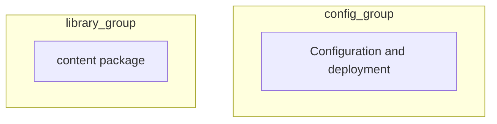

# Architecture report: 1c7/Crash-Course-Computer-Science-Chinese

> Automated static analysis. **Observed** = directly seen in files/imports/AST; **Inferred** = interpretation from that evidence. Repository code was not executed.

## 1. Repository at a glance

| Item | Value |
| --- | --- |
| Repository | 1c7/Crash-Course-Computer-Science-Chinese |
| Description | 计算机速成课（播放量 509 万） （共40集，每一集 10 分钟）2018 年完成翻译。评论区有大量好评 |
| Language | JavaScript |
| Stars | 10940 |
| Licence | Not detected |
| Analysed commit / branch | 6db659d0e923a8c74124334c7f0f2fb4e30b2f4e / master |
| Framework(s) | None detected |
| Files analysed | 49 |
| Components | 2 |

## 2. Architecture in one minute

1c7/Crash-Course-Computer-Science-Chinese - 计算机速成课（播放量 509 万） （共40集，每一集 10 分钟）2018 年完成翻译。评论区有大量好评. This repository was analysed statically from 49 file(s) (1 Python). Detected technologies (observed from imports/manifests): no known frameworks/libraries. Files are grouped into 2 component(s): Configuration and deployment, content package. Findings below distinguish observed facts from inferred interpretation.

## 3. High-level block diagram

## 4. Main components

### Configuration and deployment (`config`)

- **Kind:** config
- **Status:** Observed
- **Confidence:** 0.85
- **Responsibility:** Groups 1 file(s) under configuration and deployment (observed from repository paths and static analysis).
- **Paths:** `content/extract_from_ass_subtitle/package.json`
- **Evidence:** [content/extract_from_ass_subtitle/package.json](https://github.com/1c7/Crash-Course-Computer-Science-Chinese/blob/6db659d0e923a8c74124334c7f0f2fb4e30b2f4e/content/extract_from_ass_subtitle/package.json)

### content package (`content`)

- **Kind:** library
- **Status:** Observed
- **Confidence:** 0.85
- **Responsibility:** Groups 4 file(s) under content package (observed from repository paths and static analysis).
- **Paths:** `content/1. screenshot.py`, `content/extract_from_ass_subtitle/2. extract_head.js`, `content/extract_from_ass_subtitle/3. extract_ass_to_txt.js`, `content/extract_from_ass_subtitle/common.js`
- **Evidence:** [content/1. screenshot.py](https://github.com/1c7/Crash-Course-Computer-Science-Chinese/blob/6db659d0e923a8c74124334c7f0f2fb4e30b2f4e/content/1.%20screenshot.py); [content/extract_from_ass_subtitle/2. extract_head.js](https://github.com/1c7/Crash-Course-Computer-Science-Chinese/blob/6db659d0e923a8c74124334c7f0f2fb4e30b2f4e/content/extract_from_ass_subtitle/2.%20extract_head.js); [content/extract_from_ass_subtitle/3. extract_ass_to_txt.js](https://github.com/1c7/Crash-Course-Computer-Science-Chinese/blob/6db659d0e923a8c74124334c7f0f2fb4e30b2f4e/content/extract_from_ass_subtitle/3.%20extract_ass_to_txt.js); [content/extract_from_ass_subtitle/common.js](https://github.com/1c7/Crash-Course-Computer-Science-Chinese/blob/6db659d0e923a8c74124334c7f0f2fb4e30b2f4e/content/extract_from_ass_subtitle/common.js)

## 5. Execution flow

No entry point was observed; the startup flow below is therefore limited.

Representative flow (derived from observed entry points and the import graph; steps beyond the entry point are **Inferred**):

1. Execution starts at an observed entry point listed above, if present.
2. No internal import relationships between components were observed.

## 6. Project structure

### `(root)`

- `.gitignore` - other (94 bytes)
- `README.md` - docs (30671 bytes)

### `content`

- `content/(字幕)全40集中英字幕文本/01. 计算机早期历史-Early Computing.ass.txt` - docs (24385 bytes)
- `content/(字幕)全40集中英字幕文本/02. 电子计算机-Electronic Computing.ass.txt` - docs (19691 bytes)
- `content/(字幕)全40集中英字幕文本/03. 布尔逻辑 和 逻辑门-Boolean Logic & Logic Gates.ass.txt` - docs (19322 bytes)
- `content/(字幕)全40集中英字幕文本/04. 二进制-Representing Numbers and Letters with Binary.ass.txt` - docs (19301 bytes)
- `content/(字幕)全40集中英字幕文本/05. 算术逻辑单元-How Computers Calculate-the ALU.ass.txt` - docs (20781 bytes)
- `content/(字幕)全40集中英字幕文本/06. 寄存器 & 内存-Registers and RAM.ass.txt` - docs (22294 bytes)
- `content/(字幕)全40集中英字幕文本/07. 中央处理器-The Central Processing Unit(CPU).ass.txt` - docs (21596 bytes)
- `content/(字幕)全40集中英字幕文本/08. 指令和程序-Instructions & Programs.ass.txt` - docs (18876 bytes)
- `content/(字幕)全40集中英字幕文本/09. 高级CPU设计-Advanced CPU Designs.ass.txt` - docs (24742 bytes)
- `content/(字幕)全40集中英字幕文本/10. 早期的编程方式-Early Programming.ass.txt` - docs (17643 bytes)
- `content/(字幕)全40集中英字幕文本/11. 编程语言发展史-The First Programming Languages.ass.txt` - docs (22870 bytes)
- `content/(字幕)全40集中英字幕文本/12. 编程原理-语句和函数-Programming Basics - Statements & Functions.ass.txt` - docs (23438 bytes)
- `content/(字幕)全40集中英字幕文本/13. 算法入门 - Intro to Algorithms.ass.txt` - docs (22238 bytes)
- `content/(字幕)全40集中英字幕文本/14. 数据结构-Data Structures.ass.txt` - docs (20470 bytes)
- `content/(字幕)全40集中英字幕文本/15. 阿兰·图灵-Alan Turing.ass.txt` - docs (28627 bytes)
- `content/(字幕)全40集中英字幕文本/16. 软件工程-Software Engineering.ass.txt` - docs (23184 bytes)
- `content/(字幕)全40集中英字幕文本/17. 集成电路&摩尔定律-Integrated Circuits & Moore’s Law.ass.txt` - docs (30210 bytes)
- `content/(字幕)全40集中英字幕文本/18. 操作系统-Operating Systems.ass.txt` - docs (28661 bytes)
- `content/(字幕)全40集中英字幕文本/19. 内存&储存介质-Memory & Storage.mp4.ass.txt` - docs (25958 bytes)
- `content/(字幕)全40集中英字幕文本/20. 文件系统-Files & File Systems.ass.txt` - docs (25200 bytes)
- `content/(字幕)全40集中英字幕文本/21. 压缩-Compression.ass.txt` - docs (24511 bytes)
- `content/(字幕)全40集中英字幕文本/22. 命令行界面-Keyboards & Command Line Interfaces.ass.txt` - docs (24741 bytes)
- `content/(字幕)全40集中英字幕文本/23. 屏幕&2D 图形显示-Screens&2D Graphics.ass.txt` - docs (24549 bytes)
- `content/(字幕)全40集中英字幕文本/24. 冷战和消费主义-The Cold War and Consumerism.ass.txt` - docs (24560 bytes)
- `content/(字幕)全40集中英字幕文本/25. 个人计算机革命-The Personal Computer Revolution.ass.txt` - docs (21187 bytes)
- `content/(字幕)全40集中英字幕文本/26. 图形用户界面-Graphical User Interfaces.ass.txt` - docs (27896 bytes)
- `content/(字幕)全40集中英字幕文本/27. 3D 图形-3D Graphics.ass.txt` - docs (23966 bytes)
- `content/(字幕)全40集中英字幕文本/28. 计算机网络-Computer Networks.ass.txt` - docs (28046 bytes)
- `content/(字幕)全40集中英字幕文本/29. 互联网-The Internet.ass.txt` - docs (26828 bytes)
- `content/(字幕)全40集中英字幕文本/30. 万维网-The World Wide Web.ass.txt` - docs (24750 bytes)
- `content/(字幕)全40集中英字幕文本/31. 计算机安全-Cybersecurity.ass.txt` - docs (26876 bytes)
- `content/(字幕)全40集中英字幕文本/32. 黑客&攻击-Hackers & Cyber Attacks.ass.txt` - docs (23938 bytes)
- `content/(字幕)全40集中英字幕文本/33. 加密-Cryptography.ass.txt` - docs (24766 bytes)
- `content/(字幕)全40集中英字幕文本/34. 机器学习&人工智能-Machine Learning & Artificial Intelligence.ass.txt` - docs (24377 bytes)
- `content/(字幕)全40集中英字幕文本/35. 计算机视觉-Computer Vision.ass.txt` - docs (22652 bytes)
- `content/(字幕)全40集中英字幕文本/36. 自然语言处理-Natural Language Processing.ass.txt` - docs (22613 bytes)
- `content/(字幕)全40集中英字幕文本/37. 机器人-Robots.ass.txt` - docs (25696 bytes)
- `content/(字幕)全40集中英字幕文本/38. 计算机心理学 - Psychology of Computing.ass.txt` - docs (27223 bytes)
- `content/(字幕)全40集中英字幕文本/39. 教育科技-Educational Technology.ass.txt` - docs (25840 bytes)
- `content/(字幕)全40集中英字幕文本/40. 奇点,天网,计算机的未来-The Singularity, Skynet, and the Future of Computing.ass.txt` - docs (25945 bytes)
- `content/1. screenshot.py` - source, Python (775 bytes)
- `content/README-about-subtitle.md` - docs (2530 bytes)
- `content/extract_from_ass_subtitle/2. extract_head.js` - source, JavaScript (3187 bytes)
- `content/extract_from_ass_subtitle/3. extract_ass_to_txt.js` - source, JavaScript (1834 bytes)
- `content/extract_from_ass_subtitle/README.md` - docs (572 bytes)
- `content/extract_from_ass_subtitle/common.js` - source, JavaScript (849 bytes)
- `content/extract_from_ass_subtitle/package.json` - manifest (257 bytes)

## 7. Key dependencies and integrations

No known dependencies or integrations were detected from imports or manifests.

## 8. Data and state

No database, cache, queue, or persistent-state usage was observed in the analysed files. State handling, if any, may be in-memory or in files that were not analysed.

## 9. Configuration and deployment clues

- `content/extract_from_ass_subtitle/package.json` (manifest)

## 10. Design observations

- No strong design patterns could be established from the available evidence.

These observations are interpretations (**Inferred**) of the observed structure, not guarantees about runtime design.

## 11. Limitations and unknowns

- Static analysis only: repository code was not executed, installed, or imported at runtime.
- Components and relationships are inferred from file paths, imports, and AST structure; runtime behaviour, dynamic imports, and reflection may not be visible.
- No clear application entry point was observed in the analysed files.
- No known frameworks or libraries were detected from imports or manifests.
- Repository text was treated as untrusted data; no instructions found in repository files were followed, and likely secret values were redacted/excluded.

## 12. Source references

- [content/1. screenshot.py](https://github.com/1c7/Crash-Course-Computer-Science-Chinese/blob/6db659d0e923a8c74124334c7f0f2fb4e30b2f4e/content/1.%20screenshot.py)
- [content/extract_from_ass_subtitle/2. extract_head.js](https://github.com/1c7/Crash-Course-Computer-Science-Chinese/blob/6db659d0e923a8c74124334c7f0f2fb4e30b2f4e/content/extract_from_ass_subtitle/2.%20extract_head.js)
- [content/extract_from_ass_subtitle/3. extract_ass_to_txt.js](https://github.com/1c7/Crash-Course-Computer-Science-Chinese/blob/6db659d0e923a8c74124334c7f0f2fb4e30b2f4e/content/extract_from_ass_subtitle/3.%20extract_ass_to_txt.js)
- [content/extract_from_ass_subtitle/common.js](https://github.com/1c7/Crash-Course-Computer-Science-Chinese/blob/6db659d0e923a8c74124334c7f0f2fb4e30b2f4e/content/extract_from_ass_subtitle/common.js)
- [content/extract_from_ass_subtitle/package.json](https://github.com/1c7/Crash-Course-Computer-Science-Chinese/blob/6db659d0e923a8c74124334c7f0f2fb4e30b2f4e/content/extract_from_ass_subtitle/package.json)
