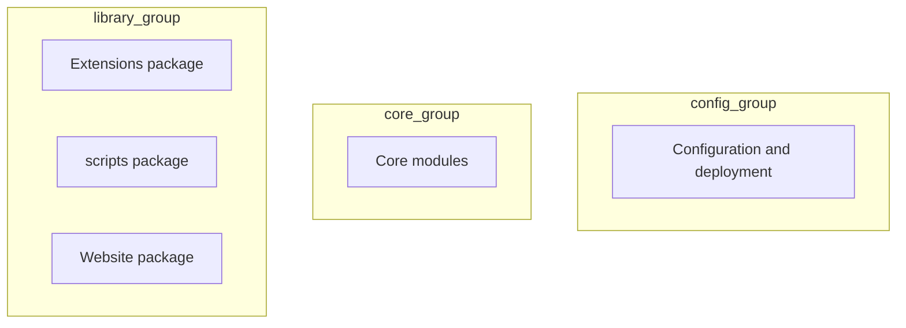

# Architecture report: Anarios/return-youtube-dislike

> Automated static analysis. **Observed** = directly seen in files/imports/AST; **Inferred** = interpretation from that evidence. Repository code was not executed.

## 1. Repository at a glance

| Item | Value |
| --- | --- |
| Repository | Anarios/return-youtube-dislike |
| Description | Chrome extension to return youtube dislikes |
| Language | JavaScript |
| Stars | 13853 |
| Licence | GPL-3.0 |
| Analysed commit / branch | 895c1fb9d47d32b8af066b80969abca734554b04 / main |
| Framework(s) | None detected |
| Files analysed | 570 |
| Components | 5 |

## 2. Architecture in one minute

Anarios/return-youtube-dislike - Chrome extension to return youtube dislikes. This repository was analysed statically from 570 file(s) (0 Python). Detected technologies (observed from imports/manifests): GitHub Actions, Jest, webpack. Files are grouped into 5 component(s): Configuration and deployment, Core modules, Extensions package, scripts package, Website package. Findings below distinguish observed facts from inferred interpretation.

## 3. High-level block diagram

## 4. Main components

### Configuration and deployment (`config`)

- **Kind:** config
- **Status:** Observed
- **Confidence:** 0.85
- **Responsibility:** Groups 31 file(s) under configuration and deployment (observed from repository paths and static analysis).
- **Paths:** `Extensions/UserScript/userscript-version.json`, `Extensions/combined/_locales/az/messages.json`, `Extensions/combined/_locales/be/messages.json`, `Extensions/combined/_locales/cs/messages.json`, `Extensions/combined/_locales/de/messages.json`, `Extensions/combined/_locales/el/messages.json`, `Extensions/combined/_locales/en/messages.json`, `Extensions/combined/_locales/es/messages.json`, `Extensions/combined/_locales/fa/messages.json`, `Extensions/combined/_locales/fr/messages.json`, `Extensions/combined/_locales/hu/messages.json`, `Extensions/combined/_locales/id/messages.json`, `Extensions/combined/_locales/it/messages.json`, `Extensions/combined/_locales/ja/messages.json`, `Extensions/combined/_locales/ko/messages.json`, `Extensions/combined/_locales/nl/messages.json`, `Extensions/combined/_locales/pl/messages.json`, `Extensions/combined/_locales/pt_BR/messages.json`, `Extensions/combined/_locales/ru/messages.json`, `Extensions/combined/_locales/sl/messages.json`, `Extensions/combined/_locales/sv_SE/messages.json`, `Extensions/combined/_locales/tr/messages.json`, `Extensions/combined/_locales/uk/messages.json`, `Extensions/combined/_locales/vi/messages.json`, `Extensions/combined/_locales/zh_CN/messages.json`, `Extensions/combined/_locales/zh_TW/messages.json`, `Extensions/combined/manifest-chrome.json`, `Extensions/combined/manifest-firefox.json`, `Extensions/combined/manifest-safari.json`, `Website/package.json`, `package.json`
- **Evidence:** [Extensions/UserScript/userscript-version.json](https://github.com/Anarios/return-youtube-dislike/blob/895c1fb9d47d32b8af066b80969abca734554b04/Extensions/UserScript/userscript-version.json); [Extensions/combined/_locales/az/messages.json](https://github.com/Anarios/return-youtube-dislike/blob/895c1fb9d47d32b8af066b80969abca734554b04/Extensions/combined/_locales/az/messages.json); [Extensions/combined/_locales/be/messages.json](https://github.com/Anarios/return-youtube-dislike/blob/895c1fb9d47d32b8af066b80969abca734554b04/Extensions/combined/_locales/be/messages.json); [Extensions/combined/_locales/cs/messages.json](https://github.com/Anarios/return-youtube-dislike/blob/895c1fb9d47d32b8af066b80969abca734554b04/Extensions/combined/_locales/cs/messages.json); [Extensions/combined/_locales/de/messages.json](https://github.com/Anarios/return-youtube-dislike/blob/895c1fb9d47d32b8af066b80969abca734554b04/Extensions/combined/_locales/de/messages.json); [Extensions/combined/_locales/el/messages.json](https://github.com/Anarios/return-youtube-dislike/blob/895c1fb9d47d32b8af066b80969abca734554b04/Extensions/combined/_locales/el/messages.json); [Extensions/combined/_locales/en/messages.json](https://github.com/Anarios/return-youtube-dislike/blob/895c1fb9d47d32b8af066b80969abca734554b04/Extensions/combined/_locales/en/messages.json); [Extensions/combined/_locales/es/messages.json](https://github.com/Anarios/return-youtube-dislike/blob/895c1fb9d47d32b8af066b80969abca734554b04/Extensions/combined/_locales/es/messages.json)

### Core modules (`core`)

- **Kind:** core
- **Status:** Observed
- **Confidence:** 0.85
- **Responsibility:** Groups 14 file(s) under core modules (observed from repository paths and static analysis).
- **Paths:** `extension-build-receipt.js`, `extension-build-receipt.spec.js`, `jest.config.js`, `playwright.extension.config.js`, `playwright.live-youtube.config.js`, `playwright.userscript.config.js`, `userscript-build-receipt.js`, `userscript-build-receipt.spec.js`, `webpack.config.js`, `webpack.discussion.spec.js`, `webpack.live-build-marker.js`, `webpack.live-build-marker.spec.js`, `webpack.packaging.spec.js`, `webpack.userscript.config.js`
- **Evidence:** [extension-build-receipt.js](https://github.com/Anarios/return-youtube-dislike/blob/895c1fb9d47d32b8af066b80969abca734554b04/extension-build-receipt.js); [extension-build-receipt.spec.js](https://github.com/Anarios/return-youtube-dislike/blob/895c1fb9d47d32b8af066b80969abca734554b04/extension-build-receipt.spec.js); [jest.config.js](https://github.com/Anarios/return-youtube-dislike/blob/895c1fb9d47d32b8af066b80969abca734554b04/jest.config.js); [playwright.extension.config.js](https://github.com/Anarios/return-youtube-dislike/blob/895c1fb9d47d32b8af066b80969abca734554b04/playwright.extension.config.js); [playwright.live-youtube.config.js](https://github.com/Anarios/return-youtube-dislike/blob/895c1fb9d47d32b8af066b80969abca734554b04/playwright.live-youtube.config.js); [playwright.userscript.config.js](https://github.com/Anarios/return-youtube-dislike/blob/895c1fb9d47d32b8af066b80969abca734554b04/playwright.userscript.config.js); [userscript-build-receipt.js](https://github.com/Anarios/return-youtube-dislike/blob/895c1fb9d47d32b8af066b80969abca734554b04/userscript-build-receipt.js); [userscript-build-receipt.spec.js](https://github.com/Anarios/return-youtube-dislike/blob/895c1fb9d47d32b8af066b80969abca734554b04/userscript-build-receipt.spec.js)

### Extensions package (`extensions`)

- **Kind:** library
- **Status:** Observed
- **Confidence:** 0.85
- **Responsibility:** Groups 290 file(s) under extensions package (observed from repository paths and static analysis).
- **Paths:** `Extensions/UserScript/Return Youtube Dislike.user.js`, `Extensions/UserScript/e2e/harness.js`, `Extensions/UserScript/e2e/live/live-artifact-readiness.js`, `Extensions/UserScript/e2e/live/live-authenticated-context.js`, `Extensions/UserScript/e2e/live/live-diagnostics.js`, `Extensions/UserScript/e2e/live/live-extension-reloader.js`, `Extensions/UserScript/e2e/live/live-full-run-contract.js`, `Extensions/UserScript/e2e/live/live-interactive-readonly.js`, `Extensions/UserScript/e2e/live/live-interactive-runner.js`, `Extensions/UserScript/e2e/live/live-interactive-scenario-contract.js`, `Extensions/UserScript/e2e/live/live-scenarios.js`, `Extensions/UserScript/e2e/live/live-youtube.live.e2e.js`, `Extensions/UserScript/e2e/live/reload-live-extension.js`, `Extensions/UserScript/e2e/live/watch-ratio-audit.js`, `Extensions/UserScript/e2e/navigation-matrix.js`, `Extensions/UserScript/e2e/userscript-color-themes.e2e.js`, `Extensions/UserScript/e2e/userscript-control-width.e2e.js`, `Extensions/UserScript/e2e/userscript-delegated-activation.e2e.js`, `Extensions/UserScript/e2e/userscript-dislike-text-layout.e2e.js`, `Extensions/UserScript/e2e/userscript-initialization-race.e2e.js`, `Extensions/UserScript/e2e/userscript-like-formatting.e2e.js`, `Extensions/UserScript/e2e/userscript-navigation-lifecycle.e2e.js`, `Extensions/UserScript/e2e/userscript-navigation-matrix.e2e.js`, `Extensions/UserScript/e2e/userscript-rate-bar.e2e.js`, `Extensions/UserScript/e2e/userscript-render-oracle.e2e.js`, `Extensions/UserScript/e2e/userscript-runtime-resilience.e2e.js`, `Extensions/UserScript/e2e/userscript-shorts-layout.e2e.js`, `Extensions/UserScript/e2e/userscript-shorts-placeholder-pool.e2e.js`, `Extensions/UserScript/e2e/userscript-state-visual-contract.e2e.js`, `Extensions/UserScript/e2e/userscript-trusted-types.e2e.js`, `Extensions/UserScript/e2e/userscript-voting.e2e.js`, `Extensions/UserScript/live/live-artifact-readiness.spec.js`, `Extensions/UserScript/live/live-authenticated-context.spec.js`, `Extensions/UserScript/live/live-cdp-endpoint.js`, `Extensions/UserScript/live/live-cdp-endpoint.spec.js`, `Extensions/UserScript/live/live-diagnostics.spec.js`, `Extensions/UserScript/live/live-extension-reloader.spec.js`, `Extensions/UserScript/live/live-full-run-contract.spec.js`, `Extensions/UserScript/live/live-interactive-readonly.spec.js`, `Extensions/UserScript/live/live-interactive-runner.spec.js`, `Extensions/UserScript/live/live-navigation-constants.js`, `Extensions/UserScript/live/live-options.js`, `Extensions/UserScript/live/live-options.spec.js`, `Extensions/UserScript/live/live-readonly-guard.spec.js`, `Extensions/UserScript/live/live-runtime-traffic-ledger.spec.js`, `Extensions/UserScript/live/live-scenarios.spec.js`, `Extensions/UserScript/live/live-vote-traffic-recorder.spec.js`, `Extensions/UserScript/live/live-youtube-driver.spec.js`, `Extensions/UserScript/live/watch-ratio-audit.spec.js`, `Extensions/UserScript/src/color-presentation.spec.js`, `Extensions/UserScript/src/dislike-text-container.spec.js`, `Extensions/UserScript/src/gm-credential-store.js`, `Extensions/UserScript/src/gm-credential-store.spec.js`, `Extensions/UserScript/src/gm-synthetic-dislike-store.js`, `Extensions/UserScript/src/gm-synthetic-dislike-store.spec.js`, `Extensions/UserScript/src/passive-identity.spec.js`, `Extensions/UserScript/src/userscript-entry.js`, `Extensions/UserScript/src/video-identity.spec.js`, `Extensions/UserScript/userscript-artifact.spec.js`, `Extensions/UserScript/userscript.meta.js`, `Extensions/combined/changelog/changelog.js`, `Extensions/combined/comments-bridge.js`, `Extensions/combined/consent.js`, `Extensions/combined/consent.spec.js`, `Extensions/combined/menu-fixer.js`, `Extensions/combined/message-keys.spec.js`, `Extensions/combined/popup-colors.spec.js`, `Extensions/combined/popup-context.js`, `Extensions/combined/popup-context.spec.js`, `Extensions/combined/popup-locale.spec.js`, `Extensions/combined/popup-permissions.spec.js`, `Extensions/combined/popup-private.spec.js`, `Extensions/combined/popup-settings-layout.spec.js`, `Extensions/combined/popup.js`, `Extensions/combined/popup.spec.js`, `Extensions/combined/ryd.background-changelog.spec.js`, `Extensions/combined/ryd.background.js`, `Extensions/combined/ryd.background.spec.js`, `Extensions/combined/ryd.changelog.js`, `Extensions/combined/ryd.changelog.spec.js`, `Extensions/combined/ryd.content-script.js`, `Extensions/combined/src/account-data-consent.js`, `Extensions/combined/src/account-data-consent.spec.js`, `Extensions/combined/src/amo-policy.spec.js`, `Extensions/combined/src/bar.js`, `Extensions/combined/src/bar.spec.js`, `Extensions/combined/src/belarusian-locale.spec.js`, `Extensions/combined/src/browser-brand.js`, `Extensions/combined/src/browser-brand.spec.js`, `Extensions/combined/src/buttons.js`, `Extensions/combined/src/buttons.spec.js`, `Extensions/combined/src/changelog/index.js`, `Extensions/combined/src/changelog/index.spec.js`, `Extensions/combined/src/clutter-button-setting.js`, `Extensions/combined/src/clutter-button-setting.spec.js`, `Extensions/combined/src/color-settings-initialization.spec.js`, `Extensions/combined/src/color-settings.spec.js`, `Extensions/combined/src/config.js`, `Extensions/combined/src/content-script-private.spec.js`, `Extensions/combined/src/core-data-consent.js`, `Extensions/combined/src/core-data-consent.spec.js`, `Extensions/combined/src/counts-consent-popup.js`, `Extensions/combined/src/counts-consent-popup.spec.js`, `Extensions/combined/src/data-collection-permissions.js`, `Extensions/combined/src/data-collection-permissions.spec.js`, `Extensions/combined/src/data-consent-prompt.js`, `Extensions/combined/src/data-consent-prompt.spec.js`, `Extensions/combined/src/data-permission-list.js`, `Extensions/combined/src/data-permission-list.spec.js`, `Extensions/combined/src/discussion-background.js`, `Extensions/combined/src/discussion-background.spec.js`, `Extensions/combined/src/discussion-config.js`, `Extensions/combined/src/discussion-navigation-fetch.spec.js`, `Extensions/combined/src/discussion-notifications-socket.spec.js`, `Extensions/combined/src/discussion/bridge.spec.js`, `Extensions/combined/src/discussion/client-content.spec.js`, `Extensions/combined/src/discussion/client.js`, `Extensions/combined/src/discussion/client.spec.js`, `Extensions/combined/src/discussion/detector.js`, `Extensions/combined/src/discussion/detector.spec.js`, `Extensions/combined/src/discussion/dom.js`, `Extensions/combined/src/discussion/dom.spec.js`, `Extensions/combined/src/discussion/inbox.js`, `Extensions/combined/src/discussion/inbox.spec.js`, `Extensions/combined/src/discussion/index.js`, `Extensions/combined/src/discussion/index.spec.js`, `Extensions/combined/src/discussion/localize.js`, `Extensions/combined/src/discussion/localize.spec.js`, `Extensions/combined/src/discussion/panel.js`, `Extensions/combined/src/discussion/panel.spec.js`, `Extensions/combined/src/discussion/popup.js`, `Extensions/combined/src/discussion/popup.spec.js`, `Extensions/combined/src/dislike-rendering.spec.js`, `Extensions/combined/src/events.js`, `Extensions/combined/src/events.spec.js`, `Extensions/combined/src/github-auth.js`, `Extensions/combined/src/github-auth.spec.js`, `Extensions/combined/src/github-login-error.js`, `Extensions/combined/src/initialization-cycle.js`, `Extensions/combined/src/initialization-cycle.spec.js`, `Extensions/combined/src/localize-page.js`, `Extensions/combined/src/localize-page.spec.js`, `Extensions/combined/src/logging.js`, `Extensions/combined/src/logging.spec.js`, `Extensions/combined/src/menu-fixer.spec.js`, `Extensions/combined/src/page-popover-style.js`, `Extensions/combined/src/patreon.js`, `Extensions/combined/src/patreon.spec.js`, `Extensions/combined/src/popup-clutter-setting.spec.js`, `Extensions/combined/src/premiumAnalytics/activity/index.js`, `Extensions/combined/src/premiumAnalytics/activity/index.spec.js`, `Extensions/combined/src/premiumAnalytics/activity/layout.spec.js`, `Extensions/combined/src/premiumAnalytics/activity/time.js`, `Extensions/combined/src/premiumAnalytics/activity/time.spec.js`, `Extensions/combined/src/premiumAnalytics/constants.js`, `Extensions/combined/src/premiumAnalytics/index.js`, `Extensions/combined/src/premiumAnalytics/index.spec.js`, `Extensions/combined/src/premiumAnalytics/lifecycle.js`, `Extensions/combined/src/premiumAnalytics/lists/index.js`, `Extensions/combined/src/premiumAnalytics/lists/index.spec.js`, `Extensions/combined/src/premiumAnalytics/logging.js`, `Extensions/combined/src/premiumAnalytics/logging.spec.js`, `Extensions/combined/src/premiumAnalytics/map/index.js`, `Extensions/combined/src/premiumAnalytics/map/index.spec.js`, `Extensions/combined/src/premiumAnalytics/panel.js`, `Extensions/combined/src/premiumAnalytics/panel.spec.js`, `Extensions/combined/src/premiumAnalytics/rawCounts.js`, `Extensions/combined/src/premiumAnalytics/rawCounts.spec.js`, `Extensions/combined/src/premiumAnalytics/render.js`, `Extensions/combined/src/premiumAnalytics/requests.js`, `Extensions/combined/src/premiumAnalytics/state.js`, `Extensions/combined/src/premiumAnalytics/state.spec.js`, `Extensions/combined/src/premiumAnalytics/teaser/index.js`, `Extensions/combined/src/premiumAnalytics/teaser/index.spec.js`, `Extensions/combined/src/premiumAnalytics/theme.js`, `Extensions/combined/src/premiumAnalytics/theme.spec.js`, `Extensions/combined/src/premiumAnalytics/utils.js`, `Extensions/combined/src/premiumAnalytics/utils.spec.js`, `Extensions/combined/src/private-browsing.js`, `Extensions/combined/src/private-browsing.spec.js`, `Extensions/combined/src/reaction-presentation.spec.js`, `Extensions/combined/src/review-prompt-tracker.js`, `Extensions/combined/src/review-prompt-tracker.spec.js`, `Extensions/combined/src/review-prompt.js`, `Extensions/combined/src/review-prompt.spec.js`, `Extensions/combined/src/starRating.js`, `Extensions/combined/src/state.js`, `Extensions/combined/src/state.spec.js`, `Extensions/combined/src/toolbar-popup.js`, `Extensions/combined/src/utils.js`, `Extensions/combined/src/utils.spec.js`, `Extensions/combined/src/vote-client-adapter.js`, `Extensions/combined/src/vote-client-adapter.spec.js`, `Extensions/combined/src/vote-data-request.js`, `Extensions/combined/src/vote-data-request.spec.js`, `Extensions/combined/src/vote-status-popup.js`, `Extensions/combined/src/vote-status-popup.spec.js`, `Extensions/combined/src/vote-submission-intent.js`, `Extensions/combined/src/vote-submission-setting.js`, `Extensions/combined/src/vote-submission-setting.spec.js`, `Extensions/common/color-themes.js`, `Extensions/common/color-themes.spec.js`, `Extensions/common/delegated-vote-activation.js`, `Extensions/common/delegated-vote-activation.spec.js`, `Extensions/common/live-video-id.js`, `Extensions/common/live-video-id.spec.js`, `Extensions/common/shorts-control-readiness.js`, `Extensions/common/shorts-control-readiness.spec.js`, `Extensions/common/vote-client.js`, `Extensions/common/vote-client.spec.js`, `Extensions/common/vote-transition-core.js`, `Extensions/common/vote-transition.js`, `Extensions/common/vote-transition.spec.js`, `Extensions/e2e/action-overflow-contract.js`, `Extensions/e2e/action-overflow-contract.spec.js`, `Extensions/e2e/continuous-invariants.js`, `Extensions/e2e/continuous-invariants.spec.js`, `Extensions/e2e/discussion/hermetic-discussion-smoke.js`, `Extensions/e2e/discussion/live-discussion-contract.js`, `Extensions/e2e/discussion/live-discussion-contract.spec.js`, `Extensions/e2e/discussion/watch-width-smoke.js`, `Extensions/e2e/extension/color-theme-fixture.js`, `Extensions/e2e/extension/extension-action-overflow-fixture.js`, `Extensions/e2e/extension/extension-action-overflow.e2e.js`, `Extensions/e2e/extension/extension-artifact-navigation.e2e.js`, `Extensions/e2e/extension/extension-artifact-visual.e2e.js`, `Extensions/e2e/extension/extension-color-themes.e2e.js`, `Extensions/e2e/extension/extension-control-width.e2e.js`, `Extensions/e2e/extension/extension-counter-typography.e2e.js`, `Extensions/e2e/extension/extension-dislike-observer.e2e.js`, `Extensions/e2e/extension/extension-hide-clutter-popup.e2e.js`, `Extensions/e2e/extension/extension-initialization-races.e2e.js`, `Extensions/e2e/extension/extension-injected-reaction-control.e2e.js`, `Extensions/e2e/extension/extension-mobile-artifact.e2e.js`, `Extensions/e2e/extension/extension-navigation-fixture.js`, `Extensions/e2e/extension/extension-owned-page-locale.e2e.js`, `Extensions/e2e/extension/extension-popup-encoding.e2e.js`, `Extensions/e2e/extension/extension-premium-analytics-theme.e2e.js`, `Extensions/e2e/extension/extension-premium-teaser-theme.e2e.js`, `Extensions/e2e/extension/extension-render-oracle.e2e.js`, `Extensions/e2e/extension/extension-review-prompt.e2e.js`, `Extensions/e2e/extension/extension-runtime-resilience.e2e.js`, `Extensions/e2e/extension/extension-startup-resilience.e2e.js`, `Extensions/e2e/extension/extension-worker-signals.e2e.js`, `Extensions/e2e/extension/github-login.e2e.js`, `Extensions/e2e/feature-identity-smoke.js`, `Extensions/e2e/feature-permissions-fixtures.js`, `Extensions/e2e/firefox-changelog-lifecycle.js`, `Extensions/e2e/firefox-consent-smoke.js`, `Extensions/e2e/firefox-feature-permissions.js`, `Extensions/e2e/firefox-install-consent.js`, `Extensions/e2e/firefox-install-consent.spec.js`, `Extensions/e2e/firefox-live-youtube.js`, `Extensions/e2e/firefox-toolbar-popup.js`, `Extensions/e2e/generate-hide-clutter-tooltip-assets.js`, `Extensions/e2e/hermetic-api-contract.js`, `Extensions/e2e/hermetic-api-contract.spec.js`, `Extensions/e2e/hermetic-artifact-smoke.js`, `Extensions/e2e/hermetic-artifact-smoke.spec.js`, `Extensions/e2e/hide-clutter-tooltip-assets.spec.js`, `Extensions/e2e/live-runtime-adapter.js`, `Extensions/e2e/navigation-runtime-contract.js`, `Extensions/e2e/navigation-runtime-contract.spec.js`, `Extensions/e2e/notification-recovery-smoke.js`, `Extensions/e2e/playwright-extension-global-setup.js`, `Extensions/e2e/playwright-extension-global-setup.spec.js`, `Extensions/e2e/playwright-userscript-global-setup.js`, `Extensions/e2e/playwright-userscript-global-setup.spec.js`, `Extensions/e2e/popover-surface.js`, `Extensions/e2e/runtime-resilience-contract.js`, `Extensions/e2e/shared-browser-parity.spec.js`, `Extensions/e2e/shared-live-scenarios.js`, `Extensions/e2e/shared-live-scenarios.spec.js`, `Extensions/e2e/shorts-placeholder-pool-contract.js`, `Extensions/e2e/shorts-placeholder-pool-contract.spec.js`, `Extensions/e2e/shorts-visual-contract.js`, `Extensions/e2e/systematic-coverage.spec.js`, `Extensions/e2e/verify-extension-artifact.js`, `Extensions/e2e/verify-extension-artifact.spec.js`, `Extensions/e2e/verify-userscript-artifact.js`, `Extensions/e2e/visual-evidence.js`, `Extensions/e2e/visual-evidence.spec.js`, `Extensions/e2e/vote-identity-journey-contract.js`, `Extensions/e2e/vote-identity-journey-contract.spec.js`, `Extensions/e2e/vote-protocol-contract.js`, `Extensions/e2e/vote-protocol-contract.spec.js`, `Extensions/e2e/watch-control-width-contract.js`, `Extensions/e2e/watch-visual-contract.js`, `Extensions/e2e/watch-visual-scenarios.js`, `Extensions/e2e/watch-visual-scenarios.spec.js`
- **Evidence:** [Extensions/UserScript/Return Youtube Dislike.user.js](https://github.com/Anarios/return-youtube-dislike/blob/895c1fb9d47d32b8af066b80969abca734554b04/Extensions/UserScript/Return%20Youtube%20Dislike.user.js); [Extensions/UserScript/e2e/harness.js](https://github.com/Anarios/return-youtube-dislike/blob/895c1fb9d47d32b8af066b80969abca734554b04/Extensions/UserScript/e2e/harness.js); [Extensions/UserScript/e2e/live/live-artifact-readiness.js](https://github.com/Anarios/return-youtube-dislike/blob/895c1fb9d47d32b8af066b80969abca734554b04/Extensions/UserScript/e2e/live/live-artifact-readiness.js); [Extensions/UserScript/e2e/live/live-authenticated-context.js](https://github.com/Anarios/return-youtube-dislike/blob/895c1fb9d47d32b8af066b80969abca734554b04/Extensions/UserScript/e2e/live/live-authenticated-context.js); [Extensions/UserScript/e2e/live/live-diagnostics.js](https://github.com/Anarios/return-youtube-dislike/blob/895c1fb9d47d32b8af066b80969abca734554b04/Extensions/UserScript/e2e/live/live-diagnostics.js); [Extensions/UserScript/e2e/live/live-extension-reloader.js](https://github.com/Anarios/return-youtube-dislike/blob/895c1fb9d47d32b8af066b80969abca734554b04/Extensions/UserScript/e2e/live/live-extension-reloader.js); [Extensions/UserScript/e2e/live/live-full-run-contract.js](https://github.com/Anarios/return-youtube-dislike/blob/895c1fb9d47d32b8af066b80969abca734554b04/Extensions/UserScript/e2e/live/live-full-run-contract.js); [Extensions/UserScript/e2e/live/live-interactive-readonly.js](https://github.com/Anarios/return-youtube-dislike/blob/895c1fb9d47d32b8af066b80969abca734554b04/Extensions/UserScript/e2e/live/live-interactive-readonly.js)

### scripts package (`scripts`)

- **Kind:** library
- **Status:** Observed
- **Confidence:** 0.85
- **Responsibility:** Groups 7 file(s) under scripts package (observed from repository paths and static analysis).
- **Paths:** `scripts/build-firefox-source.mjs`, `scripts/check-locales.js`, `scripts/check-locales.spec.js`, `scripts/package-amo-release.cjs`, `scripts/package-amo-release.spec.js`, `scripts/with-trusted-node.cjs`, `scripts/with-trusted-node.spec.js`
- **Evidence:** [scripts/build-firefox-source.mjs](https://github.com/Anarios/return-youtube-dislike/blob/895c1fb9d47d32b8af066b80969abca734554b04/scripts/build-firefox-source.mjs); [scripts/check-locales.js](https://github.com/Anarios/return-youtube-dislike/blob/895c1fb9d47d32b8af066b80969abca734554b04/scripts/check-locales.js); [scripts/check-locales.spec.js](https://github.com/Anarios/return-youtube-dislike/blob/895c1fb9d47d32b8af066b80969abca734554b04/scripts/check-locales.spec.js); [scripts/package-amo-release.cjs](https://github.com/Anarios/return-youtube-dislike/blob/895c1fb9d47d32b8af066b80969abca734554b04/scripts/package-amo-release.cjs); [scripts/package-amo-release.spec.js](https://github.com/Anarios/return-youtube-dislike/blob/895c1fb9d47d32b8af066b80969abca734554b04/scripts/package-amo-release.spec.js); [scripts/with-trusted-node.cjs](https://github.com/Anarios/return-youtube-dislike/blob/895c1fb9d47d32b8af066b80969abca734554b04/scripts/with-trusted-node.cjs); [scripts/with-trusted-node.spec.js](https://github.com/Anarios/return-youtube-dislike/blob/895c1fb9d47d32b8af066b80969abca734554b04/scripts/with-trusted-node.spec.js)

### Website package (`website`)

- **Kind:** library
- **Status:** Observed
- **Confidence:** 0.85
- **Responsibility:** Groups 38 file(s) under website package (observed from repository paths and static analysis).
- **Paths:** `Website/.eslintrc.js`, `Website/_locales/az.ts`, `Website/_locales/be.ts`, `Website/_locales/cs.ts`, `Website/_locales/de.ts`, `Website/_locales/en.ts`, `Website/_locales/es.ts`, `Website/_locales/fa.ts`, `Website/_locales/fr.ts`, `Website/_locales/hu.ts`, `Website/_locales/id.ts`, `Website/_locales/it-IT.ts`, `Website/_locales/ja.ts`, `Website/_locales/ko.ts`, `Website/_locales/nl.ts`, `Website/_locales/pl.ts`, `Website/_locales/pt_BR.ts`, `Website/_locales/ru.ts`, `Website/_locales/sl.ts`, `Website/_locales/sv.ts`, `Website/_locales/tr.ts`, `Website/_locales/uk.ts`, `Website/_locales/vi.ts`, `Website/layouts/default.spec.js`, `Website/layouts/default.vue`, `Website/layouts/error.vue`, `Website/nuxt.config.js`, `Website/pages/debug.vue`, `Website/pages/docs.vue`, `Website/pages/donate.vue`, `Website/pages/faq.vue`, `Website/pages/help.vue`, `Website/pages/index.vue`, `Website/pages/install.vue`, `Website/pages/links.vue`, `Website/pages/pay/crypto.vue`, `Website/utils/locale.js`, `Website/utils/locale.spec.js`
- **Evidence:** [Website/.eslintrc.js](https://github.com/Anarios/return-youtube-dislike/blob/895c1fb9d47d32b8af066b80969abca734554b04/Website/.eslintrc.js); [Website/_locales/az.ts](https://github.com/Anarios/return-youtube-dislike/blob/895c1fb9d47d32b8af066b80969abca734554b04/Website/_locales/az.ts); [Website/_locales/be.ts](https://github.com/Anarios/return-youtube-dislike/blob/895c1fb9d47d32b8af066b80969abca734554b04/Website/_locales/be.ts); [Website/_locales/cs.ts](https://github.com/Anarios/return-youtube-dislike/blob/895c1fb9d47d32b8af066b80969abca734554b04/Website/_locales/cs.ts); [Website/_locales/de.ts](https://github.com/Anarios/return-youtube-dislike/blob/895c1fb9d47d32b8af066b80969abca734554b04/Website/_locales/de.ts); [Website/_locales/en.ts](https://github.com/Anarios/return-youtube-dislike/blob/895c1fb9d47d32b8af066b80969abca734554b04/Website/_locales/en.ts); [Website/_locales/es.ts](https://github.com/Anarios/return-youtube-dislike/blob/895c1fb9d47d32b8af066b80969abca734554b04/Website/_locales/es.ts); [Website/_locales/fa.ts](https://github.com/Anarios/return-youtube-dislike/blob/895c1fb9d47d32b8af066b80969abca734554b04/Website/_locales/fa.ts)

## 5. Execution flow

No entry point was observed; the startup flow below is therefore limited.

Representative flow (derived from observed entry points and the import graph; steps beyond the entry point are **Inferred**):

1. Execution starts at an observed entry point listed above, if present.
2. No internal import relationships between components were observed.

## 6. Project structure

### `(root)`

- `.babelrc` - other (64 bytes)
- `.gitattributes` - other (204 bytes)
- `.gitignore` - other (835 bytes)
- `.nvmrc` - other (9 bytes)
- `AMO_RELEASE_NOTES.md` - docs (425 bytes)
- `CONTRIBUTING.md` - docs (3084 bytes)
- `CONTRIBUTINGar.md` - docs (3957 bytes)
- `CONTRIBUTINGaz.md` - docs (3676 bytes)
- `CONTRIBUTINGbe.md` - docs (4940 bytes)
- `CONTRIBUTINGbg.md` - docs (5144 bytes)
- `CONTRIBUTINGcn.md` - docs (2850 bytes)
- `CONTRIBUTINGda.md` - docs (3108 bytes)
- `CONTRIBUTINGde.md` - docs (3546 bytes)
- `CONTRIBUTINGes.md` - docs (3465 bytes)
- `CONTRIBUTINGfa.md` - docs (4453 bytes)
- `CONTRIBUTINGfr.md` - docs (4370 bytes)
- `CONTRIBUTINGgr.md` - docs (5272 bytes)
- `CONTRIBUTINGhu.md` - docs (3282 bytes)
- `CONTRIBUTINGid.md` - docs (3145 bytes)
- `CONTRIBUTINGja.md` - docs (3597 bytes)
- `CONTRIBUTINGkr.md` - docs (3305 bytes)
- `CONTRIBUTINGnl.md` - docs (3345 bytes)
- `CONTRIBUTINGpl.md` - docs (3315 bytes)
- `CONTRIBUTINGpt_BR.md` - docs (3544 bytes)
- `CONTRIBUTINGru.md` - docs (5204 bytes)
- `CONTRIBUTINGsl.md` - docs (3183 bytes)
- `CONTRIBUTINGsv.md` - docs (3108 bytes)
- `CONTRIBUTINGtr.md` - docs (3544 bytes)
- `CONTRIBUTINGuk.md` - docs (4839 bytes)
- `CONTRIBUTINGvi.md` - docs (4921 bytes)
- `LICENSE` - docs (35149 bytes)
- `README.md` - docs (5233 bytes)
- `README_AMO_SOURCE.md` - docs (2838 bytes)
- `READMEar.md` - docs (6103 bytes)
- `READMEaz.md` - docs (5417 bytes)
- `READMEbe.md` - docs (6480 bytes)
- `READMEbg.md` - docs (6506 bytes)
- `READMEcn.md` - docs (5210 bytes)
- `READMEda.md` - docs (5240 bytes)
- `READMEde.md` - docs (5929 bytes)
- `READMEes.md` - docs (5488 bytes)
- `READMEfa.md` - docs (6122 bytes)
- `READMEfr.md` - docs (5317 bytes)
- `READMEgr.md` - docs (6571 bytes)
- `READMEhu.md` - docs (5373 bytes)
- `READMEid.md` - docs (5142 bytes)
- `READMEja.md` - docs (5391 bytes)
- `READMEkr.md` - docs (5466 bytes)
- `READMEnl.md` - docs (5212 bytes)
- `READMEpl.md` - docs (5166 bytes)
- `READMEpt_BR.md` - docs (5366 bytes)
- `READMEru.md` - docs (6714 bytes)
- `READMEsl.md` - docs (5379 bytes)
- `READMEsv.md` - docs (5619 bytes)
- `READMEtr.md` - docs (5303 bytes)
- `READMEtw.md` - docs (5188 bytes)
- `READMEuk.md` - docs (6500 bytes)
- `READMEvi.md` - docs (6609 bytes)
- `extension-build-receipt.js` - source, JavaScript (3447 bytes)
- `extension-build-receipt.spec.js` - source, JavaScript (3971 bytes)
- `extension-description-store-ar.txt` - docs (3377 bytes)
- `extension-description-store-az.txt` - docs (2818 bytes)
- `extension-description-store-be.txt` - docs (4395 bytes)
- `extension-description-store-bg.txt` - docs (4289 bytes)
- `extension-description-store-cs.txt` - docs (2362 bytes)
- `extension-description-store-da.txt` - docs (2412 bytes)
- `extension-description-store-de.txt` - docs (2591 bytes)
- `extension-description-store-el.txt` - docs (4567 bytes)
- `extension-description-store-en.txt` - docs (2080 bytes)
- `extension-description-store-es.txt` - docs (2803 bytes)
- `extension-description-store-fa.txt` - docs (3788 bytes)
- `extension-description-store-fr.txt` - docs (2703 bytes)
- `extension-description-store-hu.txt` - docs (2606 bytes)
- `extension-description-store-id.txt` - docs (2367 bytes)
- `extension-description-store-it.txt` - docs (2463 bytes)
- `extension-description-store-ja.txt` - docs (3233 bytes)
- `extension-description-store-ko.txt` - docs (2865 bytes)
- `extension-description-store-nl.txt` - docs (2408 bytes)
- `extension-description-store-pl.txt` - docs (2460 bytes)
- `extension-description-store-pt_BR.txt` - docs (2492 bytes)
- `extension-description-store-pt_PT.txt` - docs (2602 bytes)
- `extension-description-store-ru.txt` - docs (4427 bytes)
- `extension-description-store-sl.txt` - docs (2351 bytes)
- `extension-description-store-sv_SE.txt` - docs (2434 bytes)
- `extension-description-store-tr.txt` - docs (2699 bytes)
- `extension-description-store-uk.txt` - docs (4453 bytes)
- `extension-description-store-vi.txt` - docs (3498 bytes)
- `extension-description-store-zh_CN.txt` - docs (2105 bytes)
- `extension-description-store-zh_TW.txt` - docs (2177 bytes)
- `jest.config.js` - source, JavaScript (581 bytes)
- `package.json` - manifest (4225 bytes)
- `playwright.extension.config.js` - source, JavaScript (785 bytes)
- `playwright.live-youtube.config.js` - source, JavaScript (362 bytes)
- `playwright.userscript.config.js` - source, JavaScript (846 bytes)
- `userscript-build-receipt.js` - source, JavaScript (8032 bytes)
- `userscript-build-receipt.spec.js` - source, JavaScript (6525 bytes)
- `webpack.config.js` - source, JavaScript (8869 bytes)
- `webpack.discussion.spec.js` - source, JavaScript (3066 bytes)
- `webpack.live-build-marker.js` - source, JavaScript (1143 bytes)
- `webpack.live-build-marker.spec.js` - source, JavaScript (2472 bytes)
- `webpack.packaging.spec.js` - source, JavaScript (2085 bytes)
- `webpack.userscript.config.js` - source, JavaScript (4358 bytes)

### `.github`

- `.github/FUNDING.yml` - config (80 bytes)
- `.github/ISSUE_TEMPLATE/bug.yml` - config (2159 bytes)
- `.github/ISSUE_TEMPLATE/feature-request.yml` - config (936 bytes)
- `.github/dependabot.yml` - config (296 bytes)
- `.github/workflows/build.yaml` - ci, YAML (4234 bytes)
- `.github/workflows/commentcommands.yml` - ci, YAML (3389 bytes)
- `.github/workflows/weblint.yml` - ci, YAML (1751 bytes)

### `Docs`

- `Docs/FAQ.md` - docs (2747 bytes)
- `Docs/FAQar.md` - docs (3981 bytes)
- `Docs/FAQaz.md` - docs (3114 bytes)
- `Docs/FAQbe.md` - docs (4556 bytes)
- `Docs/FAQbg.md` - docs (4367 bytes)
- `Docs/FAQcn.md` - docs (2409 bytes)
- `Docs/FAQde.md` - docs (3047 bytes)
- `Docs/FAQfa.md` - docs (4113 bytes)
- `Docs/FAQfr.md` - docs (2217 bytes)
- `Docs/FAQid.md` - docs (2762 bytes)
- `Docs/FAQnl.md` - docs (3020 bytes)
- `Docs/FAQpl.md` - docs (3018 bytes)
- `Docs/FAQpt_BR.md` - docs (2562 bytes)
- `Docs/FAQru.md` - docs (3449 bytes)
- `Docs/FAQsl.md` - docs (2840 bytes)
- `Docs/FAQtr.md` - docs (2898 bytes)
- `Docs/FAQuk.md` - docs (4450 bytes)
- `Docs/FAQvi.md` - docs (4575 bytes)
- `Docs/Guide__Installing.md` - docs (9228 bytes)
- `Docs/Guide__Installingvi.md` - docs (9231 bytes)
- `Docs/Guide__Troubleshooting.md` - docs (6967 bytes)
- `Docs/Guide__Troubleshootingvi.md` - docs (6990 bytes)
- `Docs/Privacy Policy` - docs (8771 bytes)
- `Docs/Privacy Policyvi` - docs (704 bytes)
- `Docs/SECURITY-FAQ.md` - docs (4788 bytes)
- `Docs/SECURITY-FAQaz.md` - docs (3618 bytes)
- `Docs/SECURITY-FAQbe.md` - docs (6675 bytes)
- `Docs/SECURITY-FAQbg.md` - docs (5487 bytes)
- `Docs/SECURITY-FAQcn.md` - docs (2973 bytes)
- `Docs/SECURITY-FAQde.md` - docs (3796 bytes)
- `Docs/SECURITY-FAQfa.md` - docs (6239 bytes)
- `Docs/SECURITY-FAQfr.md` - docs (4097 bytes)
- `Docs/SECURITY-FAQid.md` - docs (3450 bytes)
- `Docs/SECURITY-FAQnl.md` - docs (3563 bytes)
- `Docs/SECURITY-FAQpl.md` - docs (3617 bytes)
- `Docs/SECURITY-FAQpt_BR.md` - docs (3275 bytes)
- `Docs/SECURITY-FAQru.md` - docs (6419 bytes)
- `Docs/SECURITY-FAQsl.md` - docs (3841 bytes)
- `Docs/SECURITY-FAQtr.md` - docs (3739 bytes)
- `Docs/SECURITY-FAQuk.md` - docs (6173 bytes)
- `Docs/SECURITY-FAQvi.md` - docs (5022 bytes)
- `Docs/SECURITY_FAQar.md` - docs (4406 bytes)
- `Docs/readme.md` - docs (1340 bytes)
- `Docs/readmeaz.md` - docs (1414 bytes)
- `Docs/readmebe.md` - docs (947 bytes)
- `Docs/readmecn.md` - docs (1191 bytes)
- `Docs/readmefa.md` - docs (1464 bytes)
- `Docs/readmefr.md` - docs (1174 bytes)
- `Docs/readmeid.md` - docs (1254 bytes)
- `Docs/readmenl.md` - docs (1325 bytes)
- `Docs/readmept_BR.md` - docs (1222 bytes)
- `Docs/readmetr.md` - docs (1361 bytes)
- `Docs/readmevi.md` - docs (1497 bytes)

### `Extensions`

- `Extensions/UserScript/Return Youtube Dislike.user.js` - source, JavaScript (121033 bytes)
- `Extensions/UserScript/e2e/fixtures/navigation-page.html` - other (38431 bytes)
- `Extensions/UserScript/e2e/fixtures/shorts-page.html` - other (13139 bytes)
- `Extensions/UserScript/e2e/fixtures/watch-page.html` - other (13767 bytes)
- `Extensions/UserScript/e2e/harness.js` - source, JavaScript (15379 bytes)
- `Extensions/UserScript/e2e/live/README.md` - docs (23978 bytes)
- `Extensions/UserScript/e2e/live/live-artifact-readiness.js` - source, JavaScript (1565 bytes)
- `Extensions/UserScript/e2e/live/live-authenticated-context.js` - source, JavaScript (13159 bytes)
- `Extensions/UserScript/e2e/live/live-diagnostics.js` - source, JavaScript (26516 bytes)
- `Extensions/UserScript/e2e/live/live-extension-reloader.js` - source, JavaScript (11154 bytes)
- `Extensions/UserScript/e2e/live/live-full-run-contract.js` - source, JavaScript (3430 bytes)
- `Extensions/UserScript/e2e/live/live-interactive-readonly.js` - source, JavaScript (4156 bytes)
- `Extensions/UserScript/e2e/live/live-interactive-runner.js` - source, JavaScript (20608 bytes)
- `Extensions/UserScript/e2e/live/live-interactive-scenario-contract.js` - source, JavaScript (3101 bytes)
- `Extensions/UserScript/e2e/live/live-scenarios.js` - source, JavaScript (42516 bytes)
- `Extensions/UserScript/e2e/live/live-youtube.live.e2e.js` - source, JavaScript (7880 bytes)
- `Extensions/UserScript/e2e/live/reload-live-extension.js` - source, JavaScript (2281 bytes)
- `Extensions/UserScript/e2e/live/watch-ratio-audit.js` - source, JavaScript (10035 bytes)
- `Extensions/UserScript/e2e/navigation-matrix.js` - source, JavaScript (154879 bytes)
- `Extensions/UserScript/e2e/userscript-color-themes.e2e.js` - source, JavaScript (4831 bytes)
- `Extensions/UserScript/e2e/userscript-control-width.e2e.js` - source, JavaScript (2520 bytes)
- `Extensions/UserScript/e2e/userscript-delegated-activation.e2e.js` - source, JavaScript (3094 bytes)
- `Extensions/UserScript/e2e/userscript-dislike-text-layout.e2e.js` - source, JavaScript (12591 bytes)
- `Extensions/UserScript/e2e/userscript-initialization-race.e2e.js` - source, JavaScript (16914 bytes)
- `Extensions/UserScript/e2e/userscript-like-formatting.e2e.js` - source, JavaScript (1384 bytes)
- `Extensions/UserScript/e2e/userscript-navigation-lifecycle.e2e.js` - source, JavaScript (57929 bytes)
- `Extensions/UserScript/e2e/userscript-navigation-matrix.e2e.js` - source, JavaScript (4065 bytes)
- `Extensions/UserScript/e2e/userscript-rate-bar.e2e.js` - source, JavaScript (9582 bytes)
- `Extensions/UserScript/e2e/userscript-render-oracle.e2e.js` - source, JavaScript (1874 bytes)
- `Extensions/UserScript/e2e/userscript-runtime-resilience.e2e.js` - source, JavaScript (837 bytes)
- `Extensions/UserScript/e2e/userscript-shorts-layout.e2e.js` - source, JavaScript (10550 bytes)
- `Extensions/UserScript/e2e/userscript-shorts-placeholder-pool.e2e.js` - source, JavaScript (2367 bytes)
- `Extensions/UserScript/e2e/userscript-state-visual-contract.e2e.js` - source, JavaScript (4798 bytes)
- `Extensions/UserScript/e2e/userscript-trusted-types.e2e.js` - source, JavaScript (2748 bytes)
- `Extensions/UserScript/e2e/userscript-voting.e2e.js` - source, JavaScript (43178 bytes)
- `Extensions/UserScript/live/live-artifact-readiness.spec.js` - source, JavaScript (2677 bytes)
- `Extensions/UserScript/live/live-authenticated-context.spec.js` - source, JavaScript (17757 bytes)
- `Extensions/UserScript/live/live-cdp-endpoint.js` - source, JavaScript (8406 bytes)
- `Extensions/UserScript/live/live-cdp-endpoint.spec.js` - source, JavaScript (8422 bytes)
- `Extensions/UserScript/live/live-diagnostics.spec.js` - source, JavaScript (25802 bytes)
- `Extensions/UserScript/live/live-extension-reloader.spec.js` - source, JavaScript (14617 bytes)
- `Extensions/UserScript/live/live-full-run-contract.spec.js` - source, JavaScript (5610 bytes)
- `Extensions/UserScript/live/live-interactive-readonly.spec.js` - source, JavaScript (8546 bytes)
- `Extensions/UserScript/live/live-interactive-runner.spec.js` - source, JavaScript (18978 bytes)
- `Extensions/UserScript/live/live-navigation-constants.js` - source, JavaScript (232 bytes)
- `Extensions/UserScript/live/live-options.js` - source, JavaScript (9219 bytes)
- `Extensions/UserScript/live/live-options.spec.js` - source, JavaScript (12792 bytes)
- `Extensions/UserScript/live/live-readonly-guard.spec.js` - source, JavaScript (6467 bytes)
- `Extensions/UserScript/live/live-runtime-traffic-ledger.spec.js` - source, JavaScript (4933 bytes)
- `Extensions/UserScript/live/live-scenarios.spec.js` - source, JavaScript (74044 bytes)
- `Extensions/UserScript/live/live-vote-traffic-recorder.spec.js` - source, JavaScript (4220 bytes)
- `Extensions/UserScript/live/live-youtube-driver.spec.js` - source, JavaScript (177538 bytes)
- `Extensions/UserScript/live/watch-ratio-audit.spec.js` - source, JavaScript (4920 bytes)
- `Extensions/UserScript/src/color-presentation.spec.js` - source, JavaScript (11730 bytes)
- `Extensions/UserScript/src/dislike-text-container.spec.js` - source, JavaScript (13064 bytes)
- `Extensions/UserScript/src/gm-credential-store.js` - source, JavaScript (1799 bytes)
- `Extensions/UserScript/src/gm-credential-store.spec.js` - source, JavaScript (3328 bytes)
- `Extensions/UserScript/src/gm-synthetic-dislike-store.js` - source, JavaScript (2549 bytes)
- `Extensions/UserScript/src/gm-synthetic-dislike-store.spec.js` - source, JavaScript (6502 bytes)
- `Extensions/UserScript/src/passive-identity.spec.js` - source, JavaScript (1809 bytes)
- `Extensions/UserScript/src/userscript-entry.js` - source, JavaScript (91074 bytes)
- `Extensions/UserScript/src/video-identity.spec.js` - source, JavaScript (1703 bytes)
- `Extensions/UserScript/userscript-artifact.spec.js` - source, JavaScript (4646 bytes)
- `Extensions/UserScript/userscript-version.json` - config (8 bytes)
- `Extensions/UserScript/userscript.meta.js` - source, JavaScript (1122 bytes)
- `Extensions/combined/_locales/az/messages.json` - config (35033 bytes)
- `Extensions/combined/_locales/be/messages.json` - config (44888 bytes)
- `Extensions/combined/_locales/cs/messages.json` - config (33815 bytes)
- `Extensions/combined/_locales/de/messages.json` - config (34202 bytes)
- `Extensions/combined/_locales/el/messages.json` - config (47275 bytes)
- `Extensions/combined/_locales/en/messages.json` - config (30479 bytes)
- `Extensions/combined/_locales/es/messages.json` - config (34337 bytes)
- `Extensions/combined/_locales/fa/messages.json` - config (41897 bytes)
- `Extensions/combined/_locales/fr/messages.json` - config (35516 bytes)
- `Extensions/combined/_locales/hu/messages.json` - config (35194 bytes)
- `Extensions/combined/_locales/id/messages.json` - config (32409 bytes)
- `Extensions/combined/_locales/it/messages.json` - config (33584 bytes)
- `Extensions/combined/_locales/ja/messages.json` - config (38372 bytes)
- `Extensions/combined/_locales/ko/messages.json` - config (35517 bytes)
- `Extensions/combined/_locales/nl/messages.json` - config (33313 bytes)
- `Extensions/combined/_locales/pl/messages.json` - config (33849 bytes)
- `Extensions/combined/_locales/pt_BR/messages.json` - config (33835 bytes)
- `Extensions/combined/_locales/ru/messages.json` - config (44067 bytes)
- `Extensions/combined/_locales/sl/messages.json` - config (32796 bytes)
- `Extensions/combined/_locales/sv_SE/messages.json` - config (33028 bytes)
- `Extensions/combined/_locales/tr/messages.json` - config (34216 bytes)
- `Extensions/combined/_locales/uk/messages.json` - config (44570 bytes)
- `Extensions/combined/_locales/vi/messages.json` - config (37489 bytes)
- `Extensions/combined/_locales/zh_CN/messages.json` - config (30873 bytes)
- `Extensions/combined/_locales/zh_TW/messages.json` - config (31119 bytes)
- `Extensions/combined/changelog/3/changelog_3.0.html` - other (3409 bytes)
- `Extensions/combined/changelog/4/changelog_4.1.html` - other (9990 bytes)
- `Extensions/combined/changelog/changelog.css` - other (930 bytes)
- `Extensions/combined/changelog/changelog.js` - source, JavaScript (3097 bytes)
- `Extensions/combined/changelog/release-page.css` - other (11769 bytes)
- `Extensions/combined/comments-bridge.js` - source, JavaScript (5652 bytes)
- `Extensions/combined/consent.css` - other (1553 bytes)
- `Extensions/combined/consent.html` - other (1256 bytes)
- `Extensions/combined/consent.js` - source, JavaScript (4370 bytes)
- `Extensions/combined/consent.spec.js` - source, JavaScript (10890 bytes)
- `Extensions/combined/content-style.css` - other (41719 bytes)
- `Extensions/combined/icons/logo.svg` - other (420 bytes)
- `Extensions/combined/icons/server.svg` - other (940 bytes)
- `Extensions/combined/manifest-chrome.json` - config (1085 bytes)
- `Extensions/combined/manifest-firefox.json` - config (1312 bytes)
- `Extensions/combined/manifest-safari.json` - config (855 bytes)
- `Extensions/combined/menu-fixer.js` - source, JavaScript (20391 bytes)
- `Extensions/combined/message-keys.spec.js` - source, JavaScript (1681 bytes)
- `Extensions/combined/popup-colors.spec.js` - source, JavaScript (9462 bytes)
- `Extensions/combined/popup-context.js` - source, JavaScript (361 bytes)
- `Extensions/combined/popup-context.spec.js` - source, JavaScript (1446 bytes)
- `Extensions/combined/popup-locale.spec.js` - source, JavaScript (3549 bytes)
- `Extensions/combined/popup-permissions.spec.js` - source, JavaScript (5075 bytes)
- `Extensions/combined/popup-private.spec.js` - source, JavaScript (4859 bytes)
- `Extensions/combined/popup-settings-layout.spec.js` - source, JavaScript (1639 bytes)
- `Extensions/combined/popup.css` - other (20902 bytes)
- `Extensions/combined/popup.html` - other (15059 bytes)
- `Extensions/combined/popup.js` - source, JavaScript (34069 bytes)
- `Extensions/combined/popup.spec.js` - source, JavaScript (19590 bytes)
- `Extensions/combined/readme.md` - docs (697 bytes)
- `Extensions/combined/ryd.background-changelog.spec.js` - source, JavaScript (14271 bytes)
- `Extensions/combined/ryd.background.js` - source, JavaScript (32590 bytes)
- `Extensions/combined/ryd.background.spec.js` - source, JavaScript (46889 bytes)
- `Extensions/combined/ryd.changelog.js` - source, JavaScript (3163 bytes)
- `Extensions/combined/ryd.changelog.spec.js` - source, JavaScript (10911 bytes)
- `Extensions/combined/ryd.content-script.js` - source, JavaScript (23586 bytes)
- `Extensions/combined/src/account-data-consent.js` - source, JavaScript (1159 bytes)
- `Extensions/combined/src/account-data-consent.spec.js` - source, JavaScript (7266 bytes)
- `Extensions/combined/src/amo-policy.spec.js` - source, JavaScript (2061 bytes)
- `Extensions/combined/src/bar.js` - source, JavaScript (8058 bytes)
- `Extensions/combined/src/bar.spec.js` - source, JavaScript (11346 bytes)
- `Extensions/combined/src/belarusian-locale.spec.js` - source, JavaScript (2745 bytes)
- `Extensions/combined/src/browser-brand.js` - source, JavaScript (327 bytes)
- `Extensions/combined/src/browser-brand.spec.js` - source, JavaScript (1008 bytes)
- `Extensions/combined/src/buttons.js` - source, JavaScript (31455 bytes)
- `Extensions/combined/src/buttons.spec.js` - source, JavaScript (52214 bytes)
- `Extensions/combined/src/changelog/index.js` - source, JavaScript (2889 bytes)
- `Extensions/combined/src/changelog/index.spec.js` - source, JavaScript (3745 bytes)
- `Extensions/combined/src/clutter-button-setting.js` - source, JavaScript (609 bytes)
- `Extensions/combined/src/clutter-button-setting.spec.js` - source, JavaScript (1301 bytes)
- `Extensions/combined/src/color-settings-initialization.spec.js` - source, JavaScript (2543 bytes)
- `Extensions/combined/src/color-settings.spec.js` - source, JavaScript (3174 bytes)
- `Extensions/combined/src/config.js` - source, JavaScript (1713 bytes)
- `Extensions/combined/src/content-script-private.spec.js` - source, JavaScript (18282 bytes)
- `Extensions/combined/src/core-data-consent.js` - source, JavaScript (9556 bytes)
- `Extensions/combined/src/core-data-consent.spec.js` - source, JavaScript (17512 bytes)
- `Extensions/combined/src/counts-consent-popup.js` - source, JavaScript (2755 bytes)
- `Extensions/combined/src/counts-consent-popup.spec.js` - source, JavaScript (7824 bytes)
- `Extensions/combined/src/data-collection-permissions.js` - source, JavaScript (586 bytes)
- `Extensions/combined/src/data-collection-permissions.spec.js` - source, JavaScript (3852 bytes)
- `Extensions/combined/src/data-consent-prompt.js` - source, JavaScript (17866 bytes)
- `Extensions/combined/src/data-consent-prompt.spec.js` - source, JavaScript (30567 bytes)
- `Extensions/combined/src/data-permission-list.js` - source, JavaScript (1127 bytes)
- `Extensions/combined/src/data-permission-list.spec.js` - source, JavaScript (1768 bytes)
- `Extensions/combined/src/discussion-background.js` - source, JavaScript (41329 bytes)
- `Extensions/combined/src/discussion-background.spec.js` - source, JavaScript (70900 bytes)
- `Extensions/combined/src/discussion-config.js` - source, JavaScript (474 bytes)
- `Extensions/combined/src/discussion-navigation-fetch.spec.js` - source, JavaScript (3452 bytes)
- `Extensions/combined/src/discussion-notifications-socket.spec.js` - source, JavaScript (9315 bytes)
- `Extensions/combined/src/discussion/bridge.spec.js` - source, JavaScript (9405 bytes)
- `Extensions/combined/src/discussion/client-content.spec.js` - source, JavaScript (1177 bytes)
- `Extensions/combined/src/discussion/client.js` - source, JavaScript (3641 bytes)
- `Extensions/combined/src/discussion/client.spec.js` - source, JavaScript (6734 bytes)
- `Extensions/combined/src/discussion/detector.js` - source, JavaScript (2964 bytes)
- `Extensions/combined/src/discussion/detector.spec.js` - source, JavaScript (4068 bytes)
- `Extensions/combined/src/discussion/dom.js` - source, JavaScript (2656 bytes)
- `Extensions/combined/src/discussion/dom.spec.js` - source, JavaScript (1544 bytes)
- `Extensions/combined/src/discussion/inbox.js` - source, JavaScript (6325 bytes)
- `Extensions/combined/src/discussion/inbox.spec.js` - source, JavaScript (6087 bytes)
- `Extensions/combined/src/discussion/index.js` - source, JavaScript (14110 bytes)
- `Extensions/combined/src/discussion/index.spec.js` - source, JavaScript (35910 bytes)
- `Extensions/combined/src/discussion/localize.js` - source, JavaScript (3946 bytes)
- `Extensions/combined/src/discussion/localize.spec.js` - source, JavaScript (4742 bytes)
- `Extensions/combined/src/discussion/panel.js` - source, JavaScript (32228 bytes)
- `Extensions/combined/src/discussion/panel.spec.js` - source, JavaScript (39305 bytes)
- `Extensions/combined/src/discussion/popup.js` - source, JavaScript (3474 bytes)
- `Extensions/combined/src/discussion/popup.spec.js` - source, JavaScript (9073 bytes)
- `Extensions/combined/src/dislike-rendering.spec.js` - source, JavaScript (2305 bytes)
- `Extensions/combined/src/events.js` - source, JavaScript (12096 bytes)
- `Extensions/combined/src/events.spec.js` - source, JavaScript (18342 bytes)
- `Extensions/combined/src/github-auth.js` - source, JavaScript (3551 bytes)
- `Extensions/combined/src/github-auth.spec.js` - source, JavaScript (6038 bytes)
- `Extensions/combined/src/github-login-error.js` - source, JavaScript (687 bytes)
- `Extensions/combined/src/initialization-cycle.js` - source, JavaScript (2576 bytes)
- `Extensions/combined/src/initialization-cycle.spec.js` - source, JavaScript (6715 bytes)
- `Extensions/combined/src/localize-page.js` - source, JavaScript (505 bytes)
- `Extensions/combined/src/localize-page.spec.js` - source, JavaScript (1675 bytes)
- `Extensions/combined/src/logging.js` - source, JavaScript (275 bytes)
- `Extensions/combined/src/logging.spec.js` - source, JavaScript (1232 bytes)
- `Extensions/combined/src/menu-fixer.spec.js` - source, JavaScript (28204 bytes)
- `Extensions/combined/src/page-popover-style.js` - source, JavaScript (1036 bytes)
- `Extensions/combined/src/patreon.js` - source, JavaScript (5371 bytes)
- `Extensions/combined/src/patreon.spec.js` - source, JavaScript (11069 bytes)
- `Extensions/combined/src/popup-clutter-setting.spec.js` - source, JavaScript (2482 bytes)
- `Extensions/combined/src/premiumAnalytics/activity/index.js` - source, JavaScript (16627 bytes)
- `Extensions/combined/src/premiumAnalytics/activity/index.spec.js` - source, JavaScript (18679 bytes)
- `Extensions/combined/src/premiumAnalytics/activity/layout.spec.js` - source, JavaScript (2378 bytes)
- `Extensions/combined/src/premiumAnalytics/activity/time.js` - source, JavaScript (2618 bytes)
- `Extensions/combined/src/premiumAnalytics/activity/time.spec.js` - source, JavaScript (2816 bytes)
- `Extensions/combined/src/premiumAnalytics/constants.js` - source, JavaScript (152 bytes)
- `Extensions/combined/src/premiumAnalytics/index.js` - source, JavaScript (147 bytes)
- `Extensions/combined/src/premiumAnalytics/index.spec.js` - source, JavaScript (29735 bytes)
- `Extensions/combined/src/premiumAnalytics/lifecycle.js` - source, JavaScript (9583 bytes)
- `Extensions/combined/src/premiumAnalytics/lists/index.js` - source, JavaScript (1303 bytes)
- `Extensions/combined/src/premiumAnalytics/lists/index.spec.js` - source, JavaScript (1458 bytes)
- `Extensions/combined/src/premiumAnalytics/logging.js` - source, JavaScript (997 bytes)
- `Extensions/combined/src/premiumAnalytics/logging.spec.js` - source, JavaScript (2079 bytes)
- `Extensions/combined/src/premiumAnalytics/map/index.js` - source, JavaScript (22044 bytes)
- `Extensions/combined/src/premiumAnalytics/map/index.spec.js` - source, JavaScript (15590 bytes)
- `Extensions/combined/src/premiumAnalytics/panel.js` - source, JavaScript (21806 bytes)
- `Extensions/combined/src/premiumAnalytics/panel.spec.js` - source, JavaScript (16236 bytes)
- `Extensions/combined/src/premiumAnalytics/rawCounts.js` - source, JavaScript (3538 bytes)
- `Extensions/combined/src/premiumAnalytics/rawCounts.spec.js` - source, JavaScript (10648 bytes)
- `Extensions/combined/src/premiumAnalytics/render.js` - source, JavaScript (3118 bytes)
- `Extensions/combined/src/premiumAnalytics/requests.js` - source, JavaScript (6982 bytes)
- `Extensions/combined/src/premiumAnalytics/state.js` - source, JavaScript (2313 bytes)
- `Extensions/combined/src/premiumAnalytics/state.spec.js` - source, JavaScript (4835 bytes)
- `Extensions/combined/src/premiumAnalytics/teaser/index.js` - source, JavaScript (13678 bytes)
- `Extensions/combined/src/premiumAnalytics/teaser/index.spec.js` - source, JavaScript (13759 bytes)
- `Extensions/combined/src/premiumAnalytics/theme.js` - source, JavaScript (1723 bytes)
- `Extensions/combined/src/premiumAnalytics/theme.spec.js` - source, JavaScript (4304 bytes)
- `Extensions/combined/src/premiumAnalytics/utils.js` - source, JavaScript (1114 bytes)
- `Extensions/combined/src/premiumAnalytics/utils.spec.js` - source, JavaScript (3586 bytes)
- `Extensions/combined/src/private-browsing.js` - source, JavaScript (1002 bytes)
- `Extensions/combined/src/private-browsing.spec.js` - source, JavaScript (2166 bytes)
- `Extensions/combined/src/reaction-presentation.spec.js` - source, JavaScript (25748 bytes)
- `Extensions/combined/src/review-prompt-tracker.js` - source, JavaScript (4059 bytes)
- `Extensions/combined/src/review-prompt-tracker.spec.js` - source, JavaScript (23336 bytes)
- `Extensions/combined/src/review-prompt.js` - source, JavaScript (10426 bytes)
- `Extensions/combined/src/review-prompt.spec.js` - source, JavaScript (11417 bytes)
- `Extensions/combined/src/starRating.js` - source, JavaScript (2947 bytes)
- `Extensions/combined/src/state.js` - source, JavaScript (27041 bytes)
- `Extensions/combined/src/state.spec.js` - source, JavaScript (31223 bytes)
- `Extensions/combined/src/toolbar-popup.js` - source, JavaScript (455 bytes)
- `Extensions/combined/src/utils.js` - source, JavaScript (10389 bytes)
- `Extensions/combined/src/utils.spec.js` - source, JavaScript (22030 bytes)
- `Extensions/combined/src/vote-client-adapter.js` - source, JavaScript (3356 bytes)
- `Extensions/combined/src/vote-client-adapter.spec.js` - source, JavaScript (6059 bytes)
- `Extensions/combined/src/vote-data-request.js` - source, JavaScript (5270 bytes)
- `Extensions/combined/src/vote-data-request.spec.js` - source, JavaScript (9387 bytes)
- `Extensions/combined/src/vote-status-popup.js` - source, JavaScript (2607 bytes)
- `Extensions/combined/src/vote-status-popup.spec.js` - source, JavaScript (11641 bytes)
- `Extensions/combined/src/vote-submission-intent.js` - source, JavaScript (1456 bytes)
- `Extensions/combined/src/vote-submission-setting.js` - source, JavaScript (1040 bytes)
- `Extensions/combined/src/vote-submission-setting.spec.js` - source, JavaScript (2247 bytes)
- `Extensions/common/color-themes.js` - source, JavaScript (1834 bytes)
- `Extensions/common/color-themes.spec.js` - source, JavaScript (4067 bytes)
- `Extensions/common/delegated-vote-activation.js` - source, JavaScript (1975 bytes)
- `Extensions/common/delegated-vote-activation.spec.js` - source, JavaScript (3679 bytes)
- `Extensions/common/live-video-id.js` - source, JavaScript (946 bytes)
- `Extensions/common/live-video-id.spec.js` - source, JavaScript (2869 bytes)
- `Extensions/common/shorts-control-readiness.js` - source, JavaScript (6077 bytes)
- `Extensions/common/shorts-control-readiness.spec.js` - source, JavaScript (13639 bytes)
- `Extensions/common/vote-client.js` - source, JavaScript (10910 bytes)
- `Extensions/common/vote-client.spec.js` - source, JavaScript (31070 bytes)
- `Extensions/common/vote-transition-core.js` - source, JavaScript (1973 bytes)
- `Extensions/common/vote-transition.js` - source, JavaScript (374 bytes)
- `Extensions/common/vote-transition.spec.js` - source, JavaScript (3911 bytes)
- `Extensions/e2e/README.md` - docs (9487 bytes)
- `Extensions/e2e/action-overflow-contract.js` - source, JavaScript (4119 bytes)
- `Extensions/e2e/action-overflow-contract.spec.js` - source, JavaScript (2063 bytes)
- `Extensions/e2e/continuous-invariants.js` - source, JavaScript (3956 bytes)
- `Extensions/e2e/continuous-invariants.spec.js` - source, JavaScript (2572 bytes)
- `Extensions/e2e/discussion/README.md` - docs (3279 bytes)
- `Extensions/e2e/discussion/hermetic-discussion-smoke.js` - source, JavaScript (33125 bytes)
- `Extensions/e2e/discussion/live-discussion-contract.js` - source, JavaScript (44949 bytes)
- `Extensions/e2e/discussion/live-discussion-contract.spec.js` - source, JavaScript (8689 bytes)
- `Extensions/e2e/discussion/watch-width-smoke.js` - source, JavaScript (5144 bytes)
- `Extensions/e2e/extension/color-theme-fixture.js` - source, JavaScript (4196 bytes)
- `Extensions/e2e/extension/extension-action-overflow-fixture.js` - source, JavaScript (21452 bytes)
- `Extensions/e2e/extension/extension-action-overflow.e2e.js` - source, JavaScript (11796 bytes)
- `Extensions/e2e/extension/extension-artifact-navigation.e2e.js` - source, JavaScript (45643 bytes)
- `Extensions/e2e/extension/extension-artifact-visual.e2e.js` - source, JavaScript (8813 bytes)
- `Extensions/e2e/extension/extension-color-themes.e2e.js` - source, JavaScript (11105 bytes)
- `Extensions/e2e/extension/extension-control-width.e2e.js` - source, JavaScript (2918 bytes)
- `Extensions/e2e/extension/extension-counter-typography.e2e.js` - source, JavaScript (6286 bytes)
- `Extensions/e2e/extension/extension-dislike-observer.e2e.js` - source, JavaScript (4763 bytes)
- `Extensions/e2e/extension/extension-hide-clutter-popup.e2e.js` - source, JavaScript (6742 bytes)
- `Extensions/e2e/extension/extension-initialization-races.e2e.js` - source, JavaScript (13557 bytes)
- `Extensions/e2e/extension/extension-injected-reaction-control.e2e.js` - source, JavaScript (14141 bytes)
- `Extensions/e2e/extension/extension-mobile-artifact.e2e.js` - source, JavaScript (16024 bytes)
- `Extensions/e2e/extension/extension-navigation-fixture.js` - source, JavaScript (20174 bytes)
- `Extensions/e2e/extension/extension-owned-page-locale.e2e.js` - source, JavaScript (9233 bytes)
- `Extensions/e2e/extension/extension-popup-encoding.e2e.js` - source, JavaScript (2350 bytes)
- `Extensions/e2e/extension/extension-premium-analytics-theme.e2e.js` - source, JavaScript (8740 bytes)
- `Extensions/e2e/extension/extension-premium-teaser-theme.e2e.js` - source, JavaScript (6907 bytes)
- `Extensions/e2e/extension/extension-render-oracle.e2e.js` - source, JavaScript (2564 bytes)
- `Extensions/e2e/extension/extension-review-prompt.e2e.js` - source, JavaScript (20297 bytes)
- `Extensions/e2e/extension/extension-runtime-resilience.e2e.js` - source, JavaScript (956 bytes)
- `Extensions/e2e/extension/extension-startup-resilience.e2e.js` - source, JavaScript (2095 bytes)
- `Extensions/e2e/extension/extension-worker-signals.e2e.js` - source, JavaScript (1632 bytes)
- `Extensions/e2e/extension/github-login.e2e.js` - source, JavaScript (6081 bytes)
- `Extensions/e2e/feature-identity-smoke.js` - source, JavaScript (16420 bytes)
- `Extensions/e2e/feature-permissions-fixtures.js` - source, JavaScript (19206 bytes)
- `Extensions/e2e/firefox-changelog-lifecycle.js` - source, JavaScript (11996 bytes)
- `Extensions/e2e/firefox-consent-smoke.js` - source, JavaScript (5026 bytes)
- `Extensions/e2e/firefox-feature-permissions.js` - source, JavaScript (58303 bytes)
- `Extensions/e2e/firefox-install-consent.js` - source, JavaScript (20219 bytes)
- `Extensions/e2e/firefox-install-consent.spec.js` - source, JavaScript (2266 bytes)
- `Extensions/e2e/firefox-live-youtube.js` - source, JavaScript (25310 bytes)
- `Extensions/e2e/firefox-toolbar-popup.js` - source, JavaScript (2370 bytes)
- `Extensions/e2e/fixtures/youtube-cascade.css` - other (1625 bytes)
- `Extensions/e2e/generate-hide-clutter-tooltip-assets.js` - source, JavaScript (3327 bytes)
- `Extensions/e2e/hermetic-api-contract.js` - source, JavaScript (1928 bytes)
- `Extensions/e2e/hermetic-api-contract.spec.js` - source, JavaScript (1341 bytes)
- `Extensions/e2e/hermetic-artifact-smoke.js` - source, JavaScript (92223 bytes)
- `Extensions/e2e/hermetic-artifact-smoke.spec.js` - source, JavaScript (42092 bytes)
- `Extensions/e2e/hide-clutter-tooltip-assets.spec.js` - source, JavaScript (1253 bytes)
- `Extensions/e2e/live-runtime-adapter.js` - source, JavaScript (9007 bytes)
- `Extensions/e2e/navigation-runtime-contract.js` - source, JavaScript (11431 bytes)
- `Extensions/e2e/navigation-runtime-contract.spec.js` - source, JavaScript (15404 bytes)
- `Extensions/e2e/notification-recovery-smoke.js` - source, JavaScript (27049 bytes)
- `Extensions/e2e/playwright-extension-global-setup.js` - source, JavaScript (1458 bytes)
- `Extensions/e2e/playwright-extension-global-setup.spec.js` - source, JavaScript (2442 bytes)
- `Extensions/e2e/playwright-userscript-global-setup.js` - source, JavaScript (622 bytes)
- `Extensions/e2e/playwright-userscript-global-setup.spec.js` - source, JavaScript (4258 bytes)
- `Extensions/e2e/popover-surface.js` - source, JavaScript (2648 bytes)
- `Extensions/e2e/runtime-resilience-contract.js` - source, JavaScript (11778 bytes)
- `Extensions/e2e/shared-browser-parity.spec.js` - source, JavaScript (12033 bytes)
- `Extensions/e2e/shared-live-scenarios.js` - source, JavaScript (8380 bytes)
- `Extensions/e2e/shared-live-scenarios.spec.js` - source, JavaScript (14216 bytes)
- `Extensions/e2e/shorts-placeholder-pool-contract.js` - source, JavaScript (61867 bytes)
- `Extensions/e2e/shorts-placeholder-pool-contract.spec.js` - source, JavaScript (12295 bytes)
- `Extensions/e2e/shorts-visual-contract.js` - source, JavaScript (18685 bytes)
- `Extensions/e2e/systematic-coverage.spec.js` - source, JavaScript (5496 bytes)
- `Extensions/e2e/verify-extension-artifact.js` - source, JavaScript (11427 bytes)
- `Extensions/e2e/verify-extension-artifact.spec.js` - source, JavaScript (4932 bytes)
- `Extensions/e2e/verify-userscript-artifact.js` - source, JavaScript (3076 bytes)
- `Extensions/e2e/visual-evidence.js` - source, JavaScript (1632 bytes)
- `Extensions/e2e/visual-evidence.spec.js` - source, JavaScript (1407 bytes)
- `Extensions/e2e/vote-identity-journey-contract.js` - source, JavaScript (6259 bytes)
- `Extensions/e2e/vote-identity-journey-contract.spec.js` - source, JavaScript (3591 bytes)
- `Extensions/e2e/vote-protocol-contract.js` - source, JavaScript (1251 bytes)
- `Extensions/e2e/vote-protocol-contract.spec.js` - source, JavaScript (2253 bytes)
- `Extensions/e2e/watch-control-width-contract.js` - source, JavaScript (6521 bytes)
- `Extensions/e2e/watch-visual-contract.js` - source, JavaScript (21648 bytes)
- `Extensions/e2e/watch-visual-scenarios.js` - source, JavaScript (3518 bytes)
- `Extensions/e2e/watch-visual-scenarios.spec.js` - source, JavaScript (4241 bytes)

### `Icons`

- `Icons/Return Youtube Dislike - Transparent.svg` - other (376 bytes)

### `Website`

- `Website/.eslintignore` - other (186 bytes)
- `Website/.eslintrc.js` - source, JavaScript (571 bytes)
- `Website/README.md` - docs (3605 bytes)
- `Website/READMEaz.md` - docs (4001 bytes)
- `Website/READMEbe.md` - docs (4799 bytes)
- `Website/READMEbg.md` - docs (5854 bytes)
- `Website/READMEde.md` - docs (3973 bytes)
- `Website/READMEnl.md` - docs (3675 bytes)
- `Website/READMEtr.md` - docs (3959 bytes)
- `Website/READMEvi.md` - docs (4296 bytes)
- `Website/_locales/az.ts` - source, TypeScript (7835 bytes)
- `Website/_locales/be.ts` - source, TypeScript (11783 bytes)
- `Website/_locales/cs.ts` - source, TypeScript (7532 bytes)
- `Website/_locales/de.ts` - source, TypeScript (7664 bytes)
- `Website/_locales/en.ts` - source, TypeScript (6814 bytes)
- `Website/_locales/es.ts` - source, TypeScript (8046 bytes)
- `Website/_locales/fa.ts` - source, TypeScript (10028 bytes)
- `Website/_locales/fr.ts` - source, TypeScript (8124 bytes)
- `Website/_locales/hu.ts` - source, TypeScript (8077 bytes)
- `Website/_locales/id.ts` - source, TypeScript (7142 bytes)
- `Website/_locales/it-IT.ts` - source, TypeScript (7432 bytes)
- `Website/_locales/ja.ts` - source, TypeScript (8884 bytes)
- `Website/_locales/ko.ts` - source, TypeScript (8383 bytes)
- `Website/_locales/nl.ts` - source, TypeScript (7528 bytes)
- `Website/_locales/pl.ts` - source, TypeScript (7527 bytes)
- `Website/_locales/pt_BR.ts` - source, TypeScript (7146 bytes)
- `Website/_locales/ru.ts` - source, TypeScript (11532 bytes)
- `Website/_locales/sl.ts` - source, TypeScript (7283 bytes)
- `Website/_locales/sv.ts` - source, TypeScript (7144 bytes)
- `Website/_locales/tr.ts` - source, TypeScript (8253 bytes)
- `Website/_locales/uk.ts` - source, TypeScript (11336 bytes)
- `Website/_locales/vi.ts` - source, TypeScript (9666 bytes)
- `Website/layouts/default.spec.js` - source, JavaScript (3981 bytes)
- `Website/layouts/default.vue` - source, Vue (9836 bytes)
- `Website/layouts/error.vue` - source, Vue (659 bytes)
- `Website/nuxt.config.js` - source, JavaScript (2589 bytes)
- `Website/package.json` - manifest (848 bytes)
- `Website/pages/debug.vue` - source, Vue (7249 bytes)
- `Website/pages/docs.vue` - source, Vue (2437 bytes)
- `Website/pages/docs/endpoints.vue` - docs (515 bytes)
- `Website/pages/docs/fetching.vue` - docs (2206 bytes)
- `Website/pages/docs/index.vue` - docs (220 bytes)
- `Website/pages/docs/url.vue` - docs (421 bytes)
- `Website/pages/docs/usage-rights.vue` - docs (615 bytes)
- `Website/pages/donate.vue` - source, Vue (1184 bytes)
- `Website/pages/faq.vue` - source, Vue (1251 bytes)
- `Website/pages/help.vue` - source, Vue (4897 bytes)
- `Website/pages/index.vue` - source, Vue (5815 bytes)
- `Website/pages/install.vue` - source, Vue (6120 bytes)
- `Website/pages/links.vue` - source, Vue (4319 bytes)
- `Website/pages/pay/crypto.vue` - source, Vue (1189 bytes)
- `Website/static/logo.svg` - other (376 bytes)
- `Website/static/ui/abstract.svg` - other (5090 bytes)
- `Website/store/README.md` - docs (609 bytes)
- `Website/store/READMEbe.md` - docs (952 bytes)
- `Website/store/READMEbg.md` - docs (865 bytes)
- `Website/store/READMEde.md` - docs (612 bytes)
- `Website/store/READMEnl.md` - docs (614 bytes)
- `Website/store/READMEtr.md` - docs (620 bytes)
- `Website/store/READMEvi.md` - docs (592 bytes)
- `Website/utils/locale.js` - source, JavaScript (1119 bytes)
- `Website/utils/locale.spec.js` - source, JavaScript (2492 bytes)

### `scripts`

- `scripts/build-firefox-source.mjs` - source, JavaScript (6047 bytes)
- `scripts/check-locales.js` - source, JavaScript (13418 bytes)
- `scripts/check-locales.spec.js` - source, JavaScript (9286 bytes)
- `scripts/package-amo-release.cjs` - source, JavaScript (17302 bytes)
- `scripts/package-amo-release.spec.js` - source, JavaScript (5618 bytes)
- `scripts/with-trusted-node.cjs` - source, JavaScript (8173 bytes)
- `scripts/with-trusted-node.spec.js` - source, JavaScript (7593 bytes)

## 7. Key dependencies and integrations

| Name | Category | Status | Confidence | Evidence |
| --- | --- | --- | --- | --- |
| GitHub Actions | ci | Observed | 0.90 | [.github/workflows/build.yaml](https://github.com/Anarios/return-youtube-dislike/blob/895c1fb9d47d32b8af066b80969abca734554b04/.github/workflows/build.yaml); [.github/workflows/commentcommands.yml](https://github.com/Anarios/return-youtube-dislike/blob/895c1fb9d47d32b8af066b80969abca734554b04/.github/workflows/commentcommands.yml); [.github/workflows/weblint.yml](https://github.com/Anarios/return-youtube-dislike/blob/895c1fb9d47d32b8af066b80969abca734554b04/.github/workflows/weblint.yml) |
| Jest | tooling | Observed | 0.85 | [package.json:22](https://github.com/Anarios/return-youtube-dislike/blob/895c1fb9d47d32b8af066b80969abca734554b04/package.json#L22) |
| webpack | tooling | Observed | 0.85 | [package.json:13](https://github.com/Anarios/return-youtube-dislike/blob/895c1fb9d47d32b8af066b80969abca734554b04/package.json#L13) |

## 8. Data and state

No database, cache, queue, or persistent-state usage was observed in the analysed files. State handling, if any, may be in-memory or in files that were not analysed.

## 9. Configuration and deployment clues

- `.github/FUNDING.yml` (config)
- `.github/ISSUE_TEMPLATE/bug.yml` (config)
- `.github/ISSUE_TEMPLATE/feature-request.yml` (config)
- `.github/dependabot.yml` (config)
- `.github/workflows/build.yaml` (ci)
- `.github/workflows/commentcommands.yml` (ci)
- `.github/workflows/weblint.yml` (ci)
- `Extensions/UserScript/userscript-version.json` (config)
- `Extensions/combined/_locales/az/messages.json` (config)
- `Extensions/combined/_locales/be/messages.json` (config)
- `Extensions/combined/_locales/cs/messages.json` (config)
- `Extensions/combined/_locales/de/messages.json` (config)
- `Extensions/combined/_locales/el/messages.json` (config)
- `Extensions/combined/_locales/en/messages.json` (config)
- `Extensions/combined/_locales/es/messages.json` (config)
- `Extensions/combined/_locales/fa/messages.json` (config)
- `Extensions/combined/_locales/fr/messages.json` (config)
- `Extensions/combined/_locales/hu/messages.json` (config)
- `Extensions/combined/_locales/id/messages.json` (config)
- `Extensions/combined/_locales/it/messages.json` (config)
- `Extensions/combined/_locales/ja/messages.json` (config)
- `Extensions/combined/_locales/ko/messages.json` (config)
- `Extensions/combined/_locales/nl/messages.json` (config)
- `Extensions/combined/_locales/pl/messages.json` (config)
- `Extensions/combined/_locales/pt_BR/messages.json` (config)
- `Extensions/combined/_locales/ru/messages.json` (config)
- `Extensions/combined/_locales/sl/messages.json` (config)
- `Extensions/combined/_locales/sv_SE/messages.json` (config)
- `Extensions/combined/_locales/tr/messages.json` (config)
- `Extensions/combined/_locales/uk/messages.json` (config)
- `Extensions/combined/_locales/vi/messages.json` (config)
- `Extensions/combined/_locales/zh_CN/messages.json` (config)
- `Extensions/combined/_locales/zh_TW/messages.json` (config)
- `Extensions/combined/manifest-chrome.json` (config)
- `Extensions/combined/manifest-firefox.json` (config)
- `Extensions/combined/manifest-safari.json` (config)
- `Website/package.json` (manifest)
- `package.json` (manifest)

## 10. Design observations

- No strong design patterns could be established from the available evidence.

These observations are interpretations (**Inferred**) of the observed structure, not guarantees about runtime design.

## 11. Limitations and unknowns

- Static analysis only: repository code was not executed, installed, or imported at runtime.
- Components and relationships are inferred from file paths, imports, and AST structure; runtime behaviour, dynamic imports, and reflection may not be visible.
- 1 file(s) were skipped during inventory (1 x likely secret file excluded).
- No clear application entry point was observed in the analysed files.
- Repository text was treated as untrusted data; no instructions found in repository files were followed, and likely secret values were redacted/excluded.
- JavaScript and TypeScript files were inventoried from paths and package manifests. They were not parsed with a full language AST, and repository code was not executed.

## 12. Source references

- [.github/workflows/build.yaml](https://github.com/Anarios/return-youtube-dislike/blob/895c1fb9d47d32b8af066b80969abca734554b04/.github/workflows/build.yaml)
- [.github/workflows/commentcommands.yml](https://github.com/Anarios/return-youtube-dislike/blob/895c1fb9d47d32b8af066b80969abca734554b04/.github/workflows/commentcommands.yml)
- [.github/workflows/weblint.yml](https://github.com/Anarios/return-youtube-dislike/blob/895c1fb9d47d32b8af066b80969abca734554b04/.github/workflows/weblint.yml)
- [Extensions/UserScript/Return Youtube Dislike.user.js](https://github.com/Anarios/return-youtube-dislike/blob/895c1fb9d47d32b8af066b80969abca734554b04/Extensions/UserScript/Return%20Youtube%20Dislike.user.js)
- [Extensions/UserScript/e2e/harness.js](https://github.com/Anarios/return-youtube-dislike/blob/895c1fb9d47d32b8af066b80969abca734554b04/Extensions/UserScript/e2e/harness.js)
- [Extensions/UserScript/e2e/live/live-artifact-readiness.js](https://github.com/Anarios/return-youtube-dislike/blob/895c1fb9d47d32b8af066b80969abca734554b04/Extensions/UserScript/e2e/live/live-artifact-readiness.js)
- [Extensions/UserScript/e2e/live/live-authenticated-context.js](https://github.com/Anarios/return-youtube-dislike/blob/895c1fb9d47d32b8af066b80969abca734554b04/Extensions/UserScript/e2e/live/live-authenticated-context.js)
- [Extensions/UserScript/e2e/live/live-diagnostics.js](https://github.com/Anarios/return-youtube-dislike/blob/895c1fb9d47d32b8af066b80969abca734554b04/Extensions/UserScript/e2e/live/live-diagnostics.js)
- [Extensions/UserScript/e2e/live/live-extension-reloader.js](https://github.com/Anarios/return-youtube-dislike/blob/895c1fb9d47d32b8af066b80969abca734554b04/Extensions/UserScript/e2e/live/live-extension-reloader.js)
- [Extensions/UserScript/e2e/live/live-full-run-contract.js](https://github.com/Anarios/return-youtube-dislike/blob/895c1fb9d47d32b8af066b80969abca734554b04/Extensions/UserScript/e2e/live/live-full-run-contract.js)
- [Extensions/UserScript/e2e/live/live-interactive-readonly.js](https://github.com/Anarios/return-youtube-dislike/blob/895c1fb9d47d32b8af066b80969abca734554b04/Extensions/UserScript/e2e/live/live-interactive-readonly.js)
- [Extensions/UserScript/userscript-version.json](https://github.com/Anarios/return-youtube-dislike/blob/895c1fb9d47d32b8af066b80969abca734554b04/Extensions/UserScript/userscript-version.json)
- [Extensions/combined/_locales/az/messages.json](https://github.com/Anarios/return-youtube-dislike/blob/895c1fb9d47d32b8af066b80969abca734554b04/Extensions/combined/_locales/az/messages.json)
- [Extensions/combined/_locales/be/messages.json](https://github.com/Anarios/return-youtube-dislike/blob/895c1fb9d47d32b8af066b80969abca734554b04/Extensions/combined/_locales/be/messages.json)
- [Extensions/combined/_locales/cs/messages.json](https://github.com/Anarios/return-youtube-dislike/blob/895c1fb9d47d32b8af066b80969abca734554b04/Extensions/combined/_locales/cs/messages.json)
- [Extensions/combined/_locales/de/messages.json](https://github.com/Anarios/return-youtube-dislike/blob/895c1fb9d47d32b8af066b80969abca734554b04/Extensions/combined/_locales/de/messages.json)
- [Extensions/combined/_locales/el/messages.json](https://github.com/Anarios/return-youtube-dislike/blob/895c1fb9d47d32b8af066b80969abca734554b04/Extensions/combined/_locales/el/messages.json)
- [Extensions/combined/_locales/en/messages.json](https://github.com/Anarios/return-youtube-dislike/blob/895c1fb9d47d32b8af066b80969abca734554b04/Extensions/combined/_locales/en/messages.json)
- [Extensions/combined/_locales/es/messages.json](https://github.com/Anarios/return-youtube-dislike/blob/895c1fb9d47d32b8af066b80969abca734554b04/Extensions/combined/_locales/es/messages.json)
- [Website/.eslintrc.js](https://github.com/Anarios/return-youtube-dislike/blob/895c1fb9d47d32b8af066b80969abca734554b04/Website/.eslintrc.js)
- [Website/_locales/az.ts](https://github.com/Anarios/return-youtube-dislike/blob/895c1fb9d47d32b8af066b80969abca734554b04/Website/_locales/az.ts)
- [Website/_locales/be.ts](https://github.com/Anarios/return-youtube-dislike/blob/895c1fb9d47d32b8af066b80969abca734554b04/Website/_locales/be.ts)
- [Website/_locales/cs.ts](https://github.com/Anarios/return-youtube-dislike/blob/895c1fb9d47d32b8af066b80969abca734554b04/Website/_locales/cs.ts)
- [Website/_locales/de.ts](https://github.com/Anarios/return-youtube-dislike/blob/895c1fb9d47d32b8af066b80969abca734554b04/Website/_locales/de.ts)
- [Website/_locales/en.ts](https://github.com/Anarios/return-youtube-dislike/blob/895c1fb9d47d32b8af066b80969abca734554b04/Website/_locales/en.ts)
- [Website/_locales/es.ts](https://github.com/Anarios/return-youtube-dislike/blob/895c1fb9d47d32b8af066b80969abca734554b04/Website/_locales/es.ts)
- [Website/_locales/fa.ts](https://github.com/Anarios/return-youtube-dislike/blob/895c1fb9d47d32b8af066b80969abca734554b04/Website/_locales/fa.ts)
- [extension-build-receipt.js](https://github.com/Anarios/return-youtube-dislike/blob/895c1fb9d47d32b8af066b80969abca734554b04/extension-build-receipt.js)
- [extension-build-receipt.spec.js](https://github.com/Anarios/return-youtube-dislike/blob/895c1fb9d47d32b8af066b80969abca734554b04/extension-build-receipt.spec.js)
- [jest.config.js](https://github.com/Anarios/return-youtube-dislike/blob/895c1fb9d47d32b8af066b80969abca734554b04/jest.config.js)
- [package.json:13](https://github.com/Anarios/return-youtube-dislike/blob/895c1fb9d47d32b8af066b80969abca734554b04/package.json#L13)
- [package.json:22](https://github.com/Anarios/return-youtube-dislike/blob/895c1fb9d47d32b8af066b80969abca734554b04/package.json#L22)
- [playwright.extension.config.js](https://github.com/Anarios/return-youtube-dislike/blob/895c1fb9d47d32b8af066b80969abca734554b04/playwright.extension.config.js)
- [playwright.live-youtube.config.js](https://github.com/Anarios/return-youtube-dislike/blob/895c1fb9d47d32b8af066b80969abca734554b04/playwright.live-youtube.config.js)
- [playwright.userscript.config.js](https://github.com/Anarios/return-youtube-dislike/blob/895c1fb9d47d32b8af066b80969abca734554b04/playwright.userscript.config.js)
- [scripts/build-firefox-source.mjs](https://github.com/Anarios/return-youtube-dislike/blob/895c1fb9d47d32b8af066b80969abca734554b04/scripts/build-firefox-source.mjs)
- [scripts/check-locales.js](https://github.com/Anarios/return-youtube-dislike/blob/895c1fb9d47d32b8af066b80969abca734554b04/scripts/check-locales.js)
- [scripts/check-locales.spec.js](https://github.com/Anarios/return-youtube-dislike/blob/895c1fb9d47d32b8af066b80969abca734554b04/scripts/check-locales.spec.js)
- [scripts/package-amo-release.cjs](https://github.com/Anarios/return-youtube-dislike/blob/895c1fb9d47d32b8af066b80969abca734554b04/scripts/package-amo-release.cjs)
- [scripts/package-amo-release.spec.js](https://github.com/Anarios/return-youtube-dislike/blob/895c1fb9d47d32b8af066b80969abca734554b04/scripts/package-amo-release.spec.js)
- [scripts/with-trusted-node.cjs](https://github.com/Anarios/return-youtube-dislike/blob/895c1fb9d47d32b8af066b80969abca734554b04/scripts/with-trusted-node.cjs)
- [scripts/with-trusted-node.spec.js](https://github.com/Anarios/return-youtube-dislike/blob/895c1fb9d47d32b8af066b80969abca734554b04/scripts/with-trusted-node.spec.js)
- [userscript-build-receipt.js](https://github.com/Anarios/return-youtube-dislike/blob/895c1fb9d47d32b8af066b80969abca734554b04/userscript-build-receipt.js)
- [userscript-build-receipt.spec.js](https://github.com/Anarios/return-youtube-dislike/blob/895c1fb9d47d32b8af066b80969abca734554b04/userscript-build-receipt.spec.js)
