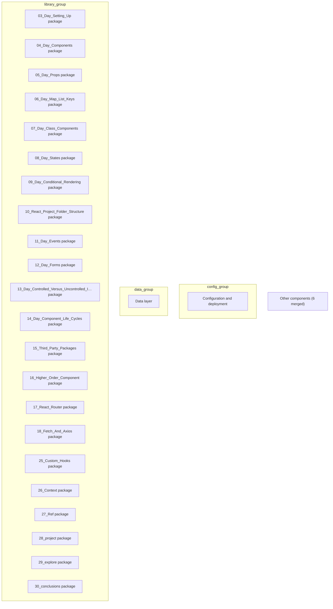

# Architecture report: Asabeneh/30-Days-Of-React

> Automated static analysis. **Observed** = directly seen in files/imports/AST; **Inferred** = interpretation from that evidence. Repository code was not executed.

## 1. Repository at a glance

| Item | Value |
| --- | --- |
| Repository | Asabeneh/30-Days-Of-React |
| Description | 30 Days of  React challenge is a step by step guide to learn React in 30 days.  These videos may help too: https://www.youtube.com/channel/UC7PNRuno1rzYPb1xLa4yktw |
| Language | JavaScript |
| Stars | 27531 |
| Licence | Not detected |
| Analysed commit / branch | 7ab55d69bfa910833989ff5118660844b605852b / master |
| Framework(s) | React |
| Files analysed | 258 |
| Components | 30 |

## 2. Architecture in one minute

Asabeneh/30-Days-Of-React - 30 Days of  React challenge is a step by step guide to learn React in 30 days.  These videos may help too: https://www.youtube.com/channel/UC7PNRuno1rzYPb1xLa4yktw. This repository was analysed statically from 258 file(s) (0 Python). Detected technologies (observed from imports/manifests): React. Files are grouped into 30 component(s): 03_Day_Setting_Up package, 04_Day_Components package, 05_Day_Props package, 06_Day_Map_List_Keys package, 07_Day_Class_Components package, 08_Day_States package, 09_Day_Conditional_Rendering package, 10_React_Project_Folder_Structure package. Findings below distinguish observed facts from inferred interpretation.

## 3. High-level block diagram

## 4. Main components

### 03_Day_Setting_Up package (`c_03_day_setting_up`)

- **Kind:** library
- **Status:** Observed
- **Confidence:** 0.85
- **Responsibility:** Groups 2 file(s) under 03_day_setting_up package (observed from repository paths and static analysis).
- **Paths:** `03_Day_Setting_Up/03_setting_up_boilerplate/src/index.js`, `03_Day_Setting_Up/03_setting_up_boilerplate/src/math.js`
- **Evidence:** [03_Day_Setting_Up/03_setting_up_boilerplate/src/index.js](https://github.com/Asabeneh/30-Days-Of-React/blob/7ab55d69bfa910833989ff5118660844b605852b/03_Day_Setting_Up/03_setting_up_boilerplate/src/index.js); [03_Day_Setting_Up/03_setting_up_boilerplate/src/math.js](https://github.com/Asabeneh/30-Days-Of-React/blob/7ab55d69bfa910833989ff5118660844b605852b/03_Day_Setting_Up/03_setting_up_boilerplate/src/math.js)

### 04_Day_Components package (`c_04_day_components`)

- **Kind:** library
- **Status:** Observed
- **Confidence:** 0.85
- **Responsibility:** Groups 1 file(s) under 04_day_components package (observed from repository paths and static analysis).
- **Paths:** `04_Day_Components/04_components_boilerplate/src/index.js`
- **Evidence:** [04_Day_Components/04_components_boilerplate/src/index.js](https://github.com/Asabeneh/30-Days-Of-React/blob/7ab55d69bfa910833989ff5118660844b605852b/04_Day_Components/04_components_boilerplate/src/index.js)

### 05_Day_Props package (`c_05_day_props`)

- **Kind:** library
- **Status:** Observed
- **Confidence:** 0.85
- **Responsibility:** Groups 1 file(s) under 05_day_props package (observed from repository paths and static analysis).
- **Paths:** `05_Day_Props/05_props_boilerplate/src/index.js`
- **Evidence:** [05_Day_Props/05_props_boilerplate/src/index.js](https://github.com/Asabeneh/30-Days-Of-React/blob/7ab55d69bfa910833989ff5118660844b605852b/05_Day_Props/05_props_boilerplate/src/index.js)

### 06_Day_Map_List_Keys package (`c_06_day_map_list_keys`)

- **Kind:** library
- **Status:** Observed
- **Confidence:** 0.85
- **Responsibility:** Groups 1 file(s) under 06_day_map_list_keys package (observed from repository paths and static analysis).
- **Paths:** `06_Day_Map_List_Keys/06_map_list_keys_boilerplate/src/index.js`
- **Evidence:** [06_Day_Map_List_Keys/06_map_list_keys_boilerplate/src/index.js](https://github.com/Asabeneh/30-Days-Of-React/blob/7ab55d69bfa910833989ff5118660844b605852b/06_Day_Map_List_Keys/06_map_list_keys_boilerplate/src/index.js)

### 07_Day_Class_Components package (`c_07_day_class_components`)

- **Kind:** library
- **Status:** Observed
- **Confidence:** 0.85
- **Responsibility:** Groups 1 file(s) under 07_day_class_components package (observed from repository paths and static analysis).
- **Paths:** `07_Day_Class_Components/07_class_based_components_boilerplate/src/index.js`
- **Evidence:** [07_Day_Class_Components/07_class_based_components_boilerplate/src/index.js](https://github.com/Asabeneh/30-Days-Of-React/blob/7ab55d69bfa910833989ff5118660844b605852b/07_Day_Class_Components/07_class_based_components_boilerplate/src/index.js)

### 08_Day_States package (`c_08_day_states`)

- **Kind:** library
- **Status:** Observed
- **Confidence:** 0.85
- **Responsibility:** Groups 1 file(s) under 08_day_states package (observed from repository paths and static analysis).
- **Paths:** `08_Day_States/08_states_boilerplate/src/index.js`
- **Evidence:** [08_Day_States/08_states_boilerplate/src/index.js](https://github.com/Asabeneh/30-Days-Of-React/blob/7ab55d69bfa910833989ff5118660844b605852b/08_Day_States/08_states_boilerplate/src/index.js)

### 09_Day_Conditional_Rendering package (`c_09_day_conditional_rendering`)

- **Kind:** library
- **Status:** Observed
- **Confidence:** 0.85
- **Responsibility:** Groups 1 file(s) under 09_day_conditional_rendering package (observed from repository paths and static analysis).
- **Paths:** `09_Day_Conditional_Rendering/09_conditional_rendering_boilerplate/src/index.js`
- **Evidence:** [09_Day_Conditional_Rendering/09_conditional_rendering_boilerplate/src/index.js](https://github.com/Asabeneh/30-Days-Of-React/blob/7ab55d69bfa910833989ff5118660844b605852b/09_Day_Conditional_Rendering/09_conditional_rendering_boilerplate/src/index.js)

### 10_React_Project_Folder_Structure package (`c_10_react_project_folder_structure`)

- **Kind:** library
- **Status:** Observed
- **Confidence:** 0.85
- **Responsibility:** Groups 12 file(s) under 10_react_project_folder_structure package (observed from repository paths and static analysis).
- **Paths:** `10_React_Project_Folder_Structure/10_react_project_folder_structure_boilerplate/src/App.js`, `10_React_Project_Folder_Structure/10_react_project_folder_structure_boilerplate/src/components/color/HexaColor.js`, `10_React_Project_Folder_Structure/10_react_project_folder_structure_boilerplate/src/components/country/Country.js`, `10_React_Project_Folder_Structure/10_react_project_folder_structure_boilerplate/src/components/footer/Footer.js`, `10_React_Project_Folder_Structure/10_react_project_folder_structure_boilerplate/src/components/header/Header.js`, `10_React_Project_Folder_Structure/10_react_project_folder_structure_boilerplate/src/components/main/Main.js`, `10_React_Project_Folder_Structure/10_react_project_folder_structure_boilerplate/src/components/shared/Button.js`, `10_React_Project_Folder_Structure/10_react_project_folder_structure_boilerplate/src/components/user/UserCard.js`, `10_React_Project_Folder_Structure/10_react_project_folder_structure_boilerplate/src/index.js`, `10_React_Project_Folder_Structure/10_react_project_folder_structure_boilerplate/src/styles/button-styles.js`, `10_React_Project_Folder_Structure/10_react_project_folder_structure_boilerplate/src/utils/display-date-and-time.js`, `10_React_Project_Folder_Structure/10_react_project_folder_structure_boilerplate/src/utils/hexadecimal-color-generator.js`
- **Evidence:** [10_React_Project_Folder_Structure/10_react_project_folder_structure_boilerplate/src/App.js](https://github.com/Asabeneh/30-Days-Of-React/blob/7ab55d69bfa910833989ff5118660844b605852b/10_React_Project_Folder_Structure/10_react_project_folder_structure_boilerplate/src/App.js); [10_React_Project_Folder_Structure/10_react_project_folder_structure_boilerplate/src/components/color/HexaColor.js](https://github.com/Asabeneh/30-Days-Of-React/blob/7ab55d69bfa910833989ff5118660844b605852b/10_React_Project_Folder_Structure/10_react_project_folder_structure_boilerplate/src/components/color/HexaColor.js); [10_React_Project_Folder_Structure/10_react_project_folder_structure_boilerplate/src/components/country/Country.js](https://github.com/Asabeneh/30-Days-Of-React/blob/7ab55d69bfa910833989ff5118660844b605852b/10_React_Project_Folder_Structure/10_react_project_folder_structure_boilerplate/src/components/country/Country.js); [10_React_Project_Folder_Structure/10_react_project_folder_structure_boilerplate/src/components/footer/Footer.js](https://github.com/Asabeneh/30-Days-Of-React/blob/7ab55d69bfa910833989ff5118660844b605852b/10_React_Project_Folder_Structure/10_react_project_folder_structure_boilerplate/src/components/footer/Footer.js); [10_React_Project_Folder_Structure/10_react_project_folder_structure_boilerplate/src/components/header/Header.js](https://github.com/Asabeneh/30-Days-Of-React/blob/7ab55d69bfa910833989ff5118660844b605852b/10_React_Project_Folder_Structure/10_react_project_folder_structure_boilerplate/src/components/header/Header.js); [10_React_Project_Folder_Structure/10_react_project_folder_structure_boilerplate/src/components/main/Main.js](https://github.com/Asabeneh/30-Days-Of-React/blob/7ab55d69bfa910833989ff5118660844b605852b/10_React_Project_Folder_Structure/10_react_project_folder_structure_boilerplate/src/components/main/Main.js); [10_React_Project_Folder_Structure/10_react_project_folder_structure_boilerplate/src/components/shared/Button.js](https://github.com/Asabeneh/30-Days-Of-React/blob/7ab55d69bfa910833989ff5118660844b605852b/10_React_Project_Folder_Structure/10_react_project_folder_structure_boilerplate/src/components/shared/Button.js); [10_React_Project_Folder_Structure/10_react_project_folder_structure_boilerplate/src/components/user/UserCard.js](https://github.com/Asabeneh/30-Days-Of-React/blob/7ab55d69bfa910833989ff5118660844b605852b/10_React_Project_Folder_Structure/10_react_project_folder_structure_boilerplate/src/components/user/UserCard.js)

### 11_Day_Events package (`c_11_day_events`)

- **Kind:** library
- **Status:** Observed
- **Confidence:** 0.85
- **Responsibility:** Groups 1 file(s) under 11_day_events package (observed from repository paths and static analysis).
- **Paths:** `11_Day_Events/11_events_boilerplate/src/index.js`
- **Evidence:** [11_Day_Events/11_events_boilerplate/src/index.js](https://github.com/Asabeneh/30-Days-Of-React/blob/7ab55d69bfa910833989ff5118660844b605852b/11_Day_Events/11_events_boilerplate/src/index.js)

### 12_Day_Forms package (`c_12_day_forms`)

- **Kind:** library
- **Status:** Observed
- **Confidence:** 0.85
- **Responsibility:** Groups 1 file(s) under 12_day_forms package (observed from repository paths and static analysis).
- **Paths:** `12_Day_Forms/12_forms_boilerplate/src/index.js`
- **Evidence:** [12_Day_Forms/12_forms_boilerplate/src/index.js](https://github.com/Asabeneh/30-Days-Of-React/blob/7ab55d69bfa910833989ff5118660844b605852b/12_Day_Forms/12_forms_boilerplate/src/index.js)

### 13_Day_Controlled_Versus_Uncontrolled_I… package (`c_13_day_controlled_versus_uncontrolled_input`)

- **Kind:** library
- **Status:** Observed
- **Confidence:** 0.85
- **Responsibility:** Groups 1 file(s) under 13_day_controlled_versus_uncontrolled_i… package (observed from repository paths and static analysis).
- **Paths:** `13_Day_Controlled_Versus_Uncontrolled_Input/13_uncontrolled_input_boilerplate/src/index.js`
- **Evidence:** [13_Day_Controlled_Versus_Uncontrolled_Input/13_uncontrolled_input_boilerplate/src/index.js](https://github.com/Asabeneh/30-Days-Of-React/blob/7ab55d69bfa910833989ff5118660844b605852b/13_Day_Controlled_Versus_Uncontrolled_Input/13_uncontrolled_input_boilerplate/src/index.js)

### 14_Day_Component_Life_Cycles package (`c_14_day_component_life_cycles`)

- **Kind:** library
- **Status:** Observed
- **Confidence:** 0.85
- **Responsibility:** Groups 1 file(s) under 14_day_component_life_cycles package (observed from repository paths and static analysis).
- **Paths:** `14_Day_Component_Life_Cycles/14_component_life_cycles_boilerplate/src/index.js`
- **Evidence:** [14_Day_Component_Life_Cycles/14_component_life_cycles_boilerplate/src/index.js](https://github.com/Asabeneh/30-Days-Of-React/blob/7ab55d69bfa910833989ff5118660844b605852b/14_Day_Component_Life_Cycles/14_component_life_cycles_boilerplate/src/index.js)

### 15_Third_Party_Packages package (`c_15_third_party_packages`)

- **Kind:** library
- **Status:** Observed
- **Confidence:** 0.85
- **Responsibility:** Groups 1 file(s) under 15_third_party_packages package (observed from repository paths and static analysis).
- **Paths:** `15_Third_Party_Packages/15_third_pary_packages_boilerplate/src/index.js`
- **Evidence:** [15_Third_Party_Packages/15_third_pary_packages_boilerplate/src/index.js](https://github.com/Asabeneh/30-Days-Of-React/blob/7ab55d69bfa910833989ff5118660844b605852b/15_Third_Party_Packages/15_third_pary_packages_boilerplate/src/index.js)

### 16_Higher_Order_Component package (`c_16_higher_order_component`)

- **Kind:** library
- **Status:** Observed
- **Confidence:** 0.85
- **Responsibility:** Groups 1 file(s) under 16_higher_order_component package (observed from repository paths and static analysis).
- **Paths:** `16_Higher_Order_Component/16_higher_order_component_boilerplate/src/index.js`
- **Evidence:** [16_Higher_Order_Component/16_higher_order_component_boilerplate/src/index.js](https://github.com/Asabeneh/30-Days-Of-React/blob/7ab55d69bfa910833989ff5118660844b605852b/16_Higher_Order_Component/16_higher_order_component_boilerplate/src/index.js)

### 17_React_Router package (`c_17_react_router`)

- **Kind:** library
- **Status:** Observed
- **Confidence:** 0.85
- **Responsibility:** Groups 1 file(s) under 17_react_router package (observed from repository paths and static analysis).
- **Paths:** `17_React_Router/17_react_router_boilerplate/src/index.js`
- **Evidence:** [17_React_Router/17_react_router_boilerplate/src/index.js](https://github.com/Asabeneh/30-Days-Of-React/blob/7ab55d69bfa910833989ff5118660844b605852b/17_React_Router/17_react_router_boilerplate/src/index.js)

### 18_Fetch_And_Axios package (`c_18_fetch_and_axios`)

- **Kind:** library
- **Status:** Observed
- **Confidence:** 0.85
- **Responsibility:** Groups 1 file(s) under 18_fetch_and_axios package (observed from repository paths and static analysis).
- **Paths:** `18_Fetch_And_Axios/18_fetch_and_axios_boilerplate/src/index.js`
- **Evidence:** [18_Fetch_And_Axios/18_fetch_and_axios_boilerplate/src/index.js](https://github.com/Asabeneh/30-Days-Of-React/blob/7ab55d69bfa910833989ff5118660844b605852b/18_Fetch_And_Axios/18_fetch_and_axios_boilerplate/src/index.js)

### 19_projects package (`c_19_projects`)

- **Kind:** library
- **Status:** Observed
- **Confidence:** 0.85
- **Responsibility:** Groups 1 file(s) under 19_projects package (observed from repository paths and static analysis).
- **Paths:** `19_projects/19_projects_boilerplate/src/index.js`
- **Evidence:** [19_projects/19_projects_boilerplate/src/index.js](https://github.com/Asabeneh/30-Days-Of-React/blob/7ab55d69bfa910833989ff5118660844b605852b/19_projects/19_projects_boilerplate/src/index.js)

### 20_projects package (`c_20_projects`)

- **Kind:** library
- **Status:** Observed
- **Confidence:** 0.85
- **Responsibility:** Groups 1 file(s) under 20_projects package (observed from repository paths and static analysis).
- **Paths:** `20_projects/20_projects_boilerplate/src/index.js`
- **Evidence:** [20_projects/20_projects_boilerplate/src/index.js](https://github.com/Asabeneh/30-Days-Of-React/blob/7ab55d69bfa910833989ff5118660844b605852b/20_projects/20_projects_boilerplate/src/index.js)

### 21_Introducing_Hooks package (`c_21_introducing_hooks`)

- **Kind:** library
- **Status:** Observed
- **Confidence:** 0.85
- **Responsibility:** Groups 1 file(s) under 21_introducing_hooks package (observed from repository paths and static analysis).
- **Paths:** `21_Introducing_Hooks/21_introducing_hooks_boilerplate/src/index.js`
- **Evidence:** [21_Introducing_Hooks/21_introducing_hooks_boilerplate/src/index.js](https://github.com/Asabeneh/30-Days-Of-React/blob/7ab55d69bfa910833989ff5118660844b605852b/21_Introducing_Hooks/21_introducing_hooks_boilerplate/src/index.js)

### 22_Form_Using_Hooks package (`c_22_form_using_hooks`)

- **Kind:** library
- **Status:** Observed
- **Confidence:** 0.85
- **Responsibility:** Groups 1 file(s) under 22_form_using_hooks package (observed from repository paths and static analysis).
- **Paths:** `22_Form_Using_Hooks/22_form_using_hooks_boilerplate/src/index.js`
- **Evidence:** [22_Form_Using_Hooks/22_form_using_hooks_boilerplate/src/index.js](https://github.com/Asabeneh/30-Days-Of-React/blob/7ab55d69bfa910833989ff5118660844b605852b/22_Form_Using_Hooks/22_form_using_hooks_boilerplate/src/index.js)

### 23_Fetching_Data_Using_Hooks package (`c_23_fetching_data_using_hooks`)

- **Kind:** library
- **Status:** Observed
- **Confidence:** 0.85
- **Responsibility:** Groups 1 file(s) under 23_fetching_data_using_hooks package (observed from repository paths and static analysis).
- **Paths:** `23_Fetching_Data_Using_Hooks/23_fetching_data_using_hooks_boilerplate/src/index.js`
- **Evidence:** [23_Fetching_Data_Using_Hooks/23_fetching_data_using_hooks_boilerplate/src/index.js](https://github.com/Asabeneh/30-Days-Of-React/blob/7ab55d69bfa910833989ff5118660844b605852b/23_Fetching_Data_Using_Hooks/23_fetching_data_using_hooks_boilerplate/src/index.js)

### 24_projects package (`c_24_projects`)

- **Kind:** library
- **Status:** Observed
- **Confidence:** 0.85
- **Responsibility:** Groups 1 file(s) under 24_projects package (observed from repository paths and static analysis).
- **Paths:** `24_projects/24_projects_boilerplate/src/index.js`
- **Evidence:** [24_projects/24_projects_boilerplate/src/index.js](https://github.com/Asabeneh/30-Days-Of-React/blob/7ab55d69bfa910833989ff5118660844b605852b/24_projects/24_projects_boilerplate/src/index.js)

### 25_Custom_Hooks package (`c_25_custom_hooks`)

- **Kind:** library
- **Status:** Observed
- **Confidence:** 0.85
- **Responsibility:** Groups 2 file(s) under 25_custom_hooks package (observed from repository paths and static analysis).
- **Paths:** `25_Custom_Hooks/25_custom_hooks_boilerplate/src/index.js`, `25_Custom_Hooks/25_custom_hooks_boilerplate/src/useFetch.js`
- **Evidence:** [25_Custom_Hooks/25_custom_hooks_boilerplate/src/index.js](https://github.com/Asabeneh/30-Days-Of-React/blob/7ab55d69bfa910833989ff5118660844b605852b/25_Custom_Hooks/25_custom_hooks_boilerplate/src/index.js); [25_Custom_Hooks/25_custom_hooks_boilerplate/src/useFetch.js](https://github.com/Asabeneh/30-Days-Of-React/blob/7ab55d69bfa910833989ff5118660844b605852b/25_Custom_Hooks/25_custom_hooks_boilerplate/src/useFetch.js)

### 26_Context package (`c_26_context`)

- **Kind:** library
- **Status:** Observed
- **Confidence:** 0.85
- **Responsibility:** Groups 2 file(s) under 26_context package (observed from repository paths and static analysis).
- **Paths:** `26_Context/26_context_boilerplate/src/index.js`, `26_Context/26_context_boilerplate/src/useFetch.js`
- **Evidence:** [26_Context/26_context_boilerplate/src/index.js](https://github.com/Asabeneh/30-Days-Of-React/blob/7ab55d69bfa910833989ff5118660844b605852b/26_Context/26_context_boilerplate/src/index.js); [26_Context/26_context_boilerplate/src/useFetch.js](https://github.com/Asabeneh/30-Days-Of-React/blob/7ab55d69bfa910833989ff5118660844b605852b/26_Context/26_context_boilerplate/src/useFetch.js)

### 27_Ref package (`c_27_ref`)

- **Kind:** library
- **Status:** Observed
- **Confidence:** 0.85
- **Responsibility:** Groups 2 file(s) under 27_ref package (observed from repository paths and static analysis).
- **Paths:** `27_Ref/27_ref_boilerplate/src/index.js`, `27_Ref/27_ref_boilerplate/src/useFetch.js`
- **Evidence:** [27_Ref/27_ref_boilerplate/src/index.js](https://github.com/Asabeneh/30-Days-Of-React/blob/7ab55d69bfa910833989ff5118660844b605852b/27_Ref/27_ref_boilerplate/src/index.js); [27_Ref/27_ref_boilerplate/src/useFetch.js](https://github.com/Asabeneh/30-Days-Of-React/blob/7ab55d69bfa910833989ff5118660844b605852b/27_Ref/27_ref_boilerplate/src/useFetch.js)

### 28_project package (`c_28_project`)

- **Kind:** library
- **Status:** Observed
- **Confidence:** 0.85
- **Responsibility:** Groups 2 file(s) under 28_project package (observed from repository paths and static analysis).
- **Paths:** `28_project/28_project_boilerplate/src/index.js`, `28_project/28_project_boilerplate/src/useFetch.js`
- **Evidence:** [28_project/28_project_boilerplate/src/index.js](https://github.com/Asabeneh/30-Days-Of-React/blob/7ab55d69bfa910833989ff5118660844b605852b/28_project/28_project_boilerplate/src/index.js); [28_project/28_project_boilerplate/src/useFetch.js](https://github.com/Asabeneh/30-Days-Of-React/blob/7ab55d69bfa910833989ff5118660844b605852b/28_project/28_project_boilerplate/src/useFetch.js)

### 29_explore package (`c_29_explore`)

- **Kind:** library
- **Status:** Observed
- **Confidence:** 0.85
- **Responsibility:** Groups 2 file(s) under 29_explore package (observed from repository paths and static analysis).
- **Paths:** `29_explore/29_explore_boilerplate/src/index.js`, `29_explore/29_explore_boilerplate/src/useFetch.js`
- **Evidence:** [29_explore/29_explore_boilerplate/src/index.js](https://github.com/Asabeneh/30-Days-Of-React/blob/7ab55d69bfa910833989ff5118660844b605852b/29_explore/29_explore_boilerplate/src/index.js); [29_explore/29_explore_boilerplate/src/useFetch.js](https://github.com/Asabeneh/30-Days-Of-React/blob/7ab55d69bfa910833989ff5118660844b605852b/29_explore/29_explore_boilerplate/src/useFetch.js)

### 30_conclusions package (`c_30_conclusions`)

- **Kind:** library
- **Status:** Observed
- **Confidence:** 0.85
- **Responsibility:** Groups 2 file(s) under 30_conclusions package (observed from repository paths and static analysis).
- **Paths:** `30_conclusions/30_conclusions_boilerplate/src/index.js`, `30_conclusions/30_conclusions_boilerplate/src/useFetch.js`
- **Evidence:** [30_conclusions/30_conclusions_boilerplate/src/index.js](https://github.com/Asabeneh/30-Days-Of-React/blob/7ab55d69bfa910833989ff5118660844b605852b/30_conclusions/30_conclusions_boilerplate/src/index.js); [30_conclusions/30_conclusions_boilerplate/src/useFetch.js](https://github.com/Asabeneh/30-Days-Of-React/blob/7ab55d69bfa910833989ff5118660844b605852b/30_conclusions/30_conclusions_boilerplate/src/useFetch.js)

### Configuration and deployment (`config`)

- **Kind:** config
- **Status:** Observed
- **Confidence:** 0.85
- **Responsibility:** Groups 28 file(s) under configuration and deployment (observed from repository paths and static analysis).
- **Paths:** `03_Day_Setting_Up/03_setting_up_boilerplate/package.json`, `04_Day_Components/04_components_boilerplate/package.json`, `05_Day_Props/05_props_boilerplate/package.json`, `06_Day_Map_List_Keys/06_map_list_keys_boilerplate/package.json`, `07_Day_Class_Components/07_class_based_components_boilerplate/package.json`, `08_Day_States/08_states_boilerplate/package.json`, `09_Day_Conditional_Rendering/09_conditional_rendering_boilerplate/package.json`, `10_React_Project_Folder_Structure/10_react_project_folder_structure_boilerplate/package.json`, `11_Day_Events/11_events_boilerplate/package.json`, `12_Day_Forms/12_forms_boilerplate/package.json`, `13_Day_Controlled_Versus_Uncontrolled_Input/13_uncontrolled_input_boilerplate/package.json`, `14_Day_Component_Life_Cycles/14_component_life_cycles_boilerplate/package.json`, `15_Third_Party_Packages/15_third_pary_packages_boilerplate/package.json`, `16_Higher_Order_Component/16_higher_order_component_boilerplate/package.json`, `17_React_Router/17_react_router_boilerplate/package.json`, `18_Fetch_And_Axios/18_fetch_and_axios_boilerplate/package.json`, `19_projects/19_projects_boilerplate/package.json`, `20_projects/20_projects_boilerplate/package.json`, `21_Introducing_Hooks/21_introducing_hooks_boilerplate/package.json`, `22_Form_Using_Hooks/22_form_using_hooks_boilerplate/package.json`, `23_Fetching_Data_Using_Hooks/23_fetching_data_using_hooks_boilerplate/package.json`, `24_projects/24_projects_boilerplate/package.json`, `25_Custom_Hooks/25_custom_hooks_boilerplate/package.json`, `26_Context/26_context_boilerplate/package.json`, `27_Ref/27_ref_boilerplate/package.json`, `28_project/28_project_boilerplate/package.json`, `29_explore/29_explore_boilerplate/package.json`, `30_conclusions/30_conclusions_boilerplate/package.json`
- **Evidence:** [03_Day_Setting_Up/03_setting_up_boilerplate/package.json](https://github.com/Asabeneh/30-Days-Of-React/blob/7ab55d69bfa910833989ff5118660844b605852b/03_Day_Setting_Up/03_setting_up_boilerplate/package.json); [04_Day_Components/04_components_boilerplate/package.json](https://github.com/Asabeneh/30-Days-Of-React/blob/7ab55d69bfa910833989ff5118660844b605852b/04_Day_Components/04_components_boilerplate/package.json); [05_Day_Props/05_props_boilerplate/package.json](https://github.com/Asabeneh/30-Days-Of-React/blob/7ab55d69bfa910833989ff5118660844b605852b/05_Day_Props/05_props_boilerplate/package.json); [06_Day_Map_List_Keys/06_map_list_keys_boilerplate/package.json](https://github.com/Asabeneh/30-Days-Of-React/blob/7ab55d69bfa910833989ff5118660844b605852b/06_Day_Map_List_Keys/06_map_list_keys_boilerplate/package.json); [07_Day_Class_Components/07_class_based_components_boilerplate/package.json](https://github.com/Asabeneh/30-Days-Of-React/blob/7ab55d69bfa910833989ff5118660844b605852b/07_Day_Class_Components/07_class_based_components_boilerplate/package.json); [08_Day_States/08_states_boilerplate/package.json](https://github.com/Asabeneh/30-Days-Of-React/blob/7ab55d69bfa910833989ff5118660844b605852b/08_Day_States/08_states_boilerplate/package.json); [09_Day_Conditional_Rendering/09_conditional_rendering_boilerplate/package.json](https://github.com/Asabeneh/30-Days-Of-React/blob/7ab55d69bfa910833989ff5118660844b605852b/09_Day_Conditional_Rendering/09_conditional_rendering_boilerplate/package.json); [10_React_Project_Folder_Structure/10_react_project_folder_structure_boilerplate/package.json](https://github.com/Asabeneh/30-Days-Of-React/blob/7ab55d69bfa910833989ff5118660844b605852b/10_React_Project_Folder_Structure/10_react_project_folder_structure_boilerplate/package.json)

### Data layer (`data_layer`)

- **Kind:** data
- **Status:** Observed
- **Confidence:** 0.85
- **Responsibility:** Groups 50 file(s) under data layer (observed from repository paths and static analysis).
- **Paths:** `06_Day_Map_List_Keys/06_map_list_keys_boilerplate/src/data/countries.js`, `06_Day_Map_List_Keys/06_map_list_keys_boilerplate/src/data/ten_most_highest_populations.js`, `07_Day_Class_Components/07_class_based_components_boilerplate/src/data/countries.js`, `07_Day_Class_Components/07_class_based_components_boilerplate/src/data/ten_most_highest_populations.js`, `08_Day_States/08_states_boilerplate/src/data/countries.js`, `08_Day_States/08_states_boilerplate/src/data/ten_most_highest_populations.js`, `09_Day_Conditional_Rendering/09_conditional_rendering_boilerplate/src/data/countries.js`, `09_Day_Conditional_Rendering/09_conditional_rendering_boilerplate/src/data/ten_most_highest_populations.js`, `10_React_Project_Folder_Structure/10_react_project_folder_structure_boilerplate/src/data/countries.js`, `10_React_Project_Folder_Structure/10_react_project_folder_structure_boilerplate/src/data/ten_most_highest_populations.js`, `11_Day_Events/11_events_boilerplate/src/data/countries.js`, `11_Day_Events/11_events_boilerplate/src/data/ten_most_highest_populations.js`, `12_Day_Forms/12_forms_boilerplate/src/data/countries.js`, `12_Day_Forms/12_forms_boilerplate/src/data/ten_most_highest_populations.js`, `13_Day_Controlled_Versus_Uncontrolled_Input/13_uncontrolled_input_boilerplate/src/data/countries.js`, `13_Day_Controlled_Versus_Uncontrolled_Input/13_uncontrolled_input_boilerplate/src/data/ten_most_highest_populations.js`, `14_Day_Component_Life_Cycles/14_component_life_cycles_boilerplate/src/data/countries.js`, `14_Day_Component_Life_Cycles/14_component_life_cycles_boilerplate/src/data/ten_most_highest_populations.js`, `15_Third_Party_Packages/15_third_pary_packages_boilerplate/src/data/countries.js`, `15_Third_Party_Packages/15_third_pary_packages_boilerplate/src/data/ten_most_highest_populations.js`, `16_Higher_Order_Component/16_higher_order_component_boilerplate/src/data/countries.js`, `16_Higher_Order_Component/16_higher_order_component_boilerplate/src/data/ten_most_highest_populations.js`, `17_React_Router/17_react_router_boilerplate/src/data/countries.js`, `17_React_Router/17_react_router_boilerplate/src/data/ten_most_highest_populations.js`, `18_Fetch_And_Axios/18_fetch_and_axios_boilerplate/src/data/countries.js`, `18_Fetch_And_Axios/18_fetch_and_axios_boilerplate/src/data/ten_most_highest_populations.js`, `19_projects/19_projects_boilerplate/src/data/countries.js`, `19_projects/19_projects_boilerplate/src/data/ten_most_highest_populations.js`, `20_projects/20_projects_boilerplate/src/data/countries.js`, `20_projects/20_projects_boilerplate/src/data/ten_most_highest_populations.js`, `21_Introducing_Hooks/21_introducing_hooks_boilerplate/src/data/countries.js`, `21_Introducing_Hooks/21_introducing_hooks_boilerplate/src/data/ten_most_highest_populations.js`, `22_Form_Using_Hooks/22_form_using_hooks_boilerplate/src/data/countries.js`, `22_Form_Using_Hooks/22_form_using_hooks_boilerplate/src/data/ten_most_highest_populations.js`, `23_Fetching_Data_Using_Hooks/23_fetching_data_using_hooks_boilerplate/src/data/countries.js`, `23_Fetching_Data_Using_Hooks/23_fetching_data_using_hooks_boilerplate/src/data/ten_most_highest_populations.js`, `24_projects/24_projects_boilerplate/src/data/countries.js`, `24_projects/24_projects_boilerplate/src/data/ten_most_highest_populations.js`, `25_Custom_Hooks/25_custom_hooks_boilerplate/src/data/countries.js`, `25_Custom_Hooks/25_custom_hooks_boilerplate/src/data/ten_most_highest_populations.js`, `26_Context/26_context_boilerplate/src/data/countries.js`, `26_Context/26_context_boilerplate/src/data/ten_most_highest_populations.js`, `27_Ref/27_ref_boilerplate/src/data/countries.js`, `27_Ref/27_ref_boilerplate/src/data/ten_most_highest_populations.js`, `28_project/28_project_boilerplate/src/data/countries.js`, `28_project/28_project_boilerplate/src/data/ten_most_highest_populations.js`, `29_explore/29_explore_boilerplate/src/data/countries.js`, `29_explore/29_explore_boilerplate/src/data/ten_most_highest_populations.js`, `30_conclusions/30_conclusions_boilerplate/src/data/countries.js`, `30_conclusions/30_conclusions_boilerplate/src/data/ten_most_highest_populations.js`
- **Evidence:** [06_Day_Map_List_Keys/06_map_list_keys_boilerplate/src/data/countries.js](https://github.com/Asabeneh/30-Days-Of-React/blob/7ab55d69bfa910833989ff5118660844b605852b/06_Day_Map_List_Keys/06_map_list_keys_boilerplate/src/data/countries.js); [06_Day_Map_List_Keys/06_map_list_keys_boilerplate/src/data/ten_most_highest_populations.js](https://github.com/Asabeneh/30-Days-Of-React/blob/7ab55d69bfa910833989ff5118660844b605852b/06_Day_Map_List_Keys/06_map_list_keys_boilerplate/src/data/ten_most_highest_populations.js); [07_Day_Class_Components/07_class_based_components_boilerplate/src/data/countries.js](https://github.com/Asabeneh/30-Days-Of-React/blob/7ab55d69bfa910833989ff5118660844b605852b/07_Day_Class_Components/07_class_based_components_boilerplate/src/data/countries.js); [07_Day_Class_Components/07_class_based_components_boilerplate/src/data/ten_most_highest_populations.js](https://github.com/Asabeneh/30-Days-Of-React/blob/7ab55d69bfa910833989ff5118660844b605852b/07_Day_Class_Components/07_class_based_components_boilerplate/src/data/ten_most_highest_populations.js); [08_Day_States/08_states_boilerplate/src/data/countries.js](https://github.com/Asabeneh/30-Days-Of-React/blob/7ab55d69bfa910833989ff5118660844b605852b/08_Day_States/08_states_boilerplate/src/data/countries.js); [08_Day_States/08_states_boilerplate/src/data/ten_most_highest_populations.js](https://github.com/Asabeneh/30-Days-Of-React/blob/7ab55d69bfa910833989ff5118660844b605852b/08_Day_States/08_states_boilerplate/src/data/ten_most_highest_populations.js); [09_Day_Conditional_Rendering/09_conditional_rendering_boilerplate/src/data/countries.js](https://github.com/Asabeneh/30-Days-Of-React/blob/7ab55d69bfa910833989ff5118660844b605852b/09_Day_Conditional_Rendering/09_conditional_rendering_boilerplate/src/data/countries.js); [09_Day_Conditional_Rendering/09_conditional_rendering_boilerplate/src/data/ten_most_highest_populations.js](https://github.com/Asabeneh/30-Days-Of-React/blob/7ab55d69bfa910833989ff5118660844b605852b/09_Day_Conditional_Rendering/09_conditional_rendering_boilerplate/src/data/ten_most_highest_populations.js)

## 5. Execution flow

**Observed** entry point(s):

- [03_Day_Setting_Up/03_setting_up_boilerplate/src/index.js](https://github.com/Asabeneh/30-Days-Of-React/blob/7ab55d69bfa910833989ff5118660844b605852b/03_Day_Setting_Up/03_setting_up_boilerplate/src/index.js)
- [04_Day_Components/04_components_boilerplate/src/index.js](https://github.com/Asabeneh/30-Days-Of-React/blob/7ab55d69bfa910833989ff5118660844b605852b/04_Day_Components/04_components_boilerplate/src/index.js)
- [05_Day_Props/05_props_boilerplate/src/index.js](https://github.com/Asabeneh/30-Days-Of-React/blob/7ab55d69bfa910833989ff5118660844b605852b/05_Day_Props/05_props_boilerplate/src/index.js)
- [06_Day_Map_List_Keys/06_map_list_keys_boilerplate/src/index.js](https://github.com/Asabeneh/30-Days-Of-React/blob/7ab55d69bfa910833989ff5118660844b605852b/06_Day_Map_List_Keys/06_map_list_keys_boilerplate/src/index.js)
- [07_Day_Class_Components/07_class_based_components_boilerplate/src/index.js](https://github.com/Asabeneh/30-Days-Of-React/blob/7ab55d69bfa910833989ff5118660844b605852b/07_Day_Class_Components/07_class_based_components_boilerplate/src/index.js)
- [08_Day_States/08_states_boilerplate/src/index.js](https://github.com/Asabeneh/30-Days-Of-React/blob/7ab55d69bfa910833989ff5118660844b605852b/08_Day_States/08_states_boilerplate/src/index.js)
- [09_Day_Conditional_Rendering/09_conditional_rendering_boilerplate/src/index.js](https://github.com/Asabeneh/30-Days-Of-React/blob/7ab55d69bfa910833989ff5118660844b605852b/09_Day_Conditional_Rendering/09_conditional_rendering_boilerplate/src/index.js)
- [10_React_Project_Folder_Structure/10_react_project_folder_structure_boilerplate/src/App.js](https://github.com/Asabeneh/30-Days-Of-React/blob/7ab55d69bfa910833989ff5118660844b605852b/10_React_Project_Folder_Structure/10_react_project_folder_structure_boilerplate/src/App.js)
- [10_React_Project_Folder_Structure/10_react_project_folder_structure_boilerplate/src/index.js](https://github.com/Asabeneh/30-Days-Of-React/blob/7ab55d69bfa910833989ff5118660844b605852b/10_React_Project_Folder_Structure/10_react_project_folder_structure_boilerplate/src/index.js)
- [11_Day_Events/11_events_boilerplate/src/index.js](https://github.com/Asabeneh/30-Days-Of-React/blob/7ab55d69bfa910833989ff5118660844b605852b/11_Day_Events/11_events_boilerplate/src/index.js)
- [12_Day_Forms/12_forms_boilerplate/src/index.js](https://github.com/Asabeneh/30-Days-Of-React/blob/7ab55d69bfa910833989ff5118660844b605852b/12_Day_Forms/12_forms_boilerplate/src/index.js)
- [13_Day_Controlled_Versus_Uncontrolled_Input/13_uncontrolled_input_boilerplate/src/index.js](https://github.com/Asabeneh/30-Days-Of-React/blob/7ab55d69bfa910833989ff5118660844b605852b/13_Day_Controlled_Versus_Uncontrolled_Input/13_uncontrolled_input_boilerplate/src/index.js)

Representative flow (derived from observed entry points and the import graph; steps beyond the entry point are **Inferred**):

1. Execution starts at an observed entry point listed above, if present.
2. No internal import relationships between components were observed.

## 6. Project structure

### `(root)`

- `.gitignore` - other (54 bytes)
- `readMe.md` - docs (21478 bytes)

### `.github`

- `.github/FUNDING.yml` - config (993 bytes)

### `01_Day_JavaScript_Refresher`

- `01_Day_JavaScript_Refresher/01_javascript_refresher.md` - docs (132548 bytes)

### `02_Day_Introduction_to_React`

- `02_Day_Introduction_to_React/02_introduction_to_react.md` - docs (47644 bytes)

### `03_Day_Setting_Up`

- `03_Day_Setting_Up/03_setting_up.md` - docs (21355 bytes)
- `03_Day_Setting_Up/03_setting_up_boilerplate/.gitignore` - other (310 bytes)
- `03_Day_Setting_Up/03_setting_up_boilerplate/README.md` - docs (107 bytes)
- `03_Day_Setting_Up/03_setting_up_boilerplate/package.json` - manifest (752 bytes)
- `03_Day_Setting_Up/03_setting_up_boilerplate/public/index.html` - other (1791 bytes)
- `03_Day_Setting_Up/03_setting_up_boilerplate/src/index.js` - source, JavaScript (2409 bytes)
- `03_Day_Setting_Up/03_setting_up_boilerplate/src/math.js` - source, JavaScript (229 bytes)

### `04_Day_Components`

- `04_Day_Components/04_components.md` - docs (16053 bytes)
- `04_Day_Components/04_components_boilerplate/.gitignore` - other (310 bytes)
- `04_Day_Components/04_components_boilerplate/README.md` - docs (107 bytes)
- `04_Day_Components/04_components_boilerplate/package.json` - manifest (752 bytes)
- `04_Day_Components/04_components_boilerplate/public/index.html` - other (1990 bytes)
- `04_Day_Components/04_components_boilerplate/src/index.js` - source, JavaScript (2369 bytes)

### `05_Day_Props`

- `05_Day_Props/05_props.md` - docs (28140 bytes)
- `05_Day_Props/05_props_boilerplate/.gitignore` - other (310 bytes)
- `05_Day_Props/05_props_boilerplate/README.md` - docs (107 bytes)
- `05_Day_Props/05_props_boilerplate/package.json` - manifest (752 bytes)
- `05_Day_Props/05_props_boilerplate/public/index.html` - other (1990 bytes)
- `05_Day_Props/05_props_boilerplate/src/index.js` - source, JavaScript (3344 bytes)

### `06_Day_Map_List_Keys`

- `06_Day_Map_List_Keys/06_map_list_keys.md` - docs (7881 bytes)
- `06_Day_Map_List_Keys/06_map_list_keys_boilerplate/.gitignore` - other (310 bytes)
- `06_Day_Map_List_Keys/06_map_list_keys_boilerplate/README.md` - docs (107 bytes)
- `06_Day_Map_List_Keys/06_map_list_keys_boilerplate/package.json` - manifest (752 bytes)
- `06_Day_Map_List_Keys/06_map_list_keys_boilerplate/public/index.html` - other (1990 bytes)
- `06_Day_Map_List_Keys/06_map_list_keys_boilerplate/src/data/countries.js` - source, JavaScript (50401 bytes)
- `06_Day_Map_List_Keys/06_map_list_keys_boilerplate/src/data/ten_most_highest_populations.js` - source, JavaScript (607 bytes)
- `06_Day_Map_List_Keys/06_map_list_keys_boilerplate/src/index.js` - source, JavaScript (1148 bytes)

### `07_Day_Class_Components`

- `07_Day_Class_Components/07_class_based_components_boilerplate/.gitignore` - other (310 bytes)
- `07_Day_Class_Components/07_class_based_components_boilerplate/README.md` - docs (107 bytes)
- `07_Day_Class_Components/07_class_based_components_boilerplate/package.json` - manifest (752 bytes)
- `07_Day_Class_Components/07_class_based_components_boilerplate/public/index.html` - other (1990 bytes)
- `07_Day_Class_Components/07_class_based_components_boilerplate/src/data/countries.js` - source, JavaScript (50401 bytes)
- `07_Day_Class_Components/07_class_based_components_boilerplate/src/data/ten_most_highest_populations.js` - source, JavaScript (607 bytes)
- `07_Day_Class_Components/07_class_based_components_boilerplate/src/index.js` - source, JavaScript (4106 bytes)
- `07_Day_Class_Components/07_class_components.md` - docs (20364 bytes)

### `08_Day_States`

- `08_Day_States/08_states.md` - docs (13740 bytes)
- `08_Day_States/08_states_boilerplate/.gitignore` - other (310 bytes)
- `08_Day_States/08_states_boilerplate/README.md` - docs (107 bytes)
- `08_Day_States/08_states_boilerplate/package.json` - manifest (752 bytes)
- `08_Day_States/08_states_boilerplate/public/index.html` - other (1990 bytes)
- `08_Day_States/08_states_boilerplate/src/data/countries.js` - source, JavaScript (50401 bytes)
- `08_Day_States/08_states_boilerplate/src/data/ten_most_highest_populations.js` - source, JavaScript (607 bytes)
- `08_Day_States/08_states_boilerplate/src/index.js` - source, JavaScript (5569 bytes)

### `09_Day_Conditional_Rendering`

- `09_Day_Conditional_Rendering/09_conditional_rendering.md` - docs (17740 bytes)
- `09_Day_Conditional_Rendering/09_conditional_rendering_boilerplate/.gitignore` - other (310 bytes)
- `09_Day_Conditional_Rendering/09_conditional_rendering_boilerplate/README.md` - docs (107 bytes)
- `09_Day_Conditional_Rendering/09_conditional_rendering_boilerplate/package.json` - manifest (752 bytes)
- `09_Day_Conditional_Rendering/09_conditional_rendering_boilerplate/public/index.html` - other (1990 bytes)
- `09_Day_Conditional_Rendering/09_conditional_rendering_boilerplate/src/data/countries.js` - source, JavaScript (50401 bytes)
- `09_Day_Conditional_Rendering/09_conditional_rendering_boilerplate/src/data/ten_most_highest_populations.js` - source, JavaScript (607 bytes)
- `09_Day_Conditional_Rendering/09_conditional_rendering_boilerplate/src/index.js` - source, JavaScript (4861 bytes)

### `10_React_Project_Folder_Structure`

- `10_React_Project_Folder_Structure/10_react_project_folder_structure.md` - docs (15982 bytes)
- `10_React_Project_Folder_Structure/10_react_project_folder_structure_boilerplate/.gitignore` - other (310 bytes)
- `10_React_Project_Folder_Structure/10_react_project_folder_structure_boilerplate/README.md` - docs (108 bytes)
- `10_React_Project_Folder_Structure/10_react_project_folder_structure_boilerplate/package.json` - manifest (752 bytes)
- `10_React_Project_Folder_Structure/10_react_project_folder_structure_boilerplate/public/index.html` - other (558 bytes)
- `10_React_Project_Folder_Structure/10_react_project_folder_structure_boilerplate/src/App.js` - source, JavaScript (1709 bytes)
- `10_React_Project_Folder_Structure/10_react_project_folder_structure_boilerplate/src/components/color/HexaColor.js` - source, JavaScript (300 bytes)
- `10_React_Project_Folder_Structure/10_react_project_folder_structure_boilerplate/src/components/country/Country.js` - source, JavaScript (932 bytes)
- `10_React_Project_Folder_Structure/10_react_project_folder_structure_boilerplate/src/components/footer/Footer.js` - source, JavaScript (221 bytes)
- `10_React_Project_Folder_Structure/10_react_project_folder_structure_boilerplate/src/components/header/Header.js` - source, JavaScript (546 bytes)
- `10_React_Project_Folder_Structure/10_react_project_folder_structure_boilerplate/src/components/main/Main.js` - source, JavaScript (2515 bytes)
- `10_React_Project_Folder_Structure/10_react_project_folder_structure_boilerplate/src/components/shared/Button.js` - source, JavaScript (188 bytes)
- `10_React_Project_Folder_Structure/10_react_project_folder_structure_boilerplate/src/components/user/UserCard.js` - source, JavaScript (281 bytes)
- `10_React_Project_Folder_Structure/10_react_project_folder_structure_boilerplate/src/data/countries.js` - source, JavaScript (50402 bytes)
- `10_React_Project_Folder_Structure/10_react_project_folder_structure_boilerplate/src/data/ten_most_highest_populations.js` - source, JavaScript (607 bytes)
- `10_React_Project_Folder_Structure/10_react_project_folder_structure_boilerplate/src/index.js` - source, JavaScript (240 bytes)
- `10_React_Project_Folder_Structure/10_react_project_folder_structure_boilerplate/src/styles/button-styles.js` - source, JavaScript (237 bytes)
- `10_React_Project_Folder_Structure/10_react_project_folder_structure_boilerplate/src/styles/common.css` - other (637 bytes)
- `10_React_Project_Folder_Structure/10_react_project_folder_structure_boilerplate/src/styles/country.css` - other (997 bytes)
- `10_React_Project_Folder_Structure/10_react_project_folder_structure_boilerplate/src/styles/footer.css` - other (209 bytes)
- `10_React_Project_Folder_Structure/10_react_project_folder_structure_boilerplate/src/styles/header.css` - other (72 bytes)
- `10_React_Project_Folder_Structure/10_react_project_folder_structure_boilerplate/src/styles/index.css` - other (201 bytes)
- `10_React_Project_Folder_Structure/10_react_project_folder_structure_boilerplate/src/styles/user-card.css` - other (91 bytes)
- `10_React_Project_Folder_Structure/10_react_project_folder_structure_boilerplate/src/utils/display-date-and-time.js` - source, JavaScript (385 bytes)
- `10_React_Project_Folder_Structure/10_react_project_folder_structure_boilerplate/src/utils/hexadecimal-color-generator.js` - source, JavaScript (249 bytes)

### `11_Day_Events`

- `11_Day_Events/11_events.md` - docs (7165 bytes)
- `11_Day_Events/11_events_boilerplate/.gitignore` - other (310 bytes)
- `11_Day_Events/11_events_boilerplate/README.md` - docs (108 bytes)
- `11_Day_Events/11_events_boilerplate/package.json` - manifest (752 bytes)
- `11_Day_Events/11_events_boilerplate/public/index.html` - other (347 bytes)
- `11_Day_Events/11_events_boilerplate/src/data/countries.js` - source, JavaScript (50401 bytes)
- `11_Day_Events/11_events_boilerplate/src/data/ten_most_highest_populations.js` - source, JavaScript (607 bytes)
- `11_Day_Events/11_events_boilerplate/src/index.js` - source, JavaScript (2371 bytes)

### `12_Day_Forms`

- `12_Day_Forms/12_forms.md` - docs (27158 bytes)
- `12_Day_Forms/12_forms_boilerplate/.gitignore` - other (310 bytes)
- `12_Day_Forms/12_forms_boilerplate/README.md` - docs (108 bytes)
- `12_Day_Forms/12_forms_boilerplate/package.json` - manifest (752 bytes)
- `12_Day_Forms/12_forms_boilerplate/public/index.html` - other (1990 bytes)
- `12_Day_Forms/12_forms_boilerplate/src/data/countries.js` - source, JavaScript (50401 bytes)
- `12_Day_Forms/12_forms_boilerplate/src/data/ten_most_highest_populations.js` - source, JavaScript (607 bytes)
- `12_Day_Forms/12_forms_boilerplate/src/index.js` - source, JavaScript (8605 bytes)

### `13_Day_Controlled_Versus_Uncontrolled_Input`

- `13_Day_Controlled_Versus_Uncontrolled_Input/13_uncontrolled_input.md` - docs (5667 bytes)
- `13_Day_Controlled_Versus_Uncontrolled_Input/13_uncontrolled_input_boilerplate/.gitignore` - other (310 bytes)
- `13_Day_Controlled_Versus_Uncontrolled_Input/13_uncontrolled_input_boilerplate/README.md` - docs (108 bytes)
- `13_Day_Controlled_Versus_Uncontrolled_Input/13_uncontrolled_input_boilerplate/package.json` - manifest (752 bytes)
- `13_Day_Controlled_Versus_Uncontrolled_Input/13_uncontrolled_input_boilerplate/public/index.html` - other (1990 bytes)
- `13_Day_Controlled_Versus_Uncontrolled_Input/13_uncontrolled_input_boilerplate/src/data/countries.js` - source, JavaScript (50401 bytes)
- `13_Day_Controlled_Versus_Uncontrolled_Input/13_uncontrolled_input_boilerplate/src/data/ten_most_highest_populations.js` - source, JavaScript (607 bytes)
- `13_Day_Controlled_Versus_Uncontrolled_Input/13_uncontrolled_input_boilerplate/src/index.js` - source, JavaScript (2106 bytes)

### `14_Day_Component_Life_Cycles`

- `14_Day_Component_Life_Cycles/14_component_life_cycles.md` - docs (17483 bytes)
- `14_Day_Component_Life_Cycles/14_component_life_cycles_boilerplate/.gitignore` - other (310 bytes)
- `14_Day_Component_Life_Cycles/14_component_life_cycles_boilerplate/README.md` - docs (108 bytes)
- `14_Day_Component_Life_Cycles/14_component_life_cycles_boilerplate/package.json` - manifest (752 bytes)
- `14_Day_Component_Life_Cycles/14_component_life_cycles_boilerplate/public/index.html` - other (1990 bytes)
- `14_Day_Component_Life_Cycles/14_component_life_cycles_boilerplate/src/data/countries.js` - source, JavaScript (50401 bytes)
- `14_Day_Component_Life_Cycles/14_component_life_cycles_boilerplate/src/data/ten_most_highest_populations.js` - source, JavaScript (607 bytes)
- `14_Day_Component_Life_Cycles/14_component_life_cycles_boilerplate/src/index.js` - source, JavaScript (1499 bytes)

### `15_Third_Party_Packages`

- `15_Third_Party_Packages/15_third_party_packages.md` - docs (12373 bytes)
- `15_Third_Party_Packages/15_third_pary_packages_boilerplate/.gitignore` - other (310 bytes)
- `15_Third_Party_Packages/15_third_pary_packages_boilerplate/README.md` - docs (108 bytes)
- `15_Third_Party_Packages/15_third_pary_packages_boilerplate/package.json` - manifest (752 bytes)
- `15_Third_Party_Packages/15_third_pary_packages_boilerplate/public/index.html` - other (1990 bytes)
- `15_Third_Party_Packages/15_third_pary_packages_boilerplate/src/data/countries.js` - source, JavaScript (50401 bytes)
- `15_Third_Party_Packages/15_third_pary_packages_boilerplate/src/data/ten_most_highest_populations.js` - source, JavaScript (607 bytes)
- `15_Third_Party_Packages/15_third_pary_packages_boilerplate/src/index.js` - source, JavaScript (3545 bytes)

### `16_Higher_Order_Component`

- `16_Higher_Order_Component/16_higher_order_component.md` - docs (6082 bytes)
- `16_Higher_Order_Component/16_higher_order_component_boilerplate/.gitignore` - other (310 bytes)
- `16_Higher_Order_Component/16_higher_order_component_boilerplate/README.md` - docs (108 bytes)
- `16_Higher_Order_Component/16_higher_order_component_boilerplate/package.json` - manifest (752 bytes)
- `16_Higher_Order_Component/16_higher_order_component_boilerplate/public/index.html` - other (1990 bytes)
- `16_Higher_Order_Component/16_higher_order_component_boilerplate/src/data/countries.js` - source, JavaScript (50401 bytes)
- `16_Higher_Order_Component/16_higher_order_component_boilerplate/src/data/ten_most_highest_populations.js` - source, JavaScript (607 bytes)
- `16_Higher_Order_Component/16_higher_order_component_boilerplate/src/index.js` - source, JavaScript (2483 bytes)

### `17_React_Router`

- `17_React_Router/17_react_router.md` - docs (46183 bytes)
- `17_React_Router/17_react_router_boilerplate/.gitignore` - other (310 bytes)
- `17_React_Router/17_react_router_boilerplate/README.md` - docs (108 bytes)
- `17_React_Router/17_react_router_boilerplate/package.json` - manifest (752 bytes)
- `17_React_Router/17_react_router_boilerplate/public/index.html` - other (1990 bytes)
- `17_React_Router/17_react_router_boilerplate/src/data/countries.js` - source, JavaScript (50401 bytes)
- `17_React_Router/17_react_router_boilerplate/src/data/ten_most_highest_populations.js` - source, JavaScript (607 bytes)
- `17_React_Router/17_react_router_boilerplate/src/index.js` - source, JavaScript (7565 bytes)

### `18_Fetch_And_Axios`

- `18_Fetch_And_Axios/18_fetch_and_axios_boilerplate/.gitignore` - other (310 bytes)
- `18_Fetch_And_Axios/18_fetch_and_axios_boilerplate/README.md` - docs (108 bytes)
- `18_Fetch_And_Axios/18_fetch_and_axios_boilerplate/package.json` - manifest (752 bytes)
- `18_Fetch_And_Axios/18_fetch_and_axios_boilerplate/public/index.html` - other (1990 bytes)
- `18_Fetch_And_Axios/18_fetch_and_axios_boilerplate/src/data/countries.js` - source, JavaScript (50401 bytes)
- `18_Fetch_And_Axios/18_fetch_and_axios_boilerplate/src/data/ten_most_highest_populations.js` - source, JavaScript (607 bytes)
- `18_Fetch_And_Axios/18_fetch_and_axios_boilerplate/src/index.js` - source, JavaScript (1421 bytes)
- `18_Fetch_And_Axios/18_fetch_axios.md` - docs (11221 bytes)

### `19_projects`

- `19_projects/19_projects.md` - docs (1641 bytes)
- `19_projects/19_projects_boilerplate/.gitignore` - other (310 bytes)
- `19_projects/19_projects_boilerplate/README.md` - docs (108 bytes)
- `19_projects/19_projects_boilerplate/package.json` - manifest (752 bytes)
- `19_projects/19_projects_boilerplate/public/index.html` - other (1990 bytes)
- `19_projects/19_projects_boilerplate/src/data/countries.js` - source, JavaScript (50401 bytes)
- `19_projects/19_projects_boilerplate/src/data/ten_most_highest_populations.js` - source, JavaScript (607 bytes)
- `19_projects/19_projects_boilerplate/src/index.js` - source, JavaScript (1961 bytes)

### `20_projects`

- `20_projects/20_projects.md` - docs (1621 bytes)
- `20_projects/20_projects_boilerplate/.gitignore` - other (310 bytes)
- `20_projects/20_projects_boilerplate/README.md` - docs (108 bytes)
- `20_projects/20_projects_boilerplate/package.json` - manifest (752 bytes)
- `20_projects/20_projects_boilerplate/public/index.html` - other (1990 bytes)
- `20_projects/20_projects_boilerplate/src/data/countries.js` - source, JavaScript (50401 bytes)
- `20_projects/20_projects_boilerplate/src/data/ten_most_highest_populations.js` - source, JavaScript (607 bytes)
- `20_projects/20_projects_boilerplate/src/index.js` - source, JavaScript (1961 bytes)

### `21_Introducing_Hooks`

- `21_Introducing_Hooks/21_introducing_hooks.md` - docs (10250 bytes)
- `21_Introducing_Hooks/21_introducing_hooks_boilerplate/.gitignore` - other (310 bytes)
- `21_Introducing_Hooks/21_introducing_hooks_boilerplate/README.md` - docs (108 bytes)
- `21_Introducing_Hooks/21_introducing_hooks_boilerplate/package.json` - manifest (752 bytes)
- `21_Introducing_Hooks/21_introducing_hooks_boilerplate/public/index.html` - other (1990 bytes)
- `21_Introducing_Hooks/21_introducing_hooks_boilerplate/src/data/countries.js` - source, JavaScript (50401 bytes)
- `21_Introducing_Hooks/21_introducing_hooks_boilerplate/src/data/ten_most_highest_populations.js` - source, JavaScript (607 bytes)
- `21_Introducing_Hooks/21_introducing_hooks_boilerplate/src/index.js` - source, JavaScript (4723 bytes)
- `21_Introducing_Hooks/21_introducing_hooks_boilerplate/src/index.scss` - other (1008 bytes)

### `22_Form_Using_Hooks`

- `22_Form_Using_Hooks/22_form_using_hooks.md` - docs (26386 bytes)
- `22_Form_Using_Hooks/22_form_using_hooks_boilerplate/.gitignore` - other (310 bytes)
- `22_Form_Using_Hooks/22_form_using_hooks_boilerplate/README.md` - docs (108 bytes)
- `22_Form_Using_Hooks/22_form_using_hooks_boilerplate/package.json` - manifest (752 bytes)
- `22_Form_Using_Hooks/22_form_using_hooks_boilerplate/public/index.html` - other (1990 bytes)
- `22_Form_Using_Hooks/22_form_using_hooks_boilerplate/src/data/countries.js` - source, JavaScript (50401 bytes)
- `22_Form_Using_Hooks/22_form_using_hooks_boilerplate/src/data/ten_most_highest_populations.js` - source, JavaScript (607 bytes)
- `22_Form_Using_Hooks/22_form_using_hooks_boilerplate/src/index.js` - source, JavaScript (8747 bytes)
- `22_Form_Using_Hooks/22_form_using_hooks_boilerplate/src/index.scss` - other (1008 bytes)

### `23_Fetching_Data_Using_Hooks`

- `23_Fetching_Data_Using_Hooks/23_fetching_data_using_hooks.md` - docs (3360 bytes)
- `23_Fetching_Data_Using_Hooks/23_fetching_data_using_hooks_boilerplate/.gitignore` - other (310 bytes)
- `23_Fetching_Data_Using_Hooks/23_fetching_data_using_hooks_boilerplate/README.md` - docs (108 bytes)
- `23_Fetching_Data_Using_Hooks/23_fetching_data_using_hooks_boilerplate/package.json` - manifest (752 bytes)
- `23_Fetching_Data_Using_Hooks/23_fetching_data_using_hooks_boilerplate/public/index.html` - other (1990 bytes)
- `23_Fetching_Data_Using_Hooks/23_fetching_data_using_hooks_boilerplate/src/data/countries.js` - source, JavaScript (50401 bytes)
- `23_Fetching_Data_Using_Hooks/23_fetching_data_using_hooks_boilerplate/src/data/ten_most_highest_populations.js` - source, JavaScript (607 bytes)
- `23_Fetching_Data_Using_Hooks/23_fetching_data_using_hooks_boilerplate/src/index.js` - source, JavaScript (1347 bytes)
- `23_Fetching_Data_Using_Hooks/23_fetching_data_using_hooks_boilerplate/src/index.scss` - other (1008 bytes)

### `24_projects`

- `24_projects/24_projects.md` - docs (1148 bytes)
- `24_projects/24_projects_boilerplate/.gitignore` - other (310 bytes)
- `24_projects/24_projects_boilerplate/README.md` - docs (108 bytes)
- `24_projects/24_projects_boilerplate/package.json` - manifest (752 bytes)
- `24_projects/24_projects_boilerplate/public/index.html` - other (1990 bytes)
- `24_projects/24_projects_boilerplate/src/data/countries.js` - source, JavaScript (50401 bytes)
- `24_projects/24_projects_boilerplate/src/data/ten_most_highest_populations.js` - source, JavaScript (607 bytes)
- `24_projects/24_projects_boilerplate/src/index.js` - source, JavaScript (1347 bytes)
- `24_projects/24_projects_boilerplate/src/index.scss` - other (1008 bytes)

### `25_Custom_Hooks`

- `25_Custom_Hooks/25_custom_hooks.md` - docs (6367 bytes)
- `25_Custom_Hooks/25_custom_hooks_boilerplate/.gitignore` - other (310 bytes)
- `25_Custom_Hooks/25_custom_hooks_boilerplate/README.md` - docs (108 bytes)
- `25_Custom_Hooks/25_custom_hooks_boilerplate/package.json` - manifest (752 bytes)
- `25_Custom_Hooks/25_custom_hooks_boilerplate/public/index.html` - other (1990 bytes)
- `25_Custom_Hooks/25_custom_hooks_boilerplate/src/data/countries.js` - source, JavaScript (50401 bytes)
- `25_Custom_Hooks/25_custom_hooks_boilerplate/src/data/ten_most_highest_populations.js` - source, JavaScript (607 bytes)
- `25_Custom_Hooks/25_custom_hooks_boilerplate/src/index.js` - source, JavaScript (1106 bytes)
- `25_Custom_Hooks/25_custom_hooks_boilerplate/src/index.scss` - other (1008 bytes)
- `25_Custom_Hooks/25_custom_hooks_boilerplate/src/useFetch.js` - source, JavaScript (430 bytes)

### `26_Context`

- `26_Context/26_context.md` - docs (1975 bytes)
- `26_Context/26_context_boilerplate/.gitignore` - other (310 bytes)
- `26_Context/26_context_boilerplate/README.md` - docs (108 bytes)
- `26_Context/26_context_boilerplate/package.json` - manifest (752 bytes)
- `26_Context/26_context_boilerplate/public/index.html` - other (1990 bytes)
- `26_Context/26_context_boilerplate/src/data/countries.js` - source, JavaScript (50401 bytes)
- `26_Context/26_context_boilerplate/src/data/ten_most_highest_populations.js` - source, JavaScript (607 bytes)
- `26_Context/26_context_boilerplate/src/index.js` - source, JavaScript (1106 bytes)
- `26_Context/26_context_boilerplate/src/index.scss` - other (1008 bytes)
- `26_Context/26_context_boilerplate/src/useFetch.js` - source, JavaScript (430 bytes)

### `27_Ref`

- `27_Ref/27_ref.md` - docs (4258 bytes)
- `27_Ref/27_ref_boilerplate/.gitignore` - other (310 bytes)
- `27_Ref/27_ref_boilerplate/README.md` - docs (108 bytes)
- `27_Ref/27_ref_boilerplate/package.json` - manifest (752 bytes)
- `27_Ref/27_ref_boilerplate/public/index.html` - other (1990 bytes)
- `27_Ref/27_ref_boilerplate/src/data/countries.js` - source, JavaScript (50401 bytes)
- `27_Ref/27_ref_boilerplate/src/data/ten_most_highest_populations.js` - source, JavaScript (607 bytes)
- `27_Ref/27_ref_boilerplate/src/index.js` - source, JavaScript (555 bytes)
- `27_Ref/27_ref_boilerplate/src/index.scss` - other (1008 bytes)
- `27_Ref/27_ref_boilerplate/src/useFetch.js` - source, JavaScript (429 bytes)

### `28_project`

- `28_project/28_project.md` - docs (1807 bytes)
- `28_project/28_project_boilerplate/.gitignore` - other (310 bytes)
- `28_project/28_project_boilerplate/README.md` - docs (108 bytes)
- `28_project/28_project_boilerplate/package.json` - manifest (752 bytes)
- `28_project/28_project_boilerplate/public/index.html` - other (1990 bytes)
- `28_project/28_project_boilerplate/src/data/countries.js` - source, JavaScript (50401 bytes)
- `28_project/28_project_boilerplate/src/data/ten_most_highest_populations.js` - source, JavaScript (607 bytes)
- `28_project/28_project_boilerplate/src/index.js` - source, JavaScript (555 bytes)
- `28_project/28_project_boilerplate/src/index.scss` - other (1008 bytes)
- `28_project/28_project_boilerplate/src/useFetch.js` - source, JavaScript (429 bytes)

### `29_explore`

- `29_explore/29_explore.md` - docs (2487 bytes)
- `29_explore/29_explore_boilerplate/.gitignore` - other (310 bytes)
- `29_explore/29_explore_boilerplate/README.md` - docs (108 bytes)
- `29_explore/29_explore_boilerplate/package.json` - manifest (752 bytes)
- `29_explore/29_explore_boilerplate/public/index.html` - other (1990 bytes)
- `29_explore/29_explore_boilerplate/src/data/countries.js` - source, JavaScript (50401 bytes)
- `29_explore/29_explore_boilerplate/src/data/ten_most_highest_populations.js` - source, JavaScript (607 bytes)
- `29_explore/29_explore_boilerplate/src/index.js` - source, JavaScript (555 bytes)
- `29_explore/29_explore_boilerplate/src/index.scss` - other (1008 bytes)
- `29_explore/29_explore_boilerplate/src/useFetch.js` - source, JavaScript (429 bytes)

### `30_conclusions`

- `30_conclusions/30_conclusions.md` - docs (2146 bytes)
- `30_conclusions/30_conclusions_boilerplate/.gitignore` - other (310 bytes)
- `30_conclusions/30_conclusions_boilerplate/README.md` - docs (108 bytes)
- `30_conclusions/30_conclusions_boilerplate/package.json` - manifest (752 bytes)
- `30_conclusions/30_conclusions_boilerplate/public/index.html` - other (1990 bytes)
- `30_conclusions/30_conclusions_boilerplate/src/data/countries.js` - source, JavaScript (50401 bytes)
- `30_conclusions/30_conclusions_boilerplate/src/data/ten_most_highest_populations.js` - source, JavaScript (607 bytes)
- `30_conclusions/30_conclusions_boilerplate/src/index.js` - source, JavaScript (555 bytes)
- `30_conclusions/30_conclusions_boilerplate/src/index.scss` - other (1008 bytes)
- `30_conclusions/30_conclusions_boilerplate/src/useFetch.js` - source, JavaScript (429 bytes)

### `images`

- `images/wispr_flow_logo.svg` - other (2660 bytes)

## 7. Key dependencies and integrations

| Name | Category | Status | Confidence | Evidence |
| --- | --- | --- | --- | --- |
| React | framework | Observed | 0.90 | [03_Day_Setting_Up/03_setting_up_boilerplate/package.json:2](https://github.com/Asabeneh/30-Days-Of-React/blob/7ab55d69bfa910833989ff5118660844b605852b/03_Day_Setting_Up/03_setting_up_boilerplate/package.json#L2); [03_Day_Setting_Up/03_setting_up_boilerplate/package.json:10](https://github.com/Asabeneh/30-Days-Of-React/blob/7ab55d69bfa910833989ff5118660844b605852b/03_Day_Setting_Up/03_setting_up_boilerplate/package.json#L10); [04_Day_Components/04_components_boilerplate/package.json:2](https://github.com/Asabeneh/30-Days-Of-React/blob/7ab55d69bfa910833989ff5118660844b605852b/04_Day_Components/04_components_boilerplate/package.json#L2); [04_Day_Components/04_components_boilerplate/package.json:10](https://github.com/Asabeneh/30-Days-Of-React/blob/7ab55d69bfa910833989ff5118660844b605852b/04_Day_Components/04_components_boilerplate/package.json#L10) |

## 8. Data and state

- Data component `data_layer` (Observed): Groups 50 file(s) under data layer (observed from repository paths and static analysis).

## 9. Configuration and deployment clues

- `.github/FUNDING.yml` (config)
- `03_Day_Setting_Up/03_setting_up_boilerplate/package.json` (manifest)
- `04_Day_Components/04_components_boilerplate/package.json` (manifest)
- `05_Day_Props/05_props_boilerplate/package.json` (manifest)
- `06_Day_Map_List_Keys/06_map_list_keys_boilerplate/package.json` (manifest)
- `07_Day_Class_Components/07_class_based_components_boilerplate/package.json` (manifest)
- `08_Day_States/08_states_boilerplate/package.json` (manifest)
- `09_Day_Conditional_Rendering/09_conditional_rendering_boilerplate/package.json` (manifest)
- `10_React_Project_Folder_Structure/10_react_project_folder_structure_boilerplate/package.json` (manifest)
- `11_Day_Events/11_events_boilerplate/package.json` (manifest)
- `12_Day_Forms/12_forms_boilerplate/package.json` (manifest)
- `13_Day_Controlled_Versus_Uncontrolled_Input/13_uncontrolled_input_boilerplate/package.json` (manifest)
- `14_Day_Component_Life_Cycles/14_component_life_cycles_boilerplate/package.json` (manifest)
- `15_Third_Party_Packages/15_third_pary_packages_boilerplate/package.json` (manifest)
- `16_Higher_Order_Component/16_higher_order_component_boilerplate/package.json` (manifest)
- `17_React_Router/17_react_router_boilerplate/package.json` (manifest)
- `18_Fetch_And_Axios/18_fetch_and_axios_boilerplate/package.json` (manifest)
- `19_projects/19_projects_boilerplate/package.json` (manifest)
- `20_projects/20_projects_boilerplate/package.json` (manifest)
- `21_Introducing_Hooks/21_introducing_hooks_boilerplate/package.json` (manifest)
- `22_Form_Using_Hooks/22_form_using_hooks_boilerplate/package.json` (manifest)
- `23_Fetching_Data_Using_Hooks/23_fetching_data_using_hooks_boilerplate/package.json` (manifest)
- `24_projects/24_projects_boilerplate/package.json` (manifest)
- `25_Custom_Hooks/25_custom_hooks_boilerplate/package.json` (manifest)
- `26_Context/26_context_boilerplate/package.json` (manifest)
- `27_Ref/27_ref_boilerplate/package.json` (manifest)
- `28_project/28_project_boilerplate/package.json` (manifest)
- `29_explore/29_explore_boilerplate/package.json` (manifest)
- `30_conclusions/30_conclusions_boilerplate/package.json` (manifest)

## 10. Design observations

- Data-related code is grouped separately, suggesting a data-layer boundary (Inferred).

These observations are interpretations (**Inferred**) of the observed structure, not guarantees about runtime design.

## 11. Limitations and unknowns

- Static analysis only: repository code was not executed, installed, or imported at runtime.
- Components and relationships are inferred from file paths, imports, and AST structure; runtime behaviour, dynamic imports, and reflection may not be visible.
- No clear application entry point was observed in the analysed files.
- Repository text was treated as untrusted data; no instructions found in repository files were followed, and likely secret values were redacted/excluded.
- JavaScript and TypeScript files were inventoried from paths and package manifests. They were not parsed with a full language AST, and repository code was not executed.

## 12. Source references

- [03_Day_Setting_Up/03_setting_up_boilerplate/package.json](https://github.com/Asabeneh/30-Days-Of-React/blob/7ab55d69bfa910833989ff5118660844b605852b/03_Day_Setting_Up/03_setting_up_boilerplate/package.json)
- [03_Day_Setting_Up/03_setting_up_boilerplate/package.json:2](https://github.com/Asabeneh/30-Days-Of-React/blob/7ab55d69bfa910833989ff5118660844b605852b/03_Day_Setting_Up/03_setting_up_boilerplate/package.json#L2)
- [03_Day_Setting_Up/03_setting_up_boilerplate/package.json:10](https://github.com/Asabeneh/30-Days-Of-React/blob/7ab55d69bfa910833989ff5118660844b605852b/03_Day_Setting_Up/03_setting_up_boilerplate/package.json#L10)
- [03_Day_Setting_Up/03_setting_up_boilerplate/src/index.js](https://github.com/Asabeneh/30-Days-Of-React/blob/7ab55d69bfa910833989ff5118660844b605852b/03_Day_Setting_Up/03_setting_up_boilerplate/src/index.js)
- [03_Day_Setting_Up/03_setting_up_boilerplate/src/math.js](https://github.com/Asabeneh/30-Days-Of-React/blob/7ab55d69bfa910833989ff5118660844b605852b/03_Day_Setting_Up/03_setting_up_boilerplate/src/math.js)
- [04_Day_Components/04_components_boilerplate/package.json](https://github.com/Asabeneh/30-Days-Of-React/blob/7ab55d69bfa910833989ff5118660844b605852b/04_Day_Components/04_components_boilerplate/package.json)
- [04_Day_Components/04_components_boilerplate/package.json:2](https://github.com/Asabeneh/30-Days-Of-React/blob/7ab55d69bfa910833989ff5118660844b605852b/04_Day_Components/04_components_boilerplate/package.json#L2)
- [04_Day_Components/04_components_boilerplate/package.json:10](https://github.com/Asabeneh/30-Days-Of-React/blob/7ab55d69bfa910833989ff5118660844b605852b/04_Day_Components/04_components_boilerplate/package.json#L10)
- [04_Day_Components/04_components_boilerplate/src/index.js](https://github.com/Asabeneh/30-Days-Of-React/blob/7ab55d69bfa910833989ff5118660844b605852b/04_Day_Components/04_components_boilerplate/src/index.js)
- [05_Day_Props/05_props_boilerplate/package.json](https://github.com/Asabeneh/30-Days-Of-React/blob/7ab55d69bfa910833989ff5118660844b605852b/05_Day_Props/05_props_boilerplate/package.json)
- [05_Day_Props/05_props_boilerplate/package.json:2](https://github.com/Asabeneh/30-Days-Of-React/blob/7ab55d69bfa910833989ff5118660844b605852b/05_Day_Props/05_props_boilerplate/package.json#L2)
- [05_Day_Props/05_props_boilerplate/package.json:10](https://github.com/Asabeneh/30-Days-Of-React/blob/7ab55d69bfa910833989ff5118660844b605852b/05_Day_Props/05_props_boilerplate/package.json#L10)
- [05_Day_Props/05_props_boilerplate/src/index.js](https://github.com/Asabeneh/30-Days-Of-React/blob/7ab55d69bfa910833989ff5118660844b605852b/05_Day_Props/05_props_boilerplate/src/index.js)
- [06_Day_Map_List_Keys/06_map_list_keys_boilerplate/package.json](https://github.com/Asabeneh/30-Days-Of-React/blob/7ab55d69bfa910833989ff5118660844b605852b/06_Day_Map_List_Keys/06_map_list_keys_boilerplate/package.json)
- [06_Day_Map_List_Keys/06_map_list_keys_boilerplate/package.json:2](https://github.com/Asabeneh/30-Days-Of-React/blob/7ab55d69bfa910833989ff5118660844b605852b/06_Day_Map_List_Keys/06_map_list_keys_boilerplate/package.json#L2)
- [06_Day_Map_List_Keys/06_map_list_keys_boilerplate/package.json:10](https://github.com/Asabeneh/30-Days-Of-React/blob/7ab55d69bfa910833989ff5118660844b605852b/06_Day_Map_List_Keys/06_map_list_keys_boilerplate/package.json#L10)
- [06_Day_Map_List_Keys/06_map_list_keys_boilerplate/src/data/countries.js](https://github.com/Asabeneh/30-Days-Of-React/blob/7ab55d69bfa910833989ff5118660844b605852b/06_Day_Map_List_Keys/06_map_list_keys_boilerplate/src/data/countries.js)
- [06_Day_Map_List_Keys/06_map_list_keys_boilerplate/src/data/ten_most_highest_populations.js](https://github.com/Asabeneh/30-Days-Of-React/blob/7ab55d69bfa910833989ff5118660844b605852b/06_Day_Map_List_Keys/06_map_list_keys_boilerplate/src/data/ten_most_highest_populations.js)
- [06_Day_Map_List_Keys/06_map_list_keys_boilerplate/src/index.js](https://github.com/Asabeneh/30-Days-Of-React/blob/7ab55d69bfa910833989ff5118660844b605852b/06_Day_Map_List_Keys/06_map_list_keys_boilerplate/src/index.js)
- [07_Day_Class_Components/07_class_based_components_boilerplate/package.json](https://github.com/Asabeneh/30-Days-Of-React/blob/7ab55d69bfa910833989ff5118660844b605852b/07_Day_Class_Components/07_class_based_components_boilerplate/package.json)
- [07_Day_Class_Components/07_class_based_components_boilerplate/src/data/countries.js](https://github.com/Asabeneh/30-Days-Of-React/blob/7ab55d69bfa910833989ff5118660844b605852b/07_Day_Class_Components/07_class_based_components_boilerplate/src/data/countries.js)
- [07_Day_Class_Components/07_class_based_components_boilerplate/src/data/ten_most_highest_populations.js](https://github.com/Asabeneh/30-Days-Of-React/blob/7ab55d69bfa910833989ff5118660844b605852b/07_Day_Class_Components/07_class_based_components_boilerplate/src/data/ten_most_highest_populations.js)
- [07_Day_Class_Components/07_class_based_components_boilerplate/src/index.js](https://github.com/Asabeneh/30-Days-Of-React/blob/7ab55d69bfa910833989ff5118660844b605852b/07_Day_Class_Components/07_class_based_components_boilerplate/src/index.js)
- [08_Day_States/08_states_boilerplate/package.json](https://github.com/Asabeneh/30-Days-Of-React/blob/7ab55d69bfa910833989ff5118660844b605852b/08_Day_States/08_states_boilerplate/package.json)
- [08_Day_States/08_states_boilerplate/src/data/countries.js](https://github.com/Asabeneh/30-Days-Of-React/blob/7ab55d69bfa910833989ff5118660844b605852b/08_Day_States/08_states_boilerplate/src/data/countries.js)
- [08_Day_States/08_states_boilerplate/src/data/ten_most_highest_populations.js](https://github.com/Asabeneh/30-Days-Of-React/blob/7ab55d69bfa910833989ff5118660844b605852b/08_Day_States/08_states_boilerplate/src/data/ten_most_highest_populations.js)
- [08_Day_States/08_states_boilerplate/src/index.js](https://github.com/Asabeneh/30-Days-Of-React/blob/7ab55d69bfa910833989ff5118660844b605852b/08_Day_States/08_states_boilerplate/src/index.js)
- [09_Day_Conditional_Rendering/09_conditional_rendering_boilerplate/package.json](https://github.com/Asabeneh/30-Days-Of-React/blob/7ab55d69bfa910833989ff5118660844b605852b/09_Day_Conditional_Rendering/09_conditional_rendering_boilerplate/package.json)
- [09_Day_Conditional_Rendering/09_conditional_rendering_boilerplate/src/data/countries.js](https://github.com/Asabeneh/30-Days-Of-React/blob/7ab55d69bfa910833989ff5118660844b605852b/09_Day_Conditional_Rendering/09_conditional_rendering_boilerplate/src/data/countries.js)
- [09_Day_Conditional_Rendering/09_conditional_rendering_boilerplate/src/data/ten_most_highest_populations.js](https://github.com/Asabeneh/30-Days-Of-React/blob/7ab55d69bfa910833989ff5118660844b605852b/09_Day_Conditional_Rendering/09_conditional_rendering_boilerplate/src/data/ten_most_highest_populations.js)
- [09_Day_Conditional_Rendering/09_conditional_rendering_boilerplate/src/index.js](https://github.com/Asabeneh/30-Days-Of-React/blob/7ab55d69bfa910833989ff5118660844b605852b/09_Day_Conditional_Rendering/09_conditional_rendering_boilerplate/src/index.js)
- [10_React_Project_Folder_Structure/10_react_project_folder_structure_boilerplate/package.json](https://github.com/Asabeneh/30-Days-Of-React/blob/7ab55d69bfa910833989ff5118660844b605852b/10_React_Project_Folder_Structure/10_react_project_folder_structure_boilerplate/package.json)
- [10_React_Project_Folder_Structure/10_react_project_folder_structure_boilerplate/src/App.js](https://github.com/Asabeneh/30-Days-Of-React/blob/7ab55d69bfa910833989ff5118660844b605852b/10_React_Project_Folder_Structure/10_react_project_folder_structure_boilerplate/src/App.js)
- [10_React_Project_Folder_Structure/10_react_project_folder_structure_boilerplate/src/components/color/HexaColor.js](https://github.com/Asabeneh/30-Days-Of-React/blob/7ab55d69bfa910833989ff5118660844b605852b/10_React_Project_Folder_Structure/10_react_project_folder_structure_boilerplate/src/components/color/HexaColor.js)
- [10_React_Project_Folder_Structure/10_react_project_folder_structure_boilerplate/src/components/country/Country.js](https://github.com/Asabeneh/30-Days-Of-React/blob/7ab55d69bfa910833989ff5118660844b605852b/10_React_Project_Folder_Structure/10_react_project_folder_structure_boilerplate/src/components/country/Country.js)
- [10_React_Project_Folder_Structure/10_react_project_folder_structure_boilerplate/src/components/footer/Footer.js](https://github.com/Asabeneh/30-Days-Of-React/blob/7ab55d69bfa910833989ff5118660844b605852b/10_React_Project_Folder_Structure/10_react_project_folder_structure_boilerplate/src/components/footer/Footer.js)
- [10_React_Project_Folder_Structure/10_react_project_folder_structure_boilerplate/src/components/header/Header.js](https://github.com/Asabeneh/30-Days-Of-React/blob/7ab55d69bfa910833989ff5118660844b605852b/10_React_Project_Folder_Structure/10_react_project_folder_structure_boilerplate/src/components/header/Header.js)
- [10_React_Project_Folder_Structure/10_react_project_folder_structure_boilerplate/src/components/main/Main.js](https://github.com/Asabeneh/30-Days-Of-React/blob/7ab55d69bfa910833989ff5118660844b605852b/10_React_Project_Folder_Structure/10_react_project_folder_structure_boilerplate/src/components/main/Main.js)
- [10_React_Project_Folder_Structure/10_react_project_folder_structure_boilerplate/src/components/shared/Button.js](https://github.com/Asabeneh/30-Days-Of-React/blob/7ab55d69bfa910833989ff5118660844b605852b/10_React_Project_Folder_Structure/10_react_project_folder_structure_boilerplate/src/components/shared/Button.js)
- [10_React_Project_Folder_Structure/10_react_project_folder_structure_boilerplate/src/components/user/UserCard.js](https://github.com/Asabeneh/30-Days-Of-React/blob/7ab55d69bfa910833989ff5118660844b605852b/10_React_Project_Folder_Structure/10_react_project_folder_structure_boilerplate/src/components/user/UserCard.js)
- [10_React_Project_Folder_Structure/10_react_project_folder_structure_boilerplate/src/index.js](https://github.com/Asabeneh/30-Days-Of-React/blob/7ab55d69bfa910833989ff5118660844b605852b/10_React_Project_Folder_Structure/10_react_project_folder_structure_boilerplate/src/index.js)
- [11_Day_Events/11_events_boilerplate/src/index.js](https://github.com/Asabeneh/30-Days-Of-React/blob/7ab55d69bfa910833989ff5118660844b605852b/11_Day_Events/11_events_boilerplate/src/index.js)
- [12_Day_Forms/12_forms_boilerplate/src/index.js](https://github.com/Asabeneh/30-Days-Of-React/blob/7ab55d69bfa910833989ff5118660844b605852b/12_Day_Forms/12_forms_boilerplate/src/index.js)
- [13_Day_Controlled_Versus_Uncontrolled_Input/13_uncontrolled_input_boilerplate/src/index.js](https://github.com/Asabeneh/30-Days-Of-React/blob/7ab55d69bfa910833989ff5118660844b605852b/13_Day_Controlled_Versus_Uncontrolled_Input/13_uncontrolled_input_boilerplate/src/index.js)
- [14_Day_Component_Life_Cycles/14_component_life_cycles_boilerplate/src/index.js](https://github.com/Asabeneh/30-Days-Of-React/blob/7ab55d69bfa910833989ff5118660844b605852b/14_Day_Component_Life_Cycles/14_component_life_cycles_boilerplate/src/index.js)
- [15_Third_Party_Packages/15_third_pary_packages_boilerplate/src/index.js](https://github.com/Asabeneh/30-Days-Of-React/blob/7ab55d69bfa910833989ff5118660844b605852b/15_Third_Party_Packages/15_third_pary_packages_boilerplate/src/index.js)
- [16_Higher_Order_Component/16_higher_order_component_boilerplate/src/index.js](https://github.com/Asabeneh/30-Days-Of-React/blob/7ab55d69bfa910833989ff5118660844b605852b/16_Higher_Order_Component/16_higher_order_component_boilerplate/src/index.js)
- [17_React_Router/17_react_router_boilerplate/src/index.js](https://github.com/Asabeneh/30-Days-Of-React/blob/7ab55d69bfa910833989ff5118660844b605852b/17_React_Router/17_react_router_boilerplate/src/index.js)
- [18_Fetch_And_Axios/18_fetch_and_axios_boilerplate/src/index.js](https://github.com/Asabeneh/30-Days-Of-React/blob/7ab55d69bfa910833989ff5118660844b605852b/18_Fetch_And_Axios/18_fetch_and_axios_boilerplate/src/index.js)
- [19_projects/19_projects_boilerplate/src/index.js](https://github.com/Asabeneh/30-Days-Of-React/blob/7ab55d69bfa910833989ff5118660844b605852b/19_projects/19_projects_boilerplate/src/index.js)
- [20_projects/20_projects_boilerplate/src/index.js](https://github.com/Asabeneh/30-Days-Of-React/blob/7ab55d69bfa910833989ff5118660844b605852b/20_projects/20_projects_boilerplate/src/index.js)
- [21_Introducing_Hooks/21_introducing_hooks_boilerplate/src/index.js](https://github.com/Asabeneh/30-Days-Of-React/blob/7ab55d69bfa910833989ff5118660844b605852b/21_Introducing_Hooks/21_introducing_hooks_boilerplate/src/index.js)
- [22_Form_Using_Hooks/22_form_using_hooks_boilerplate/src/index.js](https://github.com/Asabeneh/30-Days-Of-React/blob/7ab55d69bfa910833989ff5118660844b605852b/22_Form_Using_Hooks/22_form_using_hooks_boilerplate/src/index.js)
- [23_Fetching_Data_Using_Hooks/23_fetching_data_using_hooks_boilerplate/src/index.js](https://github.com/Asabeneh/30-Days-Of-React/blob/7ab55d69bfa910833989ff5118660844b605852b/23_Fetching_Data_Using_Hooks/23_fetching_data_using_hooks_boilerplate/src/index.js)
- [24_projects/24_projects_boilerplate/src/index.js](https://github.com/Asabeneh/30-Days-Of-React/blob/7ab55d69bfa910833989ff5118660844b605852b/24_projects/24_projects_boilerplate/src/index.js)
- [25_Custom_Hooks/25_custom_hooks_boilerplate/src/index.js](https://github.com/Asabeneh/30-Days-Of-React/blob/7ab55d69bfa910833989ff5118660844b605852b/25_Custom_Hooks/25_custom_hooks_boilerplate/src/index.js)
- [25_Custom_Hooks/25_custom_hooks_boilerplate/src/useFetch.js](https://github.com/Asabeneh/30-Days-Of-React/blob/7ab55d69bfa910833989ff5118660844b605852b/25_Custom_Hooks/25_custom_hooks_boilerplate/src/useFetch.js)
- [26_Context/26_context_boilerplate/src/index.js](https://github.com/Asabeneh/30-Days-Of-React/blob/7ab55d69bfa910833989ff5118660844b605852b/26_Context/26_context_boilerplate/src/index.js)
- [26_Context/26_context_boilerplate/src/useFetch.js](https://github.com/Asabeneh/30-Days-Of-React/blob/7ab55d69bfa910833989ff5118660844b605852b/26_Context/26_context_boilerplate/src/useFetch.js)
- [27_Ref/27_ref_boilerplate/src/index.js](https://github.com/Asabeneh/30-Days-Of-React/blob/7ab55d69bfa910833989ff5118660844b605852b/27_Ref/27_ref_boilerplate/src/index.js)
- [27_Ref/27_ref_boilerplate/src/useFetch.js](https://github.com/Asabeneh/30-Days-Of-React/blob/7ab55d69bfa910833989ff5118660844b605852b/27_Ref/27_ref_boilerplate/src/useFetch.js)
- [28_project/28_project_boilerplate/src/index.js](https://github.com/Asabeneh/30-Days-Of-React/blob/7ab55d69bfa910833989ff5118660844b605852b/28_project/28_project_boilerplate/src/index.js)
- [28_project/28_project_boilerplate/src/useFetch.js](https://github.com/Asabeneh/30-Days-Of-React/blob/7ab55d69bfa910833989ff5118660844b605852b/28_project/28_project_boilerplate/src/useFetch.js)
- [29_explore/29_explore_boilerplate/src/index.js](https://github.com/Asabeneh/30-Days-Of-React/blob/7ab55d69bfa910833989ff5118660844b605852b/29_explore/29_explore_boilerplate/src/index.js)
- [29_explore/29_explore_boilerplate/src/useFetch.js](https://github.com/Asabeneh/30-Days-Of-React/blob/7ab55d69bfa910833989ff5118660844b605852b/29_explore/29_explore_boilerplate/src/useFetch.js)
- [30_conclusions/30_conclusions_boilerplate/src/index.js](https://github.com/Asabeneh/30-Days-Of-React/blob/7ab55d69bfa910833989ff5118660844b605852b/30_conclusions/30_conclusions_boilerplate/src/index.js)
- [30_conclusions/30_conclusions_boilerplate/src/useFetch.js](https://github.com/Asabeneh/30-Days-Of-React/blob/7ab55d69bfa910833989ff5118660844b605852b/30_conclusions/30_conclusions_boilerplate/src/useFetch.js)
