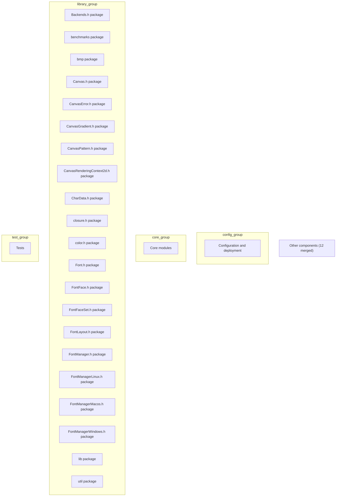

# Architecture report: Automattic/node-canvas

> Automated static analysis. **Observed** = directly seen in files/imports/AST; **Inferred** = interpretation from that evidence. Repository code was not executed.

## 1. Repository at a glance

| Item | Value |
| --- | --- |
| Repository | Automattic/node-canvas |
| Description | Node canvas is a Cairo backed Canvas implementation for NodeJS. |
| Language | JavaScript |
| Stars | 10696 |
| Licence | Not detected |
| Analysed commit / branch | efd824343c84071e26b0a132a6c6c2fcb88399fb / master |
| Framework(s) | Express |
| Files analysed | 181 |
| Components | 36 |

## 2. Architecture in one minute

Automattic/node-canvas - Node canvas is a Cairo backed Canvas implementation for NodeJS.. This repository was analysed statically from 181 file(s) (0 Python). Detected technologies (observed from imports/manifests): GitHub Actions, Express, TypeScript. Files are grouped into 36 component(s): Backends.h package, benchmarks package, bmp package, Canvas.h package, CanvasError.h package, CanvasGradient.h package, CanvasPattern.h package, CanvasRenderingContext2d.h package. Findings below distinguish observed facts from inferred interpretation.

## 3. High-level block diagram

## 4. Main components

### Backends.h package (`backends_h`)

- **Kind:** library
- **Status:** Observed
- **Confidence:** 0.85
- **Responsibility:** Groups 1 file(s) under backends.h package (observed from repository paths and static analysis).
- **Paths:** `src/Backends.h`
- **Evidence:** [src/Backends.h](https://github.com/Automattic/node-canvas/blob/efd824343c84071e26b0a132a6c6c2fcb88399fb/src/Backends.h)

### benchmarks package (`benchmarks`)

- **Kind:** library
- **Status:** Observed
- **Confidence:** 0.85
- **Responsibility:** Groups 1 file(s) under benchmarks package (observed from repository paths and static analysis).
- **Paths:** `benchmarks/run.js`
- **Evidence:** [benchmarks/run.js](https://github.com/Automattic/node-canvas/blob/efd824343c84071e26b0a132a6c6c2fcb88399fb/benchmarks/run.js)

### bmp package (`bmp`)

- **Kind:** library
- **Status:** Observed
- **Confidence:** 0.85
- **Responsibility:** Groups 1 file(s) under bmp package (observed from repository paths and static analysis).
- **Paths:** `src/bmp/BMPParser.h`
- **Evidence:** [src/bmp/BMPParser.h](https://github.com/Automattic/node-canvas/blob/efd824343c84071e26b0a132a6c6c2fcb88399fb/src/bmp/BMPParser.h)

### Canvas.h package (`canvas_h`)

- **Kind:** library
- **Status:** Observed
- **Confidence:** 0.85
- **Responsibility:** Groups 1 file(s) under canvas.h package (observed from repository paths and static analysis).
- **Paths:** `src/Canvas.h`
- **Evidence:** [src/Canvas.h](https://github.com/Automattic/node-canvas/blob/efd824343c84071e26b0a132a6c6c2fcb88399fb/src/Canvas.h)

### CanvasError.h package (`canvaserror_h`)

- **Kind:** library
- **Status:** Observed
- **Confidence:** 0.85
- **Responsibility:** Groups 1 file(s) under canvaserror.h package (observed from repository paths and static analysis).
- **Paths:** `src/CanvasError.h`
- **Evidence:** [src/CanvasError.h](https://github.com/Automattic/node-canvas/blob/efd824343c84071e26b0a132a6c6c2fcb88399fb/src/CanvasError.h)

### CanvasGradient.h package (`canvasgradient_h`)

- **Kind:** library
- **Status:** Observed
- **Confidence:** 0.85
- **Responsibility:** Groups 1 file(s) under canvasgradient.h package (observed from repository paths and static analysis).
- **Paths:** `src/CanvasGradient.h`
- **Evidence:** [src/CanvasGradient.h](https://github.com/Automattic/node-canvas/blob/efd824343c84071e26b0a132a6c6c2fcb88399fb/src/CanvasGradient.h)

### CanvasPattern.h package (`canvaspattern_h`)

- **Kind:** library
- **Status:** Observed
- **Confidence:** 0.85
- **Responsibility:** Groups 1 file(s) under canvaspattern.h package (observed from repository paths and static analysis).
- **Paths:** `src/CanvasPattern.h`
- **Evidence:** [src/CanvasPattern.h](https://github.com/Automattic/node-canvas/blob/efd824343c84071e26b0a132a6c6c2fcb88399fb/src/CanvasPattern.h)

### CanvasRenderingContext2d.h package (`canvasrenderingcontext2d_h`)

- **Kind:** library
- **Status:** Observed
- **Confidence:** 0.85
- **Responsibility:** Groups 1 file(s) under canvasrenderingcontext2d.h package (observed from repository paths and static analysis).
- **Paths:** `src/CanvasRenderingContext2d.h`
- **Evidence:** [src/CanvasRenderingContext2d.h](https://github.com/Automattic/node-canvas/blob/efd824343c84071e26b0a132a6c6c2fcb88399fb/src/CanvasRenderingContext2d.h)

### CharData.h package (`chardata_h`)

- **Kind:** library
- **Status:** Observed
- **Confidence:** 0.85
- **Responsibility:** Groups 1 file(s) under chardata.h package (observed from repository paths and static analysis).
- **Paths:** `src/CharData.h`
- **Evidence:** [src/CharData.h](https://github.com/Automattic/node-canvas/blob/efd824343c84071e26b0a132a6c6c2fcb88399fb/src/CharData.h)

### closure.h package (`closure_h`)

- **Kind:** library
- **Status:** Observed
- **Confidence:** 0.85
- **Responsibility:** Groups 1 file(s) under closure.h package (observed from repository paths and static analysis).
- **Paths:** `src/closure.h`
- **Evidence:** [src/closure.h](https://github.com/Automattic/node-canvas/blob/efd824343c84071e26b0a132a6c6c2fcb88399fb/src/closure.h)

### color.h package (`color_h`)

- **Kind:** library
- **Status:** Observed
- **Confidence:** 0.85
- **Responsibility:** Groups 1 file(s) under color.h package (observed from repository paths and static analysis).
- **Paths:** `src/color.h`
- **Evidence:** [src/color.h](https://github.com/Automattic/node-canvas/blob/efd824343c84071e26b0a132a6c6c2fcb88399fb/src/color.h)

### Configuration and deployment (`config`)

- **Kind:** config
- **Status:** Observed
- **Confidence:** 0.85
- **Responsibility:** Groups 14 file(s) under configuration and deployment (observed from repository paths and static analysis).
- **Paths:** `npm/darwin-arm64/package.json`, `npm/darwin-x64/package.json`, `npm/linux-arm-gnueabihf/package.json`, `npm/linux-arm64-gnu/package.json`, `npm/linux-arm64-musl/package.json`, `npm/linux-riscv64-gnu/package.json`, `npm/linux-x64-gnu/package.json`, `npm/linux-x64-musl/package.json`, `npm/linux-x86-gnu/package.json`, `npm/linux-x86-musl/package.json`, `npm/win32-arm64/package.json`, `npm/win32-x64/package.json`, `npm/win32-x86/package.json`, `package.json`
- **Evidence:** [npm/darwin-arm64/package.json](https://github.com/Automattic/node-canvas/blob/efd824343c84071e26b0a132a6c6c2fcb88399fb/npm/darwin-arm64/package.json); [npm/darwin-x64/package.json](https://github.com/Automattic/node-canvas/blob/efd824343c84071e26b0a132a6c6c2fcb88399fb/npm/darwin-x64/package.json); [npm/linux-arm-gnueabihf/package.json](https://github.com/Automattic/node-canvas/blob/efd824343c84071e26b0a132a6c6c2fcb88399fb/npm/linux-arm-gnueabihf/package.json); [npm/linux-arm64-gnu/package.json](https://github.com/Automattic/node-canvas/blob/efd824343c84071e26b0a132a6c6c2fcb88399fb/npm/linux-arm64-gnu/package.json); [npm/linux-arm64-musl/package.json](https://github.com/Automattic/node-canvas/blob/efd824343c84071e26b0a132a6c6c2fcb88399fb/npm/linux-arm64-musl/package.json); [npm/linux-riscv64-gnu/package.json](https://github.com/Automattic/node-canvas/blob/efd824343c84071e26b0a132a6c6c2fcb88399fb/npm/linux-riscv64-gnu/package.json); [npm/linux-x64-gnu/package.json](https://github.com/Automattic/node-canvas/blob/efd824343c84071e26b0a132a6c6c2fcb88399fb/npm/linux-x64-gnu/package.json); [npm/linux-x64-musl/package.json](https://github.com/Automattic/node-canvas/blob/efd824343c84071e26b0a132a6c6c2fcb88399fb/npm/linux-x64-musl/package.json)

### Core modules (`core`)

- **Kind:** core
- **Status:** Observed
- **Confidence:** 0.85
- **Responsibility:** Groups 4 file(s) under core modules (observed from repository paths and static analysis).
- **Paths:** `browser.js`, `index.d.ts`, `index.js`, `index.test-d.ts`
- **Evidence:** [browser.js](https://github.com/Automattic/node-canvas/blob/efd824343c84071e26b0a132a6c6c2fcb88399fb/browser.js); [index.d.ts](https://github.com/Automattic/node-canvas/blob/efd824343c84071e26b0a132a6c6c2fcb88399fb/index.d.ts); [index.js](https://github.com/Automattic/node-canvas/blob/efd824343c84071e26b0a132a6c6c2fcb88399fb/index.js); [index.test-d.ts](https://github.com/Automattic/node-canvas/blob/efd824343c84071e26b0a132a6c6c2fcb88399fb/index.test-d.ts)

### Font.h package (`font_h`)

- **Kind:** library
- **Status:** Observed
- **Confidence:** 0.85
- **Responsibility:** Groups 1 file(s) under font.h package (observed from repository paths and static analysis).
- **Paths:** `src/Font.h`
- **Evidence:** [src/Font.h](https://github.com/Automattic/node-canvas/blob/efd824343c84071e26b0a132a6c6c2fcb88399fb/src/Font.h)

### FontFace.h package (`fontface_h`)

- **Kind:** library
- **Status:** Observed
- **Confidence:** 0.85
- **Responsibility:** Groups 1 file(s) under fontface.h package (observed from repository paths and static analysis).
- **Paths:** `src/FontFace.h`
- **Evidence:** [src/FontFace.h](https://github.com/Automattic/node-canvas/blob/efd824343c84071e26b0a132a6c6c2fcb88399fb/src/FontFace.h)

### FontFaceSet.h package (`fontfaceset_h`)

- **Kind:** library
- **Status:** Observed
- **Confidence:** 0.85
- **Responsibility:** Groups 1 file(s) under fontfaceset.h package (observed from repository paths and static analysis).
- **Paths:** `src/FontFaceSet.h`
- **Evidence:** [src/FontFaceSet.h](https://github.com/Automattic/node-canvas/blob/efd824343c84071e26b0a132a6c6c2fcb88399fb/src/FontFaceSet.h)

### FontLayout.h package (`fontlayout_h`)

- **Kind:** library
- **Status:** Observed
- **Confidence:** 0.85
- **Responsibility:** Groups 1 file(s) under fontlayout.h package (observed from repository paths and static analysis).
- **Paths:** `src/FontLayout.h`
- **Evidence:** [src/FontLayout.h](https://github.com/Automattic/node-canvas/blob/efd824343c84071e26b0a132a6c6c2fcb88399fb/src/FontLayout.h)

### FontManager.h package (`fontmanager_h`)

- **Kind:** library
- **Status:** Observed
- **Confidence:** 0.85
- **Responsibility:** Groups 1 file(s) under fontmanager.h package (observed from repository paths and static analysis).
- **Paths:** `src/FontManager.h`
- **Evidence:** [src/FontManager.h](https://github.com/Automattic/node-canvas/blob/efd824343c84071e26b0a132a6c6c2fcb88399fb/src/FontManager.h)

### FontManagerLinux.h package (`fontmanagerlinux_h`)

- **Kind:** library
- **Status:** Observed
- **Confidence:** 0.85
- **Responsibility:** Groups 1 file(s) under fontmanagerlinux.h package (observed from repository paths and static analysis).
- **Paths:** `src/FontManagerLinux.h`
- **Evidence:** [src/FontManagerLinux.h](https://github.com/Automattic/node-canvas/blob/efd824343c84071e26b0a132a6c6c2fcb88399fb/src/FontManagerLinux.h)

### FontManagerMacos.h package (`fontmanagermacos_h`)

- **Kind:** library
- **Status:** Observed
- **Confidence:** 0.85
- **Responsibility:** Groups 1 file(s) under fontmanagermacos.h package (observed from repository paths and static analysis).
- **Paths:** `src/FontManagerMacos.h`
- **Evidence:** [src/FontManagerMacos.h](https://github.com/Automattic/node-canvas/blob/efd824343c84071e26b0a132a6c6c2fcb88399fb/src/FontManagerMacos.h)

### FontManagerWindows.h package (`fontmanagerwindows_h`)

- **Kind:** library
- **Status:** Observed
- **Confidence:** 0.85
- **Responsibility:** Groups 1 file(s) under fontmanagerwindows.h package (observed from repository paths and static analysis).
- **Paths:** `src/FontManagerWindows.h`
- **Evidence:** [src/FontManagerWindows.h](https://github.com/Automattic/node-canvas/blob/efd824343c84071e26b0a132a6c6c2fcb88399fb/src/FontManagerWindows.h)

### FontParser.h package (`fontparser_h`)

- **Kind:** library
- **Status:** Observed
- **Confidence:** 0.85
- **Responsibility:** Groups 1 file(s) under fontparser.h package (observed from repository paths and static analysis).
- **Paths:** `src/FontParser.h`
- **Evidence:** [src/FontParser.h](https://github.com/Automattic/node-canvas/blob/efd824343c84071e26b0a132a6c6c2fcb88399fb/src/FontParser.h)

### Image.h package (`image_h`)

- **Kind:** library
- **Status:** Observed
- **Confidence:** 0.85
- **Responsibility:** Groups 1 file(s) under image.h package (observed from repository paths and static analysis).
- **Paths:** `src/Image.h`
- **Evidence:** [src/Image.h](https://github.com/Automattic/node-canvas/blob/efd824343c84071e26b0a132a6c6c2fcb88399fb/src/Image.h)

### ImageData.h package (`imagedata_h`)

- **Kind:** library
- **Status:** Observed
- **Confidence:** 0.85
- **Responsibility:** Groups 1 file(s) under imagedata.h package (observed from repository paths and static analysis).
- **Paths:** `src/ImageData.h`
- **Evidence:** [src/ImageData.h](https://github.com/Automattic/node-canvas/blob/efd824343c84071e26b0a132a6c6c2fcb88399fb/src/ImageData.h)

### InstanceData.h package (`instancedata_h`)

- **Kind:** library
- **Status:** Observed
- **Confidence:** 0.85
- **Responsibility:** Groups 1 file(s) under instancedata.h package (observed from repository paths and static analysis).
- **Paths:** `src/InstanceData.h`
- **Evidence:** [src/InstanceData.h](https://github.com/Automattic/node-canvas/blob/efd824343c84071e26b0a132a6c6c2fcb88399fb/src/InstanceData.h)

### itemize.h package (`itemize_h`)

- **Kind:** library
- **Status:** Observed
- **Confidence:** 0.85
- **Responsibility:** Groups 1 file(s) under itemize.h package (observed from repository paths and static analysis).
- **Paths:** `src/itemize.h`
- **Evidence:** [src/itemize.h](https://github.com/Automattic/node-canvas/blob/efd824343c84071e26b0a132a6c6c2fcb88399fb/src/itemize.h)

### JPEGStream.h package (`jpegstream_h`)

- **Kind:** library
- **Status:** Observed
- **Confidence:** 0.85
- **Responsibility:** Groups 1 file(s) under jpegstream.h package (observed from repository paths and static analysis).
- **Paths:** `src/JPEGStream.h`
- **Evidence:** [src/JPEGStream.h](https://github.com/Automattic/node-canvas/blob/efd824343c84071e26b0a132a6c6c2fcb88399fb/src/JPEGStream.h)

### lib package (`lib`)

- **Kind:** library
- **Status:** Observed
- **Confidence:** 0.85
- **Responsibility:** Groups 9 file(s) under lib package (observed from repository paths and static analysis).
- **Paths:** `lib/DOMMatrix.js`, `lib/bindings.js`, `lib/canvas.js`, `lib/context2d.js`, `lib/image.js`, `lib/jpegstream.js`, `lib/pattern.js`, `lib/pdfstream.js`, `lib/pngstream.js`
- **Evidence:** [lib/DOMMatrix.js](https://github.com/Automattic/node-canvas/blob/efd824343c84071e26b0a132a6c6c2fcb88399fb/lib/DOMMatrix.js); [lib/bindings.js](https://github.com/Automattic/node-canvas/blob/efd824343c84071e26b0a132a6c6c2fcb88399fb/lib/bindings.js); [lib/canvas.js](https://github.com/Automattic/node-canvas/blob/efd824343c84071e26b0a132a6c6c2fcb88399fb/lib/canvas.js); [lib/context2d.js](https://github.com/Automattic/node-canvas/blob/efd824343c84071e26b0a132a6c6c2fcb88399fb/lib/context2d.js); [lib/image.js](https://github.com/Automattic/node-canvas/blob/efd824343c84071e26b0a132a6c6c2fcb88399fb/lib/image.js); [lib/jpegstream.js](https://github.com/Automattic/node-canvas/blob/efd824343c84071e26b0a132a6c6c2fcb88399fb/lib/jpegstream.js); [lib/pattern.js](https://github.com/Automattic/node-canvas/blob/efd824343c84071e26b0a132a6c6c2fcb88399fb/lib/pattern.js); [lib/pdfstream.js](https://github.com/Automattic/node-canvas/blob/efd824343c84071e26b0a132a6c6c2fcb88399fb/lib/pdfstream.js)

### pkg package (`pkg`)

- **Kind:** library
- **Status:** Observed
- **Confidence:** 0.85
- **Responsibility:** Groups 1 file(s) under pkg package (observed from repository paths and static analysis).
- **Paths:** `pkg/libpng/pnglibconf.h`
- **Evidence:** [pkg/libpng/pnglibconf.h](https://github.com/Automattic/node-canvas/blob/efd824343c84071e26b0a132a6c6c2fcb88399fb/pkg/libpng/pnglibconf.h)

### PNG.h package (`png_h`)

- **Kind:** library
- **Status:** Observed
- **Confidence:** 0.85
- **Responsibility:** Groups 1 file(s) under png.h package (observed from repository paths and static analysis).
- **Paths:** `src/PNG.h`
- **Evidence:** [src/PNG.h](https://github.com/Automattic/node-canvas/blob/efd824343c84071e26b0a132a6c6c2fcb88399fb/src/PNG.h)

### Point.h package (`point_h`)

- **Kind:** library
- **Status:** Observed
- **Confidence:** 0.85
- **Responsibility:** Groups 1 file(s) under point.h package (observed from repository paths and static analysis).
- **Paths:** `src/Point.h`
- **Evidence:** [src/Point.h](https://github.com/Automattic/node-canvas/blob/efd824343c84071e26b0a132a6c6c2fcb88399fb/src/Point.h)

### scripts package (`scripts`)

- **Kind:** library
- **Status:** Observed
- **Confidence:** 0.85
- **Responsibility:** Groups 1 file(s) under scripts package (observed from repository paths and static analysis).
- **Paths:** `scripts/version.js`
- **Evidence:** [scripts/version.js](https://github.com/Automattic/node-canvas/blob/efd824343c84071e26b0a132a6c6c2fcb88399fb/scripts/version.js)

### Tests (`tests`)

- **Kind:** test
- **Status:** Observed
- **Confidence:** 0.85
- **Responsibility:** Groups 35 file(s) under tests (observed from repository paths and static analysis).
- **Paths:** `test/canvas.test.js`, `test/dommatrix.test.js`, `test/fixtures/Arimo-Regular-License.txt`, `test/fixtures/embedded-jpeg.svg`, `test/fixtures/tree.svg`, `test/fontParser.test.js`, `test/image.test.js`, `test/imageData.test.js`, `test/public/app.html`, `test/public/app.js`, `test/public/style.css`, `test/public/tests.js`, `test/server.js`, `test/wpt/drawing-text-to-the-canvas.yaml`, `test/wpt/fill-and-stroke-styles.yaml`, `test/wpt/generate.js`, `test/wpt/generated/drawing-text-to-the-canvas.js`, `test/wpt/generated/line-styles.js`, `test/wpt/generated/meta.js`, `test/wpt/generated/path-objects.js`, `test/wpt/generated/pixel-manipulation.js`, `test/wpt/generated/shadows.js`, `test/wpt/generated/text-styles.js`, `test/wpt/generated/the-canvas-element.js`, `test/wpt/generated/the-canvas-state.js`, `test/wpt/generated/transformations.js`, `test/wpt/line-styles.yaml`, `test/wpt/meta.yaml`, `test/wpt/path-objects.yaml`, `test/wpt/pixel-manipulation.yaml`, `test/wpt/shadows.yaml`, `test/wpt/text-styles.yaml`, `test/wpt/the-canvas-element.yaml`, `test/wpt/the-canvas-state.yaml`, `test/wpt/transformations.yaml`
- **Evidence:** [test/canvas.test.js](https://github.com/Automattic/node-canvas/blob/efd824343c84071e26b0a132a6c6c2fcb88399fb/test/canvas.test.js); [test/dommatrix.test.js](https://github.com/Automattic/node-canvas/blob/efd824343c84071e26b0a132a6c6c2fcb88399fb/test/dommatrix.test.js); [test/fixtures/Arimo-Regular-License.txt](https://github.com/Automattic/node-canvas/blob/efd824343c84071e26b0a132a6c6c2fcb88399fb/test/fixtures/Arimo-Regular-License.txt); [test/fixtures/embedded-jpeg.svg](https://github.com/Automattic/node-canvas/blob/efd824343c84071e26b0a132a6c6c2fcb88399fb/test/fixtures/embedded-jpeg.svg); [test/fixtures/tree.svg](https://github.com/Automattic/node-canvas/blob/efd824343c84071e26b0a132a6c6c2fcb88399fb/test/fixtures/tree.svg); [test/fontParser.test.js](https://github.com/Automattic/node-canvas/blob/efd824343c84071e26b0a132a6c6c2fcb88399fb/test/fontParser.test.js); [test/image.test.js](https://github.com/Automattic/node-canvas/blob/efd824343c84071e26b0a132a6c6c2fcb88399fb/test/image.test.js); [test/imageData.test.js](https://github.com/Automattic/node-canvas/blob/efd824343c84071e26b0a132a6c6c2fcb88399fb/test/imageData.test.js)

### unicode.h package (`unicode_h`)

- **Kind:** library
- **Status:** Observed
- **Confidence:** 0.85
- **Responsibility:** Groups 1 file(s) under unicode.h package (observed from repository paths and static analysis).
- **Paths:** `src/unicode.h`
- **Evidence:** [src/unicode.h](https://github.com/Automattic/node-canvas/blob/efd824343c84071e26b0a132a6c6c2fcb88399fb/src/unicode.h)

### util package (`util`)

- **Kind:** library
- **Status:** Observed
- **Confidence:** 0.85
- **Responsibility:** Groups 2 file(s) under util package (observed from repository paths and static analysis).
- **Paths:** `util/has_lib.js`, `util/win_jpeg_lookup.js`
- **Evidence:** [util/has_lib.js](https://github.com/Automattic/node-canvas/blob/efd824343c84071e26b0a132a6c6c2fcb88399fb/util/has_lib.js); [util/win_jpeg_lookup.js](https://github.com/Automattic/node-canvas/blob/efd824343c84071e26b0a132a6c6c2fcb88399fb/util/win_jpeg_lookup.js)

### Util.h package (`util_h`)

- **Kind:** library
- **Status:** Observed
- **Confidence:** 0.85
- **Responsibility:** Groups 1 file(s) under util.h package (observed from repository paths and static analysis).
- **Paths:** `src/Util.h`
- **Evidence:** [src/Util.h](https://github.com/Automattic/node-canvas/blob/efd824343c84071e26b0a132a6c6c2fcb88399fb/src/Util.h)

## 5. Execution flow

**Observed** entry point(s):

- [index.js](https://github.com/Automattic/node-canvas/blob/efd824343c84071e26b0a132a6c6c2fcb88399fb/index.js)

Representative flow (derived from observed entry points and the import graph; steps beyond the entry point are **Inferred**):

1. Execution starts at an observed entry point listed above, if present.
2. No internal import relationships between components were observed.

## 6. Project structure

### `(root)`

- `.gitignore` - other (222 bytes)
- `CHANGELOG.md` - docs (39966 bytes)
- `README.md` - docs (27293 bytes)
- `SECURITY.md` - docs (366 bytes)
- `browser.js` - source, JavaScript (986 bytes)
- `build.zig` - other (7012 bytes)
- `build.zig.zon` - other (1776 bytes)
- `index.d.ts` - source, TypeScript (18596 bytes)
- `index.js` - source, JavaScript (2221 bytes)
- `index.test-d.ts` - source, TypeScript (1763 bytes)
- `package.json` - manifest (2230 bytes)

### `.github`

- `.github/ISSUE_TEMPLATE/bug.yml` - config (1079 bytes)
- `.github/ISSUE_TEMPLATE/feat.yml` - config (363 bytes)
- `.github/PULL_REQUEST_TEMPLATE.md` - docs (63 bytes)
- `.github/workflows/ci.yaml` - ci, YAML (1733 bytes)
- `.github/workflows/publish.yaml` - ci, YAML (2409 bytes)

### `benchmarks`

- `benchmarks/run.js` - source, JavaScript (4873 bytes)

### `examples`

- `examples/clock.js` - source, JavaScript (2510 bytes)
- `examples/crop.js` - source, JavaScript (603 bytes)
- `examples/fill-evenodd.js` - source, JavaScript (366 bytes)
- `examples/font.js` - source, JavaScript (1326 bytes)
- `examples/globalAlpha.js` - source, JavaScript (693 bytes)
- `examples/gradients.js` - source, JavaScript (781 bytes)
- `examples/grayscale-image.js` - source, JavaScript (475 bytes)
- `examples/image-caption-overlay.js` - source, JavaScript (2214 bytes)
- `examples/image-src-svg.js` - source, JavaScript (587 bytes)
- `examples/image-src-url.js` - source, JavaScript (454 bytes)
- `examples/image-src.js` - source, JavaScript (994 bytes)
- `examples/images/badge.svg` - other (318 bytes)
- `examples/images/small-svg.svg` - other (3356 bytes)
- `examples/indexed-png-alpha.js` - source, JavaScript (991 bytes)
- `examples/indexed-png-image-data.js` - source, JavaScript (1091 bytes)
- `examples/kraken.js` - source, JavaScript (2618 bytes)
- `examples/live-clock.js` - source, JavaScript (474 bytes)
- `examples/multi-page-pdf.js` - source, JavaScript (721 bytes)
- `examples/pango-glyphs.js` - source, JavaScript (808 bytes)
- `examples/pdf-images.js` - source, JavaScript (1120 bytes)
- `examples/pdf-link.js` - source, JavaScript (601 bytes)
- `examples/pfennigFont/FONTLOG.txt` - docs (4665 bytes)
- `examples/pfennigFont/OFL.txt` - docs (4374 bytes)
- `examples/ray.js` - source, JavaScript (1895 bytes)
- `examples/resize.js` - source, JavaScript (735 bytes)
- `examples/rhill-voronoi-core-min.js` - source, JavaScript (18556 bytes)
- `examples/small-pdf.js` - source, JavaScript (581 bytes)
- `examples/small-svg.js` - source, JavaScript (581 bytes)
- `examples/spark.js` - source, JavaScript (801 bytes)
- `examples/state.js` - source, JavaScript (895 bytes)
- `examples/text.js` - source, JavaScript (919 bytes)
- `examples/voronoi.js` - source, JavaScript (3631 bytes)
- `examples/worker-threads.js` - source, JavaScript (2194 bytes)

### `lib`

- `lib/DOMMatrix.js` - source, JavaScript (19700 bytes)
- `lib/bindings.js` - source, JavaScript (4237 bytes)
- `lib/canvas.js` - source, JavaScript (3214 bytes)
- `lib/context2d.js` - source, JavaScript (205 bytes)
- `lib/image.js` - source, JavaScript (2942 bytes)
- `lib/jpegstream.js` - source, JavaScript (751 bytes)
- `lib/pattern.js` - source, JavaScript (292 bytes)
- `lib/pdfstream.js` - source, JavaScript (679 bytes)
- `lib/pngstream.js` - source, JavaScript (940 bytes)

### `npm`

- `npm/darwin-arm64/package.json` - manifest (332 bytes)
- `npm/darwin-x64/package.json` - manifest (328 bytes)
- `npm/linux-arm-gnueabihf/package.json` - manifest (336 bytes)
- `npm/linux-arm64-gnu/package.json` - manifest (334 bytes)
- `npm/linux-arm64-musl/package.json` - manifest (335 bytes)
- `npm/linux-riscv64-gnu/package.json` - manifest (338 bytes)
- `npm/linux-x64-gnu/package.json` - manifest (330 bytes)
- `npm/linux-x64-musl/package.json` - manifest (331 bytes)
- `npm/linux-x86-gnu/package.json` - manifest (331 bytes)
- `npm/linux-x86-musl/package.json` - manifest (332 bytes)
- `npm/win32-arm64/package.json` - manifest (330 bytes)
- `npm/win32-x64/package.json` - manifest (326 bytes)
- `npm/win32-x86/package.json` - manifest (327 bytes)

### `pkg`

- `pkg/cairo/build.zig` - other (8001 bytes)
- `pkg/cairo/build.zig.zon` - other (627 bytes)
- `pkg/cairo/sources.zig` - other (3613 bytes)
- `pkg/freetype/build.zig` - other (3550 bytes)
- `pkg/freetype/build.zig.zon` - other (406 bytes)
- `pkg/giflib/build.zig` - other (999 bytes)
- `pkg/giflib/build.zig.zon` - other (382 bytes)
- `pkg/harfbuzz/build.zig` - other (732 bytes)
- `pkg/harfbuzz/build.zig.zon` - other (317 bytes)
- `pkg/libpng/LICENSE` - docs (1091 bytes)
- `pkg/libpng/build.zig` - other (1609 bytes)
- `pkg/libpng/build.zig.zon` - other (502 bytes)
- `pkg/libpng/pnglibconf.h` - source, C/C++ (7615 bytes)
- `pkg/lunasvg/build.zig` - other (3605 bytes)
- `pkg/lunasvg/build.zig.zon` - other (379 bytes)
- `pkg/pixman/build.zig` - other (1746 bytes)
- `pkg/pixman/build.zig.zon` - other (301 bytes)
- `pkg/sheenbidi/build.zig` - other (823 bytes)
- `pkg/sheenbidi/build.zig.zon` - other (318 bytes)
- `pkg/zlib/LICENSE` - docs (1076 bytes)
- `pkg/zlib/build.zig` - other (1246 bytes)
- `pkg/zlib/build.zig.zon` - other (429 bytes)

### `scripts`

- `scripts/version.js` - source, JavaScript (2008 bytes)

### `src`

- `src/Backends.h` - source, C/C++ (193 bytes)
- `src/Canvas.cc` - other (24013 bytes)
- `src/Canvas.h` - source, C/C++ (3106 bytes)
- `src/CanvasError.h` - source, C/C++ (977 bytes)
- `src/CanvasGradient.cc` - other (2901 bytes)
- `src/CanvasGradient.h` - source, C/C++ (477 bytes)
- `src/CanvasPattern.cc` - other (4386 bytes)
- `src/CanvasPattern.h` - source, C/C++ (1164 bytes)
- `src/CanvasRenderingContext2d.cc` - other (98153 bytes)
- `src/CanvasRenderingContext2d.h` - source, C/C++ (9656 bytes)
- `src/CharData.h` - source, C/C++ (14124 bytes)
- `src/Font.h` - source, C/C++ (4479 bytes)
- `src/FontFace.cc` - other (5932 bytes)
- `src/FontFace.h` - source, C/C++ (1057 bytes)
- `src/FontFaceSet.cc` - other (5688 bytes)
- `src/FontFaceSet.h` - source, C/C++ (1237 bytes)
- `src/FontLayout.cc` - other (17187 bytes)
- `src/FontLayout.h` - source, C/C++ (1758 bytes)
- `src/FontManager.cc` - other (6741 bytes)
- `src/FontManager.h` - source, C/C++ (2314 bytes)
- `src/FontManagerLinux.cc` - other (25387 bytes)
- `src/FontManagerLinux.h` - source, C/C++ (739 bytes)
- `src/FontManagerMacos.cc` - other (20404 bytes)
- `src/FontManagerMacos.h` - source, C/C++ (354 bytes)
- `src/FontManagerWindows.cc` - other (19202 bytes)
- `src/FontManagerWindows.h` - source, C/C++ (356 bytes)
- `src/FontParser.cc` - other (14972 bytes)
- `src/FontParser.h` - source, C/C++ (2365 bytes)
- `src/Image.cc` - other (44581 bytes)
- `src/Image.h` - source, C/C++ (4634 bytes)
- `src/ImageData.cc` - other (4248 bytes)
- `src/ImageData.h` - source, C/C++ (707 bytes)
- `src/InstanceData.h` - source, C/C++ (2034 bytes)
- `src/JPEGStream.h` - source, C/C++ (4619 bytes)
- `src/PNG.h` - source, C/C++ (8965 bytes)
- `src/Point.h` - source, C/C++ (248 bytes)
- `src/Util.h` - source, C/C++ (426 bytes)
- `src/bmp/BMPParser.cc` - other (12463 bytes)
- `src/bmp/BMPParser.h` - source, C/C++ (1302 bytes)
- `src/bmp/LICENSE.md` - docs (1209 bytes)
- `src/closure.cc` - other (1560 bytes)
- `src/closure.h` - source, C/C++ (2368 bytes)
- `src/color.cc` - other (17459 bytes)
- `src/color.h` - source, C/C++ (449 bytes)
- `src/init.cc` - other (2506 bytes)
- `src/itemize.cc` - other (5527 bytes)
- `src/itemize.h` - source, C/C++ (1941 bytes)
- `src/unicode.h` - source, C/C++ (13037 bytes)
- `src/unicode.zig` - other (8896 bytes)

### `test`

- `test/canvas.test.js` - test, JavaScript (92954 bytes)
- `test/dommatrix.test.js` - test, JavaScript (19159 bytes)
- `test/fixtures/Arimo-Regular-License.txt` - test (11560 bytes)
- `test/fixtures/embedded-jpeg.svg` - test (650 bytes)
- `test/fixtures/tree.svg` - test (608 bytes)
- `test/fontParser.test.js` - test, JavaScript (3879 bytes)
- `test/image.test.js` - test, JavaScript (15892 bytes)
- `test/imageData.test.js` - test, JavaScript (2983 bytes)
- `test/public/app.html` - test (472 bytes)
- `test/public/app.js` - test, JavaScript (2768 bytes)
- `test/public/style.css` - test (557 bytes)
- `test/public/tests.js` - test, JavaScript (70033 bytes)
- `test/server.js` - test, JavaScript (1629 bytes)
- `test/wpt/drawing-text-to-the-canvas.yaml` - test (35248 bytes)
- `test/wpt/fill-and-stroke-styles.yaml` - test (66281 bytes)
- `test/wpt/generate.js` - test, JavaScript (7393 bytes)
- `test/wpt/generated/drawing-text-to-the-canvas.js` - test, JavaScript (44531 bytes)
- `test/wpt/generated/line-styles.js` - test, JavaScript (31017 bytes)
- `test/wpt/generated/meta.js` - test, JavaScript (2726 bytes)
- `test/wpt/generated/path-objects.js` - test, JavaScript (139527 bytes)
- `test/wpt/generated/pixel-manipulation.js` - test, JavaScript (67152 bytes)
- `test/wpt/generated/shadows.js` - test, JavaScript (35500 bytes)
- `test/wpt/generated/text-styles.js` - test, JavaScript (21163 bytes)
- `test/wpt/generated/the-canvas-element.js` - test, JavaScript (11115 bytes)
- `test/wpt/generated/the-canvas-state.js` - test, JavaScript (5774 bytes)
- `test/wpt/generated/transformations.js` - test, JavaScript (23172 bytes)
- `test/wpt/line-styles.yaml` - test (24782 bytes)
- `test/wpt/meta.yaml` - test (23716 bytes)
- `test/wpt/path-objects.yaml` - test (105483 bytes)
- `test/wpt/pixel-manipulation.yaml` - test (39079 bytes)
- `test/wpt/shadows.yaml` - test (30855 bytes)
- `test/wpt/text-styles.yaml` - test (15084 bytes)
- `test/wpt/the-canvas-element.yaml` - test (5574 bytes)
- `test/wpt/the-canvas-state.yaml` - test (2556 bytes)
- `test/wpt/transformations.yaml` - test (11346 bytes)

### `util`

- `util/has_lib.js` - source, JavaScript (2855 bytes)
- `util/win_jpeg_lookup.js` - source, JavaScript (360 bytes)

## 7. Key dependencies and integrations

| Name | Category | Status | Confidence | Evidence |
| --- | --- | --- | --- | --- |
| GitHub Actions | ci | Observed | 0.90 | [.github/workflows/ci.yaml](https://github.com/Automattic/node-canvas/blob/efd824343c84071e26b0a132a6c6c2fcb88399fb/.github/workflows/ci.yaml); [.github/workflows/publish.yaml](https://github.com/Automattic/node-canvas/blob/efd824343c84071e26b0a132a6c6c2fcb88399fb/.github/workflows/publish.yaml) |
| Express | framework | Observed | 0.85 | [package.json:58](https://github.com/Automattic/node-canvas/blob/efd824343c84071e26b0a132a6c6c2fcb88399fb/package.json#L58) |
| TypeScript | tooling | Observed | 0.85 | [package.json:64](https://github.com/Automattic/node-canvas/blob/efd824343c84071e26b0a132a6c6c2fcb88399fb/package.json#L64) |

## 8. Data and state

No database, cache, queue, or persistent-state usage was observed in the analysed files. State handling, if any, may be in-memory or in files that were not analysed.

## 9. Configuration and deployment clues

- `.github/ISSUE_TEMPLATE/bug.yml` (config)
- `.github/ISSUE_TEMPLATE/feat.yml` (config)
- `.github/workflows/ci.yaml` (ci)
- `.github/workflows/publish.yaml` (ci)
- `npm/darwin-arm64/package.json` (manifest)
- `npm/darwin-x64/package.json` (manifest)
- `npm/linux-arm-gnueabihf/package.json` (manifest)
- `npm/linux-arm64-gnu/package.json` (manifest)
- `npm/linux-arm64-musl/package.json` (manifest)
- `npm/linux-riscv64-gnu/package.json` (manifest)
- `npm/linux-x64-gnu/package.json` (manifest)
- `npm/linux-x64-musl/package.json` (manifest)
- `npm/linux-x86-gnu/package.json` (manifest)
- `npm/linux-x86-musl/package.json` (manifest)
- `npm/win32-arm64/package.json` (manifest)
- `npm/win32-x64/package.json` (manifest)
- `npm/win32-x86/package.json` (manifest)
- `package.json` (manifest)

## 10. Design observations

- Tests are present alongside source code (Observed from test file paths).

These observations are interpretations (**Inferred**) of the observed structure, not guarantees about runtime design.

## 11. Limitations and unknowns

- Static analysis only: repository code was not executed, installed, or imported at runtime.
- Components and relationships are inferred from file paths, imports, and AST structure; runtime behaviour, dynamic imports, and reflection may not be visible.
- No clear application entry point was observed in the analysed files.
- Repository text was treated as untrusted data; no instructions found in repository files were followed, and likely secret values were redacted/excluded.
- JavaScript and TypeScript files were inventoried from paths and package manifests. They were not parsed with a full language AST, and repository code was not executed.

## 12. Source references

- [.github/workflows/ci.yaml](https://github.com/Automattic/node-canvas/blob/efd824343c84071e26b0a132a6c6c2fcb88399fb/.github/workflows/ci.yaml)
- [.github/workflows/publish.yaml](https://github.com/Automattic/node-canvas/blob/efd824343c84071e26b0a132a6c6c2fcb88399fb/.github/workflows/publish.yaml)
- [benchmarks/run.js](https://github.com/Automattic/node-canvas/blob/efd824343c84071e26b0a132a6c6c2fcb88399fb/benchmarks/run.js)
- [browser.js](https://github.com/Automattic/node-canvas/blob/efd824343c84071e26b0a132a6c6c2fcb88399fb/browser.js)
- [index.d.ts](https://github.com/Automattic/node-canvas/blob/efd824343c84071e26b0a132a6c6c2fcb88399fb/index.d.ts)
- [index.js](https://github.com/Automattic/node-canvas/blob/efd824343c84071e26b0a132a6c6c2fcb88399fb/index.js)
- [index.test-d.ts](https://github.com/Automattic/node-canvas/blob/efd824343c84071e26b0a132a6c6c2fcb88399fb/index.test-d.ts)
- [lib/DOMMatrix.js](https://github.com/Automattic/node-canvas/blob/efd824343c84071e26b0a132a6c6c2fcb88399fb/lib/DOMMatrix.js)
- [lib/bindings.js](https://github.com/Automattic/node-canvas/blob/efd824343c84071e26b0a132a6c6c2fcb88399fb/lib/bindings.js)
- [lib/canvas.js](https://github.com/Automattic/node-canvas/blob/efd824343c84071e26b0a132a6c6c2fcb88399fb/lib/canvas.js)
- [lib/context2d.js](https://github.com/Automattic/node-canvas/blob/efd824343c84071e26b0a132a6c6c2fcb88399fb/lib/context2d.js)
- [lib/image.js](https://github.com/Automattic/node-canvas/blob/efd824343c84071e26b0a132a6c6c2fcb88399fb/lib/image.js)
- [lib/jpegstream.js](https://github.com/Automattic/node-canvas/blob/efd824343c84071e26b0a132a6c6c2fcb88399fb/lib/jpegstream.js)
- [lib/pattern.js](https://github.com/Automattic/node-canvas/blob/efd824343c84071e26b0a132a6c6c2fcb88399fb/lib/pattern.js)
- [lib/pdfstream.js](https://github.com/Automattic/node-canvas/blob/efd824343c84071e26b0a132a6c6c2fcb88399fb/lib/pdfstream.js)
- [npm/darwin-arm64/package.json](https://github.com/Automattic/node-canvas/blob/efd824343c84071e26b0a132a6c6c2fcb88399fb/npm/darwin-arm64/package.json)
- [npm/darwin-x64/package.json](https://github.com/Automattic/node-canvas/blob/efd824343c84071e26b0a132a6c6c2fcb88399fb/npm/darwin-x64/package.json)
- [npm/linux-arm-gnueabihf/package.json](https://github.com/Automattic/node-canvas/blob/efd824343c84071e26b0a132a6c6c2fcb88399fb/npm/linux-arm-gnueabihf/package.json)
- [npm/linux-arm64-gnu/package.json](https://github.com/Automattic/node-canvas/blob/efd824343c84071e26b0a132a6c6c2fcb88399fb/npm/linux-arm64-gnu/package.json)
- [npm/linux-arm64-musl/package.json](https://github.com/Automattic/node-canvas/blob/efd824343c84071e26b0a132a6c6c2fcb88399fb/npm/linux-arm64-musl/package.json)
- [npm/linux-riscv64-gnu/package.json](https://github.com/Automattic/node-canvas/blob/efd824343c84071e26b0a132a6c6c2fcb88399fb/npm/linux-riscv64-gnu/package.json)
- [npm/linux-x64-gnu/package.json](https://github.com/Automattic/node-canvas/blob/efd824343c84071e26b0a132a6c6c2fcb88399fb/npm/linux-x64-gnu/package.json)
- [npm/linux-x64-musl/package.json](https://github.com/Automattic/node-canvas/blob/efd824343c84071e26b0a132a6c6c2fcb88399fb/npm/linux-x64-musl/package.json)
- [package.json:58](https://github.com/Automattic/node-canvas/blob/efd824343c84071e26b0a132a6c6c2fcb88399fb/package.json#L58)
- [package.json:64](https://github.com/Automattic/node-canvas/blob/efd824343c84071e26b0a132a6c6c2fcb88399fb/package.json#L64)
- [pkg/libpng/pnglibconf.h](https://github.com/Automattic/node-canvas/blob/efd824343c84071e26b0a132a6c6c2fcb88399fb/pkg/libpng/pnglibconf.h)
- [scripts/version.js](https://github.com/Automattic/node-canvas/blob/efd824343c84071e26b0a132a6c6c2fcb88399fb/scripts/version.js)
- [src/Backends.h](https://github.com/Automattic/node-canvas/blob/efd824343c84071e26b0a132a6c6c2fcb88399fb/src/Backends.h)
- [src/Canvas.h](https://github.com/Automattic/node-canvas/blob/efd824343c84071e26b0a132a6c6c2fcb88399fb/src/Canvas.h)
- [src/CanvasError.h](https://github.com/Automattic/node-canvas/blob/efd824343c84071e26b0a132a6c6c2fcb88399fb/src/CanvasError.h)
- [src/CanvasGradient.h](https://github.com/Automattic/node-canvas/blob/efd824343c84071e26b0a132a6c6c2fcb88399fb/src/CanvasGradient.h)
- [src/CanvasPattern.h](https://github.com/Automattic/node-canvas/blob/efd824343c84071e26b0a132a6c6c2fcb88399fb/src/CanvasPattern.h)
- [src/CanvasRenderingContext2d.h](https://github.com/Automattic/node-canvas/blob/efd824343c84071e26b0a132a6c6c2fcb88399fb/src/CanvasRenderingContext2d.h)
- [src/CharData.h](https://github.com/Automattic/node-canvas/blob/efd824343c84071e26b0a132a6c6c2fcb88399fb/src/CharData.h)
- [src/Font.h](https://github.com/Automattic/node-canvas/blob/efd824343c84071e26b0a132a6c6c2fcb88399fb/src/Font.h)
- [src/FontFace.h](https://github.com/Automattic/node-canvas/blob/efd824343c84071e26b0a132a6c6c2fcb88399fb/src/FontFace.h)
- [src/FontFaceSet.h](https://github.com/Automattic/node-canvas/blob/efd824343c84071e26b0a132a6c6c2fcb88399fb/src/FontFaceSet.h)
- [src/FontLayout.h](https://github.com/Automattic/node-canvas/blob/efd824343c84071e26b0a132a6c6c2fcb88399fb/src/FontLayout.h)
- [src/FontManager.h](https://github.com/Automattic/node-canvas/blob/efd824343c84071e26b0a132a6c6c2fcb88399fb/src/FontManager.h)
- [src/FontManagerLinux.h](https://github.com/Automattic/node-canvas/blob/efd824343c84071e26b0a132a6c6c2fcb88399fb/src/FontManagerLinux.h)
- [src/FontManagerMacos.h](https://github.com/Automattic/node-canvas/blob/efd824343c84071e26b0a132a6c6c2fcb88399fb/src/FontManagerMacos.h)
- [src/FontManagerWindows.h](https://github.com/Automattic/node-canvas/blob/efd824343c84071e26b0a132a6c6c2fcb88399fb/src/FontManagerWindows.h)
- [src/FontParser.h](https://github.com/Automattic/node-canvas/blob/efd824343c84071e26b0a132a6c6c2fcb88399fb/src/FontParser.h)
- [src/Image.h](https://github.com/Automattic/node-canvas/blob/efd824343c84071e26b0a132a6c6c2fcb88399fb/src/Image.h)
- [src/ImageData.h](https://github.com/Automattic/node-canvas/blob/efd824343c84071e26b0a132a6c6c2fcb88399fb/src/ImageData.h)
- [src/InstanceData.h](https://github.com/Automattic/node-canvas/blob/efd824343c84071e26b0a132a6c6c2fcb88399fb/src/InstanceData.h)
- [src/JPEGStream.h](https://github.com/Automattic/node-canvas/blob/efd824343c84071e26b0a132a6c6c2fcb88399fb/src/JPEGStream.h)
- [src/PNG.h](https://github.com/Automattic/node-canvas/blob/efd824343c84071e26b0a132a6c6c2fcb88399fb/src/PNG.h)
- [src/Point.h](https://github.com/Automattic/node-canvas/blob/efd824343c84071e26b0a132a6c6c2fcb88399fb/src/Point.h)
- [src/Util.h](https://github.com/Automattic/node-canvas/blob/efd824343c84071e26b0a132a6c6c2fcb88399fb/src/Util.h)
- [src/bmp/BMPParser.h](https://github.com/Automattic/node-canvas/blob/efd824343c84071e26b0a132a6c6c2fcb88399fb/src/bmp/BMPParser.h)
- [src/closure.h](https://github.com/Automattic/node-canvas/blob/efd824343c84071e26b0a132a6c6c2fcb88399fb/src/closure.h)
- [src/color.h](https://github.com/Automattic/node-canvas/blob/efd824343c84071e26b0a132a6c6c2fcb88399fb/src/color.h)
- [src/itemize.h](https://github.com/Automattic/node-canvas/blob/efd824343c84071e26b0a132a6c6c2fcb88399fb/src/itemize.h)
- [src/unicode.h](https://github.com/Automattic/node-canvas/blob/efd824343c84071e26b0a132a6c6c2fcb88399fb/src/unicode.h)
- [test/canvas.test.js](https://github.com/Automattic/node-canvas/blob/efd824343c84071e26b0a132a6c6c2fcb88399fb/test/canvas.test.js)
- [test/dommatrix.test.js](https://github.com/Automattic/node-canvas/blob/efd824343c84071e26b0a132a6c6c2fcb88399fb/test/dommatrix.test.js)
- [test/fixtures/Arimo-Regular-License.txt](https://github.com/Automattic/node-canvas/blob/efd824343c84071e26b0a132a6c6c2fcb88399fb/test/fixtures/Arimo-Regular-License.txt)
- [test/fixtures/embedded-jpeg.svg](https://github.com/Automattic/node-canvas/blob/efd824343c84071e26b0a132a6c6c2fcb88399fb/test/fixtures/embedded-jpeg.svg)
- [test/fixtures/tree.svg](https://github.com/Automattic/node-canvas/blob/efd824343c84071e26b0a132a6c6c2fcb88399fb/test/fixtures/tree.svg)
- [test/fontParser.test.js](https://github.com/Automattic/node-canvas/blob/efd824343c84071e26b0a132a6c6c2fcb88399fb/test/fontParser.test.js)
- [test/image.test.js](https://github.com/Automattic/node-canvas/blob/efd824343c84071e26b0a132a6c6c2fcb88399fb/test/image.test.js)
- [test/imageData.test.js](https://github.com/Automattic/node-canvas/blob/efd824343c84071e26b0a132a6c6c2fcb88399fb/test/imageData.test.js)
- [util/has_lib.js](https://github.com/Automattic/node-canvas/blob/efd824343c84071e26b0a132a6c6c2fcb88399fb/util/has_lib.js)
- [util/win_jpeg_lookup.js](https://github.com/Automattic/node-canvas/blob/efd824343c84071e26b0a132a6c6c2fcb88399fb/util/win_jpeg_lookup.js)
