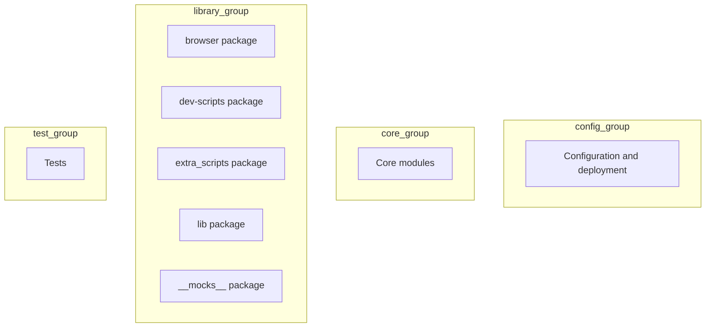

# Architecture report: BoostIO/BoostNote-Legacy

> Automated static analysis. **Observed** = directly seen in files/imports/AST; **Inferred** = interpretation from that evidence. Repository code was not executed.

## 1. Repository at a glance

| Item | Value |
| --- | --- |
| Repository | BoostIO/BoostNote-Legacy |
| Description | This repository is outdated and new Boost Note app is available! We've launched a new Boost Note app which supports real-time collaborative writing. https://github.com/BoostIO/BoostNote-App |
| Language | JavaScript |
| Stars | 16867 |
| Licence | Other |
| Analysed commit / branch | 789926bc760628ecedbd0051ca96d190a2be234f / master |
| Framework(s) | Electron, React |
| Files analysed | 408 |
| Components | 8 |

## 2. Architecture in one minute

BoostIO/BoostNote-Legacy - This repository is outdated and new Boost Note app is available! We've launched a new Boost Note app which supports real-time collaborative writing. https://github.com/BoostIO/BoostNote-App. This repository was analysed statically from 408 file(s) (0 Python). Detected technologies (observed from imports/manifests): Electron, React, React Router, Redux, Jest, webpack. Files are grouped into 8 component(s): browser package, Configuration and deployment, Core modules, dev-scripts package, extra_scripts package, lib package, __mocks__ package, Tests. Findings below distinguish observed facts from inferred interpretation.

## 3. High-level block diagram

## 4. Main components

### browser package (`browser`)

- **Kind:** library
- **Status:** Observed
- **Confidence:** 0.85
- **Responsibility:** Groups 153 file(s) under browser package (observed from repository paths and static analysis).
- **Paths:** `browser/components/CodeEditor.js`, `browser/components/ColorPicker.js`, `browser/components/MarkdownEditor.js`, `browser/components/MarkdownPreview.js`, `browser/components/MarkdownSplitEditor.js`, `browser/components/ModalEscButton.js`, `browser/components/NavToggleButton.js`, `browser/components/NoteItem.js`, `browser/components/NoteItemSimple.js`, `browser/components/RealtimeNotification.js`, `browser/components/SideNavFilter.js`, `browser/components/SnippetTab.js`, `browser/components/StorageItem.js`, `browser/components/StorageList.js`, `browser/components/TagListItem.js`, `browser/components/TodoListPercentage.js`, `browser/components/TodoProcess.js`, `browser/components/render/MermaidRender.js`, `browser/lib/CMLanguageList.js`, `browser/lib/CSSModules.js`, `browser/lib/Languages.js`, `browser/lib/Mutable.js`, `browser/lib/RcParser.js`, `browser/lib/SnippetManager.js`, `browser/lib/TextEditorInterface.js`, `browser/lib/confirmDeleteNote.js`, `browser/lib/consts.js`, `browser/lib/context.js`, `browser/lib/contextMenuBuilder.js`, `browser/lib/convertModeName.js`, `browser/lib/customMeta.js`, `browser/lib/date-formatter.js`, `browser/lib/findNoteTitle.js`, `browser/lib/findStorage.js`, `browser/lib/getTodoStatus.js`, `browser/lib/htmlTextHelper.js`, `browser/lib/i18n.js`, `browser/lib/keygen.js`, `browser/lib/markdown-it-deflist.js`, `browser/lib/markdown-it-fence.js`, `browser/lib/markdown-it-frontmatter.js`, `browser/lib/markdown-it-sanitize-html.js`, `browser/lib/markdown-toc-generator.js`, `browser/lib/markdown.js`, `browser/lib/markdown2.js`, `browser/lib/markdownTextHelper.js`, `browser/lib/newNote.js`, `browser/lib/normalizeEditorFontFamily.js`, `browser/lib/search.js`, `browser/lib/slugify.js`, `browser/lib/spellcheck.js`, `browser/lib/turndown.js`, `browser/lib/ui-themes.js`, `browser/lib/utils.js`, `browser/lib/wakatime-plugin.js`, `browser/main/Detail/FolderSelect.js`, `browser/main/Detail/FromUrlButton.js`, `browser/main/Detail/FullscreenButton.js`, `browser/main/Detail/InfoButton.js`, `browser/main/Detail/InfoPanel.js`, `browser/main/Detail/InfoPanelTrashed.js`, `browser/main/Detail/MarkdownNoteDetail.js`, `browser/main/Detail/PermanentDeleteButton.js`, `browser/main/Detail/RestoreButton.js`, `browser/main/Detail/SnippetNoteDetail.js`, `browser/main/Detail/StarButton.js`, `browser/main/Detail/TagSelect.js`, `browser/main/Detail/ToggleDirectionButton.js`, `browser/main/Detail/ToggleModeButton.js`, `browser/main/Detail/TrashButton.js`, `browser/main/Detail/index.js`, `browser/main/DevTools/index.dev.js`, `browser/main/DevTools/index.js`, `browser/main/DevTools/index.prod.js`, `browser/main/Main.js`, `browser/main/NewNoteButton/index.js`, `browser/main/NoteList/index.js`, `browser/main/SideNav/ListButton.js`, `browser/main/SideNav/PreferenceButton.js`, `browser/main/SideNav/SearchButton.js`, `browser/main/SideNav/StorageItem.js`, `browser/main/SideNav/TagButton.js`, `browser/main/SideNav/index.js`, `browser/main/StatusBar/index.js`, `browser/main/TopBar/index.js`, `browser/main/index.js`, `browser/main/lib/AwsMobileAnalyticsConfig.js`, `browser/main/lib/Commander.js`, `browser/main/lib/ConfigManager.js`, `browser/main/lib/ThemeManager.js`, `browser/main/lib/ZoomManager.js`, `browser/main/lib/dataApi/addStorage.js`, `browser/main/lib/dataApi/attachmentManagement.js`, `browser/main/lib/dataApi/copyFile.js`, `browser/main/lib/dataApi/createFolder.js`, `browser/main/lib/dataApi/createNote.js`, `browser/main/lib/dataApi/createNoteFromUrl.js`, `browser/main/lib/dataApi/createSnippet.js`, `browser/main/lib/dataApi/deleteFolder.js`, `browser/main/lib/dataApi/deleteNote.js`, `browser/main/lib/dataApi/deleteSnippet.js`, `browser/main/lib/dataApi/exportFolder.js`, `browser/main/lib/dataApi/exportNote.js`, `browser/main/lib/dataApi/exportNoteAs.js`, `browser/main/lib/dataApi/exportStorage.js`, `browser/main/lib/dataApi/exportTag.js`, `browser/main/lib/dataApi/fetchSnippet.js`, `browser/main/lib/dataApi/formatHTML.js`, `browser/main/lib/dataApi/formatMarkdown.js`, `browser/main/lib/dataApi/formatPDF.js`, `browser/main/lib/dataApi/getContentFormatter.js`, `browser/main/lib/dataApi/getFilename.js`, `browser/main/lib/dataApi/index.js`, `browser/main/lib/dataApi/init.js`, `browser/main/lib/dataApi/migrateFromV5Storage.js`, `browser/main/lib/dataApi/migrateFromV6Storage.js`, `browser/main/lib/dataApi/moveNote.js`, `browser/main/lib/dataApi/removeStorage.js`, `browser/main/lib/dataApi/renameStorage.js`, `browser/main/lib/dataApi/reorderFolder.js`, `browser/main/lib/dataApi/resolveStorageData.js`, `browser/main/lib/dataApi/resolveStorageNotes.js`, `browser/main/lib/dataApi/toggleStorage.js`, `browser/main/lib/dataApi/updateFolder.js`, `browser/main/lib/dataApi/updateNote.js`, `browser/main/lib/dataApi/updateSnippet.js`, `browser/main/lib/eventEmitter.js`, `browser/main/lib/ipcClient.js`, `browser/main/lib/modal.js`, `browser/main/lib/notify.js`, `browser/main/lib/shortcut.js`, `browser/main/lib/shortcutManager.js`, `browser/main/modals/CreateFolderModal.js`, `browser/main/modals/CreateMarkdownFromURLModal.js`, `browser/main/modals/NewNoteModal.js`, `browser/main/modals/PreferencesModal/Blog.js`, `browser/main/modals/PreferencesModal/Crowdfunding.js`, `browser/main/modals/PreferencesModal/ExportTab.js`, `browser/main/modals/PreferencesModal/FolderItem.js`, `browser/main/modals/PreferencesModal/FolderList.js`, `browser/main/modals/PreferencesModal/HotkeyTab.js`, `browser/main/modals/PreferencesModal/InfoTab.js`, `browser/main/modals/PreferencesModal/PluginsTab.js`, `browser/main/modals/PreferencesModal/SnippetEditor.js`, `browser/main/modals/PreferencesModal/SnippetList.js`, `browser/main/modals/PreferencesModal/SnippetTab.js`, `browser/main/modals/PreferencesModal/StorageItem.js`, `browser/main/modals/PreferencesModal/StoragesTab.js`, `browser/main/modals/PreferencesModal/UiTab.js`, `browser/main/modals/PreferencesModal/index.js`, `browser/main/modals/RenameFolderModal.js`, `browser/main/modals/RenameTagModal.js`, `browser/main/store.js`
- **Evidence:** [browser/components/CodeEditor.js](https://github.com/BoostIO/BoostNote-Legacy/blob/789926bc760628ecedbd0051ca96d190a2be234f/browser/components/CodeEditor.js); [browser/components/ColorPicker.js](https://github.com/BoostIO/BoostNote-Legacy/blob/789926bc760628ecedbd0051ca96d190a2be234f/browser/components/ColorPicker.js); [browser/components/MarkdownEditor.js](https://github.com/BoostIO/BoostNote-Legacy/blob/789926bc760628ecedbd0051ca96d190a2be234f/browser/components/MarkdownEditor.js); [browser/components/MarkdownPreview.js](https://github.com/BoostIO/BoostNote-Legacy/blob/789926bc760628ecedbd0051ca96d190a2be234f/browser/components/MarkdownPreview.js); [browser/components/MarkdownSplitEditor.js](https://github.com/BoostIO/BoostNote-Legacy/blob/789926bc760628ecedbd0051ca96d190a2be234f/browser/components/MarkdownSplitEditor.js); [browser/components/ModalEscButton.js](https://github.com/BoostIO/BoostNote-Legacy/blob/789926bc760628ecedbd0051ca96d190a2be234f/browser/components/ModalEscButton.js); [browser/components/NavToggleButton.js](https://github.com/BoostIO/BoostNote-Legacy/blob/789926bc760628ecedbd0051ca96d190a2be234f/browser/components/NavToggleButton.js); [browser/components/NoteItem.js](https://github.com/BoostIO/BoostNote-Legacy/blob/789926bc760628ecedbd0051ca96d190a2be234f/browser/components/NoteItem.js)

### Configuration and deployment (`config`)

- **Kind:** config
- **Status:** Observed
- **Confidence:** 0.85
- **Responsibility:** Groups 24 file(s) under configuration and deployment (observed from repository paths and static analysis).
- **Paths:** `appdmg.json`, `locales/cs.json`, `locales/da.json`, `locales/de.json`, `locales/en.json`, `locales/es-ES.json`, `locales/fa.json`, `locales/fr.json`, `locales/hu.json`, `locales/it.json`, `locales/ja.json`, `locales/ko.json`, `locales/no.json`, `locales/pl.json`, `locales/pt-BR.json`, `locales/pt-PT.json`, `locales/ru.json`, `locales/sq.json`, `locales/th.json`, `locales/tr.json`, `locales/zh-CN.json`, `locales/zh-TW.json`, `package.json`, `snap/snapcraft.yaml`
- **Evidence:** [appdmg.json](https://github.com/BoostIO/BoostNote-Legacy/blob/789926bc760628ecedbd0051ca96d190a2be234f/appdmg.json); [locales/cs.json](https://github.com/BoostIO/BoostNote-Legacy/blob/789926bc760628ecedbd0051ca96d190a2be234f/locales/cs.json); [locales/da.json](https://github.com/BoostIO/BoostNote-Legacy/blob/789926bc760628ecedbd0051ca96d190a2be234f/locales/da.json); [locales/de.json](https://github.com/BoostIO/BoostNote-Legacy/blob/789926bc760628ecedbd0051ca96d190a2be234f/locales/de.json); [locales/en.json](https://github.com/BoostIO/BoostNote-Legacy/blob/789926bc760628ecedbd0051ca96d190a2be234f/locales/en.json); [locales/es-ES.json](https://github.com/BoostIO/BoostNote-Legacy/blob/789926bc760628ecedbd0051ca96d190a2be234f/locales/es-ES.json); [locales/fa.json](https://github.com/BoostIO/BoostNote-Legacy/blob/789926bc760628ecedbd0051ca96d190a2be234f/locales/fa.json); [locales/fr.json](https://github.com/BoostIO/BoostNote-Legacy/blob/789926bc760628ecedbd0051ca96d190a2be234f/locales/fr.json)

### Core modules (`core`)

- **Kind:** core
- **Status:** Observed
- **Confidence:** 0.85
- **Responsibility:** Groups 5 file(s) under core modules (observed from repository paths and static analysis).
- **Paths:** `gruntfile.js`, `index.js`, `webpack-production.config.js`, `webpack-skeleton.js`, `webpack.config.js`
- **Evidence:** [gruntfile.js](https://github.com/BoostIO/BoostNote-Legacy/blob/789926bc760628ecedbd0051ca96d190a2be234f/gruntfile.js); [index.js](https://github.com/BoostIO/BoostNote-Legacy/blob/789926bc760628ecedbd0051ca96d190a2be234f/index.js); [webpack-production.config.js](https://github.com/BoostIO/BoostNote-Legacy/blob/789926bc760628ecedbd0051ca96d190a2be234f/webpack-production.config.js); [webpack-skeleton.js](https://github.com/BoostIO/BoostNote-Legacy/blob/789926bc760628ecedbd0051ca96d190a2be234f/webpack-skeleton.js); [webpack.config.js](https://github.com/BoostIO/BoostNote-Legacy/blob/789926bc760628ecedbd0051ca96d190a2be234f/webpack.config.js)

### dev-scripts package (`dev_scripts`)

- **Kind:** library
- **Status:** Observed
- **Confidence:** 0.85
- **Responsibility:** Groups 1 file(s) under dev-scripts package (observed from repository paths and static analysis).
- **Paths:** `dev-scripts/dev.js`
- **Evidence:** [dev-scripts/dev.js](https://github.com/BoostIO/BoostNote-Legacy/blob/789926bc760628ecedbd0051ca96d190a2be234f/dev-scripts/dev.js)

### extra_scripts package (`extra_scripts`)

- **Kind:** library
- **Status:** Observed
- **Confidence:** 0.85
- **Responsibility:** Groups 5 file(s) under extra_scripts package (observed from repository paths and static analysis).
- **Paths:** `extra_scripts/boost/boostNewLineIndentContinueMarkdownList.js`, `extra_scripts/codemirror/addon/edit/closebrackets.js`, `extra_scripts/codemirror/addon/hyperlink/hyperlink.js`, `extra_scripts/codemirror/mode/bfm/bfm.js`, `extra_scripts/codemirror/mode/gfm/gfm.js`
- **Evidence:** [extra_scripts/boost/boostNewLineIndentContinueMarkdownList.js](https://github.com/BoostIO/BoostNote-Legacy/blob/789926bc760628ecedbd0051ca96d190a2be234f/extra_scripts/boost/boostNewLineIndentContinueMarkdownList.js); [extra_scripts/codemirror/addon/edit/closebrackets.js](https://github.com/BoostIO/BoostNote-Legacy/blob/789926bc760628ecedbd0051ca96d190a2be234f/extra_scripts/codemirror/addon/edit/closebrackets.js); [extra_scripts/codemirror/addon/hyperlink/hyperlink.js](https://github.com/BoostIO/BoostNote-Legacy/blob/789926bc760628ecedbd0051ca96d190a2be234f/extra_scripts/codemirror/addon/hyperlink/hyperlink.js); [extra_scripts/codemirror/mode/bfm/bfm.js](https://github.com/BoostIO/BoostNote-Legacy/blob/789926bc760628ecedbd0051ca96d190a2be234f/extra_scripts/codemirror/mode/bfm/bfm.js); [extra_scripts/codemirror/mode/gfm/gfm.js](https://github.com/BoostIO/BoostNote-Legacy/blob/789926bc760628ecedbd0051ca96d190a2be234f/extra_scripts/codemirror/mode/gfm/gfm.js)

### lib package (`lib`)

- **Kind:** library
- **Status:** Observed
- **Confidence:** 0.85
- **Responsibility:** Groups 5 file(s) under lib package (observed from repository paths and static analysis).
- **Paths:** `lib/ipcServer.js`, `lib/main-app.js`, `lib/main-menu.js`, `lib/main-window.js`, `lib/touchbar-menu.js`
- **Evidence:** [lib/ipcServer.js](https://github.com/BoostIO/BoostNote-Legacy/blob/789926bc760628ecedbd0051ca96d190a2be234f/lib/ipcServer.js); [lib/main-app.js](https://github.com/BoostIO/BoostNote-Legacy/blob/789926bc760628ecedbd0051ca96d190a2be234f/lib/main-app.js); [lib/main-menu.js](https://github.com/BoostIO/BoostNote-Legacy/blob/789926bc760628ecedbd0051ca96d190a2be234f/lib/main-menu.js); [lib/main-window.js](https://github.com/BoostIO/BoostNote-Legacy/blob/789926bc760628ecedbd0051ca96d190a2be234f/lib/main-window.js); [lib/touchbar-menu.js](https://github.com/BoostIO/BoostNote-Legacy/blob/789926bc760628ecedbd0051ca96d190a2be234f/lib/touchbar-menu.js)

### __mocks__ package (`mocks`)

- **Kind:** library
- **Status:** Observed
- **Confidence:** 0.85
- **Responsibility:** Groups 1 file(s) under __mocks__ package (observed from repository paths and static analysis).
- **Paths:** `__mocks__/electron.js`
- **Evidence:** [__mocks__/electron.js](https://github.com/BoostIO/BoostNote-Legacy/blob/789926bc760628ecedbd0051ca96d190a2be234f/__mocks__/electron.js)

### Tests (`tests`)

- **Kind:** test
- **Status:** Observed
- **Confidence:** 0.85
- **Responsibility:** Groups 52 file(s) under tests (observed from repository paths and static analysis).
- **Paths:** `tests/.gitignore`, `tests/components/TagListItem.snapshot.test.js`, `tests/components/__snapshots__/TagListItem.snapshot.test.js.snap`, `tests/dataApi/addStorage.js`, `tests/dataApi/attachmentManagement.test.js`, `tests/dataApi/copyFile.test.js`, `tests/dataApi/createFolder.test.js`, `tests/dataApi/createNote.test.js`, `tests/dataApi/createNoteFromUrl.test.js`, `tests/dataApi/createSnippet.test.js`, `tests/dataApi/deleteFolder.test.js`, `tests/dataApi/deleteNote-test.js`, `tests/dataApi/deleteSnippet-test.js`, `tests/dataApi/exportFolder-test.js`, `tests/dataApi/exportStorage-test.js`, `tests/dataApi/init.js`, `tests/dataApi/migrateFromV6Storage-test.js`, `tests/dataApi/moveNote-test.js`, `tests/dataApi/removeStorage-test.js`, `tests/dataApi/renameStorage-test.js`, `tests/dataApi/reorderFolder-test.js`, `tests/dataApi/toggleStorage-test.js`, `tests/dataApi/updateFolder-test.js`, `tests/dataApi/updateNote-test.js`, `tests/dataApi/updateSnippet-test.js`, `tests/date-formatter-test.js`, `tests/fixtures/TestDummy.js`, `tests/fixtures/markdowns.js`, `tests/helpers/setup-browser-env.js`, `tests/helpers/setup-electron-mock.js`, `tests/jest.js`, `tests/lib/__snapshots__/markdown.test.js.snap`, `tests/lib/boostnoterc/.boostnoterc.all`, `tests/lib/boostnoterc/.boostnoterc.invalid`, `tests/lib/boostnoterc/.boostnoterc.valid`, `tests/lib/contextMenuBuilder.test.js`, `tests/lib/escapeHtmlCharacters.test.js`, `tests/lib/find-storage.test.js`, `tests/lib/find-title.test.js`, `tests/lib/get-todo-status.test.js`, `tests/lib/html-text-helper.test.js`, `tests/lib/markdown-text-helper.test.js`, `tests/lib/markdown-toc-generator.test.js`, `tests/lib/markdown.test.js`, `tests/lib/normalize-editor-font-family.test.js`, `tests/lib/rc-parser.test.js`, `tests/lib/search.test.js`, `tests/lib/slugify.test.js`, `tests/lib/snapshots/markdown-test.js.md`, `tests/lib/spellcheck.test.js`, `tests/lib/themeManager.test.js`, `tests/lib/utils.test.js`
- **Evidence:** [tests/.gitignore](https://github.com/BoostIO/BoostNote-Legacy/blob/789926bc760628ecedbd0051ca96d190a2be234f/tests/.gitignore); [tests/components/TagListItem.snapshot.test.js](https://github.com/BoostIO/BoostNote-Legacy/blob/789926bc760628ecedbd0051ca96d190a2be234f/tests/components/TagListItem.snapshot.test.js); [tests/components/__snapshots__/TagListItem.snapshot.test.js.snap](https://github.com/BoostIO/BoostNote-Legacy/blob/789926bc760628ecedbd0051ca96d190a2be234f/tests/components/__snapshots__/TagListItem.snapshot.test.js.snap); [tests/dataApi/addStorage.js](https://github.com/BoostIO/BoostNote-Legacy/blob/789926bc760628ecedbd0051ca96d190a2be234f/tests/dataApi/addStorage.js); [tests/dataApi/attachmentManagement.test.js](https://github.com/BoostIO/BoostNote-Legacy/blob/789926bc760628ecedbd0051ca96d190a2be234f/tests/dataApi/attachmentManagement.test.js); [tests/dataApi/copyFile.test.js](https://github.com/BoostIO/BoostNote-Legacy/blob/789926bc760628ecedbd0051ca96d190a2be234f/tests/dataApi/copyFile.test.js); [tests/dataApi/createFolder.test.js](https://github.com/BoostIO/BoostNote-Legacy/blob/789926bc760628ecedbd0051ca96d190a2be234f/tests/dataApi/createFolder.test.js); [tests/dataApi/createNote.test.js](https://github.com/BoostIO/BoostNote-Legacy/blob/789926bc760628ecedbd0051ca96d190a2be234f/tests/dataApi/createNote.test.js)

## 5. Execution flow

**Observed** entry point(s):

- [browser/main/Detail/index.js](https://github.com/BoostIO/BoostNote-Legacy/blob/789926bc760628ecedbd0051ca96d190a2be234f/browser/main/Detail/index.js)
- [browser/main/DevTools/index.js](https://github.com/BoostIO/BoostNote-Legacy/blob/789926bc760628ecedbd0051ca96d190a2be234f/browser/main/DevTools/index.js)
- [browser/main/Main.js](https://github.com/BoostIO/BoostNote-Legacy/blob/789926bc760628ecedbd0051ca96d190a2be234f/browser/main/Main.js)
- [browser/main/NewNoteButton/index.js](https://github.com/BoostIO/BoostNote-Legacy/blob/789926bc760628ecedbd0051ca96d190a2be234f/browser/main/NewNoteButton/index.js)
- [browser/main/NoteList/index.js](https://github.com/BoostIO/BoostNote-Legacy/blob/789926bc760628ecedbd0051ca96d190a2be234f/browser/main/NoteList/index.js)
- [browser/main/SideNav/index.js](https://github.com/BoostIO/BoostNote-Legacy/blob/789926bc760628ecedbd0051ca96d190a2be234f/browser/main/SideNav/index.js)
- [browser/main/StatusBar/index.js](https://github.com/BoostIO/BoostNote-Legacy/blob/789926bc760628ecedbd0051ca96d190a2be234f/browser/main/StatusBar/index.js)
- [browser/main/TopBar/index.js](https://github.com/BoostIO/BoostNote-Legacy/blob/789926bc760628ecedbd0051ca96d190a2be234f/browser/main/TopBar/index.js)
- [browser/main/index.js](https://github.com/BoostIO/BoostNote-Legacy/blob/789926bc760628ecedbd0051ca96d190a2be234f/browser/main/index.js)
- [index.js](https://github.com/BoostIO/BoostNote-Legacy/blob/789926bc760628ecedbd0051ca96d190a2be234f/index.js)

Representative flow (derived from observed entry points and the import graph; steps beyond the entry point are **Inferred**):

1. Execution starts at an observed entry point listed above, if present.
2. No internal import relationships between components were observed.

## 6. Project structure

### `(root)`

- `.babelrc` - other (291 bytes)
- `.boostnoterc.sample` - other (791 bytes)
- `.editorconfig` - config (385 bytes)
- `.eslintignore` - other (44 bytes)
- `.eslintrc` - other (700 bytes)
- `.gitignore` - other (146 bytes)
- `.prettierrc` - other (68 bytes)
- `.travis.yml` - ci, YAML (692 bytes)
- `FAQ.md` - docs (819 bytes)
- `ISSUE_TEMPLATE.md` - docs (733 bytes)
- `LICENSE` - docs (736 bytes)
- `PULL_REQUEST_TEMPLATE.md` - docs (1433 bytes)
- `appdmg.json` - config (314 bytes)
- `contributing.md` - docs (8069 bytes)
- `gruntfile.js` - source, JavaScript (11095 bytes)
- `index.js` - source, JavaScript (1781 bytes)
- `package.json` - manifest (6653 bytes)
- `prettier.config` - other (68 bytes)
- `readme.md` - docs (1884 bytes)
- `webpack-production.config.js` - source, JavaScript (1191 bytes)
- `webpack-skeleton.js` - source, JavaScript (1360 bytes)
- `webpack.config.js` - source, JavaScript (973 bytes)

### `.github`

- `.github/FUNDING.yml` - config (29 bytes)

### `.vscode`

- `.vscode/launch.json` - config (1108 bytes)
- `.vscode/tasks.json` - config (597 bytes)

### `__mocks__`

- `__mocks__/electron.js` - source, JavaScript (187 bytes)

### `browser`

- `browser/components/CodeEditor.js` - source, JavaScript (42138 bytes)
- `browser/components/CodeEditor.styl` - other (89 bytes)
- `browser/components/ColorPicker.js` - source, JavaScript (1939 bytes)
- `browser/components/ColorPicker.styl` - other (620 bytes)
- `browser/components/MarkdownEditor.js` - source, JavaScript (13122 bytes)
- `browser/components/MarkdownEditor.styl` - other (345 bytes)
- `browser/components/MarkdownPreview.js` - source, JavaScript (27589 bytes)
- `browser/components/MarkdownSplitEditor.js` - source, JavaScript (14501 bytes)
- `browser/components/MarkdownSplitEditor.styl` - other (705 bytes)
- `browser/components/ModalEscButton.js` - source, JavaScript (477 bytes)
- `browser/components/ModalEscButton.styl` - other (279 bytes)
- `browser/components/NavToggleButton.js` - source, JavaScript (776 bytes)
- `browser/components/NavToggleButton.styl` - other (745 bytes)
- `browser/components/NoteItem.js` - source, JavaScript (5052 bytes)
- `browser/components/NoteItem.styl` - other (10897 bytes)
- `browser/components/NoteItemSimple.js` - source, JavaScript (2201 bytes)
- `browser/components/NoteItemSimple.styl` - other (9001 bytes)
- `browser/components/RealtimeNotification.js` - source, JavaScript (1382 bytes)
- `browser/components/RealtimeNotification.styl` - other (1031 bytes)
- `browser/components/SideNavFilter.js` - source, JavaScript (2817 bytes)
- `browser/components/SideNavFilter.styl` - other (6396 bytes)
- `browser/components/SnippetTab.js` - source, JavaScript (3180 bytes)
- `browser/components/SnippetTab.styl` - other (3471 bytes)
- `browser/components/StorageItem.js` - source, JavaScript (2853 bytes)
- `browser/components/StorageItem.styl` - other (3826 bytes)
- `browser/components/StorageList.js` - source, JavaScript (657 bytes)
- `browser/components/StorageList.styl` - other (413 bytes)
- `browser/components/TagListItem.js` - source, JavaScript (1758 bytes)
- `browser/components/TagListItem.styl` - other (3040 bytes)
- `browser/components/TodoListPercentage.js` - source, JavaScript (988 bytes)
- `browser/components/TodoListPercentage.styl` - other (1490 bytes)
- `browser/components/TodoProcess.js` - source, JavaScript (931 bytes)
- `browser/components/TodoProcess.styl` - other (822 bytes)
- `browser/components/markdown.styl` - other (13758 bytes)
- `browser/components/render/MermaidRender.js` - source, JavaScript (1837 bytes)
- `browser/lib/CMLanguageList.js` - source, JavaScript (1493 bytes)
- `browser/lib/CSSModules.js` - source, JavaScript (166 bytes)
- `browser/lib/Languages.js` - source, JavaScript (1182 bytes)
- `browser/lib/Mutable.js` - source, JavaScript (1798 bytes)
- `browser/lib/RcParser.js` - source, JavaScript (564 bytes)
- `browser/lib/SnippetManager.js` - source, JavaScript (2831 bytes)
- `browser/lib/TextEditorInterface.js` - source, JavaScript (2506 bytes)
- `browser/lib/confirmDeleteNote.js` - source, JavaScript (618 bytes)
- `browser/lib/consts.js` - source, JavaScript (2141 bytes)
- `browser/lib/context.js` - source, JavaScript (318 bytes)
- `browser/lib/contextMenuBuilder.js` - source, JavaScript (4075 bytes)
- `browser/lib/convertModeName.js` - source, JavaScript (298 bytes)
- `browser/lib/customMeta.js` - source, JavaScript (467 bytes)
- `browser/lib/date-formatter.js` - source, JavaScript (358 bytes)
- `browser/lib/findNoteTitle.js` - source, JavaScript (1353 bytes)
- `browser/lib/findStorage.js` - source, JavaScript (431 bytes)
- `browser/lib/getTodoStatus.js` - source, JavaScript (631 bytes)
- `browser/lib/htmlTextHelper.js` - source, JavaScript (768 bytes)
- `browser/lib/i18n.js` - source, JavaScript (508 bytes)
- `browser/lib/keygen.js` - source, JavaScript (245 bytes)
- `browser/lib/markdown-it-deflist.js` - source, JavaScript (6521 bytes)
- `browser/lib/markdown-it-fence.js` - source, JavaScript (3375 bytes)
- `browser/lib/markdown-it-frontmatter.js` - source, JavaScript (622 bytes)
- `browser/lib/markdown-it-sanitize-html.js` - source, JavaScript (3554 bytes)
- `browser/lib/markdown-toc-generator.js` - source, JavaScript (2536 bytes)
- `browser/lib/markdown.js` - source, JavaScript (14739 bytes)
- `browser/lib/markdown2.js` - source, JavaScript (0 bytes)
- `browser/lib/markdownTextHelper.js` - source, JavaScript (959 bytes)
- `browser/lib/newNote.js` - source, JavaScript (2376 bytes)
- `browser/lib/normalizeEditorFontFamily.js` - source, JavaScript (372 bytes)
- `browser/lib/search.js` - source, JavaScript (1122 bytes)
- `browser/lib/slugify.js` - source, JavaScript (304 bytes)
- `browser/lib/spellcheck.js` - source, JavaScript (7361 bytes)
- `browser/lib/turndown.js` - source, JavaScript (251 bytes)
- `browser/lib/ui-themes.js` - source, JavaScript (677 bytes)
- `browser/lib/utils.js` - source, JavaScript (5648 bytes)
- `browser/lib/wakatime-plugin.js` - source, JavaScript (1247 bytes)
- `browser/main/Detail/Detail.styl` - other (836 bytes)
- `browser/main/Detail/DetailVars.styl` - other (322 bytes)
- `browser/main/Detail/FolderSelect.js` - source, JavaScript (7630 bytes)
- `browser/main/Detail/FolderSelect.styl` - other (4139 bytes)
- `browser/main/Detail/FromUrlButton.js` - source, JavaScript (1587 bytes)
- `browser/main/Detail/FromUrlButton.styl` - other (723 bytes)
- `browser/main/Detail/FullscreenButton.js` - source, JavaScript (837 bytes)
- `browser/main/Detail/FullscreenButton.styl` - other (405 bytes)
- `browser/main/Detail/InfoButton.js` - source, JavaScript (545 bytes)
- `browser/main/Detail/InfoButton.styl` - other (370 bytes)
- `browser/main/Detail/InfoPanel.js` - source, JavaScript (4320 bytes)
- `browser/main/Detail/InfoPanel.styl` - other (3853 bytes)
- `browser/main/Detail/InfoPanelTrashed.js` - source, JavaScript (2334 bytes)
- `browser/main/Detail/MarkdownNoteDetail.js` - source, JavaScript (18386 bytes)
- `browser/main/Detail/MarkdownNoteDetail.styl` - other (1526 bytes)
- `browser/main/Detail/NoteDetailInfo.styl` - other (2322 bytes)
- `browser/main/Detail/PermanentDeleteButton.js` - source, JavaScript (580 bytes)
- `browser/main/Detail/RestoreButton.js` - source, JavaScript (545 bytes)
- `browser/main/Detail/RestoreButton.styl` - other (349 bytes)
- `browser/main/Detail/SnippetNoteDetail.js` - source, JavaScript (31290 bytes)
- `browser/main/Detail/SnippetNoteDetail.styl` - other (4205 bytes)
- `browser/main/Detail/StarButton.js` - source, JavaScript (1584 bytes)
- `browser/main/Detail/StarButton.styl` - other (774 bytes)
- `browser/main/Detail/TagSelect.js` - source, JavaScript (7242 bytes)
- `browser/main/Detail/TagSelect.styl` - other (1397 bytes)
- `browser/main/Detail/ToggleDirectionButton.js` - source, JavaScript (907 bytes)
- `browser/main/Detail/ToggleDirectionButton.styl` - other (1605 bytes)
- `browser/main/Detail/ToggleModeButton.js` - source, JavaScript (1177 bytes)
- `browser/main/Detail/ToggleModeButton.styl` - other (1587 bytes)
- `browser/main/Detail/TrashButton.js` - source, JavaScript (560 bytes)
- `browser/main/Detail/TrashButton.styl` - other (490 bytes)
- `browser/main/Detail/index.js` - source, JavaScript (3857 bytes)
- `browser/main/DevTools/index.dev.js` - source, JavaScript (406 bytes)
- `browser/main/DevTools/index.js` - source, JavaScript (278 bytes)
- `browser/main/DevTools/index.prod.js` - source, JavaScript (114 bytes)
- `browser/main/Main.js` - source, JavaScript (12991 bytes)
- `browser/main/Main.styl` - other (598 bytes)
- `browser/main/NewNoteButton/NewNoteButton.styl` - other (1792 bytes)
- `browser/main/NewNoteButton/index.js` - source, JavaScript (3350 bytes)
- `browser/main/NoteList/NoteList.styl` - other (2051 bytes)
- `browser/main/NoteList/index.js` - source, JavaScript (38841 bytes)
- `browser/main/SideNav/ListButton.js` - source, JavaScript (749 bytes)
- `browser/main/SideNav/PreferenceButton.js` - source, JavaScript (575 bytes)
- `browser/main/SideNav/PreferenceButton.styl` - other (1106 bytes)
- `browser/main/SideNav/SearchButton.js` - source, JavaScript (703 bytes)
- `browser/main/SideNav/SearchButton.styl` - other (1172 bytes)
- `browser/main/SideNav/SideNav.styl` - other (3811 bytes)
- `browser/main/SideNav/StorageItem.js` - source, JavaScript (13092 bytes)
- `browser/main/SideNav/StorageItem.styl` - other (4755 bytes)
- `browser/main/SideNav/SwitchButton.styl` - other (1074 bytes)
- `browser/main/SideNav/TagButton.js` - source, JavaScript (743 bytes)
- `browser/main/SideNav/index.js` - source, JavaScript (19369 bytes)
- `browser/main/StatusBar/StatusBar.styl` - other (1757 bytes)
- `browser/main/StatusBar/index.js` - source, JavaScript (3403 bytes)
- `browser/main/TopBar/TopBar.styl` - other (5584 bytes)
- `browser/main/TopBar/index.js` - source, JavaScript (5374 bytes)
- `browser/main/global.styl` - other (3145 bytes)
- `browser/main/index.js` - source, JavaScript (5166 bytes)
- `browser/main/lib/AwsMobileAnalyticsConfig.js` - source, JavaScript (2160 bytes)
- `browser/main/lib/Commander.js` - source, JavaScript (555 bytes)
- `browser/main/lib/ConfigManager.js` - source, JavaScript (8536 bytes)
- `browser/main/lib/ThemeManager.js` - source, JavaScript (1491 bytes)
- `browser/main/lib/ZoomManager.js` - source, JavaScript (516 bytes)
- `browser/main/lib/dataApi/addStorage.js` - source, JavaScript (2484 bytes)
- `browser/main/lib/dataApi/attachmentManagement.js` - source, JavaScript (36429 bytes)
- `browser/main/lib/dataApi/copyFile.js` - source, JavaScript (761 bytes)
- `browser/main/lib/dataApi/createFolder.js` - source, JavaScript (1351 bytes)
- `browser/main/lib/dataApi/createNote.js` - source, JavaScript (2623 bytes)
- `browser/main/lib/dataApi/createNoteFromUrl.js` - source, JavaScript (2888 bytes)
- `browser/main/lib/dataApi/createSnippet.js` - source, JavaScript (826 bytes)
- `browser/main/lib/dataApi/deleteFolder.js` - source, JavaScript (1704 bytes)
- `browser/main/lib/dataApi/deleteNote.js` - source, JavaScript (1007 bytes)
- `browser/main/lib/dataApi/deleteSnippet.js` - source, JavaScript (619 bytes)
- `browser/main/lib/dataApi/exportFolder.js` - source, JavaScript (1688 bytes)
- `browser/main/lib/dataApi/exportNote.js` - source, JavaScript (2464 bytes)
- `browser/main/lib/dataApi/exportNoteAs.js` - source, JavaScript (541 bytes)
- `browser/main/lib/dataApi/exportStorage.js` - source, JavaScript (2101 bytes)
- `browser/main/lib/dataApi/exportTag.js` - source, JavaScript (638 bytes)
- `browser/main/lib/dataApi/fetchSnippet.js` - source, JavaScript (523 bytes)
- `browser/main/lib/dataApi/formatHTML.js` - source, JavaScript (18247 bytes)
- `browser/main/lib/dataApi/formatMarkdown.js` - source, JavaScript (2558 bytes)
- `browser/main/lib/dataApi/formatPDF.js` - source, JavaScript (718 bytes)
- `browser/main/lib/dataApi/getContentFormatter.js` - source, JavaScript (1972 bytes)
- `browser/main/lib/dataApi/getFilename.js` - source, JavaScript (794 bytes)
- `browser/main/lib/dataApi/index.js` - source, JavaScript (1246 bytes)
- `browser/main/lib/dataApi/init.js` - source, JavaScript (2809 bytes)
- `browser/main/lib/dataApi/migrateFromV5Storage.js` - source, JavaScript (3387 bytes)
- `browser/main/lib/dataApi/migrateFromV6Storage.js` - source, JavaScript (3097 bytes)
- `browser/main/lib/dataApi/moveNote.js` - source, JavaScript (3306 bytes)
- `browser/main/lib/dataApi/removeStorage.js` - source, JavaScript (598 bytes)
- `browser/main/lib/dataApi/renameStorage.js` - source, JavaScript (883 bytes)
- `browser/main/lib/dataApi/reorderFolder.js` - source, JavaScript (1106 bytes)
- `browser/main/lib/dataApi/resolveStorageData.js` - source, JavaScript (1201 bytes)
- `browser/main/lib/dataApi/resolveStorageNotes.js` - source, JavaScript (1175 bytes)
- `browser/main/lib/dataApi/toggleStorage.js` - source, JavaScript (781 bytes)
- `browser/main/lib/dataApi/updateFolder.js` - source, JavaScript (1323 bytes)
- `browser/main/lib/dataApi/updateNote.js` - source, JavaScript (4167 bytes)
- `browser/main/lib/dataApi/updateSnippet.js` - source, JavaScript (1270 bytes)
- `browser/main/lib/eventEmitter.js` - source, JavaScript (435 bytes)
- `browser/main/lib/ipcClient.js` - source, JavaScript (682 bytes)
- `browser/main/lib/modal.js` - source, JavaScript (1876 bytes)
- `browser/main/lib/notify.js` - source, JavaScript (316 bytes)
- `browser/main/lib/shortcut.js` - source, JavaScript (337 bytes)
- `browser/main/lib/shortcutManager.js` - source, JavaScript (1029 bytes)
- `browser/main/modals/CreateFolderModal.js` - source, JavaScript (2844 bytes)
- `browser/main/modals/CreateFolderModal.styl` - other (1800 bytes)
- `browser/main/modals/CreateMarkdownFromURLModal.js` - source, JavaScript (2920 bytes)
- `browser/main/modals/CreateMarkdownFromURLModal.styl` - other (1698 bytes)
- `browser/main/modals/NewNoteModal.js` - source, JavaScript (4490 bytes)
- `browser/main/modals/NewNoteModal.styl` - other (1391 bytes)
- `browser/main/modals/PreferencesModal/Blog.js` - source, JavaScript (6583 bytes)
- `browser/main/modals/PreferencesModal/ConfigTab.styl` - other (6434 bytes)
- `browser/main/modals/PreferencesModal/Crowdfunding.js` - source, JavaScript (3174 bytes)
- `browser/main/modals/PreferencesModal/Crowdfunding.styl` - other (662 bytes)
- `browser/main/modals/PreferencesModal/ExportTab.js` - source, JavaScript (4863 bytes)
- `browser/main/modals/PreferencesModal/FolderItem.js` - source, JavaScript (8498 bytes)
- `browser/main/modals/PreferencesModal/FolderItem.styl` - other (2726 bytes)
- `browser/main/modals/PreferencesModal/FolderList.js` - source, JavaScript (2186 bytes)
- `browser/main/modals/PreferencesModal/FolderList.styl` - other (0 bytes)
- `browser/main/modals/PreferencesModal/HotkeyTab.js` - source, JavaScript (10941 bytes)
- `browser/main/modals/PreferencesModal/InfoTab.js` - source, JavaScript (9028 bytes)
- `browser/main/modals/PreferencesModal/InfoTab.styl` - other (1850 bytes)
- `browser/main/modals/PreferencesModal/PluginsTab.js` - source, JavaScript (5680 bytes)
- `browser/main/modals/PreferencesModal/PreferencesModal.styl` - other (1932 bytes)
- `browser/main/modals/PreferencesModal/SnippetEditor.js` - source, JavaScript (3284 bytes)
- `browser/main/modals/PreferencesModal/SnippetList.js` - source, JavaScript (2791 bytes)
- `browser/main/modals/PreferencesModal/SnippetTab.js` - source, JavaScript (6161 bytes)
- `browser/main/modals/PreferencesModal/SnippetTab.styl` - other (3210 bytes)
- `browser/main/modals/PreferencesModal/StorageItem.js` - source, JavaScript (5189 bytes)
- `browser/main/modals/PreferencesModal/StorageItem.styl` - other (2341 bytes)
- `browser/main/modals/PreferencesModal/StoragesTab.js` - source, JavaScript (9864 bytes)
- `browser/main/modals/PreferencesModal/StoragesTab.styl` - other (4853 bytes)
- `browser/main/modals/PreferencesModal/Tab.styl` - other (435 bytes)
- `browser/main/modals/PreferencesModal/UiTab.js` - source, JavaScript (49164 bytes)
- `browser/main/modals/PreferencesModal/index.js` - source, JavaScript (5266 bytes)
- `browser/main/modals/RenameFolderModal.js` - source, JavaScript (2522 bytes)
- `browser/main/modals/RenameModal.styl` - other (1524 bytes)
- `browser/main/modals/RenameTagModal.js` - source, JavaScript (4501 bytes)
- `browser/main/store.js` - source, JavaScript (15755 bytes)
- `browser/styles/Detail/TagSelect.styl` - other (1968 bytes)
- `browser/styles/index.styl` - other (14270 bytes)
- `browser/styles/mixins/alert.styl` - other (233 bytes)
- `browser/styles/mixins/btn.styl` - other (995 bytes)
- `browser/styles/mixins/circle.styl` - other (47 bytes)
- `browser/styles/mixins/fullsize.styl` - other (69 bytes)
- `browser/styles/mixins/input.styl` - other (370 bytes)
- `browser/styles/mixins/marked.styl` - other (3863 bytes)
- `browser/styles/mixins/tooltip.styl` - other (279 bytes)
- `browser/styles/mixins/util.styl` - other (92 bytes)
- `browser/styles/shared/btn.styl` - other (1108 bytes)
- `browser/styles/theme/dark.styl` - other (12070 bytes)
- `browser/styles/vars.styl` - other (868 bytes)

### `dev-scripts`

- `dev-scripts/dev.js` - source, JavaScript (1858 bytes)

### `dictionaries`

- `dictionaries/de_DE/LICENSE` - docs (18071 bytes)
- `dictionaries/de_DE/de_DE.aff` - other (12981 bytes)
- `dictionaries/en_GB/LICENSE` - docs (15184 bytes)
- `dictionaries/en_GB/en_GB.aff` - other (28123 bytes)

### `docs`

- `docs/build.md` - docs (3102 bytes)
- `docs/code_style.md` - docs (2395 bytes)
- `docs/de/build.md` - docs (2623 bytes)
- `docs/de/debug.md` - docs (1921 bytes)
- `docs/debug.md` - docs (2925 bytes)
- `docs/fr/build.md` - docs (2448 bytes)
- `docs/fr/debug.md` - docs (1646 bytes)
- `docs/jp/build.md` - docs (2050 bytes)
- `docs/jp/debug.md` - docs (1199 bytes)
- `docs/ko/build.md` - docs (3059 bytes)
- `docs/ko/debug.md` - docs (3042 bytes)
- `docs/pt_BR/build.md` - docs (2369 bytes)
- `docs/pt_BR/debug.md` - docs (2971 bytes)
- `docs/ru/build.md` - docs (2054 bytes)
- `docs/ru/debug.md` - docs (1559 bytes)
- `docs/zh_CN/build.md` - docs (1213 bytes)
- `docs/zh_CN/debug.md` - docs (920 bytes)
- `docs/zh_TW/build.md` - docs (2963 bytes)

### `extra_scripts`

- `extra_scripts/boost/boostNewLineIndentContinueMarkdownList.js` - source, JavaScript (3393 bytes)
- `extra_scripts/codemirror/addon/edit/closebrackets.js` - source, JavaScript (6882 bytes)
- `extra_scripts/codemirror/addon/hyperlink/hyperlink.js` - source, JavaScript (7494 bytes)
- `extra_scripts/codemirror/mode/bfm/bfm.css` - other (3835 bytes)
- `extra_scripts/codemirror/mode/bfm/bfm.js` - source, JavaScript (6357 bytes)
- `extra_scripts/codemirror/mode/gfm/gfm.js` - source, JavaScript (5832 bytes)
- `extra_scripts/codemirror/theme/nord.css` - other (1049 bytes)

### `lib`

- `lib/ipcServer.js` - source, JavaScript (1745 bytes)
- `lib/main-app.js` - source, JavaScript (3548 bytes)
- `lib/main-menu.js` - source, JavaScript (10927 bytes)
- `lib/main-window.js` - source, JavaScript (2741 bytes)
- `lib/main.development.html` - other (6696 bytes)
- `lib/main.production.html` - other (6643 bytes)
- `lib/touchbar-menu.js` - source, JavaScript (868 bytes)

### `locales`

- `locales/cs.json` - config (11074 bytes)
- `locales/da.json` - config (8505 bytes)
- `locales/de.json` - config (11510 bytes)
- `locales/en.json` - config (10262 bytes)
- `locales/es-ES.json` - config (9260 bytes)
- `locales/fa.json` - config (10970 bytes)
- `locales/fr.json` - config (10207 bytes)
- `locales/hu.json` - config (10817 bytes)
- `locales/it.json` - config (9005 bytes)
- `locales/ja.json` - config (14245 bytes)
- `locales/ko.json` - config (9378 bytes)
- `locales/no.json` - config (8499 bytes)
- `locales/pl.json` - config (9275 bytes)
- `locales/pt-BR.json` - config (9274 bytes)
- `locales/pt-PT.json` - config (9191 bytes)
- `locales/ru.json` - config (10892 bytes)
- `locales/sq.json` - config (8473 bytes)
- `locales/th.json` - config (15525 bytes)
- `locales/tr.json` - config (8357 bytes)
- `locales/zh-CN.json` - config (12543 bytes)
- `locales/zh-TW.json` - config (10221 bytes)

### `resources`

- `resources/icon/icon-all-active.svg` - other (1207 bytes)
- `resources/icon/icon-all.svg` - other (1205 bytes)
- `resources/icon/icon-code-off.svg` - other (952 bytes)
- `resources/icon/icon-code-on.svg` - other (1750 bytes)
- `resources/icon/icon-column-list.svg` - other (1240 bytes)
- `resources/icon/icon-column.svg` - other (1093 bytes)
- `resources/icon/icon-down.svg` - other (1088 bytes)
- `resources/icon/icon-edit-lock.svg` - other (887 bytes)
- `resources/icon/icon-edit.svg` - other (1569 bytes)
- `resources/icon/icon-external.svg` - other (2225 bytes)
- `resources/icon/icon-full.svg` - other (954 bytes)
- `resources/icon/icon-info.svg` - other (1242 bytes)
- `resources/icon/icon-left-to-right.svg` - other (946 bytes)
- `resources/icon/icon-list-active.svg` - other (1174 bytes)
- `resources/icon/icon-list.svg` - other (1160 bytes)
- `resources/icon/icon-lock.svg` - other (1251 bytes)
- `resources/icon/icon-mode-markdown-off-active.svg` - other (1504 bytes)
- `resources/icon/icon-mode-markdown-off.svg` - other (1504 bytes)
- `resources/icon/icon-mode-split-on-active.svg` - other (1767 bytes)
- `resources/icon/icon-mode-split-on.svg` - other (1767 bytes)
- `resources/icon/icon-newnote.svg` - other (1241 bytes)
- `resources/icon/icon-note-code.svg` - other (3069 bytes)
- `resources/icon/icon-note-text.svg` - other (1456 bytes)
- `resources/icon/icon-plus.svg` - other (1043 bytes)
- `resources/icon/icon-previewoff-off.svg` - other (1346 bytes)
- `resources/icon/icon-previewoff-on.svg` - other (1344 bytes)
- `resources/icon/icon-right-to-left.svg` - other (986 bytes)
- `resources/icon/icon-right.svg` - other (1006 bytes)
- `resources/icon/icon-search-active.svg` - other (1106 bytes)
- `resources/icon/icon-search.svg` - other (1106 bytes)
- `resources/icon/icon-setting.svg` - other (1188 bytes)
- `resources/icon/icon-sidebar.svg` - other (1117 bytes)
- `resources/icon/icon-star-active.svg` - other (1432 bytes)
- `resources/icon/icon-star-sidenav.svg` - other (1353 bytes)
- `resources/icon/icon-star.svg` - other (1226 bytes)
- `resources/icon/icon-starred.svg` - other (1358 bytes)
- `resources/icon/icon-tag-active.svg` - other (1211 bytes)
- `resources/icon/icon-tag.svg` - other (1197 bytes)
- `resources/icon/icon-trash-active.svg` - other (1406 bytes)
- `resources/icon/icon-trash-sidenav.svg` - other (1363 bytes)
- `resources/icon/icon-trash.svg` - other (1414 bytes)
- `resources/icon/icon-unlock.svg` - other (1285 bytes)
- `resources/icon/icon-up.svg` - other (1089 bytes)
- `resources/icon/icon-x-light.svg` - other (917 bytes)
- `resources/icon/icon-x.svg` - other (917 bytes)
- `resources/icon/icon-zoom.svg` - other (1276 bytes)

### `snap`

- `snap/gui/boostnote.desktop` - other (197 bytes)
- `snap/snapcraft.yaml` - config (912 bytes)

### `tests`

- `tests/.gitignore` - test (10 bytes)
- `tests/components/TagListItem.snapshot.test.js` - test, JavaScript (347 bytes)
- `tests/components/__snapshots__/TagListItem.snapshot.test.js.snap` - test (577 bytes)
- `tests/dataApi/addStorage.js` - test, JavaScript (2495 bytes)
- `tests/dataApi/attachmentManagement.test.js` - test, JavaScript (59608 bytes)
- `tests/dataApi/copyFile.test.js` - test, JavaScript (1037 bytes)
- `tests/dataApi/createFolder.test.js` - test, JavaScript (1386 bytes)
- `tests/dataApi/createNote.test.js` - test, JavaScript (3850 bytes)
- `tests/dataApi/createNoteFromUrl.test.js` - test, JavaScript (1511 bytes)
- `tests/dataApi/createSnippet.test.js` - test, JavaScript (1032 bytes)
- `tests/dataApi/deleteFolder.test.js` - test, JavaScript (2883 bytes)
- `tests/dataApi/deleteNote-test.js` - test, JavaScript (2696 bytes)
- `tests/dataApi/deleteSnippet-test.js` - test, JavaScript (977 bytes)
- `tests/dataApi/exportFolder-test.js` - test, JavaScript (2193 bytes)
- `tests/dataApi/exportStorage-test.js` - test, JavaScript (2024 bytes)
- `tests/dataApi/init.js` - test, JavaScript (2318 bytes)
- `tests/dataApi/migrateFromV6Storage-test.js` - test, JavaScript (2231 bytes)
- `tests/dataApi/moveNote-test.js` - test, JavaScript (2337 bytes)
- `tests/dataApi/removeStorage-test.js` - test, JavaScript (1135 bytes)
- `tests/dataApi/renameStorage-test.js` - test, JavaScript (1271 bytes)
- `tests/dataApi/reorderFolder-test.js` - test, JavaScript (1650 bytes)
- `tests/dataApi/toggleStorage-test.js` - test, JavaScript (1272 bytes)
- `tests/dataApi/updateFolder-test.js` - test, JavaScript (1561 bytes)
- `tests/dataApi/updateNote-test.js` - test, JavaScript (4655 bytes)
- `tests/dataApi/updateSnippet-test.js` - test, JavaScript (1315 bytes)
- `tests/date-formatter-test.js` - test, JavaScript (244 bytes)
- `tests/fixtures/TestDummy.js` - test, JavaScript (4727 bytes)
- `tests/fixtures/markdowns.js` - test, JavaScript (4106 bytes)
- `tests/helpers/setup-browser-env.js` - test, JavaScript (492 bytes)
- `tests/helpers/setup-electron-mock.js` - test, JavaScript (155 bytes)
- `tests/jest.js` - test, JavaScript (245 bytes)
- `tests/lib/__snapshots__/markdown.test.js.snap` - test (10519 bytes)
- `tests/lib/boostnoterc/.boostnoterc.all` - test (764 bytes)
- `tests/lib/boostnoterc/.boostnoterc.invalid` - test (214 bytes)
- `tests/lib/boostnoterc/.boostnoterc.valid` - test (213 bytes)
- `tests/lib/contextMenuBuilder.test.js` - test, JavaScript (5241 bytes)
- `tests/lib/escapeHtmlCharacters.test.js` - test, JavaScript (2126 bytes)
- `tests/lib/find-storage.test.js` - test, JavaScript (1054 bytes)
- `tests/lib/find-title.test.js` - test, JavaScript (1933 bytes)
- `tests/lib/get-todo-status.test.js` - test, JavaScript (2148 bytes)
- `tests/lib/html-text-helper.test.js` - test, JavaScript (1747 bytes)
- `tests/lib/markdown-text-helper.test.js` - test, JavaScript (1032 bytes)
- `tests/lib/markdown-toc-generator.test.js` - test, JavaScript (11628 bytes)
- `tests/lib/markdown.test.js` - test, JavaScript (3853 bytes)
- `tests/lib/normalize-editor-font-family.test.js` - test, JavaScript (695 bytes)
- `tests/lib/rc-parser.test.js` - test, JavaScript (1612 bytes)
- `tests/lib/search.test.js` - test, JavaScript (1630 bytes)
- `tests/lib/slugify.test.js` - test, JavaScript (1719 bytes)
- `tests/lib/snapshots/markdown-test.js.md` - test (10564 bytes)
- `tests/lib/spellcheck.test.js` - test, JavaScript (30607 bytes)
- `tests/lib/themeManager.test.js` - test, JavaScript (2722 bytes)
- `tests/lib/utils.test.js` - test, JavaScript (667 bytes)

## 7. Key dependencies and integrations

| Name | Category | Status | Confidence | Evidence |
| --- | --- | --- | --- | --- |
| Electron | framework | Observed | 0.85 | [package.json:9](https://github.com/BoostIO/BoostNote-Legacy/blob/789926bc760628ecedbd0051ca96d190a2be234f/package.json#L9) |
| React | framework | Observed | 0.90 | [package.json:65](https://github.com/BoostIO/BoostNote-Legacy/blob/789926bc760628ecedbd0051ca96d190a2be234f/package.json#L65); [package.json:114](https://github.com/BoostIO/BoostNote-Legacy/blob/789926bc760628ecedbd0051ca96d190a2be234f/package.json#L114) |
| React Router | library | Observed | 0.85 | [package.json:118](https://github.com/BoostIO/BoostNote-Legacy/blob/789926bc760628ecedbd0051ca96d190a2be234f/package.json#L118) |
| Redux | library | Observed | 0.85 | [package.json:117](https://github.com/BoostIO/BoostNote-Legacy/blob/789926bc760628ecedbd0051ca96d190a2be234f/package.json#L117) |
| Jest | tooling | Observed | 0.85 | [package.json:11](https://github.com/BoostIO/BoostNote-Legacy/blob/789926bc760628ecedbd0051ca96d190a2be234f/package.json#L11) |
| webpack | tooling | Observed | 0.85 | [package.json:17](https://github.com/BoostIO/BoostNote-Legacy/blob/789926bc760628ecedbd0051ca96d190a2be234f/package.json#L17) |

## 8. Data and state

No database, cache, queue, or persistent-state usage was observed in the analysed files. State handling, if any, may be in-memory or in files that were not analysed.

## 9. Configuration and deployment clues

- `.editorconfig` (config)
- `.github/FUNDING.yml` (config)
- `.travis.yml` (ci)
- `.vscode/launch.json` (config)
- `.vscode/tasks.json` (config)
- `appdmg.json` (config)
- `locales/cs.json` (config)
- `locales/da.json` (config)
- `locales/de.json` (config)
- `locales/en.json` (config)
- `locales/es-ES.json` (config)
- `locales/fa.json` (config)
- `locales/fr.json` (config)
- `locales/hu.json` (config)
- `locales/it.json` (config)
- `locales/ja.json` (config)
- `locales/ko.json` (config)
- `locales/no.json` (config)
- `locales/pl.json` (config)
- `locales/pt-BR.json` (config)
- `locales/pt-PT.json` (config)
- `locales/ru.json` (config)
- `locales/sq.json` (config)
- `locales/th.json` (config)
- `locales/tr.json` (config)
- `locales/zh-CN.json` (config)
- `locales/zh-TW.json` (config)
- `package.json` (manifest)
- `snap/snapcraft.yaml` (config)

## 10. Design observations

- Tests are present alongside source code (Observed from test file paths).

These observations are interpretations (**Inferred**) of the observed structure, not guarantees about runtime design.

## 11. Limitations and unknowns

- Static analysis only: repository code was not executed, installed, or imported at runtime.
- Components and relationships are inferred from file paths, imports, and AST structure; runtime behaviour, dynamic imports, and reflection may not be visible.
- No clear application entry point was observed in the analysed files.
- Repository text was treated as untrusted data; no instructions found in repository files were followed, and likely secret values were redacted/excluded.
- JavaScript and TypeScript files were inventoried from paths and package manifests. They were not parsed with a full language AST, and repository code was not executed.
- The GitHub repository was marked archived at selection time.

## 12. Source references

- [__mocks__/electron.js](https://github.com/BoostIO/BoostNote-Legacy/blob/789926bc760628ecedbd0051ca96d190a2be234f/__mocks__/electron.js)
- [appdmg.json](https://github.com/BoostIO/BoostNote-Legacy/blob/789926bc760628ecedbd0051ca96d190a2be234f/appdmg.json)
- [browser/components/CodeEditor.js](https://github.com/BoostIO/BoostNote-Legacy/blob/789926bc760628ecedbd0051ca96d190a2be234f/browser/components/CodeEditor.js)
- [browser/components/ColorPicker.js](https://github.com/BoostIO/BoostNote-Legacy/blob/789926bc760628ecedbd0051ca96d190a2be234f/browser/components/ColorPicker.js)
- [browser/components/MarkdownEditor.js](https://github.com/BoostIO/BoostNote-Legacy/blob/789926bc760628ecedbd0051ca96d190a2be234f/browser/components/MarkdownEditor.js)
- [browser/components/MarkdownPreview.js](https://github.com/BoostIO/BoostNote-Legacy/blob/789926bc760628ecedbd0051ca96d190a2be234f/browser/components/MarkdownPreview.js)
- [browser/components/MarkdownSplitEditor.js](https://github.com/BoostIO/BoostNote-Legacy/blob/789926bc760628ecedbd0051ca96d190a2be234f/browser/components/MarkdownSplitEditor.js)
- [browser/components/ModalEscButton.js](https://github.com/BoostIO/BoostNote-Legacy/blob/789926bc760628ecedbd0051ca96d190a2be234f/browser/components/ModalEscButton.js)
- [browser/components/NavToggleButton.js](https://github.com/BoostIO/BoostNote-Legacy/blob/789926bc760628ecedbd0051ca96d190a2be234f/browser/components/NavToggleButton.js)
- [browser/components/NoteItem.js](https://github.com/BoostIO/BoostNote-Legacy/blob/789926bc760628ecedbd0051ca96d190a2be234f/browser/components/NoteItem.js)
- [browser/main/Detail/index.js](https://github.com/BoostIO/BoostNote-Legacy/blob/789926bc760628ecedbd0051ca96d190a2be234f/browser/main/Detail/index.js)
- [browser/main/DevTools/index.js](https://github.com/BoostIO/BoostNote-Legacy/blob/789926bc760628ecedbd0051ca96d190a2be234f/browser/main/DevTools/index.js)
- [browser/main/Main.js](https://github.com/BoostIO/BoostNote-Legacy/blob/789926bc760628ecedbd0051ca96d190a2be234f/browser/main/Main.js)
- [browser/main/NewNoteButton/index.js](https://github.com/BoostIO/BoostNote-Legacy/blob/789926bc760628ecedbd0051ca96d190a2be234f/browser/main/NewNoteButton/index.js)
- [browser/main/NoteList/index.js](https://github.com/BoostIO/BoostNote-Legacy/blob/789926bc760628ecedbd0051ca96d190a2be234f/browser/main/NoteList/index.js)
- [browser/main/SideNav/index.js](https://github.com/BoostIO/BoostNote-Legacy/blob/789926bc760628ecedbd0051ca96d190a2be234f/browser/main/SideNav/index.js)
- [browser/main/StatusBar/index.js](https://github.com/BoostIO/BoostNote-Legacy/blob/789926bc760628ecedbd0051ca96d190a2be234f/browser/main/StatusBar/index.js)
- [browser/main/TopBar/index.js](https://github.com/BoostIO/BoostNote-Legacy/blob/789926bc760628ecedbd0051ca96d190a2be234f/browser/main/TopBar/index.js)
- [browser/main/index.js](https://github.com/BoostIO/BoostNote-Legacy/blob/789926bc760628ecedbd0051ca96d190a2be234f/browser/main/index.js)
- [dev-scripts/dev.js](https://github.com/BoostIO/BoostNote-Legacy/blob/789926bc760628ecedbd0051ca96d190a2be234f/dev-scripts/dev.js)
- [extra_scripts/boost/boostNewLineIndentContinueMarkdownList.js](https://github.com/BoostIO/BoostNote-Legacy/blob/789926bc760628ecedbd0051ca96d190a2be234f/extra_scripts/boost/boostNewLineIndentContinueMarkdownList.js)
- [extra_scripts/codemirror/addon/edit/closebrackets.js](https://github.com/BoostIO/BoostNote-Legacy/blob/789926bc760628ecedbd0051ca96d190a2be234f/extra_scripts/codemirror/addon/edit/closebrackets.js)
- [extra_scripts/codemirror/addon/hyperlink/hyperlink.js](https://github.com/BoostIO/BoostNote-Legacy/blob/789926bc760628ecedbd0051ca96d190a2be234f/extra_scripts/codemirror/addon/hyperlink/hyperlink.js)
- [extra_scripts/codemirror/mode/bfm/bfm.js](https://github.com/BoostIO/BoostNote-Legacy/blob/789926bc760628ecedbd0051ca96d190a2be234f/extra_scripts/codemirror/mode/bfm/bfm.js)
- [extra_scripts/codemirror/mode/gfm/gfm.js](https://github.com/BoostIO/BoostNote-Legacy/blob/789926bc760628ecedbd0051ca96d190a2be234f/extra_scripts/codemirror/mode/gfm/gfm.js)
- [gruntfile.js](https://github.com/BoostIO/BoostNote-Legacy/blob/789926bc760628ecedbd0051ca96d190a2be234f/gruntfile.js)
- [index.js](https://github.com/BoostIO/BoostNote-Legacy/blob/789926bc760628ecedbd0051ca96d190a2be234f/index.js)
- [lib/ipcServer.js](https://github.com/BoostIO/BoostNote-Legacy/blob/789926bc760628ecedbd0051ca96d190a2be234f/lib/ipcServer.js)
- [lib/main-app.js](https://github.com/BoostIO/BoostNote-Legacy/blob/789926bc760628ecedbd0051ca96d190a2be234f/lib/main-app.js)
- [lib/main-menu.js](https://github.com/BoostIO/BoostNote-Legacy/blob/789926bc760628ecedbd0051ca96d190a2be234f/lib/main-menu.js)
- [lib/main-window.js](https://github.com/BoostIO/BoostNote-Legacy/blob/789926bc760628ecedbd0051ca96d190a2be234f/lib/main-window.js)
- [lib/touchbar-menu.js](https://github.com/BoostIO/BoostNote-Legacy/blob/789926bc760628ecedbd0051ca96d190a2be234f/lib/touchbar-menu.js)
- [locales/cs.json](https://github.com/BoostIO/BoostNote-Legacy/blob/789926bc760628ecedbd0051ca96d190a2be234f/locales/cs.json)
- [locales/da.json](https://github.com/BoostIO/BoostNote-Legacy/blob/789926bc760628ecedbd0051ca96d190a2be234f/locales/da.json)
- [locales/de.json](https://github.com/BoostIO/BoostNote-Legacy/blob/789926bc760628ecedbd0051ca96d190a2be234f/locales/de.json)
- [locales/en.json](https://github.com/BoostIO/BoostNote-Legacy/blob/789926bc760628ecedbd0051ca96d190a2be234f/locales/en.json)
- [locales/es-ES.json](https://github.com/BoostIO/BoostNote-Legacy/blob/789926bc760628ecedbd0051ca96d190a2be234f/locales/es-ES.json)
- [locales/fa.json](https://github.com/BoostIO/BoostNote-Legacy/blob/789926bc760628ecedbd0051ca96d190a2be234f/locales/fa.json)
- [locales/fr.json](https://github.com/BoostIO/BoostNote-Legacy/blob/789926bc760628ecedbd0051ca96d190a2be234f/locales/fr.json)
- [package.json:9](https://github.com/BoostIO/BoostNote-Legacy/blob/789926bc760628ecedbd0051ca96d190a2be234f/package.json#L9)
- [package.json:11](https://github.com/BoostIO/BoostNote-Legacy/blob/789926bc760628ecedbd0051ca96d190a2be234f/package.json#L11)
- [package.json:17](https://github.com/BoostIO/BoostNote-Legacy/blob/789926bc760628ecedbd0051ca96d190a2be234f/package.json#L17)
- [package.json:65](https://github.com/BoostIO/BoostNote-Legacy/blob/789926bc760628ecedbd0051ca96d190a2be234f/package.json#L65)
- [package.json:114](https://github.com/BoostIO/BoostNote-Legacy/blob/789926bc760628ecedbd0051ca96d190a2be234f/package.json#L114)
- [package.json:117](https://github.com/BoostIO/BoostNote-Legacy/blob/789926bc760628ecedbd0051ca96d190a2be234f/package.json#L117)
- [package.json:118](https://github.com/BoostIO/BoostNote-Legacy/blob/789926bc760628ecedbd0051ca96d190a2be234f/package.json#L118)
- [tests/.gitignore](https://github.com/BoostIO/BoostNote-Legacy/blob/789926bc760628ecedbd0051ca96d190a2be234f/tests/.gitignore)
- [tests/components/TagListItem.snapshot.test.js](https://github.com/BoostIO/BoostNote-Legacy/blob/789926bc760628ecedbd0051ca96d190a2be234f/tests/components/TagListItem.snapshot.test.js)
- [tests/components/__snapshots__/TagListItem.snapshot.test.js.snap](https://github.com/BoostIO/BoostNote-Legacy/blob/789926bc760628ecedbd0051ca96d190a2be234f/tests/components/__snapshots__/TagListItem.snapshot.test.js.snap)
- [tests/dataApi/addStorage.js](https://github.com/BoostIO/BoostNote-Legacy/blob/789926bc760628ecedbd0051ca96d190a2be234f/tests/dataApi/addStorage.js)
- [tests/dataApi/attachmentManagement.test.js](https://github.com/BoostIO/BoostNote-Legacy/blob/789926bc760628ecedbd0051ca96d190a2be234f/tests/dataApi/attachmentManagement.test.js)
- [tests/dataApi/copyFile.test.js](https://github.com/BoostIO/BoostNote-Legacy/blob/789926bc760628ecedbd0051ca96d190a2be234f/tests/dataApi/copyFile.test.js)
- [tests/dataApi/createFolder.test.js](https://github.com/BoostIO/BoostNote-Legacy/blob/789926bc760628ecedbd0051ca96d190a2be234f/tests/dataApi/createFolder.test.js)
- [tests/dataApi/createNote.test.js](https://github.com/BoostIO/BoostNote-Legacy/blob/789926bc760628ecedbd0051ca96d190a2be234f/tests/dataApi/createNote.test.js)
- [webpack-production.config.js](https://github.com/BoostIO/BoostNote-Legacy/blob/789926bc760628ecedbd0051ca96d190a2be234f/webpack-production.config.js)
- [webpack-skeleton.js](https://github.com/BoostIO/BoostNote-Legacy/blob/789926bc760628ecedbd0051ca96d190a2be234f/webpack-skeleton.js)
- [webpack.config.js](https://github.com/BoostIO/BoostNote-Legacy/blob/789926bc760628ecedbd0051ca96d190a2be234f/webpack.config.js)
