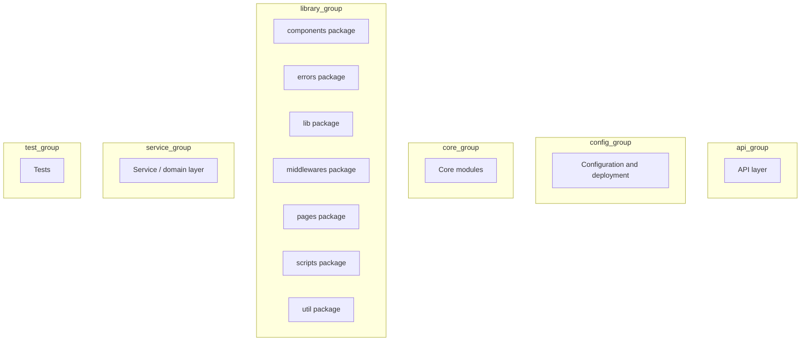

# Architecture report: BrasilAPI/BrasilAPI

> Automated static analysis. **Observed** = directly seen in files/imports/AST; **Inferred** = interpretation from that evidence. Repository code was not executed.

## 1. Repository at a glance

| Item | Value |
| --- | --- |
| Repository | BrasilAPI/BrasilAPI |
| Description | Vamos transformar o Brasil em uma API? |
| Language | JavaScript |
| Stars | 11571 |
| Licence | MIT |
| Analysed commit / branch | 0c229b4e56d0c8f789e1162b6a71d6ea1d54fc8b / main |
| Framework(s) | Next.js, React |
| Files analysed | 323 |
| Components | 12 |

## 2. Architecture in one minute

BrasilAPI/BrasilAPI - Vamos transformar o Brasil em uma API?. This repository was analysed statically from 323 file(s) (0 Python). Detected technologies (observed from imports/manifests): GitHub Actions, Next.js, React, axios, Vite, Vitest. Files are grouped into 12 component(s): API layer, components package, Configuration and deployment, Core modules, errors package, lib package, middlewares package, pages package. Findings below distinguish observed facts from inferred interpretation.

## 3. High-level block diagram

## 4. Main components

### API layer (`api_layer`)

- **Kind:** api
- **Status:** Observed
- **Confidence:** 0.85
- **Responsibility:** Groups 87 file(s) under api layer (observed from repository paths and static analysis).
- **Paths:** `pages/api/banks/v1/[code].js`, `pages/api/banks/v1/index.js`, `pages/api/cambio/v1/cotacao/[moeda]/[data].js`, `pages/api/cambio/v1/moedas/index.js`, `pages/api/cep/v1/[cep].js`, `pages/api/cep/v2/[cep].js`, `pages/api/cep/v3/[cep].js`, `pages/api/cnpj/v1/[cnpj].js`, `pages/api/cpf/v1/[cpf].js`, `pages/api/cptec/v1/cidade/[name].js`, `pages/api/cptec/v1/cidade/index.js`, `pages/api/cptec/v1/clima/aeroporto/[airport].js`, `pages/api/cptec/v1/clima/capital/index.js`, `pages/api/cptec/v1/clima/previsao/[cityCode]/[days].js`, `pages/api/cptec/v1/clima/previsao/[cityCode]/index.js`, `pages/api/cptec/v1/clima/previsao/semana/[lat]/[long].js`, `pages/api/cptec/v1/ondas/[cityCode]/[days].js`, `pages/api/cptec/v1/ondas/[cityCode]/index.js`, `pages/api/cvm/corretoras/v1/[cnpj].js`, `pages/api/cvm/corretoras/v1/index.js`, `pages/api/cvm/fundos/v1/[cnpj].js`, `pages/api/cvm/fundos/v1/index.js`, `pages/api/ddd/uf/v1/[uf].js`, `pages/api/ddd/v1/[ddd].js`, `pages/api/ddd/v1/index.js`, `pages/api/ddd/v2/[ddd].js`, `pages/api/diasuteis/v1/index.js`, `pages/api/eleicoes/anos-eleitorais.js`, `pages/api/eleicoes/candidaturas/[candidato].js`, `pages/api/eleicoes/candidaturas/index.js`, `pages/api/eleicoes/cargos-por-municipio.js`, `pages/api/eleicoes/ordinarias.js`, `pages/api/feriados/v1/[ano].js`, `pages/api/feriados/v1/index.js`, `pages/api/fipe/anos/v1/[vehicleType]/[makerCode]/[modelCode].js`, `pages/api/fipe/detalhes/v1/[vehicleType]/[makerCode]/[modelCode]/[yearCode].js`, `pages/api/fipe/marcas/v1/[vehicleType].js`, `pages/api/fipe/marcas/v1/index.js`, `pages/api/fipe/preco/v1/[fipeCode].js`, `pages/api/fipe/tabelas/v1/index.js`, `pages/api/fipe/veiculos/v1/[vehicleType]/[makerCode].js`, `pages/api/geolocation/v1/index.js`, `pages/api/hospitais/v1/ciatox.js`, `pages/api/hospitais/v1/cnes/[cnes].js`, `pages/api/hospitais/v1/estados.js`, `pages/api/hospitais/v1/index.js`, `pages/api/hospitais/v1/opcoes.js`, `pages/api/hospitais/v1/proximos.js`, `pages/api/ibge/cnae/v1/classes/[classe].js`, `pages/api/ibge/cnae/v1/classes/index.js`, `pages/api/ibge/cnae/v1/divisoes/[divisao].js`, `pages/api/ibge/cnae/v1/grupos/[grupo].js`, `pages/api/ibge/municipios/v1/[uf].js`, `pages/api/ibge/regioes/v1/[regionCode].js`, `pages/api/ibge/regioes/v1/index.js`, `pages/api/ibge/uf/v1/[code].js`, `pages/api/ibge/uf/v1/index.js`, `pages/api/ibge/uf/v1/regiao/[regionCode].js`, `pages/api/ibpt/lc116/v1/[uf].js`, `pages/api/ibpt/lc116/v1/[uf]/[codigo].js`, `pages/api/ibpt/nbs/v1/[uf].js`, `pages/api/ibpt/nbs/v1/[uf]/[codigo].js`, `pages/api/ibpt/ncm/v1/[uf].js`, `pages/api/ibpt/ncm/v1/[uf]/[codigo].js`, `pages/api/ibpt/versao/v1/index.js`, `pages/api/indices/igpm/v1/index.js`, `pages/api/indices/igpm/v1/intervalo/index.js`, `pages/api/indices/igpm/v1/ultimos/index.js`, `pages/api/isbn/v1/[isbn].js`, `pages/api/ncm/v1/[code].js`, `pages/api/ncm/v1/index.js`, `pages/api/oms/cid10/v1/[code].js`, `pages/api/oms/cid10/v1/index.js`, `pages/api/pix/v1/participants.js`, `pages/api/registrobr/v1/[domain].js`, `pages/api/solar/v1/index.js`, `pages/api/status/v1/index.js`, `pages/api/taxas/v1/[sigla].js`, `pages/api/taxas/v1/index.js`, `pages/api/tickers/b3/acoes/v1/index.js`, `pages/api/tickers/b3/fundos/v1/[typeFund].js`, `pages/api/tuss/v1/[tuss].js`, `pages/api/tuss/v1/autocomplete.js`, `pages/api/tuss/v1/index.js`, `pages/api/tuss/v1/search.js`, `pages/api/universities/v1/[id].js`, `pages/api/universities/v1/index.js`
- **Evidence:** [pages/api/banks/v1/[code].js](https://github.com/BrasilAPI/BrasilAPI/blob/0c229b4e56d0c8f789e1162b6a71d6ea1d54fc8b/pages/api/banks/v1/%5Bcode%5D.js); [pages/api/banks/v1/index.js](https://github.com/BrasilAPI/BrasilAPI/blob/0c229b4e56d0c8f789e1162b6a71d6ea1d54fc8b/pages/api/banks/v1/index.js); [pages/api/cambio/v1/cotacao/[moeda]/[data].js](https://github.com/BrasilAPI/BrasilAPI/blob/0c229b4e56d0c8f789e1162b6a71d6ea1d54fc8b/pages/api/cambio/v1/cotacao/%5Bmoeda%5D/%5Bdata%5D.js); [pages/api/cambio/v1/moedas/index.js](https://github.com/BrasilAPI/BrasilAPI/blob/0c229b4e56d0c8f789e1162b6a71d6ea1d54fc8b/pages/api/cambio/v1/moedas/index.js); [pages/api/cep/v1/[cep].js](https://github.com/BrasilAPI/BrasilAPI/blob/0c229b4e56d0c8f789e1162b6a71d6ea1d54fc8b/pages/api/cep/v1/%5Bcep%5D.js); [pages/api/cep/v2/[cep].js](https://github.com/BrasilAPI/BrasilAPI/blob/0c229b4e56d0c8f789e1162b6a71d6ea1d54fc8b/pages/api/cep/v2/%5Bcep%5D.js); [pages/api/cep/v3/[cep].js](https://github.com/BrasilAPI/BrasilAPI/blob/0c229b4e56d0c8f789e1162b6a71d6ea1d54fc8b/pages/api/cep/v3/%5Bcep%5D.js); [pages/api/cnpj/v1/[cnpj].js](https://github.com/BrasilAPI/BrasilAPI/blob/0c229b4e56d0c8f789e1162b6a71d6ea1d54fc8b/pages/api/cnpj/v1/%5Bcnpj%5D.js)

### components package (`components`)

- **Kind:** library
- **Status:** Observed
- **Confidence:** 0.85
- **Responsibility:** Groups 1 file(s) under components package (observed from repository paths and static analysis).
- **Paths:** `components/Header/index.js`
- **Evidence:** [components/Header/index.js](https://github.com/BrasilAPI/BrasilAPI/blob/0c229b4e56d0c8f789e1162b6a71d6ea1d54fc8b/components/Header/index.js)

### Configuration and deployment (`config`)

- **Kind:** config
- **Status:** Observed
- **Confidence:** 0.85
- **Responsibility:** Groups 40 file(s) under configuration and deployment (observed from repository paths and static analysis).
- **Paths:** `jsconfig.json`, `package.json`, `pages/docs/doc/bank.json`, `pages/docs/doc/basic_info.json`, `pages/docs/doc/cambio.json`, `pages/docs/doc/cep.json`, `pages/docs/doc/cid10.json`, `pages/docs/doc/cnpj.json`, `pages/docs/doc/corretoras.json`, `pages/docs/doc/cpf.json`, `pages/docs/doc/cptec.json`, `pages/docs/doc/ddd.json`, `pages/docs/doc/diasuteis.json`, `pages/docs/doc/eleicoes.json`, `pages/docs/doc/error.json`, `pages/docs/doc/fipe.json`, `pages/docs/doc/fundos.json`, `pages/docs/doc/geolocation.json`, `pages/docs/doc/holydays.json`, `pages/docs/doc/hospitais.json`, `pages/docs/doc/ibge.json`, `pages/docs/doc/ibpt.json`, `pages/docs/doc/igpm.json`, `pages/docs/doc/isbn.json`, `pages/docs/doc/ncm.json`, `pages/docs/doc/pix.json`, `pages/docs/doc/registrobr.json`, `pages/docs/doc/solarIncidence.json`, `pages/docs/doc/statewideHolydays.json`, `pages/docs/doc/status.json`, `pages/docs/doc/taxas.json`, `pages/docs/doc/tickers.json`, `pages/docs/doc/tuss.json`, `pages/docs/doc/universities.json`, `services/banco-central/banksList.json`, `services/banco-central/logo-urls.json`, `services/banco-central/snapshots/metrics-latest.json`, `services/hospitais/snapshots/metrics-latest.json`, `services/pix/snapshots/metadata-latest.json`, `vercel.json`
- **Evidence:** [jsconfig.json](https://github.com/BrasilAPI/BrasilAPI/blob/0c229b4e56d0c8f789e1162b6a71d6ea1d54fc8b/jsconfig.json); [package.json](https://github.com/BrasilAPI/BrasilAPI/blob/0c229b4e56d0c8f789e1162b6a71d6ea1d54fc8b/package.json); [pages/docs/doc/bank.json](https://github.com/BrasilAPI/BrasilAPI/blob/0c229b4e56d0c8f789e1162b6a71d6ea1d54fc8b/pages/docs/doc/bank.json); [pages/docs/doc/basic_info.json](https://github.com/BrasilAPI/BrasilAPI/blob/0c229b4e56d0c8f789e1162b6a71d6ea1d54fc8b/pages/docs/doc/basic_info.json); [pages/docs/doc/cambio.json](https://github.com/BrasilAPI/BrasilAPI/blob/0c229b4e56d0c8f789e1162b6a71d6ea1d54fc8b/pages/docs/doc/cambio.json); [pages/docs/doc/cep.json](https://github.com/BrasilAPI/BrasilAPI/blob/0c229b4e56d0c8f789e1162b6a71d6ea1d54fc8b/pages/docs/doc/cep.json); [pages/docs/doc/cid10.json](https://github.com/BrasilAPI/BrasilAPI/blob/0c229b4e56d0c8f789e1162b6a71d6ea1d54fc8b/pages/docs/doc/cid10.json); [pages/docs/doc/cnpj.json](https://github.com/BrasilAPI/BrasilAPI/blob/0c229b4e56d0c8f789e1162b6a71d6ea1d54fc8b/pages/docs/doc/cnpj.json)

### Core modules (`core`)

- **Kind:** core
- **Status:** Observed
- **Confidence:** 0.85
- **Responsibility:** Groups 3 file(s) under core modules (observed from repository paths and static analysis).
- **Paths:** `app.js`, `next.config.js`, `vite.config.js`
- **Evidence:** [app.js](https://github.com/BrasilAPI/BrasilAPI/blob/0c229b4e56d0c8f789e1162b6a71d6ea1d54fc8b/app.js); [next.config.js](https://github.com/BrasilAPI/BrasilAPI/blob/0c229b4e56d0c8f789e1162b6a71d6ea1d54fc8b/next.config.js); [vite.config.js](https://github.com/BrasilAPI/BrasilAPI/blob/0c229b4e56d0c8f789e1162b6a71d6ea1d54fc8b/vite.config.js)

### errors package (`errors`)

- **Kind:** library
- **Status:** Observed
- **Confidence:** 0.85
- **Responsibility:** Groups 7 file(s) under errors package (observed from repository paths and static analysis).
- **Paths:** `errors/BadRequestError.js`, `errors/BaseError.js`, `errors/InternalError.js`, `errors/NotFoundError.js`, `errors/ServiceUnavailableError.js`, `errors/UnauthorizedError.js`, `errors/UnprocessableEntityError.js`
- **Evidence:** [errors/BadRequestError.js](https://github.com/BrasilAPI/BrasilAPI/blob/0c229b4e56d0c8f789e1162b6a71d6ea1d54fc8b/errors/BadRequestError.js); [errors/BaseError.js](https://github.com/BrasilAPI/BrasilAPI/blob/0c229b4e56d0c8f789e1162b6a71d6ea1d54fc8b/errors/BaseError.js); [errors/InternalError.js](https://github.com/BrasilAPI/BrasilAPI/blob/0c229b4e56d0c8f789e1162b6a71d6ea1d54fc8b/errors/InternalError.js); [errors/NotFoundError.js](https://github.com/BrasilAPI/BrasilAPI/blob/0c229b4e56d0c8f789e1162b6a71d6ea1d54fc8b/errors/NotFoundError.js); [errors/ServiceUnavailableError.js](https://github.com/BrasilAPI/BrasilAPI/blob/0c229b4e56d0c8f789e1162b6a71d6ea1d54fc8b/errors/ServiceUnavailableError.js); [errors/UnauthorizedError.js](https://github.com/BrasilAPI/BrasilAPI/blob/0c229b4e56d0c8f789e1162b6a71d6ea1d54fc8b/errors/UnauthorizedError.js); [errors/UnprocessableEntityError.js](https://github.com/BrasilAPI/BrasilAPI/blob/0c229b4e56d0c8f789e1162b6a71d6ea1d54fc8b/errors/UnprocessableEntityError.js)

### lib package (`lib`)

- **Kind:** library
- **Status:** Observed
- **Confidence:** 0.85
- **Responsibility:** Groups 3 file(s) under lib package (observed from repository paths and static analysis).
- **Paths:** `lib/fetchGeocoordinateFromBrazilLocation.js`, `lib/fetchTimezoneNameFromBrazilLocation.js`, `lib/parseRequest.js`
- **Evidence:** [lib/fetchGeocoordinateFromBrazilLocation.js](https://github.com/BrasilAPI/BrasilAPI/blob/0c229b4e56d0c8f789e1162b6a71d6ea1d54fc8b/lib/fetchGeocoordinateFromBrazilLocation.js); [lib/fetchTimezoneNameFromBrazilLocation.js](https://github.com/BrasilAPI/BrasilAPI/blob/0c229b4e56d0c8f789e1162b6a71d6ea1d54fc8b/lib/fetchTimezoneNameFromBrazilLocation.js); [lib/parseRequest.js](https://github.com/BrasilAPI/BrasilAPI/blob/0c229b4e56d0c8f789e1162b6a71d6ea1d54fc8b/lib/parseRequest.js)

### middlewares package (`middlewares`)

- **Kind:** library
- **Status:** Observed
- **Confidence:** 0.85
- **Responsibility:** Groups 4 file(s) under middlewares package (observed from repository paths and static analysis).
- **Paths:** `middlewares/cache.js`, `middlewares/errorHandler.js`, `middlewares/firewall.js`, `middlewares/logger.js`
- **Evidence:** [middlewares/cache.js](https://github.com/BrasilAPI/BrasilAPI/blob/0c229b4e56d0c8f789e1162b6a71d6ea1d54fc8b/middlewares/cache.js); [middlewares/errorHandler.js](https://github.com/BrasilAPI/BrasilAPI/blob/0c229b4e56d0c8f789e1162b6a71d6ea1d54fc8b/middlewares/errorHandler.js); [middlewares/firewall.js](https://github.com/BrasilAPI/BrasilAPI/blob/0c229b4e56d0c8f789e1162b6a71d6ea1d54fc8b/middlewares/firewall.js); [middlewares/logger.js](https://github.com/BrasilAPI/BrasilAPI/blob/0c229b4e56d0c8f789e1162b6a71d6ea1d54fc8b/middlewares/logger.js)

### pages package (`pages`)

- **Kind:** library
- **Status:** Observed
- **Confidence:** 0.85
- **Responsibility:** Groups 4 file(s) under pages package (observed from repository paths and static analysis).
- **Paths:** `pages/_app.js`, `pages/_document.js`, `pages/index.js`, `pages/sitemap.xml/index.jsx`
- **Evidence:** [pages/_app.js](https://github.com/BrasilAPI/BrasilAPI/blob/0c229b4e56d0c8f789e1162b6a71d6ea1d54fc8b/pages/_app.js); [pages/_document.js](https://github.com/BrasilAPI/BrasilAPI/blob/0c229b4e56d0c8f789e1162b6a71d6ea1d54fc8b/pages/_document.js); [pages/index.js](https://github.com/BrasilAPI/BrasilAPI/blob/0c229b4e56d0c8f789e1162b6a71d6ea1d54fc8b/pages/index.js); [pages/sitemap.xml/index.jsx](https://github.com/BrasilAPI/BrasilAPI/blob/0c229b4e56d0c8f789e1162b6a71d6ea1d54fc8b/pages/sitemap.xml/index.jsx)

### scripts package (`scripts`)

- **Kind:** library
- **Status:** Observed
- **Confidence:** 0.85
- **Responsibility:** Groups 4 file(s) under scripts package (observed from repository paths and static analysis).
- **Paths:** `scripts/generate-bank-headquarters-snapshot.js`, `scripts/generate-hospitais-snapshot.js`, `scripts/generate-pix-participants-snapshot.js`, `scripts/merge-pr.sh`
- **Evidence:** [scripts/generate-bank-headquarters-snapshot.js](https://github.com/BrasilAPI/BrasilAPI/blob/0c229b4e56d0c8f789e1162b6a71d6ea1d54fc8b/scripts/generate-bank-headquarters-snapshot.js); [scripts/generate-hospitais-snapshot.js](https://github.com/BrasilAPI/BrasilAPI/blob/0c229b4e56d0c8f789e1162b6a71d6ea1d54fc8b/scripts/generate-hospitais-snapshot.js); [scripts/generate-pix-participants-snapshot.js](https://github.com/BrasilAPI/BrasilAPI/blob/0c229b4e56d0c8f789e1162b6a71d6ea1d54fc8b/scripts/generate-pix-participants-snapshot.js); [scripts/merge-pr.sh](https://github.com/BrasilAPI/BrasilAPI/blob/0c229b4e56d0c8f789e1162b6a71d6ea1d54fc8b/scripts/merge-pr.sh)

### Service / domain layer (`service_layer`)

- **Kind:** service
- **Status:** Observed
- **Confidence:** 0.85
- **Responsibility:** Groups 58 file(s) under service / domain layer (observed from repository paths and static analysis).
- **Paths:** `services/banco-central/index.js`, `services/cambio/cotacao.js`, `services/cambio/moedas.js`, `services/cep/cep.js`, `services/cnpj.js`, `services/cpf/cpf.js`, `services/cptec/cities.js`, `services/cptec/constants.js`, `services/cptec/index.js`, `services/cptec/swell.js`, `services/cptec/weather.js`, `services/cvm/corretoras.js`, `services/cvm/fundos.js`, `services/dados-abertos-br/cities.js`, `services/date.js`, `services/ddd.js`, `services/eleicoes/anos-eleitorais.js`, `services/eleicoes/candidaturas.js`, `services/eleicoes/cargos-por-municipio.js`, `services/eleicoes/constants.js`, `services/eleicoes/index.js`, `services/eleicoes/ordinarias.js`, `services/fipe/automakers.js`, `services/fipe/constants.js`, `services/fipe/http.js`, `services/fipe/parallelum.js`, `services/fipe/price.js`, `services/fipe/priceByModelAndYear.js`, `services/fipe/referenceTable.js`, `services/fipe/vehiclesByMakers.js`, `services/fipe/yearsByModel.js`, `services/getJsonDoc.js`, `services/holidays/index.js`, `services/hospitais/index.js`, `services/hospitais/origem.js`, `services/hospitais/query.js`, `services/hospitais/vocabulario.js`, `services/ibge/cnae.js`, `services/ibge/gov.js`, `services/ibge/wikipedia.js`, `services/ibpt/index.js`, `services/indices/codes.js`, `services/indices/helpers.js`, `services/indices/igpm.js`, `services/indices/schemas.js`, `services/isbn/cbl.js`, `services/isbn/googleBooks.js`, `services/isbn/mercadoEditorial.js`, `services/isbn/openLibrary.js`, `services/isbn/tools.js`, `services/oms/cid10/index.js`, `services/pix/participants.js`, `services/registro.js`, `services/sefaz/index.js`, `services/solarIncidenceService.js`, `services/tickers/listTickers.js`, `services/tuss/index.js`, `services/universities.js`
- **Evidence:** [services/banco-central/index.js](https://github.com/BrasilAPI/BrasilAPI/blob/0c229b4e56d0c8f789e1162b6a71d6ea1d54fc8b/services/banco-central/index.js); [services/cambio/cotacao.js](https://github.com/BrasilAPI/BrasilAPI/blob/0c229b4e56d0c8f789e1162b6a71d6ea1d54fc8b/services/cambio/cotacao.js); [services/cambio/moedas.js](https://github.com/BrasilAPI/BrasilAPI/blob/0c229b4e56d0c8f789e1162b6a71d6ea1d54fc8b/services/cambio/moedas.js); [services/cep/cep.js](https://github.com/BrasilAPI/BrasilAPI/blob/0c229b4e56d0c8f789e1162b6a71d6ea1d54fc8b/services/cep/cep.js); [services/cnpj.js](https://github.com/BrasilAPI/BrasilAPI/blob/0c229b4e56d0c8f789e1162b6a71d6ea1d54fc8b/services/cnpj.js); [services/cpf/cpf.js](https://github.com/BrasilAPI/BrasilAPI/blob/0c229b4e56d0c8f789e1162b6a71d6ea1d54fc8b/services/cpf/cpf.js); [services/cptec/cities.js](https://github.com/BrasilAPI/BrasilAPI/blob/0c229b4e56d0c8f789e1162b6a71d6ea1d54fc8b/services/cptec/cities.js); [services/cptec/constants.js](https://github.com/BrasilAPI/BrasilAPI/blob/0c229b4e56d0c8f789e1162b6a71d6ea1d54fc8b/services/cptec/constants.js)

### Tests (`tests`)

- **Kind:** test
- **Status:** Observed
- **Confidence:** 0.85
- **Responsibility:** Groups 65 file(s) under tests (observed from repository paths and static analysis).
- **Paths:** `tests/b3-v1.test.js`, `tests/banks-logo-url.test.js`, `tests/banks-v1.test.js`, `tests/cambio-v1.test.js`, `tests/cep-timeout.test.js`, `tests/cep-v1.test.js`, `tests/cep-v2.test.js`, `tests/cep-v3.test.js`, `tests/cnpj-contract.test.js`, `tests/cnpj-v1.test.js`, `tests/corretoras-v1.test.js`, `tests/cpetc/aeroporto-v1.test.js`, `tests/cpetc/capital-v1.test.js`, `tests/cpetc/cidade-v1.test.js`, `tests/cpetc/ondas-v1.test.js`, `tests/cpetc/previsao-v1.test.js`, `tests/cpf-v1.test.js`, `tests/ddd-uf-v1.test.js`, `tests/ddd-v1.test.js`, `tests/ddd-v2.test.js`, `tests/diasuteis-v1.test.js`, `tests/docs-spec-refs.test.js`, `tests/eleicoes/anos-eleitorais-api.test.js`, `tests/eleicoes/anos-eleitorais.test.js`, `tests/eleicoes/candidatos/candidatos.test.js`, `tests/eleicoes/candidatos/candidaturas-api.test.js`, `tests/eleicoes/cargos-por-municipio-api.test.js`, `tests/eleicoes/cargos-por-municipio.test.js`, `tests/eleicoes/ordinarias-api.test.js`, `tests/eleicoes/ordinarias.test.js`, `tests/feriados-v1.test.js`, `tests/feriados/getHolidays.test.js`, `tests/fetchGeocoordinateFromBrazilLocation.test.js`, `tests/fipe-v1.test.js`, `tests/fundos-v1.test.js`, `tests/geolocation-v1.test.js`, `tests/haversine.test.js`, `tests/helpers/cors.js`, `tests/helpers/ddd/index.js`, `tests/helpers/feriados/index.js`, `tests/helpers/server/setup.js`, `tests/holidays-uf-fix.test.js`, `tests/hospitais-v1.test.js`, `tests/ibge-cnae-v1.test.js`, `tests/ibge-municipios-v1.test.js`, `tests/ibge-populacao-fix.test.js`, `tests/ibge-regioes-v1.test.js`, `tests/ibge-uf-v1.test.js`, `tests/ibpt-v1.test.js`, `tests/indices/igpm.test.js`, `tests/isbn-tools.test.js`, `tests/isbn-v1.test.js`, `tests/map-uf-to-uf-code.test.js`, `tests/ncm-contract.test.js`, `tests/ncm-v1.test.js`, `tests/pages/api/cptec/v1/cidade/[name].test.js`, `tests/pix-v1.test.js`, `tests/registrobr.test.js`, `tests/services/hospitais/vocabulario.test.js`, `tests/services/isbn/searchInMercadoEditorial.test.js`, `tests/services/pix/participants.test.js`, `tests/solarIncidence.test.js`, `tests/taxas-v1.test.js`, `tests/tuss-v1.test.js`, `tests/universities-v1.test.js`
- **Evidence:** [tests/b3-v1.test.js](https://github.com/BrasilAPI/BrasilAPI/blob/0c229b4e56d0c8f789e1162b6a71d6ea1d54fc8b/tests/b3-v1.test.js); [tests/banks-logo-url.test.js](https://github.com/BrasilAPI/BrasilAPI/blob/0c229b4e56d0c8f789e1162b6a71d6ea1d54fc8b/tests/banks-logo-url.test.js); [tests/banks-v1.test.js](https://github.com/BrasilAPI/BrasilAPI/blob/0c229b4e56d0c8f789e1162b6a71d6ea1d54fc8b/tests/banks-v1.test.js); [tests/cambio-v1.test.js](https://github.com/BrasilAPI/BrasilAPI/blob/0c229b4e56d0c8f789e1162b6a71d6ea1d54fc8b/tests/cambio-v1.test.js); [tests/cep-timeout.test.js](https://github.com/BrasilAPI/BrasilAPI/blob/0c229b4e56d0c8f789e1162b6a71d6ea1d54fc8b/tests/cep-timeout.test.js); [tests/cep-v1.test.js](https://github.com/BrasilAPI/BrasilAPI/blob/0c229b4e56d0c8f789e1162b6a71d6ea1d54fc8b/tests/cep-v1.test.js); [tests/cep-v2.test.js](https://github.com/BrasilAPI/BrasilAPI/blob/0c229b4e56d0c8f789e1162b6a71d6ea1d54fc8b/tests/cep-v2.test.js); [tests/cep-v3.test.js](https://github.com/BrasilAPI/BrasilAPI/blob/0c229b4e56d0c8f789e1162b6a71d6ea1d54fc8b/tests/cep-v3.test.js)

### util package (`util`)

- **Kind:** library
- **Status:** Observed
- **Confidence:** 0.85
- **Responsibility:** Groups 7 file(s) under util package (observed from repository paths and static analysis).
- **Paths:** `util/cep-error-handler.js`, `util/getCsvAsJson.js`, `util/haversine.js`, `util/mapUfToUfCode.js`, `util/normalizeBrazilianDate.js`, `util/rejectWhenEmptyArray.js`, `util/removeSpecialChars.js`
- **Evidence:** [util/cep-error-handler.js](https://github.com/BrasilAPI/BrasilAPI/blob/0c229b4e56d0c8f789e1162b6a71d6ea1d54fc8b/util/cep-error-handler.js); [util/getCsvAsJson.js](https://github.com/BrasilAPI/BrasilAPI/blob/0c229b4e56d0c8f789e1162b6a71d6ea1d54fc8b/util/getCsvAsJson.js); [util/haversine.js](https://github.com/BrasilAPI/BrasilAPI/blob/0c229b4e56d0c8f789e1162b6a71d6ea1d54fc8b/util/haversine.js); [util/mapUfToUfCode.js](https://github.com/BrasilAPI/BrasilAPI/blob/0c229b4e56d0c8f789e1162b6a71d6ea1d54fc8b/util/mapUfToUfCode.js); [util/normalizeBrazilianDate.js](https://github.com/BrasilAPI/BrasilAPI/blob/0c229b4e56d0c8f789e1162b6a71d6ea1d54fc8b/util/normalizeBrazilianDate.js); [util/rejectWhenEmptyArray.js](https://github.com/BrasilAPI/BrasilAPI/blob/0c229b4e56d0c8f789e1162b6a71d6ea1d54fc8b/util/rejectWhenEmptyArray.js); [util/removeSpecialChars.js](https://github.com/BrasilAPI/BrasilAPI/blob/0c229b4e56d0c8f789e1162b6a71d6ea1d54fc8b/util/removeSpecialChars.js)

## 5. Execution flow

**Observed** entry point(s):

- [app.js](https://github.com/BrasilAPI/BrasilAPI/blob/0c229b4e56d0c8f789e1162b6a71d6ea1d54fc8b/app.js)
- [components/Header/index.js](https://github.com/BrasilAPI/BrasilAPI/blob/0c229b4e56d0c8f789e1162b6a71d6ea1d54fc8b/components/Header/index.js)
- [pages/index.js](https://github.com/BrasilAPI/BrasilAPI/blob/0c229b4e56d0c8f789e1162b6a71d6ea1d54fc8b/pages/index.js)
- [pages/sitemap.xml/index.jsx](https://github.com/BrasilAPI/BrasilAPI/blob/0c229b4e56d0c8f789e1162b6a71d6ea1d54fc8b/pages/sitemap.xml/index.jsx)
- [services/banco-central/index.js](https://github.com/BrasilAPI/BrasilAPI/blob/0c229b4e56d0c8f789e1162b6a71d6ea1d54fc8b/services/banco-central/index.js)
- [services/cptec/index.js](https://github.com/BrasilAPI/BrasilAPI/blob/0c229b4e56d0c8f789e1162b6a71d6ea1d54fc8b/services/cptec/index.js)
- [services/eleicoes/index.js](https://github.com/BrasilAPI/BrasilAPI/blob/0c229b4e56d0c8f789e1162b6a71d6ea1d54fc8b/services/eleicoes/index.js)
- [services/holidays/index.js](https://github.com/BrasilAPI/BrasilAPI/blob/0c229b4e56d0c8f789e1162b6a71d6ea1d54fc8b/services/holidays/index.js)
- [services/hospitais/index.js](https://github.com/BrasilAPI/BrasilAPI/blob/0c229b4e56d0c8f789e1162b6a71d6ea1d54fc8b/services/hospitais/index.js)
- [services/ibpt/index.js](https://github.com/BrasilAPI/BrasilAPI/blob/0c229b4e56d0c8f789e1162b6a71d6ea1d54fc8b/services/ibpt/index.js)
- [services/oms/cid10/index.js](https://github.com/BrasilAPI/BrasilAPI/blob/0c229b4e56d0c8f789e1162b6a71d6ea1d54fc8b/services/oms/cid10/index.js)
- [services/sefaz/index.js](https://github.com/BrasilAPI/BrasilAPI/blob/0c229b4e56d0c8f789e1162b6a71d6ea1d54fc8b/services/sefaz/index.js)

Representative flow (derived from observed entry points and the import graph; steps beyond the entry point are **Inferred**):

1. Execution starts at an observed entry point listed above, if present.
2. No internal import relationships between components were observed.

## 6. Project structure

### `(root)`

- `.codex` - other (0 bytes)
- `.editorconfig` - config (147 bytes)
- `.eslintignore` - other (30 bytes)
- `.eslintrc.js` - source, JavaScript (845 bytes)
- `.gitignore` - other (1736 bytes)
- `.nvmrc` - other (3 bytes)
- `.prettierrc` - other (90 bytes)
- `CLAUDE.md` - docs (6312 bytes)
- `CODE_OF_CONDUCT.md` - docs (3528 bytes)
- `CONTRIBUTING.md` - docs (6303 bytes)
- `GOOD_PRACTICES.md` - docs (5319 bytes)
- `LICENSE` - docs (1073 bytes)
- `README.md` - docs (7298 bytes)
- `app.js` - source, JavaScript (1075 bytes)
- `jsconfig.json` - config (174 bytes)
- `next.config.js` - source, JavaScript (455 bytes)
- `package.json` - manifest (3367 bytes)
- `vercel.json` - config (86 bytes)
- `vite.config.js` - source, JavaScript (683 bytes)

### `.claude`

- `.claude/hooks/pre-merge-check.sh` - source, Shell (1429 bytes)
- `.claude/settings.json` - config (258 bytes)

### `.github`

- `.github/CODE_REVIEW_GUIDELINES.md` - docs (12005 bytes)
- `.github/PULL_REQUEST_TEMPLATE.md` - docs (3878 bytes)
- `.github/README.md` - docs (9022 bytes)
- `.github/contributors-list/layout-strategy-custom.js` - source, JavaScript (836 bytes)
- `.github/copilot-instructions.md` - docs (8137 bytes)
- `.github/copilot-review-instructions.md` - docs (11278 bytes)
- `.github/workflows/banks-headquarters-snapshot.yml` - ci, YAML (2612 bytes)
- `.github/workflows/e2e-tests.yml` - ci, YAML (1245 bytes)
- `.github/workflows/hospitais-snapshot.yml` - ci, YAML (2016 bytes)
- `.github/workflows/pix-participants-snapshot.yml` - ci, YAML (2585 bytes)

### `.husky`

- `.husky/.gitignore` - other (1 bytes)
- `.husky/pre-commit` - other (70 bytes)

### `.vscode`

- `.vscode/launch.json` - config (1250 bytes)

### `components`

- `components/Header/index.js` - source, JavaScript (844 bytes)
- `components/Header/styles.module.scss` - other (1472 bytes)

### `docs`

- `docs/BANKS_HEADQUARTERS_ADDRESS.md` - docs (6864 bytes)
- `docs/ENDPOINT_GUIDE.md` - docs (11433 bytes)
- `docs/HOSPITAIS_MAPASUS.md` - docs (8837 bytes)
- `docs/audit-2026-08-10.md` - docs (4967 bytes)

### `errors`

- `errors/BadRequestError.js` - source, JavaScript (349 bytes)
- `errors/BaseError.js` - source, JavaScript (290 bytes)
- `errors/InternalError.js` - source, JavaScript (342 bytes)
- `errors/NotFoundError.js` - source, JavaScript (343 bytes)
- `errors/ServiceUnavailableError.js` - source, JavaScript (266 bytes)
- `errors/UnauthorizedError.js` - source, JavaScript (354 bytes)
- `errors/UnprocessableEntityError.js` - source, JavaScript (376 bytes)

### `lib`

- `lib/fetchGeocoordinateFromBrazilLocation.js` - source, JavaScript (3979 bytes)
- `lib/fetchTimezoneNameFromBrazilLocation.js` - source, JavaScript (737 bytes)
- `lib/parseRequest.js` - source, JavaScript (2183 bytes)

### `middlewares`

- `middlewares/cache.js` - source, JavaScript (1452 bytes)
- `middlewares/errorHandler.js` - source, JavaScript (824 bytes)
- `middlewares/firewall.js` - source, JavaScript (598 bytes)
- `middlewares/logger.js` - source, JavaScript (471 bytes)

### `pages`

- `pages/_app.js` - source, JavaScript (274 bytes)
- `pages/_document.js` - source, JavaScript (1048 bytes)
- `pages/api/banks/v1/[code].js` - source, JavaScript (580 bytes)
- `pages/api/banks/v1/index.js` - source, JavaScript (263 bytes)
- `pages/api/cambio/v1/cotacao/[moeda]/[data].js` - source, JavaScript (3427 bytes)
- `pages/api/cambio/v1/moedas/index.js` - source, JavaScript (593 bytes)
- `pages/api/cep/v1/[cep].js` - source, JavaScript (1993 bytes)
- `pages/api/cep/v2/[cep].js` - source, JavaScript (1907 bytes)
- `pages/api/cep/v3/[cep].js` - source, JavaScript (3818 bytes)
- `pages/api/cnpj/v1/[cnpj].js` - source, JavaScript (887 bytes)
- `pages/api/cpf/v1/[cpf].js` - source, JavaScript (1484 bytes)
- `pages/api/cptec/v1/cidade/[name].js` - source, JavaScript (1211 bytes)
- `pages/api/cptec/v1/cidade/index.js` - source, JavaScript (617 bytes)
- `pages/api/cptec/v1/clima/aeroporto/[airport].js` - source, JavaScript (1300 bytes)
- `pages/api/cptec/v1/clima/capital/index.js` - source, JavaScript (675 bytes)
- `pages/api/cptec/v1/clima/previsao/[cityCode]/[days].js` - source, JavaScript (1986 bytes)
- `pages/api/cptec/v1/clima/previsao/[cityCode]/index.js` - source, JavaScript (1153 bytes)
- `pages/api/cptec/v1/clima/previsao/semana/[lat]/[long].js` - source, JavaScript (1568 bytes)
- `pages/api/cptec/v1/ondas/[cityCode]/[days].js` - source, JavaScript (1984 bytes)
- `pages/api/cptec/v1/ondas/[cityCode]/index.js` - source, JavaScript (1139 bytes)
- `pages/api/cvm/corretoras/v1/[cnpj].js` - source, JavaScript (1069 bytes)
- `pages/api/cvm/corretoras/v1/index.js` - source, JavaScript (1249 bytes)
- `pages/api/cvm/fundos/v1/[cnpj].js` - source, JavaScript (692 bytes)
- `pages/api/cvm/fundos/v1/index.js` - source, JavaScript (664 bytes)
- `pages/api/ddd/uf/v1/[uf].js` - source, JavaScript (1839 bytes)
- `pages/api/ddd/v1/[ddd].js` - source, JavaScript (1397 bytes)
- `pages/api/ddd/v1/index.js` - source, JavaScript (1338 bytes)
- `pages/api/ddd/v2/[ddd].js` - source, JavaScript (1273 bytes)
- `pages/api/diasuteis/v1/index.js` - source, JavaScript (1899 bytes)
- `pages/api/eleicoes/anos-eleitorais.js` - source, JavaScript (512 bytes)
- `pages/api/eleicoes/candidaturas/[candidato].js` - source, JavaScript (879 bytes)
- `pages/api/eleicoes/candidaturas/index.js` - source, JavaScript (915 bytes)
- `pages/api/eleicoes/cargos-por-municipio.js` - source, JavaScript (887 bytes)
- `pages/api/eleicoes/ordinarias.js` - source, JavaScript (519 bytes)
- `pages/api/feriados/v1/[ano].js` - source, JavaScript (872 bytes)
- `pages/api/feriados/v1/index.js` - source, JavaScript (267 bytes)
- `pages/api/fipe/anos/v1/[vehicleType]/[makerCode]/[modelCode].js` - source, JavaScript (1819 bytes)
- `pages/api/fipe/detalhes/v1/[vehicleType]/[makerCode]/[modelCode]/[yearCode].js` - source, JavaScript (1934 bytes)
- `pages/api/fipe/marcas/v1/[vehicleType].js` - source, JavaScript (1463 bytes)
- `pages/api/fipe/marcas/v1/index.js` - source, JavaScript (1376 bytes)
- `pages/api/fipe/preco/v1/[fipeCode].js` - source, JavaScript (1481 bytes)
- `pages/api/fipe/tabelas/v1/index.js` - source, JavaScript (328 bytes)
- `pages/api/fipe/veiculos/v1/[vehicleType]/[makerCode].js` - source, JavaScript (1693 bytes)
- `pages/api/geolocation/v1/index.js` - source, JavaScript (1391 bytes)
- `pages/api/hospitais/v1/ciatox.js` - source, JavaScript (456 bytes)
- `pages/api/hospitais/v1/cnes/[cnes].js` - source, JavaScript (1075 bytes)
- `pages/api/hospitais/v1/estados.js` - source, JavaScript (498 bytes)
- `pages/api/hospitais/v1/index.js` - source, JavaScript (737 bytes)
- `pages/api/hospitais/v1/opcoes.js` - source, JavaScript (577 bytes)
- `pages/api/hospitais/v1/proximos.js` - source, JavaScript (1060 bytes)
- `pages/api/ibge/cnae/v1/classes/[classe].js` - source, JavaScript (588 bytes)
- `pages/api/ibge/cnae/v1/classes/index.js` - source, JavaScript (268 bytes)
- `pages/api/ibge/cnae/v1/divisoes/[divisao].js` - source, JavaScript (608 bytes)
- `pages/api/ibge/cnae/v1/grupos/[grupo].js` - source, JavaScript (595 bytes)
- `pages/api/ibge/municipios/v1/[uf].js` - source, JavaScript (3326 bytes)
- `pages/api/ibge/regioes/v1/[regionCode].js` - source, JavaScript (497 bytes)
- `pages/api/ibge/regioes/v1/index.js` - source, JavaScript (259 bytes)
- `pages/api/ibge/uf/v1/[code].js` - source, JavaScript (674 bytes)
- `pages/api/ibge/uf/v1/index.js` - source, JavaScript (251 bytes)
- `pages/api/ibge/uf/v1/regiao/[regionCode].js` - source, JavaScript (495 bytes)
- `pages/api/ibpt/lc116/v1/[uf].js` - source, JavaScript (1031 bytes)
- `pages/api/ibpt/lc116/v1/[uf]/[codigo].js` - source, JavaScript (1948 bytes)
- `pages/api/ibpt/nbs/v1/[uf].js` - source, JavaScript (1018 bytes)
- `pages/api/ibpt/nbs/v1/[uf]/[codigo].js` - source, JavaScript (1918 bytes)
- `pages/api/ibpt/ncm/v1/[uf].js` - source, JavaScript (1018 bytes)
- `pages/api/ibpt/ncm/v1/[uf]/[codigo].js` - source, JavaScript (1918 bytes)
- `pages/api/ibpt/versao/v1/index.js` - source, JavaScript (571 bytes)
- `pages/api/indices/igpm/v1/index.js` - source, JavaScript (648 bytes)
- `pages/api/indices/igpm/v1/intervalo/index.js` - source, JavaScript (1641 bytes)
- `pages/api/indices/igpm/v1/ultimos/index.js` - source, JavaScript (1232 bytes)
- `pages/api/isbn/v1/[isbn].js` - source, JavaScript (2215 bytes)
- `pages/api/ncm/v1/[code].js` - source, JavaScript (620 bytes)
- `pages/api/ncm/v1/index.js` - source, JavaScript (918 bytes)
- `pages/api/oms/cid10/v1/[code].js` - source, JavaScript (500 bytes)
- `pages/api/oms/cid10/v1/index.js` - source, JavaScript (218 bytes)
- `pages/api/pix/v1/participants.js` - source, JavaScript (442 bytes)
- `pages/api/registrobr/v1/[domain].js` - source, JavaScript (1136 bytes)
- `pages/api/solar/v1/index.js` - source, JavaScript (730 bytes)
- `pages/api/status/v1/index.js` - source, JavaScript (365 bytes)
- `pages/api/taxas/v1/[sigla].js` - source, JavaScript (557 bytes)
- `pages/api/taxas/v1/index.js` - source, JavaScript (294 bytes)
- `pages/api/tickers/b3/acoes/v1/index.js` - source, JavaScript (262 bytes)
- `pages/api/tickers/b3/fundos/v1/[typeFund].js` - source, JavaScript (708 bytes)
- `pages/api/tuss/v1/[tuss].js` - source, JavaScript (486 bytes)
- `pages/api/tuss/v1/autocomplete.js` - source, JavaScript (866 bytes)
- `pages/api/tuss/v1/index.js` - source, JavaScript (1492 bytes)
- `pages/api/tuss/v1/search.js` - source, JavaScript (1667 bytes)
- `pages/api/universities/v1/[id].js` - source, JavaScript (919 bytes)
- `pages/api/universities/v1/index.js` - source, JavaScript (716 bytes)
- `pages/docs/doc/bank.json` - config (5804 bytes)
- `pages/docs/doc/basic_info.json` - config (2611 bytes)
- `pages/docs/doc/cambio.json` - config (8244 bytes)
- `pages/docs/doc/cep.json` - config (15079 bytes)
- `pages/docs/doc/cid10.json` - config (2460 bytes)
- `pages/docs/doc/cnpj.json` - config (22229 bytes)
- `pages/docs/doc/corretoras.json` - config (5047 bytes)
- `pages/docs/doc/cpf.json` - config (2965 bytes)
- `pages/docs/doc/cptec.json` - config (24083 bytes)
- `pages/docs/doc/ddd.json` - config (12890 bytes)
- `pages/docs/doc/diasuteis.json` - config (2763 bytes)
- `pages/docs/doc/eleicoes.json` - config (12913 bytes)
- `pages/docs/doc/endpoint.json.example` - docs (3057 bytes)
- `pages/docs/doc/error.json` - config (763 bytes)
- `pages/docs/doc/fipe.json` - config (17409 bytes)
- `pages/docs/doc/fundos.json` - config (11499 bytes)
- `pages/docs/doc/geolocation.json` - config (3259 bytes)
- `pages/docs/doc/holydays.json` - config (6666 bytes)
- `pages/docs/doc/hospitais.json` - config (32346 bytes)
- `pages/docs/doc/ibge.json` - config (25869 bytes)
- `pages/docs/doc/ibpt.json` - config (41143 bytes)
- `pages/docs/doc/igpm.json` - config (7323 bytes)
- `pages/docs/doc/isbn.json` - config (11698 bytes)
- `pages/docs/doc/ncm.json` - config (6272 bytes)
- `pages/docs/doc/pix.json` - config (3442 bytes)
- `pages/docs/doc/registrobr.json` - config (6593 bytes)
- `pages/docs/doc/solarIncidence.json` - config (3950 bytes)
- `pages/docs/doc/statewideHolydays.json` - config (1144 bytes)
- `pages/docs/doc/status.json` - config (1525 bytes)
- `pages/docs/doc/taxas.json` - config (3110 bytes)
- `pages/docs/doc/tickers.json` - config (4455 bytes)
- `pages/docs/doc/tuss.json` - config (11547 bytes)
- `pages/docs/doc/universities.json` - config (2303 bytes)
- `pages/docs/index.js` - docs (372 bytes)
- `pages/index.js` - source, JavaScript (4472 bytes)
- `pages/sitemap.xml/index.jsx` - source, JavaScript (1359 bytes)

### `public`

- `public/images/api-schema.svg` - other (17534 bytes)
- `public/powered-by-vercel.svg` - other (5336 bytes)
- `public/robots.txt` - docs (76 bytes)

### `scripts`

- `scripts/generate-bank-headquarters-snapshot.js` - source, JavaScript (15429 bytes)
- `scripts/generate-hospitais-snapshot.js` - source, JavaScript (11927 bytes)
- `scripts/generate-pix-participants-snapshot.js` - source, JavaScript (17770 bytes)
- `scripts/merge-pr.sh` - source, Shell (7949 bytes)

### `services`

- `services/banco-central/banksList.json` - config (82191 bytes)
- `services/banco-central/index.js` - source, JavaScript (11175 bytes)
- `services/banco-central/logo-urls.json` - config (41414 bytes)
- `services/banco-central/snapshots/metrics-latest.json` - config (1359 bytes)
- `services/cambio/cotacao.js` - source, JavaScript (744 bytes)
- `services/cambio/moedas.js` - source, JavaScript (431 bytes)
- `services/cep/cep.js` - source, JavaScript (2758 bytes)
- `services/cnpj.js` - source, JavaScript (956 bytes)
- `services/cpf/cpf.js` - source, JavaScript (1523 bytes)
- `services/cptec/cities.js` - source, JavaScript (1382 bytes)
- `services/cptec/constants.js` - source, JavaScript (2656 bytes)
- `services/cptec/index.js` - source, JavaScript (427 bytes)
- `services/cptec/swell.js` - source, JavaScript (2039 bytes)
- `services/cptec/weather.js` - source, JavaScript (4773 bytes)
- `services/cvm/corretoras.js` - source, JavaScript (2853 bytes)
- `services/cvm/fundos.js` - source, JavaScript (3639 bytes)
- `services/dados-abertos-br/cities.js` - source, JavaScript (326 bytes)
- `services/date.js` - source, JavaScript (3531 bytes)
- `services/ddd.js` - source, JavaScript (599 bytes)
- `services/eleicoes/anos-eleitorais.js` - source, JavaScript (451 bytes)
- `services/eleicoes/candidaturas.js` - source, JavaScript (2985 bytes)
- `services/eleicoes/cargos-por-municipio.js` - source, JavaScript (1198 bytes)
- `services/eleicoes/constants.js` - source, JavaScript (906 bytes)
- `services/eleicoes/index.js` - source, JavaScript (137 bytes)
- `services/eleicoes/ordinarias.js` - source, JavaScript (472 bytes)
- `services/fipe/automakers.js` - source, JavaScript (1579 bytes)
- `services/fipe/constants.js` - source, JavaScript (133 bytes)
- `services/fipe/http.js` - source, JavaScript (1441 bytes)
- `services/fipe/parallelum.js` - source, JavaScript (1487 bytes)
- `services/fipe/price.js` - source, JavaScript (2788 bytes)
- `services/fipe/priceByModelAndYear.js` - source, JavaScript (2463 bytes)
- `services/fipe/referenceTable.js` - source, JavaScript (845 bytes)
- `services/fipe/vehiclesByMakers.js` - source, JavaScript (1232 bytes)
- `services/fipe/yearsByModel.js` - source, JavaScript (1837 bytes)
- `services/getJsonDoc.js` - source, JavaScript (1476 bytes)
- `services/holidays/index.js` - source, JavaScript (6868 bytes)
- `services/hospitais/index.js` - source, JavaScript (7179 bytes)
- `services/hospitais/origem.js` - source, JavaScript (2414 bytes)
- `services/hospitais/query.js` - source, JavaScript (3412 bytes)
- `services/hospitais/snapshots/metrics-latest.json` - config (4365 bytes)
- `services/hospitais/vocabulario.js` - source, JavaScript (8460 bytes)
- `services/ibge/cnae.js` - source, JavaScript (458 bytes)
- `services/ibge/gov.js` - source, JavaScript (2643 bytes)
- `services/ibge/wikipedia.js` - source, JavaScript (2109 bytes)
- `services/ibpt/index.js` - source, JavaScript (1318 bytes)
- `services/indices/codes.js` - source, JavaScript (45 bytes)
- `services/indices/helpers.js` - source, JavaScript (1252 bytes)
- `services/indices/igpm.js` - source, JavaScript (2241 bytes)
- `services/indices/schemas.js` - source, JavaScript (178 bytes)
- `services/isbn/cbl.js` - source, JavaScript (4058 bytes)
- `services/isbn/googleBooks.js` - source, JavaScript (3298 bytes)
- `services/isbn/mercadoEditorial.js` - source, JavaScript (3333 bytes)
- `services/isbn/openLibrary.js` - source, JavaScript (3514 bytes)
- `services/isbn/tools.js` - source, JavaScript (2226 bytes)
- `services/oms/cid10/index.js` - source, JavaScript (221 bytes)
- `services/pix/participants.js` - source, JavaScript (862 bytes)
- `services/pix/snapshots/metadata-latest.json` - config (528 bytes)
- `services/registro.js` - source, JavaScript (521 bytes)
- `services/sefaz/index.js` - source, JavaScript (1404 bytes)
- `services/solarIncidenceService.js` - source, JavaScript (1212 bytes)
- `services/tickers/listTickers.js` - source, JavaScript (4694 bytes)
- `services/tuss/index.js` - source, JavaScript (3833 bytes)
- `services/universities.js` - source, JavaScript (979 bytes)

### `styles`

- `styles/globals.scss` - other (682 bytes)
- `styles/home.module.scss` - other (3013 bytes)

### `tests`

- `tests/b3-v1.test.js` - test, JavaScript (4858 bytes)
- `tests/banks-logo-url.test.js` - test, JavaScript (1088 bytes)
- `tests/banks-v1.test.js` - test, JavaScript (3611 bytes)
- `tests/cambio-v1.test.js` - test, JavaScript (9879 bytes)
- `tests/cep-timeout.test.js` - test, JavaScript (2222 bytes)
- `tests/cep-v1.test.js` - test, JavaScript (9320 bytes)
- `tests/cep-v2.test.js` - test, JavaScript (6003 bytes)
- `tests/cep-v3.test.js` - test, JavaScript (3811 bytes)
- `tests/cnpj-contract.test.js` - test, JavaScript (6681 bytes)
- `tests/cnpj-v1.test.js` - test, JavaScript (1666 bytes)
- `tests/corretoras-v1.test.js` - test, JavaScript (4470 bytes)
- `tests/cpetc/aeroporto-v1.test.js` - test, JavaScript (2198 bytes)
- `tests/cpetc/capital-v1.test.js` - test, JavaScript (537 bytes)
- `tests/cpetc/cidade-v1.test.js` - test, JavaScript (3057 bytes)
- `tests/cpetc/ondas-v1.test.js` - test, JavaScript (4548 bytes)
- `tests/cpetc/previsao-v1.test.js` - test, JavaScript (7391 bytes)
- `tests/cpf-v1.test.js` - test, JavaScript (1897 bytes)
- `tests/ddd-uf-v1.test.js` - test, JavaScript (860 bytes)
- `tests/ddd-v1.test.js` - test, JavaScript (1183 bytes)
- `tests/ddd-v2.test.js` - test, JavaScript (807 bytes)
- `tests/diasuteis-v1.test.js` - test, JavaScript (2689 bytes)
- `tests/docs-spec-refs.test.js` - test, JavaScript (788 bytes)
- `tests/eleicoes/anos-eleitorais-api.test.js` - test, JavaScript (1046 bytes)
- `tests/eleicoes/anos-eleitorais.test.js` - test, JavaScript (596 bytes)
- `tests/eleicoes/candidatos/candidatos.test.js` - test, JavaScript (6855 bytes)
- `tests/eleicoes/candidatos/candidaturas-api.test.js` - test, JavaScript (12919 bytes)
- `tests/eleicoes/cargos-por-municipio-api.test.js` - test, JavaScript (1860 bytes)
- `tests/eleicoes/cargos-por-municipio.test.js` - test, JavaScript (2286 bytes)
- `tests/eleicoes/ordinarias-api.test.js` - test, JavaScript (5571 bytes)
- `tests/eleicoes/ordinarias.test.js` - test, JavaScript (5349 bytes)
- `tests/feriados-v1.test.js` - test, JavaScript (6634 bytes)
- `tests/feriados/getHolidays.test.js` - test, JavaScript (1992 bytes)
- `tests/fetchGeocoordinateFromBrazilLocation.test.js` - test, JavaScript (2745 bytes)
- `tests/fipe-v1.test.js` - test, JavaScript (6511 bytes)
- `tests/fundos-v1.test.js` - test, JavaScript (4003 bytes)
- `tests/geolocation-v1.test.js` - test, JavaScript (995 bytes)
- `tests/haversine.test.js` - test, JavaScript (698 bytes)
- `tests/helpers/cors.js` - test, JavaScript (2038 bytes)
- `tests/helpers/ddd/index.js` - test, JavaScript (6826 bytes)
- `tests/helpers/feriados/index.js` - test, JavaScript (3806 bytes)
- `tests/helpers/server/setup.js` - test, JavaScript (938 bytes)
- `tests/holidays-uf-fix.test.js` - test, JavaScript (870 bytes)
- `tests/hospitais-v1.test.js` - test, JavaScript (15053 bytes)
- `tests/ibge-cnae-v1.test.js` - test, JavaScript (4069 bytes)
- `tests/ibge-municipios-v1.test.js` - test, JavaScript (3707 bytes)
- `tests/ibge-populacao-fix.test.js` - test, JavaScript (1109 bytes)
- `tests/ibge-regioes-v1.test.js` - test, JavaScript (2522 bytes)
- `tests/ibge-uf-v1.test.js` - test, JavaScript (5043 bytes)
- `tests/ibpt-v1.test.js` - test, JavaScript (12948 bytes)
- `tests/indices/igpm.test.js` - test, JavaScript (5973 bytes)
- `tests/isbn-tools.test.js` - test, JavaScript (796 bytes)
- `tests/isbn-v1.test.js` - test, JavaScript (9825 bytes)
- `tests/map-uf-to-uf-code.test.js` - test, JavaScript (595 bytes)
- `tests/ncm-contract.test.js` - test, JavaScript (2702 bytes)
- `tests/ncm-v1.test.js` - test, JavaScript (4282 bytes)
- `tests/pages/api/cptec/v1/cidade/[name].test.js` - test, JavaScript (5983 bytes)
- `tests/pix-v1.test.js` - test, JavaScript (924 bytes)
- `tests/registrobr.test.js` - test, JavaScript (1161 bytes)
- `tests/services/hospitais/vocabulario.test.js` - test, JavaScript (4058 bytes)
- `tests/services/isbn/searchInMercadoEditorial.test.js` - test, JavaScript (10615 bytes)
- `tests/services/pix/participants.test.js` - test, JavaScript (1296 bytes)
- `tests/solarIncidence.test.js` - test, JavaScript (1237 bytes)
- `tests/taxas-v1.test.js` - test, JavaScript (2566 bytes)
- `tests/tuss-v1.test.js` - test, JavaScript (5346 bytes)
- `tests/universities-v1.test.js` - test, JavaScript (1880 bytes)

### `util`

- `util/cep-error-handler.js` - source, JavaScript (1702 bytes)
- `util/getCsvAsJson.js` - source, JavaScript (218 bytes)
- `util/haversine.js` - source, JavaScript (633 bytes)
- `util/mapUfToUfCode.js` - source, JavaScript (888 bytes)
- `util/normalizeBrazilianDate.js` - source, JavaScript (813 bytes)
- `util/rejectWhenEmptyArray.js` - source, JavaScript (446 bytes)
- `util/removeSpecialChars.js` - source, JavaScript (183 bytes)

## 7. Key dependencies and integrations

| Name | Category | Status | Confidence | Evidence |
| --- | --- | --- | --- | --- |
| GitHub Actions | ci | Observed | 0.90 | [.github/workflows/banks-headquarters-snapshot.yml](https://github.com/BrasilAPI/BrasilAPI/blob/0c229b4e56d0c8f789e1162b6a71d6ea1d54fc8b/.github/workflows/banks-headquarters-snapshot.yml); [.github/workflows/e2e-tests.yml](https://github.com/BrasilAPI/BrasilAPI/blob/0c229b4e56d0c8f789e1162b6a71d6ea1d54fc8b/.github/workflows/e2e-tests.yml); [.github/workflows/hospitais-snapshot.yml](https://github.com/BrasilAPI/BrasilAPI/blob/0c229b4e56d0c8f789e1162b6a71d6ea1d54fc8b/.github/workflows/hospitais-snapshot.yml); [.github/workflows/pix-participants-snapshot.yml](https://github.com/BrasilAPI/BrasilAPI/blob/0c229b4e56d0c8f789e1162b6a71d6ea1d54fc8b/.github/workflows/pix-participants-snapshot.yml) |
| Next.js | framework | Observed | 0.85 | [package.json:24](https://github.com/BrasilAPI/BrasilAPI/blob/0c229b4e56d0c8f789e1162b6a71d6ea1d54fc8b/package.json#L24) |
| React | framework | Observed | 0.90 | [package.json:10](https://github.com/BrasilAPI/BrasilAPI/blob/0c229b4e56d0c8f789e1162b6a71d6ea1d54fc8b/package.json#L10); [package.json:30](https://github.com/BrasilAPI/BrasilAPI/blob/0c229b4e56d0c8f789e1162b6a71d6ea1d54fc8b/package.json#L30) |
| axios | library | Observed | 0.85 | [package.json:12](https://github.com/BrasilAPI/BrasilAPI/blob/0c229b4e56d0c8f789e1162b6a71d6ea1d54fc8b/package.json#L12) |
| Vite | tooling | Observed | 0.85 | [package.json:37](https://github.com/BrasilAPI/BrasilAPI/blob/0c229b4e56d0c8f789e1162b6a71d6ea1d54fc8b/package.json#L37) |
| Vitest | tooling | Observed | 0.85 | [package.json:42](https://github.com/BrasilAPI/BrasilAPI/blob/0c229b4e56d0c8f789e1162b6a71d6ea1d54fc8b/package.json#L42) |

## 8. Data and state

No database, cache, queue, or persistent-state usage was observed in the analysed files. State handling, if any, may be in-memory or in files that were not analysed.

## 9. Configuration and deployment clues

- `.claude/settings.json` (config)
- `.editorconfig` (config)
- `.github/workflows/banks-headquarters-snapshot.yml` (ci)
- `.github/workflows/e2e-tests.yml` (ci)
- `.github/workflows/hospitais-snapshot.yml` (ci)
- `.github/workflows/pix-participants-snapshot.yml` (ci)
- `.vscode/launch.json` (config)
- `jsconfig.json` (config)
- `package.json` (manifest)
- `pages/docs/doc/bank.json` (config)
- `pages/docs/doc/basic_info.json` (config)
- `pages/docs/doc/cambio.json` (config)
- `pages/docs/doc/cep.json` (config)
- `pages/docs/doc/cid10.json` (config)
- `pages/docs/doc/cnpj.json` (config)
- `pages/docs/doc/corretoras.json` (config)
- `pages/docs/doc/cpf.json` (config)
- `pages/docs/doc/cptec.json` (config)
- `pages/docs/doc/ddd.json` (config)
- `pages/docs/doc/diasuteis.json` (config)
- `pages/docs/doc/eleicoes.json` (config)
- `pages/docs/doc/error.json` (config)
- `pages/docs/doc/fipe.json` (config)
- `pages/docs/doc/fundos.json` (config)
- `pages/docs/doc/geolocation.json` (config)
- `pages/docs/doc/holydays.json` (config)
- `pages/docs/doc/hospitais.json` (config)
- `pages/docs/doc/ibge.json` (config)
- `pages/docs/doc/ibpt.json` (config)
- `pages/docs/doc/igpm.json` (config)
- `pages/docs/doc/isbn.json` (config)
- `pages/docs/doc/ncm.json` (config)
- `pages/docs/doc/pix.json` (config)
- `pages/docs/doc/registrobr.json` (config)
- `pages/docs/doc/solarIncidence.json` (config)
- `pages/docs/doc/statewideHolydays.json` (config)
- `pages/docs/doc/status.json` (config)
- `pages/docs/doc/taxas.json` (config)
- `pages/docs/doc/tickers.json` (config)
- `pages/docs/doc/tuss.json` (config)
- `pages/docs/doc/universities.json` (config)
- `services/banco-central/banksList.json` (config)
- `services/banco-central/logo-urls.json` (config)
- `services/banco-central/snapshots/metrics-latest.json` (config)
- `services/hospitais/snapshots/metrics-latest.json` (config)
- `services/pix/snapshots/metadata-latest.json` (config)
- `vercel.json` (config)

## 10. Design observations

- An entry/API layer is separated from other code (Inferred from paths and decorators).
- Service/domain code is distinct from entry and data code, suggesting layered separation (Inferred).
- Tests are present alongside source code (Observed from test file paths).

These observations are interpretations (**Inferred**) of the observed structure, not guarantees about runtime design.

## 11. Limitations and unknowns

- Static analysis only: repository code was not executed, installed, or imported at runtime.
- Components and relationships are inferred from file paths, imports, and AST structure; runtime behaviour, dynamic imports, and reflection may not be visible.
- No clear application entry point was observed in the analysed files.
- Repository text was treated as untrusted data; no instructions found in repository files were followed, and likely secret values were redacted/excluded.
- JavaScript and TypeScript files were inventoried from paths and package manifests. They were not parsed with a full language AST, and repository code was not executed.

## 12. Source references

- [.github/workflows/banks-headquarters-snapshot.yml](https://github.com/BrasilAPI/BrasilAPI/blob/0c229b4e56d0c8f789e1162b6a71d6ea1d54fc8b/.github/workflows/banks-headquarters-snapshot.yml)
- [.github/workflows/e2e-tests.yml](https://github.com/BrasilAPI/BrasilAPI/blob/0c229b4e56d0c8f789e1162b6a71d6ea1d54fc8b/.github/workflows/e2e-tests.yml)
- [.github/workflows/hospitais-snapshot.yml](https://github.com/BrasilAPI/BrasilAPI/blob/0c229b4e56d0c8f789e1162b6a71d6ea1d54fc8b/.github/workflows/hospitais-snapshot.yml)
- [.github/workflows/pix-participants-snapshot.yml](https://github.com/BrasilAPI/BrasilAPI/blob/0c229b4e56d0c8f789e1162b6a71d6ea1d54fc8b/.github/workflows/pix-participants-snapshot.yml)
- [app.js](https://github.com/BrasilAPI/BrasilAPI/blob/0c229b4e56d0c8f789e1162b6a71d6ea1d54fc8b/app.js)
- [components/Header/index.js](https://github.com/BrasilAPI/BrasilAPI/blob/0c229b4e56d0c8f789e1162b6a71d6ea1d54fc8b/components/Header/index.js)
- [errors/BadRequestError.js](https://github.com/BrasilAPI/BrasilAPI/blob/0c229b4e56d0c8f789e1162b6a71d6ea1d54fc8b/errors/BadRequestError.js)
- [errors/BaseError.js](https://github.com/BrasilAPI/BrasilAPI/blob/0c229b4e56d0c8f789e1162b6a71d6ea1d54fc8b/errors/BaseError.js)
- [errors/InternalError.js](https://github.com/BrasilAPI/BrasilAPI/blob/0c229b4e56d0c8f789e1162b6a71d6ea1d54fc8b/errors/InternalError.js)
- [errors/NotFoundError.js](https://github.com/BrasilAPI/BrasilAPI/blob/0c229b4e56d0c8f789e1162b6a71d6ea1d54fc8b/errors/NotFoundError.js)
- [errors/ServiceUnavailableError.js](https://github.com/BrasilAPI/BrasilAPI/blob/0c229b4e56d0c8f789e1162b6a71d6ea1d54fc8b/errors/ServiceUnavailableError.js)
- [errors/UnauthorizedError.js](https://github.com/BrasilAPI/BrasilAPI/blob/0c229b4e56d0c8f789e1162b6a71d6ea1d54fc8b/errors/UnauthorizedError.js)
- [errors/UnprocessableEntityError.js](https://github.com/BrasilAPI/BrasilAPI/blob/0c229b4e56d0c8f789e1162b6a71d6ea1d54fc8b/errors/UnprocessableEntityError.js)
- [jsconfig.json](https://github.com/BrasilAPI/BrasilAPI/blob/0c229b4e56d0c8f789e1162b6a71d6ea1d54fc8b/jsconfig.json)
- [lib/fetchGeocoordinateFromBrazilLocation.js](https://github.com/BrasilAPI/BrasilAPI/blob/0c229b4e56d0c8f789e1162b6a71d6ea1d54fc8b/lib/fetchGeocoordinateFromBrazilLocation.js)
- [lib/fetchTimezoneNameFromBrazilLocation.js](https://github.com/BrasilAPI/BrasilAPI/blob/0c229b4e56d0c8f789e1162b6a71d6ea1d54fc8b/lib/fetchTimezoneNameFromBrazilLocation.js)
- [lib/parseRequest.js](https://github.com/BrasilAPI/BrasilAPI/blob/0c229b4e56d0c8f789e1162b6a71d6ea1d54fc8b/lib/parseRequest.js)
- [middlewares/cache.js](https://github.com/BrasilAPI/BrasilAPI/blob/0c229b4e56d0c8f789e1162b6a71d6ea1d54fc8b/middlewares/cache.js)
- [middlewares/errorHandler.js](https://github.com/BrasilAPI/BrasilAPI/blob/0c229b4e56d0c8f789e1162b6a71d6ea1d54fc8b/middlewares/errorHandler.js)
- [middlewares/firewall.js](https://github.com/BrasilAPI/BrasilAPI/blob/0c229b4e56d0c8f789e1162b6a71d6ea1d54fc8b/middlewares/firewall.js)
- [middlewares/logger.js](https://github.com/BrasilAPI/BrasilAPI/blob/0c229b4e56d0c8f789e1162b6a71d6ea1d54fc8b/middlewares/logger.js)
- [next.config.js](https://github.com/BrasilAPI/BrasilAPI/blob/0c229b4e56d0c8f789e1162b6a71d6ea1d54fc8b/next.config.js)
- [package.json](https://github.com/BrasilAPI/BrasilAPI/blob/0c229b4e56d0c8f789e1162b6a71d6ea1d54fc8b/package.json)
- [package.json:10](https://github.com/BrasilAPI/BrasilAPI/blob/0c229b4e56d0c8f789e1162b6a71d6ea1d54fc8b/package.json#L10)
- [package.json:12](https://github.com/BrasilAPI/BrasilAPI/blob/0c229b4e56d0c8f789e1162b6a71d6ea1d54fc8b/package.json#L12)
- [package.json:24](https://github.com/BrasilAPI/BrasilAPI/blob/0c229b4e56d0c8f789e1162b6a71d6ea1d54fc8b/package.json#L24)
- [package.json:30](https://github.com/BrasilAPI/BrasilAPI/blob/0c229b4e56d0c8f789e1162b6a71d6ea1d54fc8b/package.json#L30)
- [package.json:37](https://github.com/BrasilAPI/BrasilAPI/blob/0c229b4e56d0c8f789e1162b6a71d6ea1d54fc8b/package.json#L37)
- [package.json:42](https://github.com/BrasilAPI/BrasilAPI/blob/0c229b4e56d0c8f789e1162b6a71d6ea1d54fc8b/package.json#L42)
- [pages/_app.js](https://github.com/BrasilAPI/BrasilAPI/blob/0c229b4e56d0c8f789e1162b6a71d6ea1d54fc8b/pages/_app.js)
- [pages/_document.js](https://github.com/BrasilAPI/BrasilAPI/blob/0c229b4e56d0c8f789e1162b6a71d6ea1d54fc8b/pages/_document.js)
- [pages/api/banks/v1/[code].js](https://github.com/BrasilAPI/BrasilAPI/blob/0c229b4e56d0c8f789e1162b6a71d6ea1d54fc8b/pages/api/banks/v1/%5Bcode%5D.js)
- [pages/api/banks/v1/index.js](https://github.com/BrasilAPI/BrasilAPI/blob/0c229b4e56d0c8f789e1162b6a71d6ea1d54fc8b/pages/api/banks/v1/index.js)
- [pages/api/cambio/v1/cotacao/[moeda]/[data].js](https://github.com/BrasilAPI/BrasilAPI/blob/0c229b4e56d0c8f789e1162b6a71d6ea1d54fc8b/pages/api/cambio/v1/cotacao/%5Bmoeda%5D/%5Bdata%5D.js)
- [pages/api/cambio/v1/moedas/index.js](https://github.com/BrasilAPI/BrasilAPI/blob/0c229b4e56d0c8f789e1162b6a71d6ea1d54fc8b/pages/api/cambio/v1/moedas/index.js)
- [pages/api/cep/v1/[cep].js](https://github.com/BrasilAPI/BrasilAPI/blob/0c229b4e56d0c8f789e1162b6a71d6ea1d54fc8b/pages/api/cep/v1/%5Bcep%5D.js)
- [pages/api/cep/v2/[cep].js](https://github.com/BrasilAPI/BrasilAPI/blob/0c229b4e56d0c8f789e1162b6a71d6ea1d54fc8b/pages/api/cep/v2/%5Bcep%5D.js)
- [pages/api/cep/v3/[cep].js](https://github.com/BrasilAPI/BrasilAPI/blob/0c229b4e56d0c8f789e1162b6a71d6ea1d54fc8b/pages/api/cep/v3/%5Bcep%5D.js)
- [pages/api/cnpj/v1/[cnpj].js](https://github.com/BrasilAPI/BrasilAPI/blob/0c229b4e56d0c8f789e1162b6a71d6ea1d54fc8b/pages/api/cnpj/v1/%5Bcnpj%5D.js)
- [pages/docs/doc/bank.json](https://github.com/BrasilAPI/BrasilAPI/blob/0c229b4e56d0c8f789e1162b6a71d6ea1d54fc8b/pages/docs/doc/bank.json)
- [pages/docs/doc/basic_info.json](https://github.com/BrasilAPI/BrasilAPI/blob/0c229b4e56d0c8f789e1162b6a71d6ea1d54fc8b/pages/docs/doc/basic_info.json)
- [pages/docs/doc/cambio.json](https://github.com/BrasilAPI/BrasilAPI/blob/0c229b4e56d0c8f789e1162b6a71d6ea1d54fc8b/pages/docs/doc/cambio.json)
- [pages/docs/doc/cep.json](https://github.com/BrasilAPI/BrasilAPI/blob/0c229b4e56d0c8f789e1162b6a71d6ea1d54fc8b/pages/docs/doc/cep.json)
- [pages/docs/doc/cid10.json](https://github.com/BrasilAPI/BrasilAPI/blob/0c229b4e56d0c8f789e1162b6a71d6ea1d54fc8b/pages/docs/doc/cid10.json)
- [pages/docs/doc/cnpj.json](https://github.com/BrasilAPI/BrasilAPI/blob/0c229b4e56d0c8f789e1162b6a71d6ea1d54fc8b/pages/docs/doc/cnpj.json)
- [pages/index.js](https://github.com/BrasilAPI/BrasilAPI/blob/0c229b4e56d0c8f789e1162b6a71d6ea1d54fc8b/pages/index.js)
- [pages/sitemap.xml/index.jsx](https://github.com/BrasilAPI/BrasilAPI/blob/0c229b4e56d0c8f789e1162b6a71d6ea1d54fc8b/pages/sitemap.xml/index.jsx)
- [scripts/generate-bank-headquarters-snapshot.js](https://github.com/BrasilAPI/BrasilAPI/blob/0c229b4e56d0c8f789e1162b6a71d6ea1d54fc8b/scripts/generate-bank-headquarters-snapshot.js)
- [scripts/generate-hospitais-snapshot.js](https://github.com/BrasilAPI/BrasilAPI/blob/0c229b4e56d0c8f789e1162b6a71d6ea1d54fc8b/scripts/generate-hospitais-snapshot.js)
- [scripts/generate-pix-participants-snapshot.js](https://github.com/BrasilAPI/BrasilAPI/blob/0c229b4e56d0c8f789e1162b6a71d6ea1d54fc8b/scripts/generate-pix-participants-snapshot.js)
- [scripts/merge-pr.sh](https://github.com/BrasilAPI/BrasilAPI/blob/0c229b4e56d0c8f789e1162b6a71d6ea1d54fc8b/scripts/merge-pr.sh)
- [services/banco-central/index.js](https://github.com/BrasilAPI/BrasilAPI/blob/0c229b4e56d0c8f789e1162b6a71d6ea1d54fc8b/services/banco-central/index.js)
- [services/cambio/cotacao.js](https://github.com/BrasilAPI/BrasilAPI/blob/0c229b4e56d0c8f789e1162b6a71d6ea1d54fc8b/services/cambio/cotacao.js)
- [services/cambio/moedas.js](https://github.com/BrasilAPI/BrasilAPI/blob/0c229b4e56d0c8f789e1162b6a71d6ea1d54fc8b/services/cambio/moedas.js)
- [services/cep/cep.js](https://github.com/BrasilAPI/BrasilAPI/blob/0c229b4e56d0c8f789e1162b6a71d6ea1d54fc8b/services/cep/cep.js)
- [services/cnpj.js](https://github.com/BrasilAPI/BrasilAPI/blob/0c229b4e56d0c8f789e1162b6a71d6ea1d54fc8b/services/cnpj.js)
- [services/cpf/cpf.js](https://github.com/BrasilAPI/BrasilAPI/blob/0c229b4e56d0c8f789e1162b6a71d6ea1d54fc8b/services/cpf/cpf.js)
- [services/cptec/cities.js](https://github.com/BrasilAPI/BrasilAPI/blob/0c229b4e56d0c8f789e1162b6a71d6ea1d54fc8b/services/cptec/cities.js)
- [services/cptec/constants.js](https://github.com/BrasilAPI/BrasilAPI/blob/0c229b4e56d0c8f789e1162b6a71d6ea1d54fc8b/services/cptec/constants.js)
- [services/cptec/index.js](https://github.com/BrasilAPI/BrasilAPI/blob/0c229b4e56d0c8f789e1162b6a71d6ea1d54fc8b/services/cptec/index.js)
- [services/eleicoes/index.js](https://github.com/BrasilAPI/BrasilAPI/blob/0c229b4e56d0c8f789e1162b6a71d6ea1d54fc8b/services/eleicoes/index.js)
- [services/holidays/index.js](https://github.com/BrasilAPI/BrasilAPI/blob/0c229b4e56d0c8f789e1162b6a71d6ea1d54fc8b/services/holidays/index.js)
- [services/hospitais/index.js](https://github.com/BrasilAPI/BrasilAPI/blob/0c229b4e56d0c8f789e1162b6a71d6ea1d54fc8b/services/hospitais/index.js)
- [services/ibpt/index.js](https://github.com/BrasilAPI/BrasilAPI/blob/0c229b4e56d0c8f789e1162b6a71d6ea1d54fc8b/services/ibpt/index.js)
- [services/oms/cid10/index.js](https://github.com/BrasilAPI/BrasilAPI/blob/0c229b4e56d0c8f789e1162b6a71d6ea1d54fc8b/services/oms/cid10/index.js)
- [services/sefaz/index.js](https://github.com/BrasilAPI/BrasilAPI/blob/0c229b4e56d0c8f789e1162b6a71d6ea1d54fc8b/services/sefaz/index.js)
- [tests/b3-v1.test.js](https://github.com/BrasilAPI/BrasilAPI/blob/0c229b4e56d0c8f789e1162b6a71d6ea1d54fc8b/tests/b3-v1.test.js)
- [tests/banks-logo-url.test.js](https://github.com/BrasilAPI/BrasilAPI/blob/0c229b4e56d0c8f789e1162b6a71d6ea1d54fc8b/tests/banks-logo-url.test.js)
- [tests/banks-v1.test.js](https://github.com/BrasilAPI/BrasilAPI/blob/0c229b4e56d0c8f789e1162b6a71d6ea1d54fc8b/tests/banks-v1.test.js)
- [tests/cambio-v1.test.js](https://github.com/BrasilAPI/BrasilAPI/blob/0c229b4e56d0c8f789e1162b6a71d6ea1d54fc8b/tests/cambio-v1.test.js)
- [tests/cep-timeout.test.js](https://github.com/BrasilAPI/BrasilAPI/blob/0c229b4e56d0c8f789e1162b6a71d6ea1d54fc8b/tests/cep-timeout.test.js)
- [tests/cep-v1.test.js](https://github.com/BrasilAPI/BrasilAPI/blob/0c229b4e56d0c8f789e1162b6a71d6ea1d54fc8b/tests/cep-v1.test.js)
- [tests/cep-v2.test.js](https://github.com/BrasilAPI/BrasilAPI/blob/0c229b4e56d0c8f789e1162b6a71d6ea1d54fc8b/tests/cep-v2.test.js)
- [tests/cep-v3.test.js](https://github.com/BrasilAPI/BrasilAPI/blob/0c229b4e56d0c8f789e1162b6a71d6ea1d54fc8b/tests/cep-v3.test.js)
- [util/cep-error-handler.js](https://github.com/BrasilAPI/BrasilAPI/blob/0c229b4e56d0c8f789e1162b6a71d6ea1d54fc8b/util/cep-error-handler.js)
- [util/getCsvAsJson.js](https://github.com/BrasilAPI/BrasilAPI/blob/0c229b4e56d0c8f789e1162b6a71d6ea1d54fc8b/util/getCsvAsJson.js)
- [util/haversine.js](https://github.com/BrasilAPI/BrasilAPI/blob/0c229b4e56d0c8f789e1162b6a71d6ea1d54fc8b/util/haversine.js)
- [util/mapUfToUfCode.js](https://github.com/BrasilAPI/BrasilAPI/blob/0c229b4e56d0c8f789e1162b6a71d6ea1d54fc8b/util/mapUfToUfCode.js)
- [util/normalizeBrazilianDate.js](https://github.com/BrasilAPI/BrasilAPI/blob/0c229b4e56d0c8f789e1162b6a71d6ea1d54fc8b/util/normalizeBrazilianDate.js)
- [util/rejectWhenEmptyArray.js](https://github.com/BrasilAPI/BrasilAPI/blob/0c229b4e56d0c8f789e1162b6a71d6ea1d54fc8b/util/rejectWhenEmptyArray.js)
- [util/removeSpecialChars.js](https://github.com/BrasilAPI/BrasilAPI/blob/0c229b4e56d0c8f789e1162b6a71d6ea1d54fc8b/util/removeSpecialChars.js)
- [vite.config.js](https://github.com/BrasilAPI/BrasilAPI/blob/0c229b4e56d0c8f789e1162b6a71d6ea1d54fc8b/vite.config.js)
