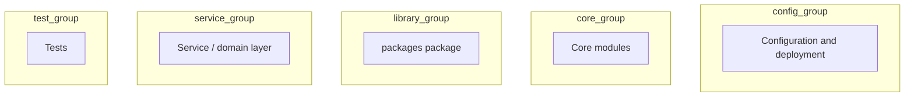

# Architecture report: BrowserSync/browser-sync

> Automated static analysis. **Observed** = directly seen in files/imports/AST; **Inferred** = interpretation from that evidence. Repository code was not executed.

## 1. Repository at a glance

| Item | Value |
| --- | --- |
| Repository | BrowserSync/browser-sync |
| Description | Keep multiple browsers & devices in sync when building websites. https://browsersync.io |
| Language | JavaScript |
| Stars | 12288 |
| Licence | Apache-2.0 |
| Analysed commit / branch | dc74bc0a6bcbe70eea5f2f94b524b2902436efb1 / master |
| Framework(s) | None detected |
| Files analysed | 720 |
| Components | 5 |

## 2. Architecture in one minute

BrowserSync/browser-sync - Keep multiple browsers & devices in sync when building websites. https://browsersync.io. This repository was analysed statically from 720 file(s) (0 Python). Detected technologies (observed from imports/manifests): GitHub Actions, TypeScript, webpack. Files are grouped into 5 component(s): Configuration and deployment, Core modules, packages package, Service / domain layer, Tests. Findings below distinguish observed facts from inferred interpretation.

## 3. High-level block diagram

## 4. Main components

### Configuration and deployment (`config`)

- **Kind:** config
- **Status:** Observed
- **Confidence:** 0.85
- **Responsibility:** Groups 16 file(s) under configuration and deployment (observed from repository paths and static analysis).
- **Paths:** `lerna.json`, `nx.json`, `package.json`, `packages/browser-sync-client/.travis.yml`, `packages/browser-sync-client/package.json`, `packages/browser-sync-client/tsconfig.json`, `packages/browser-sync-ui/.editorconfig`, `packages/browser-sync-ui/crossbow.yaml`, `packages/browser-sync-ui/package.json`, `packages/browser-sync-ui/src/crossbow/_config.yml`, `packages/browser-sync/cli-options/opts.init.json`, `packages/browser-sync/cli-options/opts.recipe.json`, `packages/browser-sync/cli-options/opts.reload.json`, `packages/browser-sync/cli-options/opts.start.json`, `packages/browser-sync/package.json`, `packages/browser-sync/tsconfig.json`
- **Evidence:** [lerna.json](https://github.com/BrowserSync/browser-sync/blob/dc74bc0a6bcbe70eea5f2f94b524b2902436efb1/lerna.json); [nx.json](https://github.com/BrowserSync/browser-sync/blob/dc74bc0a6bcbe70eea5f2f94b524b2902436efb1/nx.json); [package.json](https://github.com/BrowserSync/browser-sync/blob/dc74bc0a6bcbe70eea5f2f94b524b2902436efb1/package.json); [packages/browser-sync-client/.travis.yml](https://github.com/BrowserSync/browser-sync/blob/dc74bc0a6bcbe70eea5f2f94b524b2902436efb1/packages/browser-sync-client/.travis.yml); [packages/browser-sync-client/package.json](https://github.com/BrowserSync/browser-sync/blob/dc74bc0a6bcbe70eea5f2f94b524b2902436efb1/packages/browser-sync-client/package.json); [packages/browser-sync-client/tsconfig.json](https://github.com/BrowserSync/browser-sync/blob/dc74bc0a6bcbe70eea5f2f94b524b2902436efb1/packages/browser-sync-client/tsconfig.json); [packages/browser-sync-ui/.editorconfig](https://github.com/BrowserSync/browser-sync/blob/dc74bc0a6bcbe70eea5f2f94b524b2902436efb1/packages/browser-sync-ui/.editorconfig); [packages/browser-sync-ui/crossbow.yaml](https://github.com/BrowserSync/browser-sync/blob/dc74bc0a6bcbe70eea5f2f94b524b2902436efb1/packages/browser-sync-ui/crossbow.yaml)

### Core modules (`core`)

- **Kind:** core
- **Status:** Observed
- **Confidence:** 0.85
- **Responsibility:** Groups 2 file(s) under core modules (observed from repository paths and static analysis).
- **Paths:** `changelog.js`, `playwright.config.ts`
- **Evidence:** [changelog.js](https://github.com/BrowserSync/browser-sync/blob/dc74bc0a6bcbe70eea5f2f94b524b2902436efb1/changelog.js); [playwright.config.ts](https://github.com/BrowserSync/browser-sync/blob/dc74bc0a6bcbe70eea5f2f94b524b2902436efb1/playwright.config.ts)

### packages package (`packages`)

- **Kind:** library
- **Status:** Observed
- **Confidence:** 0.85
- **Responsibility:** Groups 171 file(s) under packages package (observed from repository paths and static analysis).
- **Paths:** `packages/browser-sync-client/index.js`, `packages/browser-sync-client/lib/browser.utils.ts`, `packages/browser-sync-client/lib/dom-effects.ts`, `packages/browser-sync-client/lib/dom-effects/link-replace.dom-effect.ts`, `packages/browser-sync-client/lib/dom-effects/prop-set.dom-effect.ts`, `packages/browser-sync-client/lib/dom-effects/set-scroll.dom-effect.ts`, `packages/browser-sync-client/lib/dom-effects/set-window-name.dom-effect.ts`, `packages/browser-sync-client/lib/dom-effects/style-set.dom-effect.ts`, `packages/browser-sync-client/lib/effects.ts`, `packages/browser-sync-client/lib/effects/browser-reload.effect.ts`, `packages/browser-sync-client/lib/effects/browser-set-location.effect.ts`, `packages/browser-sync-client/lib/effects/file-reload.effect.ts`, `packages/browser-sync-client/lib/effects/set-element-toggle-value.effect.ts`, `packages/browser-sync-client/lib/effects/set-element-value.effect.ts`, `packages/browser-sync-client/lib/effects/set-options.effect.ts`, `packages/browser-sync-client/lib/effects/set-scroll.ts`, `packages/browser-sync-client/lib/effects/simulate-click.effect.ts`, `packages/browser-sync-client/lib/index.ts`, `packages/browser-sync-client/lib/listeners.ts`, `packages/browser-sync-client/lib/listeners/clicks.listener.ts`, `packages/browser-sync-client/lib/listeners/form-inputs.listener.ts`, `packages/browser-sync-client/lib/listeners/form-toggles.listener.ts`, `packages/browser-sync-client/lib/listeners/scroll.listener.ts`, `packages/browser-sync-client/lib/log.ts`, `packages/browser-sync-client/lib/messages/BrowserLocation.ts`, `packages/browser-sync-client/lib/messages/BrowserNotify.ts`, `packages/browser-sync-client/lib/messages/BrowserReload.ts`, `packages/browser-sync-client/lib/messages/ClickEvent.ts`, `packages/browser-sync-client/lib/messages/Connection.ts`, `packages/browser-sync-client/lib/messages/Disconnect.ts`, `packages/browser-sync-client/lib/messages/FileReload.ts`, `packages/browser-sync-client/lib/messages/FormToggleEvent.ts`, `packages/browser-sync-client/lib/messages/KeyupEvent.ts`, `packages/browser-sync-client/lib/messages/OptionsSet.ts`, `packages/browser-sync-client/lib/messages/ScrollEvent.ts`, `packages/browser-sync-client/lib/notify.ts`, `packages/browser-sync-client/lib/scroll-restore.ts`, `packages/browser-sync-client/lib/socket-messages.ts`, `packages/browser-sync-client/lib/socket.ts`, `packages/browser-sync-client/lib/types.ts`, `packages/browser-sync-client/lib/types/socket.ts`, `packages/browser-sync-client/lib/types/types.d.ts`, `packages/browser-sync-client/lib/utils.ts`, `packages/browser-sync-client/webpack.config.js`, `packages/browser-sync-ui/example.stream.js`, `packages/browser-sync-ui/index.js`, `packages/browser-sync-ui/lib/UI.js`, `packages/browser-sync-ui/lib/async-tasks.js`, `packages/browser-sync-ui/lib/async.js`, `packages/browser-sync-ui/lib/client-elements.js`, `packages/browser-sync-ui/lib/client-js.js`, `packages/browser-sync-ui/lib/config.js`, `packages/browser-sync-ui/lib/directive-stripper.js`, `packages/browser-sync-ui/lib/hooks.js`, `packages/browser-sync-ui/lib/opts.js`, `packages/browser-sync-ui/lib/plugins/connections/connections.client.js`, `packages/browser-sync-ui/lib/plugins/connections/connections.plugin.js`, `packages/browser-sync-ui/lib/plugins/connections/lib/connections.js`, `packages/browser-sync-ui/lib/plugins/help/help.client.js`, `packages/browser-sync-ui/lib/plugins/help/help.plugin.js`, `packages/browser-sync-ui/lib/plugins/history/history.client.js`, `packages/browser-sync-ui/lib/plugins/history/history.js`, `packages/browser-sync-ui/lib/plugins/history/history.plugin.js`, `packages/browser-sync-ui/lib/plugins/network-throttle/network-throttle.client.js`, `packages/browser-sync-ui/lib/plugins/network-throttle/network-throttle.js`, `packages/browser-sync-ui/lib/plugins/network-throttle/network-throttle.plugin.js`, `packages/browser-sync-ui/lib/plugins/network-throttle/targets.js`, `packages/browser-sync-ui/lib/plugins/network-throttle/throttle-server.js`, `packages/browser-sync-ui/lib/plugins/overview/overview.client.js`, `packages/browser-sync-ui/lib/plugins/overview/overview.plugin.js`, `packages/browser-sync-ui/lib/plugins/plugins/plugins.client.js`, `packages/browser-sync-ui/lib/plugins/plugins/plugins.plugin.js`, `packages/browser-sync-ui/lib/plugins/remote-debug/client-files.js`, `packages/browser-sync-ui/lib/plugins/remote-debug/compression.js`, `packages/browser-sync-ui/lib/plugins/remote-debug/latency/latency.client.js`, `packages/browser-sync-ui/lib/plugins/remote-debug/latency/latency.js`, `packages/browser-sync-ui/lib/plugins/remote-debug/no-cache.js`, `packages/browser-sync-ui/lib/plugins/remote-debug/overlay-grid/js/grid-overlay.js`, `packages/browser-sync-ui/lib/plugins/remote-debug/overlay-grid/overlay-grid.client.js`, `packages/browser-sync-ui/lib/plugins/remote-debug/overlay-grid/overlay-grid.js`, `packages/browser-sync-ui/lib/plugins/remote-debug/remote-debug.client.js`, `packages/browser-sync-ui/lib/plugins/remote-debug/remote-debug.plugin.js`, `packages/browser-sync-ui/lib/plugins/sync-options/sync-options.client.js`, `packages/browser-sync-ui/lib/plugins/sync-options/sync-options.plugin.js`, `packages/browser-sync-ui/lib/resolve-plugins.js`, `packages/browser-sync-ui/lib/server.js`, `packages/browser-sync-ui/lib/transform.options.js`, `packages/browser-sync-ui/lib/transforms.js`, `packages/browser-sync-ui/lib/urls.js`, `packages/browser-sync-ui/lib/utils.js`, `packages/browser-sync-ui/src/scripts/angular.js`, `packages/browser-sync-ui/src/scripts/app.js`, `packages/browser-sync-ui/src/scripts/directives.js`, `packages/browser-sync-ui/src/scripts/directives/icon.js`, `packages/browser-sync-ui/src/scripts/directives/link-to.js`, `packages/browser-sync-ui/src/scripts/directives/new-tab.js`, `packages/browser-sync-ui/src/scripts/directives/switch.js`, `packages/browser-sync-ui/src/scripts/editor.js`, `packages/browser-sync-ui/src/scripts/filters.js`, `packages/browser-sync-ui/src/scripts/main/controller.js`, `packages/browser-sync-ui/src/scripts/module.js`, `packages/browser-sync-ui/src/scripts/modules/bsClients.js`, `packages/browser-sync-ui/src/scripts/modules/bsDisconnect.js`, `packages/browser-sync-ui/src/scripts/modules/bsHistory.js`, `packages/browser-sync-ui/src/scripts/modules/bsNotify.js`, `packages/browser-sync-ui/src/scripts/modules/bsSocket.js`, `packages/browser-sync-ui/src/scripts/modules/bsStore.js`, `packages/browser-sync-ui/src/scripts/utils.js`, `packages/browser-sync-ui/tasks/crossbow.js`, `packages/browser-sync-ui/tasks/icons.js`, `packages/browser-sync-ui/webpack.config.js`, `packages/browser-sync/certs/gen.sh`, `packages/browser-sync/lib/args.js`, `packages/browser-sync/lib/async-tasks.js`, `packages/browser-sync/lib/async.js`, `packages/browser-sync/lib/bin.ts`, `packages/browser-sync/lib/browser-sync.js`, `packages/browser-sync/lib/cli/cli-info.js`, `packages/browser-sync/lib/cli/cli-options.ts`, `packages/browser-sync/lib/cli/command.init.js`, `packages/browser-sync/lib/cli/command.recipe.js`, `packages/browser-sync/lib/cli/command.reload.js`, `packages/browser-sync/lib/cli/command.start.ts`, `packages/browser-sync/lib/cli/transforms/addCwdToWatchOptions.ts`, `packages/browser-sync/lib/cli/transforms/addDefaultIgnorePatterns.ts`, `packages/browser-sync/lib/cli/transforms/addToFilesOption.ts`, `packages/browser-sync/lib/cli/transforms/appendServerDirectoryOption.ts`, `packages/browser-sync/lib/cli/transforms/appendServerIndexOption.ts`, `packages/browser-sync/lib/cli/transforms/copyCLIIgnoreToWatchOptions.ts`, `packages/browser-sync/lib/cli/transforms/handleExtensionsOption.ts`, `packages/browser-sync/lib/cli/transforms/handleFilesOption.ts`, `packages/browser-sync/lib/cli/transforms/handleGhostModeOption.ts`, `packages/browser-sync/lib/cli/transforms/handleHostOption.ts`, `packages/browser-sync/lib/cli/transforms/handlePortsOption.ts`, `packages/browser-sync/lib/cli/transforms/handleProxyOption.ts`, `packages/browser-sync/lib/cli/transforms/handleServerOption.ts`, `packages/browser-sync/lib/config.js`, `packages/browser-sync/lib/connect-utils.js`, `packages/browser-sync/lib/default-config.js`, `packages/browser-sync/lib/file-event-handler.js`, `packages/browser-sync/lib/file-utils.js`, `packages/browser-sync/lib/file-watcher.js`, `packages/browser-sync/lib/hooks.js`, `packages/browser-sync/lib/http-protocol.js`, `packages/browser-sync/lib/index.js`, `packages/browser-sync/lib/internal-events.js`, `packages/browser-sync/lib/lodash.custom.js`, `packages/browser-sync/lib/logger.js`, `packages/browser-sync/lib/options.ts`, `packages/browser-sync/lib/plugins.js`, `packages/browser-sync/lib/public/exit.js`, `packages/browser-sync/lib/public/init.ts`, `packages/browser-sync/lib/public/notify.js`, `packages/browser-sync/lib/public/pause.js`, `packages/browser-sync/lib/public/public-utils.js`, `packages/browser-sync/lib/public/reload.js`, `packages/browser-sync/lib/public/resume.js`, `packages/browser-sync/lib/public/stream.js`, `packages/browser-sync/lib/server/index.js`, `packages/browser-sync/lib/server/proxy-server.js`, `packages/browser-sync/lib/server/proxy-utils.js`, `packages/browser-sync/lib/server/serve-static-wrapper.ts`, `packages/browser-sync/lib/server/snippet-server.js`, `packages/browser-sync/lib/server/static-server.js`, `packages/browser-sync/lib/server/utils.js`, `packages/browser-sync/lib/snippet.js`, `packages/browser-sync/lib/sockets.ts`, `packages/browser-sync/lib/tunnel.js`, `packages/browser-sync/lib/types.ts`, `packages/browser-sync/lib/utils.ts`, `packages/browser-sync/templates/cli-template.js`
- **Evidence:** [packages/browser-sync-client/index.js](https://github.com/BrowserSync/browser-sync/blob/dc74bc0a6bcbe70eea5f2f94b524b2902436efb1/packages/browser-sync-client/index.js); [packages/browser-sync-client/lib/browser.utils.ts](https://github.com/BrowserSync/browser-sync/blob/dc74bc0a6bcbe70eea5f2f94b524b2902436efb1/packages/browser-sync-client/lib/browser.utils.ts); [packages/browser-sync-client/lib/dom-effects.ts](https://github.com/BrowserSync/browser-sync/blob/dc74bc0a6bcbe70eea5f2f94b524b2902436efb1/packages/browser-sync-client/lib/dom-effects.ts); [packages/browser-sync-client/lib/dom-effects/link-replace.dom-effect.ts](https://github.com/BrowserSync/browser-sync/blob/dc74bc0a6bcbe70eea5f2f94b524b2902436efb1/packages/browser-sync-client/lib/dom-effects/link-replace.dom-effect.ts); [packages/browser-sync-client/lib/dom-effects/prop-set.dom-effect.ts](https://github.com/BrowserSync/browser-sync/blob/dc74bc0a6bcbe70eea5f2f94b524b2902436efb1/packages/browser-sync-client/lib/dom-effects/prop-set.dom-effect.ts); [packages/browser-sync-client/lib/dom-effects/set-scroll.dom-effect.ts](https://github.com/BrowserSync/browser-sync/blob/dc74bc0a6bcbe70eea5f2f94b524b2902436efb1/packages/browser-sync-client/lib/dom-effects/set-scroll.dom-effect.ts); [packages/browser-sync-client/lib/dom-effects/set-window-name.dom-effect.ts](https://github.com/BrowserSync/browser-sync/blob/dc74bc0a6bcbe70eea5f2f94b524b2902436efb1/packages/browser-sync-client/lib/dom-effects/set-window-name.dom-effect.ts); [packages/browser-sync-client/lib/dom-effects/style-set.dom-effect.ts](https://github.com/BrowserSync/browser-sync/blob/dc74bc0a6bcbe70eea5f2f94b524b2902436efb1/packages/browser-sync-client/lib/dom-effects/style-set.dom-effect.ts)

### Service / domain layer (`service_layer`)

- **Kind:** service
- **Status:** Observed
- **Confidence:** 0.85
- **Responsibility:** Groups 2 file(s) under service / domain layer (observed from repository paths and static analysis).
- **Paths:** `packages/browser-sync-ui/src/scripts/services/Options.js`, `packages/browser-sync-ui/src/scripts/services/Pages.js`
- **Evidence:** [packages/browser-sync-ui/src/scripts/services/Options.js](https://github.com/BrowserSync/browser-sync/blob/dc74bc0a6bcbe70eea5f2f94b524b2902436efb1/packages/browser-sync-ui/src/scripts/services/Options.js); [packages/browser-sync-ui/src/scripts/services/Pages.js](https://github.com/BrowserSync/browser-sync/blob/dc74bc0a6bcbe70eea5f2f94b524b2902436efb1/packages/browser-sync-ui/src/scripts/services/Pages.js)

### Tests (`tests`)

- **Kind:** test
- **Status:** Observed
- **Confidence:** 0.85
- **Responsibility:** Groups 321 file(s) under tests (observed from repository paths and static analysis).
- **Paths:** `packages/browser-sync-client/test/.jshintrc`, `packages/browser-sync-client/test/client-new/bs.options.js`, `packages/browser-sync-client/test/client-new/code-sync.js`, `packages/browser-sync-client/test/client-new/emitter.js`, `packages/browser-sync-client/test/client-new/ghostmode.click.js`, `packages/browser-sync-client/test/client-new/ghostmode.forms.inputs.js`, `packages/browser-sync-client/test/client-new/ghostmode.forms.js`, `packages/browser-sync-client/test/client-new/ghostmode.forms.submit.js`, `packages/browser-sync-client/test/client-new/ghostmode.forms.toggles.js`, `packages/browser-sync-client/test/client-new/ghostmode.js`, `packages/browser-sync-client/test/client-new/ghostmode.location.js`, `packages/browser-sync-client/test/client-new/ghostmode.scroll.js`, `packages/browser-sync-client/test/client-new/index.js`, `packages/browser-sync-client/test/client-new/libs/assert.js`, `packages/browser-sync-client/test/client-new/notify.js`, `packages/browser-sync-client/test/client-new/socket.js`, `packages/browser-sync-client/test/client-new/stubs/bs.js`, `packages/browser-sync-client/test/client-new/utils.js`, `packages/browser-sync-client/test/fixtures/css/style.css`, `packages/browser-sync-client/test/fixtures/forms.html`, `packages/browser-sync-client/test/fixtures/index-large.html`, `packages/browser-sync-client/test/fixtures/index-urls.html`, `packages/browser-sync-client/test/fixtures/index.html`, `packages/browser-sync-client/test/fixtures/inputs.html`, `packages/browser-sync-client/test/fixtures/less.html`, `packages/browser-sync-client/test/fixtures/links.html`, `packages/browser-sync-client/test/fixtures/proxy-headers.html`, `packages/browser-sync-client/test/fixtures/proxy-ip.html`, `packages/browser-sync-client/test/fixtures/proxy-vhost.html`, `packages/browser-sync-client/test/fixtures/sass.html`, `packages/browser-sync-client/test/fixtures/scrolling.html`, `packages/browser-sync-client/test/karma.conf.ci.js`, `packages/browser-sync-client/test/karma.conf.js`, `packages/browser-sync-client/test/middleware/file.js`, `packages/browser-sync-client/test/middleware/middleware.js`, `packages/browser-sync-client/test/test.conf.js`, `packages/browser-sync-ui/test/.jshintrc`, `packages/browser-sync-ui/test/client/e2e/bs-init.js`, `packages/browser-sync-ui/test/client/e2e/config.js`, `packages/browser-sync-ui/test/client/e2e/e2e.plugins.js`, `packages/browser-sync-ui/test/client/e2e/e2e.server-info.js`, `packages/browser-sync-ui/test/client/e2e/e2e.sync-options.js`, `packages/browser-sync-ui/test/client/e2e/test-utils.js`, `packages/browser-sync-ui/test/client/e2e/tests/history.js`, `packages/browser-sync-ui/test/client/e2e/tests/history.newtabs.js`, `packages/browser-sync-ui/test/client/e2e/tests/home.js`, `packages/browser-sync-ui/test/client/e2e/tests/network-throttle.auto.js`, `packages/browser-sync-ui/test/client/e2e/tests/network-throttle.js`, `packages/browser-sync-ui/test/client/e2e/tests/network-throttle.manual.js`, `packages/browser-sync-ui/test/client/e2e/tests/network-throttle.remove.js`, `packages/browser-sync-ui/test/client/e2e/tests/plugins.inline.js`, `packages/browser-sync-ui/test/client/e2e/tests/plugins.js`, `packages/browser-sync-ui/test/client/e2e/tests/remote-debug.js`, `packages/browser-sync-ui/test/fixtures/content.html`, `packages/browser-sync-ui/test/fixtures/css/blog.css`, `packages/browser-sync-ui/test/fixtures/css/bootstrap.css`, `packages/browser-sync-ui/test/fixtures/forms.html`, `packages/browser-sync-ui/test/fixtures/index.html`, `packages/browser-sync-ui/test/fixtures/plugin-multi-templates/index.plugin.js`, `packages/browser-sync-ui/test/fixtures/plugin-multi-templates/package.json`, `packages/browser-sync-ui/test/fixtures/plugin-multi-templates/ui/client.js`, `packages/browser-sync-ui/test/fixtures/plugin-multi-templates/ui/client2.js`, `packages/browser-sync-ui/test/fixtures/plugin-multi-templates/ui/test.directive.html`, `packages/browser-sync-ui/test/fixtures/plugin-multi-templates/ui/test.html`, `packages/browser-sync-ui/test/fixtures/plugin-multi-templates/ui/test.list.html`, `packages/browser-sync-ui/test/fixtures/plugin-noui/index.plugin.js`, `packages/browser-sync-ui/test/fixtures/plugin-noui/package.json`, `packages/browser-sync-ui/test/fixtures/plugin/index.plugin.js`, `packages/browser-sync-ui/test/fixtures/plugin/package.json`, `packages/browser-sync-ui/test/fixtures/plugin/ui/client.js`, `packages/browser-sync-ui/test/fixtures/plugin/ui/test.directive.html`, `packages/browser-sync-ui/test/fixtures/plugin/ui/test.html`, `packages/browser-sync-ui/test/fixtures/scrolling.html`, `packages/browser-sync-ui/test/opts.server.json`, `packages/browser-sync-ui/test/protractor.sh`, `packages/browser-sync-ui/test/server/history/history.js`, `packages/browser-sync-ui/test/server/init.js`, `packages/browser-sync-ui/test/server/plugins.js`, `packages/browser-sync-ui/test/server/plugins.templates.js`, `packages/browser-sync-ui/test/server/remote-debug/client.files.js`, `packages/browser-sync-ui/test/server/remote-debug/latency.js`, `packages/browser-sync-ui/test/server/remote-debug/no-cache.js`, `packages/browser-sync-ui/test/server/remote-debug/throttle.https.js`, `packages/browser-sync-ui/test/server/remote-debug/throttle.js`, `packages/browser-sync/test/env.js`, `packages/browser-sync/test/fixtures/.tmp/temp.css`, `packages/browser-sync/test/fixtures/alt/index.htm`, `packages/browser-sync/test/fixtures/assets/import.css`, `packages/browser-sync/test/fixtures/assets/import2.css`, `packages/browser-sync/test/fixtures/assets/print.css`, `packages/browser-sync/test/fixtures/assets/style.css`, `packages/browser-sync/test/fixtures/base.html`, `packages/browser-sync/test/fixtures/bootstrap.html`, `packages/browser-sync/test/fixtures/bootstrap/css/bootstrap-grid.css`, `packages/browser-sync/test/fixtures/bootstrap/css/bootstrap-reboot.css`, `packages/browser-sync/test/fixtures/bootstrap/css/bootstrap.css`, `packages/browser-sync/test/fixtures/bootstrap/css/justified-nav.css`, `packages/browser-sync/test/fixtures/bootstrap/index.html`, `packages/browser-sync/test/fixtures/bootstrap/js/bootstrap.bundle.js`, `packages/browser-sync/test/fixtures/bootstrap/js/bootstrap.js`, `packages/browser-sync/test/fixtures/bower.html`, `packages/browser-sync/test/fixtures/bower_components/app.css`, `packages/browser-sync/test/fixtures/config/config.js`, `packages/browser-sync/test/fixtures/config/si-config-partial.js`, `packages/browser-sync/test/fixtures/config/si-config-ports.js`, `packages/browser-sync/test/fixtures/config/si-config-proxy.js`, `packages/browser-sync/test/fixtures/config/si-config.js`, `packages/browser-sync/test/fixtures/config/si-default-config.js`, `packages/browser-sync/test/fixtures/css/bootstrap-less.css`, `packages/browser-sync/test/fixtures/css/bootstrap-scss.css`, `packages/browser-sync/test/fixtures/css/bootstrap.css`, `packages/browser-sync/test/fixtures/fonts/roboto/Roboto-Regular-demo.html`, `packages/browser-sync/test/fixtures/fonts/roboto/Roboto-Regular-webfont.svg`, `packages/browser-sync/test/fixtures/fonts/roboto/stylesheet.css`, `packages/browser-sync/test/fixtures/forms.html`, `packages/browser-sync/test/fixtures/iframe.html`, `packages/browser-sync/test/fixtures/images.html`, `packages/browser-sync/test/fixtures/import-link.html`, `packages/browser-sync/test/fixtures/import.html`, `packages/browser-sync/test/fixtures/index-amd.html`, `packages/browser-sync/test/fixtures/index-large.html`, `packages/browser-sync/test/fixtures/index-urls.html`, `packages/browser-sync/test/fixtures/index.html`, `packages/browser-sync/test/fixtures/inputs.html`, `packages/browser-sync/test/fixtures/js/default.js`, `packages/browser-sync/test/fixtures/js/main.js`, `packages/browser-sync/test/fixtures/less.html`, `packages/browser-sync/test/fixtures/less/bootstrap.less`, `packages/browser-sync/test/fixtures/links.html`, `packages/browser-sync/test/fixtures/plugin.js`, `packages/browser-sync/test/fixtures/proxy-headers.html`, `packages/browser-sync/test/fixtures/proxy-ip.html`, `packages/browser-sync/test/fixtures/proxy-vhost.html`, `packages/browser-sync/test/fixtures/rewrites/comment.expected.html`, `packages/browser-sync/test/fixtures/rewrites/comment.html`, `packages/browser-sync/test/fixtures/rewrites/escaped.1.expected.html`, `packages/browser-sync/test/fixtures/rewrites/escaped.1.html`, `packages/browser-sync/test/fixtures/rewrites/hashes.expected.html`, `packages/browser-sync/test/fixtures/rewrites/hashes.input.html`, `packages/browser-sync/test/fixtures/sass.html`, `packages/browser-sync/test/fixtures/scrolling.html`, `packages/browser-sync/test/fixtures/scss/bootstrap-scss.scss`, `packages/browser-sync/test/fixtures/socket.io.html`, `packages/browser-sync/test/fixtures/stylus/bootstrap.styl`, `packages/browser-sync/test/fixtures/svg.html`, `packages/browser-sync/test/fixtures/svg/bin.svg`, `packages/browser-sync/test/fixtures/tailwind/index.html`, `packages/browser-sync/test/fixtures/test.txt`, `packages/browser-sync/test/fixtures/test2.txt`, `packages/browser-sync/test/fixtures/username.github.io/index.html`, `packages/browser-sync/test/fixtures/watch-func.txt`, `packages/browser-sync/test/fixtures2/style-alt.css`, `packages/browser-sync/test/protractor/_run.js`, `packages/browser-sync/test/protractor/bs.init.js`, `packages/browser-sync/test/protractor/config.multi.js`, `packages/browser-sync/test/protractor/config.single.js`, `packages/browser-sync/test/protractor/logger.js`, `packages/browser-sync/test/protractor/runProtractor.js`, `packages/browser-sync/test/protractor/setup.js`, `packages/browser-sync/test/protractor/setup.single.js`, `packages/browser-sync/test/protractor/tests.multi.js`, `packages/browser-sync/test/protractor/tests.single.js`, `packages/browser-sync/test/protractor/tests/actions.clicks.js`, `packages/browser-sync/test/protractor/tests/actions.scroll.js`, `packages/browser-sync/test/protractor/tests/proxy.interactions.js`, `packages/browser-sync/test/protractor/tests/proxy.rewrites.js`, `packages/browser-sync/test/protractor/tests/server.interactions.js`, `packages/browser-sync/test/protractor/tests/snippet.injection.js`, `packages/browser-sync/test/protractor/tests/with.baseurl.https.js`, `packages/browser-sync/test/protractor/tests/with.baseurl.js`, `packages/browser-sync/test/protractor/tests/with.socket.io.js`, `packages/browser-sync/test/protractor/utils.js`, `packages/browser-sync/test/specs/api/init.active.js`, `packages/browser-sync/test/specs/api/init.exit.js`, `packages/browser-sync/test/specs/api/init.js`, `packages/browser-sync/test/specs/api/init.notify.js`, `packages/browser-sync/test/specs/api/init.pause.js`, `packages/browser-sync/test/specs/api/init.reload.deprecated.js`, `packages/browser-sync/test/specs/api/init.reload.js`, `packages/browser-sync/test/specs/api/init.reload.multi.js`, `packages/browser-sync/test/specs/api/init.reload.stream.js`, `packages/browser-sync/test/specs/api/init.reload.stream.noop.js`, `packages/browser-sync/test/specs/api/init.returns.js`, `packages/browser-sync/test/specs/api/init.sockets.js`, `packages/browser-sync/test/specs/api/watch.js`, `packages/browser-sync/test/specs/cli/cli.exec.js`, `packages/browser-sync/test/specs/cli/cli.get.config.js`, `packages/browser-sync/test/specs/cli/cli.help.js`, `packages/browser-sync/test/specs/cli/cli.info.js`, `packages/browser-sync/test/specs/cli/cli.options.files.js`, `packages/browser-sync/test/specs/cli/cli.options.ghost.js`, `packages/browser-sync/test/specs/cli/cli.options.ignore.js`, `packages/browser-sync/test/specs/cli/cli.options.ports.js`, `packages/browser-sync/test/specs/cli/cli.options.proxy.js`, `packages/browser-sync/test/specs/cli/cli.options.server.js`, `packages/browser-sync/test/specs/cli/cli.options.watch.js`, `packages/browser-sync/test/specs/cli/cli.options.watchOptions.cwd.js`, `packages/browser-sync/test/specs/commands/recipes.js`, `packages/browser-sync/test/specs/commands/reload.js`, `packages/browser-sync/test/specs/e2e/cli/e2e.cli.conf.js`, `packages/browser-sync/test/specs/e2e/cli/e2e.cli.error.js`, `packages/browser-sync/test/specs/e2e/cli/e2e.cli.files.js`, `packages/browser-sync/test/specs/e2e/cli/e2e.cli.init.js`, `packages/browser-sync/test/specs/e2e/cli/e2e.cli.plugins.js`, `packages/browser-sync/test/specs/e2e/cli/e2e.cli.proxy.js`, `packages/browser-sync/test/specs/e2e/cli/e2e.cli.proxy.ws.js`, `packages/browser-sync/test/specs/e2e/cli/e2e.cli.server.js`, `packages/browser-sync/test/specs/e2e/cli/e2e.cli.snippet.js`, `packages/browser-sync/test/specs/e2e/cli/e2e.cli.ui.js`, `packages/browser-sync/test/specs/e2e/commands.server.json`, `packages/browser-sync/test/specs/e2e/e2e.events.js`, `packages/browser-sync/test/specs/e2e/e2e.fail.js`, `packages/browser-sync/test/specs/e2e/e2e.online.js`, `packages/browser-sync/test/specs/e2e/e2e.options.callbacks.js`, `packages/browser-sync/test/specs/e2e/e2e.options.cors.js`, `packages/browser-sync/test/specs/e2e/e2e.options.js`, `packages/browser-sync/test/specs/e2e/e2e.options.logPrefix.js`, `packages/browser-sync/test/specs/e2e/e2e.options.logSnippet.js`, `packages/browser-sync/test/specs/e2e/e2e.options.open.browsers.js`, `packages/browser-sync/test/specs/e2e/e2e.options.open.js`, `packages/browser-sync/test/specs/e2e/e2e.options.port.js`, `packages/browser-sync/test/specs/e2e/e2e.options.script.async.js`, `packages/browser-sync/test/specs/e2e/e2e.options.scriptpath.js`, `packages/browser-sync/test/specs/e2e/e2e.options.serveStatic.js`, `packages/browser-sync/test/specs/e2e/e2e.options.single.js`, `packages/browser-sync/test/specs/e2e/e2e.options.snippet.js`, `packages/browser-sync/test/specs/e2e/e2e.options.sockets.js`, `packages/browser-sync/test/specs/e2e/e2e.options.startPath.js`, `packages/browser-sync/test/specs/e2e/e2e.snippet.js`, `packages/browser-sync/test/specs/e2e/files/e2e.file.changed.js`, `packages/browser-sync/test/specs/e2e/files/e2e.file.options.js`, `packages/browser-sync/test/specs/e2e/files/e2e.file.watching.js`, `packages/browser-sync/test/specs/e2e/middleware/middleware.option.js`, `packages/browser-sync/test/specs/e2e/middleware/middleware.proxy.option.js`, `packages/browser-sync/test/specs/e2e/middleware/middleware.server.option.js`, `packages/browser-sync/test/specs/e2e/proxy/e2e.proxy.cookies.js`, `packages/browser-sync/test/specs/e2e/proxy/e2e.proxy.error.js`, `packages/browser-sync/test/specs/e2e/proxy/e2e.proxy.external.js`, `packages/browser-sync/test/specs/e2e/proxy/e2e.proxy.js`, `packages/browser-sync/test/specs/e2e/proxy/e2e.proxy.proxy.options.js`, `packages/browser-sync/test/specs/e2e/proxy/e2e.proxy.req.headers.js`, `packages/browser-sync/test/specs/e2e/proxy/e2e.proxy.req.headers.obj.js`, `packages/browser-sync/test/specs/e2e/proxy/e2e.proxy.rewrite.rules.add.js`, `packages/browser-sync/test/specs/e2e/proxy/e2e.proxy.rewrite.rules.js`, `packages/browser-sync/test/specs/e2e/proxy/e2e.proxy.rewrite.rules.remove.js`, `packages/browser-sync/test/specs/e2e/proxy/e2e.proxy.rewrite.rules.replace.js`, `packages/browser-sync/test/specs/e2e/proxy/e2e.proxy.secure.js`, `packages/browser-sync/test/specs/e2e/proxy/e2e.proxy.snippet.js`, `packages/browser-sync/test/specs/e2e/proxy/e2e.proxy.ws.js`, `packages/browser-sync/test/specs/e2e/server/e2e.server.404.js`, `packages/browser-sync/test/specs/e2e/server/e2e.server.dirs.js`, `packages/browser-sync/test/specs/e2e/server/e2e.server.httpModule.js`, `packages/browser-sync/test/specs/e2e/server/e2e.server.js`, `packages/browser-sync/test/specs/e2e/server/e2e.server.middleware.js`, `packages/browser-sync/test/specs/e2e/server/e2e.server.newapi.js`, `packages/browser-sync/test/specs/e2e/server/e2e.server.newapi2.js`, `packages/browser-sync/test/specs/e2e/server/e2e.server.rewrite.rules.add.js`, `packages/browser-sync/test/specs/e2e/server/e2e.server.rewrite.rules.js`, `packages/browser-sync/test/specs/e2e/server/e2e.server.rewrite.rules.remove.js`, `packages/browser-sync/test/specs/e2e/server/e2e.server.rewrite.rules.replace.js`, `packages/browser-sync/test/specs/e2e/server/e2e.server.routes.js`, `packages/browser-sync/test/specs/e2e/server/e2e.server.secure.custom.js`, `packages/browser-sync/test/specs/e2e/server/e2e.server.secure.js`, `packages/browser-sync/test/specs/e2e/server/e2e.server.secure.pfx.js`, `packages/browser-sync/test/specs/e2e/server/e2e.server.serveStatic.extensions.js`, `packages/browser-sync/test/specs/e2e/server/e2e.server.serveStatic.js`, `packages/browser-sync/test/specs/e2e/server/e2e.server.tunnel.js`, `packages/browser-sync/test/specs/files/files.event-handler.js`, `packages/browser-sync/test/specs/files/files.watching.debounce.js`, `packages/browser-sync/test/specs/files/files.watching.delay.js`, `packages/browser-sync/test/specs/files/files.watching.js`, `packages/browser-sync/test/specs/hooks/files.watch.hook.js`, `packages/browser-sync/test/specs/http-protocol/http.reload.js`, `packages/browser-sync/test/specs/instances/multi.emitter.js`, `packages/browser-sync/test/specs/instances/multi.get.js`, `packages/browser-sync/test/specs/instances/multi.has.js`, `packages/browser-sync/test/specs/instances/multi.init.js`, `packages/browser-sync/test/specs/instances/multi.js`, `packages/browser-sync/test/specs/instances/multi.plugins.js`, `packages/browser-sync/test/specs/instances/multi.proxy.js`, `packages/browser-sync/test/specs/instances/single.js`, `packages/browser-sync/test/specs/logger/logger.baseDir.js`, `packages/browser-sync/test/specs/logger/logger.files.changed.js`, `packages/browser-sync/test/specs/options/options.set.js`, `packages/browser-sync/test/specs/plugins/bs.options.js`, `packages/browser-sync/test/specs/plugins/connector.js`, `packages/browser-sync/test/specs/plugins/files.js`, `packages/browser-sync/test/specs/plugins/hooks.js`, `packages/browser-sync/test/specs/plugins/logger.js`, `packages/browser-sync/test/specs/plugins/options.js`, `packages/browser-sync/test/specs/plugins/ui.error.js`, `packages/browser-sync/test/specs/plugins/ui.js`, `packages/browser-sync/test/specs/plugins/user.plugins.add.middleware.js`, `packages/browser-sync/test/specs/plugins/user.plugins.cleanup.js`, `packages/browser-sync/test/specs/plugins/user.plugins.error.js`, `packages/browser-sync/test/specs/plugins/user.plugins.inline.enabled.js`, `packages/browser-sync/test/specs/plugins/user.plugins.inline.error.js`, `packages/browser-sync/test/specs/plugins/user.plugins.inline.js`, `packages/browser-sync/test/specs/plugins/user.plugins.inline.obj.js`, `packages/browser-sync/test/specs/plugins/user.plugins.inline.obj.reference.js`, `packages/browser-sync/test/specs/plugins/user.plugins.inline.options.js`, `packages/browser-sync/test/specs/plugins/user.plugins.js`, `packages/browser-sync/test/specs/plugins/user.plugins.proxy.js`, `packages/browser-sync/test/specs/plugins/user.plugins.serve.files.js`, `packages/browser-sync/test/specs/resp-mod/rewrite-links.js`, `packages/browser-sync/test/specs/server/server.snippet.js`, `packages/browser-sync/test/specs/utils/utils.connect.js`, `packages/browser-sync/test/specs/utils/utils.default.callback.js`, `packages/browser-sync/test/specs/utils/utils.fail.js`, `packages/browser-sync/test/specs/utils/utils.getHostIp.js`, `packages/browser-sync/test/specs/utils/utils.getUrl.js`, `packages/browser-sync/test/specs/utils/utils.getUrls.js`, `packages/browser-sync/test/specs/utils/utils.js`, `packages/browser-sync/test/specs/utils/utils.setUrlOptions.js`, `packages/browser-sync/test/specs/utils/utils.verifyOptions.js`, `packages/browser-sync/test/utils.js`, `tests/examples/basic/basic.spec.ts`, `tests/examples/html-inject/html-inject.spec.ts`, `tests/examples/snippet/snippet.spec.ts`, `tests/examples/tailwind/tailwind.spec.ts`, `tests/utils.ts`
- **Evidence:** [packages/browser-sync-client/test/.jshintrc](https://github.com/BrowserSync/browser-sync/blob/dc74bc0a6bcbe70eea5f2f94b524b2902436efb1/packages/browser-sync-client/test/.jshintrc); [packages/browser-sync-client/test/client-new/bs.options.js](https://github.com/BrowserSync/browser-sync/blob/dc74bc0a6bcbe70eea5f2f94b524b2902436efb1/packages/browser-sync-client/test/client-new/bs.options.js); [packages/browser-sync-client/test/client-new/code-sync.js](https://github.com/BrowserSync/browser-sync/blob/dc74bc0a6bcbe70eea5f2f94b524b2902436efb1/packages/browser-sync-client/test/client-new/code-sync.js); [packages/browser-sync-client/test/client-new/emitter.js](https://github.com/BrowserSync/browser-sync/blob/dc74bc0a6bcbe70eea5f2f94b524b2902436efb1/packages/browser-sync-client/test/client-new/emitter.js); [packages/browser-sync-client/test/client-new/ghostmode.click.js](https://github.com/BrowserSync/browser-sync/blob/dc74bc0a6bcbe70eea5f2f94b524b2902436efb1/packages/browser-sync-client/test/client-new/ghostmode.click.js); [packages/browser-sync-client/test/client-new/ghostmode.forms.inputs.js](https://github.com/BrowserSync/browser-sync/blob/dc74bc0a6bcbe70eea5f2f94b524b2902436efb1/packages/browser-sync-client/test/client-new/ghostmode.forms.inputs.js); [packages/browser-sync-client/test/client-new/ghostmode.forms.js](https://github.com/BrowserSync/browser-sync/blob/dc74bc0a6bcbe70eea5f2f94b524b2902436efb1/packages/browser-sync-client/test/client-new/ghostmode.forms.js); [packages/browser-sync-client/test/client-new/ghostmode.forms.submit.js](https://github.com/BrowserSync/browser-sync/blob/dc74bc0a6bcbe70eea5f2f94b524b2902436efb1/packages/browser-sync-client/test/client-new/ghostmode.forms.submit.js)

## 5. Execution flow

**Observed** entry point(s):

- [packages/browser-sync-client/index.js](https://github.com/BrowserSync/browser-sync/blob/dc74bc0a6bcbe70eea5f2f94b524b2902436efb1/packages/browser-sync-client/index.js)
- [packages/browser-sync-client/lib/index.ts](https://github.com/BrowserSync/browser-sync/blob/dc74bc0a6bcbe70eea5f2f94b524b2902436efb1/packages/browser-sync-client/lib/index.ts)
- [packages/browser-sync-ui/index.js](https://github.com/BrowserSync/browser-sync/blob/dc74bc0a6bcbe70eea5f2f94b524b2902436efb1/packages/browser-sync-ui/index.js)
- [packages/browser-sync-ui/lib/server.js](https://github.com/BrowserSync/browser-sync/blob/dc74bc0a6bcbe70eea5f2f94b524b2902436efb1/packages/browser-sync-ui/lib/server.js)
- [packages/browser-sync-ui/test/fixtures/plugin-multi-templates/index.plugin.js](https://github.com/BrowserSync/browser-sync/blob/dc74bc0a6bcbe70eea5f2f94b524b2902436efb1/packages/browser-sync-ui/test/fixtures/plugin-multi-templates/index.plugin.js)
- [packages/browser-sync-ui/test/fixtures/plugin-noui/index.plugin.js](https://github.com/BrowserSync/browser-sync/blob/dc74bc0a6bcbe70eea5f2f94b524b2902436efb1/packages/browser-sync-ui/test/fixtures/plugin-noui/index.plugin.js)
- [packages/browser-sync-ui/test/fixtures/plugin/index.plugin.js](https://github.com/BrowserSync/browser-sync/blob/dc74bc0a6bcbe70eea5f2f94b524b2902436efb1/packages/browser-sync-ui/test/fixtures/plugin/index.plugin.js)
- [packages/browser-sync/lib/index.js](https://github.com/BrowserSync/browser-sync/blob/dc74bc0a6bcbe70eea5f2f94b524b2902436efb1/packages/browser-sync/lib/index.js)

Representative flow (derived from observed entry points and the import graph; steps beyond the entry point are **Inferred**):

1. Execution starts at an observed entry point listed above, if present.
2. No internal import relationships between components were observed.

## 6. Project structure

### `(root)`

- `.editorconfig` - config (218 bytes)
- `.gitattributes` - other (12 bytes)
- `.gitignore` - other (497 bytes)
- `.travis.yml` - ci, YAML (70 bytes)
- `CONTRIBUTING.md` - docs (4422 bytes)
- `ISSUE_TEMPLATE.md` - docs (766 bytes)
- `LICENSE` - docs (11349 bytes)
- `README.md` - docs (2571 bytes)
- `changelog.js` - source, JavaScript (1710 bytes)
- `lerna.json` - config (63 bytes)
- `nx.json` - config (283 bytes)
- `package.json` - manifest (439 bytes)
- `playwright.config.ts` - source, TypeScript (1358 bytes)

### `.github`

- `.github/workflows/main.yml` - ci, YAML (1470 bytes)

### `examples`

- `examples/404.js` - source, JavaScript (584 bytes)
- `examples/basic/run.js` - source, JavaScript (598 bytes)
- `examples/callback.js` - source, JavaScript (469 bytes)
- `examples/express.js` - source, JavaScript (813 bytes)
- `examples/less.js` - source, JavaScript (606 bytes)
- `examples/middleware.css.injection.js` - source, JavaScript (1325 bytes)
- `examples/notify-styles.js` - source, JavaScript (671 bytes)
- `examples/options.snippetOptions.js` - source, JavaScript (667 bytes)
- `examples/proxy.gzip.js` - source, JavaScript (450 bytes)
- `examples/proxy.headers.js` - source, JavaScript (698 bytes)
- `examples/proxy.localhost.js` - source, JavaScript (359 bytes)
- `examples/proxy.middleware.js` - source, JavaScript (472 bytes)
- `examples/proxy.middleware.multi.js` - source, JavaScript (554 bytes)
- `examples/proxy.proxyRes.js` - source, JavaScript (503 bytes)
- `examples/proxy.rewriteRules.advanced.js` - source, JavaScript (1168 bytes)
- `examples/proxy.rewriteRules.simple.js` - source, JavaScript (1004 bytes)
- `examples/proxy.secure.js` - source, JavaScript (312 bytes)
- `examples/proxy.vhost.js` - source, JavaScript (341 bytes)
- `examples/server.basedir.js` - source, JavaScript (340 bytes)
- `examples/server.basedir.mulitple.js` - source, JavaScript (367 bytes)
- `examples/server.default.js` - source, JavaScript (288 bytes)
- `examples/server.gzip.js` - source, JavaScript (409 bytes)
- `examples/server.http2.js` - source, JavaScript (430 bytes)
- `examples/server.latency.js` - source, JavaScript (582 bytes)
- `examples/server.middleware.js` - source, JavaScript (573 bytes)
- `examples/server.middleware.multiple.js` - source, JavaScript (755 bytes)
- `examples/server.proxy.js` - source, JavaScript (558 bytes)
- `examples/server.secure.js` - source, JavaScript (399 bytes)
- `examples/server.secure.pfx.js` - source, JavaScript (433 bytes)
- `examples/server.watch.js` - source, JavaScript (354 bytes)
- `examples/snippet/index.html` - other (414 bytes)
- `examples/snippet/run.js` - source, JavaScript (686 bytes)

### `packages`

- `packages/browser-sync-client/.gitignore` - other (75 bytes)
- `packages/browser-sync-client/.travis.yml` - ci, YAML (179 bytes)
- `packages/browser-sync-client/LICENSE-MIT` - other (1058 bytes)
- `packages/browser-sync-client/README.md` - docs (446 bytes)
- `packages/browser-sync-client/index.js` - source, JavaScript (3184 bytes)
- `packages/browser-sync-client/lib/browser.utils.ts` - source, TypeScript (5499 bytes)
- `packages/browser-sync-client/lib/dom-effects.ts` - source, TypeScript (962 bytes)
- `packages/browser-sync-client/lib/dom-effects/link-replace.dom-effect.ts` - source, TypeScript (1218 bytes)
- `packages/browser-sync-client/lib/dom-effects/prop-set.dom-effect.ts` - source, TypeScript (760 bytes)
- `packages/browser-sync-client/lib/dom-effects/set-scroll.dom-effect.ts` - source, TypeScript (753 bytes)
- `packages/browser-sync-client/lib/dom-effects/set-window-name.dom-effect.ts` - source, TypeScript (661 bytes)
- `packages/browser-sync-client/lib/dom-effects/style-set.dom-effect.ts` - source, TypeScript (778 bytes)
- `packages/browser-sync-client/lib/effects.ts` - source, TypeScript (1552 bytes)
- `packages/browser-sync-client/lib/effects/browser-reload.effect.ts` - source, TypeScript (588 bytes)
- `packages/browser-sync-client/lib/effects/browser-set-location.effect.ts` - source, TypeScript (1067 bytes)
- `packages/browser-sync-client/lib/effects/file-reload.effect.ts` - source, TypeScript (981 bytes)
- `packages/browser-sync-client/lib/effects/set-element-toggle-value.effect.ts` - source, TypeScript (1186 bytes)
- `packages/browser-sync-client/lib/effects/set-element-value.effect.ts` - source, TypeScript (856 bytes)
- `packages/browser-sync-client/lib/effects/set-options.effect.ts` - source, TypeScript (743 bytes)
- `packages/browser-sync-client/lib/effects/set-scroll.ts` - source, TypeScript (5361 bytes)
- `packages/browser-sync-client/lib/effects/simulate-click.effect.ts` - source, TypeScript (1685 bytes)
- `packages/browser-sync-client/lib/index.ts` - source, TypeScript (4806 bytes)
- `packages/browser-sync-client/lib/listeners.ts` - source, TypeScript (913 bytes)
- `packages/browser-sync-client/lib/listeners/clicks.listener.ts` - source, TypeScript (2099 bytes)
- `packages/browser-sync-client/lib/listeners/form-inputs.listener.ts` - source, TypeScript (2054 bytes)
- `packages/browser-sync-client/lib/listeners/form-toggles.listener.ts` - source, TypeScript (2047 bytes)
- `packages/browser-sync-client/lib/listeners/scroll.listener.ts` - source, TypeScript (2841 bytes)
- `packages/browser-sync-client/lib/log.ts` - source, TypeScript (3573 bytes)
- `packages/browser-sync-client/lib/messages/BrowserLocation.ts` - source, TypeScript (760 bytes)
- `packages/browser-sync-client/lib/messages/BrowserNotify.ts` - source, TypeScript (380 bytes)
- `packages/browser-sync-client/lib/messages/BrowserReload.ts` - source, TypeScript (1084 bytes)
- `packages/browser-sync-client/lib/messages/ClickEvent.ts` - source, TypeScript (1191 bytes)
- `packages/browser-sync-client/lib/messages/Connection.ts` - source, TypeScript (844 bytes)
- `packages/browser-sync-client/lib/messages/Disconnect.ts` - source, TypeScript (277 bytes)
- `packages/browser-sync-client/lib/messages/FileReload.ts` - source, TypeScript (1099 bytes)
- `packages/browser-sync-client/lib/messages/FormToggleEvent.ts` - source, TypeScript (1428 bytes)
- `packages/browser-sync-client/lib/messages/KeyupEvent.ts` - source, TypeScript (1384 bytes)
- `packages/browser-sync-client/lib/messages/OptionsSet.ts` - source, TypeScript (457 bytes)
- `packages/browser-sync-client/lib/messages/ScrollEvent.ts` - source, TypeScript (1536 bytes)
- `packages/browser-sync-client/lib/notify.ts` - source, TypeScript (1416 bytes)
- `packages/browser-sync-client/lib/scroll-restore.ts` - source, TypeScript (3204 bytes)
- `packages/browser-sync-client/lib/socket-messages.ts` - source, TypeScript (3089 bytes)
- `packages/browser-sync-client/lib/socket.ts` - source, TypeScript (1544 bytes)
- `packages/browser-sync-client/lib/types.ts` - source, TypeScript (2834 bytes)
- `packages/browser-sync-client/lib/types/socket.ts` - source, TypeScript (312 bytes)
- `packages/browser-sync-client/lib/types/types.d.ts` - source, TypeScript (2875 bytes)
- `packages/browser-sync-client/lib/utils.ts` - source, TypeScript (3895 bytes)
- `packages/browser-sync-client/package.json` - manifest (1453 bytes)
- `packages/browser-sync-client/test/.jshintrc` - test (526 bytes)
- `packages/browser-sync-client/test/client-new/bs.options.js` - test, JavaScript (2154 bytes)
- `packages/browser-sync-client/test/client-new/code-sync.js` - test, JavaScript (12177 bytes)
- `packages/browser-sync-client/test/client-new/emitter.js` - test, JavaScript (1066 bytes)
- `packages/browser-sync-client/test/client-new/ghostmode.click.js` - test, JavaScript (4858 bytes)
- `packages/browser-sync-client/test/client-new/ghostmode.forms.inputs.js` - test, JavaScript (4491 bytes)
- `packages/browser-sync-client/test/client-new/ghostmode.forms.js` - test, JavaScript (3088 bytes)
- `packages/browser-sync-client/test/client-new/ghostmode.forms.submit.js` - test, JavaScript (5364 bytes)
- `packages/browser-sync-client/test/client-new/ghostmode.forms.toggles.js` - test, JavaScript (5737 bytes)
- `packages/browser-sync-client/test/client-new/ghostmode.js` - test, JavaScript (292 bytes)
- `packages/browser-sync-client/test/client-new/ghostmode.location.js` - test, JavaScript (2138 bytes)
- `packages/browser-sync-client/test/client-new/ghostmode.scroll.js` - test, JavaScript (3954 bytes)
- `packages/browser-sync-client/test/client-new/index.js` - test, JavaScript (1007 bytes)
- `packages/browser-sync-client/test/client-new/libs/assert.js` - test, JavaScript (13753 bytes)
- `packages/browser-sync-client/test/client-new/notify.js` - test, JavaScript (4399 bytes)
- `packages/browser-sync-client/test/client-new/socket.js` - test, JavaScript (1011 bytes)
- `packages/browser-sync-client/test/client-new/stubs/bs.js` - test, JavaScript (757 bytes)
- `packages/browser-sync-client/test/client-new/utils.js` - test, JavaScript (6152 bytes)
- `packages/browser-sync-client/test/fixtures/css/style.css` - test (27 bytes)
- `packages/browser-sync-client/test/fixtures/forms.html` - test (1974 bytes)
- `packages/browser-sync-client/test/fixtures/index-large.html` - test (67127 bytes)
- `packages/browser-sync-client/test/fixtures/index-urls.html` - test (716 bytes)
- `packages/browser-sync-client/test/fixtures/index.html` - test (1357 bytes)
- `packages/browser-sync-client/test/fixtures/inputs.html` - test (1087 bytes)
- `packages/browser-sync-client/test/fixtures/less.html` - test (591 bytes)
- `packages/browser-sync-client/test/fixtures/links.html` - test (112 bytes)
- `packages/browser-sync-client/test/fixtures/proxy-headers.html` - test (584 bytes)
- `packages/browser-sync-client/test/fixtures/proxy-ip.html` - test (16014 bytes)
- `packages/browser-sync-client/test/fixtures/proxy-vhost.html` - test (15933 bytes)
- `packages/browser-sync-client/test/fixtures/sass.html` - test (591 bytes)
- `packages/browser-sync-client/test/fixtures/scrolling.html` - test (2693 bytes)
- `packages/browser-sync-client/test/karma.conf.ci.js` - test, JavaScript (337 bytes)
- `packages/browser-sync-client/test/karma.conf.js` - test, JavaScript (214 bytes)
- `packages/browser-sync-client/test/middleware/file.js` - test, JavaScript (404 bytes)
- `packages/browser-sync-client/test/middleware/middleware.js` - test, JavaScript (2937 bytes)
- `packages/browser-sync-client/test/test.conf.js` - test, JavaScript (1483 bytes)
- `packages/browser-sync-client/tsconfig.json` - config (428 bytes)
- `packages/browser-sync-client/webpack.config.js` - source, JavaScript (1368 bytes)
- `packages/browser-sync-ui/.editorconfig` - config (347 bytes)
- `packages/browser-sync-ui/.gitignore` - other (125 bytes)
- `packages/browser-sync-ui/.jshintrc` - other (589 bytes)
- `packages/browser-sync-ui/LICENSE` - docs (11350 bytes)
- `packages/browser-sync-ui/README.md` - docs (285 bytes)
- `packages/browser-sync-ui/crossbow.yaml` - config (1415 bytes)
- `packages/browser-sync-ui/example.stream.js` - source, JavaScript (2087 bytes)
- `packages/browser-sync-ui/index.js` - source, JavaScript (1056 bytes)
- `packages/browser-sync-ui/lib/UI.js` - source, JavaScript (5795 bytes)
- `packages/browser-sync-ui/lib/async-tasks.js` - source, JavaScript (801 bytes)
- `packages/browser-sync-ui/lib/async.js` - source, JavaScript (5931 bytes)
- `packages/browser-sync-ui/lib/client-elements.js` - source, JavaScript (2058 bytes)
- `packages/browser-sync-ui/lib/client-js.js` - source, JavaScript (3451 bytes)
- `packages/browser-sync-ui/lib/config.js` - source, JavaScript (992 bytes)
- `packages/browser-sync-ui/lib/directive-stripper.js` - source, JavaScript (1888 bytes)
- `packages/browser-sync-ui/lib/hooks.js` - source, JavaScript (7207 bytes)
- `packages/browser-sync-ui/lib/opts.js` - source, JavaScript (492 bytes)
- `packages/browser-sync-ui/lib/plugins/connections/connections.client.js` - source, JavaScript (1770 bytes)
- `packages/browser-sync-ui/lib/plugins/connections/connections.directive.html` - other (475 bytes)
- `packages/browser-sync-ui/lib/plugins/connections/connections.html` - other (951 bytes)
- `packages/browser-sync-ui/lib/plugins/connections/connections.plugin.js` - source, JavaScript (863 bytes)
- `packages/browser-sync-ui/lib/plugins/connections/lib/connections.js` - source, JavaScript (3607 bytes)
- `packages/browser-sync-ui/lib/plugins/help/help.client.js` - source, JavaScript (495 bytes)
- `packages/browser-sync-ui/lib/plugins/help/help.directive.html` - other (0 bytes)
- `packages/browser-sync-ui/lib/plugins/help/help.html` - other (236 bytes)
- `packages/browser-sync-ui/lib/plugins/help/help.plugin.js` - source, JavaScript (1016 bytes)
- `packages/browser-sync-ui/lib/plugins/history/history.client.js` - source, JavaScript (2637 bytes)
- `packages/browser-sync-ui/lib/plugins/history/history.directive.html` - other (874 bytes)
- `packages/browser-sync-ui/lib/plugins/history/history.html` - other (679 bytes)
- `packages/browser-sync-ui/lib/plugins/history/history.js` - source, JavaScript (3280 bytes)
- `packages/browser-sync-ui/lib/plugins/history/history.plugin.js` - source, JavaScript (1117 bytes)
- `packages/browser-sync-ui/lib/plugins/network-throttle/network-throttle.client.js` - source, JavaScript (5179 bytes)
- `packages/browser-sync-ui/lib/plugins/network-throttle/network-throttle.directive.html` - other (375 bytes)
- `packages/browser-sync-ui/lib/plugins/network-throttle/network-throttle.html` - other (4449 bytes)
- `packages/browser-sync-ui/lib/plugins/network-throttle/network-throttle.js` - source, JavaScript (4480 bytes)
- `packages/browser-sync-ui/lib/plugins/network-throttle/network-throttle.plugin.js` - source, JavaScript (1152 bytes)
- `packages/browser-sync-ui/lib/plugins/network-throttle/targets.js` - source, JavaScript (1148 bytes)
- `packages/browser-sync-ui/lib/plugins/network-throttle/throttle-server.js` - source, JavaScript (1717 bytes)
- `packages/browser-sync-ui/lib/plugins/overview/overview.client.js` - source, JavaScript (3335 bytes)
- `packages/browser-sync-ui/lib/plugins/overview/overview.html` - other (793 bytes)
- `packages/browser-sync-ui/lib/plugins/overview/overview.plugin.js` - source, JavaScript (1059 bytes)
- `packages/browser-sync-ui/lib/plugins/overview/snippet-info.html` - other (352 bytes)
- `packages/browser-sync-ui/lib/plugins/overview/url-info.html` - other (1602 bytes)
- `packages/browser-sync-ui/lib/plugins/plugins/plugins.client.js` - source, JavaScript (1932 bytes)
- `packages/browser-sync-ui/lib/plugins/plugins/plugins.html` - other (1150 bytes)
- `packages/browser-sync-ui/lib/plugins/plugins/plugins.plugin.js` - source, JavaScript (1720 bytes)
- `packages/browser-sync-ui/lib/plugins/remote-debug/client-files.js` - source, JavaScript (1312 bytes)
- `packages/browser-sync-ui/lib/plugins/remote-debug/compression.html` - other (811 bytes)
- `packages/browser-sync-ui/lib/plugins/remote-debug/compression.js` - source, JavaScript (940 bytes)
- `packages/browser-sync-ui/lib/plugins/remote-debug/css/pesticide-depth.css` - other (14023 bytes)
- `packages/browser-sync-ui/lib/plugins/remote-debug/css/pesticide.css` - other (4610 bytes)
- `packages/browser-sync-ui/lib/plugins/remote-debug/latency/latency.client.js` - source, JavaScript (1117 bytes)
- `packages/browser-sync-ui/lib/plugins/remote-debug/latency/latency.html` - other (332 bytes)
- `packages/browser-sync-ui/lib/plugins/remote-debug/latency/latency.js` - source, JavaScript (1354 bytes)
- `packages/browser-sync-ui/lib/plugins/remote-debug/no-cache.html` - other (779 bytes)
- `packages/browser-sync-ui/lib/plugins/remote-debug/no-cache.js` - source, JavaScript (1164 bytes)
- `packages/browser-sync-ui/lib/plugins/remote-debug/overlay-grid/css/grid-overlay-horizontal.css` - other (352 bytes)
- `packages/browser-sync-ui/lib/plugins/remote-debug/overlay-grid/css/grid-overlay-vertical.css` - other (359 bytes)
- `packages/browser-sync-ui/lib/plugins/remote-debug/overlay-grid/js/grid-overlay.js` - source, JavaScript (465 bytes)
- `packages/browser-sync-ui/lib/plugins/remote-debug/overlay-grid/overlay-grid.client.js` - source, JavaScript (1427 bytes)
- `packages/browser-sync-ui/lib/plugins/remote-debug/overlay-grid/overlay-grid.html` - other (3821 bytes)
- `packages/browser-sync-ui/lib/plugins/remote-debug/overlay-grid/overlay-grid.js` - source, JavaScript (2906 bytes)
- `packages/browser-sync-ui/lib/plugins/remote-debug/remote-debug.client.js` - source, JavaScript (3765 bytes)
- `packages/browser-sync-ui/lib/plugins/remote-debug/remote-debug.html` - other (768 bytes)
- `packages/browser-sync-ui/lib/plugins/remote-debug/remote-debug.plugin.js` - source, JavaScript (2013 bytes)
- `packages/browser-sync-ui/lib/plugins/sync-options/sync-options.client.js` - source, JavaScript (2882 bytes)
- `packages/browser-sync-ui/lib/plugins/sync-options/sync-options.html` - other (879 bytes)
- `packages/browser-sync-ui/lib/plugins/sync-options/sync-options.plugin.js` - source, JavaScript (1907 bytes)
- `packages/browser-sync-ui/lib/resolve-plugins.js` - source, JavaScript (3272 bytes)
- `packages/browser-sync-ui/lib/server.js` - source, JavaScript (5094 bytes)
- `packages/browser-sync-ui/lib/transform.options.js` - source, JavaScript (600 bytes)
- `packages/browser-sync-ui/lib/transforms.js` - source, JavaScript (224 bytes)
- `packages/browser-sync-ui/lib/urls.js` - source, JavaScript (0 bytes)
- `packages/browser-sync-ui/lib/utils.js` - source, JavaScript (668 bytes)
- `packages/browser-sync-ui/package.json` - manifest (1495 bytes)
- `packages/browser-sync-ui/public/css/components.css` - other (240 bytes)
- `packages/browser-sync-ui/public/css/core.css` - other (38 bytes)
- `packages/browser-sync-ui/public/fonts/source-sans/sourcesanspro-bold-webfont.svg` - other (99209 bytes)
- `packages/browser-sync-ui/public/fonts/source-sans/sourcesanspro-it-webfont.svg` - other (96943 bytes)
- `packages/browser-sync-ui/public/fonts/source-sans/sourcesanspro-regular-webfont.svg` - other (100480 bytes)
- `packages/browser-sync-ui/public/img/icons/icons.svg` - other (96047 bytes)
- `packages/browser-sync-ui/public/img/icons/preview.html` - other (13338 bytes)
- `packages/browser-sync-ui/public/img/logo.svg` - other (2892 bytes)
- `packages/browser-sync-ui/public/index.html` - other (2449 bytes)
- `packages/browser-sync-ui/src/crossbow/_config.yml` - config (1091 bytes)
- `packages/browser-sync-ui/src/crossbow/_includes/enable.disable.hbs` - other (271 bytes)
- `packages/browser-sync-ui/src/crossbow/_includes/form.input.checkbox.hbs` - other (171 bytes)
- `packages/browser-sync-ui/src/crossbow/_includes/form.input.text.hbs` - other (223 bytes)
- `packages/browser-sync-ui/src/crossbow/_includes/header.hbs` - other (765 bytes)
- `packages/browser-sync-ui/src/crossbow/_includes/icon.hbs` - other (61 bytes)
- `packages/browser-sync-ui/src/crossbow/_includes/nav.hbs` - other (684 bytes)
- `packages/browser-sync-ui/src/crossbow/_layouts/components.hbs` - other (57 bytes)
- `packages/browser-sync-ui/src/crossbow/_layouts/main.hbs` - other (438 bytes)
- `packages/browser-sync-ui/src/crossbow/_layouts/parent.hbs` - other (419 bytes)
- `packages/browser-sync-ui/src/crossbow/components.hbs` - other (1560 bytes)
- `packages/browser-sync-ui/src/crossbow/components/button-bars.hbs` - other (1991 bytes)
- `packages/browser-sync-ui/src/crossbow/components/buttons.hbs` - other (2839 bytes)
- `packages/browser-sync-ui/src/crossbow/components/footer.hbs` - other (384 bytes)
- `packages/browser-sync-ui/src/crossbow/components/forms.hbs` - other (1387 bytes)
- `packages/browser-sync-ui/src/crossbow/components/header.hbs` - other (1726 bytes)
- `packages/browser-sync-ui/src/crossbow/components/heading.hbs` - other (134 bytes)
- `packages/browser-sync-ui/src/crossbow/components/help-content.hbs` - other (2397 bytes)
- `packages/browser-sync-ui/src/crossbow/components/lists.hbs` - other (867 bytes)
- `packages/browser-sync-ui/src/crossbow/components/panels.hbs` - other (909 bytes)
- `packages/browser-sync-ui/src/crossbow/components/switches.hbs` - other (1808 bytes)
- `packages/browser-sync-ui/src/crossbow/components/type.hbs` - other (3549 bytes)
- `packages/browser-sync-ui/src/crossbow/content/help.content.hbs` - other (101 bytes)
- `packages/browser-sync-ui/src/crossbow/help.hbs` - other (118 bytes)
- `packages/browser-sync-ui/src/crossbow/history.hbs` - other (1387 bytes)
- `packages/browser-sync-ui/src/crossbow/network-throttle.hbs` - other (4801 bytes)
- `packages/browser-sync-ui/src/crossbow/plugins.hbs` - other (6974 bytes)
- `packages/browser-sync-ui/src/crossbow/remote-debug.hbs` - other (1137 bytes)
- `packages/browser-sync-ui/src/crossbow/server-info-snippet.hbs` - other (1456 bytes)
- `packages/browser-sync-ui/src/crossbow/server-info.hbs` - other (1853 bytes)
- `packages/browser-sync-ui/src/crossbow/sync-options.hbs` - other (1231 bytes)
- `packages/browser-sync-ui/src/scripts/angular.js` - source, JavaScript (60 bytes)
- `packages/browser-sync-ui/src/scripts/app.js` - source, JavaScript (1156 bytes)
- `packages/browser-sync-ui/src/scripts/directives.js` - source, JavaScript (293 bytes)
- `packages/browser-sync-ui/src/scripts/directives/icon.js` - source, JavaScript (366 bytes)
- `packages/browser-sync-ui/src/scripts/directives/link-to.js` - source, JavaScript (656 bytes)
- `packages/browser-sync-ui/src/scripts/directives/new-tab.js` - source, JavaScript (364 bytes)
- `packages/browser-sync-ui/src/scripts/directives/switch.js` - source, JavaScript (522 bytes)
- `packages/browser-sync-ui/src/scripts/editor.js` - source, JavaScript (266 bytes)
- `packages/browser-sync-ui/src/scripts/filters.js` - source, JavaScript (413 bytes)
- `packages/browser-sync-ui/src/scripts/main/controller.js` - source, JavaScript (3346 bytes)
- `packages/browser-sync-ui/src/scripts/module.js` - source, JavaScript (82 bytes)
- `packages/browser-sync-ui/src/scripts/modules/bsClients.js` - source, JavaScript (1048 bytes)
- `packages/browser-sync-ui/src/scripts/modules/bsDisconnect.js` - source, JavaScript (1886 bytes)
- `packages/browser-sync-ui/src/scripts/modules/bsHistory.js` - source, JavaScript (1286 bytes)
- `packages/browser-sync-ui/src/scripts/modules/bsNotify.js` - source, JavaScript (2004 bytes)
- `packages/browser-sync-ui/src/scripts/modules/bsSocket.js` - source, JavaScript (2402 bytes)
- `packages/browser-sync-ui/src/scripts/modules/bsStore.js` - source, JavaScript (1344 bytes)
- `packages/browser-sync-ui/src/scripts/services/Options.js` - source, JavaScript (296 bytes)
- `packages/browser-sync-ui/src/scripts/services/Pages.js` - source, JavaScript (1438 bytes)
- `packages/browser-sync-ui/src/scripts/utils.js` - source, JavaScript (831 bytes)
- `packages/browser-sync-ui/src/scss/_vars.scss` - other (1785 bytes)
- `packages/browser-sync-ui/src/scss/components.scss` - other (156 bytes)
- `packages/browser-sync-ui/src/scss/core.scss` - other (794 bytes)
- `packages/browser-sync-ui/src/scss/modules/_mixins.scss` - other (2348 bytes)
- `packages/browser-sync-ui/src/scss/modules/_reset.scss` - other (566 bytes)
- `packages/browser-sync-ui/src/scss/theme/_animations.scss` - other (153 bytes)
- `packages/browser-sync-ui/src/scss/theme/_base.scss` - other (2129 bytes)
- `packages/browser-sync-ui/src/scss/theme/_buttons.scss` - other (4692 bytes)
- `packages/browser-sync-ui/src/scss/theme/_cloak.scss` - other (112 bytes)
- `packages/browser-sync-ui/src/scss/theme/_code.scss` - other (618 bytes)
- `packages/browser-sync-ui/src/scss/theme/_custom-icons.scss` - other (755 bytes)
- `packages/browser-sync-ui/src/scss/theme/_disconnect.scss` - other (594 bytes)
- `packages/browser-sync-ui/src/scss/theme/_footer.scss` - other (929 bytes)
- `packages/browser-sync-ui/src/scss/theme/_forms.scss` - other (2748 bytes)
- `packages/browser-sync-ui/src/scss/theme/_grid.scss` - other (589 bytes)
- `packages/browser-sync-ui/src/scss/theme/_header.scss` - other (2045 bytes)
- `packages/browser-sync-ui/src/scss/theme/_headings.scss` - other (1808 bytes)
- `packages/browser-sync-ui/src/scss/theme/_helpers.scss` - other (2379 bytes)
- `packages/browser-sync-ui/src/scss/theme/_links.scss` - other (345 bytes)
- `packages/browser-sync-ui/src/scss/theme/_lists.scss` - other (3140 bytes)
- `packages/browser-sync-ui/src/scss/theme/_main-content.scss` - other (538 bytes)
- `packages/browser-sync-ui/src/scss/theme/_misc.scss` - other (462 bytes)
- `packages/browser-sync-ui/src/scss/theme/_msgs.scss` - other (367 bytes)
- `packages/browser-sync-ui/src/scss/theme/_notifications.scss` - other (478 bytes)
- `packages/browser-sync-ui/src/scss/theme/_panel.scss` - other (3345 bytes)
- `packages/browser-sync-ui/src/scss/theme/_paragraphs.scss` - other (132 bytes)
- `packages/browser-sync-ui/src/scss/theme/_section-nav.scss` - other (1722 bytes)
- `packages/browser-sync-ui/src/scss/theme/_sidebar.scss` - other (499 bytes)
- `packages/browser-sync-ui/src/scss/theme/_spinner.scss` - other (1017 bytes)
- `packages/browser-sync-ui/src/scss/theme/_state.scss` - other (630 bytes)
- `packages/browser-sync-ui/src/scss/theme/_svg.scss` - other (164 bytes)
- `packages/browser-sync-ui/src/scss/theme/_switch.scss` - other (1261 bytes)
- `packages/browser-sync-ui/src/scss/theme/_top-bar.scss` - other (2062 bytes)
- `packages/browser-sync-ui/src/svg-template.tmpl` - other (191 bytes)
- `packages/browser-sync-ui/src/svg/bin.svg` - other (994 bytes)
- `packages/browser-sync-ui/src/svg/block.svg` - other (883 bytes)
- `packages/browser-sync-ui/src/svg/book.svg` - other (2384 bytes)
- `packages/browser-sync-ui/src/svg/bug.svg` - other (2042 bytes)
- `packages/browser-sync-ui/src/svg/circle-delete.svg` - other (1233 bytes)
- `packages/browser-sync-ui/src/svg/circle-minus.svg` - other (872 bytes)
- `packages/browser-sync-ui/src/svg/circle-ok.svg` - other (829 bytes)
- `packages/browser-sync-ui/src/svg/circle-pause.svg` - other (688 bytes)
- `packages/browser-sync-ui/src/svg/circle-play.svg` - other (825 bytes)
- `packages/browser-sync-ui/src/svg/circle-plus.svg` - other (953 bytes)
- `packages/browser-sync-ui/src/svg/code.svg` - other (1523 bytes)
- `packages/browser-sync-ui/src/svg/cog.svg` - other (1260 bytes)
- `packages/browser-sync-ui/src/svg/devices.svg` - other (1141 bytes)
- `packages/browser-sync-ui/src/svg/github.svg` - other (981 bytes)
- `packages/browser-sync-ui/src/svg/globe.svg` - other (126084 bytes)
- `packages/browser-sync-ui/src/svg/help.svg` - other (1833 bytes)
- `packages/browser-sync-ui/src/svg/home.svg` - other (1248 bytes)
- `packages/browser-sync-ui/src/svg/imac.svg` - other (719 bytes)
- `packages/browser-sync-ui/src/svg/jh.svg` - other (987 bytes)
- `packages/browser-sync-ui/src/svg/list.svg` - other (1009 bytes)
- `packages/browser-sync-ui/src/svg/list2.svg` - other (1109 bytes)
- `packages/browser-sync-ui/src/svg/logo-word.svg` - other (3060 bytes)
- `packages/browser-sync-ui/src/svg/logo.svg` - other (2291 bytes)
- `packages/browser-sync-ui/src/svg/newtab.svg` - other (642 bytes)
- `packages/browser-sync-ui/src/svg/pen.svg` - other (875 bytes)
- `packages/browser-sync-ui/src/svg/pencil.svg` - other (607 bytes)
- `packages/browser-sync-ui/src/svg/plug.svg` - other (991 bytes)
- `packages/browser-sync-ui/src/svg/repeat.svg` - other (1118 bytes)
- `packages/browser-sync-ui/src/svg/square-add.svg` - other (885 bytes)
- `packages/browser-sync-ui/src/svg/square-up.svg` - other (1951 bytes)
- `packages/browser-sync-ui/src/svg/sync-browser.svg` - other (2018 bytes)
- `packages/browser-sync-ui/src/svg/sync.svg` - other (1323 bytes)
- `packages/browser-sync-ui/src/svg/syncall.svg` - other (908 bytes)
- `packages/browser-sync-ui/src/svg/target.svg` - other (1330 bytes)
- `packages/browser-sync-ui/src/svg/terminal.svg` - other (1086 bytes)
- `packages/browser-sync-ui/src/svg/time.svg` - other (870 bytes)
- `packages/browser-sync-ui/src/svg/trash.svg` - other (3615 bytes)
- `packages/browser-sync-ui/src/svg/twitter.svg` - other (1322 bytes)
- `packages/browser-sync-ui/src/svg/wifi.svg` - other (1122 bytes)
- `packages/browser-sync-ui/static/components/button-bars.html` - other (2382 bytes)
- `packages/browser-sync-ui/static/components/buttons.html` - other (3259 bytes)
- `packages/browser-sync-ui/static/components/footer.html` - other (454 bytes)
- `packages/browser-sync-ui/static/components/forms.html` - other (1578 bytes)
- `packages/browser-sync-ui/static/components/header.html` - other (1808 bytes)
- `packages/browser-sync-ui/static/components/heading.html` - other (155 bytes)
- `packages/browser-sync-ui/static/components/help-content.html` - other (2577 bytes)
- `packages/browser-sync-ui/static/components/lists.html` - other (4370 bytes)
- `packages/browser-sync-ui/static/components/panels.html` - other (974 bytes)
- `packages/browser-sync-ui/static/components/switches.html` - other (2866 bytes)
- `packages/browser-sync-ui/static/components/type.html` - other (3549 bytes)
- `packages/browser-sync-ui/static/content/help.content.html` - other (2723 bytes)
- `packages/browser-sync-ui/tasks/crossbow.js` - source, JavaScript (417 bytes)
- `packages/browser-sync-ui/tasks/icons.js` - source, JavaScript (310 bytes)
- `packages/browser-sync-ui/templates/config.item.tmpl` - other (221 bytes)
- `packages/browser-sync-ui/templates/config.tmpl` - other (308 bytes)
- `packages/browser-sync-ui/templates/directives/bs-switch.html` - other (760 bytes)
- `packages/browser-sync-ui/templates/inline.template.tmpl` - other (66 bytes)
- `packages/browser-sync-ui/templates/plugin.item.tmpl` - other (264 bytes)
- `packages/browser-sync-ui/templates/plugin.tmpl` - other (8 bytes)
- `packages/browser-sync-ui/test/.jshintrc` - test (704 bytes)
- `packages/browser-sync-ui/test/client/e2e/bs-init.js` - test, JavaScript (476 bytes)
- `packages/browser-sync-ui/test/client/e2e/config.js` - test, JavaScript (147 bytes)
- `packages/browser-sync-ui/test/client/e2e/e2e.plugins.js` - test, JavaScript (534 bytes)
- `packages/browser-sync-ui/test/client/e2e/e2e.server-info.js` - test, JavaScript (1918 bytes)
- `packages/browser-sync-ui/test/client/e2e/e2e.sync-options.js` - test, JavaScript (2689 bytes)
- `packages/browser-sync-ui/test/client/e2e/test-utils.js` - test, JavaScript (140 bytes)
- `packages/browser-sync-ui/test/client/e2e/tests/history.js` - test, JavaScript (3604 bytes)
- `packages/browser-sync-ui/test/client/e2e/tests/history.newtabs.js` - test, JavaScript (1674 bytes)
- `packages/browser-sync-ui/test/client/e2e/tests/home.js` - test, JavaScript (2010 bytes)
- `packages/browser-sync-ui/test/client/e2e/tests/network-throttle.auto.js` - test, JavaScript (2083 bytes)
- `packages/browser-sync-ui/test/client/e2e/tests/network-throttle.js` - test, JavaScript (2083 bytes)
- `packages/browser-sync-ui/test/client/e2e/tests/network-throttle.manual.js` - test, JavaScript (2115 bytes)
- `packages/browser-sync-ui/test/client/e2e/tests/network-throttle.remove.js` - test, JavaScript (1437 bytes)
- `packages/browser-sync-ui/test/client/e2e/tests/plugins.inline.js` - test, JavaScript (2442 bytes)
- `packages/browser-sync-ui/test/client/e2e/tests/plugins.js` - test, JavaScript (2345 bytes)
- `packages/browser-sync-ui/test/client/e2e/tests/remote-debug.js` - test, JavaScript (1660 bytes)
- `packages/browser-sync-ui/test/fixtures/content.html` - test (2202 bytes)
- `packages/browser-sync-ui/test/fixtures/css/blog.css` - test (2408 bytes)
- `packages/browser-sync-ui/test/fixtures/css/bootstrap.css` - test (132546 bytes)
- `packages/browser-sync-ui/test/fixtures/forms.html` - test (535 bytes)
- `packages/browser-sync-ui/test/fixtures/index.html` - test (8856 bytes)
- `packages/browser-sync-ui/test/fixtures/plugin-multi-templates/index.plugin.js` - test, JavaScript (350 bytes)
- `packages/browser-sync-ui/test/fixtures/plugin-multi-templates/package.json` - test (1052 bytes)
- `packages/browser-sync-ui/test/fixtures/plugin-multi-templates/ui/client.js` - test, JavaScript (879 bytes)
- `packages/browser-sync-ui/test/fixtures/plugin-multi-templates/ui/client2.js` - test, JavaScript (881 bytes)
- `packages/browser-sync-ui/test/fixtures/plugin-multi-templates/ui/test.directive.html` - test (65 bytes)
- `packages/browser-sync-ui/test/fixtures/plugin-multi-templates/ui/test.html` - test (50 bytes)
- `packages/browser-sync-ui/test/fixtures/plugin-multi-templates/ui/test.list.html` - test (70 bytes)
- `packages/browser-sync-ui/test/fixtures/plugin-noui/index.plugin.js` - test, JavaScript (143 bytes)
- `packages/browser-sync-ui/test/fixtures/plugin-noui/package.json` - test (803 bytes)
- `packages/browser-sync-ui/test/fixtures/plugin/index.plugin.js` - test, JavaScript (350 bytes)
- `packages/browser-sync-ui/test/fixtures/plugin/package.json` - test (966 bytes)
- `packages/browser-sync-ui/test/fixtures/plugin/ui/client.js` - test, JavaScript (879 bytes)
- `packages/browser-sync-ui/test/fixtures/plugin/ui/test.directive.html` - test (65 bytes)
- `packages/browser-sync-ui/test/fixtures/plugin/ui/test.html` - test (50 bytes)
- `packages/browser-sync-ui/test/fixtures/scrolling.html` - test (23587 bytes)
- `packages/browser-sync-ui/test/opts.server.json` - test (2207 bytes)
- `packages/browser-sync-ui/test/protractor.sh` - test, Shell (1087 bytes)
- `packages/browser-sync-ui/test/server/history/history.js` - test, JavaScript (1461 bytes)
- `packages/browser-sync-ui/test/server/init.js` - test, JavaScript (1225 bytes)
- `packages/browser-sync-ui/test/server/plugins.js` - test, JavaScript (3363 bytes)
- `packages/browser-sync-ui/test/server/plugins.templates.js` - test, JavaScript (1982 bytes)
- `packages/browser-sync-ui/test/server/remote-debug/client.files.js` - test, JavaScript (1116 bytes)
- `packages/browser-sync-ui/test/server/remote-debug/latency.js` - test, JavaScript (1693 bytes)
- `packages/browser-sync-ui/test/server/remote-debug/no-cache.js` - test, JavaScript (2055 bytes)
- `packages/browser-sync-ui/test/server/remote-debug/throttle.https.js` - test, JavaScript (1900 bytes)
- `packages/browser-sync-ui/test/server/remote-debug/throttle.js` - test, JavaScript (1873 bytes)
- `packages/browser-sync-ui/webpack.config.js` - source, JavaScript (318 bytes)
- `packages/browser-sync/.gitignore` - other (8 bytes)
- `packages/browser-sync/.prettierignore` - other (0 bytes)
- `packages/browser-sync/certs/gen.sh` - source, Shell (268 bytes)
- `packages/browser-sync/certs/server.crt` - other (1111 bytes)
- `packages/browser-sync/certs/server.csr` - other (989 bytes)
- `packages/browser-sync/cli-options/opts.init.json` - config (2 bytes)
- `packages/browser-sync/cli-options/opts.recipe.json` - config (82 bytes)
- `packages/browser-sync/cli-options/opts.reload.json` - config (316 bytes)
- `packages/browser-sync/cli-options/opts.start.json` - config (3392 bytes)
- `packages/browser-sync/lib/args.js` - source, JavaScript (1573 bytes)
- `packages/browser-sync/lib/async-tasks.js` - source, JavaScript (1325 bytes)
- `packages/browser-sync/lib/async.js` - source, JavaScript (9983 bytes)
- `packages/browser-sync/lib/bin.ts` - source, TypeScript (7281 bytes)
- `packages/browser-sync/lib/browser-sync.js` - source, JavaScript (14933 bytes)
- `packages/browser-sync/lib/cli/cli-info.js` - source, JavaScript (1598 bytes)
- `packages/browser-sync/lib/cli/cli-options.ts` - source, TypeScript (4172 bytes)
- `packages/browser-sync/lib/cli/command.init.js` - source, JavaScript (263 bytes)
- `packages/browser-sync/lib/cli/command.recipe.js` - source, JavaScript (2095 bytes)
- `packages/browser-sync/lib/cli/command.reload.js` - source, JavaScript (1120 bytes)
- `packages/browser-sync/lib/cli/command.start.ts` - source, TypeScript (2602 bytes)
- `packages/browser-sync/lib/cli/transforms/addCwdToWatchOptions.ts` - source, TypeScript (307 bytes)
- `packages/browser-sync/lib/cli/transforms/addDefaultIgnorePatterns.ts` - source, TypeScript (795 bytes)
- `packages/browser-sync/lib/cli/transforms/addToFilesOption.ts` - source, TypeScript (1501 bytes)
- `packages/browser-sync/lib/cli/transforms/appendServerDirectoryOption.ts` - source, TypeScript (411 bytes)
- `packages/browser-sync/lib/cli/transforms/appendServerIndexOption.ts` - source, TypeScript (372 bytes)
- `packages/browser-sync/lib/cli/transforms/copyCLIIgnoreToWatchOptions.ts` - source, TypeScript (494 bytes)
- `packages/browser-sync/lib/cli/transforms/handleExtensionsOption.ts` - source, TypeScript (613 bytes)
- `packages/browser-sync/lib/cli/transforms/handleFilesOption.ts` - source, TypeScript (685 bytes)
- `packages/browser-sync/lib/cli/transforms/handleGhostModeOption.ts` - source, TypeScript (1869 bytes)
- `packages/browser-sync/lib/cli/transforms/handleHostOption.ts` - source, TypeScript (1504 bytes)
- `packages/browser-sync/lib/cli/transforms/handlePortsOption.ts` - source, TypeScript (812 bytes)
- `packages/browser-sync/lib/cli/transforms/handleProxyOption.ts` - source, TypeScript (1055 bytes)
- `packages/browser-sync/lib/cli/transforms/handleServerOption.ts` - source, TypeScript (1185 bytes)
- `packages/browser-sync/lib/config.js` - source, JavaScript (1177 bytes)
- `packages/browser-sync/lib/connect-utils.js` - source, JavaScript (8036 bytes)
- `packages/browser-sync/lib/default-config.js` - source, JavaScript (14122 bytes)
- `packages/browser-sync/lib/file-event-handler.js` - source, JavaScript (2597 bytes)
- `packages/browser-sync/lib/file-utils.js` - source, JavaScript (1793 bytes)
- `packages/browser-sync/lib/file-watcher.js` - source, JavaScript (2117 bytes)
- `packages/browser-sync/lib/hooks.js` - source, JavaScript (2610 bytes)
- `packages/browser-sync/lib/http-protocol.js` - source, JavaScript (3426 bytes)
- `packages/browser-sync/lib/index.js` - source, JavaScript (10722 bytes)
- `packages/browser-sync/lib/internal-events.js` - source, JavaScript (3626 bytes)
- `packages/browser-sync/lib/lodash.custom.js` - source, JavaScript (158386 bytes)
- `packages/browser-sync/lib/logger.js` - source, JavaScript (7797 bytes)
- `packages/browser-sync/lib/options.ts` - source, TypeScript (6594 bytes)
- `packages/browser-sync/lib/plugins.js` - source, JavaScript (4853 bytes)
- `packages/browser-sync/lib/public/exit.js` - source, JavaScript (304 bytes)
- `packages/browser-sync/lib/public/init.ts` - source, TypeScript (1013 bytes)
- `packages/browser-sync/lib/public/notify.js` - source, JavaScript (373 bytes)
- `packages/browser-sync/lib/public/pause.js` - source, JavaScript (192 bytes)
- `packages/browser-sync/lib/public/public-utils.js` - source, JavaScript (1580 bytes)
- `packages/browser-sync/lib/public/reload.js` - source, JavaScript (1929 bytes)
- `packages/browser-sync/lib/public/resume.js` - source, JavaScript (193 bytes)
- `packages/browser-sync/lib/public/stream.js` - source, JavaScript (2570 bytes)
- `packages/browser-sync/lib/server/index.js` - source, JavaScript (2464 bytes)
- `packages/browser-sync/lib/server/proxy-server.js` - source, JavaScript (5128 bytes)
- `packages/browser-sync/lib/server/proxy-utils.js` - source, JavaScript (4372 bytes)
- `packages/browser-sync/lib/server/serve-static-wrapper.ts` - source, TypeScript (313 bytes)
- `packages/browser-sync/lib/server/snippet-server.js` - source, JavaScript (373 bytes)
- `packages/browser-sync/lib/server/static-server.js` - source, JavaScript (2654 bytes)
- `packages/browser-sync/lib/server/utils.js` - source, JavaScript (16271 bytes)
- `packages/browser-sync/lib/snippet.js` - source, JavaScript (2971 bytes)
- `packages/browser-sync/lib/sockets.ts` - source, TypeScript (2104 bytes)
- `packages/browser-sync/lib/tunnel.js` - source, JavaScript (1345 bytes)
- `packages/browser-sync/lib/types.ts` - source, TypeScript (990 bytes)
- `packages/browser-sync/lib/utils.ts` - source, TypeScript (9292 bytes)
- `packages/browser-sync/package.json` - manifest (2394 bytes)
- `packages/browser-sync/readme.md` - docs (2706 bytes)
- `packages/browser-sync/templates/cli-template.js` - source, JavaScript (448 bytes)
- `packages/browser-sync/templates/connector.tmpl` - other (326 bytes)
- `packages/browser-sync/templates/script-tags-simple.html` - other (60 bytes)
- `packages/browser-sync/templates/script-tags.html` - other (513 bytes)
- `packages/browser-sync/test/env.js` - test, JavaScript (28 bytes)
- `packages/browser-sync/test/fixtures/.tmp/temp.css` - test (29 bytes)
- `packages/browser-sync/test/fixtures/alt/index.htm` - test (607 bytes)
- `packages/browser-sync/test/fixtures/assets/import.css` - test (52 bytes)
- `packages/browser-sync/test/fixtures/assets/import2.css` - test (29 bytes)
- `packages/browser-sync/test/fixtures/assets/print.css` - test (87 bytes)
- `packages/browser-sync/test/fixtures/assets/style.css` - test (87 bytes)
- `packages/browser-sync/test/fixtures/base.html` - test (2015 bytes)
- `packages/browser-sync/test/fixtures/bootstrap.html` - test (0 bytes)
- `packages/browser-sync/test/fixtures/bootstrap/css/bootstrap-grid.css` - test (38875 bytes)
- `packages/browser-sync/test/fixtures/bootstrap/css/bootstrap-reboot.css` - test (4968 bytes)
- `packages/browser-sync/test/fixtures/bootstrap/css/bootstrap.css` - test (174909 bytes)
- `packages/browser-sync/test/fixtures/bootstrap/css/justified-nav.css` - test (937 bytes)
- `packages/browser-sync/test/fixtures/bootstrap/index.html` - test (4758 bytes)
- `packages/browser-sync/test/fixtures/bootstrap/js/bootstrap.bundle.js` - test, JavaScript (195760 bytes)
- `packages/browser-sync/test/fixtures/bootstrap/js/bootstrap.js` - test, JavaScript (114953 bytes)
- `packages/browser-sync/test/fixtures/bower.html` - test (419 bytes)
- `packages/browser-sync/test/fixtures/bower_components/app.css` - test (32 bytes)
- `packages/browser-sync/test/fixtures/config/config.js` - test, JavaScript (4764 bytes)
- `packages/browser-sync/test/fixtures/config/si-config-partial.js` - test, JavaScript (98 bytes)
- `packages/browser-sync/test/fixtures/config/si-config-ports.js` - test, JavaScript (463 bytes)
- `packages/browser-sync/test/fixtures/config/si-config-proxy.js` - test, JavaScript (423 bytes)
- `packages/browser-sync/test/fixtures/config/si-config.js` - test, JavaScript (207 bytes)
- `packages/browser-sync/test/fixtures/config/si-default-config.js` - test, JavaScript (403 bytes)
- `packages/browser-sync/test/fixtures/css/bootstrap-less.css` - test (121461 bytes)
- `packages/browser-sync/test/fixtures/css/bootstrap-scss.css` - test (122009 bytes)
- `packages/browser-sync/test/fixtures/css/bootstrap.css` - test (121432 bytes)
- `packages/browser-sync/test/fixtures/fonts/roboto/Roboto-Regular-demo.html` - test (24065 bytes)
- `packages/browser-sync/test/fixtures/fonts/roboto/Roboto-Regular-webfont.svg` - test (73186 bytes)
- `packages/browser-sync/test/fixtures/fonts/roboto/stylesheet.css` - test (418 bytes)
- `packages/browser-sync/test/fixtures/forms.html` - test (2272 bytes)
- `packages/browser-sync/test/fixtures/iframe.html` - test (580 bytes)
- `packages/browser-sync/test/fixtures/images.html` - test (509 bytes)
- `packages/browser-sync/test/fixtures/import-link.html` - test (328 bytes)
- `packages/browser-sync/test/fixtures/import.html` - test (356 bytes)
- `packages/browser-sync/test/fixtures/index-amd.html` - test (583 bytes)
- `packages/browser-sync/test/fixtures/index-large.html` - test (67127 bytes)
- `packages/browser-sync/test/fixtures/index-urls.html` - test (716 bytes)
- `packages/browser-sync/test/fixtures/index.html` - test (718 bytes)
- `packages/browser-sync/test/fixtures/inputs.html` - test (1087 bytes)
- `packages/browser-sync/test/fixtures/js/default.js` - test, JavaScript (22 bytes)
- `packages/browser-sync/test/fixtures/js/main.js` - test, JavaScript (53 bytes)
- `packages/browser-sync/test/fixtures/less.html` - test (588 bytes)
- `packages/browser-sync/test/fixtures/less/bootstrap.less` - test (122849 bytes)
- `packages/browser-sync/test/fixtures/links.html` - test (112 bytes)
- `packages/browser-sync/test/fixtures/plugin.js` - test, JavaScript (125 bytes)
- `packages/browser-sync/test/fixtures/proxy-headers.html` - test (584 bytes)
- `packages/browser-sync/test/fixtures/proxy-ip.html` - test (16014 bytes)
- `packages/browser-sync/test/fixtures/proxy-vhost.html` - test (15933 bytes)
- `packages/browser-sync/test/fixtures/rewrites/comment.expected.html` - test (243 bytes)
- `packages/browser-sync/test/fixtures/rewrites/comment.html` - test (246 bytes)
- `packages/browser-sync/test/fixtures/rewrites/escaped.1.expected.html` - test (145 bytes)
- `packages/browser-sync/test/fixtures/rewrites/escaped.1.html` - test (132 bytes)
- `packages/browser-sync/test/fixtures/rewrites/hashes.expected.html` - test (729 bytes)
- `packages/browser-sync/test/fixtures/rewrites/hashes.input.html` - test (831 bytes)
- `packages/browser-sync/test/fixtures/sass.html` - test (591 bytes)
- `packages/browser-sync/test/fixtures/scrolling.html` - test (3882 bytes)
- `packages/browser-sync/test/fixtures/scss/bootstrap-scss.scss` - test (122533 bytes)
- `packages/browser-sync/test/fixtures/socket.io.html` - test (413 bytes)
- `packages/browser-sync/test/fixtures/stylus/bootstrap.styl` - test (112372 bytes)
- `packages/browser-sync/test/fixtures/svg.html` - test (185 bytes)
- `packages/browser-sync/test/fixtures/svg/bin.svg` - test (925 bytes)
- `packages/browser-sync/test/fixtures/tailwind/index.html` - test (1298 bytes)
- `packages/browser-sync/test/fixtures/test.txt` - test (15 bytes)
- `packages/browser-sync/test/fixtures/test2.txt` - test (15 bytes)
- `packages/browser-sync/test/fixtures/username.github.io/index.html` - test (325 bytes)
- `packages/browser-sync/test/fixtures/watch-func.txt` - test (59 bytes)
- `packages/browser-sync/test/fixtures2/style-alt.css` - test (28 bytes)
- `packages/browser-sync/test/protractor/_run.js` - test, JavaScript (1784 bytes)
- `packages/browser-sync/test/protractor/bs.init.js` - test, JavaScript (359 bytes)
- `packages/browser-sync/test/protractor/config.multi.js` - test, JavaScript (169 bytes)
- `packages/browser-sync/test/protractor/config.single.js` - test, JavaScript (391 bytes)
- `packages/browser-sync/test/protractor/logger.js` - test, JavaScript (258 bytes)
- `packages/browser-sync/test/protractor/runProtractor.js` - test, JavaScript (946 bytes)
- `packages/browser-sync/test/protractor/setup.js` - test, JavaScript (836 bytes)
- `packages/browser-sync/test/protractor/setup.single.js` - test, JavaScript (1015 bytes)
- `packages/browser-sync/test/protractor/tests.multi.js` - test, JavaScript (2684 bytes)
- `packages/browser-sync/test/protractor/tests.single.js` - test, JavaScript (169 bytes)
- `packages/browser-sync/test/protractor/tests/actions.clicks.js` - test, JavaScript (1324 bytes)
- `packages/browser-sync/test/protractor/tests/actions.scroll.js` - test, JavaScript (1617 bytes)
- `packages/browser-sync/test/protractor/tests/proxy.interactions.js` - test, JavaScript (3093 bytes)
- `packages/browser-sync/test/protractor/tests/proxy.rewrites.js` - test, JavaScript (3268 bytes)
- `packages/browser-sync/test/protractor/tests/server.interactions.js` - test, JavaScript (2479 bytes)
- `packages/browser-sync/test/protractor/tests/snippet.injection.js` - test, JavaScript (991 bytes)
- `packages/browser-sync/test/protractor/tests/with.baseurl.https.js` - test, JavaScript (1117 bytes)
- `packages/browser-sync/test/protractor/tests/with.baseurl.js` - test, JavaScript (1106 bytes)
- `packages/browser-sync/test/protractor/tests/with.socket.io.js` - test, JavaScript (1335 bytes)
- `packages/browser-sync/test/protractor/utils.js` - test, JavaScript (580 bytes)
- `packages/browser-sync/test/specs/api/init.active.js` - test, JavaScript (928 bytes)
- `packages/browser-sync/test/specs/api/init.exit.js` - test, JavaScript (894 bytes)
- `packages/browser-sync/test/specs/api/init.js` - test, JavaScript (1843 bytes)
- `packages/browser-sync/test/specs/api/init.notify.js` - test, JavaScript (1694 bytes)
- `packages/browser-sync/test/specs/api/init.pause.js` - test, JavaScript (759 bytes)
- `packages/browser-sync/test/specs/api/init.reload.deprecated.js` - test, JavaScript (753 bytes)
- `packages/browser-sync/test/specs/api/init.reload.js` - test, JavaScript (5449 bytes)
- `packages/browser-sync/test/specs/api/init.reload.multi.js` - test, JavaScript (1230 bytes)
- `packages/browser-sync/test/specs/api/init.reload.stream.js` - test, JavaScript (6229 bytes)
- `packages/browser-sync/test/specs/api/init.reload.stream.noop.js` - test, JavaScript (1399 bytes)
- `packages/browser-sync/test/specs/api/init.returns.js` - test, JavaScript (0 bytes)
- `packages/browser-sync/test/specs/api/init.sockets.js` - test, JavaScript (1420 bytes)
- `packages/browser-sync/test/specs/api/watch.js` - test, JavaScript (2619 bytes)
- `packages/browser-sync/test/specs/cli/cli.exec.js` - test, JavaScript (662 bytes)
- `packages/browser-sync/test/specs/cli/cli.get.config.js` - test, JavaScript (750 bytes)
- `packages/browser-sync/test/specs/cli/cli.help.js` - test, JavaScript (1586 bytes)
- `packages/browser-sync/test/specs/cli/cli.info.js` - test, JavaScript (2166 bytes)
- `packages/browser-sync/test/specs/cli/cli.options.files.js` - test, JavaScript (923 bytes)
- `packages/browser-sync/test/specs/cli/cli.options.ghost.js` - test, JavaScript (3235 bytes)
- `packages/browser-sync/test/specs/cli/cli.options.ignore.js` - test, JavaScript (641 bytes)
- `packages/browser-sync/test/specs/cli/cli.options.ports.js` - test, JavaScript (1312 bytes)
- `packages/browser-sync/test/specs/cli/cli.options.proxy.js` - test, JavaScript (2606 bytes)
- `packages/browser-sync/test/specs/cli/cli.options.server.js` - test, JavaScript (4211 bytes)
- `packages/browser-sync/test/specs/cli/cli.options.watch.js` - test, JavaScript (5809 bytes)
- `packages/browser-sync/test/specs/cli/cli.options.watchOptions.cwd.js` - test, JavaScript (487 bytes)
- `packages/browser-sync/test/specs/commands/recipes.js` - test, JavaScript (4262 bytes)
- `packages/browser-sync/test/specs/commands/reload.js` - test, JavaScript (4937 bytes)
- `packages/browser-sync/test/specs/e2e/cli/e2e.cli.conf.js` - test, JavaScript (1788 bytes)
- `packages/browser-sync/test/specs/e2e/cli/e2e.cli.error.js` - test, JavaScript (985 bytes)
- `packages/browser-sync/test/specs/e2e/cli/e2e.cli.files.js` - test, JavaScript (2443 bytes)
- `packages/browser-sync/test/specs/e2e/cli/e2e.cli.init.js` - test, JavaScript (610 bytes)
- `packages/browser-sync/test/specs/e2e/cli/e2e.cli.plugins.js` - test, JavaScript (2202 bytes)
- `packages/browser-sync/test/specs/e2e/cli/e2e.cli.proxy.js` - test, JavaScript (2714 bytes)
- `packages/browser-sync/test/specs/e2e/cli/e2e.cli.proxy.ws.js` - test, JavaScript (1458 bytes)
- `packages/browser-sync/test/specs/e2e/cli/e2e.cli.server.js` - test, JavaScript (4688 bytes)
- `packages/browser-sync/test/specs/e2e/cli/e2e.cli.snippet.js` - test, JavaScript (1503 bytes)
- `packages/browser-sync/test/specs/e2e/cli/e2e.cli.ui.js` - test, JavaScript (1006 bytes)
- `packages/browser-sync/test/specs/e2e/commands.server.json` - test (321 bytes)
- `packages/browser-sync/test/specs/e2e/e2e.events.js` - test, JavaScript (965 bytes)
- `packages/browser-sync/test/specs/e2e/e2e.fail.js` - test, JavaScript (1294 bytes)
- `packages/browser-sync/test/specs/e2e/e2e.online.js` - test, JavaScript (1358 bytes)
- `packages/browser-sync/test/specs/e2e/e2e.options.callbacks.js` - test, JavaScript (1192 bytes)
- `packages/browser-sync/test/specs/e2e/e2e.options.cors.js` - test, JavaScript (1442 bytes)
- `packages/browser-sync/test/specs/e2e/e2e.options.js` - test, JavaScript (7781 bytes)
- `packages/browser-sync/test/specs/e2e/e2e.options.logPrefix.js` - test, JavaScript (1528 bytes)
- `packages/browser-sync/test/specs/e2e/e2e.options.logSnippet.js` - test, JavaScript (1155 bytes)
- `packages/browser-sync/test/specs/e2e/e2e.options.open.browsers.js` - test, JavaScript (4370 bytes)
- `packages/browser-sync/test/specs/e2e/e2e.options.open.js` - test, JavaScript (2584 bytes)
- `packages/browser-sync/test/specs/e2e/e2e.options.port.js` - test, JavaScript (4806 bytes)
- `packages/browser-sync/test/specs/e2e/e2e.options.script.async.js` - test, JavaScript (830 bytes)
- `packages/browser-sync/test/specs/e2e/e2e.options.scriptpath.js` - test, JavaScript (3193 bytes)
- `packages/browser-sync/test/specs/e2e/e2e.options.serveStatic.js` - test, JavaScript (6098 bytes)
- `packages/browser-sync/test/specs/e2e/e2e.options.single.js` - test, JavaScript (1897 bytes)
- `packages/browser-sync/test/specs/e2e/e2e.options.snippet.js` - test, JavaScript (5597 bytes)
- `packages/browser-sync/test/specs/e2e/e2e.options.sockets.js` - test, JavaScript (1011 bytes)
- `packages/browser-sync/test/specs/e2e/e2e.options.startPath.js` - test, JavaScript (1510 bytes)
- `packages/browser-sync/test/specs/e2e/e2e.snippet.js` - test, JavaScript (1587 bytes)
- `packages/browser-sync/test/specs/e2e/files/e2e.file.changed.js` - test, JavaScript (4081 bytes)
- `packages/browser-sync/test/specs/e2e/files/e2e.file.options.js` - test, JavaScript (1728 bytes)
- `packages/browser-sync/test/specs/e2e/files/e2e.file.watching.js` - test, JavaScript (1713 bytes)
- `packages/browser-sync/test/specs/e2e/middleware/middleware.option.js` - test, JavaScript (3018 bytes)
- `packages/browser-sync/test/specs/e2e/middleware/middleware.proxy.option.js` - test, JavaScript (7013 bytes)
- `packages/browser-sync/test/specs/e2e/middleware/middleware.server.option.js` - test, JavaScript (5893 bytes)
- `packages/browser-sync/test/specs/e2e/proxy/e2e.proxy.cookies.js` - test, JavaScript (1210 bytes)
- `packages/browser-sync/test/specs/e2e/proxy/e2e.proxy.error.js` - test, JavaScript (1488 bytes)
- `packages/browser-sync/test/specs/e2e/proxy/e2e.proxy.external.js` - test, JavaScript (884 bytes)
- `packages/browser-sync/test/specs/e2e/proxy/e2e.proxy.js` - test, JavaScript (5711 bytes)
- `packages/browser-sync/test/specs/e2e/proxy/e2e.proxy.proxy.options.js` - test, JavaScript (1664 bytes)
- `packages/browser-sync/test/specs/e2e/proxy/e2e.proxy.req.headers.js` - test, JavaScript (1870 bytes)
- `packages/browser-sync/test/specs/e2e/proxy/e2e.proxy.req.headers.obj.js` - test, JavaScript (1828 bytes)
- `packages/browser-sync/test/specs/e2e/proxy/e2e.proxy.rewrite.rules.add.js` - test, JavaScript (3737 bytes)
- `packages/browser-sync/test/specs/e2e/proxy/e2e.proxy.rewrite.rules.js` - test, JavaScript (1418 bytes)
- `packages/browser-sync/test/specs/e2e/proxy/e2e.proxy.rewrite.rules.remove.js` - test, JavaScript (1803 bytes)
- `packages/browser-sync/test/specs/e2e/proxy/e2e.proxy.rewrite.rules.replace.js` - test, JavaScript (1939 bytes)
- `packages/browser-sync/test/specs/e2e/proxy/e2e.proxy.secure.js` - test, JavaScript (3061 bytes)
- `packages/browser-sync/test/specs/e2e/proxy/e2e.proxy.snippet.js` - test, JavaScript (2633 bytes)
- `packages/browser-sync/test/specs/e2e/proxy/e2e.proxy.ws.js` - test, JavaScript (1316 bytes)
- `packages/browser-sync/test/specs/e2e/server/e2e.server.404.js` - test, JavaScript (985 bytes)
- `packages/browser-sync/test/specs/e2e/server/e2e.server.dirs.js` - test, JavaScript (3405 bytes)
- `packages/browser-sync/test/specs/e2e/server/e2e.server.httpModule.js` - test, JavaScript (1078 bytes)
- `packages/browser-sync/test/specs/e2e/server/e2e.server.js` - test, JavaScript (1587 bytes)
- `packages/browser-sync/test/specs/e2e/server/e2e.server.middleware.js` - test, JavaScript (1575 bytes)
- `packages/browser-sync/test/specs/e2e/server/e2e.server.newapi.js` - test, JavaScript (1754 bytes)
- `packages/browser-sync/test/specs/e2e/server/e2e.server.newapi2.js` - test, JavaScript (1606 bytes)
- `packages/browser-sync/test/specs/e2e/server/e2e.server.rewrite.rules.add.js` - test, JavaScript (1038 bytes)
- `packages/browser-sync/test/specs/e2e/server/e2e.server.rewrite.rules.js` - test, JavaScript (1742 bytes)
- `packages/browser-sync/test/specs/e2e/server/e2e.server.rewrite.rules.remove.js` - test, JavaScript (1613 bytes)
- `packages/browser-sync/test/specs/e2e/server/e2e.server.rewrite.rules.replace.js` - test, JavaScript (1041 bytes)
- `packages/browser-sync/test/specs/e2e/server/e2e.server.routes.js` - test, JavaScript (1948 bytes)
- `packages/browser-sync/test/specs/e2e/server/e2e.server.secure.custom.js` - test, JavaScript (1629 bytes)
- `packages/browser-sync/test/specs/e2e/server/e2e.server.secure.js` - test, JavaScript (2958 bytes)
- `packages/browser-sync/test/specs/e2e/server/e2e.server.secure.pfx.js` - test, JavaScript (1598 bytes)
- `packages/browser-sync/test/specs/e2e/server/e2e.server.serveStatic.extensions.js` - test, JavaScript (1420 bytes)
- `packages/browser-sync/test/specs/e2e/server/e2e.server.serveStatic.js` - test, JavaScript (2264 bytes)
- `packages/browser-sync/test/specs/e2e/server/e2e.server.tunnel.js` - test, JavaScript (2835 bytes)
- `packages/browser-sync/test/specs/files/files.event-handler.js` - test, JavaScript (2494 bytes)
- `packages/browser-sync/test/specs/files/files.watching.debounce.js` - test, JavaScript (2294 bytes)
- `packages/browser-sync/test/specs/files/files.watching.delay.js` - test, JavaScript (2124 bytes)
- `packages/browser-sync/test/specs/files/files.watching.js` - test, JavaScript (6729 bytes)
- `packages/browser-sync/test/specs/hooks/files.watch.hook.js` - test, JavaScript (10382 bytes)
- `packages/browser-sync/test/specs/http-protocol/http.reload.js` - test, JavaScript (3674 bytes)
- `packages/browser-sync/test/specs/instances/multi.emitter.js` - test, JavaScript (453 bytes)
- `packages/browser-sync/test/specs/instances/multi.get.js` - test, JavaScript (332 bytes)
- `packages/browser-sync/test/specs/instances/multi.has.js` - test, JavaScript (586 bytes)
- `packages/browser-sync/test/specs/instances/multi.init.js` - test, JavaScript (750 bytes)
- `packages/browser-sync/test/specs/instances/multi.js` - test, JavaScript (1965 bytes)
- `packages/browser-sync/test/specs/instances/multi.plugins.js` - test, JavaScript (1456 bytes)
- `packages/browser-sync/test/specs/instances/multi.proxy.js` - test, JavaScript (1659 bytes)
- `packages/browser-sync/test/specs/instances/single.js` - test, JavaScript (1261 bytes)
- `packages/browser-sync/test/specs/logger/logger.baseDir.js` - test, JavaScript (1938 bytes)
- `packages/browser-sync/test/specs/logger/logger.files.changed.js` - test, JavaScript (4278 bytes)
- `packages/browser-sync/test/specs/options/options.set.js` - test, JavaScript (1755 bytes)
- `packages/browser-sync/test/specs/plugins/bs.options.js` - test, JavaScript (903 bytes)
- `packages/browser-sync/test/specs/plugins/connector.js` - test, JavaScript (3195 bytes)
- `packages/browser-sync/test/specs/plugins/files.js` - test, JavaScript (2123 bytes)
- `packages/browser-sync/test/specs/plugins/hooks.js` - test, JavaScript (3549 bytes)
- `packages/browser-sync/test/specs/plugins/logger.js` - test, JavaScript (1286 bytes)
- `packages/browser-sync/test/specs/plugins/options.js` - test, JavaScript (938 bytes)
- `packages/browser-sync/test/specs/plugins/ui.error.js` - test, JavaScript (701 bytes)
- `packages/browser-sync/test/specs/plugins/ui.js` - test, JavaScript (2241 bytes)
- `packages/browser-sync/test/specs/plugins/user.plugins.add.middleware.js` - test, JavaScript (9734 bytes)
- `packages/browser-sync/test/specs/plugins/user.plugins.cleanup.js` - test, JavaScript (752 bytes)
- `packages/browser-sync/test/specs/plugins/user.plugins.error.js` - test, JavaScript (995 bytes)
- `packages/browser-sync/test/specs/plugins/user.plugins.inline.enabled.js` - test, JavaScript (1539 bytes)
- `packages/browser-sync/test/specs/plugins/user.plugins.inline.error.js` - test, JavaScript (1786 bytes)
- `packages/browser-sync/test/specs/plugins/user.plugins.inline.js` - test, JavaScript (919 bytes)
- `packages/browser-sync/test/specs/plugins/user.plugins.inline.obj.js` - test, JavaScript (1020 bytes)
- `packages/browser-sync/test/specs/plugins/user.plugins.inline.obj.reference.js` - test, JavaScript (1264 bytes)
- `packages/browser-sync/test/specs/plugins/user.plugins.inline.options.js` - test, JavaScript (1199 bytes)
- `packages/browser-sync/test/specs/plugins/user.plugins.js` - test, JavaScript (2558 bytes)
- `packages/browser-sync/test/specs/plugins/user.plugins.proxy.js` - test, JavaScript (1407 bytes)
- `packages/browser-sync/test/specs/plugins/user.plugins.serve.files.js` - test, JavaScript (3778 bytes)
- `packages/browser-sync/test/specs/resp-mod/rewrite-links.js` - test, JavaScript (16502 bytes)
- `packages/browser-sync/test/specs/server/server.snippet.js` - test, JavaScript (6009 bytes)
- `packages/browser-sync/test/specs/utils/utils.connect.js` - test, JavaScript (10152 bytes)
- `packages/browser-sync/test/specs/utils/utils.default.callback.js` - test, JavaScript (461 bytes)
- `packages/browser-sync/test/specs/utils/utils.fail.js` - test, JavaScript (661 bytes)
- `packages/browser-sync/test/specs/utils/utils.getHostIp.js` - test, JavaScript (1387 bytes)
- `packages/browser-sync/test/specs/utils/utils.getUrl.js` - test, JavaScript (2257 bytes)
- `packages/browser-sync/test/specs/utils/utils.getUrls.js` - test, JavaScript (1864 bytes)
- `packages/browser-sync/test/specs/utils/utils.js` - test, JavaScript (0 bytes)
- `packages/browser-sync/test/specs/utils/utils.setUrlOptions.js` - test, JavaScript (2126 bytes)
- `packages/browser-sync/test/specs/utils/utils.verifyOptions.js` - test, JavaScript (1534 bytes)
- `packages/browser-sync/test/utils.js` - test, JavaScript (2009 bytes)
- `packages/browser-sync/tsconfig.json` - config (4791 bytes)

### `tests`

- `tests/examples/basic/basic.spec.ts` - test, TypeScript (6176 bytes)
- `tests/examples/html-inject/html-inject.spec.ts` - test, TypeScript (1465 bytes)
- `tests/examples/snippet/snippet.spec.ts` - test, TypeScript (643 bytes)
- `tests/examples/tailwind/tailwind.spec.ts` - test, TypeScript (332 bytes)
- `tests/utils.ts` - test, TypeScript (6526 bytes)

## 7. Key dependencies and integrations

| Name | Category | Status | Confidence | Evidence |
| --- | --- | --- | --- | --- |
| GitHub Actions | ci | Observed | 0.85 | [.github/workflows/main.yml](https://github.com/BrowserSync/browser-sync/blob/dc74bc0a6bcbe70eea5f2f94b524b2902436efb1/.github/workflows/main.yml) |
| TypeScript | tooling | Observed | 0.90 | [packages/browser-sync-client/package.json:37](https://github.com/BrowserSync/browser-sync/blob/dc74bc0a6bcbe70eea5f2f94b524b2902436efb1/packages/browser-sync-client/package.json#L37); [packages/browser-sync/package.json:85](https://github.com/BrowserSync/browser-sync/blob/dc74bc0a6bcbe70eea5f2f94b524b2902436efb1/packages/browser-sync/package.json#L85) |
| webpack | tooling | Observed | 0.85 | [packages/browser-sync-client/package.json:28](https://github.com/BrowserSync/browser-sync/blob/dc74bc0a6bcbe70eea5f2f94b524b2902436efb1/packages/browser-sync-client/package.json#L28) |

## 8. Data and state

No database, cache, queue, or persistent-state usage was observed in the analysed files. State handling, if any, may be in-memory or in files that were not analysed.

## 9. Configuration and deployment clues

- `.editorconfig` (config)
- `.github/workflows/main.yml` (ci)
- `.travis.yml` (ci)
- `lerna.json` (config)
- `nx.json` (config)
- `package.json` (manifest)
- `packages/browser-sync-client/.travis.yml` (ci)
- `packages/browser-sync-client/package.json` (manifest)
- `packages/browser-sync-client/tsconfig.json` (config)
- `packages/browser-sync-ui/.editorconfig` (config)
- `packages/browser-sync-ui/crossbow.yaml` (config)
- `packages/browser-sync-ui/package.json` (manifest)
- `packages/browser-sync-ui/src/crossbow/_config.yml` (config)
- `packages/browser-sync/cli-options/opts.init.json` (config)
- `packages/browser-sync/cli-options/opts.recipe.json` (config)
- `packages/browser-sync/cli-options/opts.reload.json` (config)
- `packages/browser-sync/cli-options/opts.start.json` (config)
- `packages/browser-sync/package.json` (manifest)
- `packages/browser-sync/tsconfig.json` (config)

## 10. Design observations

- Service/domain code is distinct from entry and data code, suggesting layered separation (Inferred).
- Tests are present alongside source code (Observed from test file paths).

These observations are interpretations (**Inferred**) of the observed structure, not guarantees about runtime design.

## 11. Limitations and unknowns

- Static analysis only: repository code was not executed, installed, or imported at runtime.
- Components and relationships are inferred from file paths, imports, and AST structure; runtime behaviour, dynamic imports, and reflection may not be visible.
- 9 file(s) were skipped during inventory (2 x generated/minified file excluded; 1 x likely secret file excluded; 1 x lockfile excluded; 5 x vendored/generated directory excluded).
- No clear application entry point was observed in the analysed files.
- Repository text was treated as untrusted data; no instructions found in repository files were followed, and likely secret values were redacted/excluded.
- JavaScript and TypeScript files were inventoried from paths and package manifests. They were not parsed with a full language AST, and repository code was not executed.

## 12. Source references

- [.github/workflows/main.yml](https://github.com/BrowserSync/browser-sync/blob/dc74bc0a6bcbe70eea5f2f94b524b2902436efb1/.github/workflows/main.yml)
- [changelog.js](https://github.com/BrowserSync/browser-sync/blob/dc74bc0a6bcbe70eea5f2f94b524b2902436efb1/changelog.js)
- [lerna.json](https://github.com/BrowserSync/browser-sync/blob/dc74bc0a6bcbe70eea5f2f94b524b2902436efb1/lerna.json)
- [nx.json](https://github.com/BrowserSync/browser-sync/blob/dc74bc0a6bcbe70eea5f2f94b524b2902436efb1/nx.json)
- [package.json](https://github.com/BrowserSync/browser-sync/blob/dc74bc0a6bcbe70eea5f2f94b524b2902436efb1/package.json)
- [packages/browser-sync-client/.travis.yml](https://github.com/BrowserSync/browser-sync/blob/dc74bc0a6bcbe70eea5f2f94b524b2902436efb1/packages/browser-sync-client/.travis.yml)
- [packages/browser-sync-client/index.js](https://github.com/BrowserSync/browser-sync/blob/dc74bc0a6bcbe70eea5f2f94b524b2902436efb1/packages/browser-sync-client/index.js)
- [packages/browser-sync-client/lib/browser.utils.ts](https://github.com/BrowserSync/browser-sync/blob/dc74bc0a6bcbe70eea5f2f94b524b2902436efb1/packages/browser-sync-client/lib/browser.utils.ts)
- [packages/browser-sync-client/lib/dom-effects.ts](https://github.com/BrowserSync/browser-sync/blob/dc74bc0a6bcbe70eea5f2f94b524b2902436efb1/packages/browser-sync-client/lib/dom-effects.ts)
- [packages/browser-sync-client/lib/dom-effects/link-replace.dom-effect.ts](https://github.com/BrowserSync/browser-sync/blob/dc74bc0a6bcbe70eea5f2f94b524b2902436efb1/packages/browser-sync-client/lib/dom-effects/link-replace.dom-effect.ts)
- [packages/browser-sync-client/lib/dom-effects/prop-set.dom-effect.ts](https://github.com/BrowserSync/browser-sync/blob/dc74bc0a6bcbe70eea5f2f94b524b2902436efb1/packages/browser-sync-client/lib/dom-effects/prop-set.dom-effect.ts)
- [packages/browser-sync-client/lib/dom-effects/set-scroll.dom-effect.ts](https://github.com/BrowserSync/browser-sync/blob/dc74bc0a6bcbe70eea5f2f94b524b2902436efb1/packages/browser-sync-client/lib/dom-effects/set-scroll.dom-effect.ts)
- [packages/browser-sync-client/lib/dom-effects/set-window-name.dom-effect.ts](https://github.com/BrowserSync/browser-sync/blob/dc74bc0a6bcbe70eea5f2f94b524b2902436efb1/packages/browser-sync-client/lib/dom-effects/set-window-name.dom-effect.ts)
- [packages/browser-sync-client/lib/dom-effects/style-set.dom-effect.ts](https://github.com/BrowserSync/browser-sync/blob/dc74bc0a6bcbe70eea5f2f94b524b2902436efb1/packages/browser-sync-client/lib/dom-effects/style-set.dom-effect.ts)
- [packages/browser-sync-client/lib/index.ts](https://github.com/BrowserSync/browser-sync/blob/dc74bc0a6bcbe70eea5f2f94b524b2902436efb1/packages/browser-sync-client/lib/index.ts)
- [packages/browser-sync-client/package.json](https://github.com/BrowserSync/browser-sync/blob/dc74bc0a6bcbe70eea5f2f94b524b2902436efb1/packages/browser-sync-client/package.json)
- [packages/browser-sync-client/package.json:28](https://github.com/BrowserSync/browser-sync/blob/dc74bc0a6bcbe70eea5f2f94b524b2902436efb1/packages/browser-sync-client/package.json#L28)
- [packages/browser-sync-client/package.json:37](https://github.com/BrowserSync/browser-sync/blob/dc74bc0a6bcbe70eea5f2f94b524b2902436efb1/packages/browser-sync-client/package.json#L37)
- [packages/browser-sync-client/test/.jshintrc](https://github.com/BrowserSync/browser-sync/blob/dc74bc0a6bcbe70eea5f2f94b524b2902436efb1/packages/browser-sync-client/test/.jshintrc)
- [packages/browser-sync-client/test/client-new/bs.options.js](https://github.com/BrowserSync/browser-sync/blob/dc74bc0a6bcbe70eea5f2f94b524b2902436efb1/packages/browser-sync-client/test/client-new/bs.options.js)
- [packages/browser-sync-client/test/client-new/code-sync.js](https://github.com/BrowserSync/browser-sync/blob/dc74bc0a6bcbe70eea5f2f94b524b2902436efb1/packages/browser-sync-client/test/client-new/code-sync.js)
- [packages/browser-sync-client/test/client-new/emitter.js](https://github.com/BrowserSync/browser-sync/blob/dc74bc0a6bcbe70eea5f2f94b524b2902436efb1/packages/browser-sync-client/test/client-new/emitter.js)
- [packages/browser-sync-client/test/client-new/ghostmode.click.js](https://github.com/BrowserSync/browser-sync/blob/dc74bc0a6bcbe70eea5f2f94b524b2902436efb1/packages/browser-sync-client/test/client-new/ghostmode.click.js)
- [packages/browser-sync-client/test/client-new/ghostmode.forms.inputs.js](https://github.com/BrowserSync/browser-sync/blob/dc74bc0a6bcbe70eea5f2f94b524b2902436efb1/packages/browser-sync-client/test/client-new/ghostmode.forms.inputs.js)
- [packages/browser-sync-client/test/client-new/ghostmode.forms.js](https://github.com/BrowserSync/browser-sync/blob/dc74bc0a6bcbe70eea5f2f94b524b2902436efb1/packages/browser-sync-client/test/client-new/ghostmode.forms.js)
- [packages/browser-sync-client/test/client-new/ghostmode.forms.submit.js](https://github.com/BrowserSync/browser-sync/blob/dc74bc0a6bcbe70eea5f2f94b524b2902436efb1/packages/browser-sync-client/test/client-new/ghostmode.forms.submit.js)
- [packages/browser-sync-client/tsconfig.json](https://github.com/BrowserSync/browser-sync/blob/dc74bc0a6bcbe70eea5f2f94b524b2902436efb1/packages/browser-sync-client/tsconfig.json)
- [packages/browser-sync-ui/.editorconfig](https://github.com/BrowserSync/browser-sync/blob/dc74bc0a6bcbe70eea5f2f94b524b2902436efb1/packages/browser-sync-ui/.editorconfig)
- [packages/browser-sync-ui/crossbow.yaml](https://github.com/BrowserSync/browser-sync/blob/dc74bc0a6bcbe70eea5f2f94b524b2902436efb1/packages/browser-sync-ui/crossbow.yaml)
- [packages/browser-sync-ui/index.js](https://github.com/BrowserSync/browser-sync/blob/dc74bc0a6bcbe70eea5f2f94b524b2902436efb1/packages/browser-sync-ui/index.js)
- [packages/browser-sync-ui/lib/server.js](https://github.com/BrowserSync/browser-sync/blob/dc74bc0a6bcbe70eea5f2f94b524b2902436efb1/packages/browser-sync-ui/lib/server.js)
- [packages/browser-sync-ui/src/scripts/services/Options.js](https://github.com/BrowserSync/browser-sync/blob/dc74bc0a6bcbe70eea5f2f94b524b2902436efb1/packages/browser-sync-ui/src/scripts/services/Options.js)
- [packages/browser-sync-ui/src/scripts/services/Pages.js](https://github.com/BrowserSync/browser-sync/blob/dc74bc0a6bcbe70eea5f2f94b524b2902436efb1/packages/browser-sync-ui/src/scripts/services/Pages.js)
- [packages/browser-sync-ui/test/fixtures/plugin-multi-templates/index.plugin.js](https://github.com/BrowserSync/browser-sync/blob/dc74bc0a6bcbe70eea5f2f94b524b2902436efb1/packages/browser-sync-ui/test/fixtures/plugin-multi-templates/index.plugin.js)
- [packages/browser-sync-ui/test/fixtures/plugin-noui/index.plugin.js](https://github.com/BrowserSync/browser-sync/blob/dc74bc0a6bcbe70eea5f2f94b524b2902436efb1/packages/browser-sync-ui/test/fixtures/plugin-noui/index.plugin.js)
- [packages/browser-sync-ui/test/fixtures/plugin/index.plugin.js](https://github.com/BrowserSync/browser-sync/blob/dc74bc0a6bcbe70eea5f2f94b524b2902436efb1/packages/browser-sync-ui/test/fixtures/plugin/index.plugin.js)
- [packages/browser-sync/lib/index.js](https://github.com/BrowserSync/browser-sync/blob/dc74bc0a6bcbe70eea5f2f94b524b2902436efb1/packages/browser-sync/lib/index.js)
- [packages/browser-sync/package.json:85](https://github.com/BrowserSync/browser-sync/blob/dc74bc0a6bcbe70eea5f2f94b524b2902436efb1/packages/browser-sync/package.json#L85)
- [playwright.config.ts](https://github.com/BrowserSync/browser-sync/blob/dc74bc0a6bcbe70eea5f2f94b524b2902436efb1/playwright.config.ts)
