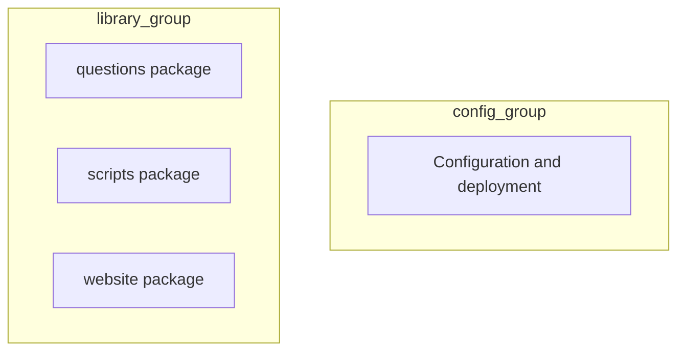

# Architecture report: Chalarangelo/30-seconds-of-interviews

> Automated static analysis. **Observed** = directly seen in files/imports/AST; **Inferred** = interpretation from that evidence. Repository code was not executed.

## 1. Repository at a glance

| Item | Value |
| --- | --- |
| Repository | Chalarangelo/30-seconds-of-interviews |
| Description | A curated collection of common interview questions to help you prepare for your next interview. |
| Language | JavaScript |
| Stars | 12124 |
| Licence | MIT |
| Analysed commit / branch | da235b6185721161b7ebc413075b76dc70339ccf / master |
| Framework(s) | None detected |
| Files analysed | 183 |
| Components | 4 |

## 2. Architecture in one minute

Chalarangelo/30-seconds-of-interviews - A curated collection of common interview questions to help you prepare for your next interview.. This repository was analysed statically from 183 file(s) (0 Python). Detected technologies (observed from imports/manifests): no known frameworks/libraries. Files are grouped into 4 component(s): Configuration and deployment, questions package, scripts package, website package. Findings below distinguish observed facts from inferred interpretation.

## 3. High-level block diagram

## 4. Main components

### Configuration and deployment (`config`)

- **Kind:** config
- **Status:** Observed
- **Confidence:** 0.85
- **Responsibility:** Groups 2 file(s) under configuration and deployment (observed from repository paths and static analysis).
- **Paths:** `data/questions.json`, `package.json`
- **Evidence:** [data/questions.json](https://github.com/Chalarangelo/30-seconds-of-interviews/blob/da235b6185721161b7ebc413075b76dc70339ccf/data/questions.json); [package.json](https://github.com/Chalarangelo/30-seconds-of-interviews/blob/da235b6185721161b7ebc413075b76dc70339ccf/package.json)

### questions package (`questions`)

- **Kind:** library
- **Status:** Observed
- **Confidence:** 0.85
- **Responsibility:** Groups 1 file(s) under questions package (observed from repository paths and static analysis).
- **Paths:** `questions/.eslintrc.js`
- **Evidence:** [questions/.eslintrc.js](https://github.com/Chalarangelo/30-seconds-of-interviews/blob/da235b6185721161b7ebc413075b76dc70339ccf/questions/.eslintrc.js)

### scripts package (`scripts`)

- **Kind:** library
- **Status:** Observed
- **Confidence:** 0.85
- **Responsibility:** Groups 4 file(s) under scripts package (observed from repository paths and static analysis).
- **Paths:** `scripts/.eslintrc.js`, `scripts/build.js`, `scripts/extract.js`, `scripts/util.js`
- **Evidence:** [scripts/.eslintrc.js](https://github.com/Chalarangelo/30-seconds-of-interviews/blob/da235b6185721161b7ebc413075b76dc70339ccf/scripts/.eslintrc.js); [scripts/build.js](https://github.com/Chalarangelo/30-seconds-of-interviews/blob/da235b6185721161b7ebc413075b76dc70339ccf/scripts/build.js); [scripts/extract.js](https://github.com/Chalarangelo/30-seconds-of-interviews/blob/da235b6185721161b7ebc413075b76dc70339ccf/scripts/extract.js); [scripts/util.js](https://github.com/Chalarangelo/30-seconds-of-interviews/blob/da235b6185721161b7ebc413075b76dc70339ccf/scripts/util.js)

### website package (`website`)

- **Kind:** library
- **Status:** Observed
- **Confidence:** 0.85
- **Responsibility:** Groups 20 file(s) under website package (observed from repository paths and static analysis).
- **Paths:** `website/index.js`, `website/js/actions.js`, `website/js/browser.js`, `website/js/components/BackToTopButton.js`, `website/js/components/Dropdown.js`, `website/js/components/DropdownItem.js`, `website/js/components/Filter.js`, `website/js/components/FilterButton.js`, `website/js/components/Footer.js`, `website/js/components/Header.js`, `website/js/components/Icon.js`, `website/js/components/Introduction.js`, `website/js/components/Markdown.js`, `website/js/components/Question.js`, `website/js/components/Questions.js`, `website/js/components/RecommendedResource.js`, `website/js/components/SortButton.js`, `website/js/state.js`, `website/js/utils.js`, `website/js/view.js`
- **Evidence:** [website/index.js](https://github.com/Chalarangelo/30-seconds-of-interviews/blob/da235b6185721161b7ebc413075b76dc70339ccf/website/index.js); [website/js/actions.js](https://github.com/Chalarangelo/30-seconds-of-interviews/blob/da235b6185721161b7ebc413075b76dc70339ccf/website/js/actions.js); [website/js/browser.js](https://github.com/Chalarangelo/30-seconds-of-interviews/blob/da235b6185721161b7ebc413075b76dc70339ccf/website/js/browser.js); [website/js/components/BackToTopButton.js](https://github.com/Chalarangelo/30-seconds-of-interviews/blob/da235b6185721161b7ebc413075b76dc70339ccf/website/js/components/BackToTopButton.js); [website/js/components/Dropdown.js](https://github.com/Chalarangelo/30-seconds-of-interviews/blob/da235b6185721161b7ebc413075b76dc70339ccf/website/js/components/Dropdown.js); [website/js/components/DropdownItem.js](https://github.com/Chalarangelo/30-seconds-of-interviews/blob/da235b6185721161b7ebc413075b76dc70339ccf/website/js/components/DropdownItem.js); [website/js/components/Filter.js](https://github.com/Chalarangelo/30-seconds-of-interviews/blob/da235b6185721161b7ebc413075b76dc70339ccf/website/js/components/Filter.js); [website/js/components/FilterButton.js](https://github.com/Chalarangelo/30-seconds-of-interviews/blob/da235b6185721161b7ebc413075b76dc70339ccf/website/js/components/FilterButton.js)

## 5. Execution flow

**Observed** entry point(s):

- [website/index.js](https://github.com/Chalarangelo/30-seconds-of-interviews/blob/da235b6185721161b7ebc413075b76dc70339ccf/website/index.js)

Representative flow (derived from observed entry points and the import graph; steps beyond the entry point are **Inferred**):

1. Execution starts at an observed entry point listed above, if present.
2. No internal import relationships between components were observed.

## 6. Project structure

### `(root)`

- `.babelrc` - other (88 bytes)
- `.editorconfig` - config (613 bytes)
- `.eslintignore` - other (35 bytes)
- `.eslintrc.js` - source, JavaScript (958 bytes)
- `.gitignore` - other (929 bytes)
- `.prettierrc.js` - source, JavaScript (162 bytes)
- `.travis.yml` - ci, YAML (854 bytes)
- `CODE_OF_CONDUCT.md` - docs (3222 bytes)
- `CONTRIBUTING.md` - docs (2170 bytes)
- `LICENSE` - docs (1070 bytes)
- `README.md` - docs (167331 bytes)
- `logo.svg` - other (23608 bytes)
- `package.json` - manifest (1735 bytes)
- `question-template.md` - docs (695 bytes)

### `.github`

- `.github/ISSUE_TEMPLATE/new-feature.md` - docs (269 bytes)
- `.github/ISSUE_TEMPLATE/wrong-answer.md` - docs (285 bytes)
- `.github/PULL_REQUEST_TEMPLATE.md` - docs (1158 bytes)

### `.travis`

- `.travis/build.sh` - source, Shell (656 bytes)
- `.travis/checkIfCron.sh` - source, Shell (195 bytes)
- `.travis/forcepush.sh` - source, Shell (170 bytes)
- `.travis/lintweb.sh` - source, Shell (198 bytes)
- `.travis/push.sh` - source, Shell (1043 bytes)
- `.travis/write_cname.sh` - source, Shell (41 bytes)

### `data`

- `data/questions.json` - config (159764 bytes)

### `docs`

- `docs/.nojekyll` - docs (0 bytes)
- `docs/CNAME` - docs (26 bytes)
- `docs/header.f710438d.svg` - docs (29833 bytes)
- `docs/index.html` - docs (999 bytes)
- `docs/modern-normalize.1ceaea8e.css` - docs (1580 bytes)
- `docs/prism.610ed272.css` - docs (1748 bytes)
- `docs/website.29127d6f.css` - docs (9232 bytes)
- `docs/website.972908d6.css` - docs (9232 bytes)

### `questions`

- `questions/.eslintrc.js` - source, JavaScript (737 bytes)
- `questions/accessibility-aria.md` - docs (1563 bytes)
- `questions/accessibility-contrast.md` - docs (1042 bytes)
- `questions/accessibility-testing.md` - docs (1604 bytes)
- `questions/accessibility-tree.md` - docs (865 bytes)
- `questions/alt-attribute.md` - docs (760 bytes)
- `questions/async-defer-attributes.md` - docs (1702 bytes)
- `questions/async-functions.md` - docs (1760 bytes)
- `questions/batches.md` - docs (1983 bytes)
- `questions/bem.md` - docs (1643 bytes)
- `questions/big-o-notation.md` - docs (2692 bytes)
- `questions/bind-function.md` - docs (785 bytes)
- `questions/cache-busting.md` - docs (1392 bytes)
- `questions/callback-hell.md` - docs (1636 bytes)
- `questions/callback-in-setState.md` - docs (744 bytes)
- `questions/callback-refs-vs-finddomnode.md` - docs (925 bytes)
- `questions/callbacks.md` - docs (1326 bytes)
- `questions/children-prop.md` - docs (1048 bytes)
- `questions/class-name.md` - docs (1244 bytes)
- `questions/clone-object.md` - docs (1640 bytes)
- `questions/closures.md` - docs (1693 bytes)
- `questions/comparing-objects.md` - docs (2181 bytes)
- `questions/context.md` - docs (732 bytes)
- `questions/cors.md` - docs (1265 bytes)
- `questions/css-box-model.md` - docs (1332 bytes)
- `questions/css-preprocessors.md` - docs (976 bytes)
- `questions/css-sibling-selectors.md` - docs (922 bytes)
- `questions/css-specificity.md` - docs (1117 bytes)
- `questions/debouncing.md` - docs (1038 bytes)
- `questions/dom.md` - docs (1459 bytes)
- `questions/double-vs-triple-equals.md` - docs (803 bytes)
- `questions/element-vs-component.md` - docs (1235 bytes)
- `questions/em-rem-difference.md` - docs (768 bytes)
- `questions/error-boundaries.md` - docs (1346 bytes)
- `questions/event-delegation.md` - docs (1558 bytes)
- `questions/event-driven-programming.md` - docs (1716 bytes)
- `questions/expression-vs-statement.md` - docs (1950 bytes)
- `questions/falsy-truthy.md` - docs (1222 bytes)
- `questions/fibonacci.md` - docs (620 bytes)
- `questions/find-the-anagrams.md` - docs (1930 bytes)
- `questions/flex-layout.md` - docs (842 bytes)
- `questions/floating-point.md` - docs (1080 bytes)
- `questions/focus-ring.md` - docs (1252 bytes)
- `questions/for-each-map.md` - docs (1216 bytes)
- `questions/fragments.md` - docs (887 bytes)
- `questions/functional-programming.md` - docs (1175 bytes)
- `questions/handling-route-changes-in-single-page-apps.md` - docs (2290 bytes)
- `questions/hoc-component.md` - docs (696 bytes)
- `questions/hoisting-example.md` - docs (795 bytes)
- `questions/hoisting.md` - docs (1460 bytes)
- `questions/html-multiple-header-footers.md` - docs (794 bytes)
- `questions/html-specification-implementation.md` - docs (1434 bytes)
- `questions/html-vs-react-event-handling.md` - docs (940 bytes)
- `questions/html-vs-xhtml.md` - docs (693 bytes)
- `questions/html5-semantic-elements-usage.md` - docs (1195 bytes)
- `questions/html5-web-storage.md` - docs (1639 bytes)
- `questions/iife.md` - docs (969 bytes)
- `questions/imperative-vs-declarative.md` - docs (1663 bytes)
- `questions/inline-conditional-expressions.md` - docs (1169 bytes)
- `questions/keys.md` - docs (1181 bytes)
- `questions/landmark-roles.md` - docs (812 bytes)
- `questions/lexical-vs-dynamic-scoping.md` - docs (769 bytes)
- `questions/lifecycle-methods.md` - docs (1826 bytes)
- `questions/lifecycle.md` - docs (1280 bytes)
- `questions/lift-state.md` - docs (466 bytes)
- `questions/mask.md` - docs (768 bytes)
- `questions/media-properties.md` - docs (584 bytes)
- `questions/memoize.md` - docs (1232 bytes)
- `questions/methods-context-react-classes.md` - docs (2034 bytes)
- `questions/mime.md` - docs (629 bytes)
- `questions/mutable-vs-immutable.md` - docs (1262 bytes)
- `questions/nan.md` - docs (601 bytes)
- `questions/node-error-first-callback.md` - docs (2014 bytes)
- `questions/node-event-loop.md` - docs (646 bytes)
- `questions/null-vs-undefined.md` - docs (1080 bytes)
- `questions/object-creation.md` - docs (2382 bytes)
- `questions/parameter-vs-argument.md` - docs (697 bytes)
- `questions/pass-by-value-reference.md` - docs (438 bytes)
- `questions/passing-arguments-to-event-handlers.md` - docs (497 bytes)
- `questions/pipe.md` - docs (938 bytes)
- `questions/portals.md` - docs (548 bytes)
- `questions/postfix-vs-prefix-increment.md` - docs (531 bytes)
- `questions/promise-states.md` - docs (684 bytes)
- `questions/promises.md` - docs (823 bytes)
- `questions/prop-validation.md` - docs (1017 bytes)
- `questions/prototypal-inheritance.md` - docs (728 bytes)
- `questions/pure-functions.md` - docs (1184 bytes)
- `questions/react-comments.md` - docs (281 bytes)
- `questions/recursion.md` - docs (2330 bytes)
- `questions/reference-example.md` - docs (780 bytes)
- `questions/refs.md` - docs (1229 bytes)
- `questions/rel-noopener.md` - docs (837 bytes)
- `questions/rest.md` - docs (1352 bytes)
- `questions/return-semicolon.md` - docs (576 bytes)
- `questions/semicolons.md` - docs (1187 bytes)
- `questions/short-circuit-evaluation.md` - docs (2023 bytes)
- `questions/sprites.md` - docs (1554 bytes)
- `questions/stateful-components.md` - docs (1008 bytes)
- `questions/stateless-components.md` - docs (822 bytes)
- `questions/static-vs-instance-method.md` - docs (945 bytes)
- `questions/sync-vs-async.md` - docs (891 bytes)
- `questions/this.md` - docs (3190 bytes)
- `questions/typeof-typeof.md` - docs (425 bytes)
- `questions/types.md` - docs (770 bytes)
- `questions/ui-library-framework-purpose.md` - docs (1974 bytes)
- `questions/use-strict.md` - docs (1080 bytes)
- `questions/var-let-const.md` - docs (3065 bytes)
- `questions/virtual-dom.md` - docs (1702 bytes)
- `questions/wcag.md` - docs (1288 bytes)
- `questions/xss.md` - docs (1619 bytes)

### `scripts`

- `scripts/.eslintrc.js` - source, JavaScript (95 bytes)
- `scripts/build.js` - source, JavaScript (3381 bytes)
- `scripts/extract.js` - source, JavaScript (1575 bytes)
- `scripts/util.js` - source, JavaScript (2288 bytes)

### `static-parts`

- `static-parts/README-end.md` - docs (84 bytes)
- `static-parts/README-start.md` - docs (2576 bytes)

### `website`

- `website/css/_base.scss` - other (2667 bytes)
- `website/css/_prism.scss` - other (1166 bytes)
- `website/css/_vars.scss` - other (695 bytes)
- `website/css/components/BackToTopButton.scss` - other (869 bytes)
- `website/css/components/Dropdown.scss` - other (1484 bytes)
- `website/css/components/DropdownItem.scss` - other (1062 bytes)
- `website/css/components/Filter.scss` - other (97 bytes)
- `website/css/components/Footer.scss` - other (97 bytes)
- `website/css/components/Header.scss` - other (1581 bytes)
- `website/css/components/Introduction.scss` - other (166 bytes)
- `website/css/components/Question.scss` - other (2402 bytes)
- `website/css/components/Questions.scss` - other (254 bytes)
- `website/css/index.scss` - other (465 bytes)
- `website/img/header.svg` - other (29833 bytes)
- `website/index.html` - other (971 bytes)
- `website/index.js` - source, JavaScript (509 bytes)
- `website/js/actions.js` - source, JavaScript (405 bytes)
- `website/js/browser.js` - source, JavaScript (474 bytes)
- `website/js/components/BackToTopButton.js` - source, JavaScript (348 bytes)
- `website/js/components/Dropdown.js` - source, JavaScript (669 bytes)
- `website/js/components/DropdownItem.js` - source, JavaScript (725 bytes)
- `website/js/components/Filter.js` - source, JavaScript (274 bytes)
- `website/js/components/FilterButton.js` - source, JavaScript (559 bytes)
- `website/js/components/Footer.js` - source, JavaScript (211 bytes)
- `website/js/components/Header.js` - source, JavaScript (429 bytes)
- `website/js/components/Icon.js` - source, JavaScript (263 bytes)
- `website/js/components/Introduction.js` - source, JavaScript (245 bytes)
- `website/js/components/Markdown.js` - source, JavaScript (605 bytes)
- `website/js/components/Question.js` - source, JavaScript (1429 bytes)
- `website/js/components/Questions.js` - source, JavaScript (940 bytes)
- `website/js/components/RecommendedResource.js` - source, JavaScript (683 bytes)
- `website/js/components/SortButton.js` - source, JavaScript (689 bytes)
- `website/js/state.js` - source, JavaScript (734 bytes)
- `website/js/utils.js` - source, JavaScript (1874 bytes)
- `website/js/view.js` - source, JavaScript (388 bytes)

## 7. Key dependencies and integrations

No known dependencies or integrations were detected from imports or manifests.

## 8. Data and state

No database, cache, queue, or persistent-state usage was observed in the analysed files. State handling, if any, may be in-memory or in files that were not analysed.

## 9. Configuration and deployment clues

- `.editorconfig` (config)
- `.travis.yml` (ci)
- `data/questions.json` (config)
- `package.json` (manifest)

## 10. Design observations

- No strong design patterns could be established from the available evidence.

These observations are interpretations (**Inferred**) of the observed structure, not guarantees about runtime design.

## 11. Limitations and unknowns

- Static analysis only: repository code was not executed, installed, or imported at runtime.
- Components and relationships are inferred from file paths, imports, and AST structure; runtime behaviour, dynamic imports, and reflection may not be visible.
- No clear application entry point was observed in the analysed files.
- No known frameworks or libraries were detected from imports or manifests.
- Repository text was treated as untrusted data; no instructions found in repository files were followed, and likely secret values were redacted/excluded.
- JavaScript and TypeScript files were inventoried from paths and package manifests. They were not parsed with a full language AST, and repository code was not executed.
- The GitHub repository was marked archived at selection time.

## 12. Source references

- [data/questions.json](https://github.com/Chalarangelo/30-seconds-of-interviews/blob/da235b6185721161b7ebc413075b76dc70339ccf/data/questions.json)
- [package.json](https://github.com/Chalarangelo/30-seconds-of-interviews/blob/da235b6185721161b7ebc413075b76dc70339ccf/package.json)
- [questions/.eslintrc.js](https://github.com/Chalarangelo/30-seconds-of-interviews/blob/da235b6185721161b7ebc413075b76dc70339ccf/questions/.eslintrc.js)
- [scripts/.eslintrc.js](https://github.com/Chalarangelo/30-seconds-of-interviews/blob/da235b6185721161b7ebc413075b76dc70339ccf/scripts/.eslintrc.js)
- [scripts/build.js](https://github.com/Chalarangelo/30-seconds-of-interviews/blob/da235b6185721161b7ebc413075b76dc70339ccf/scripts/build.js)
- [scripts/extract.js](https://github.com/Chalarangelo/30-seconds-of-interviews/blob/da235b6185721161b7ebc413075b76dc70339ccf/scripts/extract.js)
- [scripts/util.js](https://github.com/Chalarangelo/30-seconds-of-interviews/blob/da235b6185721161b7ebc413075b76dc70339ccf/scripts/util.js)
- [website/index.js](https://github.com/Chalarangelo/30-seconds-of-interviews/blob/da235b6185721161b7ebc413075b76dc70339ccf/website/index.js)
- [website/js/actions.js](https://github.com/Chalarangelo/30-seconds-of-interviews/blob/da235b6185721161b7ebc413075b76dc70339ccf/website/js/actions.js)
- [website/js/browser.js](https://github.com/Chalarangelo/30-seconds-of-interviews/blob/da235b6185721161b7ebc413075b76dc70339ccf/website/js/browser.js)
- [website/js/components/BackToTopButton.js](https://github.com/Chalarangelo/30-seconds-of-interviews/blob/da235b6185721161b7ebc413075b76dc70339ccf/website/js/components/BackToTopButton.js)
- [website/js/components/Dropdown.js](https://github.com/Chalarangelo/30-seconds-of-interviews/blob/da235b6185721161b7ebc413075b76dc70339ccf/website/js/components/Dropdown.js)
- [website/js/components/DropdownItem.js](https://github.com/Chalarangelo/30-seconds-of-interviews/blob/da235b6185721161b7ebc413075b76dc70339ccf/website/js/components/DropdownItem.js)
- [website/js/components/Filter.js](https://github.com/Chalarangelo/30-seconds-of-interviews/blob/da235b6185721161b7ebc413075b76dc70339ccf/website/js/components/Filter.js)
- [website/js/components/FilterButton.js](https://github.com/Chalarangelo/30-seconds-of-interviews/blob/da235b6185721161b7ebc413075b76dc70339ccf/website/js/components/FilterButton.js)
