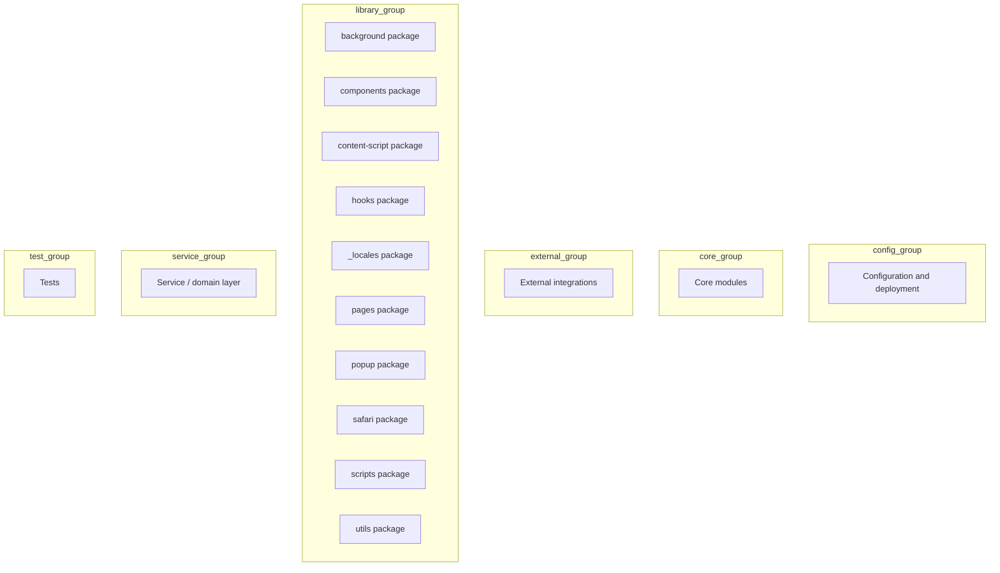

# Architecture report: ChatGPTBox-dev/chatGPTBox

> Automated static analysis. **Observed** = directly seen in files/imports/AST; **Inferred** = interpretation from that evidence. Repository code was not executed.

## 1. Repository at a glance

| Item | Value |
| --- | --- |
| Repository | ChatGPTBox-dev/chatGPTBox |
| Description | Integrating ChatGPT into your browser deeply, everything you need is here |
| Language | JavaScript |
| Stars | 10774 |
| Licence | MIT |
| Analysed commit / branch | f0717a154e756a147f12c985021676c6134c34b5 / master |
| Framework(s) | React |
| Files analysed | 271 |
| Components | 15 |

## 2. Architecture in one minute

ChatGPTBox-dev/chatGPTBox - Integrating ChatGPT into your browser deeply, everything you need is here. This repository was analysed statically from 271 file(s) (0 Python). Detected technologies (observed from imports/manifests): GitHub Actions, React, webpack. Files are grouped into 15 component(s): background package, components package, Configuration and deployment, content-script package, Core modules, External integrations, hooks package, _locales package. Findings below distinguish observed facts from inferred interpretation.

## 3. High-level block diagram

## 4. Main components

### background package (`background`)

- **Kind:** library
- **Status:** Observed
- **Confidence:** 0.85
- **Responsibility:** Groups 5 file(s) under background package (observed from repository paths and static analysis).
- **Paths:** `src/background/commands.mjs`, `src/background/index.mjs`, `src/background/menus.mjs`, `src/background/proxy-generation-state.mjs`, `src/background/redact.mjs`
- **Evidence:** [src/background/commands.mjs](https://github.com/ChatGPTBox-dev/chatGPTBox/blob/f0717a154e756a147f12c985021676c6134c34b5/src/background/commands.mjs); [src/background/index.mjs](https://github.com/ChatGPTBox-dev/chatGPTBox/blob/f0717a154e756a147f12c985021676c6134c34b5/src/background/index.mjs); [src/background/menus.mjs](https://github.com/ChatGPTBox-dev/chatGPTBox/blob/f0717a154e756a147f12c985021676c6134c34b5/src/background/menus.mjs); [src/background/proxy-generation-state.mjs](https://github.com/ChatGPTBox-dev/chatGPTBox/blob/f0717a154e756a147f12c985021676c6134c34b5/src/background/proxy-generation-state.mjs); [src/background/redact.mjs](https://github.com/ChatGPTBox-dev/chatGPTBox/blob/f0717a154e756a147f12c985021676c6134c34b5/src/background/redact.mjs)

### components package (`components`)

- **Kind:** library
- **Status:** Observed
- **Confidence:** 0.85
- **Responsibility:** Groups 20 file(s) under components package (observed from repository paths and static analysis).
- **Paths:** `src/components/ConfirmButton/index.jsx`, `src/components/ConversationCard/index.jsx`, `src/components/ConversationCard/session.mjs`, `src/components/ConversationItem/index.jsx`, `src/components/CopyButton/index.jsx`, `src/components/DecisionCard/index.jsx`, `src/components/DeleteButton/index.jsx`, `src/components/FeedbackForChatGPTWeb/index.jsx`, `src/components/FloatingToolbar/index.jsx`, `src/components/InputBox/index.jsx`, `src/components/InputBox/input-action.mjs`, `src/components/InputBox/resize.mjs`, `src/components/MarkdownRender/Hyperlink.jsx`, `src/components/MarkdownRender/Pre.jsx`, `src/components/MarkdownRender/markdown-without-katex.jsx`, `src/components/MarkdownRender/markdown.jsx`, `src/components/ReadButton/index.jsx`, `src/components/ReadButton/voice.mjs`, `src/components/WebJumpBackNotification/index.jsx`, `src/components/index.mjs`
- **Evidence:** [src/components/ConfirmButton/index.jsx](https://github.com/ChatGPTBox-dev/chatGPTBox/blob/f0717a154e756a147f12c985021676c6134c34b5/src/components/ConfirmButton/index.jsx); [src/components/ConversationCard/index.jsx](https://github.com/ChatGPTBox-dev/chatGPTBox/blob/f0717a154e756a147f12c985021676c6134c34b5/src/components/ConversationCard/index.jsx); [src/components/ConversationCard/session.mjs](https://github.com/ChatGPTBox-dev/chatGPTBox/blob/f0717a154e756a147f12c985021676c6134c34b5/src/components/ConversationCard/session.mjs); [src/components/ConversationItem/index.jsx](https://github.com/ChatGPTBox-dev/chatGPTBox/blob/f0717a154e756a147f12c985021676c6134c34b5/src/components/ConversationItem/index.jsx); [src/components/CopyButton/index.jsx](https://github.com/ChatGPTBox-dev/chatGPTBox/blob/f0717a154e756a147f12c985021676c6134c34b5/src/components/CopyButton/index.jsx); [src/components/DecisionCard/index.jsx](https://github.com/ChatGPTBox-dev/chatGPTBox/blob/f0717a154e756a147f12c985021676c6134c34b5/src/components/DecisionCard/index.jsx); [src/components/DeleteButton/index.jsx](https://github.com/ChatGPTBox-dev/chatGPTBox/blob/f0717a154e756a147f12c985021676c6134c34b5/src/components/DeleteButton/index.jsx); [src/components/FeedbackForChatGPTWeb/index.jsx](https://github.com/ChatGPTBox-dev/chatGPTBox/blob/f0717a154e756a147f12c985021676c6134c34b5/src/components/FeedbackForChatGPTWeb/index.jsx)

### Configuration and deployment (`config`)

- **Kind:** config
- **Status:** Observed
- **Confidence:** 0.85
- **Responsibility:** Groups 24 file(s) under configuration and deployment (observed from repository paths and static analysis).
- **Paths:** `badges/coverage.json`, `package.json`, `safari/appdmg.json`, `src/_locales/de/main.json`, `src/_locales/en/main.json`, `src/_locales/es/main.json`, `src/_locales/fr/main.json`, `src/_locales/id/main.json`, `src/_locales/it/main.json`, `src/_locales/ja/main.json`, `src/_locales/ko/main.json`, `src/_locales/pt/main.json`, `src/_locales/ru/main.json`, `src/_locales/tr/main.json`, `src/_locales/zh-hans/main.json`, `src/_locales/zh-hant/main.json`, `src/config/index.mjs`, `src/config/language-data.mjs`, `src/config/language.mjs`, `src/config/model-key-migrations.mjs`, `src/config/openai-provider-mappings.mjs`, `src/manifest.json`, `src/manifest.v2.json`, `src/rules.json`
- **Evidence:** [badges/coverage.json](https://github.com/ChatGPTBox-dev/chatGPTBox/blob/f0717a154e756a147f12c985021676c6134c34b5/badges/coverage.json); [package.json](https://github.com/ChatGPTBox-dev/chatGPTBox/blob/f0717a154e756a147f12c985021676c6134c34b5/package.json); [safari/appdmg.json](https://github.com/ChatGPTBox-dev/chatGPTBox/blob/f0717a154e756a147f12c985021676c6134c34b5/safari/appdmg.json); [src/_locales/de/main.json](https://github.com/ChatGPTBox-dev/chatGPTBox/blob/f0717a154e756a147f12c985021676c6134c34b5/src/_locales/de/main.json); [src/_locales/en/main.json](https://github.com/ChatGPTBox-dev/chatGPTBox/blob/f0717a154e756a147f12c985021676c6134c34b5/src/_locales/en/main.json); [src/_locales/es/main.json](https://github.com/ChatGPTBox-dev/chatGPTBox/blob/f0717a154e756a147f12c985021676c6134c34b5/src/_locales/es/main.json); [src/_locales/fr/main.json](https://github.com/ChatGPTBox-dev/chatGPTBox/blob/f0717a154e756a147f12c985021676c6134c34b5/src/_locales/fr/main.json); [src/_locales/id/main.json](https://github.com/ChatGPTBox-dev/chatGPTBox/blob/f0717a154e756a147f12c985021676c6134c34b5/src/_locales/id/main.json)

### content-script package (`content_script`)

- **Kind:** library
- **Status:** Observed
- **Confidence:** 0.85
- **Responsibility:** Groups 21 file(s) under content-script package (observed from repository paths and static analysis).
- **Paths:** `src/content-script/index.jsx`, `src/content-script/menu-tools/index.mjs`, `src/content-script/port-error.mjs`, `src/content-script/selection-tools/index.mjs`, `src/content-script/site-adapters/arxiv/index.mjs`, `src/content-script/site-adapters/baidu/index.mjs`, `src/content-script/site-adapters/bilibili/index.mjs`, `src/content-script/site-adapters/brave/index.mjs`, `src/content-script/site-adapters/duckduckgo/index.mjs`, `src/content-script/site-adapters/followin/index.mjs`, `src/content-script/site-adapters/github/index.mjs`, `src/content-script/site-adapters/github/path-matching.mjs`, `src/content-script/site-adapters/gitlab/index.mjs`, `src/content-script/site-adapters/index.mjs`, `src/content-script/site-adapters/juejin/index.mjs`, `src/content-script/site-adapters/quora/index.mjs`, `src/content-script/site-adapters/reddit/index.mjs`, `src/content-script/site-adapters/stackoverflow/index.mjs`, `src/content-script/site-adapters/weixin/index.mjs`, `src/content-script/site-adapters/youtube/index.mjs`, `src/content-script/site-adapters/zhihu/index.mjs`
- **Evidence:** [src/content-script/index.jsx](https://github.com/ChatGPTBox-dev/chatGPTBox/blob/f0717a154e756a147f12c985021676c6134c34b5/src/content-script/index.jsx); [src/content-script/menu-tools/index.mjs](https://github.com/ChatGPTBox-dev/chatGPTBox/blob/f0717a154e756a147f12c985021676c6134c34b5/src/content-script/menu-tools/index.mjs); [src/content-script/port-error.mjs](https://github.com/ChatGPTBox-dev/chatGPTBox/blob/f0717a154e756a147f12c985021676c6134c34b5/src/content-script/port-error.mjs); [src/content-script/selection-tools/index.mjs](https://github.com/ChatGPTBox-dev/chatGPTBox/blob/f0717a154e756a147f12c985021676c6134c34b5/src/content-script/selection-tools/index.mjs); [src/content-script/site-adapters/arxiv/index.mjs](https://github.com/ChatGPTBox-dev/chatGPTBox/blob/f0717a154e756a147f12c985021676c6134c34b5/src/content-script/site-adapters/arxiv/index.mjs); [src/content-script/site-adapters/baidu/index.mjs](https://github.com/ChatGPTBox-dev/chatGPTBox/blob/f0717a154e756a147f12c985021676c6134c34b5/src/content-script/site-adapters/baidu/index.mjs); [src/content-script/site-adapters/bilibili/index.mjs](https://github.com/ChatGPTBox-dev/chatGPTBox/blob/f0717a154e756a147f12c985021676c6134c34b5/src/content-script/site-adapters/bilibili/index.mjs); [src/content-script/site-adapters/brave/index.mjs](https://github.com/ChatGPTBox-dev/chatGPTBox/blob/f0717a154e756a147f12c985021676c6134c34b5/src/content-script/site-adapters/brave/index.mjs)

### Core modules (`core`)

- **Kind:** core
- **Status:** Observed
- **Confidence:** 0.85
- **Responsibility:** Groups 1 file(s) under core modules (observed from repository paths and static analysis).
- **Paths:** `build.mjs`
- **Evidence:** [build.mjs](https://github.com/ChatGPTBox-dev/chatGPTBox/blob/f0717a154e756a147f12c985021676c6134c34b5/build.mjs)

### External integrations (`external_integrations`)

- **Kind:** external
- **Status:** Observed
- **Confidence:** 0.85
- **Responsibility:** Groups 4 file(s) under external integrations (observed from repository paths and static analysis).
- **Paths:** `src/services/clients/bard/index.mjs`, `src/services/clients/bing/BingImageCreator.js`, `src/services/clients/bing/index.mjs`, `src/services/clients/claude/index.mjs`
- **Evidence:** [src/services/clients/bard/index.mjs](https://github.com/ChatGPTBox-dev/chatGPTBox/blob/f0717a154e756a147f12c985021676c6134c34b5/src/services/clients/bard/index.mjs); [src/services/clients/bing/BingImageCreator.js](https://github.com/ChatGPTBox-dev/chatGPTBox/blob/f0717a154e756a147f12c985021676c6134c34b5/src/services/clients/bing/BingImageCreator.js); [src/services/clients/bing/index.mjs](https://github.com/ChatGPTBox-dev/chatGPTBox/blob/f0717a154e756a147f12c985021676c6134c34b5/src/services/clients/bing/index.mjs); [src/services/clients/claude/index.mjs](https://github.com/ChatGPTBox-dev/chatGPTBox/blob/f0717a154e756a147f12c985021676c6134c34b5/src/services/clients/claude/index.mjs)

### hooks package (`hooks`)

- **Kind:** library
- **Status:** Observed
- **Confidence:** 0.85
- **Responsibility:** Groups 6 file(s) under hooks package (observed from repository paths and static analysis).
- **Paths:** `src/hooks/config-storage-listener.mjs`, `src/hooks/use-clamp-window-size.mjs`, `src/hooks/use-config.mjs`, `src/hooks/use-theme.mjs`, `src/hooks/use-window-size.mjs`, `src/hooks/use-window-theme.mjs`
- **Evidence:** [src/hooks/config-storage-listener.mjs](https://github.com/ChatGPTBox-dev/chatGPTBox/blob/f0717a154e756a147f12c985021676c6134c34b5/src/hooks/config-storage-listener.mjs); [src/hooks/use-clamp-window-size.mjs](https://github.com/ChatGPTBox-dev/chatGPTBox/blob/f0717a154e756a147f12c985021676c6134c34b5/src/hooks/use-clamp-window-size.mjs); [src/hooks/use-config.mjs](https://github.com/ChatGPTBox-dev/chatGPTBox/blob/f0717a154e756a147f12c985021676c6134c34b5/src/hooks/use-config.mjs); [src/hooks/use-theme.mjs](https://github.com/ChatGPTBox-dev/chatGPTBox/blob/f0717a154e756a147f12c985021676c6134c34b5/src/hooks/use-theme.mjs); [src/hooks/use-window-size.mjs](https://github.com/ChatGPTBox-dev/chatGPTBox/blob/f0717a154e756a147f12c985021676c6134c34b5/src/hooks/use-window-size.mjs); [src/hooks/use-window-theme.mjs](https://github.com/ChatGPTBox-dev/chatGPTBox/blob/f0717a154e756a147f12c985021676c6134c34b5/src/hooks/use-window-theme.mjs)

### _locales package (`locales`)

- **Kind:** library
- **Status:** Observed
- **Confidence:** 0.85
- **Responsibility:** Groups 3 file(s) under _locales package (observed from repository paths and static analysis).
- **Paths:** `src/_locales/i18n-react.mjs`, `src/_locales/i18n.mjs`, `src/_locales/resources.mjs`
- **Evidence:** [src/_locales/i18n-react.mjs](https://github.com/ChatGPTBox-dev/chatGPTBox/blob/f0717a154e756a147f12c985021676c6134c34b5/src/_locales/i18n-react.mjs); [src/_locales/i18n.mjs](https://github.com/ChatGPTBox-dev/chatGPTBox/blob/f0717a154e756a147f12c985021676c6134c34b5/src/_locales/i18n.mjs); [src/_locales/resources.mjs](https://github.com/ChatGPTBox-dev/chatGPTBox/blob/f0717a154e756a147f12c985021676c6134c34b5/src/_locales/resources.mjs)

### pages package (`pages`)

- **Kind:** library
- **Status:** Observed
- **Confidence:** 0.85
- **Responsibility:** Groups 2 file(s) under pages package (observed from repository paths and static analysis).
- **Paths:** `src/pages/IndependentPanel/App.jsx`, `src/pages/IndependentPanel/index.jsx`
- **Evidence:** [src/pages/IndependentPanel/App.jsx](https://github.com/ChatGPTBox-dev/chatGPTBox/blob/f0717a154e756a147f12c985021676c6134c34b5/src/pages/IndependentPanel/App.jsx); [src/pages/IndependentPanel/index.jsx](https://github.com/ChatGPTBox-dev/chatGPTBox/blob/f0717a154e756a147f12c985021676c6134c34b5/src/pages/IndependentPanel/index.jsx)

### popup package (`popup`)

- **Kind:** library
- **Status:** Observed
- **Confidence:** 0.85
- **Responsibility:** Groups 15 file(s) under popup package (observed from repository paths and static analysis).
- **Paths:** `src/popup/Popup.jsx`, `src/popup/api-mode-config-utils.mjs`, `src/popup/index.jsx`, `src/popup/popup-config-utils.mjs`, `src/popup/sections/AdvancedPart.jsx`, `src/popup/sections/ApiModes.jsx`, `src/popup/sections/FeaturePages.jsx`, `src/popup/sections/GeneralPart.jsx`, `src/popup/sections/ModulesPart.jsx`, `src/popup/sections/SelectionTools.jsx`, `src/popup/sections/SiteAdapters.jsx`, `src/popup/sections/api-modes-provider-utils.mjs`, `src/popup/sections/general-provider-override-utils.mjs`, `src/popup/sections/import-data-cleanup.mjs`, `src/popup/sections/provider-secret-utils.mjs`
- **Evidence:** [src/popup/Popup.jsx](https://github.com/ChatGPTBox-dev/chatGPTBox/blob/f0717a154e756a147f12c985021676c6134c34b5/src/popup/Popup.jsx); [src/popup/api-mode-config-utils.mjs](https://github.com/ChatGPTBox-dev/chatGPTBox/blob/f0717a154e756a147f12c985021676c6134c34b5/src/popup/api-mode-config-utils.mjs); [src/popup/index.jsx](https://github.com/ChatGPTBox-dev/chatGPTBox/blob/f0717a154e756a147f12c985021676c6134c34b5/src/popup/index.jsx); [src/popup/popup-config-utils.mjs](https://github.com/ChatGPTBox-dev/chatGPTBox/blob/f0717a154e756a147f12c985021676c6134c34b5/src/popup/popup-config-utils.mjs); [src/popup/sections/AdvancedPart.jsx](https://github.com/ChatGPTBox-dev/chatGPTBox/blob/f0717a154e756a147f12c985021676c6134c34b5/src/popup/sections/AdvancedPart.jsx); [src/popup/sections/ApiModes.jsx](https://github.com/ChatGPTBox-dev/chatGPTBox/blob/f0717a154e756a147f12c985021676c6134c34b5/src/popup/sections/ApiModes.jsx); [src/popup/sections/FeaturePages.jsx](https://github.com/ChatGPTBox-dev/chatGPTBox/blob/f0717a154e756a147f12c985021676c6134c34b5/src/popup/sections/FeaturePages.jsx); [src/popup/sections/GeneralPart.jsx](https://github.com/ChatGPTBox-dev/chatGPTBox/blob/f0717a154e756a147f12c985021676c6134c34b5/src/popup/sections/GeneralPart.jsx)

### safari package (`safari`)

- **Kind:** library
- **Status:** Observed
- **Confidence:** 0.85
- **Responsibility:** Groups 1 file(s) under safari package (observed from repository paths and static analysis).
- **Paths:** `safari/build.sh`
- **Evidence:** [safari/build.sh](https://github.com/ChatGPTBox-dev/chatGPTBox/blob/f0717a154e756a147f12c985021676c6134c34b5/safari/build.sh)

### scripts package (`scripts`)

- **Kind:** library
- **Status:** Observed
- **Confidence:** 0.85
- **Responsibility:** Groups 4 file(s) under scripts package (observed from repository paths and static analysis).
- **Paths:** `scripts/check-edge-api-key-expiry.mjs`, `scripts/create-firefox-sources-zip.mjs`, `scripts/submit-stores.mjs`, `scripts/update-firefox-metadata.mjs`
- **Evidence:** [scripts/check-edge-api-key-expiry.mjs](https://github.com/ChatGPTBox-dev/chatGPTBox/blob/f0717a154e756a147f12c985021676c6134c34b5/scripts/check-edge-api-key-expiry.mjs); [scripts/create-firefox-sources-zip.mjs](https://github.com/ChatGPTBox-dev/chatGPTBox/blob/f0717a154e756a147f12c985021676c6134c34b5/scripts/create-firefox-sources-zip.mjs); [scripts/submit-stores.mjs](https://github.com/ChatGPTBox-dev/chatGPTBox/blob/f0717a154e756a147f12c985021676c6134c34b5/scripts/submit-stores.mjs); [scripts/update-firefox-metadata.mjs](https://github.com/ChatGPTBox-dev/chatGPTBox/blob/f0717a154e756a147f12c985021676c6134c34b5/scripts/update-firefox-metadata.mjs)

### Service / domain layer (`service_layer`)

- **Kind:** service
- **Status:** Observed
- **Confidence:** 0.85
- **Responsibility:** Groups 18 file(s) under service / domain layer (observed from repository paths and static analysis).
- **Paths:** `src/services/apis/azure-openai-api.mjs`, `src/services/apis/bard-web.mjs`, `src/services/apis/bing-web.mjs`, `src/services/apis/chatgpt-web.mjs`, `src/services/apis/claude-api.mjs`, `src/services/apis/claude-web.mjs`, `src/services/apis/custom-api.mjs`, `src/services/apis/moonshot-web.mjs`, `src/services/apis/openai-api.mjs`, `src/services/apis/openai-compatible-core.mjs`, `src/services/apis/openai-token-params.mjs`, `src/services/apis/provider-registry.mjs`, `src/services/apis/shared.mjs`, `src/services/apis/temperature-params.mjs`, `src/services/apis/waylaidwanderer-api.mjs`, `src/services/init-session.mjs`, `src/services/local-session.mjs`, `src/services/wrappers.mjs`
- **Evidence:** [src/services/apis/azure-openai-api.mjs](https://github.com/ChatGPTBox-dev/chatGPTBox/blob/f0717a154e756a147f12c985021676c6134c34b5/src/services/apis/azure-openai-api.mjs); [src/services/apis/bard-web.mjs](https://github.com/ChatGPTBox-dev/chatGPTBox/blob/f0717a154e756a147f12c985021676c6134c34b5/src/services/apis/bard-web.mjs); [src/services/apis/bing-web.mjs](https://github.com/ChatGPTBox-dev/chatGPTBox/blob/f0717a154e756a147f12c985021676c6134c34b5/src/services/apis/bing-web.mjs); [src/services/apis/chatgpt-web.mjs](https://github.com/ChatGPTBox-dev/chatGPTBox/blob/f0717a154e756a147f12c985021676c6134c34b5/src/services/apis/chatgpt-web.mjs); [src/services/apis/claude-api.mjs](https://github.com/ChatGPTBox-dev/chatGPTBox/blob/f0717a154e756a147f12c985021676c6134c34b5/src/services/apis/claude-api.mjs); [src/services/apis/claude-web.mjs](https://github.com/ChatGPTBox-dev/chatGPTBox/blob/f0717a154e756a147f12c985021676c6134c34b5/src/services/apis/claude-web.mjs); [src/services/apis/custom-api.mjs](https://github.com/ChatGPTBox-dev/chatGPTBox/blob/f0717a154e756a147f12c985021676c6134c34b5/src/services/apis/custom-api.mjs); [src/services/apis/moonshot-web.mjs](https://github.com/ChatGPTBox-dev/chatGPTBox/blob/f0717a154e756a147f12c985021676c6134c34b5/src/services/apis/moonshot-web.mjs)

### Tests (`tests`)

- **Kind:** test
- **Status:** Observed
- **Confidence:** 0.85
- **Responsibility:** Groups 82 file(s) under tests (observed from repository paths and static analysis).
- **Paths:** `tests/setup/bing-web-lifecycle-loader-hooks.mjs`, `tests/setup/browser-shim.mjs`, `tests/setup/content-script-selection-toolbar-loader-hooks.mjs`, `tests/setup/conversation-card-lifecycle-loader-hooks.mjs`, `tests/setup/floating-toolbar-subscriptions-loader-hooks.mjs`, `tests/setup/jsx-loader-hooks.mjs`, `tests/setup/use-config-loader-hooks.mjs`, `tests/unit/background/commands.test.mjs`, `tests/unit/background/proxy-generation-state.test.mjs`, `tests/unit/background/redact.test.mjs`, `tests/unit/components/conversation-card-lifecycle.test.mjs`, `tests/unit/components/conversation-card-session.test.mjs`, `tests/unit/components/floating-toolbar-stale-tasks.test.mjs`, `tests/unit/components/floating-toolbar-subscriptions.test.mjs`, `tests/unit/components/input-box-action.test.mjs`, `tests/unit/components/input-box-resize.test.mjs`, `tests/unit/components/read-button-voice.test.mjs`, `tests/unit/config/config-predicates.test.mjs`, `tests/unit/config/language-config.test.mjs`, `tests/unit/config/language-data.test.mjs`, `tests/unit/config/migrate-user-config.test.mjs`, `tests/unit/config/user-config.test.mjs`, `tests/unit/content-script/github-path-matching.test.mjs`, `tests/unit/content-script/menu-tools.test.mjs`, `tests/unit/content-script/port-error.test.mjs`, `tests/unit/content-script/selection-toolbar-lifecycle.test.mjs`, `tests/unit/content-script/selection-tools.test.mjs`, `tests/unit/helpers/port.mjs`, `tests/unit/helpers/sse-response.mjs`, `tests/unit/hooks/config-storage-listener.test.mjs`, `tests/unit/hooks/use-config-lifecycle.test.mjs`, `tests/unit/hooks/use-window-theme.test.mjs`, `tests/unit/popup/api-mode-config-utils.test.mjs`, `tests/unit/popup/api-modes-provider-utils.test.mjs`, `tests/unit/popup/api-modes.test.mjs`, `tests/unit/popup/general-part-override.test.mjs`, `tests/unit/popup/import-data-cleanup.test.mjs`, `tests/unit/popup/popup-config-update.test.mjs`, `tests/unit/popup/provider-secret-utils.test.mjs`, `tests/unit/release/check-edge-api-key-expiry.test.mjs`, `tests/unit/release/create-firefox-sources-zip.test.mjs`, `tests/unit/release/submit-stores.test.mjs`, `tests/unit/release/update-firefox-metadata.test.mjs`, `tests/unit/services/apis/azure-openai-api.test.mjs`, `tests/unit/services/apis/azure-openai-temperature.test.mjs`, `tests/unit/services/apis/bard-web.test.mjs`, `tests/unit/services/apis/bing-web-lifecycle.test.mjs`, `tests/unit/services/apis/claude-api.test.mjs`, `tests/unit/services/apis/custom-api.test.mjs`, `tests/unit/services/apis/moonshot-web.test.mjs`, `tests/unit/services/apis/openai-api-compat.test.mjs`, `tests/unit/services/apis/openai-compatible-temperature.test.mjs`, `tests/unit/services/apis/openai-token-params.test.mjs`, `tests/unit/services/apis/openrouter-attribution.test.mjs`, `tests/unit/services/apis/provider-registry.test.mjs`, `tests/unit/services/apis/shared.test.mjs`, `tests/unit/services/apis/temperature-params.test.mjs`, `tests/unit/services/apis/thin-adapters.test.mjs`, `tests/unit/services/clients/bing.test.mjs`, `tests/unit/services/handle-port-error.test.mjs`, `tests/unit/services/init-session.test.mjs`, `tests/unit/services/local-session.test.mjs`, `tests/unit/services/wrappers-disconnect.test.mjs`, `tests/unit/services/wrappers-register.test.mjs`, `tests/unit/setup/browser-shim.test.mjs`, `tests/unit/utils/basic-guards.test.mjs`, `tests/unit/utils/browser-detection.test.mjs`, `tests/unit/utils/crop-text.test.mjs`, `tests/unit/utils/error-text.test.mjs`, `tests/unit/utils/eventsource-parser.test.mjs`, `tests/unit/utils/fetch-bg.test.mjs`, `tests/unit/utils/fetch-sse.test.mjs`, `tests/unit/utils/get-client-position.test.mjs`, `tests/unit/utils/get-core-content-text.test.mjs`, `tests/unit/utils/get-possible-element-by-query-selector.test.mjs`, `tests/unit/utils/hs256-jwt.test.mjs`, `tests/unit/utils/jwt-token-generator.test.mjs`, `tests/unit/utils/limited-fetch.test.mjs`, `tests/unit/utils/model-name-convert.test.mjs`, `tests/unit/utils/open-url.test.mjs`, `tests/unit/utils/set-element-position-in-viewport.test.mjs`, `tests/unit/utils/wait-for-element-to-exist-and-select.test.mjs`
- **Evidence:** [tests/setup/bing-web-lifecycle-loader-hooks.mjs](https://github.com/ChatGPTBox-dev/chatGPTBox/blob/f0717a154e756a147f12c985021676c6134c34b5/tests/setup/bing-web-lifecycle-loader-hooks.mjs); [tests/setup/browser-shim.mjs](https://github.com/ChatGPTBox-dev/chatGPTBox/blob/f0717a154e756a147f12c985021676c6134c34b5/tests/setup/browser-shim.mjs); [tests/setup/content-script-selection-toolbar-loader-hooks.mjs](https://github.com/ChatGPTBox-dev/chatGPTBox/blob/f0717a154e756a147f12c985021676c6134c34b5/tests/setup/content-script-selection-toolbar-loader-hooks.mjs); [tests/setup/conversation-card-lifecycle-loader-hooks.mjs](https://github.com/ChatGPTBox-dev/chatGPTBox/blob/f0717a154e756a147f12c985021676c6134c34b5/tests/setup/conversation-card-lifecycle-loader-hooks.mjs); [tests/setup/floating-toolbar-subscriptions-loader-hooks.mjs](https://github.com/ChatGPTBox-dev/chatGPTBox/blob/f0717a154e756a147f12c985021676c6134c34b5/tests/setup/floating-toolbar-subscriptions-loader-hooks.mjs); [tests/setup/jsx-loader-hooks.mjs](https://github.com/ChatGPTBox-dev/chatGPTBox/blob/f0717a154e756a147f12c985021676c6134c34b5/tests/setup/jsx-loader-hooks.mjs); [tests/setup/use-config-loader-hooks.mjs](https://github.com/ChatGPTBox-dev/chatGPTBox/blob/f0717a154e756a147f12c985021676c6134c34b5/tests/setup/use-config-loader-hooks.mjs); [tests/unit/background/commands.test.mjs](https://github.com/ChatGPTBox-dev/chatGPTBox/blob/f0717a154e756a147f12c985021676c6134c34b5/tests/unit/background/commands.test.mjs)

### utils package (`utils`)

- **Kind:** library
- **Status:** Observed
- **Confidence:** 0.85
- **Responsibility:** Groups 28 file(s) under utils package (observed from repository paths and static analysis).
- **Paths:** `src/utils/abort-error.mjs`, `src/utils/change-children-font-size.mjs`, `src/utils/create-element-at-position.mjs`, `src/utils/crop-text.mjs`, `src/utils/ends-with-question-mark.mjs`, `src/utils/error-text.mjs`, `src/utils/eventsource-parser.mjs`, `src/utils/fetch-bg.mjs`, `src/utils/fetch-sse.mjs`, `src/utils/get-client-position.mjs`, `src/utils/get-conversation-pairs.mjs`, `src/utils/get-core-content-text.mjs`, `src/utils/get-possible-element-by-query-selector.mjs`, `src/utils/hs256-jwt.mjs`, `src/utils/index.mjs`, `src/utils/is-edge.mjs`, `src/utils/is-firefox.mjs`, `src/utils/is-mobile.mjs`, `src/utils/is-safari.mjs`, `src/utils/jwt-token-generator.mjs`, `src/utils/limited-fetch.mjs`, `src/utils/model-name-convert.mjs`, `src/utils/open-url.mjs`, `src/utils/parse-float-with-clamp.mjs`, `src/utils/parse-int-with-clamp.mjs`, `src/utils/set-element-position-in-viewport.mjs`, `src/utils/update-ref-height.mjs`, `src/utils/wait-for-element-to-exist-and-select.mjs`
- **Evidence:** [src/utils/abort-error.mjs](https://github.com/ChatGPTBox-dev/chatGPTBox/blob/f0717a154e756a147f12c985021676c6134c34b5/src/utils/abort-error.mjs); [src/utils/change-children-font-size.mjs](https://github.com/ChatGPTBox-dev/chatGPTBox/blob/f0717a154e756a147f12c985021676c6134c34b5/src/utils/change-children-font-size.mjs); [src/utils/create-element-at-position.mjs](https://github.com/ChatGPTBox-dev/chatGPTBox/blob/f0717a154e756a147f12c985021676c6134c34b5/src/utils/create-element-at-position.mjs); [src/utils/crop-text.mjs](https://github.com/ChatGPTBox-dev/chatGPTBox/blob/f0717a154e756a147f12c985021676c6134c34b5/src/utils/crop-text.mjs); [src/utils/ends-with-question-mark.mjs](https://github.com/ChatGPTBox-dev/chatGPTBox/blob/f0717a154e756a147f12c985021676c6134c34b5/src/utils/ends-with-question-mark.mjs); [src/utils/error-text.mjs](https://github.com/ChatGPTBox-dev/chatGPTBox/blob/f0717a154e756a147f12c985021676c6134c34b5/src/utils/error-text.mjs); [src/utils/eventsource-parser.mjs](https://github.com/ChatGPTBox-dev/chatGPTBox/blob/f0717a154e756a147f12c985021676c6134c34b5/src/utils/eventsource-parser.mjs); [src/utils/fetch-bg.mjs](https://github.com/ChatGPTBox-dev/chatGPTBox/blob/f0717a154e756a147f12c985021676c6134c34b5/src/utils/fetch-bg.mjs)

## 5. Execution flow

**Observed** entry point(s):

- [src/components/ConfirmButton/index.jsx](https://github.com/ChatGPTBox-dev/chatGPTBox/blob/f0717a154e756a147f12c985021676c6134c34b5/src/components/ConfirmButton/index.jsx)
- [src/components/ConversationCard/index.jsx](https://github.com/ChatGPTBox-dev/chatGPTBox/blob/f0717a154e756a147f12c985021676c6134c34b5/src/components/ConversationCard/index.jsx)
- [src/components/ConversationItem/index.jsx](https://github.com/ChatGPTBox-dev/chatGPTBox/blob/f0717a154e756a147f12c985021676c6134c34b5/src/components/ConversationItem/index.jsx)
- [src/components/CopyButton/index.jsx](https://github.com/ChatGPTBox-dev/chatGPTBox/blob/f0717a154e756a147f12c985021676c6134c34b5/src/components/CopyButton/index.jsx)
- [src/components/DecisionCard/index.jsx](https://github.com/ChatGPTBox-dev/chatGPTBox/blob/f0717a154e756a147f12c985021676c6134c34b5/src/components/DecisionCard/index.jsx)
- [src/components/DeleteButton/index.jsx](https://github.com/ChatGPTBox-dev/chatGPTBox/blob/f0717a154e756a147f12c985021676c6134c34b5/src/components/DeleteButton/index.jsx)
- [src/components/FeedbackForChatGPTWeb/index.jsx](https://github.com/ChatGPTBox-dev/chatGPTBox/blob/f0717a154e756a147f12c985021676c6134c34b5/src/components/FeedbackForChatGPTWeb/index.jsx)
- [src/components/FloatingToolbar/index.jsx](https://github.com/ChatGPTBox-dev/chatGPTBox/blob/f0717a154e756a147f12c985021676c6134c34b5/src/components/FloatingToolbar/index.jsx)
- [src/components/InputBox/index.jsx](https://github.com/ChatGPTBox-dev/chatGPTBox/blob/f0717a154e756a147f12c985021676c6134c34b5/src/components/InputBox/index.jsx)
- [src/components/ReadButton/index.jsx](https://github.com/ChatGPTBox-dev/chatGPTBox/blob/f0717a154e756a147f12c985021676c6134c34b5/src/components/ReadButton/index.jsx)
- [src/components/WebJumpBackNotification/index.jsx](https://github.com/ChatGPTBox-dev/chatGPTBox/blob/f0717a154e756a147f12c985021676c6134c34b5/src/components/WebJumpBackNotification/index.jsx)
- [src/content-script/index.jsx](https://github.com/ChatGPTBox-dev/chatGPTBox/blob/f0717a154e756a147f12c985021676c6134c34b5/src/content-script/index.jsx)

Representative flow (derived from observed entry points and the import graph; steps beyond the entry point are **Inferred**):

1. Execution starts at an observed entry point listed above, if present.
2. No internal import relationships between components were observed.

## 6. Project structure

### `(root)`

- `.eslintrc.json` - config (423 bytes)
- `.gitattributes` - other (42 bytes)
- `.gitignore` - other (74 bytes)
- `.nvmrc` - other (3 bytes)
- `.prettierignore` - other (81 bytes)
- `.prettierrc` - other (249 bytes)
- `AGENTS.md` - docs (16562 bytes)
- `CURRENT_CHANGE.md` - docs (1626 bytes)
- `LICENSE` - docs (1091 bytes)
- `README.md` - docs (7176 bytes)
- `README_IN.md` - docs (7352 bytes)
- `README_JA.md` - docs (8133 bytes)
- `README_TR.md` - docs (7592 bytes)
- `README_ZH.md` - docs (7702 bytes)
- `SOURCE_CODE_REVIEW.md` - docs (284 bytes)
- `build.mjs` - source, JavaScript (22221 bytes)
- `package.json` - manifest (4058 bytes)

### `.github`

- `.github/CONTRIBUTING.md` - docs (78 bytes)
- `.github/ISSUE_TEMPLATE/bug-report---问题报告.md` - docs (796 bytes)
- `.github/ISSUE_TEMPLATE/feature-request---新功能请求.md` - docs (583 bytes)
- `.github/dependabot.yml` - config (182 bytes)
- `.github/workflows/edge-api-key-expiry.yml` - ci, YAML (678 bytes)
- `.github/workflows/firefox-metadata.yml` - ci, YAML (1333 bytes)
- `.github/workflows/format-lint.yml` - ci, YAML (1551 bytes)
- `.github/workflows/pr-tests.yml` - ci, YAML (4446 bytes)
- `.github/workflows/pre-release-build.yml` - ci, YAML (2734 bytes)
- `.github/workflows/pullfrog.yml` - ci, YAML (804 bytes)
- `.github/workflows/scripts/update-coverage-badge.mjs` - ci, YAML (1274 bytes)
- `.github/workflows/scripts/verify-search-engine-configs.mjs` - ci, YAML (7347 bytes)
- `.github/workflows/tagged-release.yml` - ci, YAML (6279 bytes)
- `.github/workflows/verify-configs.yml` - ci, YAML (495 bytes)

### `badges`

- `badges/coverage.json` - config (89 bytes)

### `safari`

- `safari/appdmg.json` - config (225 bytes)
- `safari/build.sh` - source, Shell (671 bytes)
- `safari/export-options.plist` - other (240 bytes)

### `scripts`

- `scripts/check-edge-api-key-expiry.mjs` - source, JavaScript (2808 bytes)
- `scripts/create-firefox-sources-zip.mjs` - source, JavaScript (3629 bytes)
- `scripts/submit-stores.mjs` - source, JavaScript (6556 bytes)
- `scripts/update-firefox-metadata.mjs` - source, JavaScript (1879 bytes)

### `src`

- `src/_locales/de/main.json` - config (12215 bytes)
- `src/_locales/en/main.json` - config (14497 bytes)
- `src/_locales/es/main.json` - config (12246 bytes)
- `src/_locales/fr/main.json` - config (12473 bytes)
- `src/_locales/i18n-react.mjs` - source, JavaScript (285 bytes)
- `src/_locales/i18n.mjs` - source, JavaScript (117 bytes)
- `src/_locales/id/main.json` - config (11170 bytes)
- `src/_locales/it/main.json` - config (11948 bytes)
- `src/_locales/ja/main.json` - config (12895 bytes)
- `src/_locales/ko/main.json` - config (12191 bytes)
- `src/_locales/pt/main.json` - config (11726 bytes)
- `src/_locales/resources.mjs` - source, JavaScript (928 bytes)
- `src/_locales/ru/main.json` - config (16126 bytes)
- `src/_locales/tr/main.json` - config (11547 bytes)
- `src/_locales/zh-hans/main.json` - config (11257 bytes)
- `src/_locales/zh-hant/main.json` - config (11144 bytes)
- `src/background/commands.mjs` - source, JavaScript (2820 bytes)
- `src/background/index.mjs` - source, JavaScript (38810 bytes)
- `src/background/menus.mjs` - source, JavaScript (5957 bytes)
- `src/background/proxy-generation-state.mjs` - source, JavaScript (2007 bytes)
- `src/background/redact.mjs` - source, JavaScript (2124 bytes)
- `src/components/ConfirmButton/index.jsx` - source, JavaScript (1313 bytes)
- `src/components/ConversationCard/index.jsx` - source, JavaScript (30517 bytes)
- `src/components/ConversationCard/session.mjs` - source, JavaScript (2321 bytes)
- `src/components/ConversationItem/index.jsx` - source, JavaScript (4545 bytes)
- `src/components/CopyButton/index.jsx` - source, JavaScript (918 bytes)
- `src/components/DecisionCard/index.jsx` - source, JavaScript (4213 bytes)
- `src/components/DeleteButton/index.jsx` - source, JavaScript (1418 bytes)
- `src/components/FeedbackForChatGPTWeb/index.jsx` - source, JavaScript (1782 bytes)
- `src/components/FloatingToolbar/index.jsx` - source, JavaScript (10978 bytes)
- `src/components/InputBox/index.jsx` - source, JavaScript (6884 bytes)
- `src/components/InputBox/input-action.mjs` - source, JavaScript (371 bytes)
- `src/components/InputBox/resize.mjs` - source, JavaScript (1047 bytes)
- `src/components/MarkdownRender/Hyperlink.jsx` - source, JavaScript (1001 bytes)
- `src/components/MarkdownRender/Pre.jsx` - source, JavaScript (1241 bytes)
- `src/components/MarkdownRender/markdown-without-katex.jsx` - source, JavaScript (4901 bytes)
- `src/components/MarkdownRender/markdown.jsx` - source, JavaScript (5039 bytes)
- `src/components/ReadButton/index.jsx` - source, JavaScript (2019 bytes)
- `src/components/ReadButton/voice.mjs` - source, JavaScript (1850 bytes)
- `src/components/WebJumpBackNotification/index.jsx` - source, JavaScript (2613 bytes)
- `src/components/index.mjs` - source, JavaScript (323 bytes)
- `src/config/index.mjs` - source, JavaScript (77428 bytes)
- `src/config/language-data.mjs` - source, JavaScript (1488 bytes)
- `src/config/language.mjs` - source, JavaScript (895 bytes)
- `src/config/model-key-migrations.mjs` - source, JavaScript (5240 bytes)
- `src/config/openai-provider-mappings.mjs` - source, JavaScript (1124 bytes)
- `src/content-script/index.jsx` - source, JavaScript (38962 bytes)
- `src/content-script/menu-tools/index.mjs` - source, JavaScript (3747 bytes)
- `src/content-script/port-error.mjs` - source, JavaScript (651 bytes)
- `src/content-script/selection-tools/index.mjs` - source, JavaScript (3999 bytes)
- `src/content-script/site-adapters/arxiv/index.mjs` - source, JavaScript (969 bytes)
- `src/content-script/site-adapters/baidu/index.mjs` - source, JavaScript (772 bytes)
- `src/content-script/site-adapters/bilibili/index.mjs` - source, JavaScript (2602 bytes)
- `src/content-script/site-adapters/brave/index.mjs` - source, JavaScript (428 bytes)
- `src/content-script/site-adapters/duckduckgo/index.mjs` - source, JavaScript (319 bytes)
- `src/content-script/site-adapters/followin/index.mjs` - source, JavaScript (1440 bytes)
- `src/content-script/site-adapters/github/index.mjs` - source, JavaScript (6165 bytes)
- `src/content-script/site-adapters/github/path-matching.mjs` - source, JavaScript (623 bytes)
- `src/content-script/site-adapters/gitlab/index.mjs` - source, JavaScript (2198 bytes)
- `src/content-script/site-adapters/index.mjs` - source, JavaScript (6871 bytes)
- `src/content-script/site-adapters/juejin/index.mjs` - source, JavaScript (1166 bytes)
- `src/content-script/site-adapters/quora/index.mjs` - source, JavaScript (806 bytes)
- `src/content-script/site-adapters/reddit/index.mjs` - source, JavaScript (912 bytes)
- `src/content-script/site-adapters/stackoverflow/index.mjs` - source, JavaScript (1503 bytes)
- `src/content-script/site-adapters/weixin/index.mjs` - source, JavaScript (1241 bytes)
- `src/content-script/site-adapters/youtube/index.mjs` - source, JavaScript (3120 bytes)
- `src/content-script/site-adapters/zhihu/index.mjs` - source, JavaScript (2040 bytes)
- `src/content-script/styles.scss` - other (32523 bytes)
- `src/fonts/styles.css` - other (1940 bytes)
- `src/hooks/config-storage-listener.mjs` - source, JavaScript (456 bytes)
- `src/hooks/use-clamp-window-size.mjs` - source, JavaScript (374 bytes)
- `src/hooks/use-config.mjs` - source, JavaScript (853 bytes)
- `src/hooks/use-theme.mjs` - source, JavaScript (269 bytes)
- `src/hooks/use-window-size.mjs` - source, JavaScript (493 bytes)
- `src/hooks/use-window-theme.mjs` - source, JavaScript (617 bytes)
- `src/manifest.json` - config (2369 bytes)
- `src/manifest.v2.json` - config (1909 bytes)
- `src/pages/IndependentPanel/App.jsx` - source, JavaScript (6215 bytes)
- `src/pages/IndependentPanel/index.html` - other (398 bytes)
- `src/pages/IndependentPanel/index.jsx` - source, JavaScript (596 bytes)
- `src/pages/IndependentPanel/styles.scss` - other (2984 bytes)
- `src/pages/styles.scss` - other (40 bytes)
- `src/popup/Popup.jsx` - source, JavaScript (7402 bytes)
- `src/popup/api-mode-config-utils.mjs` - source, JavaScript (1971 bytes)
- `src/popup/index.html` - other (332 bytes)
- `src/popup/index.jsx` - source, JavaScript (1146 bytes)
- `src/popup/popup-config-utils.mjs` - source, JavaScript (984 bytes)
- `src/popup/sections/AdvancedPart.jsx` - source, JavaScript (8038 bytes)
- `src/popup/sections/ApiModes.jsx` - source, JavaScript (25778 bytes)
- `src/popup/sections/FeaturePages.jsx` - source, JavaScript (2891 bytes)
- `src/popup/sections/GeneralPart.jsx` - source, JavaScript (34544 bytes)
- `src/popup/sections/ModulesPart.jsx` - source, JavaScript (1126 bytes)
- `src/popup/sections/SelectionTools.jsx` - source, JavaScript (5878 bytes)
- `src/popup/sections/SiteAdapters.jsx` - source, JavaScript (1085 bytes)
- `src/popup/sections/api-modes-provider-utils.mjs` - source, JavaScript (24218 bytes)
- `src/popup/sections/general-provider-override-utils.mjs` - source, JavaScript (6471 bytes)
- `src/popup/sections/import-data-cleanup.mjs` - source, JavaScript (5177 bytes)
- `src/popup/sections/provider-secret-utils.mjs` - source, JavaScript (17384 bytes)
- `src/popup/styles.scss` - other (1597 bytes)
- `src/rules.json` - config (1458 bytes)
- `src/services/apis/azure-openai-api.mjs` - source, JavaScript (3232 bytes)
- `src/services/apis/bard-web.mjs` - source, JavaScript (1213 bytes)
- `src/services/apis/bing-web.mjs` - source, JavaScript (3581 bytes)
- `src/services/apis/chatgpt-web.mjs` - source, JavaScript (15548 bytes)
- `src/services/apis/claude-api.mjs` - source, JavaScript (4789 bytes)
- `src/services/apis/claude-web.mjs` - source, JavaScript (1880 bytes)
- `src/services/apis/custom-api.mjs` - source, JavaScript (727 bytes)
- `src/services/apis/moonshot-web.mjs` - source, JavaScript (18541 bytes)
- `src/services/apis/openai-api.mjs` - source, JavaScript (11163 bytes)
- `src/services/apis/openai-compatible-core.mjs` - source, JavaScript (5811 bytes)
- `src/services/apis/openai-token-params.mjs` - source, JavaScript (763 bytes)
- `src/services/apis/provider-registry.mjs` - source, JavaScript (34117 bytes)
- `src/services/apis/shared.mjs` - source, JavaScript (2790 bytes)
- `src/services/apis/temperature-params.mjs` - source, JavaScript (1748 bytes)
- `src/services/apis/waylaidwanderer-api.mjs` - source, JavaScript (3042 bytes)
- `src/services/clients/bard/index.mjs` - source, JavaScript (4474 bytes)
- `src/services/clients/bing/BingImageCreator.js` - source, JavaScript (20416 bytes)
- `src/services/clients/bing/index.mjs` - source, JavaScript (26262 bytes)
- `src/services/clients/claude/index.mjs` - source, JavaScript (29949 bytes)
- `src/services/init-session.mjs` - source, JavaScript (2886 bytes)
- `src/services/local-session.mjs` - source, JavaScript (2792 bytes)
- `src/services/wrappers.mjs` - source, JavaScript (9160 bytes)
- `src/utils/abort-error.mjs` - source, JavaScript (350 bytes)
- `src/utils/change-children-font-size.mjs` - source, JavaScript (248 bytes)
- `src/utils/create-element-at-position.mjs` - source, JavaScript (322 bytes)
- `src/utils/crop-text.mjs` - source, JavaScript (3789 bytes)
- `src/utils/ends-with-question-mark.mjs` - source, JavaScript (237 bytes)
- `src/utils/error-text.mjs` - source, JavaScript (1321 bytes)
- `src/utils/eventsource-parser.mjs` - source, JavaScript (3700 bytes)
- `src/utils/fetch-bg.mjs` - source, JavaScript (839 bytes)
- `src/utils/fetch-sse.mjs` - source, JavaScript (4316 bytes)
- `src/utils/get-client-position.mjs` - source, JavaScript (121 bytes)
- `src/utils/get-conversation-pairs.mjs` - source, JavaScript (451 bytes)
- `src/utils/get-core-content-text.mjs` - source, JavaScript (2687 bytes)
- `src/utils/get-possible-element-by-query-selector.mjs` - source, JavaScript (327 bytes)
- `src/utils/hs256-jwt.mjs` - source, JavaScript (1616 bytes)
- `src/utils/index.mjs` - source, JavaScript (841 bytes)
- `src/utils/is-edge.mjs` - source, JavaScript (88 bytes)
- `src/utils/is-firefox.mjs` - source, JavaScript (95 bytes)
- `src/utils/is-mobile.mjs` - source, JavaScript (2329 bytes)
- `src/utils/is-safari.mjs` - source, JavaScript (84 bytes)
- `src/utils/jwt-token-generator.mjs` - source, JavaScript (1790 bytes)
- `src/utils/limited-fetch.mjs` - source, JavaScript (1012 bytes)
- `src/utils/model-name-convert.mjs` - source, JavaScript (16572 bytes)
- `src/utils/open-url.mjs` - source, JavaScript (415 bytes)
- `src/utils/parse-float-with-clamp.mjs` - source, JavaScript (229 bytes)
- `src/utils/parse-int-with-clamp.mjs` - source, JavaScript (225 bytes)
- `src/utils/set-element-position-in-viewport.mjs` - source, JavaScript (361 bytes)
- `src/utils/update-ref-height.mjs` - source, JavaScript (482 bytes)
- `src/utils/wait-for-element-to-exist-and-select.mjs` - source, JavaScript (849 bytes)

### `tests`

- `tests/setup/bing-web-lifecycle-loader-hooks.mjs` - test, JavaScript (1384 bytes)
- `tests/setup/browser-shim.mjs` - test, JavaScript (4984 bytes)
- `tests/setup/content-script-selection-toolbar-loader-hooks.mjs` - test, JavaScript (9395 bytes)
- `tests/setup/conversation-card-lifecycle-loader-hooks.mjs` - test, JavaScript (6413 bytes)
- `tests/setup/floating-toolbar-subscriptions-loader-hooks.mjs` - test, JavaScript (3611 bytes)
- `tests/setup/jsx-loader-hooks.mjs` - test, JavaScript (2220 bytes)
- `tests/setup/use-config-loader-hooks.mjs` - test, JavaScript (2092 bytes)
- `tests/unit/background/commands.test.mjs` - test, JavaScript (3555 bytes)
- `tests/unit/background/proxy-generation-state.test.mjs` - test, JavaScript (5694 bytes)
- `tests/unit/background/redact.test.mjs` - test, JavaScript (3841 bytes)
- `tests/unit/components/conversation-card-lifecycle.test.mjs` - test, JavaScript (24911 bytes)
- `tests/unit/components/conversation-card-session.test.mjs` - test, JavaScript (6933 bytes)
- `tests/unit/components/floating-toolbar-stale-tasks.test.mjs` - test, JavaScript (20679 bytes)
- `tests/unit/components/floating-toolbar-subscriptions.test.mjs` - test, JavaScript (8820 bytes)
- `tests/unit/components/input-box-action.test.mjs` - test, JavaScript (1691 bytes)
- `tests/unit/components/input-box-resize.test.mjs` - test, JavaScript (1743 bytes)
- `tests/unit/components/read-button-voice.test.mjs` - test, JavaScript (2761 bytes)
- `tests/unit/config/config-predicates.test.mjs` - test, JavaScript (13297 bytes)
- `tests/unit/config/language-config.test.mjs` - test, JavaScript (4906 bytes)
- `tests/unit/config/language-data.test.mjs` - test, JavaScript (4106 bytes)
- `tests/unit/config/migrate-user-config.test.mjs` - test, JavaScript (69406 bytes)
- `tests/unit/config/user-config.test.mjs` - test, JavaScript (10376 bytes)
- `tests/unit/content-script/github-path-matching.test.mjs` - test, JavaScript (3352 bytes)
- `tests/unit/content-script/menu-tools.test.mjs` - test, JavaScript (4784 bytes)
- `tests/unit/content-script/port-error.test.mjs` - test, JavaScript (2577 bytes)
- `tests/unit/content-script/selection-toolbar-lifecycle.test.mjs` - test, JavaScript (9493 bytes)
- `tests/unit/content-script/selection-tools.test.mjs` - test, JavaScript (8927 bytes)
- `tests/unit/helpers/port.mjs` - test, JavaScript (1041 bytes)
- `tests/unit/helpers/sse-response.mjs` - test, JavaScript (618 bytes)
- `tests/unit/hooks/config-storage-listener.test.mjs` - test, JavaScript (2939 bytes)
- `tests/unit/hooks/use-config-lifecycle.test.mjs` - test, JavaScript (5324 bytes)
- `tests/unit/hooks/use-window-theme.test.mjs` - test, JavaScript (2032 bytes)
- `tests/unit/popup/api-mode-config-utils.test.mjs` - test, JavaScript (7520 bytes)
- `tests/unit/popup/api-modes-provider-utils.test.mjs` - test, JavaScript (48743 bytes)
- `tests/unit/popup/api-modes.test.mjs` - test, JavaScript (1327 bytes)
- `tests/unit/popup/general-part-override.test.mjs` - test, JavaScript (17801 bytes)
- `tests/unit/popup/import-data-cleanup.test.mjs` - test, JavaScript (13136 bytes)
- `tests/unit/popup/popup-config-update.test.mjs` - test, JavaScript (5364 bytes)
- `tests/unit/popup/provider-secret-utils.test.mjs` - test, JavaScript (32663 bytes)
- `tests/unit/release/check-edge-api-key-expiry.test.mjs` - test, JavaScript (1572 bytes)
- `tests/unit/release/create-firefox-sources-zip.test.mjs` - test, JavaScript (1493 bytes)
- `tests/unit/release/submit-stores.test.mjs` - test, JavaScript (8136 bytes)
- `tests/unit/release/update-firefox-metadata.test.mjs` - test, JavaScript (2410 bytes)
- `tests/unit/services/apis/azure-openai-api.test.mjs` - test, JavaScript (8546 bytes)
- `tests/unit/services/apis/azure-openai-temperature.test.mjs` - test, JavaScript (1357 bytes)
- `tests/unit/services/apis/bard-web.test.mjs` - test, JavaScript (983 bytes)
- `tests/unit/services/apis/bing-web-lifecycle.test.mjs` - test, JavaScript (3165 bytes)
- `tests/unit/services/apis/claude-api.test.mjs` - test, JavaScript (25378 bytes)
- `tests/unit/services/apis/custom-api.test.mjs` - test, JavaScript (15447 bytes)
- `tests/unit/services/apis/moonshot-web.test.mjs` - test, JavaScript (1089 bytes)
- `tests/unit/services/apis/openai-api-compat.test.mjs` - test, JavaScript (73283 bytes)
- `tests/unit/services/apis/openai-compatible-temperature.test.mjs` - test, JavaScript (3925 bytes)
- `tests/unit/services/apis/openai-token-params.test.mjs` - test, JavaScript (3495 bytes)
- `tests/unit/services/apis/openrouter-attribution.test.mjs` - test, JavaScript (4582 bytes)
- `tests/unit/services/apis/provider-registry.test.mjs` - test, JavaScript (86553 bytes)
- `tests/unit/services/apis/shared.test.mjs` - test, JavaScript (4491 bytes)
- `tests/unit/services/apis/temperature-params.test.mjs` - test, JavaScript (4398 bytes)
- `tests/unit/services/apis/thin-adapters.test.mjs` - test, JavaScript (4993 bytes)
- `tests/unit/services/clients/bing.test.mjs` - test, JavaScript (12696 bytes)
- `tests/unit/services/handle-port-error.test.mjs` - test, JavaScript (17510 bytes)
- `tests/unit/services/init-session.test.mjs` - test, JavaScript (3522 bytes)
- `tests/unit/services/local-session.test.mjs` - test, JavaScript (6076 bytes)
- `tests/unit/services/wrappers-disconnect.test.mjs` - test, JavaScript (2602 bytes)
- `tests/unit/services/wrappers-register.test.mjs` - test, JavaScript (20570 bytes)
- `tests/unit/setup/browser-shim.test.mjs` - test, JavaScript (4257 bytes)
- `tests/unit/utils/basic-guards.test.mjs` - test, JavaScript (3936 bytes)
- `tests/unit/utils/browser-detection.test.mjs` - test, JavaScript (3516 bytes)
- `tests/unit/utils/crop-text.test.mjs` - test, JavaScript (6755 bytes)
- `tests/unit/utils/error-text.test.mjs` - test, JavaScript (3984 bytes)
- `tests/unit/utils/eventsource-parser.test.mjs` - test, JavaScript (8908 bytes)
- `tests/unit/utils/fetch-bg.test.mjs` - test, JavaScript (2469 bytes)
- `tests/unit/utils/fetch-sse.test.mjs` - test, JavaScript (14270 bytes)
- `tests/unit/utils/get-client-position.test.mjs` - test, JavaScript (1032 bytes)
- `tests/unit/utils/get-core-content-text.test.mjs` - test, JavaScript (3301 bytes)
- `tests/unit/utils/get-possible-element-by-query-selector.test.mjs` - test, JavaScript (2102 bytes)
- `tests/unit/utils/hs256-jwt.test.mjs` - test, JavaScript (4422 bytes)
- `tests/unit/utils/jwt-token-generator.test.mjs` - test, JavaScript (6047 bytes)
- `tests/unit/utils/limited-fetch.test.mjs` - test, JavaScript (5993 bytes)
- `tests/unit/utils/model-name-convert.test.mjs` - test, JavaScript (41479 bytes)
- `tests/unit/utils/open-url.test.mjs` - test, JavaScript (3390 bytes)
- `tests/unit/utils/set-element-position-in-viewport.test.mjs` - test, JavaScript (2194 bytes)
- `tests/unit/utils/wait-for-element-to-exist-and-select.test.mjs` - test, JavaScript (4406 bytes)

## 7. Key dependencies and integrations

| Name | Category | Status | Confidence | Evidence |
| --- | --- | --- | --- | --- |
| GitHub Actions | ci | Observed | 0.90 | [.github/workflows/edge-api-key-expiry.yml](https://github.com/ChatGPTBox-dev/chatGPTBox/blob/f0717a154e756a147f12c985021676c6134c34b5/.github/workflows/edge-api-key-expiry.yml); [.github/workflows/firefox-metadata.yml](https://github.com/ChatGPTBox-dev/chatGPTBox/blob/f0717a154e756a147f12c985021676c6134c34b5/.github/workflows/firefox-metadata.yml); [.github/workflows/format-lint.yml](https://github.com/ChatGPTBox-dev/chatGPTBox/blob/f0717a154e756a147f12c985021676c6134c34b5/.github/workflows/format-lint.yml); [.github/workflows/pr-tests.yml](https://github.com/ChatGPTBox-dev/chatGPTBox/blob/f0717a154e756a147f12c985021676c6134c34b5/.github/workflows/pr-tests.yml) |
| React | framework | Observed | 0.90 | [package.json:43](https://github.com/ChatGPTBox-dev/chatGPTBox/blob/f0717a154e756a147f12c985021676c6134c34b5/package.json#L43); [package.json:60](https://github.com/ChatGPTBox-dev/chatGPTBox/blob/f0717a154e756a147f12c985021676c6134c34b5/package.json#L60) |
| webpack | tooling | Observed | 0.85 | [package.json:90](https://github.com/ChatGPTBox-dev/chatGPTBox/blob/f0717a154e756a147f12c985021676c6134c34b5/package.json#L90) |

## 8. Data and state

No database, cache, queue, or persistent-state usage was observed in the analysed files. State handling, if any, may be in-memory or in files that were not analysed.

## 9. Configuration and deployment clues

- `.eslintrc.json` (config)
- `.github/dependabot.yml` (config)
- `.github/workflows/edge-api-key-expiry.yml` (ci)
- `.github/workflows/firefox-metadata.yml` (ci)
- `.github/workflows/format-lint.yml` (ci)
- `.github/workflows/pr-tests.yml` (ci)
- `.github/workflows/pre-release-build.yml` (ci)
- `.github/workflows/pullfrog.yml` (ci)
- `.github/workflows/scripts/update-coverage-badge.mjs` (ci)
- `.github/workflows/scripts/verify-search-engine-configs.mjs` (ci)
- `.github/workflows/tagged-release.yml` (ci)
- `.github/workflows/verify-configs.yml` (ci)
- `badges/coverage.json` (config)
- `package.json` (manifest)
- `safari/appdmg.json` (config)
- `src/_locales/de/main.json` (config)
- `src/_locales/en/main.json` (config)
- `src/_locales/es/main.json` (config)
- `src/_locales/fr/main.json` (config)
- `src/_locales/id/main.json` (config)
- `src/_locales/it/main.json` (config)
- `src/_locales/ja/main.json` (config)
- `src/_locales/ko/main.json` (config)
- `src/_locales/pt/main.json` (config)
- `src/_locales/ru/main.json` (config)
- `src/_locales/tr/main.json` (config)
- `src/_locales/zh-hans/main.json` (config)
- `src/_locales/zh-hant/main.json` (config)
- `src/manifest.json` (config)
- `src/manifest.v2.json` (config)
- `src/rules.json` (config)

## 10. Design observations

- Service/domain code is distinct from entry and data code, suggesting layered separation (Inferred).
- Tests are present alongside source code (Observed from test file paths).
- External integrations appear isolated behind a boundary component (Inferred from imports/paths).

These observations are interpretations (**Inferred**) of the observed structure, not guarantees about runtime design.

## 11. Limitations and unknowns

- Static analysis only: repository code was not executed, installed, or imported at runtime.
- Components and relationships are inferred from file paths, imports, and AST structure; runtime behaviour, dynamic imports, and reflection may not be visible.
- 1 file(s) were skipped during inventory (1 x generated/minified file excluded).
- No clear application entry point was observed in the analysed files.
- Repository text was treated as untrusted data; no instructions found in repository files were followed, and likely secret values were redacted/excluded.
- JavaScript and TypeScript files were inventoried from paths and package manifests. They were not parsed with a full language AST, and repository code was not executed.

## 12. Source references

- [.github/workflows/edge-api-key-expiry.yml](https://github.com/ChatGPTBox-dev/chatGPTBox/blob/f0717a154e756a147f12c985021676c6134c34b5/.github/workflows/edge-api-key-expiry.yml)
- [.github/workflows/firefox-metadata.yml](https://github.com/ChatGPTBox-dev/chatGPTBox/blob/f0717a154e756a147f12c985021676c6134c34b5/.github/workflows/firefox-metadata.yml)
- [.github/workflows/format-lint.yml](https://github.com/ChatGPTBox-dev/chatGPTBox/blob/f0717a154e756a147f12c985021676c6134c34b5/.github/workflows/format-lint.yml)
- [.github/workflows/pr-tests.yml](https://github.com/ChatGPTBox-dev/chatGPTBox/blob/f0717a154e756a147f12c985021676c6134c34b5/.github/workflows/pr-tests.yml)
- [.github/workflows/pre-release-build.yml](https://github.com/ChatGPTBox-dev/chatGPTBox/blob/f0717a154e756a147f12c985021676c6134c34b5/.github/workflows/pre-release-build.yml)
- [.github/workflows/pullfrog.yml](https://github.com/ChatGPTBox-dev/chatGPTBox/blob/f0717a154e756a147f12c985021676c6134c34b5/.github/workflows/pullfrog.yml)
- [.github/workflows/scripts/update-coverage-badge.mjs](https://github.com/ChatGPTBox-dev/chatGPTBox/blob/f0717a154e756a147f12c985021676c6134c34b5/.github/workflows/scripts/update-coverage-badge.mjs)
- [.github/workflows/scripts/verify-search-engine-configs.mjs](https://github.com/ChatGPTBox-dev/chatGPTBox/blob/f0717a154e756a147f12c985021676c6134c34b5/.github/workflows/scripts/verify-search-engine-configs.mjs)
- [badges/coverage.json](https://github.com/ChatGPTBox-dev/chatGPTBox/blob/f0717a154e756a147f12c985021676c6134c34b5/badges/coverage.json)
- [build.mjs](https://github.com/ChatGPTBox-dev/chatGPTBox/blob/f0717a154e756a147f12c985021676c6134c34b5/build.mjs)
- [package.json](https://github.com/ChatGPTBox-dev/chatGPTBox/blob/f0717a154e756a147f12c985021676c6134c34b5/package.json)
- [package.json:43](https://github.com/ChatGPTBox-dev/chatGPTBox/blob/f0717a154e756a147f12c985021676c6134c34b5/package.json#L43)
- [package.json:60](https://github.com/ChatGPTBox-dev/chatGPTBox/blob/f0717a154e756a147f12c985021676c6134c34b5/package.json#L60)
- [package.json:90](https://github.com/ChatGPTBox-dev/chatGPTBox/blob/f0717a154e756a147f12c985021676c6134c34b5/package.json#L90)
- [safari/appdmg.json](https://github.com/ChatGPTBox-dev/chatGPTBox/blob/f0717a154e756a147f12c985021676c6134c34b5/safari/appdmg.json)
- [safari/build.sh](https://github.com/ChatGPTBox-dev/chatGPTBox/blob/f0717a154e756a147f12c985021676c6134c34b5/safari/build.sh)
- [scripts/check-edge-api-key-expiry.mjs](https://github.com/ChatGPTBox-dev/chatGPTBox/blob/f0717a154e756a147f12c985021676c6134c34b5/scripts/check-edge-api-key-expiry.mjs)
- [scripts/create-firefox-sources-zip.mjs](https://github.com/ChatGPTBox-dev/chatGPTBox/blob/f0717a154e756a147f12c985021676c6134c34b5/scripts/create-firefox-sources-zip.mjs)
- [scripts/submit-stores.mjs](https://github.com/ChatGPTBox-dev/chatGPTBox/blob/f0717a154e756a147f12c985021676c6134c34b5/scripts/submit-stores.mjs)
- [scripts/update-firefox-metadata.mjs](https://github.com/ChatGPTBox-dev/chatGPTBox/blob/f0717a154e756a147f12c985021676c6134c34b5/scripts/update-firefox-metadata.mjs)
- [src/_locales/de/main.json](https://github.com/ChatGPTBox-dev/chatGPTBox/blob/f0717a154e756a147f12c985021676c6134c34b5/src/_locales/de/main.json)
- [src/_locales/en/main.json](https://github.com/ChatGPTBox-dev/chatGPTBox/blob/f0717a154e756a147f12c985021676c6134c34b5/src/_locales/en/main.json)
- [src/_locales/es/main.json](https://github.com/ChatGPTBox-dev/chatGPTBox/blob/f0717a154e756a147f12c985021676c6134c34b5/src/_locales/es/main.json)
- [src/_locales/fr/main.json](https://github.com/ChatGPTBox-dev/chatGPTBox/blob/f0717a154e756a147f12c985021676c6134c34b5/src/_locales/fr/main.json)
- [src/_locales/i18n-react.mjs](https://github.com/ChatGPTBox-dev/chatGPTBox/blob/f0717a154e756a147f12c985021676c6134c34b5/src/_locales/i18n-react.mjs)
- [src/_locales/i18n.mjs](https://github.com/ChatGPTBox-dev/chatGPTBox/blob/f0717a154e756a147f12c985021676c6134c34b5/src/_locales/i18n.mjs)
- [src/_locales/id/main.json](https://github.com/ChatGPTBox-dev/chatGPTBox/blob/f0717a154e756a147f12c985021676c6134c34b5/src/_locales/id/main.json)
- [src/_locales/resources.mjs](https://github.com/ChatGPTBox-dev/chatGPTBox/blob/f0717a154e756a147f12c985021676c6134c34b5/src/_locales/resources.mjs)
- [src/background/commands.mjs](https://github.com/ChatGPTBox-dev/chatGPTBox/blob/f0717a154e756a147f12c985021676c6134c34b5/src/background/commands.mjs)
- [src/background/index.mjs](https://github.com/ChatGPTBox-dev/chatGPTBox/blob/f0717a154e756a147f12c985021676c6134c34b5/src/background/index.mjs)
- [src/background/menus.mjs](https://github.com/ChatGPTBox-dev/chatGPTBox/blob/f0717a154e756a147f12c985021676c6134c34b5/src/background/menus.mjs)
- [src/background/proxy-generation-state.mjs](https://github.com/ChatGPTBox-dev/chatGPTBox/blob/f0717a154e756a147f12c985021676c6134c34b5/src/background/proxy-generation-state.mjs)
- [src/background/redact.mjs](https://github.com/ChatGPTBox-dev/chatGPTBox/blob/f0717a154e756a147f12c985021676c6134c34b5/src/background/redact.mjs)
- [src/components/ConfirmButton/index.jsx](https://github.com/ChatGPTBox-dev/chatGPTBox/blob/f0717a154e756a147f12c985021676c6134c34b5/src/components/ConfirmButton/index.jsx)
- [src/components/ConversationCard/index.jsx](https://github.com/ChatGPTBox-dev/chatGPTBox/blob/f0717a154e756a147f12c985021676c6134c34b5/src/components/ConversationCard/index.jsx)
- [src/components/ConversationCard/session.mjs](https://github.com/ChatGPTBox-dev/chatGPTBox/blob/f0717a154e756a147f12c985021676c6134c34b5/src/components/ConversationCard/session.mjs)
- [src/components/ConversationItem/index.jsx](https://github.com/ChatGPTBox-dev/chatGPTBox/blob/f0717a154e756a147f12c985021676c6134c34b5/src/components/ConversationItem/index.jsx)
- [src/components/CopyButton/index.jsx](https://github.com/ChatGPTBox-dev/chatGPTBox/blob/f0717a154e756a147f12c985021676c6134c34b5/src/components/CopyButton/index.jsx)
- [src/components/DecisionCard/index.jsx](https://github.com/ChatGPTBox-dev/chatGPTBox/blob/f0717a154e756a147f12c985021676c6134c34b5/src/components/DecisionCard/index.jsx)
- [src/components/DeleteButton/index.jsx](https://github.com/ChatGPTBox-dev/chatGPTBox/blob/f0717a154e756a147f12c985021676c6134c34b5/src/components/DeleteButton/index.jsx)
- [src/components/FeedbackForChatGPTWeb/index.jsx](https://github.com/ChatGPTBox-dev/chatGPTBox/blob/f0717a154e756a147f12c985021676c6134c34b5/src/components/FeedbackForChatGPTWeb/index.jsx)
- [src/components/FloatingToolbar/index.jsx](https://github.com/ChatGPTBox-dev/chatGPTBox/blob/f0717a154e756a147f12c985021676c6134c34b5/src/components/FloatingToolbar/index.jsx)
- [src/components/InputBox/index.jsx](https://github.com/ChatGPTBox-dev/chatGPTBox/blob/f0717a154e756a147f12c985021676c6134c34b5/src/components/InputBox/index.jsx)
- [src/components/ReadButton/index.jsx](https://github.com/ChatGPTBox-dev/chatGPTBox/blob/f0717a154e756a147f12c985021676c6134c34b5/src/components/ReadButton/index.jsx)
- [src/components/WebJumpBackNotification/index.jsx](https://github.com/ChatGPTBox-dev/chatGPTBox/blob/f0717a154e756a147f12c985021676c6134c34b5/src/components/WebJumpBackNotification/index.jsx)
- [src/content-script/index.jsx](https://github.com/ChatGPTBox-dev/chatGPTBox/blob/f0717a154e756a147f12c985021676c6134c34b5/src/content-script/index.jsx)
- [src/content-script/menu-tools/index.mjs](https://github.com/ChatGPTBox-dev/chatGPTBox/blob/f0717a154e756a147f12c985021676c6134c34b5/src/content-script/menu-tools/index.mjs)
- [src/content-script/port-error.mjs](https://github.com/ChatGPTBox-dev/chatGPTBox/blob/f0717a154e756a147f12c985021676c6134c34b5/src/content-script/port-error.mjs)
- [src/content-script/selection-tools/index.mjs](https://github.com/ChatGPTBox-dev/chatGPTBox/blob/f0717a154e756a147f12c985021676c6134c34b5/src/content-script/selection-tools/index.mjs)
- [src/content-script/site-adapters/arxiv/index.mjs](https://github.com/ChatGPTBox-dev/chatGPTBox/blob/f0717a154e756a147f12c985021676c6134c34b5/src/content-script/site-adapters/arxiv/index.mjs)
- [src/content-script/site-adapters/baidu/index.mjs](https://github.com/ChatGPTBox-dev/chatGPTBox/blob/f0717a154e756a147f12c985021676c6134c34b5/src/content-script/site-adapters/baidu/index.mjs)
- [src/content-script/site-adapters/bilibili/index.mjs](https://github.com/ChatGPTBox-dev/chatGPTBox/blob/f0717a154e756a147f12c985021676c6134c34b5/src/content-script/site-adapters/bilibili/index.mjs)
- [src/content-script/site-adapters/brave/index.mjs](https://github.com/ChatGPTBox-dev/chatGPTBox/blob/f0717a154e756a147f12c985021676c6134c34b5/src/content-script/site-adapters/brave/index.mjs)
- [src/hooks/config-storage-listener.mjs](https://github.com/ChatGPTBox-dev/chatGPTBox/blob/f0717a154e756a147f12c985021676c6134c34b5/src/hooks/config-storage-listener.mjs)
- [src/hooks/use-clamp-window-size.mjs](https://github.com/ChatGPTBox-dev/chatGPTBox/blob/f0717a154e756a147f12c985021676c6134c34b5/src/hooks/use-clamp-window-size.mjs)
- [src/hooks/use-config.mjs](https://github.com/ChatGPTBox-dev/chatGPTBox/blob/f0717a154e756a147f12c985021676c6134c34b5/src/hooks/use-config.mjs)
- [src/hooks/use-theme.mjs](https://github.com/ChatGPTBox-dev/chatGPTBox/blob/f0717a154e756a147f12c985021676c6134c34b5/src/hooks/use-theme.mjs)
- [src/hooks/use-window-size.mjs](https://github.com/ChatGPTBox-dev/chatGPTBox/blob/f0717a154e756a147f12c985021676c6134c34b5/src/hooks/use-window-size.mjs)
- [src/hooks/use-window-theme.mjs](https://github.com/ChatGPTBox-dev/chatGPTBox/blob/f0717a154e756a147f12c985021676c6134c34b5/src/hooks/use-window-theme.mjs)
- [src/pages/IndependentPanel/App.jsx](https://github.com/ChatGPTBox-dev/chatGPTBox/blob/f0717a154e756a147f12c985021676c6134c34b5/src/pages/IndependentPanel/App.jsx)
- [src/pages/IndependentPanel/index.jsx](https://github.com/ChatGPTBox-dev/chatGPTBox/blob/f0717a154e756a147f12c985021676c6134c34b5/src/pages/IndependentPanel/index.jsx)
- [src/popup/Popup.jsx](https://github.com/ChatGPTBox-dev/chatGPTBox/blob/f0717a154e756a147f12c985021676c6134c34b5/src/popup/Popup.jsx)
- [src/popup/api-mode-config-utils.mjs](https://github.com/ChatGPTBox-dev/chatGPTBox/blob/f0717a154e756a147f12c985021676c6134c34b5/src/popup/api-mode-config-utils.mjs)
- [src/popup/index.jsx](https://github.com/ChatGPTBox-dev/chatGPTBox/blob/f0717a154e756a147f12c985021676c6134c34b5/src/popup/index.jsx)
- [src/popup/popup-config-utils.mjs](https://github.com/ChatGPTBox-dev/chatGPTBox/blob/f0717a154e756a147f12c985021676c6134c34b5/src/popup/popup-config-utils.mjs)
- [src/popup/sections/AdvancedPart.jsx](https://github.com/ChatGPTBox-dev/chatGPTBox/blob/f0717a154e756a147f12c985021676c6134c34b5/src/popup/sections/AdvancedPart.jsx)
- [src/popup/sections/ApiModes.jsx](https://github.com/ChatGPTBox-dev/chatGPTBox/blob/f0717a154e756a147f12c985021676c6134c34b5/src/popup/sections/ApiModes.jsx)
- [src/popup/sections/FeaturePages.jsx](https://github.com/ChatGPTBox-dev/chatGPTBox/blob/f0717a154e756a147f12c985021676c6134c34b5/src/popup/sections/FeaturePages.jsx)
- [src/popup/sections/GeneralPart.jsx](https://github.com/ChatGPTBox-dev/chatGPTBox/blob/f0717a154e756a147f12c985021676c6134c34b5/src/popup/sections/GeneralPart.jsx)
- [src/services/apis/azure-openai-api.mjs](https://github.com/ChatGPTBox-dev/chatGPTBox/blob/f0717a154e756a147f12c985021676c6134c34b5/src/services/apis/azure-openai-api.mjs)
- [src/services/apis/bard-web.mjs](https://github.com/ChatGPTBox-dev/chatGPTBox/blob/f0717a154e756a147f12c985021676c6134c34b5/src/services/apis/bard-web.mjs)
- [src/services/apis/bing-web.mjs](https://github.com/ChatGPTBox-dev/chatGPTBox/blob/f0717a154e756a147f12c985021676c6134c34b5/src/services/apis/bing-web.mjs)
- [src/services/apis/chatgpt-web.mjs](https://github.com/ChatGPTBox-dev/chatGPTBox/blob/f0717a154e756a147f12c985021676c6134c34b5/src/services/apis/chatgpt-web.mjs)
- [src/services/apis/claude-api.mjs](https://github.com/ChatGPTBox-dev/chatGPTBox/blob/f0717a154e756a147f12c985021676c6134c34b5/src/services/apis/claude-api.mjs)
- [src/services/apis/claude-web.mjs](https://github.com/ChatGPTBox-dev/chatGPTBox/blob/f0717a154e756a147f12c985021676c6134c34b5/src/services/apis/claude-web.mjs)
- [src/services/apis/custom-api.mjs](https://github.com/ChatGPTBox-dev/chatGPTBox/blob/f0717a154e756a147f12c985021676c6134c34b5/src/services/apis/custom-api.mjs)
- [src/services/apis/moonshot-web.mjs](https://github.com/ChatGPTBox-dev/chatGPTBox/blob/f0717a154e756a147f12c985021676c6134c34b5/src/services/apis/moonshot-web.mjs)
- [src/services/clients/bard/index.mjs](https://github.com/ChatGPTBox-dev/chatGPTBox/blob/f0717a154e756a147f12c985021676c6134c34b5/src/services/clients/bard/index.mjs)
- [src/services/clients/bing/BingImageCreator.js](https://github.com/ChatGPTBox-dev/chatGPTBox/blob/f0717a154e756a147f12c985021676c6134c34b5/src/services/clients/bing/BingImageCreator.js)
- [src/services/clients/bing/index.mjs](https://github.com/ChatGPTBox-dev/chatGPTBox/blob/f0717a154e756a147f12c985021676c6134c34b5/src/services/clients/bing/index.mjs)
- [src/services/clients/claude/index.mjs](https://github.com/ChatGPTBox-dev/chatGPTBox/blob/f0717a154e756a147f12c985021676c6134c34b5/src/services/clients/claude/index.mjs)
- [src/utils/abort-error.mjs](https://github.com/ChatGPTBox-dev/chatGPTBox/blob/f0717a154e756a147f12c985021676c6134c34b5/src/utils/abort-error.mjs)
- [src/utils/change-children-font-size.mjs](https://github.com/ChatGPTBox-dev/chatGPTBox/blob/f0717a154e756a147f12c985021676c6134c34b5/src/utils/change-children-font-size.mjs)
- [src/utils/create-element-at-position.mjs](https://github.com/ChatGPTBox-dev/chatGPTBox/blob/f0717a154e756a147f12c985021676c6134c34b5/src/utils/create-element-at-position.mjs)
- [src/utils/crop-text.mjs](https://github.com/ChatGPTBox-dev/chatGPTBox/blob/f0717a154e756a147f12c985021676c6134c34b5/src/utils/crop-text.mjs)
- [src/utils/ends-with-question-mark.mjs](https://github.com/ChatGPTBox-dev/chatGPTBox/blob/f0717a154e756a147f12c985021676c6134c34b5/src/utils/ends-with-question-mark.mjs)
- [src/utils/error-text.mjs](https://github.com/ChatGPTBox-dev/chatGPTBox/blob/f0717a154e756a147f12c985021676c6134c34b5/src/utils/error-text.mjs)
- [src/utils/eventsource-parser.mjs](https://github.com/ChatGPTBox-dev/chatGPTBox/blob/f0717a154e756a147f12c985021676c6134c34b5/src/utils/eventsource-parser.mjs)
- [src/utils/fetch-bg.mjs](https://github.com/ChatGPTBox-dev/chatGPTBox/blob/f0717a154e756a147f12c985021676c6134c34b5/src/utils/fetch-bg.mjs)
- [tests/setup/bing-web-lifecycle-loader-hooks.mjs](https://github.com/ChatGPTBox-dev/chatGPTBox/blob/f0717a154e756a147f12c985021676c6134c34b5/tests/setup/bing-web-lifecycle-loader-hooks.mjs)
- [tests/setup/browser-shim.mjs](https://github.com/ChatGPTBox-dev/chatGPTBox/blob/f0717a154e756a147f12c985021676c6134c34b5/tests/setup/browser-shim.mjs)
- [tests/setup/content-script-selection-toolbar-loader-hooks.mjs](https://github.com/ChatGPTBox-dev/chatGPTBox/blob/f0717a154e756a147f12c985021676c6134c34b5/tests/setup/content-script-selection-toolbar-loader-hooks.mjs)
- [tests/setup/conversation-card-lifecycle-loader-hooks.mjs](https://github.com/ChatGPTBox-dev/chatGPTBox/blob/f0717a154e756a147f12c985021676c6134c34b5/tests/setup/conversation-card-lifecycle-loader-hooks.mjs)
- [tests/setup/floating-toolbar-subscriptions-loader-hooks.mjs](https://github.com/ChatGPTBox-dev/chatGPTBox/blob/f0717a154e756a147f12c985021676c6134c34b5/tests/setup/floating-toolbar-subscriptions-loader-hooks.mjs)
- [tests/setup/jsx-loader-hooks.mjs](https://github.com/ChatGPTBox-dev/chatGPTBox/blob/f0717a154e756a147f12c985021676c6134c34b5/tests/setup/jsx-loader-hooks.mjs)
- [tests/setup/use-config-loader-hooks.mjs](https://github.com/ChatGPTBox-dev/chatGPTBox/blob/f0717a154e756a147f12c985021676c6134c34b5/tests/setup/use-config-loader-hooks.mjs)
- [tests/unit/background/commands.test.mjs](https://github.com/ChatGPTBox-dev/chatGPTBox/blob/f0717a154e756a147f12c985021676c6134c34b5/tests/unit/background/commands.test.mjs)
