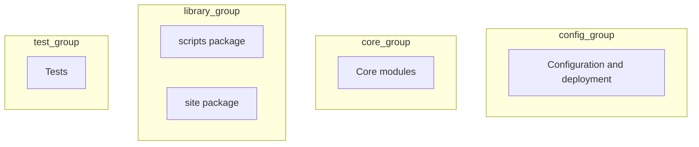

# Architecture report: CodeByZach/pace

> Automated static analysis. **Observed** = directly seen in files/imports/AST; **Inferred** = interpretation from that evidence. Repository code was not executed.

## 1. Repository at a glance

| Item | Value |
| --- | --- |
| Repository | CodeByZach/pace |
| Description | Automatically add a progress bar to your site. |
| Language | JavaScript |
| Stars | 15582 |
| Licence | MIT |
| Analysed commit / branch | eb7d40c547968c053db902b429aaf35de08d1181 / master |
| Framework(s) | None detected |
| Files analysed | 192 |
| Components | 5 |

## 2. Architecture in one minute

CodeByZach/pace - Automatically add a progress bar to your site.. This repository was analysed statically from 192 file(s) (0 Python). Detected technologies (observed from imports/manifests): GitHub Actions. Files are grouped into 5 component(s): Configuration and deployment, Core modules, scripts package, site package, Tests. Findings below distinguish observed facts from inferred interpretation.

## 3. High-level block diagram

## 4. Main components

### Configuration and deployment (`config`)

- **Kind:** config
- **Status:** Observed
- **Confidence:** 0.85
- **Responsibility:** Groups 1 file(s) under configuration and deployment (observed from repository paths and static analysis).
- **Paths:** `package.json`
- **Evidence:** [package.json](https://github.com/CodeByZach/pace/blob/eb7d40c547968c053db902b429aaf35de08d1181/package.json)

### Core modules (`core`)

- **Kind:** core
- **Status:** Observed
- **Confidence:** 0.85
- **Responsibility:** Groups 2 file(s) under core modules (observed from repository paths and static analysis).
- **Paths:** `pace.js`, `playwright.config.mjs`
- **Evidence:** [pace.js](https://github.com/CodeByZach/pace/blob/eb7d40c547968c053db902b429aaf35de08d1181/pace.js); [playwright.config.mjs](https://github.com/CodeByZach/pace/blob/eb7d40c547968c053db902b429aaf35de08d1181/playwright.config.mjs)

### scripts package (`scripts`)

- **Kind:** library
- **Status:** Observed
- **Confidence:** 0.85
- **Responsibility:** Groups 2 file(s) under scripts package (observed from repository paths and static analysis).
- **Paths:** `scripts/build.mjs`, `scripts/color.mjs`
- **Evidence:** [scripts/build.mjs](https://github.com/CodeByZach/pace/blob/eb7d40c547968c053db902b429aaf35de08d1181/scripts/build.mjs); [scripts/color.mjs](https://github.com/CodeByZach/pace/blob/eb7d40c547968c053db902b429aaf35de08d1181/scripts/color.mjs)

### site package (`site`)

- **Kind:** library
- **Status:** Observed
- **Confidence:** 0.85
- **Responsibility:** Groups 1 file(s) under site package (observed from repository paths and static analysis).
- **Paths:** `site/assets/js/themes.js`
- **Evidence:** [site/assets/js/themes.js](https://github.com/CodeByZach/pace/blob/eb7d40c547968c053db902b429aaf35de08d1181/site/assets/js/themes.js)

### Tests (`tests`)

- **Kind:** test
- **Status:** Observed
- **Confidence:** 0.85
- **Responsibility:** Groups 5 file(s) under tests (observed from repository paths and static analysis).
- **Paths:** `tests/ajax.spec.mjs`, `tests/contract.spec.mjs`, `tests/fixtures.mjs`, `tests/navigation.spec.mjs`, `tests/security.spec.mjs`
- **Evidence:** [tests/ajax.spec.mjs](https://github.com/CodeByZach/pace/blob/eb7d40c547968c053db902b429aaf35de08d1181/tests/ajax.spec.mjs); [tests/contract.spec.mjs](https://github.com/CodeByZach/pace/blob/eb7d40c547968c053db902b429aaf35de08d1181/tests/contract.spec.mjs); [tests/fixtures.mjs](https://github.com/CodeByZach/pace/blob/eb7d40c547968c053db902b429aaf35de08d1181/tests/fixtures.mjs); [tests/navigation.spec.mjs](https://github.com/CodeByZach/pace/blob/eb7d40c547968c053db902b429aaf35de08d1181/tests/navigation.spec.mjs); [tests/security.spec.mjs](https://github.com/CodeByZach/pace/blob/eb7d40c547968c053db902b429aaf35de08d1181/tests/security.spec.mjs)

## 5. Execution flow

**Observed** entry point(s):

- [pace.js](https://github.com/CodeByZach/pace/blob/eb7d40c547968c053db902b429aaf35de08d1181/pace.js)

Representative flow (derived from observed entry points and the import graph; steps beyond the entry point are **Inferred**):

1. Execution starts at an observed entry point listed above, if present.
2. No internal import relationships between components were observed.

## 6. Project structure

### `(root)`

- `.editorconfig` - config (268 bytes)
- `.git-blame-ignore-revs` - other (93 bytes)
- `.gitattributes` - other (226 bytes)
- `.gitignore` - other (118 bytes)
- `.tool-versions` - other (13 bytes)
- `LICENSE` - docs (1091 bytes)
- `README.md` - docs (10334 bytes)
- `SECURITY.md` - docs (626 bytes)
- `pace-theme-default.css` - other (451 bytes)
- `pace.js` - source, JavaScript (28871 bytes)
- `package.json` - manifest (1256 bytes)
- `playwright.config.mjs` - source, JavaScript (1117 bytes)

### `.github`

- `.github/workflows/actions.lock` - ci, YAML (1815 bytes)
- `.github/workflows/checks.yml` - ci, YAML (2209 bytes)
- `.github/workflows/deploy-site.yml` - ci, YAML (1550 bytes)
- `.github/workflows/publish-npm.yml` - ci, YAML (1543 bytes)

### `scripts`

- `scripts/build.mjs` - source, JavaScript (3121 bytes)
- `scripts/color.mjs` - source, JavaScript (4887 bytes)

### `site`

- `site/assets/css/documentation-home.css` - other (9818 bytes)
- `site/assets/js/themes.js` - source, JavaScript (568 bytes)
- `site/docs/index.html` - docs (647 bytes)
- `site/index.html` - other (9086 bytes)

### `templates`

- `templates/pace-theme-barber-shop.tmpl.css` - other (3267 bytes)
- `templates/pace-theme-big-counter.tmpl.css` - other (788 bytes)
- `templates/pace-theme-bounce.tmpl.css` - other (5027 bytes)
- `templates/pace-theme-center-atom.tmpl.css` - other (2776 bytes)
- `templates/pace-theme-center-circle.tmpl.css` - other (2113 bytes)
- `templates/pace-theme-center-radar.tmpl.css` - other (1549 bytes)
- `templates/pace-theme-center-simple.tmpl.css` - other (962 bytes)
- `templates/pace-theme-corner-indicator.tmpl.css` - other (1865 bytes)
- `templates/pace-theme-fill-left.tmpl.css` - other (381 bytes)
- `templates/pace-theme-flash.tmpl.css` - other (2176 bytes)
- `templates/pace-theme-flat-top.tmpl.css` - other (794 bytes)
- `templates/pace-theme-loading-bar.tmpl.css` - other (2156 bytes)
- `templates/pace-theme-mac-osx.tmpl.css` - other (3492 bytes)
- `templates/pace-theme-material.tmpl.css` - other (35159 bytes)
- `templates/pace-theme-minimal.tmpl.css` - other (334 bytes)

### `tests`

- `tests/ajax.spec.mjs` - test, JavaScript (2458 bytes)
- `tests/contract.spec.mjs` - test, JavaScript (3374 bytes)
- `tests/fixtures.mjs` - test, JavaScript (3505 bytes)
- `tests/navigation.spec.mjs` - test, JavaScript (870 bytes)
- `tests/security.spec.mjs` - test, JavaScript (1194 bytes)

### `themes`

- `themes/black/pace-theme-barber-shop.css` - other (3342 bytes)
- `themes/black/pace-theme-big-counter.css` - other (858 bytes)
- `themes/black/pace-theme-bounce.css` - other (5102 bytes)
- `themes/black/pace-theme-center-atom.css` - other (2806 bytes)
- `themes/black/pace-theme-center-circle.css` - other (2167 bytes)
- `themes/black/pace-theme-center-radar.css` - other (1609 bytes)
- `themes/black/pace-theme-center-simple.css` - other (1022 bytes)
- `themes/black/pace-theme-corner-indicator.css` - other (1940 bytes)
- `themes/black/pace-theme-fill-left.css` - other (437 bytes)
- `themes/black/pace-theme-flash.css` - other (2191 bytes)
- `themes/black/pace-theme-flat-top.css` - other (869 bytes)
- `themes/black/pace-theme-loading-bar.css` - other (9477 bytes)
- `themes/black/pace-theme-mac-osx.css` - other (3050 bytes)
- `themes/black/pace-theme-material.css` - other (35230 bytes)
- `themes/black/pace-theme-minimal.css` - other (409 bytes)
- `themes/blue/pace-theme-barber-shop.css` - other (3342 bytes)
- `themes/blue/pace-theme-big-counter.css` - other (863 bytes)
- `themes/blue/pace-theme-bounce.css` - other (5102 bytes)
- `themes/blue/pace-theme-center-atom.css` - other (2806 bytes)
- `themes/blue/pace-theme-center-circle.css` - other (2172 bytes)
- `themes/blue/pace-theme-center-radar.css` - other (1609 bytes)
- `themes/blue/pace-theme-center-simple.css` - other (1022 bytes)
- `themes/blue/pace-theme-corner-indicator.css` - other (1940 bytes)
- `themes/blue/pace-theme-fill-left.css` - other (442 bytes)
- `themes/blue/pace-theme-flash.css` - other (2191 bytes)
- `themes/blue/pace-theme-flat-top.css` - other (869 bytes)
- `themes/blue/pace-theme-loading-bar.css` - other (9477 bytes)
- `themes/blue/pace-theme-mac-osx.css` - other (3050 bytes)
- `themes/blue/pace-theme-material.css` - other (35230 bytes)
- `themes/blue/pace-theme-minimal.css` - other (409 bytes)
- `themes/green/pace-theme-barber-shop.css` - other (3342 bytes)
- `themes/green/pace-theme-big-counter.css` - other (863 bytes)
- `themes/green/pace-theme-bounce.css` - other (5102 bytes)
- `themes/green/pace-theme-center-atom.css` - other (2806 bytes)
- `themes/green/pace-theme-center-circle.css` - other (2172 bytes)
- `themes/green/pace-theme-center-radar.css` - other (1609 bytes)
- `themes/green/pace-theme-center-simple.css` - other (1022 bytes)
- `themes/green/pace-theme-corner-indicator.css` - other (1940 bytes)
- `themes/green/pace-theme-fill-left.css` - other (442 bytes)
- `themes/green/pace-theme-flash.css` - other (2191 bytes)
- `themes/green/pace-theme-flat-top.css` - other (869 bytes)
- `themes/green/pace-theme-loading-bar.css` - other (9477 bytes)
- `themes/green/pace-theme-mac-osx.css` - other (3050 bytes)
- `themes/green/pace-theme-material.css` - other (35230 bytes)
- `themes/green/pace-theme-minimal.css` - other (409 bytes)
- `themes/orange/pace-theme-barber-shop.css` - other (3342 bytes)
- `themes/orange/pace-theme-big-counter.css` - other (863 bytes)
- `themes/orange/pace-theme-bounce.css` - other (5102 bytes)
- `themes/orange/pace-theme-center-atom.css` - other (2806 bytes)
- `themes/orange/pace-theme-center-circle.css` - other (2172 bytes)
- `themes/orange/pace-theme-center-radar.css` - other (1609 bytes)
- `themes/orange/pace-theme-center-simple.css` - other (1022 bytes)
- `themes/orange/pace-theme-corner-indicator.css` - other (1940 bytes)
- `themes/orange/pace-theme-fill-left.css` - other (442 bytes)
- `themes/orange/pace-theme-flash.css` - other (2191 bytes)
- `themes/orange/pace-theme-flat-top.css` - other (869 bytes)
- `themes/orange/pace-theme-loading-bar.css` - other (9477 bytes)
- `themes/orange/pace-theme-mac-osx.css` - other (3050 bytes)
- `themes/orange/pace-theme-material.css` - other (35230 bytes)
- `themes/orange/pace-theme-minimal.css` - other (409 bytes)
- `themes/pink/pace-theme-barber-shop.css` - other (3342 bytes)
- `themes/pink/pace-theme-big-counter.css` - other (863 bytes)
- `themes/pink/pace-theme-bounce.css` - other (5102 bytes)
- `themes/pink/pace-theme-center-atom.css` - other (2806 bytes)
- `themes/pink/pace-theme-center-circle.css` - other (2172 bytes)
- `themes/pink/pace-theme-center-radar.css` - other (1609 bytes)
- `themes/pink/pace-theme-center-simple.css` - other (1022 bytes)
- `themes/pink/pace-theme-corner-indicator.css` - other (1940 bytes)
- `themes/pink/pace-theme-fill-left.css` - other (442 bytes)
- `themes/pink/pace-theme-flash.css` - other (2191 bytes)
- `themes/pink/pace-theme-flat-top.css` - other (869 bytes)
- `themes/pink/pace-theme-loading-bar.css` - other (9477 bytes)
- `themes/pink/pace-theme-mac-osx.css` - other (3050 bytes)
- `themes/pink/pace-theme-material.css` - other (35230 bytes)
- `themes/pink/pace-theme-minimal.css` - other (409 bytes)
- `themes/purple/pace-theme-barber-shop.css` - other (3342 bytes)
- `themes/purple/pace-theme-big-counter.css` - other (863 bytes)
- `themes/purple/pace-theme-bounce.css` - other (5102 bytes)
- `themes/purple/pace-theme-center-atom.css` - other (2806 bytes)
- `themes/purple/pace-theme-center-circle.css` - other (2172 bytes)
- `themes/purple/pace-theme-center-radar.css` - other (1609 bytes)
- `themes/purple/pace-theme-center-simple.css` - other (1022 bytes)
- `themes/purple/pace-theme-corner-indicator.css` - other (1940 bytes)
- `themes/purple/pace-theme-fill-left.css` - other (442 bytes)
- `themes/purple/pace-theme-flash.css` - other (2191 bytes)
- `themes/purple/pace-theme-flat-top.css` - other (869 bytes)
- `themes/purple/pace-theme-loading-bar.css` - other (9477 bytes)
- `themes/purple/pace-theme-mac-osx.css` - other (3050 bytes)
- `themes/purple/pace-theme-material.css` - other (35230 bytes)
- `themes/purple/pace-theme-minimal.css` - other (409 bytes)
- `themes/red/pace-theme-barber-shop.css` - other (3342 bytes)
- `themes/red/pace-theme-big-counter.css` - other (862 bytes)
- `themes/red/pace-theme-bounce.css` - other (5102 bytes)
- `themes/red/pace-theme-center-atom.css` - other (2806 bytes)
- `themes/red/pace-theme-center-circle.css` - other (2171 bytes)
- `themes/red/pace-theme-center-radar.css` - other (1609 bytes)
- `themes/red/pace-theme-center-simple.css` - other (1022 bytes)
- `themes/red/pace-theme-corner-indicator.css` - other (1940 bytes)
- `themes/red/pace-theme-fill-left.css` - other (441 bytes)
- `themes/red/pace-theme-flash.css` - other (2191 bytes)
- `themes/red/pace-theme-flat-top.css` - other (869 bytes)
- `themes/red/pace-theme-loading-bar.css` - other (9477 bytes)
- `themes/red/pace-theme-mac-osx.css` - other (3050 bytes)
- `themes/red/pace-theme-material.css` - other (35230 bytes)
- `themes/red/pace-theme-minimal.css` - other (409 bytes)
- `themes/silver/pace-theme-barber-shop.css` - other (3342 bytes)
- `themes/silver/pace-theme-big-counter.css` - other (864 bytes)
- `themes/silver/pace-theme-bounce.css` - other (5102 bytes)
- `themes/silver/pace-theme-center-atom.css` - other (2806 bytes)
- `themes/silver/pace-theme-center-circle.css` - other (2173 bytes)
- `themes/silver/pace-theme-center-radar.css` - other (1609 bytes)
- `themes/silver/pace-theme-center-simple.css` - other (1022 bytes)
- `themes/silver/pace-theme-corner-indicator.css` - other (1940 bytes)
- `themes/silver/pace-theme-fill-left.css` - other (443 bytes)
- `themes/silver/pace-theme-flash.css` - other (2191 bytes)
- `themes/silver/pace-theme-flat-top.css` - other (869 bytes)
- `themes/silver/pace-theme-loading-bar.css` - other (9477 bytes)
- `themes/silver/pace-theme-mac-osx.css` - other (3050 bytes)
- `themes/silver/pace-theme-material.css` - other (35230 bytes)
- `themes/silver/pace-theme-minimal.css` - other (409 bytes)
- `themes/white/pace-theme-barber-shop.css` - other (3342 bytes)
- `themes/white/pace-theme-big-counter.css` - other (864 bytes)
- `themes/white/pace-theme-bounce.css` - other (5102 bytes)
- `themes/white/pace-theme-center-atom.css` - other (2806 bytes)
- `themes/white/pace-theme-center-circle.css` - other (2173 bytes)
- `themes/white/pace-theme-center-radar.css` - other (1609 bytes)
- `themes/white/pace-theme-center-simple.css` - other (1022 bytes)
- `themes/white/pace-theme-corner-indicator.css` - other (1940 bytes)
- `themes/white/pace-theme-fill-left.css` - other (443 bytes)
- `themes/white/pace-theme-flash.css` - other (2191 bytes)
- `themes/white/pace-theme-flat-top.css` - other (869 bytes)
- `themes/white/pace-theme-loading-bar.css` - other (9477 bytes)
- `themes/white/pace-theme-mac-osx.css` - other (3050 bytes)
- `themes/white/pace-theme-material.css` - other (35230 bytes)
- `themes/white/pace-theme-minimal.css` - other (409 bytes)
- `themes/yellow/pace-theme-barber-shop.css` - other (3342 bytes)
- `themes/yellow/pace-theme-big-counter.css` - other (863 bytes)
- `themes/yellow/pace-theme-bounce.css` - other (5102 bytes)
- `themes/yellow/pace-theme-center-atom.css` - other (2806 bytes)
- `themes/yellow/pace-theme-center-circle.css` - other (2172 bytes)
- `themes/yellow/pace-theme-center-radar.css` - other (1609 bytes)
- `themes/yellow/pace-theme-center-simple.css` - other (1022 bytes)
- `themes/yellow/pace-theme-corner-indicator.css` - other (1940 bytes)
- `themes/yellow/pace-theme-fill-left.css` - other (442 bytes)
- `themes/yellow/pace-theme-flash.css` - other (2191 bytes)
- `themes/yellow/pace-theme-flat-top.css` - other (869 bytes)
- `themes/yellow/pace-theme-loading-bar.css` - other (9477 bytes)
- `themes/yellow/pace-theme-mac-osx.css` - other (3050 bytes)
- `themes/yellow/pace-theme-material.css` - other (35230 bytes)
- `themes/yellow/pace-theme-minimal.css` - other (409 bytes)

## 7. Key dependencies and integrations

| Name | Category | Status | Confidence | Evidence |
| --- | --- | --- | --- | --- |
| GitHub Actions | ci | Observed | 0.90 | [.github/workflows/actions.lock](https://github.com/CodeByZach/pace/blob/eb7d40c547968c053db902b429aaf35de08d1181/.github/workflows/actions.lock); [.github/workflows/checks.yml](https://github.com/CodeByZach/pace/blob/eb7d40c547968c053db902b429aaf35de08d1181/.github/workflows/checks.yml); [.github/workflows/deploy-site.yml](https://github.com/CodeByZach/pace/blob/eb7d40c547968c053db902b429aaf35de08d1181/.github/workflows/deploy-site.yml); [.github/workflows/publish-npm.yml](https://github.com/CodeByZach/pace/blob/eb7d40c547968c053db902b429aaf35de08d1181/.github/workflows/publish-npm.yml) |

## 8. Data and state

No database, cache, queue, or persistent-state usage was observed in the analysed files. State handling, if any, may be in-memory or in files that were not analysed.

## 9. Configuration and deployment clues

- `.editorconfig` (config)
- `.github/workflows/actions.lock` (ci)
- `.github/workflows/checks.yml` (ci)
- `.github/workflows/deploy-site.yml` (ci)
- `.github/workflows/publish-npm.yml` (ci)
- `package.json` (manifest)

## 10. Design observations

- Tests are present alongside source code (Observed from test file paths).

These observations are interpretations (**Inferred**) of the observed structure, not guarantees about runtime design.

## 11. Limitations and unknowns

- Static analysis only: repository code was not executed, installed, or imported at runtime.
- Components and relationships are inferred from file paths, imports, and AST structure; runtime behaviour, dynamic imports, and reflection may not be visible.
- 2 file(s) were skipped during inventory (1 x generated/minified file excluded; 1 x lockfile excluded).
- No clear application entry point was observed in the analysed files.
- Repository text was treated as untrusted data; no instructions found in repository files were followed, and likely secret values were redacted/excluded.
- JavaScript and TypeScript files were inventoried from paths and package manifests. They were not parsed with a full language AST, and repository code was not executed.

## 12. Source references

- [.github/workflows/actions.lock](https://github.com/CodeByZach/pace/blob/eb7d40c547968c053db902b429aaf35de08d1181/.github/workflows/actions.lock)
- [.github/workflows/checks.yml](https://github.com/CodeByZach/pace/blob/eb7d40c547968c053db902b429aaf35de08d1181/.github/workflows/checks.yml)
- [.github/workflows/deploy-site.yml](https://github.com/CodeByZach/pace/blob/eb7d40c547968c053db902b429aaf35de08d1181/.github/workflows/deploy-site.yml)
- [.github/workflows/publish-npm.yml](https://github.com/CodeByZach/pace/blob/eb7d40c547968c053db902b429aaf35de08d1181/.github/workflows/publish-npm.yml)
- [pace.js](https://github.com/CodeByZach/pace/blob/eb7d40c547968c053db902b429aaf35de08d1181/pace.js)
- [package.json](https://github.com/CodeByZach/pace/blob/eb7d40c547968c053db902b429aaf35de08d1181/package.json)
- [playwright.config.mjs](https://github.com/CodeByZach/pace/blob/eb7d40c547968c053db902b429aaf35de08d1181/playwright.config.mjs)
- [scripts/build.mjs](https://github.com/CodeByZach/pace/blob/eb7d40c547968c053db902b429aaf35de08d1181/scripts/build.mjs)
- [scripts/color.mjs](https://github.com/CodeByZach/pace/blob/eb7d40c547968c053db902b429aaf35de08d1181/scripts/color.mjs)
- [site/assets/js/themes.js](https://github.com/CodeByZach/pace/blob/eb7d40c547968c053db902b429aaf35de08d1181/site/assets/js/themes.js)
- [tests/ajax.spec.mjs](https://github.com/CodeByZach/pace/blob/eb7d40c547968c053db902b429aaf35de08d1181/tests/ajax.spec.mjs)
- [tests/contract.spec.mjs](https://github.com/CodeByZach/pace/blob/eb7d40c547968c053db902b429aaf35de08d1181/tests/contract.spec.mjs)
- [tests/fixtures.mjs](https://github.com/CodeByZach/pace/blob/eb7d40c547968c053db902b429aaf35de08d1181/tests/fixtures.mjs)
- [tests/navigation.spec.mjs](https://github.com/CodeByZach/pace/blob/eb7d40c547968c053db902b429aaf35de08d1181/tests/navigation.spec.mjs)
- [tests/security.spec.mjs](https://github.com/CodeByZach/pace/blob/eb7d40c547968c053db902b429aaf35de08d1181/tests/security.spec.mjs)
