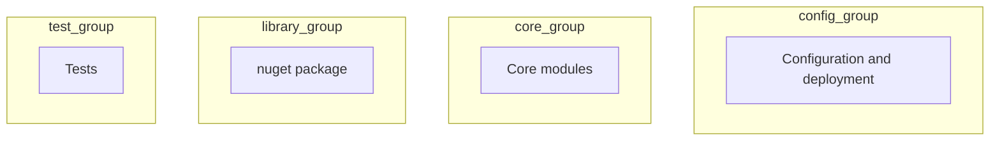

# Architecture report: CodeSeven/toastr

> Automated static analysis. **Observed** = directly seen in files/imports/AST; **Inferred** = interpretation from that evidence. Repository code was not executed.

## 1. Repository at a glance

| Item | Value |
| --- | --- |
| Repository | CodeSeven/toastr |
| Description | Simple javascript toast notifications |
| Language | JavaScript |
| Stars | 12079 |
| Licence | MIT |
| Analysed commit / branch | 50092cc604850a16c985520b63df184d3e0b4086 / master |
| Framework(s) | None detected |
| Files analysed | 44 |
| Components | 4 |

## 2. Architecture in one minute

CodeSeven/toastr - Simple javascript toast notifications. This repository was analysed statically from 44 file(s) (0 Python). Detected technologies (observed from imports/manifests): no known frameworks/libraries. Files are grouped into 4 component(s): Configuration and deployment, Core modules, nuget package, Tests. Findings below distinguish observed facts from inferred interpretation.

## 3. High-level block diagram

## 4. Main components

### Configuration and deployment (`config`)

- **Kind:** config
- **Status:** Observed
- **Confidence:** 0.85
- **Responsibility:** Groups 1 file(s) under configuration and deployment (observed from repository paths and static analysis).
- **Paths:** `package.json`
- **Evidence:** [package.json](https://github.com/CodeSeven/toastr/blob/50092cc604850a16c985520b63df184d3e0b4086/package.json)

### Core modules (`core`)

- **Kind:** core
- **Status:** Observed
- **Confidence:** 0.85
- **Responsibility:** Groups 3 file(s) under core modules (observed from repository paths and static analysis).
- **Paths:** `gulpfile.js`, `karma.conf.js`, `toastr.js`
- **Evidence:** [gulpfile.js](https://github.com/CodeSeven/toastr/blob/50092cc604850a16c985520b63df184d3e0b4086/gulpfile.js); [karma.conf.js](https://github.com/CodeSeven/toastr/blob/50092cc604850a16c985520b63df184d3e0b4086/karma.conf.js); [toastr.js](https://github.com/CodeSeven/toastr/blob/50092cc604850a16c985520b63df184d3e0b4086/toastr.js)

### nuget package (`nuget`)

- **Kind:** library
- **Status:** Observed
- **Confidence:** 0.85
- **Responsibility:** Groups 1 file(s) under nuget package (observed from repository paths and static analysis).
- **Paths:** `nuget/content/scripts/toastr.js`
- **Evidence:** [nuget/content/scripts/toastr.js](https://github.com/CodeSeven/toastr/blob/50092cc604850a16c985520b63df184d3e0b4086/nuget/content/scripts/toastr.js)

### Tests (`tests`)

- **Kind:** test
- **Status:** Observed
- **Confidence:** 0.85
- **Responsibility:** Groups 6 file(s) under tests (observed from repository paths and static analysis).
- **Paths:** `tests/qunit/qunit.css`, `tests/qunit/qunit.js`, `tests/toastr-tests.html`, `tests/unit/qunit-helper.js`, `tests/unit/toastr-tests.js`, `tests/unit/x.js`
- **Evidence:** [tests/qunit/qunit.css](https://github.com/CodeSeven/toastr/blob/50092cc604850a16c985520b63df184d3e0b4086/tests/qunit/qunit.css); [tests/qunit/qunit.js](https://github.com/CodeSeven/toastr/blob/50092cc604850a16c985520b63df184d3e0b4086/tests/qunit/qunit.js); [tests/toastr-tests.html](https://github.com/CodeSeven/toastr/blob/50092cc604850a16c985520b63df184d3e0b4086/tests/toastr-tests.html); [tests/unit/qunit-helper.js](https://github.com/CodeSeven/toastr/blob/50092cc604850a16c985520b63df184d3e0b4086/tests/unit/qunit-helper.js); [tests/unit/toastr-tests.js](https://github.com/CodeSeven/toastr/blob/50092cc604850a16c985520b63df184d3e0b4086/tests/unit/toastr-tests.js); [tests/unit/x.js](https://github.com/CodeSeven/toastr/blob/50092cc604850a16c985520b63df184d3e0b4086/tests/unit/x.js)

## 5. Execution flow

**Observed** entry point(s):

- [toastr.js](https://github.com/CodeSeven/toastr/blob/50092cc604850a16c985520b63df184d3e0b4086/toastr.js)

Representative flow (derived from observed entry points and the import graph; steps beyond the entry point are **Inferred**):

1. Execution starts at an observed entry point listed above, if present.
2. No internal import relationships between components were observed.

## 6. Project structure

### `(root)`

- `.gitattributes` - other (425 bytes)
- `.gitignore` - other (654 bytes)
- `.jscsrc` - other (2339 bytes)
- `.jshintrc` - other (1221 bytes)
- `.travis.yml` - ci, YAML (1010 bytes)
- `CHANGELOG.md` - docs (6074 bytes)
- `LICENSE` - docs (1075 bytes)
- `README.md` - docs (7781 bytes)
- `demo.html` - other (15716 bytes)
- `gulpfile.js` - source, JavaScript (4507 bytes)
- `karma.conf.js` - source, JavaScript (2072 bytes)
- `package.json` - manifest (1795 bytes)
- `release checklist.md` - docs (626 bytes)
- `toastr.js` - source, JavaScript (17728 bytes)
- `toastr.less` - other (7356 bytes)
- `toastr.scss` - other (6940 bytes)

### `nuget`

- `nuget/content/content/toastr.css` - other (6757 bytes)
- `nuget/content/content/toastr.less` - other (6245 bytes)
- `nuget/content/content/toastr.scss` - other (6767 bytes)
- `nuget/content/scripts/toastr.js` - source, JavaScript (12301 bytes)
- `nuget/toastr.1.0.0.nuspec` - other (1577 bytes)
- `nuget/toastr.1.0.3.nuspec` - other (1934 bytes)
- `nuget/toastr.1.1.0.nuspec` - other (1894 bytes)
- `nuget/toastr.1.1.1.nuspec` - other (1894 bytes)
- `nuget/toastr.1.1.2.nuspec` - other (1917 bytes)
- `nuget/toastr.1.1.4.1.nuspec` - other (2217 bytes)
- `nuget/toastr.1.1.4.2.nuspec` - other (2273 bytes)
- `nuget/toastr.1.1.4.nuspec` - other (2215 bytes)
- `nuget/toastr.1.1.5.nuspec` - other (1919 bytes)
- `nuget/toastr.1.2.0.nuspec` - other (1928 bytes)
- `nuget/toastr.1.2.1.nuspec` - other (1928 bytes)
- `nuget/toastr.1.2.2.nuspec` - other (1928 bytes)
- `nuget/toastr.1.3.0.nuspec` - other (2366 bytes)
- `nuget/toastr.1.3.1.nuspec` - other (2888 bytes)
- `nuget/toastr.2.0.0-rc1.nuspec` - other (2399 bytes)
- `nuget/toastr.2.0.1.nuspec` - other (2395 bytes)
- `nuget/toastr.2.0.2.nuspec` - other (2176 bytes)
- `nuget/toastr.2.0.3.nuspec` - other (2176 bytes)

### `tests`

- `tests/qunit/qunit.css` - test (4668 bytes)
- `tests/qunit/qunit.js` - test, JavaScript (58796 bytes)
- `tests/toastr-tests.html` - test (765 bytes)
- `tests/unit/qunit-helper.js` - test, JavaScript (274 bytes)
- `tests/unit/toastr-tests.js` - test, JavaScript (30351 bytes)
- `tests/unit/x.js` - test, JavaScript (82 bytes)

## 7. Key dependencies and integrations

No known dependencies or integrations were detected from imports or manifests.

## 8. Data and state

No database, cache, queue, or persistent-state usage was observed in the analysed files. State handling, if any, may be in-memory or in files that were not analysed.

## 9. Configuration and deployment clues

- `.travis.yml` (ci)
- `package.json` (manifest)

## 10. Design observations

- Tests are present alongside source code (Observed from test file paths).

These observations are interpretations (**Inferred**) of the observed structure, not guarantees about runtime design.

## 11. Limitations and unknowns

- Static analysis only: repository code was not executed, installed, or imported at runtime.
- Components and relationships are inferred from file paths, imports, and AST structure; runtime behaviour, dynamic imports, and reflection may not be visible.
- 3 file(s) were skipped during inventory (1 x generated/minified file excluded; 2 x vendored/generated directory excluded).
- No clear application entry point was observed in the analysed files.
- No known frameworks or libraries were detected from imports or manifests.
- Repository text was treated as untrusted data; no instructions found in repository files were followed, and likely secret values were redacted/excluded.
- JavaScript and TypeScript files were inventoried from paths and package manifests. They were not parsed with a full language AST, and repository code was not executed.

## 12. Source references

- [gulpfile.js](https://github.com/CodeSeven/toastr/blob/50092cc604850a16c985520b63df184d3e0b4086/gulpfile.js)
- [karma.conf.js](https://github.com/CodeSeven/toastr/blob/50092cc604850a16c985520b63df184d3e0b4086/karma.conf.js)
- [nuget/content/scripts/toastr.js](https://github.com/CodeSeven/toastr/blob/50092cc604850a16c985520b63df184d3e0b4086/nuget/content/scripts/toastr.js)
- [package.json](https://github.com/CodeSeven/toastr/blob/50092cc604850a16c985520b63df184d3e0b4086/package.json)
- [tests/qunit/qunit.css](https://github.com/CodeSeven/toastr/blob/50092cc604850a16c985520b63df184d3e0b4086/tests/qunit/qunit.css)
- [tests/qunit/qunit.js](https://github.com/CodeSeven/toastr/blob/50092cc604850a16c985520b63df184d3e0b4086/tests/qunit/qunit.js)
- [tests/toastr-tests.html](https://github.com/CodeSeven/toastr/blob/50092cc604850a16c985520b63df184d3e0b4086/tests/toastr-tests.html)
- [tests/unit/qunit-helper.js](https://github.com/CodeSeven/toastr/blob/50092cc604850a16c985520b63df184d3e0b4086/tests/unit/qunit-helper.js)
- [tests/unit/toastr-tests.js](https://github.com/CodeSeven/toastr/blob/50092cc604850a16c985520b63df184d3e0b4086/tests/unit/toastr-tests.js)
- [tests/unit/x.js](https://github.com/CodeSeven/toastr/blob/50092cc604850a16c985520b63df184d3e0b4086/tests/unit/x.js)
- [toastr.js](https://github.com/CodeSeven/toastr/blob/50092cc604850a16c985520b63df184d3e0b4086/toastr.js)
