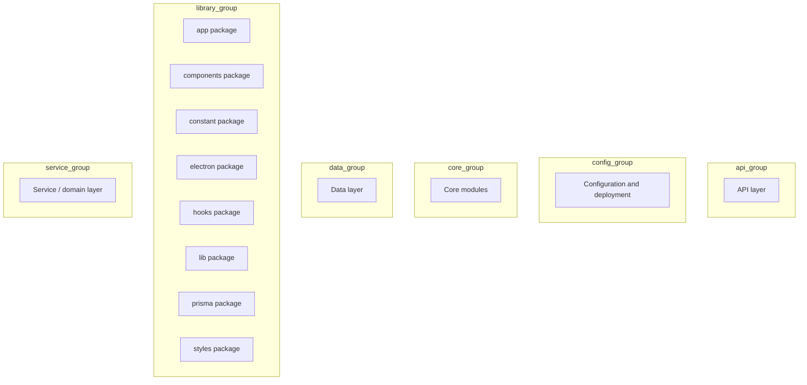

# Architecture report: ConardLi/easy-dataset

> Automated static analysis. **Observed** = directly seen in files/imports/AST; **Inferred** = interpretation from that evidence. Repository code was not executed.

## 1. Repository at a glance

| Item | Value |
| --- | --- |
| Repository | ConardLi/easy-dataset |
| Description | A powerful tool for creating datasets for LLM fine-tuning 、RAG and Eval |
| Language | JavaScript |
| Stars | 15117 |
| Licence | Other |
| Analysed commit / branch | 4002b09d9c5726cafb9f61a8d12765cb96a2d94b / main |
| Framework(s) | Electron, Next.js, React |
| Files analysed | 535 |
| Components | 13 |

## 2. Architecture in one minute

ConardLi/easy-dataset - A powerful tool for creating datasets for LLM fine-tuning 、RAG and Eval. This repository was analysed statically from 535 file(s) (0 Python). Detected technologies (observed from imports/manifests): GitHub Actions, Electron, Next.js, React, axios, Prisma. Files are grouped into 13 component(s): API layer, app package, components package, Configuration and deployment, constant package, Core modules, Data layer, electron package. Findings below distinguish observed facts from inferred interpretation.

## 3. High-level block diagram

## 4. Main components

### API layer (`api_layer`)

- **Kind:** api
- **Status:** Observed
- **Confidence:** 0.85
- **Responsibility:** Groups 108 file(s) under api layer (observed from repository paths and static analysis).
- **Paths:** `app/api/check-update/route.js`, `app/api/llm/fetch-models/route.js`, `app/api/llm/model/route.js`, `app/api/llm/ollama/models/route.js`, `app/api/llm/providers/route.js`, `app/api/monitoring/logs/route.js`, `app/api/monitoring/stats/route.js`, `app/api/monitoring/summary/route.js`, `app/api/projects/[projectId]/batch-add-manual-ga/route.js`, `app/api/projects/[projectId]/batch-delete-files/route.js`, `app/api/projects/[projectId]/batch-generateGA/route.js`, `app/api/projects/[projectId]/blind-test-tasks/[taskId]/current/route.js`, `app/api/projects/[projectId]/blind-test-tasks/[taskId]/question/route.js`, `app/api/projects/[projectId]/blind-test-tasks/[taskId]/route.js`, `app/api/projects/[projectId]/blind-test-tasks/[taskId]/stream-model/route.js`, `app/api/projects/[projectId]/blind-test-tasks/[taskId]/stream/route.js`, `app/api/projects/[projectId]/blind-test-tasks/[taskId]/vote/route.js`, `app/api/projects/[projectId]/blind-test-tasks/route.js`, `app/api/projects/[projectId]/chunks/[chunkId]/clean/route.js`, `app/api/projects/[projectId]/chunks/[chunkId]/eval-questions/route.js`, `app/api/projects/[projectId]/chunks/[chunkId]/questions/route.js`, `app/api/projects/[projectId]/chunks/[chunkId]/route.js`, `app/api/projects/[projectId]/chunks/batch-content/route.js`, `app/api/projects/[projectId]/chunks/batch-edit/route.js`, `app/api/projects/[projectId]/chunks/name/route.js`, `app/api/projects/[projectId]/chunks/route.js`, `app/api/projects/[projectId]/config/route.js`, `app/api/projects/[projectId]/custom-prompts/route.js`, `app/api/projects/[projectId]/custom-split/route.js`, `app/api/projects/[projectId]/dataset-conversations/[conversationId]/route.js`, `app/api/projects/[projectId]/dataset-conversations/export/route.js`, `app/api/projects/[projectId]/dataset-conversations/route.js`, `app/api/projects/[projectId]/dataset-conversations/tags/route.js`, `app/api/projects/[projectId]/datasets/[datasetId]/copy-to-eval/route.js`, `app/api/projects/[projectId]/datasets/[datasetId]/evaluate/route.js`, `app/api/projects/[projectId]/datasets/[datasetId]/route.js`, `app/api/projects/[projectId]/datasets/[datasetId]/token-count/route.js`, `app/api/projects/[projectId]/datasets/batch-evaluate/route.js`, `app/api/projects/[projectId]/datasets/export/route.js`, `app/api/projects/[projectId]/datasets/generate-eval-variant/route.js`, `app/api/projects/[projectId]/datasets/import/route.js`, `app/api/projects/[projectId]/datasets/optimize/route.js`, `app/api/projects/[projectId]/datasets/route.js`, `app/api/projects/[projectId]/datasets/tags/route.js`, `app/api/projects/[projectId]/default-prompts/route.js`, `app/api/projects/[projectId]/distill/questions/by-tag/route.js`, `app/api/projects/[projectId]/distill/questions/route.js`, `app/api/projects/[projectId]/distill/tags/[tagId]/route.js`, `app/api/projects/[projectId]/distill/tags/all/route.js`, `app/api/projects/[projectId]/distill/tags/route.js`, `app/api/projects/[projectId]/eval-datasets/[evalId]/route.js`, `app/api/projects/[projectId]/eval-datasets/count/route.js`, `app/api/projects/[projectId]/eval-datasets/export/route.js`, `app/api/projects/[projectId]/eval-datasets/import/route.js`, `app/api/projects/[projectId]/eval-datasets/route.js`, `app/api/projects/[projectId]/eval-datasets/sample/route.js`, `app/api/projects/[projectId]/eval-datasets/tags/route.js`, `app/api/projects/[projectId]/eval-tasks/[taskId]/route.js`, `app/api/projects/[projectId]/eval-tasks/route.js`, `app/api/projects/[projectId]/files/[fileId]/ga-pairs/route.js`, `app/api/projects/[projectId]/files/route.js`, `app/api/projects/[projectId]/generate-questions/route.js`, `app/api/projects/[projectId]/huggingface/upload/route.js`, `app/api/projects/[projectId]/image-datasets/[datasetId]/route.js`, `app/api/projects/[projectId]/image-datasets/export-zip/route.js`, `app/api/projects/[projectId]/image-datasets/export/route.js`, `app/api/projects/[projectId]/image-datasets/route.js`, `app/api/projects/[projectId]/image-datasets/tags/route.js`, `app/api/projects/[projectId]/images/[imageId]/route.js`, `app/api/projects/[projectId]/images/annotations/route.js`, `app/api/projects/[projectId]/images/datasets/route.js`, `app/api/projects/[projectId]/images/next-unanswered/route.js`, `app/api/projects/[projectId]/images/pdf-convert/route.js`, `app/api/projects/[projectId]/images/questions/route.js`, `app/api/projects/[projectId]/images/route.js`, `app/api/projects/[projectId]/images/zip-import/route.js`, `app/api/projects/[projectId]/llamaFactory/checkConfig/route.js`, `app/api/projects/[projectId]/llamaFactory/generate/route.js`, `app/api/projects/[projectId]/model-config/[modelConfigId]/route.js`, `app/api/projects/[projectId]/model-config/route.js`, `app/api/projects/[projectId]/models/[modelId]/route.js`, `app/api/projects/[projectId]/models/route.js`, `app/api/projects/[projectId]/playground/chat/route.js`, `app/api/projects/[projectId]/playground/chat/stream/route.js`, `app/api/projects/[projectId]/preview/[fileId]/route.js`, `app/api/projects/[projectId]/questions/[questionId]/route.js`, `app/api/projects/[projectId]/questions/batch-delete/route.js`, `app/api/projects/[projectId]/questions/export/route.js`, `app/api/projects/[projectId]/questions/route.js`, `app/api/projects/[projectId]/questions/templates/[templateId]/route.js`, `app/api/projects/[projectId]/questions/templates/route.js`, `app/api/projects/[projectId]/questions/tree/route.js`, `app/api/projects/[projectId]/route.js`, `app/api/projects/[projectId]/split/route.js`, `app/api/projects/[projectId]/tags/route.js`, `app/api/projects/[projectId]/tasks/[taskId]/route.js`, `app/api/projects/[projectId]/tasks/list/route.js`, `app/api/projects/[projectId]/tasks/route.js`, `app/api/projects/delete-directory/route.js`, `app/api/projects/migrate/route.js`, `app/api/projects/open-directory/route.js`, `app/api/projects/route.js`, `app/api/projects/unmigrated/route.js`, `app/api/update/route.js`, `lib/api/chunk.js`, `lib/api/file.js`, `lib/api/index.js`, `lib/api/task.js`
- **Evidence:** [app/api/check-update/route.js](https://github.com/ConardLi/easy-dataset/blob/4002b09d9c5726cafb9f61a8d12765cb96a2d94b/app/api/check-update/route.js); [app/api/llm/fetch-models/route.js](https://github.com/ConardLi/easy-dataset/blob/4002b09d9c5726cafb9f61a8d12765cb96a2d94b/app/api/llm/fetch-models/route.js); [app/api/llm/model/route.js](https://github.com/ConardLi/easy-dataset/blob/4002b09d9c5726cafb9f61a8d12765cb96a2d94b/app/api/llm/model/route.js); [app/api/llm/ollama/models/route.js](https://github.com/ConardLi/easy-dataset/blob/4002b09d9c5726cafb9f61a8d12765cb96a2d94b/app/api/llm/ollama/models/route.js); [app/api/llm/providers/route.js](https://github.com/ConardLi/easy-dataset/blob/4002b09d9c5726cafb9f61a8d12765cb96a2d94b/app/api/llm/providers/route.js); [app/api/monitoring/logs/route.js](https://github.com/ConardLi/easy-dataset/blob/4002b09d9c5726cafb9f61a8d12765cb96a2d94b/app/api/monitoring/logs/route.js); [app/api/monitoring/stats/route.js](https://github.com/ConardLi/easy-dataset/blob/4002b09d9c5726cafb9f61a8d12765cb96a2d94b/app/api/monitoring/stats/route.js); [app/api/monitoring/summary/route.js](https://github.com/ConardLi/easy-dataset/blob/4002b09d9c5726cafb9f61a8d12765cb96a2d94b/app/api/monitoring/summary/route.js)

### app package (`app`)

- **Kind:** library
- **Status:** Observed
- **Confidence:** 0.85
- **Responsibility:** Groups 126 file(s) under app package (observed from repository paths and static analysis).
- **Paths:** `app/dataset-square/page.js`, `app/layout.js`, `app/monitoring/components/Charts.js`, `app/monitoring/components/StatsCards.js`, `app/monitoring/components/UsageTable.js`, `app/monitoring/hooks/useMonitoringData.js`, `app/monitoring/page.js`, `app/page.js`, `app/projects/[projectId]/blind-test-tasks/[taskId]/page.js`, `app/projects/[projectId]/blind-test-tasks/components/BlindTestHeader.js`, `app/projects/[projectId]/blind-test-tasks/components/BlindTestInProgress.js`, `app/projects/[projectId]/blind-test-tasks/components/BlindTestTaskCard.js`, `app/projects/[projectId]/blind-test-tasks/components/CreateBlindTestDialog.js`, `app/projects/[projectId]/blind-test-tasks/components/ResultDetailList.js`, `app/projects/[projectId]/blind-test-tasks/components/ResultSummary.js`, `app/projects/[projectId]/blind-test-tasks/hooks/useBlindTestDetail.js`, `app/projects/[projectId]/blind-test-tasks/hooks/useBlindTestTasks.js`, `app/projects/[projectId]/blind-test-tasks/page.js`, `app/projects/[projectId]/datasets/[datasetId]/page.js`, `app/projects/[projectId]/datasets/[datasetId]/useDatasetDetails.js`, `app/projects/[projectId]/datasets/components/ActionBar.js`, `app/projects/[projectId]/datasets/components/DatasetList.js`, `app/projects/[projectId]/datasets/components/DeleteConfirmDialog.js`, `app/projects/[projectId]/datasets/components/FilterDialog.js`, `app/projects/[projectId]/datasets/components/SearchBar.js`, `app/projects/[projectId]/datasets/hooks/useDatasetEvaluation.js`, `app/projects/[projectId]/datasets/hooks/useDatasetExport.js`, `app/projects/[projectId]/datasets/hooks/useDatasetFilters.js`, `app/projects/[projectId]/datasets/page.js`, `app/projects/[projectId]/distill/autoDistillService.js`, `app/projects/[projectId]/distill/page.js`, `app/projects/[projectId]/eval-datasets/[evalId]/page.js`, `app/projects/[projectId]/eval-datasets/[evalId]/useEvalDatasetDetails.js`, `app/projects/[projectId]/eval-datasets/components/BuiltinDatasetDialog.js`, `app/projects/[projectId]/eval-datasets/components/EvalDatasetCard.js`, `app/projects/[projectId]/eval-datasets/components/EvalDatasetHeader.js`, `app/projects/[projectId]/eval-datasets/components/EvalDatasetList.js`, `app/projects/[projectId]/eval-datasets/components/EvalEditableField.js`, `app/projects/[projectId]/eval-datasets/components/EvalToolbar.js`, `app/projects/[projectId]/eval-datasets/components/EvalToolbar.styles.js`, `app/projects/[projectId]/eval-datasets/components/ExportEvalDialog.js`, `app/projects/[projectId]/eval-datasets/components/ImportDialog.js`, `app/projects/[projectId]/eval-datasets/components/ImportDialog.styles.js`, `app/projects/[projectId]/eval-datasets/constants.js`, `app/projects/[projectId]/eval-datasets/hooks/useEvalDatasets.js`, `app/projects/[projectId]/eval-datasets/hooks/useExportEvalDatasets.js`, `app/projects/[projectId]/eval-datasets/page.js`, `app/projects/[projectId]/eval-tasks/[taskId]/components/EvalHeader.js`, `app/projects/[projectId]/eval-tasks/[taskId]/components/EvalStats.js`, `app/projects/[projectId]/eval-tasks/[taskId]/components/QuestionCard.js`, `app/projects/[projectId]/eval-tasks/[taskId]/detailStyles.js`, `app/projects/[projectId]/eval-tasks/[taskId]/page.js`, `app/projects/[projectId]/eval-tasks/components/CreateEvalTaskDialog.js`, `app/projects/[projectId]/eval-tasks/components/EvalTaskCard.js`, `app/projects/[projectId]/eval-tasks/components/ModelSelector.js`, `app/projects/[projectId]/eval-tasks/components/QuestionFilter.js`, `app/projects/[projectId]/eval-tasks/components/ScoreAnchorsForm.js`, `app/projects/[projectId]/eval-tasks/hooks/useEvalTaskDetail.js`, `app/projects/[projectId]/eval-tasks/hooks/useEvalTaskForm.js`, `app/projects/[projectId]/eval-tasks/hooks/useEvalTasks.js`, `app/projects/[projectId]/eval-tasks/page.js`, `app/projects/[projectId]/eval-tasks/styles.js`, `app/projects/[projectId]/image-datasets/[datasetId]/page.js`, `app/projects/[projectId]/image-datasets/components/DatasetContent.js`, `app/projects/[projectId]/image-datasets/components/DatasetSidebar.js`, `app/projects/[projectId]/image-datasets/components/EmptyState.js`, `app/projects/[projectId]/image-datasets/components/ExportImageDatasetDialog.js`, `app/projects/[projectId]/image-datasets/components/ImageDatasetCard.js`, `app/projects/[projectId]/image-datasets/components/ImageDatasetFilterDialog.js`, `app/projects/[projectId]/image-datasets/components/ImageDatasetFilters.js`, `app/projects/[projectId]/image-datasets/components/ImageDatasetHeader.js`, `app/projects/[projectId]/image-datasets/components/MetadataEditor.js`, `app/projects/[projectId]/image-datasets/components/MetadataInfo.js`, `app/projects/[projectId]/image-datasets/hooks/useImageDatasetDetail.js`, `app/projects/[projectId]/image-datasets/hooks/useImageDatasetDetails.js`, `app/projects/[projectId]/image-datasets/hooks/useImageDatasetExport.js`, `app/projects/[projectId]/image-datasets/hooks/useImageDatasetFilters.js`, `app/projects/[projectId]/image-datasets/hooks/useImageDatasets.js`, `app/projects/[projectId]/image-datasets/page.js`, `app/projects/[projectId]/image-datasets/styles/imageDatasetStyles.js`, `app/projects/[projectId]/images/components/DatasetDialog.js`, `app/projects/[projectId]/images/components/ImageFilters.js`, `app/projects/[projectId]/images/components/ImageGrid.js`, `app/projects/[projectId]/images/components/ImageList.js`, `app/projects/[projectId]/images/components/ImportDialog.js`, `app/projects/[projectId]/images/components/QuestionDialog.js`, `app/projects/[projectId]/images/components/annotation/AIGenerateButton.js`, `app/projects/[projectId]/images/components/annotation/AnnotationDialog.js`, `app/projects/[projectId]/images/components/annotation/AnswerInput.js`, `app/projects/[projectId]/images/components/annotation/QuestionSelector.js`, `app/projects/[projectId]/images/hooks/useAnnotation.js`, `app/projects/[projectId]/images/page.js`, `app/projects/[projectId]/images/styles/imageStyles.js`, `app/projects/[projectId]/layout.js`, `app/projects/[projectId]/multi-turn/[conversationId]/page.js`, `app/projects/[projectId]/multi-turn/[conversationId]/useConversationDetails.js`, `app/projects/[projectId]/multi-turn/components/ConversationTable.js`, `app/projects/[projectId]/multi-turn/components/FilterDialog.js`, `app/projects/[projectId]/multi-turn/components/RatingChip.js`, `app/projects/[projectId]/multi-turn/components/SearchBar.js`, `app/projects/[projectId]/multi-turn/hooks/useMultiTurnData.js`, `app/projects/[projectId]/multi-turn/page.js`, `app/projects/[projectId]/page.js`, `app/projects/[projectId]/playground/page.js`, `app/projects/[projectId]/questions/components/ConfirmDialog.js`, `app/projects/[projectId]/questions/components/ExportQuestionsDialog.js`, `app/projects/[projectId]/questions/components/QuestionEditDialog.js`, `app/projects/[projectId]/questions/components/QuestionsFilter.js`, `app/projects/[projectId]/questions/components/QuestionsPageHeader.js`, `app/projects/[projectId]/questions/components/TemplateListView.js`, `app/projects/[projectId]/questions/components/template/TemplateFormDialog.js`, `app/projects/[projectId]/questions/components/template/TemplateManagementDialog.js`, `app/projects/[projectId]/questions/hooks/useQuestionDelete.js`, `app/projects/[projectId]/questions/hooks/useQuestionEdit.js`, `app/projects/[projectId]/questions/hooks/useQuestionExport.js`, `app/projects/[projectId]/questions/hooks/useQuestionGeneration.js`, `app/projects/[projectId]/questions/hooks/useQuestionTemplates.js`, `app/projects/[projectId]/questions/hooks/useQuestionsFilter.js`, `app/projects/[projectId]/questions/page.js`, `app/projects/[projectId]/tasks/page.js`, `app/projects/[projectId]/text-split/page.js`, `app/projects/[projectId]/text-split/useChunks.js`, `app/projects/[projectId]/text-split/useDataCleaning.js`, `app/projects/[projectId]/text-split/useEvalGeneration.js`, `app/projects/[projectId]/text-split/useFileProcessing.js`, `app/projects/[projectId]/text-split/useQuestionGeneration.js`
- **Evidence:** [app/dataset-square/page.js](https://github.com/ConardLi/easy-dataset/blob/4002b09d9c5726cafb9f61a8d12765cb96a2d94b/app/dataset-square/page.js); [app/layout.js](https://github.com/ConardLi/easy-dataset/blob/4002b09d9c5726cafb9f61a8d12765cb96a2d94b/app/layout.js); [app/monitoring/components/Charts.js](https://github.com/ConardLi/easy-dataset/blob/4002b09d9c5726cafb9f61a8d12765cb96a2d94b/app/monitoring/components/Charts.js); [app/monitoring/components/StatsCards.js](https://github.com/ConardLi/easy-dataset/blob/4002b09d9c5726cafb9f61a8d12765cb96a2d94b/app/monitoring/components/StatsCards.js); [app/monitoring/components/UsageTable.js](https://github.com/ConardLi/easy-dataset/blob/4002b09d9c5726cafb9f61a8d12765cb96a2d94b/app/monitoring/components/UsageTable.js); [app/monitoring/hooks/useMonitoringData.js](https://github.com/ConardLi/easy-dataset/blob/4002b09d9c5726cafb9f61a8d12765cb96a2d94b/app/monitoring/hooks/useMonitoringData.js); [app/monitoring/page.js](https://github.com/ConardLi/easy-dataset/blob/4002b09d9c5726cafb9f61a8d12765cb96a2d94b/app/monitoring/page.js); [app/page.js](https://github.com/ConardLi/easy-dataset/blob/4002b09d9c5726cafb9f61a8d12765cb96a2d94b/app/page.js)

### components package (`components`)

- **Kind:** library
- **Status:** Observed
- **Confidence:** 0.85
- **Responsibility:** Groups 96 file(s) under components package (observed from repository paths and static analysis).
- **Paths:** `components/ExportDatasetDialog.js`, `components/ExportProgressDialog.js`, `components/I18nProvider.js`, `components/LanguageSwitcher.js`, `components/ModelSelect.js`, `components/Navbar/ActionButtons.js`, `components/Navbar/ContextBar.js`, `components/Navbar/DesktopMenus.js`, `components/Navbar/Logo.js`, `components/Navbar/MobileDrawer.js`, `components/Navbar/NavigationTabs.js`, `components/Navbar/contextBarStyles.js`, `components/Navbar/index.js`, `components/Navbar/styles.js`, `components/TaskIcon.js`, `components/ThemeRegistry.js`, `components/UpdateChecker.js`, `components/common/MessageAlert.js`, `components/conversations/ConversationContent.js`, `components/conversations/ConversationHeader.js`, `components/conversations/ConversationMetadata.js`, `components/conversations/ConversationRatingSection.js`, `components/dataset-square/DatasetSearchBar.js`, `components/dataset-square/DatasetSiteCard.js`, `components/dataset-square/DatasetSiteList.js`, `components/datasets/DatasetHeader.js`, `components/datasets/DatasetMetadata.js`, `components/datasets/DatasetRatingSection.js`, `components/datasets/EditableField.js`, `components/datasets/EvalVariantDialog.js`, `components/datasets/ImportDatasetDialog.js`, `components/datasets/NoteInput.js`, `components/datasets/OptimizeDialog.js`, `components/datasets/StarRating.js`, `components/datasets/TagSelector.js`, `components/datasets/import/FieldMappingStep.js`, `components/datasets/import/FileUploadStep.js`, `components/datasets/import/ImportProgressStep.js`, `components/datasets/utils/ratingUtils.js`, `components/distill/AutoDistillDialog.js`, `components/distill/AutoDistillProgress.js`, `components/distill/ConfirmDialog.js`, `components/distill/DistillTreeView.js`, `components/distill/QuestionGenerationDialog.js`, `components/distill/QuestionListItem.js`, `components/distill/TagEditDialog.js`, `components/distill/TagGenerationDialog.js`, `components/distill/TagMenu.js`, `components/distill/TagTreeItem.js`, `components/distill/utils.js`, `components/export/HuggingFaceTab.js`, `components/export/LlamaFactoryTab.js`, `components/export/LocalExportTab.js`, `components/home/CreateProjectDialog.js`, `components/home/HeroSection.js`, `components/home/MigrationDialog.js`, `components/home/ParticleBackground.js`, `components/home/ProjectCard.js`, `components/home/ProjectList.js`, `components/home/StatsCard.js`, `components/mga/GaPairsIndicator.js`, `components/mga/GaPairsManager.js`, `components/playground/ChatArea.js`, `components/playground/ChatMessage.js`, `components/playground/MessageInput.js`, `components/playground/ModelSelector.js`, `components/playground/PlaygroundHeader.js`, `components/questions/QuestionListView.js`, `components/questions/QuestionTreeView.js`, `components/tasks/TaskActions.js`, `components/tasks/TaskFilters.js`, `components/tasks/TaskProgress.js`, `components/tasks/TaskStatusChip.js`, `components/tasks/TasksTable.js`, `components/text-split/BatchEditChunkDialog.js`, `components/text-split/ChunkBatchDeleteDialog.js`, `components/text-split/ChunkCard.js`, `components/text-split/ChunkDeleteDialog.js`, `components/text-split/ChunkFilterDialog.js`, `components/text-split/ChunkList.js`, `components/text-split/ChunkListHeader.js`, `components/text-split/ChunkViewDialog.js`, `components/text-split/DomainAnalysis.js`, `components/text-split/FileUploader.js`, `components/text-split/LoadingBackdrop.js`, `components/text-split/MarkdownViewDialog.js`, `components/text-split/PdfSettings.js`, `components/text-split/components/DeleteConfirmDialog.js`, `components/text-split/components/DirectoryView.js`, `components/text-split/components/DomainTreeActionDialog.js`, `components/text-split/components/DomainTreeView.js`, `components/text-split/components/FileList.js`, `components/text-split/components/FileLoadingProgress.js`, `components/text-split/components/PdfProcessingDialog.js`, `components/text-split/components/TabPanel.js`, `components/text-split/components/UploadArea.js`
- **Evidence:** [components/ExportDatasetDialog.js](https://github.com/ConardLi/easy-dataset/blob/4002b09d9c5726cafb9f61a8d12765cb96a2d94b/components/ExportDatasetDialog.js); [components/ExportProgressDialog.js](https://github.com/ConardLi/easy-dataset/blob/4002b09d9c5726cafb9f61a8d12765cb96a2d94b/components/ExportProgressDialog.js); [components/I18nProvider.js](https://github.com/ConardLi/easy-dataset/blob/4002b09d9c5726cafb9f61a8d12765cb96a2d94b/components/I18nProvider.js); [components/LanguageSwitcher.js](https://github.com/ConardLi/easy-dataset/blob/4002b09d9c5726cafb9f61a8d12765cb96a2d94b/components/LanguageSwitcher.js); [components/ModelSelect.js](https://github.com/ConardLi/easy-dataset/blob/4002b09d9c5726cafb9f61a8d12765cb96a2d94b/components/ModelSelect.js); [components/Navbar/ActionButtons.js](https://github.com/ConardLi/easy-dataset/blob/4002b09d9c5726cafb9f61a8d12765cb96a2d94b/components/Navbar/ActionButtons.js); [components/Navbar/ContextBar.js](https://github.com/ConardLi/easy-dataset/blob/4002b09d9c5726cafb9f61a8d12765cb96a2d94b/components/Navbar/ContextBar.js); [components/Navbar/DesktopMenus.js](https://github.com/ConardLi/easy-dataset/blob/4002b09d9c5726cafb9f61a8d12765cb96a2d94b/components/Navbar/DesktopMenus.js)

### Configuration and deployment (`config`)

- **Kind:** config
- **Status:** Observed
- **Confidence:** 0.85
- **Responsibility:** Groups 21 file(s) under configuration and deployment (observed from repository paths and static analysis).
- **Paths:** `Dockerfile`, `app/projects/[projectId]/settings/components/CategoryTabs.js`, `app/projects/[projectId]/settings/components/PromptDetail.js`, `app/projects/[projectId]/settings/components/PromptEditDialog.js`, `app/projects/[projectId]/settings/components/PromptList.js`, `app/projects/[projectId]/settings/components/PromptSettings.js`, `app/projects/[projectId]/settings/components/promptUtils.js`, `app/projects/[projectId]/settings/page.js`, `components/settings/BasicSettings.js`, `components/settings/ModelSettings.js`, `components/settings/TaskSettings.js`, `constant/sites.json`, `docker-compose.yml`, `jsconfig.json`, `locales/en/translation.json`, `locales/it/translation.json`, `locales/pt-BR/translation.json`, `locales/tr/translation.json`, `locales/zh-CN/translation.json`, `package.json`, `prisma/sql.json`
- **Evidence:** [Dockerfile](https://github.com/ConardLi/easy-dataset/blob/4002b09d9c5726cafb9f61a8d12765cb96a2d94b/Dockerfile); [app/projects/[projectId]/settings/components/CategoryTabs.js](https://github.com/ConardLi/easy-dataset/blob/4002b09d9c5726cafb9f61a8d12765cb96a2d94b/app/projects/%5BprojectId%5D/settings/components/CategoryTabs.js); [app/projects/[projectId]/settings/components/PromptDetail.js](https://github.com/ConardLi/easy-dataset/blob/4002b09d9c5726cafb9f61a8d12765cb96a2d94b/app/projects/%5BprojectId%5D/settings/components/PromptDetail.js); [app/projects/[projectId]/settings/components/PromptEditDialog.js](https://github.com/ConardLi/easy-dataset/blob/4002b09d9c5726cafb9f61a8d12765cb96a2d94b/app/projects/%5BprojectId%5D/settings/components/PromptEditDialog.js); [app/projects/[projectId]/settings/components/PromptList.js](https://github.com/ConardLi/easy-dataset/blob/4002b09d9c5726cafb9f61a8d12765cb96a2d94b/app/projects/%5BprojectId%5D/settings/components/PromptList.js); [app/projects/[projectId]/settings/components/PromptSettings.js](https://github.com/ConardLi/easy-dataset/blob/4002b09d9c5726cafb9f61a8d12765cb96a2d94b/app/projects/%5BprojectId%5D/settings/components/PromptSettings.js); [app/projects/[projectId]/settings/components/promptUtils.js](https://github.com/ConardLi/easy-dataset/blob/4002b09d9c5726cafb9f61a8d12765cb96a2d94b/app/projects/%5BprojectId%5D/settings/components/promptUtils.js); [app/projects/[projectId]/settings/page.js](https://github.com/ConardLi/easy-dataset/blob/4002b09d9c5726cafb9f61a8d12765cb96a2d94b/app/projects/%5BprojectId%5D/settings/page.js)

### constant package (`constant`)

- **Kind:** library
- **Status:** Observed
- **Confidence:** 0.85
- **Responsibility:** Groups 3 file(s) under constant package (observed from repository paths and static analysis).
- **Paths:** `constant/index.js`, `constant/model.js`, `constant/setting.js`
- **Evidence:** [constant/index.js](https://github.com/ConardLi/easy-dataset/blob/4002b09d9c5726cafb9f61a8d12765cb96a2d94b/constant/index.js); [constant/model.js](https://github.com/ConardLi/easy-dataset/blob/4002b09d9c5726cafb9f61a8d12765cb96a2d94b/constant/model.js); [constant/setting.js](https://github.com/ConardLi/easy-dataset/blob/4002b09d9c5726cafb9f61a8d12765cb96a2d94b/constant/setting.js)

### Core modules (`core`)

- **Kind:** core
- **Status:** Observed
- **Confidence:** 0.85
- **Responsibility:** Groups 3 file(s) under core modules (observed from repository paths and static analysis).
- **Paths:** `commitlint.config.mjs`, `docker-entrypoint.sh`, `next.config.js`
- **Evidence:** [commitlint.config.mjs](https://github.com/ConardLi/easy-dataset/blob/4002b09d9c5726cafb9f61a8d12765cb96a2d94b/commitlint.config.mjs); [docker-entrypoint.sh](https://github.com/ConardLi/easy-dataset/blob/4002b09d9c5726cafb9f61a8d12765cb96a2d94b/docker-entrypoint.sh); [next.config.js](https://github.com/ConardLi/easy-dataset/blob/4002b09d9c5726cafb9f61a8d12765cb96a2d94b/next.config.js)

### Data layer (`data_layer`)

- **Kind:** data
- **Status:** Observed
- **Confidence:** 0.85
- **Responsibility:** Groups 22 file(s) under data layer (observed from repository paths and static analysis).
- **Paths:** `lib/db/base.js`, `lib/db/chunks.js`, `lib/db/custom-prompts.js`, `lib/db/dataset-conversations.js`, `lib/db/datasets.js`, `lib/db/evalDatasets.js`, `lib/db/evalResults.js`, `lib/db/fileToDb.js`, `lib/db/files.js`, `lib/db/ga-pairs.js`, `lib/db/imageDatasets.js`, `lib/db/images.js`, `lib/db/index.js`, `lib/db/llm-models.js`, `lib/db/llm-providers.js`, `lib/db/model-config.js`, `lib/db/projects.js`, `lib/db/questionTemplates.js`, `lib/db/questions.js`, `lib/db/tags.js`, `lib/db/texts.js`, `lib/db/upload-files.js`
- **Evidence:** [lib/db/base.js](https://github.com/ConardLi/easy-dataset/blob/4002b09d9c5726cafb9f61a8d12765cb96a2d94b/lib/db/base.js); [lib/db/chunks.js](https://github.com/ConardLi/easy-dataset/blob/4002b09d9c5726cafb9f61a8d12765cb96a2d94b/lib/db/chunks.js); [lib/db/custom-prompts.js](https://github.com/ConardLi/easy-dataset/blob/4002b09d9c5726cafb9f61a8d12765cb96a2d94b/lib/db/custom-prompts.js); [lib/db/dataset-conversations.js](https://github.com/ConardLi/easy-dataset/blob/4002b09d9c5726cafb9f61a8d12765cb96a2d94b/lib/db/dataset-conversations.js); [lib/db/datasets.js](https://github.com/ConardLi/easy-dataset/blob/4002b09d9c5726cafb9f61a8d12765cb96a2d94b/lib/db/datasets.js); [lib/db/evalDatasets.js](https://github.com/ConardLi/easy-dataset/blob/4002b09d9c5726cafb9f61a8d12765cb96a2d94b/lib/db/evalDatasets.js); [lib/db/evalResults.js](https://github.com/ConardLi/easy-dataset/blob/4002b09d9c5726cafb9f61a8d12765cb96a2d94b/lib/db/evalResults.js); [lib/db/fileToDb.js](https://github.com/ConardLi/easy-dataset/blob/4002b09d9c5726cafb9f61a8d12765cb96a2d94b/lib/db/fileToDb.js)

### electron package (`electron`)

- **Kind:** library
- **Status:** Observed
- **Confidence:** 0.85
- **Responsibility:** Groups 12 file(s) under electron package (observed from repository paths and static analysis).
- **Paths:** `electron/main.js`, `electron/modules/cache.js`, `electron/modules/database.js`, `electron/modules/db-updater.js`, `electron/modules/ipc-handlers.js`, `electron/modules/logger.js`, `electron/modules/menu.js`, `electron/modules/server.js`, `electron/modules/updater.js`, `electron/modules/window-manager.js`, `electron/preload.js`, `electron/util.js`
- **Evidence:** [electron/main.js](https://github.com/ConardLi/easy-dataset/blob/4002b09d9c5726cafb9f61a8d12765cb96a2d94b/electron/main.js); [electron/modules/cache.js](https://github.com/ConardLi/easy-dataset/blob/4002b09d9c5726cafb9f61a8d12765cb96a2d94b/electron/modules/cache.js); [electron/modules/database.js](https://github.com/ConardLi/easy-dataset/blob/4002b09d9c5726cafb9f61a8d12765cb96a2d94b/electron/modules/database.js); [electron/modules/db-updater.js](https://github.com/ConardLi/easy-dataset/blob/4002b09d9c5726cafb9f61a8d12765cb96a2d94b/electron/modules/db-updater.js); [electron/modules/ipc-handlers.js](https://github.com/ConardLi/easy-dataset/blob/4002b09d9c5726cafb9f61a8d12765cb96a2d94b/electron/modules/ipc-handlers.js); [electron/modules/logger.js](https://github.com/ConardLi/easy-dataset/blob/4002b09d9c5726cafb9f61a8d12765cb96a2d94b/electron/modules/logger.js); [electron/modules/menu.js](https://github.com/ConardLi/easy-dataset/blob/4002b09d9c5726cafb9f61a8d12765cb96a2d94b/electron/modules/menu.js); [electron/modules/server.js](https://github.com/ConardLi/easy-dataset/blob/4002b09d9c5726cafb9f61a8d12765cb96a2d94b/electron/modules/server.js)

### hooks package (`hooks`)

- **Kind:** library
- **Status:** Observed
- **Confidence:** 0.85
- **Responsibility:** Groups 6 file(s) under hooks package (observed from repository paths and static analysis).
- **Paths:** `hooks/useDebounce.js`, `hooks/useFileProcessingStatus.js`, `hooks/useGenerateDataset.js`, `hooks/useModelPlayground.js`, `hooks/useSnackbar.js`, `hooks/useTaskSettings.js`
- **Evidence:** [hooks/useDebounce.js](https://github.com/ConardLi/easy-dataset/blob/4002b09d9c5726cafb9f61a8d12765cb96a2d94b/hooks/useDebounce.js); [hooks/useFileProcessingStatus.js](https://github.com/ConardLi/easy-dataset/blob/4002b09d9c5726cafb9f61a8d12765cb96a2d94b/hooks/useFileProcessingStatus.js); [hooks/useGenerateDataset.js](https://github.com/ConardLi/easy-dataset/blob/4002b09d9c5726cafb9f61a8d12765cb96a2d94b/hooks/useGenerateDataset.js); [hooks/useModelPlayground.js](https://github.com/ConardLi/easy-dataset/blob/4002b09d9c5726cafb9f61a8d12765cb96a2d94b/hooks/useModelPlayground.js); [hooks/useSnackbar.js](https://github.com/ConardLi/easy-dataset/blob/4002b09d9c5726cafb9f61a8d12765cb96a2d94b/hooks/useSnackbar.js); [hooks/useTaskSettings.js](https://github.com/ConardLi/easy-dataset/blob/4002b09d9c5726cafb9f61a8d12765cb96a2d94b/hooks/useTaskSettings.js)

### lib package (`lib`)

- **Kind:** library
- **Status:** Observed
- **Confidence:** 0.85
- **Responsibility:** Groups 56 file(s) under lib package (observed from repository paths and static analysis).
- **Paths:** `lib/file/file-process/check-file.js`, `lib/file/file-process/epub/index.js`, `lib/file/file-process/get-content.js`, `lib/file/file-process/index.js`, `lib/file/file-process/pdf/default.js`, `lib/file/file-process/pdf/index.js`, `lib/file/file-process/pdf/mineru-local.js`, `lib/file/file-process/pdf/mineru.js`, `lib/file/file-process/pdf/prompt/optimalTitle.js`, `lib/file/file-process/pdf/prompt/optimalTitleEn.js`, `lib/file/file-process/pdf/prompt/pdfToMarkdown.js`, `lib/file/file-process/pdf/prompt/pdfToMarkdownEn.js`, `lib/file/file-process/pdf/util.js`, `lib/file/file-process/pdf/vision.js`, `lib/file/file-process/utils.js`, `lib/file/split-markdown/index.js`, `lib/file/split-markdown/output/fileWriter.js`, `lib/file/split-markdown/output/formatter.js`, `lib/file/split-markdown/utils/common.js`, `lib/file/text-splitter.js`, `lib/i18n.js`, `lib/llm/common/prompt-loader.js`, `lib/llm/common/question-template.js`, `lib/llm/common/util.js`, `lib/llm/prompts/addLabel.js`, `lib/llm/prompts/answer.js`, `lib/llm/prompts/dataClean.js`, `lib/llm/prompts/datasetEvaluation.js`, `lib/llm/prompts/distillQuestions.js`, `lib/llm/prompts/distillTags.js`, `lib/llm/prompts/enhancedAnswer.js`, `lib/llm/prompts/evalQuestion.js`, `lib/llm/prompts/ga-generation.js`, `lib/llm/prompts/imageAnswer.js`, `lib/llm/prompts/imageQuestion.js`, `lib/llm/prompts/label.js`, `lib/llm/prompts/labelRevise.js`, `lib/llm/prompts/llmJudge.js`, `lib/llm/prompts/modelEvaluation.js`, `lib/llm/prompts/multiTurnConversation.js`, `lib/llm/prompts/newAnswer.js`, `lib/llm/prompts/optimizeCot.js`, `lib/llm/prompts/question.js`, `lib/llm/prompts/synthesizeCot.js`, `lib/llm/usageLogger.js`, `lib/store.js`, `lib/util/async.js`, `lib/util/domain-tree.js`, `lib/util/file.js`, `lib/util/image.js`, `lib/util/logger.js`, `lib/util/modelIcon.js`, `lib/util/processInParallel.js`, `lib/util/providerLogo.js`, `lib/util/request.js`, `lib/util/sites-i18n.js`
- **Evidence:** [lib/file/file-process/check-file.js](https://github.com/ConardLi/easy-dataset/blob/4002b09d9c5726cafb9f61a8d12765cb96a2d94b/lib/file/file-process/check-file.js); [lib/file/file-process/epub/index.js](https://github.com/ConardLi/easy-dataset/blob/4002b09d9c5726cafb9f61a8d12765cb96a2d94b/lib/file/file-process/epub/index.js); [lib/file/file-process/get-content.js](https://github.com/ConardLi/easy-dataset/blob/4002b09d9c5726cafb9f61a8d12765cb96a2d94b/lib/file/file-process/get-content.js); [lib/file/file-process/index.js](https://github.com/ConardLi/easy-dataset/blob/4002b09d9c5726cafb9f61a8d12765cb96a2d94b/lib/file/file-process/index.js); [lib/file/file-process/pdf/default.js](https://github.com/ConardLi/easy-dataset/blob/4002b09d9c5726cafb9f61a8d12765cb96a2d94b/lib/file/file-process/pdf/default.js); [lib/file/file-process/pdf/index.js](https://github.com/ConardLi/easy-dataset/blob/4002b09d9c5726cafb9f61a8d12765cb96a2d94b/lib/file/file-process/pdf/index.js); [lib/file/file-process/pdf/mineru-local.js](https://github.com/ConardLi/easy-dataset/blob/4002b09d9c5726cafb9f61a8d12765cb96a2d94b/lib/file/file-process/pdf/mineru-local.js); [lib/file/file-process/pdf/mineru.js](https://github.com/ConardLi/easy-dataset/blob/4002b09d9c5726cafb9f61a8d12765cb96a2d94b/lib/file/file-process/pdf/mineru.js)

### prisma package (`prisma`)

- **Kind:** library
- **Status:** Observed
- **Confidence:** 0.85
- **Responsibility:** Groups 1 file(s) under prisma package (observed from repository paths and static analysis).
- **Paths:** `prisma/generate-template.js`
- **Evidence:** [prisma/generate-template.js](https://github.com/ConardLi/easy-dataset/blob/4002b09d9c5726cafb9f61a8d12765cb96a2d94b/prisma/generate-template.js)

### Service / domain layer (`service_layer`)

- **Kind:** service
- **Status:** Observed
- **Confidence:** 0.85
- **Responsibility:** Groups 37 file(s) under service / domain layer (observed from repository paths and static analysis).
- **Paths:** `lib/file/split-markdown/core/parser.js`, `lib/file/split-markdown/core/splitter.js`, `lib/file/split-markdown/core/summary.js`, `lib/file/split-markdown/core/toc.js`, `lib/llm/core/index.js`, `lib/llm/core/providers/alibailian.js`, `lib/llm/core/providers/base.js`, `lib/llm/core/providers/minimax.js`, `lib/llm/core/providers/ollama.js`, `lib/llm/core/providers/openai.js`, `lib/llm/core/providers/openrouter.js`, `lib/llm/core/providers/zhipu.js`, `lib/services/clean.js`, `lib/services/datasets/evaluation.js`, `lib/services/datasets/index.js`, `lib/services/eval/index.js`, `lib/services/evaluation/index.js`, `lib/services/ga/ga-generation.js`, `lib/services/ga/ga-pairs.js`, `lib/services/images/index.js`, `lib/services/models.js`, `lib/services/multi-turn/index.js`, `lib/services/questions/index.js`, `lib/services/questions/template.js`, `lib/services/tasks/answer-generation.js`, `lib/services/tasks/data-cleaning.js`, `lib/services/tasks/data-distillation.js`, `lib/services/tasks/dataset-evaluation.js`, `lib/services/tasks/eval-generation.js`, `lib/services/tasks/file-processing.js`, `lib/services/tasks/image-dataset-generation.js`, `lib/services/tasks/image-question-generation.js`, `lib/services/tasks/index.js`, `lib/services/tasks/model-evaluation.js`, `lib/services/tasks/multi-turn-generation.js`, `lib/services/tasks/question-generation.js`, `lib/services/tasks/recovery.js`
- **Evidence:** [lib/file/split-markdown/core/parser.js](https://github.com/ConardLi/easy-dataset/blob/4002b09d9c5726cafb9f61a8d12765cb96a2d94b/lib/file/split-markdown/core/parser.js); [lib/file/split-markdown/core/splitter.js](https://github.com/ConardLi/easy-dataset/blob/4002b09d9c5726cafb9f61a8d12765cb96a2d94b/lib/file/split-markdown/core/splitter.js); [lib/file/split-markdown/core/summary.js](https://github.com/ConardLi/easy-dataset/blob/4002b09d9c5726cafb9f61a8d12765cb96a2d94b/lib/file/split-markdown/core/summary.js); [lib/file/split-markdown/core/toc.js](https://github.com/ConardLi/easy-dataset/blob/4002b09d9c5726cafb9f61a8d12765cb96a2d94b/lib/file/split-markdown/core/toc.js); [lib/llm/core/index.js](https://github.com/ConardLi/easy-dataset/blob/4002b09d9c5726cafb9f61a8d12765cb96a2d94b/lib/llm/core/index.js); [lib/llm/core/providers/alibailian.js](https://github.com/ConardLi/easy-dataset/blob/4002b09d9c5726cafb9f61a8d12765cb96a2d94b/lib/llm/core/providers/alibailian.js); [lib/llm/core/providers/base.js](https://github.com/ConardLi/easy-dataset/blob/4002b09d9c5726cafb9f61a8d12765cb96a2d94b/lib/llm/core/providers/base.js); [lib/llm/core/providers/minimax.js](https://github.com/ConardLi/easy-dataset/blob/4002b09d9c5726cafb9f61a8d12765cb96a2d94b/lib/llm/core/providers/minimax.js)

### styles package (`styles`)

- **Kind:** library
- **Status:** Observed
- **Confidence:** 0.85
- **Responsibility:** Groups 3 file(s) under styles package (observed from repository paths and static analysis).
- **Paths:** `styles/blindTest.js`, `styles/home.js`, `styles/playground.js`
- **Evidence:** [styles/blindTest.js](https://github.com/ConardLi/easy-dataset/blob/4002b09d9c5726cafb9f61a8d12765cb96a2d94b/styles/blindTest.js); [styles/home.js](https://github.com/ConardLi/easy-dataset/blob/4002b09d9c5726cafb9f61a8d12765cb96a2d94b/styles/home.js); [styles/playground.js](https://github.com/ConardLi/easy-dataset/blob/4002b09d9c5726cafb9f61a8d12765cb96a2d94b/styles/playground.js)

## 5. Execution flow

**Observed** entry point(s):

- [app/dataset-square/page.js](https://github.com/ConardLi/easy-dataset/blob/4002b09d9c5726cafb9f61a8d12765cb96a2d94b/app/dataset-square/page.js)
- [app/monitoring/page.js](https://github.com/ConardLi/easy-dataset/blob/4002b09d9c5726cafb9f61a8d12765cb96a2d94b/app/monitoring/page.js)
- [app/page.js](https://github.com/ConardLi/easy-dataset/blob/4002b09d9c5726cafb9f61a8d12765cb96a2d94b/app/page.js)
- [app/projects/[projectId]/page.js](https://github.com/ConardLi/easy-dataset/blob/4002b09d9c5726cafb9f61a8d12765cb96a2d94b/app/projects/%5BprojectId%5D/page.js)
- [components/Navbar/index.js](https://github.com/ConardLi/easy-dataset/blob/4002b09d9c5726cafb9f61a8d12765cb96a2d94b/components/Navbar/index.js)
- [constant/index.js](https://github.com/ConardLi/easy-dataset/blob/4002b09d9c5726cafb9f61a8d12765cb96a2d94b/constant/index.js)
- [electron/main.js](https://github.com/ConardLi/easy-dataset/blob/4002b09d9c5726cafb9f61a8d12765cb96a2d94b/electron/main.js)
- [electron/modules/server.js](https://github.com/ConardLi/easy-dataset/blob/4002b09d9c5726cafb9f61a8d12765cb96a2d94b/electron/modules/server.js)
- [lib/api/index.js](https://github.com/ConardLi/easy-dataset/blob/4002b09d9c5726cafb9f61a8d12765cb96a2d94b/lib/api/index.js)
- [lib/db/index.js](https://github.com/ConardLi/easy-dataset/blob/4002b09d9c5726cafb9f61a8d12765cb96a2d94b/lib/db/index.js)
- [lib/file/file-process/index.js](https://github.com/ConardLi/easy-dataset/blob/4002b09d9c5726cafb9f61a8d12765cb96a2d94b/lib/file/file-process/index.js)
- [lib/file/split-markdown/index.js](https://github.com/ConardLi/easy-dataset/blob/4002b09d9c5726cafb9f61a8d12765cb96a2d94b/lib/file/split-markdown/index.js)

Representative flow (derived from observed entry points and the import graph; steps beyond the entry point are **Inferred**):

1. Execution starts at an observed entry point listed above, if present.
2. No internal import relationships between components were observed.

## 6. Project structure

### `(root)`

- `.dockerignore` - container (199 bytes)
- `.gitattributes` - other (152 bytes)
- `.gitignore` - other (307 bytes)
- `.prettierrc.js` - source, JavaScript (255 bytes)
- `.windsurfrules` - other (3543 bytes)
- `AGENTS.md` - docs (5392 bytes)
- `AGENTS.tr.md` - docs (6877 bytes)
- `ARCHITECTURE.md` - docs (4536 bytes)
- `ARCHITECTURE.tr.md` - docs (5610 bytes)
- `Dockerfile` - container (2413 bytes)
- `LICENSE` - docs (1746 bytes)
- `README.md` - docs (12433 bytes)
- `README.tr.md` - docs (12785 bytes)
- `README.zh-CN.md` - docs (12443 bytes)
- `commitlint.config.mjs` - source, JavaScript (65 bytes)
- `docker-compose.yml` - container (234 bytes)
- `docker-entrypoint.sh` - source, Shell (2420 bytes)
- `jsconfig.json` - config (93 bytes)
- `next.config.js` - source, JavaScript (495 bytes)
- `package.json` - manifest (5290 bytes)

### `.github`

- `.github/ISSUE_TEMPLATE/bug_report.md` - docs (1011 bytes)
- `.github/ISSUE_TEMPLATE/feature-or-enhancement-.md` - docs (628 bytes)
- `.github/ISSUE_TEMPLATE/question.md` - docs (1015 bytes)
- `.github/PULL_REQUEST_TEMPLATE.md` - docs (267 bytes)
- `.github/workflows/docker-build.yml` - ci, YAML (1216 bytes)

### `.husky`

- `.husky/commit-msg` - other (46 bytes)
- `.husky/pre-commit` - other (16 bytes)

### `app`

- `app/api/check-update/route.js` - source, JavaScript (2329 bytes)
- `app/api/llm/fetch-models/route.js` - source, JavaScript (2212 bytes)
- `app/api/llm/model/route.js` - source, JavaScript (1533 bytes)
- `app/api/llm/ollama/models/route.js` - source, JavaScript (853 bytes)
- `app/api/llm/providers/route.js` - source, JavaScript (525 bytes)
- `app/api/monitoring/logs/route.js` - source, JavaScript (3036 bytes)
- `app/api/monitoring/stats/route.js` - source, JavaScript (5651 bytes)
- `app/api/monitoring/summary/route.js` - source, JavaScript (3699 bytes)
- `app/api/projects/[projectId]/batch-add-manual-ga/route.js` - source, JavaScript (5991 bytes)
- `app/api/projects/[projectId]/batch-delete-files/route.js` - source, JavaScript (6316 bytes)
- `app/api/projects/[projectId]/batch-generateGA/route.js` - source, JavaScript (3559 bytes)
- `app/api/projects/[projectId]/blind-test-tasks/[taskId]/current/route.js` - source, JavaScript (4675 bytes)
- `app/api/projects/[projectId]/blind-test-tasks/[taskId]/question/route.js` - source, JavaScript (1966 bytes)
- `app/api/projects/[projectId]/blind-test-tasks/[taskId]/route.js` - source, JavaScript (4905 bytes)
- `app/api/projects/[projectId]/blind-test-tasks/[taskId]/stream-model/route.js` - source, JavaScript (2978 bytes)
- `app/api/projects/[projectId]/blind-test-tasks/[taskId]/stream/route.js` - source, JavaScript (6612 bytes)
- `app/api/projects/[projectId]/blind-test-tasks/[taskId]/vote/route.js` - source, JavaScript (4333 bytes)
- `app/api/projects/[projectId]/blind-test-tasks/route.js` - source, JavaScript (6477 bytes)
- `app/api/projects/[projectId]/chunks/[chunkId]/clean/route.js` - source, JavaScript (1214 bytes)
- `app/api/projects/[projectId]/chunks/[chunkId]/eval-questions/route.js` - source, JavaScript (1065 bytes)
- `app/api/projects/[projectId]/chunks/[chunkId]/questions/route.js` - source, JavaScript (2485 bytes)
- `app/api/projects/[projectId]/chunks/[chunkId]/route.js` - source, JavaScript (2411 bytes)
- `app/api/projects/[projectId]/chunks/batch-content/route.js` - source, JavaScript (717 bytes)
- `app/api/projects/[projectId]/chunks/batch-edit/route.js` - source, JavaScript (2943 bytes)
- `app/api/projects/[projectId]/chunks/name/route.js` - source, JavaScript (1140 bytes)
- `app/api/projects/[projectId]/chunks/route.js` - source, JavaScript (791 bytes)
- `app/api/projects/[projectId]/config/route.js` - source, JavaScript (1172 bytes)
- `app/api/projects/[projectId]/custom-prompts/route.js` - source, JavaScript (3075 bytes)
- `app/api/projects/[projectId]/custom-split/route.js` - source, JavaScript (3576 bytes)
- `app/api/projects/[projectId]/dataset-conversations/[conversationId]/route.js` - source, JavaScript (4425 bytes)
- `app/api/projects/[projectId]/dataset-conversations/export/route.js` - source, JavaScript (1713 bytes)
- `app/api/projects/[projectId]/dataset-conversations/route.js` - source, JavaScript (3377 bytes)
- `app/api/projects/[projectId]/dataset-conversations/tags/route.js` - source, JavaScript (1149 bytes)
- `app/api/projects/[projectId]/datasets/[datasetId]/copy-to-eval/route.js` - source, JavaScript (2171 bytes)
- `app/api/projects/[projectId]/datasets/[datasetId]/evaluate/route.js` - source, JavaScript (1182 bytes)
- `app/api/projects/[projectId]/datasets/[datasetId]/route.js` - source, JavaScript (3213 bytes)
- `app/api/projects/[projectId]/datasets/[datasetId]/token-count/route.js` - source, JavaScript (1500 bytes)
- `app/api/projects/[projectId]/datasets/batch-evaluate/route.js` - source, JavaScript (1643 bytes)
- `app/api/projects/[projectId]/datasets/export/route.js` - source, JavaScript (4259 bytes)
- `app/api/projects/[projectId]/datasets/generate-eval-variant/route.js` - source, JavaScript (1669 bytes)
- `app/api/projects/[projectId]/datasets/import/route.js` - source, JavaScript (3468 bytes)
- `app/api/projects/[projectId]/datasets/optimize/route.js` - source, JavaScript (3009 bytes)
- `app/api/projects/[projectId]/datasets/route.js` - source, JavaScript (5051 bytes)
- `app/api/projects/[projectId]/datasets/tags/route.js` - source, JavaScript (705 bytes)
- `app/api/projects/[projectId]/default-prompts/route.js` - source, JavaScript (1238 bytes)
- `app/api/projects/[projectId]/distill/questions/by-tag/route.js` - source, JavaScript (1865 bytes)
- `app/api/projects/[projectId]/distill/questions/route.js` - source, JavaScript (3094 bytes)
- `app/api/projects/[projectId]/distill/tags/[tagId]/route.js` - source, JavaScript (1697 bytes)
- `app/api/projects/[projectId]/distill/tags/all/route.js` - source, JavaScript (741 bytes)
- `app/api/projects/[projectId]/distill/tags/route.js` - source, JavaScript (2633 bytes)
- `app/api/projects/[projectId]/eval-datasets/[evalId]/route.js` - source, JavaScript (3132 bytes)
- `app/api/projects/[projectId]/eval-datasets/count/route.js` - source, JavaScript (1936 bytes)
- `app/api/projects/[projectId]/eval-datasets/export/route.js` - source, JavaScript (6812 bytes)
- `app/api/projects/[projectId]/eval-datasets/import/route.js` - source, JavaScript (11292 bytes)
- `app/api/projects/[projectId]/eval-datasets/route.js` - source, JavaScript (5788 bytes)
- `app/api/projects/[projectId]/eval-datasets/sample/route.js` - source, JavaScript (3173 bytes)
- `app/api/projects/[projectId]/eval-datasets/tags/route.js` - source, JavaScript (1004 bytes)
- `app/api/projects/[projectId]/eval-tasks/[taskId]/route.js` - source, JavaScript (4774 bytes)
- `app/api/projects/[projectId]/eval-tasks/route.js` - source, JavaScript (6148 bytes)
- `app/api/projects/[projectId]/files/[fileId]/ga-pairs/route.js` - source, JavaScript (11039 bytes)
- `app/api/projects/[projectId]/files/route.js` - source, JavaScript (8460 bytes)
- `app/api/projects/[projectId]/generate-questions/route.js` - source, JavaScript (4123 bytes)
- `app/api/projects/[projectId]/huggingface/upload/route.js` - source, JavaScript (9307 bytes)
- `app/api/projects/[projectId]/image-datasets/[datasetId]/route.js` - source, JavaScript (3718 bytes)
- `app/api/projects/[projectId]/image-datasets/export-zip/route.js` - source, JavaScript (2520 bytes)
- `app/api/projects/[projectId]/image-datasets/export/route.js` - source, JavaScript (857 bytes)
- `app/api/projects/[projectId]/image-datasets/route.js` - source, JavaScript (2680 bytes)
- `app/api/projects/[projectId]/image-datasets/tags/route.js` - source, JavaScript (1051 bytes)
- `app/api/projects/[projectId]/images/[imageId]/route.js` - source, JavaScript (1010 bytes)
- `app/api/projects/[projectId]/images/annotations/route.js` - source, JavaScript (3001 bytes)
- `app/api/projects/[projectId]/images/datasets/route.js` - source, JavaScript (1303 bytes)
- `app/api/projects/[projectId]/images/next-unanswered/route.js` - source, JavaScript (1125 bytes)
- `app/api/projects/[projectId]/images/pdf-convert/route.js` - source, JavaScript (3270 bytes)
- `app/api/projects/[projectId]/images/questions/route.js` - source, JavaScript (1229 bytes)
- `app/api/projects/[projectId]/images/route.js` - source, JavaScript (2925 bytes)
- `app/api/projects/[projectId]/images/zip-import/route.js` - source, JavaScript (4139 bytes)
- `app/api/projects/[projectId]/llamaFactory/checkConfig/route.js` - source, JavaScript (847 bytes)
- `app/api/projects/[projectId]/llamaFactory/generate/route.js` - source, JavaScript (4539 bytes)
- `app/api/projects/[projectId]/model-config/[modelConfigId]/route.js` - source, JavaScript (666 bytes)
- `app/api/projects/[projectId]/model-config/route.js` - source, JavaScript (3953 bytes)
- `app/api/projects/[projectId]/models/[modelId]/route.js` - source, JavaScript (5573 bytes)
- `app/api/projects/[projectId]/models/route.js` - source, JavaScript (2842 bytes)
- `app/api/projects/[projectId]/playground/chat/route.js` - source, JavaScript (3007 bytes)
- `app/api/projects/[projectId]/playground/chat/stream/route.js` - source, JavaScript (2549 bytes)
- `app/api/projects/[projectId]/preview/[fileId]/route.js` - source, JavaScript (1317 bytes)
- `app/api/projects/[projectId]/questions/[questionId]/route.js` - source, JavaScript (787 bytes)
- `app/api/projects/[projectId]/questions/batch-delete/route.js` - source, JavaScript (713 bytes)
- `app/api/projects/[projectId]/questions/export/route.js` - source, JavaScript (2412 bytes)
- `app/api/projects/[projectId]/questions/route.js` - source, JavaScript (3409 bytes)
- `app/api/projects/[projectId]/questions/templates/[templateId]/route.js` - source, JavaScript (3674 bytes)
- `app/api/projects/[projectId]/questions/templates/route.js` - source, JavaScript (3975 bytes)
- `app/api/projects/[projectId]/questions/tree/route.js` - source, JavaScript (1873 bytes)
- `app/api/projects/[projectId]/route.js` - source, JavaScript (2196 bytes)
- `app/api/projects/[projectId]/split/route.js` - source, JavaScript (2816 bytes)
- `app/api/projects/[projectId]/tags/route.js` - source, JavaScript (3155 bytes)
- `app/api/projects/[projectId]/tasks/[taskId]/route.js` - source, JavaScript (3589 bytes)
- `app/api/projects/[projectId]/tasks/list/route.js` - source, JavaScript (1554 bytes)
- `app/api/projects/[projectId]/tasks/route.js` - source, JavaScript (4680 bytes)
- `app/api/projects/delete-directory/route.js` - source, JavaScript (1390 bytes)
- `app/api/projects/migrate/route.js` - source, JavaScript (3872 bytes)
- `app/api/projects/open-directory/route.js` - source, JavaScript (1469 bytes)
- `app/api/projects/route.js` - source, JavaScript (1402 bytes)
- `app/api/projects/unmigrated/route.js` - source, JavaScript (2096 bytes)
- `app/api/update/route.js` - source, JavaScript (1857 bytes)
- `app/dataset-square/page.js` - source, JavaScript (6675 bytes)
- `app/globals.css` - other (2063 bytes)
- `app/layout.js` - source, JavaScript (816 bytes)
- `app/monitoring/components/Charts.js` - source, JavaScript (7076 bytes)
- `app/monitoring/components/StatsCards.js` - source, JavaScript (4779 bytes)
- `app/monitoring/components/UsageTable.js` - source, JavaScript (7917 bytes)
- `app/monitoring/hooks/useMonitoringData.js` - source, JavaScript (3173 bytes)
- `app/monitoring/page.js` - source, JavaScript (8344 bytes)
- `app/page.js` - source, JavaScript (4627 bytes)
- `app/projects/[projectId]/blind-test-tasks/[taskId]/page.js` - source, JavaScript (4636 bytes)
- `app/projects/[projectId]/blind-test-tasks/components/BlindTestHeader.js` - source, JavaScript (2486 bytes)
- `app/projects/[projectId]/blind-test-tasks/components/BlindTestInProgress.js` - source, JavaScript (15266 bytes)
- `app/projects/[projectId]/blind-test-tasks/components/BlindTestTaskCard.js` - source, JavaScript (11651 bytes)
- `app/projects/[projectId]/blind-test-tasks/components/CreateBlindTestDialog.js` - source, JavaScript (17925 bytes)
- `app/projects/[projectId]/blind-test-tasks/components/ResultDetailList.js` - source, JavaScript (11101 bytes)
- `app/projects/[projectId]/blind-test-tasks/components/ResultSummary.js` - source, JavaScript (9053 bytes)
- `app/projects/[projectId]/blind-test-tasks/hooks/useBlindTestDetail.js` - source, JavaScript (13463 bytes)
- `app/projects/[projectId]/blind-test-tasks/hooks/useBlindTestTasks.js` - source, JavaScript (3638 bytes)
- `app/projects/[projectId]/blind-test-tasks/page.js` - source, JavaScript (7284 bytes)
- `app/projects/[projectId]/datasets/[datasetId]/page.js` - source, JavaScript (6413 bytes)
- `app/projects/[projectId]/datasets/[datasetId]/useDatasetDetails.js` - source, JavaScript (14969 bytes)
- `app/projects/[projectId]/datasets/components/ActionBar.js` - source, JavaScript (1160 bytes)
- `app/projects/[projectId]/datasets/components/DatasetList.js` - source, JavaScript (15317 bytes)
- `app/projects/[projectId]/datasets/components/DeleteConfirmDialog.js` - source, JavaScript (3249 bytes)
- `app/projects/[projectId]/datasets/components/FilterDialog.js` - source, JavaScript (6031 bytes)
- `app/projects/[projectId]/datasets/components/SearchBar.js` - source, JavaScript (2257 bytes)
- `app/projects/[projectId]/datasets/hooks/useDatasetEvaluation.js` - source, JavaScript (4404 bytes)
- `app/projects/[projectId]/datasets/hooks/useDatasetExport.js` - source, JavaScript (16590 bytes)
- `app/projects/[projectId]/datasets/hooks/useDatasetFilters.js` - source, JavaScript (4851 bytes)
- `app/projects/[projectId]/datasets/page.js` - source, JavaScript (17900 bytes)
- `app/projects/[projectId]/distill/autoDistillService.js` - source, JavaScript (27252 bytes)
- `app/projects/[projectId]/distill/page.js` - source, JavaScript (23611 bytes)
- `app/projects/[projectId]/eval-datasets/[evalId]/page.js` - source, JavaScript (13670 bytes)
- `app/projects/[projectId]/eval-datasets/[evalId]/useEvalDatasetDetails.js` - source, JavaScript (4357 bytes)
- `app/projects/[projectId]/eval-datasets/components/BuiltinDatasetDialog.js` - source, JavaScript (11617 bytes)
- `app/projects/[projectId]/eval-datasets/components/EvalDatasetCard.js` - source, JavaScript (11714 bytes)
- `app/projects/[projectId]/eval-datasets/components/EvalDatasetHeader.js` - source, JavaScript (1697 bytes)
- `app/projects/[projectId]/eval-datasets/components/EvalDatasetList.js` - source, JavaScript (5300 bytes)
- `app/projects/[projectId]/eval-datasets/components/EvalEditableField.js` - source, JavaScript (3798 bytes)
- `app/projects/[projectId]/eval-datasets/components/EvalToolbar.js` - source, JavaScript (8543 bytes)
- `app/projects/[projectId]/eval-datasets/components/EvalToolbar.styles.js` - source, JavaScript (4663 bytes)
- `app/projects/[projectId]/eval-datasets/components/ExportEvalDialog.js` - source, JavaScript (9150 bytes)
- `app/projects/[projectId]/eval-datasets/components/ImportDialog.js` - source, JavaScript (10850 bytes)
- `app/projects/[projectId]/eval-datasets/components/ImportDialog.styles.js` - source, JavaScript (3948 bytes)
- `app/projects/[projectId]/eval-datasets/constants.js` - source, JavaScript (17799 bytes)
- `app/projects/[projectId]/eval-datasets/hooks/useEvalDatasets.js` - source, JavaScript (5453 bytes)
- `app/projects/[projectId]/eval-datasets/hooks/useExportEvalDatasets.js` - source, JavaScript (4865 bytes)
- `app/projects/[projectId]/eval-datasets/page.js` - source, JavaScript (9438 bytes)
- `app/projects/[projectId]/eval-tasks/[taskId]/components/EvalHeader.js` - source, JavaScript (5540 bytes)
- `app/projects/[projectId]/eval-tasks/[taskId]/components/EvalStats.js` - source, JavaScript (3481 bytes)
- `app/projects/[projectId]/eval-tasks/[taskId]/components/QuestionCard.js` - source, JavaScript (12534 bytes)
- `app/projects/[projectId]/eval-tasks/[taskId]/detailStyles.js` - source, JavaScript (6215 bytes)
- `app/projects/[projectId]/eval-tasks/[taskId]/page.js` - source, JavaScript (6936 bytes)
- `app/projects/[projectId]/eval-tasks/components/CreateEvalTaskDialog.js` - source, JavaScript (9869 bytes)
- `app/projects/[projectId]/eval-tasks/components/EvalTaskCard.js` - source, JavaScript (6561 bytes)
- `app/projects/[projectId]/eval-tasks/components/ModelSelector.js` - source, JavaScript (2642 bytes)
- `app/projects/[projectId]/eval-tasks/components/QuestionFilter.js` - source, JavaScript (5463 bytes)
- `app/projects/[projectId]/eval-tasks/components/ScoreAnchorsForm.js` - source, JavaScript (4620 bytes)
- `app/projects/[projectId]/eval-tasks/hooks/useEvalTaskDetail.js` - source, JavaScript (2552 bytes)
- `app/projects/[projectId]/eval-tasks/hooks/useEvalTaskForm.js` - source, JavaScript (5864 bytes)
- `app/projects/[projectId]/eval-tasks/hooks/useEvalTasks.js` - source, JavaScript (3859 bytes)
- `app/projects/[projectId]/eval-tasks/page.js` - source, JavaScript (6088 bytes)
- `app/projects/[projectId]/eval-tasks/styles.js` - source, JavaScript (4577 bytes)
- `app/projects/[projectId]/image-datasets/[datasetId]/page.js` - source, JavaScript (2487 bytes)
- `app/projects/[projectId]/image-datasets/components/DatasetContent.js` - source, JavaScript (4586 bytes)
- `app/projects/[projectId]/image-datasets/components/DatasetSidebar.js` - source, JavaScript (652 bytes)
- `app/projects/[projectId]/image-datasets/components/EmptyState.js` - source, JavaScript (891 bytes)
- `app/projects/[projectId]/image-datasets/components/ExportImageDatasetDialog.js` - source, JavaScript (4381 bytes)
- `app/projects/[projectId]/image-datasets/components/ImageDatasetCard.js` - source, JavaScript (6635 bytes)
- `app/projects/[projectId]/image-datasets/components/ImageDatasetFilterDialog.js` - source, JavaScript (2604 bytes)
- `app/projects/[projectId]/image-datasets/components/ImageDatasetFilters.js` - source, JavaScript (1504 bytes)
- `app/projects/[projectId]/image-datasets/components/ImageDatasetHeader.js` - source, JavaScript (3014 bytes)
- `app/projects/[projectId]/image-datasets/components/MetadataEditor.js` - source, JavaScript (4780 bytes)
- `app/projects/[projectId]/image-datasets/components/MetadataInfo.js` - source, JavaScript (4729 bytes)
- `app/projects/[projectId]/image-datasets/hooks/useImageDatasetDetail.js` - source, JavaScript (2457 bytes)
- `app/projects/[projectId]/image-datasets/hooks/useImageDatasetDetails.js` - source, JavaScript (5933 bytes)
- `app/projects/[projectId]/image-datasets/hooks/useImageDatasetExport.js` - source, JavaScript (5603 bytes)
- `app/projects/[projectId]/image-datasets/hooks/useImageDatasetFilters.js` - source, JavaScript (1973 bytes)
- `app/projects/[projectId]/image-datasets/hooks/useImageDatasets.js` - source, JavaScript (2736 bytes)
- `app/projects/[projectId]/image-datasets/page.js` - source, JavaScript (6198 bytes)
- `app/projects/[projectId]/image-datasets/styles/imageDatasetStyles.js` - source, JavaScript (4859 bytes)
- `app/projects/[projectId]/images/components/DatasetDialog.js` - source, JavaScript (3500 bytes)
- `app/projects/[projectId]/images/components/ImageFilters.js` - source, JavaScript (3938 bytes)
- `app/projects/[projectId]/images/components/ImageGrid.js` - source, JavaScript (6485 bytes)
- `app/projects/[projectId]/images/components/ImageList.js` - source, JavaScript (10853 bytes)
- `app/projects/[projectId]/images/components/ImportDialog.js` - source, JavaScript (14245 bytes)
- `app/projects/[projectId]/images/components/QuestionDialog.js` - source, JavaScript (3543 bytes)
- `app/projects/[projectId]/images/components/annotation/AIGenerateButton.js` - source, JavaScript (2841 bytes)
- `app/projects/[projectId]/images/components/annotation/AnnotationDialog.js` - source, JavaScript (8490 bytes)
- `app/projects/[projectId]/images/components/annotation/AnswerInput.js` - source, JavaScript (13701 bytes)
- `app/projects/[projectId]/images/components/annotation/QuestionSelector.js` - source, JavaScript (6755 bytes)
- `app/projects/[projectId]/images/hooks/useAnnotation.js` - source, JavaScript (9612 bytes)
- `app/projects/[projectId]/images/page.js` - source, JavaScript (15223 bytes)
- `app/projects/[projectId]/images/styles/imageStyles.js` - source, JavaScript (4938 bytes)
- `app/projects/[projectId]/layout.js` - source, JavaScript (3616 bytes)
- `app/projects/[projectId]/multi-turn/[conversationId]/page.js` - source, JavaScript (4031 bytes)
- `app/projects/[projectId]/multi-turn/[conversationId]/useConversationDetails.js` - source, JavaScript (5541 bytes)
- `app/projects/[projectId]/multi-turn/components/ConversationTable.js` - source, JavaScript (11241 bytes)
- `app/projects/[projectId]/multi-turn/components/FilterDialog.js` - source, JavaScript (3458 bytes)
- `app/projects/[projectId]/multi-turn/components/RatingChip.js` - source, JavaScript (834 bytes)
- `app/projects/[projectId]/multi-turn/components/SearchBar.js` - source, JavaScript (2947 bytes)
- `app/projects/[projectId]/multi-turn/hooks/useMultiTurnData.js` - source, JavaScript (10090 bytes)
- `app/projects/[projectId]/multi-turn/page.js` - source, JavaScript (3014 bytes)
- `app/projects/[projectId]/page.js` - source, JavaScript (1202 bytes)
- `app/projects/[projectId]/playground/page.js` - source, JavaScript (2851 bytes)
- `app/projects/[projectId]/questions/components/ConfirmDialog.js` - source, JavaScript (1761 bytes)
- `app/projects/[projectId]/questions/components/ExportQuestionsDialog.js` - source, JavaScript (2743 bytes)
- `app/projects/[projectId]/questions/components/QuestionEditDialog.js` - source, JavaScript (7146 bytes)
- `app/projects/[projectId]/questions/components/QuestionsFilter.js` - source, JavaScript (6793 bytes)
- `app/projects/[projectId]/questions/components/QuestionsPageHeader.js` - source, JavaScript (6029 bytes)
- `app/projects/[projectId]/questions/components/TemplateListView.js` - source, JavaScript (3852 bytes)
- `app/projects/[projectId]/questions/components/template/TemplateFormDialog.js` - source, JavaScript (11167 bytes)
- `app/projects/[projectId]/questions/components/template/TemplateManagementDialog.js` - source, JavaScript (5080 bytes)
- `app/projects/[projectId]/questions/hooks/useQuestionDelete.js` - source, JavaScript (3738 bytes)
- `app/projects/[projectId]/questions/hooks/useQuestionEdit.js` - source, JavaScript (2353 bytes)
- `app/projects/[projectId]/questions/hooks/useQuestionExport.js` - source, JavaScript (3443 bytes)
- `app/projects/[projectId]/questions/hooks/useQuestionGeneration.js` - source, JavaScript (9348 bytes)
- `app/projects/[projectId]/questions/hooks/useQuestionTemplates.js` - source, JavaScript (3701 bytes)
- `app/projects/[projectId]/questions/hooks/useQuestionsFilter.js` - source, JavaScript (3333 bytes)
- `app/projects/[projectId]/questions/page.js` - source, JavaScript (13972 bytes)
- `app/projects/[projectId]/settings/components/CategoryTabs.js` - source, JavaScript (701 bytes)
- `app/projects/[projectId]/settings/components/PromptDetail.js` - source, JavaScript (2673 bytes)
- `app/projects/[projectId]/settings/components/PromptEditDialog.js` - source, JavaScript (1859 bytes)
- `app/projects/[projectId]/settings/components/PromptList.js` - source, JavaScript (2180 bytes)
- `app/projects/[projectId]/settings/components/PromptSettings.js` - source, JavaScript (12856 bytes)
- `app/projects/[projectId]/settings/components/promptUtils.js` - source, JavaScript (1084 bytes)
- `app/projects/[projectId]/settings/page.js` - source, JavaScript (3610 bytes)
- `app/projects/[projectId]/tasks/page.js` - source, JavaScript (5342 bytes)
- `app/projects/[projectId]/text-split/page.js` - source, JavaScript (15569 bytes)
- `app/projects/[projectId]/text-split/useChunks.js` - source, JavaScript (4374 bytes)
- `app/projects/[projectId]/text-split/useDataCleaning.js` - source, JavaScript (3146 bytes)
- `app/projects/[projectId]/text-split/useEvalGeneration.js` - source, JavaScript (2626 bytes)
- `app/projects/[projectId]/text-split/useFileProcessing.js` - source, JavaScript (2592 bytes)
- `app/projects/[projectId]/text-split/useQuestionGeneration.js` - source, JavaScript (3157 bytes)

### `components`

- `components/ExportDatasetDialog.js` - source, JavaScript (7709 bytes)
- `components/ExportProgressDialog.js` - source, JavaScript (2992 bytes)
- `components/I18nProvider.js` - source, JavaScript (445 bytes)
- `components/LanguageSwitcher.js` - source, JavaScript (2917 bytes)
- `components/ModelSelect.js` - source, JavaScript (10949 bytes)
- `components/Navbar/ActionButtons.js` - source, JavaScript (3708 bytes)
- `components/Navbar/ContextBar.js` - source, JavaScript (5659 bytes)
- `components/Navbar/DesktopMenus.js` - source, JavaScript (11595 bytes)
- `components/Navbar/Logo.js` - source, JavaScript (1172 bytes)
- `components/Navbar/MobileDrawer.js` - source, JavaScript (16732 bytes)
- `components/Navbar/NavigationTabs.js` - source, JavaScript (4715 bytes)
- `components/Navbar/contextBarStyles.js` - source, JavaScript (6507 bytes)
- `components/Navbar/index.js` - source, JavaScript (7959 bytes)
- `components/Navbar/styles.js` - source, JavaScript (10229 bytes)
- `components/TaskIcon.js` - source, JavaScript (6800 bytes)
- `components/ThemeRegistry.js` - source, JavaScript (8444 bytes)
- `components/UpdateChecker.js` - source, JavaScript (7268 bytes)
- `components/common/MessageAlert.js` - source, JavaScript (583 bytes)
- `components/conversations/ConversationContent.js` - source, JavaScript (3139 bytes)
- `components/conversations/ConversationHeader.js` - source, JavaScript (2990 bytes)
- `components/conversations/ConversationMetadata.js` - source, JavaScript (2197 bytes)
- `components/conversations/ConversationRatingSection.js` - source, JavaScript (5977 bytes)
- `components/dataset-square/DatasetSearchBar.js` - source, JavaScript (9552 bytes)
- `components/dataset-square/DatasetSiteCard.js` - source, JavaScript (6507 bytes)
- `components/dataset-square/DatasetSiteList.js` - source, JavaScript (7343 bytes)
- `components/datasets/DatasetHeader.js` - source, JavaScript (3670 bytes)
- `components/datasets/DatasetMetadata.js` - source, JavaScript (2763 bytes)
- `components/datasets/DatasetRatingSection.js` - source, JavaScript (9983 bytes)
- `components/datasets/EditableField.js` - source, JavaScript (8424 bytes)
- `components/datasets/EvalVariantDialog.js` - source, JavaScript (8011 bytes)
- `components/datasets/ImportDatasetDialog.js` - source, JavaScript (4274 bytes)
- `components/datasets/NoteInput.js` - source, JavaScript (5970 bytes)
- `components/datasets/OptimizeDialog.js` - source, JavaScript (1372 bytes)
- `components/datasets/StarRating.js` - source, JavaScript (2023 bytes)
- `components/datasets/TagSelector.js` - source, JavaScript (5248 bytes)
- `components/datasets/import/FieldMappingStep.js` - source, JavaScript (11179 bytes)
- `components/datasets/import/FileUploadStep.js` - source, JavaScript (9898 bytes)
- `components/datasets/import/ImportProgressStep.js` - source, JavaScript (9377 bytes)
- `components/datasets/utils/ratingUtils.js` - source, JavaScript (3391 bytes)
- `components/distill/AutoDistillDialog.js` - source, JavaScript (11481 bytes)
- `components/distill/AutoDistillProgress.js` - source, JavaScript (7707 bytes)
- `components/distill/ConfirmDialog.js` - source, JavaScript (1088 bytes)
- `components/distill/DistillTreeView.js` - source, JavaScript (16798 bytes)
- `components/distill/QuestionGenerationDialog.js` - source, JavaScript (5757 bytes)
- `components/distill/QuestionListItem.js` - source, JavaScript (3811 bytes)
- `components/distill/TagEditDialog.js` - source, JavaScript (3032 bytes)
- `components/distill/TagGenerationDialog.js` - source, JavaScript (7013 bytes)
- `components/distill/TagMenu.js` - source, JavaScript (1339 bytes)
- `components/distill/TagTreeItem.js` - source, JavaScript (8284 bytes)
- `components/distill/utils.js` - source, JavaScript (2189 bytes)
- `components/export/HuggingFaceTab.js` - source, JavaScript (6844 bytes)
- `components/export/LlamaFactoryTab.js` - source, JavaScript (5285 bytes)
- `components/export/LocalExportTab.js` - source, JavaScript (31240 bytes)
- `components/home/CreateProjectDialog.js` - source, JavaScript (4606 bytes)
- `components/home/HeroSection.js` - source, JavaScript (4269 bytes)
- `components/home/MigrationDialog.js` - source, JavaScript (9298 bytes)
- `components/home/ParticleBackground.js` - source, JavaScript (8511 bytes)
- `components/home/ProjectCard.js` - source, JavaScript (7767 bytes)
- `components/home/ProjectList.js` - source, JavaScript (3635 bytes)
- `components/home/StatsCard.js` - source, JavaScript (3963 bytes)
- `components/mga/GaPairsIndicator.js` - source, JavaScript (4373 bytes)
- `components/mga/GaPairsManager.js` - source, JavaScript (20323 bytes)
- `components/playground/ChatArea.js` - source, JavaScript (2734 bytes)
- `components/playground/ChatMessage.js` - source, JavaScript (7356 bytes)
- `components/playground/MessageInput.js` - source, JavaScript (3325 bytes)
- `components/playground/ModelSelector.js` - source, JavaScript (2356 bytes)
- `components/playground/PlaygroundHeader.js` - source, JavaScript (2153 bytes)
- `components/questions/QuestionListView.js` - source, JavaScript (12818 bytes)
- `components/questions/QuestionTreeView.js` - source, JavaScript (18310 bytes)
- `components/settings/BasicSettings.js` - source, JavaScript (4136 bytes)
- `components/settings/ModelSettings.js` - source, JavaScript (35487 bytes)
- `components/settings/TaskSettings.js` - source, JavaScript (27558 bytes)
- `components/tasks/TaskActions.js` - source, JavaScript (911 bytes)
- `components/tasks/TaskFilters.js` - source, JavaScript (2318 bytes)
- `components/tasks/TaskProgress.js` - source, JavaScript (959 bytes)
- `components/tasks/TaskStatusChip.js` - source, JavaScript (1160 bytes)
- `components/tasks/TasksTable.js` - source, JavaScript (9307 bytes)
- `components/text-split/BatchEditChunkDialog.js` - source, JavaScript (5284 bytes)
- `components/text-split/ChunkBatchDeleteDialog.js` - source, JavaScript (1395 bytes)
- `components/text-split/ChunkCard.js` - source, JavaScript (14691 bytes)
- `components/text-split/ChunkDeleteDialog.js` - source, JavaScript (938 bytes)
- `components/text-split/ChunkFilterDialog.js` - source, JavaScript (4350 bytes)
- `components/text-split/ChunkList.js` - source, JavaScript (12695 bytes)
- `components/text-split/ChunkListHeader.js` - source, JavaScript (13739 bytes)
- `components/text-split/ChunkViewDialog.js` - source, JavaScript (1163 bytes)
- `components/text-split/DomainAnalysis.js` - source, JavaScript (16679 bytes)
- `components/text-split/FileUploader.js` - source, JavaScript (11330 bytes)
- `components/text-split/LoadingBackdrop.js` - source, JavaScript (2928 bytes)
- `components/text-split/MarkdownViewDialog.js` - source, JavaScript (13819 bytes)
- `components/text-split/PdfSettings.js` - source, JavaScript (1640 bytes)
- `components/text-split/components/DeleteConfirmDialog.js` - source, JavaScript (1798 bytes)
- `components/text-split/components/DirectoryView.js` - source, JavaScript (2578 bytes)
- `components/text-split/components/DomainTreeActionDialog.js` - source, JavaScript (3121 bytes)
- `components/text-split/components/DomainTreeView.js` - source, JavaScript (956 bytes)
- `components/text-split/components/FileList.js` - source, JavaScript (35766 bytes)
- `components/text-split/components/FileLoadingProgress.js` - source, JavaScript (5300 bytes)
- `components/text-split/components/PdfProcessingDialog.js` - source, JavaScript (5864 bytes)
- `components/text-split/components/TabPanel.js` - source, JavaScript (629 bytes)
- `components/text-split/components/UploadArea.js` - source, JavaScript (6410 bytes)

### `constant`

- `constant/index.js` - source, JavaScript (196 bytes)
- `constant/model.js` - source, JavaScript (2280 bytes)
- `constant/setting.js` - source, JavaScript (591 bytes)
- `constant/sites.json` - config (27581 bytes)

### `electron`

- `electron/entitlements.mac.plist` - other (552 bytes)
- `electron/loading.html` - other (3071 bytes)
- `electron/main.js` - source, JavaScript (2516 bytes)
- `electron/modules/cache.js` - source, JavaScript (447 bytes)
- `electron/modules/database.js` - source, JavaScript (5123 bytes)
- `electron/modules/db-updater.js` - source, JavaScript (5328 bytes)
- `electron/modules/ipc-handlers.js` - source, JavaScript (775 bytes)
- `electron/modules/logger.js` - source, JavaScript (2428 bytes)
- `electron/modules/menu.js` - source, JavaScript (4091 bytes)
- `electron/modules/server.js` - source, JavaScript (4137 bytes)
- `electron/modules/updater.js` - source, JavaScript (2651 bytes)
- `electron/modules/window-manager.js` - source, JavaScript (2855 bytes)
- `electron/preload.js` - source, JavaScript (2382 bytes)
- `electron/util.js` - source, JavaScript (507 bytes)

### `hooks`

- `hooks/useDebounce.js` - source, JavaScript (365 bytes)
- `hooks/useFileProcessingStatus.js` - source, JavaScript (1682 bytes)
- `hooks/useGenerateDataset.js` - source, JavaScript (4463 bytes)
- `hooks/useModelPlayground.js` - source, JavaScript (13050 bytes)
- `hooks/useSnackbar.js` - source, JavaScript (1516 bytes)
- `hooks/useTaskSettings.js` - source, JavaScript (1748 bytes)

### `lib`

- `lib/api/chunk.js` - source, JavaScript (294 bytes)
- `lib/api/file.js` - source, JavaScript (1927 bytes)
- `lib/api/index.js` - source, JavaScript (107 bytes)
- `lib/api/task.js` - source, JavaScript (178 bytes)
- `lib/db/base.js` - source, JavaScript (3648 bytes)
- `lib/db/chunks.js` - source, JavaScript (7507 bytes)
- `lib/db/custom-prompts.js` - source, JavaScript (35309 bytes)
- `lib/db/dataset-conversations.js` - source, JavaScript (6282 bytes)
- `lib/db/datasets.js` - source, JavaScript (20817 bytes)
- `lib/db/evalDatasets.js` - source, JavaScript (6692 bytes)
- `lib/db/evalResults.js` - source, JavaScript (6512 bytes)
- `lib/db/fileToDb.js` - source, JavaScript (13091 bytes)
- `lib/db/files.js` - source, JavaScript (1799 bytes)
- `lib/db/ga-pairs.js` - source, JavaScript (6206 bytes)
- `lib/db/imageDatasets.js` - source, JavaScript (5405 bytes)
- `lib/db/images.js` - source, JavaScript (8796 bytes)
- `lib/db/index.js` - source, JavaScript (396 bytes)
- `lib/db/llm-models.js` - source, JavaScript (524 bytes)
- `lib/db/llm-providers.js` - source, JavaScript (1666 bytes)
- `lib/db/model-config.js` - source, JavaScript (1359 bytes)
- `lib/db/projects.js` - source, JavaScript (3849 bytes)
- `lib/db/questionTemplates.js` - source, JavaScript (4188 bytes)
- `lib/db/questions.js` - source, JavaScript (16729 bytes)
- `lib/db/tags.js` - source, JavaScript (8528 bytes)
- `lib/db/texts.js` - source, JavaScript (2632 bytes)
- `lib/db/upload-files.js` - source, JavaScript (5303 bytes)
- `lib/file/file-process/check-file.js` - source, JavaScript (1142 bytes)
- `lib/file/file-process/epub/index.js` - source, JavaScript (5664 bytes)
- `lib/file/file-process/get-content.js` - source, JavaScript (1487 bytes)
- `lib/file/file-process/index.js` - source, JavaScript (86 bytes)
- `lib/file/file-process/pdf/default.js` - source, JavaScript (1126 bytes)
- `lib/file/file-process/pdf/index.js` - source, JavaScript (1108 bytes)
- `lib/file/file-process/pdf/mineru-local.js` - source, JavaScript (3370 bytes)
- `lib/file/file-process/pdf/mineru.js` - source, JavaScript (8621 bytes)
- `lib/file/file-process/pdf/prompt/optimalTitle.js` - source, JavaScript (1897 bytes)
- `lib/file/file-process/pdf/prompt/optimalTitleEn.js` - source, JavaScript (2383 bytes)
- `lib/file/file-process/pdf/prompt/pdfToMarkdown.js` - source, JavaScript (1747 bytes)
- `lib/file/file-process/pdf/prompt/pdfToMarkdownEn.js` - source, JavaScript (1932 bytes)
- `lib/file/file-process/pdf/util.js` - source, JavaScript (815 bytes)
- `lib/file/file-process/pdf/vision.js` - source, JavaScript (2827 bytes)
- `lib/file/file-process/utils.js` - source, JavaScript (318 bytes)
- `lib/file/split-markdown/core/parser.js` - source, JavaScript (1899 bytes)
- `lib/file/split-markdown/core/splitter.js` - source, JavaScript (10387 bytes)
- `lib/file/split-markdown/core/summary.js` - source, JavaScript (5698 bytes)
- `lib/file/split-markdown/core/toc.js` - source, JavaScript (4514 bytes)
- `lib/file/split-markdown/index.js` - source, JavaScript (1444 bytes)
- `lib/file/split-markdown/output/fileWriter.js` - source, JavaScript (1646 bytes)
- `lib/file/split-markdown/output/formatter.js` - source, JavaScript (581 bytes)
- `lib/file/split-markdown/utils/common.js` - source, JavaScript (637 bytes)
- `lib/file/text-splitter.js` - source, JavaScript (11732 bytes)
- `lib/i18n.js` - source, JavaScript (1998 bytes)
- `lib/llm/common/prompt-loader.js` - source, JavaScript (3104 bytes)
- `lib/llm/common/question-template.js` - source, JavaScript (1344 bytes)
- `lib/llm/common/util.js` - source, JavaScript (3354 bytes)
- `lib/llm/core/index.js` - source, JavaScript (10022 bytes)
- `lib/llm/core/providers/alibailian.js` - source, JavaScript (3993 bytes)
- `lib/llm/core/providers/base.js` - source, JavaScript (11717 bytes)
- `lib/llm/core/providers/minimax.js` - source, JavaScript (1901 bytes)
- `lib/llm/core/providers/ollama.js` - source, JavaScript (6069 bytes)
- `lib/llm/core/providers/openai.js` - source, JavaScript (1259 bytes)
- `lib/llm/core/providers/openrouter.js` - source, JavaScript (397 bytes)
- `lib/llm/core/providers/zhipu.js` - source, JavaScript (357 bytes)
- `lib/llm/prompts/addLabel.js` - source, JavaScript (10069 bytes)
- `lib/llm/prompts/answer.js` - source, JavaScript (4477 bytes)
- `lib/llm/prompts/dataClean.js` - source, JavaScript (7085 bytes)
- `lib/llm/prompts/datasetEvaluation.js` - source, JavaScript (17452 bytes)
- `lib/llm/prompts/distillQuestions.js` - source, JavaScript (11686 bytes)
- `lib/llm/prompts/distillTags.js` - source, JavaScript (8621 bytes)
- `lib/llm/prompts/enhancedAnswer.js` - source, JavaScript (10831 bytes)
- `lib/llm/prompts/evalQuestion.js` - source, JavaScript (36849 bytes)
- `lib/llm/prompts/ga-generation.js` - source, JavaScript (9509 bytes)
- `lib/llm/prompts/imageAnswer.js` - source, JavaScript (1253 bytes)
- `lib/llm/prompts/imageQuestion.js` - source, JavaScript (9862 bytes)
- `lib/llm/prompts/label.js` - source, JavaScript (6547 bytes)
- `lib/llm/prompts/labelRevise.js` - source, JavaScript (10511 bytes)
- `lib/llm/prompts/llmJudge.js` - source, JavaScript (17954 bytes)
- `lib/llm/prompts/modelEvaluation.js` - source, JavaScript (15298 bytes)
- `lib/llm/prompts/multiTurnConversation.js` - source, JavaScript (17674 bytes)
- `lib/llm/prompts/newAnswer.js` - source, JavaScript (5446 bytes)
- `lib/llm/prompts/optimizeCot.js` - source, JavaScript (6593 bytes)
- `lib/llm/prompts/question.js` - source, JavaScript (11204 bytes)
- `lib/llm/prompts/synthesizeCot.js` - source, JavaScript (13913 bytes)
- `lib/llm/usageLogger.js` - source, JavaScript (4476 bytes)
- `lib/services/clean.js` - source, JavaScript (1829 bytes)
- `lib/services/datasets/evaluation.js` - source, JavaScript (5398 bytes)
- `lib/services/datasets/index.js` - source, JavaScript (7738 bytes)
- `lib/services/eval/index.js` - source, JavaScript (5853 bytes)
- `lib/services/evaluation/index.js` - source, JavaScript (8997 bytes)
- `lib/services/ga/ga-generation.js` - source, JavaScript (7434 bytes)
- `lib/services/ga/ga-pairs.js` - source, JavaScript (5228 bytes)
- `lib/services/images/index.js` - source, JavaScript (12611 bytes)
- `lib/services/models.js` - source, JavaScript (1873 bytes)
- `lib/services/multi-turn/index.js` - source, JavaScript (7446 bytes)
- `lib/services/questions/index.js` - source, JavaScript (10009 bytes)
- `lib/services/questions/template.js` - source, JavaScript (7859 bytes)
- `lib/services/tasks/answer-generation.js` - source, JavaScript (5656 bytes)
- `lib/services/tasks/data-cleaning.js` - source, JavaScript (4253 bytes)
- `lib/services/tasks/data-distillation.js` - source, JavaScript (19971 bytes)
- `lib/services/tasks/dataset-evaluation.js` - source, JavaScript (6102 bytes)
- `lib/services/tasks/eval-generation.js` - source, JavaScript (5684 bytes)
- `lib/services/tasks/file-processing.js` - source, JavaScript (5426 bytes)
- `lib/services/tasks/image-dataset-generation.js` - source, JavaScript (4951 bytes)
- `lib/services/tasks/image-question-generation.js` - source, JavaScript (5722 bytes)
- `lib/services/tasks/index.js` - source, JavaScript (4660 bytes)
- `lib/services/tasks/model-evaluation.js` - source, JavaScript (5410 bytes)
- `lib/services/tasks/multi-turn-generation.js` - source, JavaScript (6739 bytes)
- `lib/services/tasks/question-generation.js` - source, JavaScript (4933 bytes)
- `lib/services/tasks/recovery.js` - source, JavaScript (2690 bytes)
- `lib/store.js` - source, JavaScript (226 bytes)
- `lib/util/async.js` - source, JavaScript (904 bytes)
- `lib/util/domain-tree.js` - source, JavaScript (3433 bytes)
- `lib/util/file.js` - source, JavaScript (2645 bytes)
- `lib/util/image.js` - source, JavaScript (371 bytes)
- `lib/util/logger.js` - source, JavaScript (1616 bytes)
- `lib/util/modelIcon.js` - source, JavaScript (1250 bytes)
- `lib/util/processInParallel.js` - source, JavaScript (1066 bytes)
- `lib/util/providerLogo.js` - source, JavaScript (2394 bytes)
- `lib/util/request.js` - source, JavaScript (2310 bytes)
- `lib/util/sites-i18n.js` - source, JavaScript (616 bytes)

### `local-db`

- `local-db/empty.txt` - docs (12 bytes)

### `locales`

- `locales/en/translation.json` - config (92815 bytes)
- `locales/it/translation.json` - config (80388 bytes)
- `locales/pt-BR/translation.json` - config (105185 bytes)
- `locales/tr/translation.json` - config (98728 bytes)
- `locales/zh-CN/translation.json` - config (86726 bytes)

### `prisma`

- `prisma/generate-template.js` - source, JavaScript (1556 bytes)
- `prisma/schema.prisma` - other (14012 bytes)
- `prisma/sql.json` - config (10535 bytes)

### `public`

- `public/imgs/logo.svg` - other (830 bytes)
- `public/imgs/models/chatglm.svg` - other (1995 bytes)
- `public/imgs/models/claude.svg` - other (766 bytes)
- `public/imgs/models/deepseek.svg` - other (5258 bytes)
- `public/imgs/models/default.svg` - other (924 bytes)
- `public/imgs/models/doubao.svg` - other (44366 bytes)
- `public/imgs/models/gemini.svg` - other (542 bytes)
- `public/imgs/models/glm.svg` - other (1995 bytes)
- `public/imgs/models/gpt.svg` - other (6643 bytes)
- `public/imgs/models/hunyuan.svg` - other (1524 bytes)
- `public/imgs/models/llama.svg` - other (5512 bytes)
- `public/imgs/models/qwen.svg` - other (1086 bytes)
- `public/imgs/models/wenxin.svg` - other (4593 bytes)
- `public/imgs/models/yi.svg` - other (1218 bytes)
- `public/imgs/providers/grok.svg` - other (314 bytes)

### `styles`

- `styles/blindTest.js` - source, JavaScript (3527 bytes)
- `styles/globals.css` - other (266 bytes)
- `styles/home.js` - source, JavaScript (4565 bytes)
- `styles/playground.js` - source, JavaScript (1689 bytes)

## 7. Key dependencies and integrations

| Name | Category | Status | Confidence | Evidence |
| --- | --- | --- | --- | --- |
| GitHub Actions | ci | Observed | 0.85 | [.github/workflows/docker-build.yml](https://github.com/ConardLi/easy-dataset/blob/4002b09d9c5726cafb9f61a8d12765cb96a2d94b/.github/workflows/docker-build.yml) |
| Electron | framework | Observed | 0.85 | [package.json:19](https://github.com/ConardLi/easy-dataset/blob/4002b09d9c5726cafb9f61a8d12765cb96a2d94b/package.json#L19) |
| Next.js | framework | Observed | 0.85 | [package.json:15](https://github.com/ConardLi/easy-dataset/blob/4002b09d9c5726cafb9f61a8d12765cb96a2d94b/package.json#L15) |
| React | framework | Observed | 0.90 | [package.json:51](https://github.com/ConardLi/easy-dataset/blob/4002b09d9c5726cafb9f61a8d12765cb96a2d94b/package.json#L51); [package.json:86](https://github.com/ConardLi/easy-dataset/blob/4002b09d9c5726cafb9f61a8d12765cb96a2d94b/package.json#L86) |
| axios | library | Observed | 0.85 | [package.json:65](https://github.com/ConardLi/easy-dataset/blob/4002b09d9c5726cafb9f61a8d12765cb96a2d94b/package.json#L65) |
| Prisma | library | Observed | 0.85 | [package.json:12](https://github.com/ConardLi/easy-dataset/blob/4002b09d9c5726cafb9f61a8d12765cb96a2d94b/package.json#L12) |
| Docker | tooling | Observed | 0.90 | [.github/workflows/docker-build.yml:1](https://github.com/ConardLi/easy-dataset/blob/4002b09d9c5726cafb9f61a8d12765cb96a2d94b/.github/workflows/docker-build.yml#L1); [Dockerfile](https://github.com/ConardLi/easy-dataset/blob/4002b09d9c5726cafb9f61a8d12765cb96a2d94b/Dockerfile) |
| Docker Compose | tooling | Observed | 0.85 | [docker-compose.yml](https://github.com/ConardLi/easy-dataset/blob/4002b09d9c5726cafb9f61a8d12765cb96a2d94b/docker-compose.yml) |

## 8. Data and state

- Data component `data_layer` (Observed): Groups 22 file(s) under data layer (observed from repository paths and static analysis).

## 9. Configuration and deployment clues

- `.dockerignore` (container)
- `.github/workflows/docker-build.yml` (ci)
- `Dockerfile` (container)
- `constant/sites.json` (config)
- `docker-compose.yml` (container)
- `jsconfig.json` (config)
- `locales/en/translation.json` (config)
- `locales/it/translation.json` (config)
- `locales/pt-BR/translation.json` (config)
- `locales/tr/translation.json` (config)
- `locales/zh-CN/translation.json` (config)
- `package.json` (manifest)
- `prisma/sql.json` (config)

## 10. Design observations

- An entry/API layer is separated from other code (Inferred from paths and decorators).
- Data-related code is grouped separately, suggesting a data-layer boundary (Inferred).
- Service/domain code is distinct from entry and data code, suggesting layered separation (Inferred).

These observations are interpretations (**Inferred**) of the observed structure, not guarantees about runtime design.

## 11. Limitations and unknowns

- Static analysis only: repository code was not executed, installed, or imported at runtime.
- Components and relationships are inferred from file paths, imports, and AST structure; runtime behaviour, dynamic imports, and reflection may not be visible.
- 2 file(s) were skipped during inventory (2 x likely secret file excluded).
- No clear application entry point was observed in the analysed files.
- Repository text was treated as untrusted data; no instructions found in repository files were followed, and likely secret values were redacted/excluded.
- JavaScript and TypeScript files were inventoried from paths and package manifests. They were not parsed with a full language AST, and repository code was not executed.

## 12. Source references

- [.github/workflows/docker-build.yml](https://github.com/ConardLi/easy-dataset/blob/4002b09d9c5726cafb9f61a8d12765cb96a2d94b/.github/workflows/docker-build.yml)
- [.github/workflows/docker-build.yml:1](https://github.com/ConardLi/easy-dataset/blob/4002b09d9c5726cafb9f61a8d12765cb96a2d94b/.github/workflows/docker-build.yml#L1)
- [Dockerfile](https://github.com/ConardLi/easy-dataset/blob/4002b09d9c5726cafb9f61a8d12765cb96a2d94b/Dockerfile)
- [app/api/check-update/route.js](https://github.com/ConardLi/easy-dataset/blob/4002b09d9c5726cafb9f61a8d12765cb96a2d94b/app/api/check-update/route.js)
- [app/api/llm/fetch-models/route.js](https://github.com/ConardLi/easy-dataset/blob/4002b09d9c5726cafb9f61a8d12765cb96a2d94b/app/api/llm/fetch-models/route.js)
- [app/api/llm/model/route.js](https://github.com/ConardLi/easy-dataset/blob/4002b09d9c5726cafb9f61a8d12765cb96a2d94b/app/api/llm/model/route.js)
- [app/api/llm/ollama/models/route.js](https://github.com/ConardLi/easy-dataset/blob/4002b09d9c5726cafb9f61a8d12765cb96a2d94b/app/api/llm/ollama/models/route.js)
- [app/api/llm/providers/route.js](https://github.com/ConardLi/easy-dataset/blob/4002b09d9c5726cafb9f61a8d12765cb96a2d94b/app/api/llm/providers/route.js)
- [app/api/monitoring/logs/route.js](https://github.com/ConardLi/easy-dataset/blob/4002b09d9c5726cafb9f61a8d12765cb96a2d94b/app/api/monitoring/logs/route.js)
- [app/api/monitoring/stats/route.js](https://github.com/ConardLi/easy-dataset/blob/4002b09d9c5726cafb9f61a8d12765cb96a2d94b/app/api/monitoring/stats/route.js)
- [app/api/monitoring/summary/route.js](https://github.com/ConardLi/easy-dataset/blob/4002b09d9c5726cafb9f61a8d12765cb96a2d94b/app/api/monitoring/summary/route.js)
- [app/dataset-square/page.js](https://github.com/ConardLi/easy-dataset/blob/4002b09d9c5726cafb9f61a8d12765cb96a2d94b/app/dataset-square/page.js)
- [app/layout.js](https://github.com/ConardLi/easy-dataset/blob/4002b09d9c5726cafb9f61a8d12765cb96a2d94b/app/layout.js)
- [app/monitoring/components/Charts.js](https://github.com/ConardLi/easy-dataset/blob/4002b09d9c5726cafb9f61a8d12765cb96a2d94b/app/monitoring/components/Charts.js)
- [app/monitoring/components/StatsCards.js](https://github.com/ConardLi/easy-dataset/blob/4002b09d9c5726cafb9f61a8d12765cb96a2d94b/app/monitoring/components/StatsCards.js)
- [app/monitoring/components/UsageTable.js](https://github.com/ConardLi/easy-dataset/blob/4002b09d9c5726cafb9f61a8d12765cb96a2d94b/app/monitoring/components/UsageTable.js)
- [app/monitoring/hooks/useMonitoringData.js](https://github.com/ConardLi/easy-dataset/blob/4002b09d9c5726cafb9f61a8d12765cb96a2d94b/app/monitoring/hooks/useMonitoringData.js)
- [app/monitoring/page.js](https://github.com/ConardLi/easy-dataset/blob/4002b09d9c5726cafb9f61a8d12765cb96a2d94b/app/monitoring/page.js)
- [app/page.js](https://github.com/ConardLi/easy-dataset/blob/4002b09d9c5726cafb9f61a8d12765cb96a2d94b/app/page.js)
- [app/projects/[projectId]/page.js](https://github.com/ConardLi/easy-dataset/blob/4002b09d9c5726cafb9f61a8d12765cb96a2d94b/app/projects/%5BprojectId%5D/page.js)
- [app/projects/[projectId]/settings/components/CategoryTabs.js](https://github.com/ConardLi/easy-dataset/blob/4002b09d9c5726cafb9f61a8d12765cb96a2d94b/app/projects/%5BprojectId%5D/settings/components/CategoryTabs.js)
- [app/projects/[projectId]/settings/components/PromptDetail.js](https://github.com/ConardLi/easy-dataset/blob/4002b09d9c5726cafb9f61a8d12765cb96a2d94b/app/projects/%5BprojectId%5D/settings/components/PromptDetail.js)
- [app/projects/[projectId]/settings/components/PromptEditDialog.js](https://github.com/ConardLi/easy-dataset/blob/4002b09d9c5726cafb9f61a8d12765cb96a2d94b/app/projects/%5BprojectId%5D/settings/components/PromptEditDialog.js)
- [app/projects/[projectId]/settings/components/PromptList.js](https://github.com/ConardLi/easy-dataset/blob/4002b09d9c5726cafb9f61a8d12765cb96a2d94b/app/projects/%5BprojectId%5D/settings/components/PromptList.js)
- [app/projects/[projectId]/settings/components/PromptSettings.js](https://github.com/ConardLi/easy-dataset/blob/4002b09d9c5726cafb9f61a8d12765cb96a2d94b/app/projects/%5BprojectId%5D/settings/components/PromptSettings.js)
- [app/projects/[projectId]/settings/components/promptUtils.js](https://github.com/ConardLi/easy-dataset/blob/4002b09d9c5726cafb9f61a8d12765cb96a2d94b/app/projects/%5BprojectId%5D/settings/components/promptUtils.js)
- [app/projects/[projectId]/settings/page.js](https://github.com/ConardLi/easy-dataset/blob/4002b09d9c5726cafb9f61a8d12765cb96a2d94b/app/projects/%5BprojectId%5D/settings/page.js)
- [commitlint.config.mjs](https://github.com/ConardLi/easy-dataset/blob/4002b09d9c5726cafb9f61a8d12765cb96a2d94b/commitlint.config.mjs)
- [components/ExportDatasetDialog.js](https://github.com/ConardLi/easy-dataset/blob/4002b09d9c5726cafb9f61a8d12765cb96a2d94b/components/ExportDatasetDialog.js)
- [components/ExportProgressDialog.js](https://github.com/ConardLi/easy-dataset/blob/4002b09d9c5726cafb9f61a8d12765cb96a2d94b/components/ExportProgressDialog.js)
- [components/I18nProvider.js](https://github.com/ConardLi/easy-dataset/blob/4002b09d9c5726cafb9f61a8d12765cb96a2d94b/components/I18nProvider.js)
- [components/LanguageSwitcher.js](https://github.com/ConardLi/easy-dataset/blob/4002b09d9c5726cafb9f61a8d12765cb96a2d94b/components/LanguageSwitcher.js)
- [components/ModelSelect.js](https://github.com/ConardLi/easy-dataset/blob/4002b09d9c5726cafb9f61a8d12765cb96a2d94b/components/ModelSelect.js)
- [components/Navbar/ActionButtons.js](https://github.com/ConardLi/easy-dataset/blob/4002b09d9c5726cafb9f61a8d12765cb96a2d94b/components/Navbar/ActionButtons.js)
- [components/Navbar/ContextBar.js](https://github.com/ConardLi/easy-dataset/blob/4002b09d9c5726cafb9f61a8d12765cb96a2d94b/components/Navbar/ContextBar.js)
- [components/Navbar/DesktopMenus.js](https://github.com/ConardLi/easy-dataset/blob/4002b09d9c5726cafb9f61a8d12765cb96a2d94b/components/Navbar/DesktopMenus.js)
- [components/Navbar/index.js](https://github.com/ConardLi/easy-dataset/blob/4002b09d9c5726cafb9f61a8d12765cb96a2d94b/components/Navbar/index.js)
- [constant/index.js](https://github.com/ConardLi/easy-dataset/blob/4002b09d9c5726cafb9f61a8d12765cb96a2d94b/constant/index.js)
- [constant/model.js](https://github.com/ConardLi/easy-dataset/blob/4002b09d9c5726cafb9f61a8d12765cb96a2d94b/constant/model.js)
- [constant/setting.js](https://github.com/ConardLi/easy-dataset/blob/4002b09d9c5726cafb9f61a8d12765cb96a2d94b/constant/setting.js)
- [docker-compose.yml](https://github.com/ConardLi/easy-dataset/blob/4002b09d9c5726cafb9f61a8d12765cb96a2d94b/docker-compose.yml)
- [docker-entrypoint.sh](https://github.com/ConardLi/easy-dataset/blob/4002b09d9c5726cafb9f61a8d12765cb96a2d94b/docker-entrypoint.sh)
- [electron/main.js](https://github.com/ConardLi/easy-dataset/blob/4002b09d9c5726cafb9f61a8d12765cb96a2d94b/electron/main.js)
- [electron/modules/cache.js](https://github.com/ConardLi/easy-dataset/blob/4002b09d9c5726cafb9f61a8d12765cb96a2d94b/electron/modules/cache.js)
- [electron/modules/database.js](https://github.com/ConardLi/easy-dataset/blob/4002b09d9c5726cafb9f61a8d12765cb96a2d94b/electron/modules/database.js)
- [electron/modules/db-updater.js](https://github.com/ConardLi/easy-dataset/blob/4002b09d9c5726cafb9f61a8d12765cb96a2d94b/electron/modules/db-updater.js)
- [electron/modules/ipc-handlers.js](https://github.com/ConardLi/easy-dataset/blob/4002b09d9c5726cafb9f61a8d12765cb96a2d94b/electron/modules/ipc-handlers.js)
- [electron/modules/logger.js](https://github.com/ConardLi/easy-dataset/blob/4002b09d9c5726cafb9f61a8d12765cb96a2d94b/electron/modules/logger.js)
- [electron/modules/menu.js](https://github.com/ConardLi/easy-dataset/blob/4002b09d9c5726cafb9f61a8d12765cb96a2d94b/electron/modules/menu.js)
- [electron/modules/server.js](https://github.com/ConardLi/easy-dataset/blob/4002b09d9c5726cafb9f61a8d12765cb96a2d94b/electron/modules/server.js)
- [hooks/useDebounce.js](https://github.com/ConardLi/easy-dataset/blob/4002b09d9c5726cafb9f61a8d12765cb96a2d94b/hooks/useDebounce.js)
- [hooks/useFileProcessingStatus.js](https://github.com/ConardLi/easy-dataset/blob/4002b09d9c5726cafb9f61a8d12765cb96a2d94b/hooks/useFileProcessingStatus.js)
- [hooks/useGenerateDataset.js](https://github.com/ConardLi/easy-dataset/blob/4002b09d9c5726cafb9f61a8d12765cb96a2d94b/hooks/useGenerateDataset.js)
- [hooks/useModelPlayground.js](https://github.com/ConardLi/easy-dataset/blob/4002b09d9c5726cafb9f61a8d12765cb96a2d94b/hooks/useModelPlayground.js)
- [hooks/useSnackbar.js](https://github.com/ConardLi/easy-dataset/blob/4002b09d9c5726cafb9f61a8d12765cb96a2d94b/hooks/useSnackbar.js)
- [hooks/useTaskSettings.js](https://github.com/ConardLi/easy-dataset/blob/4002b09d9c5726cafb9f61a8d12765cb96a2d94b/hooks/useTaskSettings.js)
- [lib/api/index.js](https://github.com/ConardLi/easy-dataset/blob/4002b09d9c5726cafb9f61a8d12765cb96a2d94b/lib/api/index.js)
- [lib/db/base.js](https://github.com/ConardLi/easy-dataset/blob/4002b09d9c5726cafb9f61a8d12765cb96a2d94b/lib/db/base.js)
- [lib/db/chunks.js](https://github.com/ConardLi/easy-dataset/blob/4002b09d9c5726cafb9f61a8d12765cb96a2d94b/lib/db/chunks.js)
- [lib/db/custom-prompts.js](https://github.com/ConardLi/easy-dataset/blob/4002b09d9c5726cafb9f61a8d12765cb96a2d94b/lib/db/custom-prompts.js)
- [lib/db/dataset-conversations.js](https://github.com/ConardLi/easy-dataset/blob/4002b09d9c5726cafb9f61a8d12765cb96a2d94b/lib/db/dataset-conversations.js)
- [lib/db/datasets.js](https://github.com/ConardLi/easy-dataset/blob/4002b09d9c5726cafb9f61a8d12765cb96a2d94b/lib/db/datasets.js)
- [lib/db/evalDatasets.js](https://github.com/ConardLi/easy-dataset/blob/4002b09d9c5726cafb9f61a8d12765cb96a2d94b/lib/db/evalDatasets.js)
- [lib/db/evalResults.js](https://github.com/ConardLi/easy-dataset/blob/4002b09d9c5726cafb9f61a8d12765cb96a2d94b/lib/db/evalResults.js)
- [lib/db/fileToDb.js](https://github.com/ConardLi/easy-dataset/blob/4002b09d9c5726cafb9f61a8d12765cb96a2d94b/lib/db/fileToDb.js)
- [lib/db/index.js](https://github.com/ConardLi/easy-dataset/blob/4002b09d9c5726cafb9f61a8d12765cb96a2d94b/lib/db/index.js)
- [lib/file/file-process/check-file.js](https://github.com/ConardLi/easy-dataset/blob/4002b09d9c5726cafb9f61a8d12765cb96a2d94b/lib/file/file-process/check-file.js)
- [lib/file/file-process/epub/index.js](https://github.com/ConardLi/easy-dataset/blob/4002b09d9c5726cafb9f61a8d12765cb96a2d94b/lib/file/file-process/epub/index.js)
- [lib/file/file-process/get-content.js](https://github.com/ConardLi/easy-dataset/blob/4002b09d9c5726cafb9f61a8d12765cb96a2d94b/lib/file/file-process/get-content.js)
- [lib/file/file-process/index.js](https://github.com/ConardLi/easy-dataset/blob/4002b09d9c5726cafb9f61a8d12765cb96a2d94b/lib/file/file-process/index.js)
- [lib/file/file-process/pdf/default.js](https://github.com/ConardLi/easy-dataset/blob/4002b09d9c5726cafb9f61a8d12765cb96a2d94b/lib/file/file-process/pdf/default.js)
- [lib/file/file-process/pdf/index.js](https://github.com/ConardLi/easy-dataset/blob/4002b09d9c5726cafb9f61a8d12765cb96a2d94b/lib/file/file-process/pdf/index.js)
- [lib/file/file-process/pdf/mineru-local.js](https://github.com/ConardLi/easy-dataset/blob/4002b09d9c5726cafb9f61a8d12765cb96a2d94b/lib/file/file-process/pdf/mineru-local.js)
- [lib/file/file-process/pdf/mineru.js](https://github.com/ConardLi/easy-dataset/blob/4002b09d9c5726cafb9f61a8d12765cb96a2d94b/lib/file/file-process/pdf/mineru.js)
- [lib/file/split-markdown/core/parser.js](https://github.com/ConardLi/easy-dataset/blob/4002b09d9c5726cafb9f61a8d12765cb96a2d94b/lib/file/split-markdown/core/parser.js)
- [lib/file/split-markdown/core/splitter.js](https://github.com/ConardLi/easy-dataset/blob/4002b09d9c5726cafb9f61a8d12765cb96a2d94b/lib/file/split-markdown/core/splitter.js)
- [lib/file/split-markdown/core/summary.js](https://github.com/ConardLi/easy-dataset/blob/4002b09d9c5726cafb9f61a8d12765cb96a2d94b/lib/file/split-markdown/core/summary.js)
- [lib/file/split-markdown/core/toc.js](https://github.com/ConardLi/easy-dataset/blob/4002b09d9c5726cafb9f61a8d12765cb96a2d94b/lib/file/split-markdown/core/toc.js)
- [lib/file/split-markdown/index.js](https://github.com/ConardLi/easy-dataset/blob/4002b09d9c5726cafb9f61a8d12765cb96a2d94b/lib/file/split-markdown/index.js)
- [lib/llm/core/index.js](https://github.com/ConardLi/easy-dataset/blob/4002b09d9c5726cafb9f61a8d12765cb96a2d94b/lib/llm/core/index.js)
- [lib/llm/core/providers/alibailian.js](https://github.com/ConardLi/easy-dataset/blob/4002b09d9c5726cafb9f61a8d12765cb96a2d94b/lib/llm/core/providers/alibailian.js)
- [lib/llm/core/providers/base.js](https://github.com/ConardLi/easy-dataset/blob/4002b09d9c5726cafb9f61a8d12765cb96a2d94b/lib/llm/core/providers/base.js)
- [lib/llm/core/providers/minimax.js](https://github.com/ConardLi/easy-dataset/blob/4002b09d9c5726cafb9f61a8d12765cb96a2d94b/lib/llm/core/providers/minimax.js)
- [next.config.js](https://github.com/ConardLi/easy-dataset/blob/4002b09d9c5726cafb9f61a8d12765cb96a2d94b/next.config.js)
- [package.json:12](https://github.com/ConardLi/easy-dataset/blob/4002b09d9c5726cafb9f61a8d12765cb96a2d94b/package.json#L12)
- [package.json:15](https://github.com/ConardLi/easy-dataset/blob/4002b09d9c5726cafb9f61a8d12765cb96a2d94b/package.json#L15)
- [package.json:19](https://github.com/ConardLi/easy-dataset/blob/4002b09d9c5726cafb9f61a8d12765cb96a2d94b/package.json#L19)
- [package.json:51](https://github.com/ConardLi/easy-dataset/blob/4002b09d9c5726cafb9f61a8d12765cb96a2d94b/package.json#L51)
- [package.json:65](https://github.com/ConardLi/easy-dataset/blob/4002b09d9c5726cafb9f61a8d12765cb96a2d94b/package.json#L65)
- [package.json:86](https://github.com/ConardLi/easy-dataset/blob/4002b09d9c5726cafb9f61a8d12765cb96a2d94b/package.json#L86)
- [prisma/generate-template.js](https://github.com/ConardLi/easy-dataset/blob/4002b09d9c5726cafb9f61a8d12765cb96a2d94b/prisma/generate-template.js)
- [styles/blindTest.js](https://github.com/ConardLi/easy-dataset/blob/4002b09d9c5726cafb9f61a8d12765cb96a2d94b/styles/blindTest.js)
- [styles/home.js](https://github.com/ConardLi/easy-dataset/blob/4002b09d9c5726cafb9f61a8d12765cb96a2d94b/styles/home.js)
- [styles/playground.js](https://github.com/ConardLi/easy-dataset/blob/4002b09d9c5726cafb9f61a8d12765cb96a2d94b/styles/playground.js)
