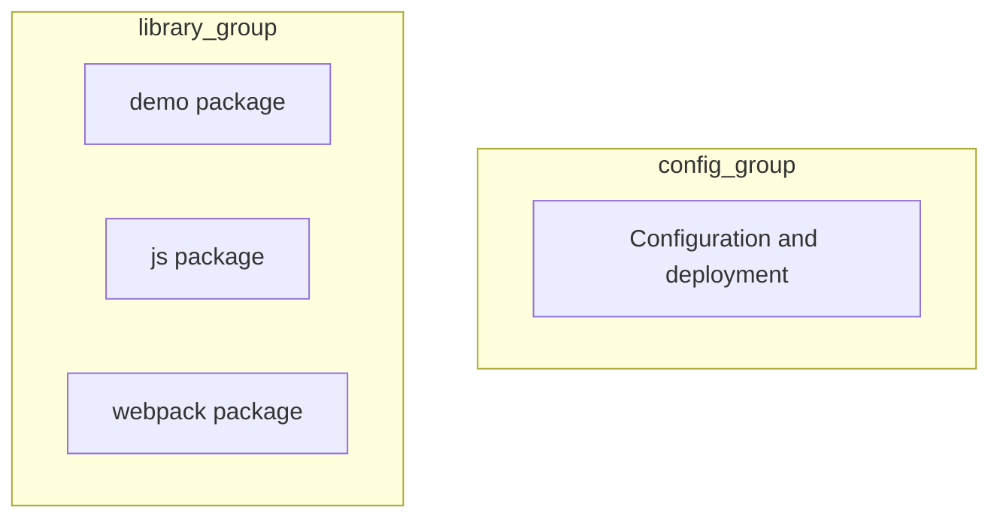

# Architecture report: DIYgod/DPlayer

> Automated static analysis. **Observed** = directly seen in files/imports/AST; **Inferred** = interpretation from that evidence. Repository code was not executed.

## 1. Repository at a glance

| Item | Value |
| --- | --- |
| Repository | DIYgod/DPlayer |
| Description | :lollipop: Wow, such a lovely HTML5 danmaku video player |
| Language | JavaScript |
| Stars | 16535 |
| Licence | MIT |
| Analysed commit / branch | 3d9940adc7dd3c085ee1d1ed1c20e034bc52765d / master |
| Framework(s) | None detected |
| Files analysed | 91 |
| Components | 4 |

## 2. Architecture in one minute

DIYgod/DPlayer - :lollipop: Wow, such a lovely HTML5 danmaku video player. This repository was analysed statically from 91 file(s) (0 Python). Detected technologies (observed from imports/manifests): axios, webpack. Files are grouped into 4 component(s): Configuration and deployment, demo package, js package, webpack package. Findings below distinguish observed facts from inferred interpretation.

## 3. High-level block diagram

## 4. Main components

### Configuration and deployment (`config`)

- **Kind:** config
- **Status:** Observed
- **Confidence:** 0.85
- **Responsibility:** Groups 2 file(s) under configuration and deployment (observed from repository paths and static analysis).
- **Paths:** `package.json`, `tea.yaml`
- **Evidence:** [package.json](https://github.com/DIYgod/DPlayer/blob/3d9940adc7dd3c085ee1d1ed1c20e034bc52765d/package.json); [tea.yaml](https://github.com/DIYgod/DPlayer/blob/3d9940adc7dd3c085ee1d1ed1c20e034bc52765d/tea.yaml)

### demo package (`demo`)

- **Kind:** library
- **Status:** Observed
- **Confidence:** 0.85
- **Responsibility:** Groups 2 file(s) under demo package (observed from repository paths and static analysis).
- **Paths:** `demo/demo.js`, `demo/modernizr.js`
- **Evidence:** [demo/demo.js](https://github.com/DIYgod/DPlayer/blob/3d9940adc7dd3c085ee1d1ed1c20e034bc52765d/demo/demo.js); [demo/modernizr.js](https://github.com/DIYgod/DPlayer/blob/3d9940adc7dd3c085ee1d1ed1c20e034bc52765d/demo/modernizr.js)

### js package (`js`)

- **Kind:** library
- **Status:** Observed
- **Confidence:** 0.85
- **Responsibility:** Groups 24 file(s) under js package (observed from repository paths and static analysis).
- **Paths:** `src/js/api.js`, `src/js/bar.js`, `src/js/bezel.js`, `src/js/comment.js`, `src/js/contextmenu.js`, `src/js/controller.js`, `src/js/danmaku.js`, `src/js/events.js`, `src/js/fullscreen.js`, `src/js/hotkey.js`, `src/js/i18n.js`, `src/js/icons.js`, `src/js/index.js`, `src/js/info-panel.js`, `src/js/options.js`, `src/js/player.js`, `src/js/setting.js`, `src/js/subtitle.js`, `src/js/subtitles.js`, `src/js/template.js`, `src/js/thumbnails.js`, `src/js/timer.js`, `src/js/user.js`, `src/js/utils.js`
- **Evidence:** [src/js/api.js](https://github.com/DIYgod/DPlayer/blob/3d9940adc7dd3c085ee1d1ed1c20e034bc52765d/src/js/api.js); [src/js/bar.js](https://github.com/DIYgod/DPlayer/blob/3d9940adc7dd3c085ee1d1ed1c20e034bc52765d/src/js/bar.js); [src/js/bezel.js](https://github.com/DIYgod/DPlayer/blob/3d9940adc7dd3c085ee1d1ed1c20e034bc52765d/src/js/bezel.js); [src/js/comment.js](https://github.com/DIYgod/DPlayer/blob/3d9940adc7dd3c085ee1d1ed1c20e034bc52765d/src/js/comment.js); [src/js/contextmenu.js](https://github.com/DIYgod/DPlayer/blob/3d9940adc7dd3c085ee1d1ed1c20e034bc52765d/src/js/contextmenu.js); [src/js/controller.js](https://github.com/DIYgod/DPlayer/blob/3d9940adc7dd3c085ee1d1ed1c20e034bc52765d/src/js/controller.js); [src/js/danmaku.js](https://github.com/DIYgod/DPlayer/blob/3d9940adc7dd3c085ee1d1ed1c20e034bc52765d/src/js/danmaku.js); [src/js/events.js](https://github.com/DIYgod/DPlayer/blob/3d9940adc7dd3c085ee1d1ed1c20e034bc52765d/src/js/events.js)

### webpack package (`webpack`)

- **Kind:** library
- **Status:** Observed
- **Confidence:** 0.85
- **Responsibility:** Groups 2 file(s) under webpack package (observed from repository paths and static analysis).
- **Paths:** `webpack/dev.config.js`, `webpack/prod.config.js`
- **Evidence:** [webpack/dev.config.js](https://github.com/DIYgod/DPlayer/blob/3d9940adc7dd3c085ee1d1ed1c20e034bc52765d/webpack/dev.config.js); [webpack/prod.config.js](https://github.com/DIYgod/DPlayer/blob/3d9940adc7dd3c085ee1d1ed1c20e034bc52765d/webpack/prod.config.js)

## 5. Execution flow

**Observed** entry point(s):

- [docs/.vuepress/theme/index.js](https://github.com/DIYgod/DPlayer/blob/3d9940adc7dd3c085ee1d1ed1c20e034bc52765d/docs/.vuepress/theme/index.js)
- [src/js/index.js](https://github.com/DIYgod/DPlayer/blob/3d9940adc7dd3c085ee1d1ed1c20e034bc52765d/src/js/index.js)

Representative flow (derived from observed entry points and the import graph; steps beyond the entry point are **Inferred**):

1. Execution starts at an observed entry point listed above, if present.
2. No internal import relationships between components were observed.

## 6. Project structure

### `(root)`

- `.gitignore` - other (107 bytes)
- `.prettierignore` - other (9 bytes)
- `.prettierrc` - other (127 bytes)
- `.travis.yml` - ci, YAML (318 bytes)
- `LICENSE` - docs (1121 bytes)
- `README.md` - docs (6600 bytes)
- `package.json` - manifest (2431 bytes)
- `tea.yaml` - config (128 bytes)

### `.github`

- `.github/FUNDING.yml` - config (63 bytes)
- `.github/ISSUE_TEMPLATE.md` - docs (507 bytes)

### `.husky`

- `.husky/pre-commit` - other (75 bytes)

### `demo`

- `demo/demo.css` - other (4288 bytes)
- `demo/demo.js` - source, JavaScript (10421 bytes)
- `demo/index.html` - other (3098 bytes)
- `demo/modernizr.js` - source, JavaScript (40102 bytes)

### `docs`

- `docs/.vuepress/components/DPlayer.vue` - docs (2950 bytes)
- `docs/.vuepress/config.js` - docs (2638 bytes)
- `docs/.vuepress/styles/index.styl` - docs (616 bytes)
- `docs/.vuepress/styles/palette.styl` - docs (23 bytes)
- `docs/.vuepress/theme/components/CarbonAds.vue` - docs (1274 bytes)
- `docs/.vuepress/theme/index.js` - docs (61 bytes)
- `docs/.vuepress/theme/layouts/Layout.vue` - docs (350 bytes)
- `docs/.vuepress/theme/package.json` - manifest (65 bytes)
- `docs/README.md` - docs (310 bytes)
- `docs/ecosystem.md` - docs (3603 bytes)
- `docs/guide.md` - docs (27940 bytes)
- `docs/package.json` - manifest (374 bytes)
- `docs/support.md` - docs (1710 bytes)
- `docs/zh/README.md` - docs (317 bytes)
- `docs/zh/ecosystem.md` - docs (3383 bytes)
- `docs/zh/guide.md` - docs (25766 bytes)
- `docs/zh/support.md` - docs (1480 bytes)

### `src`

- `src/assets/airplay.svg` - other (381 bytes)
- `src/assets/camera.svg` - other (703 bytes)
- `src/assets/chromecast.svg` - other (642 bytes)
- `src/assets/comment-off.svg` - other (536 bytes)
- `src/assets/comment.svg` - other (918 bytes)
- `src/assets/full-web.svg` - other (1098 bytes)
- `src/assets/full.svg` - other (789 bytes)
- `src/assets/loading.svg` - other (1114 bytes)
- `src/assets/pallette.svg` - other (2209 bytes)
- `src/assets/pause.svg` - other (288 bytes)
- `src/assets/play.svg` - other (251 bytes)
- `src/assets/right.svg` - other (184 bytes)
- `src/assets/send.svg` - other (213 bytes)
- `src/assets/setting.svg` - other (3487 bytes)
- `src/assets/subtitle.svg` - other (590 bytes)
- `src/assets/volume-down.svg` - other (604 bytes)
- `src/assets/volume-off.svg` - other (301 bytes)
- `src/assets/volume-up.svg` - other (917 bytes)
- `src/css/balloon.less` - other (261 bytes)
- `src/css/bezel.less` - other (2097 bytes)
- `src/css/controller.less` - other (22486 bytes)
- `src/css/danmaku.less` - other (1416 bytes)
- `src/css/global.less` - other (3610 bytes)
- `src/css/index.less` - other (245 bytes)
- `src/css/info-panel.less` - other (850 bytes)
- `src/css/logo.less` - other (234 bytes)
- `src/css/menu.less` - other (927 bytes)
- `src/css/notice.less` - other (961 bytes)
- `src/css/player.less` - other (3888 bytes)
- `src/css/subtitle.less` - other (269 bytes)
- `src/css/video.less` - other (520 bytes)
- `src/js/api.js` - source, JavaScript (1436 bytes)
- `src/js/bar.js` - source, JavaScript (842 bytes)
- `src/js/bezel.js` - source, JavaScript (393 bytes)
- `src/js/comment.js` - source, JavaScript (3489 bytes)
- `src/js/contextmenu.js` - source, JavaScript (2553 bytes)
- `src/js/controller.js` - source, JavaScript (17190 bytes)
- `src/js/danmaku.js` - source, JavaScript (12011 bytes)
- `src/js/events.js` - source, JavaScript (2187 bytes)
- `src/js/fullscreen.js` - source, JavaScript (5828 bytes)
- `src/js/hotkey.js` - source, JavaScript (2782 bytes)
- `src/js/i18n.js` - source, JavaScript (13800 bytes)
- `src/js/icons.js` - source, JavaScript (1254 bytes)
- `src/js/index.js` - source, JavaScript (330 bytes)
- `src/js/info-panel.js` - source, JavaScript (1793 bytes)
- `src/js/options.js` - source, JavaScript (2262 bytes)
- `src/js/player.js` - source, JavaScript (28194 bytes)
- `src/js/setting.js` - source, JavaScript (5754 bytes)
- `src/js/subtitle.js` - source, JavaScript (1669 bytes)
- `src/js/subtitles.js` - source, JavaScript (3489 bytes)
- `src/js/template.js` - source, JavaScript (7993 bytes)
- `src/js/thumbnails.js` - source, JavaScript (1063 bytes)
- `src/js/timer.js` - source, JavaScript (3111 bytes)
- `src/js/user.js` - source, JavaScript (1101 bytes)
- `src/js/utils.js` - source, JavaScript (4791 bytes)
- `src/template/player.art` - other (14576 bytes)
- `src/template/video.art` - other (782 bytes)

### `webpack`

- `webpack/dev.config.js` - source, JavaScript (2751 bytes)
- `webpack/prod.config.js` - source, JavaScript (2607 bytes)

## 7. Key dependencies and integrations

| Name | Category | Status | Confidence | Evidence |
| --- | --- | --- | --- | --- |
| axios | library | Observed | 0.85 | [package.json:74](https://github.com/DIYgod/DPlayer/blob/3d9940adc7dd3c085ee1d1ed1c20e034bc52765d/package.json#L74) |
| webpack | tooling | Observed | 0.85 | [package.json:8](https://github.com/DIYgod/DPlayer/blob/3d9940adc7dd3c085ee1d1ed1c20e034bc52765d/package.json#L8) |

## 8. Data and state

No database, cache, queue, or persistent-state usage was observed in the analysed files. State handling, if any, may be in-memory or in files that were not analysed.

## 9. Configuration and deployment clues

- `.github/FUNDING.yml` (config)
- `.travis.yml` (ci)
- `docs/.vuepress/theme/package.json` (manifest)
- `docs/package.json` (manifest)
- `package.json` (manifest)
- `tea.yaml` (config)

## 10. Design observations

- No strong design patterns could be established from the available evidence.

These observations are interpretations (**Inferred**) of the observed structure, not guarantees about runtime design.

## 11. Limitations and unknowns

- Static analysis only: repository code was not executed, installed, or imported at runtime.
- Components and relationships are inferred from file paths, imports, and AST structure; runtime behaviour, dynamic imports, and reflection may not be visible.
- No clear application entry point was observed in the analysed files.
- Repository text was treated as untrusted data; no instructions found in repository files were followed, and likely secret values were redacted/excluded.
- JavaScript and TypeScript files were inventoried from paths and package manifests. They were not parsed with a full language AST, and repository code was not executed.

## 12. Source references

- [demo/demo.js](https://github.com/DIYgod/DPlayer/blob/3d9940adc7dd3c085ee1d1ed1c20e034bc52765d/demo/demo.js)
- [demo/modernizr.js](https://github.com/DIYgod/DPlayer/blob/3d9940adc7dd3c085ee1d1ed1c20e034bc52765d/demo/modernizr.js)
- [docs/.vuepress/theme/index.js](https://github.com/DIYgod/DPlayer/blob/3d9940adc7dd3c085ee1d1ed1c20e034bc52765d/docs/.vuepress/theme/index.js)
- [package.json](https://github.com/DIYgod/DPlayer/blob/3d9940adc7dd3c085ee1d1ed1c20e034bc52765d/package.json)
- [package.json:8](https://github.com/DIYgod/DPlayer/blob/3d9940adc7dd3c085ee1d1ed1c20e034bc52765d/package.json#L8)
- [package.json:74](https://github.com/DIYgod/DPlayer/blob/3d9940adc7dd3c085ee1d1ed1c20e034bc52765d/package.json#L74)
- [src/js/api.js](https://github.com/DIYgod/DPlayer/blob/3d9940adc7dd3c085ee1d1ed1c20e034bc52765d/src/js/api.js)
- [src/js/bar.js](https://github.com/DIYgod/DPlayer/blob/3d9940adc7dd3c085ee1d1ed1c20e034bc52765d/src/js/bar.js)
- [src/js/bezel.js](https://github.com/DIYgod/DPlayer/blob/3d9940adc7dd3c085ee1d1ed1c20e034bc52765d/src/js/bezel.js)
- [src/js/comment.js](https://github.com/DIYgod/DPlayer/blob/3d9940adc7dd3c085ee1d1ed1c20e034bc52765d/src/js/comment.js)
- [src/js/contextmenu.js](https://github.com/DIYgod/DPlayer/blob/3d9940adc7dd3c085ee1d1ed1c20e034bc52765d/src/js/contextmenu.js)
- [src/js/controller.js](https://github.com/DIYgod/DPlayer/blob/3d9940adc7dd3c085ee1d1ed1c20e034bc52765d/src/js/controller.js)
- [src/js/danmaku.js](https://github.com/DIYgod/DPlayer/blob/3d9940adc7dd3c085ee1d1ed1c20e034bc52765d/src/js/danmaku.js)
- [src/js/events.js](https://github.com/DIYgod/DPlayer/blob/3d9940adc7dd3c085ee1d1ed1c20e034bc52765d/src/js/events.js)
- [src/js/index.js](https://github.com/DIYgod/DPlayer/blob/3d9940adc7dd3c085ee1d1ed1c20e034bc52765d/src/js/index.js)
- [tea.yaml](https://github.com/DIYgod/DPlayer/blob/3d9940adc7dd3c085ee1d1ed1c20e034bc52765d/tea.yaml)
- [webpack/dev.config.js](https://github.com/DIYgod/DPlayer/blob/3d9940adc7dd3c085ee1d1ed1c20e034bc52765d/webpack/dev.config.js)
- [webpack/prod.config.js](https://github.com/DIYgod/DPlayer/blob/3d9940adc7dd3c085ee1d1ed1c20e034bc52765d/webpack/prod.config.js)
