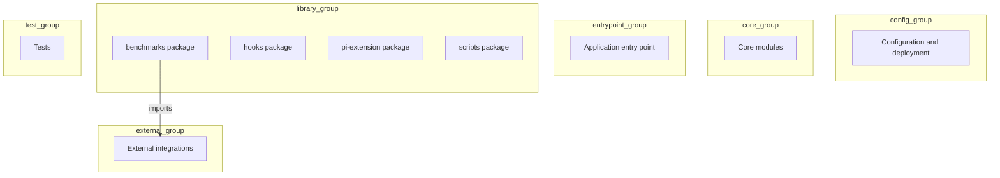

# Architecture report: DietrichGebert/ponytail

> Automated static analysis. **Observed** = directly seen in files/imports/AST; **Inferred** = interpretation from that evidence. Repository code was not executed.

## 1. Repository at a glance

| Item | Value |
| --- | --- |
| Repository | DietrichGebert/ponytail |
| Description | Makes your AI agent think like the laziest senior dev in the room. The best code is the code you never wrote. |
| Language | JavaScript |
| Stars | 190790 |
| Licence | MIT |
| Analysed commit / branch | 96608e078b2d5ea607c5c3b8b5a54d1c1fba6846 / main |
| Framework(s) | None detected |
| Files analysed | 170 |
| Components | 9 |

## 2. Architecture in one minute

DietrichGebert/ponytail - Makes your AI agent think like the laziest senior dev in the room. The best code is the code you never wrote.. This repository was analysed statically from 170 file(s) (7 Python). Detected technologies (observed from imports/manifests): GitHub Actions, SQLite. Files are grouped into 9 component(s): benchmarks package, Configuration and deployment, Core modules, Application entry point, External integrations, hooks package, pi-extension package, scripts package. Observed entry point(s): benchmarks/agentic/answer.py, benchmarks/agentic/compare.py, benchmarks/agentic/complete.py. Findings below distinguish observed facts from inferred interpretation.

## 3. High-level block diagram

## 4. Main components

### benchmarks package (`benchmarks`)

- **Kind:** library
- **Status:** Observed
- **Confidence:** 0.85
- **Responsibility:** Groups 7 file(s) under benchmarks package (observed from repository paths and static analysis). Observed top-level functions: _contained, _fail, _find, _find_class, _import, _import_pkg.
- **Paths:** `benchmarks/agentic/tasks.py`, `benchmarks/arms/baseline.js`, `benchmarks/arms/caveman.js`, `benchmarks/arms/ponytail.js`, `benchmarks/behavior.js`, `benchmarks/correctness.js`, `benchmarks/loc.js`
- **Evidence:** [benchmarks/agentic/tasks.py:34](https://github.com/DietrichGebert/ponytail/blob/96608e078b2d5ea607c5c3b8b5a54d1c1fba6846/benchmarks/agentic/tasks.py#L34); [benchmarks/arms/baseline.js](https://github.com/DietrichGebert/ponytail/blob/96608e078b2d5ea607c5c3b8b5a54d1c1fba6846/benchmarks/arms/baseline.js); [benchmarks/arms/caveman.js](https://github.com/DietrichGebert/ponytail/blob/96608e078b2d5ea607c5c3b8b5a54d1c1fba6846/benchmarks/arms/caveman.js); [benchmarks/arms/ponytail.js](https://github.com/DietrichGebert/ponytail/blob/96608e078b2d5ea607c5c3b8b5a54d1c1fba6846/benchmarks/arms/ponytail.js); [benchmarks/behavior.js](https://github.com/DietrichGebert/ponytail/blob/96608e078b2d5ea607c5c3b8b5a54d1c1fba6846/benchmarks/behavior.js); [benchmarks/correctness.js](https://github.com/DietrichGebert/ponytail/blob/96608e078b2d5ea607c5c3b8b5a54d1c1fba6846/benchmarks/correctness.js); [benchmarks/loc.js](https://github.com/DietrichGebert/ponytail/blob/96608e078b2d5ea607c5c3b8b5a54d1c1fba6846/benchmarks/loc.js)

### Configuration and deployment (`config`)

- **Kind:** config
- **Status:** Observed
- **Confidence:** 0.85
- **Responsibility:** Groups 23 file(s) under configuration and deployment (observed from repository paths and static analysis).
- **Paths:** `benchmarks/.env.example`, `benchmarks/behavior.yaml`, `benchmarks/promptfooconfig.gemini.yaml`, `benchmarks/promptfooconfig.gpt-newest.yaml`, `benchmarks/promptfooconfig.yaml`, `commands/ponytail-audit.toml`, `commands/ponytail-debt.toml`, `commands/ponytail-gain.toml`, `commands/ponytail-help.toml`, `commands/ponytail-review.toml`, `commands/ponytail.toml`, `gemini-extension.json`, `hooks/claude-band.json`, `hooks/claude-codex-hooks.json`, `hooks/copilot-hooks.json`, `hooks/cursor-hooks.json`, `hooks/qoder-hooks.json`, `opencode.json`, `package.json`, `pi-extension/package.json`, `plugin.json`, `plugin.yaml`, `skills/plugin.json`
- **Evidence:** [benchmarks/.env.example](https://github.com/DietrichGebert/ponytail/blob/96608e078b2d5ea607c5c3b8b5a54d1c1fba6846/benchmarks/.env.example); [benchmarks/behavior.yaml](https://github.com/DietrichGebert/ponytail/blob/96608e078b2d5ea607c5c3b8b5a54d1c1fba6846/benchmarks/behavior.yaml); [benchmarks/promptfooconfig.gemini.yaml](https://github.com/DietrichGebert/ponytail/blob/96608e078b2d5ea607c5c3b8b5a54d1c1fba6846/benchmarks/promptfooconfig.gemini.yaml); [benchmarks/promptfooconfig.gpt-newest.yaml](https://github.com/DietrichGebert/ponytail/blob/96608e078b2d5ea607c5c3b8b5a54d1c1fba6846/benchmarks/promptfooconfig.gpt-newest.yaml); [benchmarks/promptfooconfig.yaml](https://github.com/DietrichGebert/ponytail/blob/96608e078b2d5ea607c5c3b8b5a54d1c1fba6846/benchmarks/promptfooconfig.yaml); [commands/ponytail-audit.toml](https://github.com/DietrichGebert/ponytail/blob/96608e078b2d5ea607c5c3b8b5a54d1c1fba6846/commands/ponytail-audit.toml); [commands/ponytail-debt.toml](https://github.com/DietrichGebert/ponytail/blob/96608e078b2d5ea607c5c3b8b5a54d1c1fba6846/commands/ponytail-debt.toml); [commands/ponytail-gain.toml](https://github.com/DietrichGebert/ponytail/blob/96608e078b2d5ea607c5c3b8b5a54d1c1fba6846/commands/ponytail-gain.toml)

### Core modules (`core`)

- **Kind:** core
- **Status:** Observed
- **Confidence:** 0.85
- **Responsibility:** Groups 1 file(s) under core modules (observed from repository paths and static analysis). Observed top-level functions: _config_dir, _default_mode, _fallback_instructions, _filter_skill_body_for_mode, _handle_mode_command, _make_skill_command_handler.
- **Paths:** `__init__.py`
- **Evidence:** [__init__.py:28](https://github.com/DietrichGebert/ponytail/blob/96608e078b2d5ea607c5c3b8b5a54d1c1fba6846/__init__.py#L28)

### Application entry point (`entrypoint`)

- **Kind:** entrypoint
- **Status:** Observed
- **Confidence:** 0.85
- **Responsibility:** Groups 5 file(s) under application entry point (observed from repository paths and static analysis). Observed top-level functions: _base_cmd, _cells, _claude_version, _cli_call, _count, _fixed_diff.
- **Paths:** `benchmarks/agentic/answer.py`, `benchmarks/agentic/compare.py`, `benchmarks/agentic/complete.py`, `benchmarks/agentic/judge.py`, `benchmarks/agentic/run.py`
- **Evidence:** [benchmarks/agentic/answer.py:70](https://github.com/DietrichGebert/ponytail/blob/96608e078b2d5ea607c5c3b8b5a54d1c1fba6846/benchmarks/agentic/answer.py#L70); [benchmarks/agentic/compare.py:34](https://github.com/DietrichGebert/ponytail/blob/96608e078b2d5ea607c5c3b8b5a54d1c1fba6846/benchmarks/agentic/compare.py#L34); [benchmarks/agentic/complete.py:53](https://github.com/DietrichGebert/ponytail/blob/96608e078b2d5ea607c5c3b8b5a54d1c1fba6846/benchmarks/agentic/complete.py#L53); [benchmarks/agentic/judge.py:41](https://github.com/DietrichGebert/ponytail/blob/96608e078b2d5ea607c5c3b8b5a54d1c1fba6846/benchmarks/agentic/judge.py#L41); [benchmarks/agentic/run.py:34](https://github.com/DietrichGebert/ponytail/blob/96608e078b2d5ea607c5c3b8b5a54d1c1fba6846/benchmarks/agentic/run.py#L34)

### External integrations (`external_integrations`)

- **Kind:** external
- **Status:** Inferred
- **Confidence:** 0.70
- **Responsibility:** Groups 0 file(s) under external integrations (observed from repository paths and static analysis).
- **Evidence:** [benchmarks/agentic/tasks.py:23](https://github.com/DietrichGebert/ponytail/blob/96608e078b2d5ea607c5c3b8b5a54d1c1fba6846/benchmarks/agentic/tasks.py#L23); [benchmarks/agentic/tasks.py:526](https://github.com/DietrichGebert/ponytail/blob/96608e078b2d5ea607c5c3b8b5a54d1c1fba6846/benchmarks/agentic/tasks.py#L526)

### hooks package (`hooks`)

- **Kind:** library
- **Status:** Observed
- **Confidence:** 0.85
- **Responsibility:** Groups 14 file(s) under hooks package (observed from repository paths and static analysis).
- **Paths:** `hooks/band/board.ts`, `hooks/band/logo.ts`, `hooks/band/metrics.ts`, `hooks/band/register.tsx`, `hooks/band/types.d.ts`, `hooks/ponytail-activate.js`, `hooks/ponytail-band-import.js`, `hooks/ponytail-config.js`, `hooks/ponytail-instructions.js`, `hooks/ponytail-map.js`, `hooks/ponytail-mode-tracker.js`, `hooks/ponytail-runtime.js`, `hooks/ponytail-statusline.sh`, `hooks/ponytail-subagent.js`
- **Evidence:** [hooks/band/board.ts](https://github.com/DietrichGebert/ponytail/blob/96608e078b2d5ea607c5c3b8b5a54d1c1fba6846/hooks/band/board.ts); [hooks/band/logo.ts](https://github.com/DietrichGebert/ponytail/blob/96608e078b2d5ea607c5c3b8b5a54d1c1fba6846/hooks/band/logo.ts); [hooks/band/metrics.ts](https://github.com/DietrichGebert/ponytail/blob/96608e078b2d5ea607c5c3b8b5a54d1c1fba6846/hooks/band/metrics.ts); [hooks/band/register.tsx](https://github.com/DietrichGebert/ponytail/blob/96608e078b2d5ea607c5c3b8b5a54d1c1fba6846/hooks/band/register.tsx); [hooks/band/types.d.ts](https://github.com/DietrichGebert/ponytail/blob/96608e078b2d5ea607c5c3b8b5a54d1c1fba6846/hooks/band/types.d.ts); [hooks/ponytail-activate.js](https://github.com/DietrichGebert/ponytail/blob/96608e078b2d5ea607c5c3b8b5a54d1c1fba6846/hooks/ponytail-activate.js); [hooks/ponytail-band-import.js](https://github.com/DietrichGebert/ponytail/blob/96608e078b2d5ea607c5c3b8b5a54d1c1fba6846/hooks/ponytail-band-import.js); [hooks/ponytail-config.js](https://github.com/DietrichGebert/ponytail/blob/96608e078b2d5ea607c5c3b8b5a54d1c1fba6846/hooks/ponytail-config.js)

### pi-extension package (`pi_extension`)

- **Kind:** library
- **Status:** Observed
- **Confidence:** 0.85
- **Responsibility:** Groups 1 file(s) under pi-extension package (observed from repository paths and static analysis).
- **Paths:** `pi-extension/index.js`
- **Evidence:** [pi-extension/index.js](https://github.com/DietrichGebert/ponytail/blob/96608e078b2d5ea607c5c3b8b5a54d1c1fba6846/pi-extension/index.js)

### scripts package (`scripts`)

- **Kind:** library
- **Status:** Observed
- **Confidence:** 0.85
- **Responsibility:** Groups 6 file(s) under scripts package (observed from repository paths and static analysis).
- **Paths:** `scripts/build-openclaw-skills.js`, `scripts/check-rule-copies.js`, `scripts/check-versions.js`, `scripts/cursor-hooks.js`, `scripts/publish-openclaw-skills.js`, `scripts/uninstall.js`
- **Evidence:** [scripts/build-openclaw-skills.js](https://github.com/DietrichGebert/ponytail/blob/96608e078b2d5ea607c5c3b8b5a54d1c1fba6846/scripts/build-openclaw-skills.js); [scripts/check-rule-copies.js](https://github.com/DietrichGebert/ponytail/blob/96608e078b2d5ea607c5c3b8b5a54d1c1fba6846/scripts/check-rule-copies.js); [scripts/check-versions.js](https://github.com/DietrichGebert/ponytail/blob/96608e078b2d5ea607c5c3b8b5a54d1c1fba6846/scripts/check-versions.js); [scripts/cursor-hooks.js](https://github.com/DietrichGebert/ponytail/blob/96608e078b2d5ea607c5c3b8b5a54d1c1fba6846/scripts/cursor-hooks.js); [scripts/publish-openclaw-skills.js](https://github.com/DietrichGebert/ponytail/blob/96608e078b2d5ea607c5c3b8b5a54d1c1fba6846/scripts/publish-openclaw-skills.js); [scripts/uninstall.js](https://github.com/DietrichGebert/ponytail/blob/96608e078b2d5ea607c5c3b8b5a54d1c1fba6846/scripts/uninstall.js)

### Tests (`tests`)

- **Kind:** test
- **Status:** Observed
- **Confidence:** 0.85
- **Responsibility:** Groups 24 file(s) under tests (observed from repository paths and static analysis).
- **Paths:** `pi-extension/test/extension.test.js`, `pi-extension/test/helpers.test.js`, `tests/activation-map.test.js`, `tests/band-import.test.js`, `tests/band.test.tsx`, `tests/behavior.test.js`, `tests/commands.test.js`, `tests/copilot-plugin.test.js`, `tests/correctness.test.js`, `tests/cursor-hooks.test.js`, `tests/gemini-extension.test.js`, `tests/grok-plugin.test.js`, `tests/hermes-plugin.test.js`, `tests/hooks-windows.test.js`, `tests/hooks.test.js`, `tests/kimi-plugin.test.js`, `tests/loc.test.js`, `tests/map.test.js`, `tests/openclaw-skills.test.js`, `tests/opencode-plugin.test.js`, `tests/package-scripts.test.js`, `tests/package.test.js`, `tests/qoder-plugin.test.js`, `tests/uninstall.test.js`
- **Evidence:** [pi-extension/test/extension.test.js](https://github.com/DietrichGebert/ponytail/blob/96608e078b2d5ea607c5c3b8b5a54d1c1fba6846/pi-extension/test/extension.test.js); [pi-extension/test/helpers.test.js](https://github.com/DietrichGebert/ponytail/blob/96608e078b2d5ea607c5c3b8b5a54d1c1fba6846/pi-extension/test/helpers.test.js); [tests/activation-map.test.js](https://github.com/DietrichGebert/ponytail/blob/96608e078b2d5ea607c5c3b8b5a54d1c1fba6846/tests/activation-map.test.js); [tests/band-import.test.js](https://github.com/DietrichGebert/ponytail/blob/96608e078b2d5ea607c5c3b8b5a54d1c1fba6846/tests/band-import.test.js); [tests/band.test.tsx](https://github.com/DietrichGebert/ponytail/blob/96608e078b2d5ea607c5c3b8b5a54d1c1fba6846/tests/band.test.tsx); [tests/behavior.test.js](https://github.com/DietrichGebert/ponytail/blob/96608e078b2d5ea607c5c3b8b5a54d1c1fba6846/tests/behavior.test.js); [tests/commands.test.js](https://github.com/DietrichGebert/ponytail/blob/96608e078b2d5ea607c5c3b8b5a54d1c1fba6846/tests/commands.test.js); [tests/copilot-plugin.test.js](https://github.com/DietrichGebert/ponytail/blob/96608e078b2d5ea607c5c3b8b5a54d1c1fba6846/tests/copilot-plugin.test.js)

## 5. Execution flow

**Observed** entry point(s):

- [.opencode/plugins/index.js](https://github.com/DietrichGebert/ponytail/blob/96608e078b2d5ea607c5c3b8b5a54d1c1fba6846/.opencode/plugins/index.js)
- [benchmarks/agentic/answer.py:287](https://github.com/DietrichGebert/ponytail/blob/96608e078b2d5ea607c5c3b8b5a54d1c1fba6846/benchmarks/agentic/answer.py#L287)
- [benchmarks/agentic/compare.py:92](https://github.com/DietrichGebert/ponytail/blob/96608e078b2d5ea607c5c3b8b5a54d1c1fba6846/benchmarks/agentic/compare.py#L92)
- [benchmarks/agentic/complete.py:177](https://github.com/DietrichGebert/ponytail/blob/96608e078b2d5ea607c5c3b8b5a54d1c1fba6846/benchmarks/agentic/complete.py#L177)
- [benchmarks/agentic/judge.py:197](https://github.com/DietrichGebert/ponytail/blob/96608e078b2d5ea607c5c3b8b5a54d1c1fba6846/benchmarks/agentic/judge.py#L197)
- [benchmarks/agentic/run.py:542](https://github.com/DietrichGebert/ponytail/blob/96608e078b2d5ea607c5c3b8b5a54d1c1fba6846/benchmarks/agentic/run.py#L542)
- [pi-extension/index.js](https://github.com/DietrichGebert/ponytail/blob/96608e078b2d5ea607c5c3b8b5a54d1c1fba6846/pi-extension/index.js)

Representative flow (derived from observed entry points and the import graph; steps beyond the entry point are **Inferred**):

1. Execution starts at an observed entry point listed above, if present.
2. `benchmarks` imports `external_integrations` (benchmarks package -> External integrations).

## 6. Project structure

### `(root)`

- `.gitignore` - other (615 bytes)
- `AGENTS.md` - docs (2721 bytes)
- `INSTALL.md` - docs (15774 bytes)
- `LICENSE` - docs (1071 bytes)
- `README.md` - docs (14837 bytes)
- `__init__.py` - source, Python (8936 bytes)
- `after-install.md` - docs (662 bytes)
- `gemini-extension.json` - config (233 bytes)
- `opencode.json` - config (51 bytes)
- `package.json` - manifest (1260 bytes)
- `plugin.json` - config (25 bytes)
- `plugin.yaml` - config (467 bytes)

### `.agents`

- `.agents/plugins/marketplace.json` - config (410 bytes)
- `.agents/rules/ponytail.md` - docs (2623 bytes)

### `.claude-plugin`

- `.claude-plugin/marketplace.json` - config (513 bytes)
- `.claude-plugin/plugin.json` - config (1508 bytes)

### `.clinerules`

- `.clinerules/ponytail.md` - docs (2623 bytes)

### `.codex-plugin`

- `.codex-plugin/plugin.json` - config (1286 bytes)

### `.cursor`

- `.cursor/rules/ponytail.mdc` - other (2748 bytes)

### `.devin-plugin`

- `.devin-plugin/plugin.json` - config (508 bytes)

### `.github`

- `.github/CONTRIBUTING.md` - docs (2940 bytes)
- `.github/FUNDING.yml` - config (25 bytes)
- `.github/copilot-instructions.md` - docs (2623 bytes)
- `.github/plugin/marketplace.json` - config (610 bytes)
- `.github/plugin/plugin.json` - config (597 bytes)
- `.github/workflows/publish.yml` - ci, YAML (775 bytes)
- `.github/workflows/test.yml` - ci, YAML (902 bytes)

### `.grok-plugin`

- `.grok-plugin/marketplace.json` - config (445 bytes)

### `.kimi-plugin`

- `.kimi-plugin/plugin.json` - config (565 bytes)

### `.kiro`

- `.kiro/steering/ponytail.md` - docs (2688 bytes)

### `.openclaw`

- `.openclaw/skills/ponytail-audit/SKILL.md` - docs (5250 bytes)
- `.openclaw/skills/ponytail-debt/SKILL.md` - docs (1745 bytes)
- `.openclaw/skills/ponytail-gain/SKILL.md` - docs (2199 bytes)
- `.openclaw/skills/ponytail-help/SKILL.md` - docs (3186 bytes)
- `.openclaw/skills/ponytail-review/SKILL.md` - docs (4976 bytes)
- `.openclaw/skills/ponytail/SKILL.md` - docs (3267 bytes)

### `.opencode`

- `.opencode/command/ponytail-audit.md` - docs (1680 bytes)
- `.opencode/command/ponytail-debt.md` - docs (902 bytes)
- `.opencode/command/ponytail-gain.md` - docs (1252 bytes)
- `.opencode/command/ponytail-help.md` - docs (1141 bytes)
- `.opencode/command/ponytail-review.md` - docs (2064 bytes)
- `.opencode/command/ponytail.md` - docs (608 bytes)
- `.opencode/plugins/index.js` - source, JavaScript (274 bytes)
- `.opencode/plugins/ponytail-frontmatter.cjs` - source, JavaScript (2848 bytes)
- `.opencode/plugins/ponytail.mjs` - source, JavaScript (7653 bytes)

### `.qoder`

- `.qoder/rules/ponytail.md` - docs (2623 bytes)

### `.qoder-plugin`

- `.qoder-plugin/plugin.json` - config (602 bytes)

### `.windsurf`

- `.windsurf/rules/ponytail.md` - docs (2623 bytes)

### `assets`

- `assets/benchmark-3model.svg` - other (2753 bytes)
- `assets/benchmark-agentic.svg` - other (6295 bytes)
- `assets/logo-dark.svg` - other (86402 bytes)
- `assets/logo-greenpt-dark.svg` - other (5851 bytes)
- `assets/logo-greenpt.svg` - other (5851 bytes)
- `assets/photoreunion-logo-dark.svg` - other (108512 bytes)
- `assets/photoreunion-logo-light.svg` - other (108512 bytes)
- `assets/retriever-logo-dark.svg` - other (29153 bytes)
- `assets/retriever-logo-light.svg` - other (29153 bytes)

### `benchmarks`

- `benchmarks/.env.example` - config (106 bytes)
- `benchmarks/README.md` - docs (6637 bytes)
- `benchmarks/agentic/README.md` - docs (12226 bytes)
- `benchmarks/agentic/answer.py` - source, Python (18071 bytes)
- `benchmarks/agentic/compare.py` - source, Python (4623 bytes)
- `benchmarks/agentic/complete.py` - source, Python (9704 bytes)
- `benchmarks/agentic/judge.py` - source, Python (11004 bytes)
- `benchmarks/agentic/run.py` - source, Python (31802 bytes)
- `benchmarks/agentic/tasks.py` - source, Python (73818 bytes)
- `benchmarks/arms/baseline.js` - source, JavaScript (113 bytes)
- `benchmarks/arms/caveman-SKILL.md` - docs (3654 bytes)
- `benchmarks/arms/caveman.js` - source, JavaScript (315 bytes)
- `benchmarks/arms/ponytail.js` - source, JavaScript (373 bytes)
- `benchmarks/behavior.js` - source, JavaScript (2785 bytes)
- `benchmarks/behavior.yaml` - config (1685 bytes)
- `benchmarks/correctness.js` - source, JavaScript (10748 bytes)
- `benchmarks/loc.js` - source, JavaScript (935 bytes)
- `benchmarks/promptfooconfig.gemini.yaml` - config (1400 bytes)
- `benchmarks/promptfooconfig.gpt-newest.yaml` - config (1399 bytes)
- `benchmarks/promptfooconfig.yaml` - config (1815 bytes)
- `benchmarks/results/2026-06-12-caveman-vs-ponytail.md` - docs (3658 bytes)
- `benchmarks/results/2026-06-12-v4-hardening-vs-caveman.md` - docs (6758 bytes)
- `benchmarks/results/2026-06-15-llama3.2-local.md` - docs (3361 bytes)
- `benchmarks/results/2026-06-16-correctness-gate-fix.md` - docs (5484 bytes)
- `benchmarks/results/2026-06-16-robustness-audit.md` - docs (6747 bytes)
- `benchmarks/results/2026-06-17-agentic-safety.md` - docs (8109 bytes)
- `benchmarks/results/2026-06-17-cost-verification.md` - docs (4849 bytes)
- `benchmarks/results/2026-06-18-agentic.md` - docs (12226 bytes)
- `benchmarks/results/2026-06-22-issue-245-217-comprehension.md` - docs (5566 bytes)
- `benchmarks/results/2026-10-07-agentic.md` - docs (11079 bytes)

### `commands`

- `commands/ponytail-audit.toml` - config (1685 bytes)
- `commands/ponytail-debt.toml` - config (908 bytes)
- `commands/ponytail-gain.toml` - config (1257 bytes)
- `commands/ponytail-help.toml` - config (1152 bytes)
- `commands/ponytail-review.toml` - config (2069 bytes)
- `commands/ponytail.toml` - config (611 bytes)

### `docs`

- `docs/agent-portability.md` - docs (12826 bytes)
- `docs/cursor-hooks.md` - docs (13557 bytes)

### `examples`

- `examples/README.md` - docs (771 bytes)
- `examples/csv-sum.md` - docs (1742 bytes)
- `examples/debounce.md` - docs (5109 bytes)
- `examples/deep-clone.md` - docs (783 bytes)
- `examples/email-validation.md` - docs (4621 bytes)
- `examples/group-by.md` - docs (937 bytes)
- `examples/infinite-scroll.md` - docs (1498 bytes)
- `examples/modal-dialog.md` - docs (2027 bytes)
- `examples/number-formatting.md` - docs (1049 bytes)
- `examples/rate-limit.md` - docs (7055 bytes)
- `examples/react-countdown.md` - docs (8998 bytes)
- `examples/url-params.md` - docs (1057 bytes)

### `hooks`

- `hooks/band/board.ts` - source, TypeScript (45260 bytes)
- `hooks/band/logo.ts` - source, TypeScript (49871 bytes)
- `hooks/band/metrics.ts` - source, TypeScript (14738 bytes)
- `hooks/band/register.tsx` - source, TypeScript (21980 bytes)
- `hooks/band/types.d.ts` - source, TypeScript (640 bytes)
- `hooks/claude-band.json` - config (64 bytes)
- `hooks/claude-codex-hooks.json` - config (1230 bytes)
- `hooks/copilot-hooks.json` - config (1017 bytes)
- `hooks/cursor-hooks.json` - config (322 bytes)
- `hooks/ponytail-activate.js` - source, JavaScript (9347 bytes)
- `hooks/ponytail-band-import.js` - source, JavaScript (14078 bytes)
- `hooks/ponytail-config.js` - source, JavaScript (5911 bytes)
- `hooks/ponytail-instructions.js` - source, JavaScript (5565 bytes)
- `hooks/ponytail-map.js` - source, JavaScript (5439 bytes)
- `hooks/ponytail-mode-tracker.js` - source, JavaScript (9912 bytes)
- `hooks/ponytail-runtime.js` - source, JavaScript (7751 bytes)
- `hooks/ponytail-statusline.ps1` - other (885 bytes)
- `hooks/ponytail-statusline.sh` - source, Shell (696 bytes)
- `hooks/ponytail-subagent.js` - source, JavaScript (3462 bytes)
- `hooks/qoder-hooks.json` - config (718 bytes)

### `i18n`

- `i18n/README.es.md` - docs (16199 bytes)
- `i18n/README.ja.md` - docs (18861 bytes)
- `i18n/README.ko.md` - docs (17218 bytes)
- `i18n/README.zh-CN.md` - docs (15730 bytes)

### `pi-extension`

- `pi-extension/index.js` - source, JavaScript (9486 bytes)
- `pi-extension/package.json` - manifest (144 bytes)
- `pi-extension/test/extension.test.js` - test, JavaScript (16950 bytes)
- `pi-extension/test/helpers.test.js` - test, JavaScript (8628 bytes)

### `scripts`

- `scripts/build-openclaw-skills.js` - source, JavaScript (2858 bytes)
- `scripts/check-rule-copies.js` - source, JavaScript (2845 bytes)
- `scripts/check-versions.js` - source, JavaScript (3238 bytes)
- `scripts/cursor-hooks.js` - source, JavaScript (5511 bytes)
- `scripts/publish-openclaw-skills.js` - source, JavaScript (3088 bytes)
- `scripts/uninstall.js` - source, JavaScript (4400 bytes)

### `skills`

- `skills/plugin.json` - config (167 bytes)
- `skills/ponytail-audit/SKILL.md` - docs (5417 bytes)
- `skills/ponytail-debt/SKILL.md` - docs (1769 bytes)
- `skills/ponytail-gain/SKILL.md` - docs (2164 bytes)
- `skills/ponytail-help/SKILL.md` - docs (3188 bytes)
- `skills/ponytail-review/SKILL.md` - docs (5143 bytes)
- `skills/ponytail/SKILL.md` - docs (3496 bytes)

### `tests`

- `tests/activation-map.test.js` - test, JavaScript (2943 bytes)
- `tests/band-import.test.js` - test, JavaScript (7790 bytes)
- `tests/band.test.tsx` - test, TypeScript (25494 bytes)
- `tests/behavior.test.js` - test, JavaScript (3196 bytes)
- `tests/commands.test.js` - test, JavaScript (4539 bytes)
- `tests/copilot-plugin.test.js` - test, JavaScript (1049 bytes)
- `tests/correctness.test.js` - test, JavaScript (7408 bytes)
- `tests/cursor-hooks.test.js` - test, JavaScript (16887 bytes)
- `tests/gemini-extension.test.js` - test, JavaScript (3767 bytes)
- `tests/grok-plugin.test.js` - test, JavaScript (2003 bytes)
- `tests/hermes-plugin.test.js` - test, JavaScript (17418 bytes)
- `tests/hooks-windows.test.js` - test, JavaScript (10404 bytes)
- `tests/hooks.test.js` - test, JavaScript (48035 bytes)
- `tests/kimi-plugin.test.js` - test, JavaScript (1292 bytes)
- `tests/loc.test.js` - test, JavaScript (1087 bytes)
- `tests/map.test.js` - test, JavaScript (1606 bytes)
- `tests/openclaw-skills.test.js` - test, JavaScript (1219 bytes)
- `tests/opencode-plugin.test.js` - test, JavaScript (16532 bytes)
- `tests/package-scripts.test.js` - test, JavaScript (1582 bytes)
- `tests/package.test.js` - test, JavaScript (863 bytes)
- `tests/qoder-plugin.test.js` - test, JavaScript (3698 bytes)
- `tests/uninstall.test.js` - test, JavaScript (8192 bytes)

## 7. Key dependencies and integrations

| Name | Category | Status | Confidence | Evidence |
| --- | --- | --- | --- | --- |
| GitHub Actions | ci | Observed | 0.90 | [.github/workflows/publish.yml](https://github.com/DietrichGebert/ponytail/blob/96608e078b2d5ea607c5c3b8b5a54d1c1fba6846/.github/workflows/publish.yml); [.github/workflows/test.yml](https://github.com/DietrichGebert/ponytail/blob/96608e078b2d5ea607c5c3b8b5a54d1c1fba6846/.github/workflows/test.yml) |
| SQLite | database | Observed | 0.90 | [benchmarks/agentic/tasks.py:23](https://github.com/DietrichGebert/ponytail/blob/96608e078b2d5ea607c5c3b8b5a54d1c1fba6846/benchmarks/agentic/tasks.py#L23) |

## 8. Data and state

- **SQLite** (Observed, confidence 0.90) - evidence: [benchmarks/agentic/tasks.py:23](https://github.com/DietrichGebert/ponytail/blob/96608e078b2d5ea607c5c3b8b5a54d1c1fba6846/benchmarks/agentic/tasks.py#L23)

## 9. Configuration and deployment clues

- `.agents/plugins/marketplace.json` (config)
- `.claude-plugin/marketplace.json` (config)
- `.claude-plugin/plugin.json` (config)
- `.codex-plugin/plugin.json` (config)
- `.devin-plugin/plugin.json` (config)
- `.github/FUNDING.yml` (config)
- `.github/plugin/marketplace.json` (config)
- `.github/plugin/plugin.json` (config)
- `.github/workflows/publish.yml` (ci)
- `.github/workflows/test.yml` (ci)
- `.grok-plugin/marketplace.json` (config)
- `.kimi-plugin/plugin.json` (config)
- `.qoder-plugin/plugin.json` (config)
- `benchmarks/.env.example` (config)
- `benchmarks/behavior.yaml` (config)
- `benchmarks/promptfooconfig.gemini.yaml` (config)
- `benchmarks/promptfooconfig.gpt-newest.yaml` (config)
- `benchmarks/promptfooconfig.yaml` (config)
- `commands/ponytail-audit.toml` (config)
- `commands/ponytail-debt.toml` (config)
- `commands/ponytail-gain.toml` (config)
- `commands/ponytail-help.toml` (config)
- `commands/ponytail-review.toml` (config)
- `commands/ponytail.toml` (config)
- `gemini-extension.json` (config)
- `hooks/claude-band.json` (config)
- `hooks/claude-codex-hooks.json` (config)
- `hooks/copilot-hooks.json` (config)
- `hooks/cursor-hooks.json` (config)
- `hooks/qoder-hooks.json` (config)
- `opencode.json` (config)
- `package.json` (manifest)
- `pi-extension/package.json` (manifest)
- `plugin.json` (config)
- `plugin.yaml` (config)
- `skills/plugin.json` (config)

Environment variable *names* seen in example env files (values never recorded):

- `benchmarks/.env.example`: `ANTHROPIC_API_KEY`

## 10. Design observations

- An entry/API layer is separated from other code (Inferred from paths and decorators).
- Tests are present alongside source code (Observed from test file paths).
- External integrations appear isolated behind a boundary component (Inferred from imports/paths).

These observations are interpretations (**Inferred**) of the observed structure, not guarantees about runtime design.

## 11. Limitations and unknowns

- Static analysis only: repository code was not executed, installed, or imported at runtime.
- Components and relationships are inferred from file paths, imports, and AST structure; runtime behaviour, dynamic imports, and reflection may not be visible.
- Repository text was treated as untrusted data; no instructions found in repository files were followed, and likely secret values were redacted/excluded.

## 12. Source references

- [.github/workflows/publish.yml](https://github.com/DietrichGebert/ponytail/blob/96608e078b2d5ea607c5c3b8b5a54d1c1fba6846/.github/workflows/publish.yml)
- [.github/workflows/test.yml](https://github.com/DietrichGebert/ponytail/blob/96608e078b2d5ea607c5c3b8b5a54d1c1fba6846/.github/workflows/test.yml)
- [.opencode/plugins/index.js](https://github.com/DietrichGebert/ponytail/blob/96608e078b2d5ea607c5c3b8b5a54d1c1fba6846/.opencode/plugins/index.js)
- [__init__.py:28](https://github.com/DietrichGebert/ponytail/blob/96608e078b2d5ea607c5c3b8b5a54d1c1fba6846/__init__.py#L28)
- [benchmarks/.env.example](https://github.com/DietrichGebert/ponytail/blob/96608e078b2d5ea607c5c3b8b5a54d1c1fba6846/benchmarks/.env.example)
- [benchmarks/agentic/answer.py:70](https://github.com/DietrichGebert/ponytail/blob/96608e078b2d5ea607c5c3b8b5a54d1c1fba6846/benchmarks/agentic/answer.py#L70)
- [benchmarks/agentic/answer.py:287](https://github.com/DietrichGebert/ponytail/blob/96608e078b2d5ea607c5c3b8b5a54d1c1fba6846/benchmarks/agentic/answer.py#L287)
- [benchmarks/agentic/compare.py:34](https://github.com/DietrichGebert/ponytail/blob/96608e078b2d5ea607c5c3b8b5a54d1c1fba6846/benchmarks/agentic/compare.py#L34)
- [benchmarks/agentic/compare.py:92](https://github.com/DietrichGebert/ponytail/blob/96608e078b2d5ea607c5c3b8b5a54d1c1fba6846/benchmarks/agentic/compare.py#L92)
- [benchmarks/agentic/complete.py:53](https://github.com/DietrichGebert/ponytail/blob/96608e078b2d5ea607c5c3b8b5a54d1c1fba6846/benchmarks/agentic/complete.py#L53)
- [benchmarks/agentic/complete.py:177](https://github.com/DietrichGebert/ponytail/blob/96608e078b2d5ea607c5c3b8b5a54d1c1fba6846/benchmarks/agentic/complete.py#L177)
- [benchmarks/agentic/judge.py:41](https://github.com/DietrichGebert/ponytail/blob/96608e078b2d5ea607c5c3b8b5a54d1c1fba6846/benchmarks/agentic/judge.py#L41)
- [benchmarks/agentic/judge.py:197](https://github.com/DietrichGebert/ponytail/blob/96608e078b2d5ea607c5c3b8b5a54d1c1fba6846/benchmarks/agentic/judge.py#L197)
- [benchmarks/agentic/run.py:34](https://github.com/DietrichGebert/ponytail/blob/96608e078b2d5ea607c5c3b8b5a54d1c1fba6846/benchmarks/agentic/run.py#L34)
- [benchmarks/agentic/run.py:542](https://github.com/DietrichGebert/ponytail/blob/96608e078b2d5ea607c5c3b8b5a54d1c1fba6846/benchmarks/agentic/run.py#L542)
- [benchmarks/agentic/tasks.py:23](https://github.com/DietrichGebert/ponytail/blob/96608e078b2d5ea607c5c3b8b5a54d1c1fba6846/benchmarks/agentic/tasks.py#L23)
- [benchmarks/agentic/tasks.py:34](https://github.com/DietrichGebert/ponytail/blob/96608e078b2d5ea607c5c3b8b5a54d1c1fba6846/benchmarks/agentic/tasks.py#L34)
- [benchmarks/agentic/tasks.py:526](https://github.com/DietrichGebert/ponytail/blob/96608e078b2d5ea607c5c3b8b5a54d1c1fba6846/benchmarks/agentic/tasks.py#L526)
- [benchmarks/arms/baseline.js](https://github.com/DietrichGebert/ponytail/blob/96608e078b2d5ea607c5c3b8b5a54d1c1fba6846/benchmarks/arms/baseline.js)
- [benchmarks/arms/caveman.js](https://github.com/DietrichGebert/ponytail/blob/96608e078b2d5ea607c5c3b8b5a54d1c1fba6846/benchmarks/arms/caveman.js)
- [benchmarks/arms/ponytail.js](https://github.com/DietrichGebert/ponytail/blob/96608e078b2d5ea607c5c3b8b5a54d1c1fba6846/benchmarks/arms/ponytail.js)
- [benchmarks/behavior.js](https://github.com/DietrichGebert/ponytail/blob/96608e078b2d5ea607c5c3b8b5a54d1c1fba6846/benchmarks/behavior.js)
- [benchmarks/behavior.yaml](https://github.com/DietrichGebert/ponytail/blob/96608e078b2d5ea607c5c3b8b5a54d1c1fba6846/benchmarks/behavior.yaml)
- [benchmarks/correctness.js](https://github.com/DietrichGebert/ponytail/blob/96608e078b2d5ea607c5c3b8b5a54d1c1fba6846/benchmarks/correctness.js)
- [benchmarks/loc.js](https://github.com/DietrichGebert/ponytail/blob/96608e078b2d5ea607c5c3b8b5a54d1c1fba6846/benchmarks/loc.js)
- [benchmarks/promptfooconfig.gemini.yaml](https://github.com/DietrichGebert/ponytail/blob/96608e078b2d5ea607c5c3b8b5a54d1c1fba6846/benchmarks/promptfooconfig.gemini.yaml)
- [benchmarks/promptfooconfig.gpt-newest.yaml](https://github.com/DietrichGebert/ponytail/blob/96608e078b2d5ea607c5c3b8b5a54d1c1fba6846/benchmarks/promptfooconfig.gpt-newest.yaml)
- [benchmarks/promptfooconfig.yaml](https://github.com/DietrichGebert/ponytail/blob/96608e078b2d5ea607c5c3b8b5a54d1c1fba6846/benchmarks/promptfooconfig.yaml)
- [commands/ponytail-audit.toml](https://github.com/DietrichGebert/ponytail/blob/96608e078b2d5ea607c5c3b8b5a54d1c1fba6846/commands/ponytail-audit.toml)
- [commands/ponytail-debt.toml](https://github.com/DietrichGebert/ponytail/blob/96608e078b2d5ea607c5c3b8b5a54d1c1fba6846/commands/ponytail-debt.toml)
- [commands/ponytail-gain.toml](https://github.com/DietrichGebert/ponytail/blob/96608e078b2d5ea607c5c3b8b5a54d1c1fba6846/commands/ponytail-gain.toml)
- [hooks/band/board.ts](https://github.com/DietrichGebert/ponytail/blob/96608e078b2d5ea607c5c3b8b5a54d1c1fba6846/hooks/band/board.ts)
- [hooks/band/logo.ts](https://github.com/DietrichGebert/ponytail/blob/96608e078b2d5ea607c5c3b8b5a54d1c1fba6846/hooks/band/logo.ts)
- [hooks/band/metrics.ts](https://github.com/DietrichGebert/ponytail/blob/96608e078b2d5ea607c5c3b8b5a54d1c1fba6846/hooks/band/metrics.ts)
- [hooks/band/register.tsx](https://github.com/DietrichGebert/ponytail/blob/96608e078b2d5ea607c5c3b8b5a54d1c1fba6846/hooks/band/register.tsx)
- [hooks/band/types.d.ts](https://github.com/DietrichGebert/ponytail/blob/96608e078b2d5ea607c5c3b8b5a54d1c1fba6846/hooks/band/types.d.ts)
- [hooks/ponytail-activate.js](https://github.com/DietrichGebert/ponytail/blob/96608e078b2d5ea607c5c3b8b5a54d1c1fba6846/hooks/ponytail-activate.js)
- [hooks/ponytail-band-import.js](https://github.com/DietrichGebert/ponytail/blob/96608e078b2d5ea607c5c3b8b5a54d1c1fba6846/hooks/ponytail-band-import.js)
- [hooks/ponytail-config.js](https://github.com/DietrichGebert/ponytail/blob/96608e078b2d5ea607c5c3b8b5a54d1c1fba6846/hooks/ponytail-config.js)
- [pi-extension/index.js](https://github.com/DietrichGebert/ponytail/blob/96608e078b2d5ea607c5c3b8b5a54d1c1fba6846/pi-extension/index.js)
- [pi-extension/test/extension.test.js](https://github.com/DietrichGebert/ponytail/blob/96608e078b2d5ea607c5c3b8b5a54d1c1fba6846/pi-extension/test/extension.test.js)
- [pi-extension/test/helpers.test.js](https://github.com/DietrichGebert/ponytail/blob/96608e078b2d5ea607c5c3b8b5a54d1c1fba6846/pi-extension/test/helpers.test.js)
- [scripts/build-openclaw-skills.js](https://github.com/DietrichGebert/ponytail/blob/96608e078b2d5ea607c5c3b8b5a54d1c1fba6846/scripts/build-openclaw-skills.js)
- [scripts/check-rule-copies.js](https://github.com/DietrichGebert/ponytail/blob/96608e078b2d5ea607c5c3b8b5a54d1c1fba6846/scripts/check-rule-copies.js)
- [scripts/check-versions.js](https://github.com/DietrichGebert/ponytail/blob/96608e078b2d5ea607c5c3b8b5a54d1c1fba6846/scripts/check-versions.js)
- [scripts/cursor-hooks.js](https://github.com/DietrichGebert/ponytail/blob/96608e078b2d5ea607c5c3b8b5a54d1c1fba6846/scripts/cursor-hooks.js)
- [scripts/publish-openclaw-skills.js](https://github.com/DietrichGebert/ponytail/blob/96608e078b2d5ea607c5c3b8b5a54d1c1fba6846/scripts/publish-openclaw-skills.js)
- [scripts/uninstall.js](https://github.com/DietrichGebert/ponytail/blob/96608e078b2d5ea607c5c3b8b5a54d1c1fba6846/scripts/uninstall.js)
- [tests/activation-map.test.js](https://github.com/DietrichGebert/ponytail/blob/96608e078b2d5ea607c5c3b8b5a54d1c1fba6846/tests/activation-map.test.js)
- [tests/band-import.test.js](https://github.com/DietrichGebert/ponytail/blob/96608e078b2d5ea607c5c3b8b5a54d1c1fba6846/tests/band-import.test.js)
- [tests/band.test.tsx](https://github.com/DietrichGebert/ponytail/blob/96608e078b2d5ea607c5c3b8b5a54d1c1fba6846/tests/band.test.tsx)
- [tests/behavior.test.js](https://github.com/DietrichGebert/ponytail/blob/96608e078b2d5ea607c5c3b8b5a54d1c1fba6846/tests/behavior.test.js)
- [tests/commands.test.js](https://github.com/DietrichGebert/ponytail/blob/96608e078b2d5ea607c5c3b8b5a54d1c1fba6846/tests/commands.test.js)
- [tests/copilot-plugin.test.js](https://github.com/DietrichGebert/ponytail/blob/96608e078b2d5ea607c5c3b8b5a54d1c1fba6846/tests/copilot-plugin.test.js)
