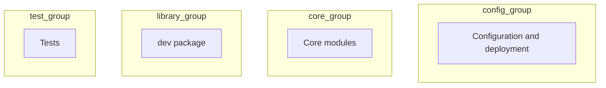

# Architecture report: DmitryBaranovskiy/raphael

> Automated static analysis. **Observed** = directly seen in files/imports/AST; **Inferred** = interpretation from that evidence. Repository code was not executed.

## 1. Repository at a glance

| Item | Value |
| --- | --- |
| Repository | DmitryBaranovskiy/raphael |
| Description | JavaScript Vector Library |
| Language | JavaScript |
| Stars | 11256 |
| Licence | MIT |
| Analysed commit / branch | b5fdbdc9850827eb49622cd0bc81b26025f8128a / master |
| Framework(s) | None detected |
| Files analysed | 19 |
| Components | 4 |

## 2. Architecture in one minute

DmitryBaranovskiy/raphael - JavaScript Vector Library. This repository was analysed statically from 19 file(s) (0 Python). Detected technologies (observed from imports/manifests): webpack. Files are grouped into 4 component(s): Configuration and deployment, Core modules, dev package, Tests. Findings below distinguish observed facts from inferred interpretation.

## 3. High-level block diagram

## 4. Main components

### Configuration and deployment (`config`)

- **Kind:** config
- **Status:** Observed
- **Confidence:** 0.85
- **Responsibility:** Groups 2 file(s) under configuration and deployment (observed from repository paths and static analysis).
- **Paths:** `bower.json`, `package.json`
- **Evidence:** [bower.json](https://github.com/DmitryBaranovskiy/raphael/blob/b5fdbdc9850827eb49622cd0bc81b26025f8128a/bower.json); [package.json](https://github.com/DmitryBaranovskiy/raphael/blob/b5fdbdc9850827eb49622cd0bc81b26025f8128a/package.json)

### Core modules (`core`)

- **Kind:** core
- **Status:** Observed
- **Confidence:** 0.85
- **Responsibility:** Groups 2 file(s) under core modules (observed from repository paths and static analysis).
- **Paths:** `Gruntfile.js`, `webpack.config.js`
- **Evidence:** [Gruntfile.js](https://github.com/DmitryBaranovskiy/raphael/blob/b5fdbdc9850827eb49622cd0bc81b26025f8128a/Gruntfile.js); [webpack.config.js](https://github.com/DmitryBaranovskiy/raphael/blob/b5fdbdc9850827eb49622cd0bc81b26025f8128a/webpack.config.js)

### dev package (`dev`)

- **Kind:** library
- **Status:** Observed
- **Confidence:** 0.85
- **Responsibility:** Groups 4 file(s) under dev package (observed from repository paths and static analysis).
- **Paths:** `dev/raphael.amd.js`, `dev/raphael.core.js`, `dev/raphael.svg.js`, `dev/raphael.vml.js`
- **Evidence:** [dev/raphael.amd.js](https://github.com/DmitryBaranovskiy/raphael/blob/b5fdbdc9850827eb49622cd0bc81b26025f8128a/dev/raphael.amd.js); [dev/raphael.core.js](https://github.com/DmitryBaranovskiy/raphael/blob/b5fdbdc9850827eb49622cd0bc81b26025f8128a/dev/raphael.core.js); [dev/raphael.svg.js](https://github.com/DmitryBaranovskiy/raphael/blob/b5fdbdc9850827eb49622cd0bc81b26025f8128a/dev/raphael.svg.js); [dev/raphael.vml.js](https://github.com/DmitryBaranovskiy/raphael/blob/b5fdbdc9850827eb49622cd0bc81b26025f8128a/dev/raphael.vml.js)

### Tests (`tests`)

- **Kind:** test
- **Status:** Observed
- **Confidence:** 0.85
- **Responsibility:** Groups 3 file(s) under tests (observed from repository paths and static analysis).
- **Paths:** `dev/test/index.html`, `dev/test/svg/dom.js`, `dev/test/vml/dom.js`
- **Evidence:** [dev/test/index.html](https://github.com/DmitryBaranovskiy/raphael/blob/b5fdbdc9850827eb49622cd0bc81b26025f8128a/dev/test/index.html); [dev/test/svg/dom.js](https://github.com/DmitryBaranovskiy/raphael/blob/b5fdbdc9850827eb49622cd0bc81b26025f8128a/dev/test/svg/dom.js); [dev/test/vml/dom.js](https://github.com/DmitryBaranovskiy/raphael/blob/b5fdbdc9850827eb49622cd0bc81b26025f8128a/dev/test/vml/dom.js)

## 5. Execution flow

No entry point was observed; the startup flow below is therefore limited.

Representative flow (derived from observed entry points and the import graph; steps beyond the entry point are **Inferred**):

1. Execution starts at an observed entry point listed above, if present.
2. No internal import relationships between components were observed.

## 6. Project structure

### `(root)`

- `.eslintrc.js` - source, JavaScript (90 bytes)
- `.gitignore` - other (90 bytes)
- `CONTRIBUTING.md` - docs (1153 bytes)
- `Gruntfile.js` - source, JavaScript (2109 bytes)
- `README.md` - docs (2752 bytes)
- `bower.json` - config (500 bytes)
- `history.md` - docs (7162 bytes)
- `license.txt` - docs (1083 bytes)
- `package.json` - manifest (1365 bytes)
- `webpack.config.js` - source, JavaScript (715 bytes)

### `dev`

- `dev/banner.txt` - docs (1755 bytes)
- `dev/raphael.amd.js` - source, JavaScript (94 bytes)
- `dev/raphael.core.js` - source, JavaScript (193554 bytes)
- `dev/raphael.svg.js` - source, JavaScript (56086 bytes)
- `dev/raphael.vml.js` - source, JavaScript (37317 bytes)
- `dev/raphaelTest.html` - other (1355 bytes)
- `dev/test/index.html` - test (865 bytes)
- `dev/test/svg/dom.js` - test, JavaScript (8603 bytes)
- `dev/test/vml/dom.js` - test, JavaScript (42 bytes)

## 7. Key dependencies and integrations

| Name | Category | Status | Confidence | Evidence |
| --- | --- | --- | --- | --- |
| webpack | tooling | Observed | 0.85 | [package.json:20](https://github.com/DmitryBaranovskiy/raphael/blob/b5fdbdc9850827eb49622cd0bc81b26025f8128a/package.json#L20) |

## 8. Data and state

No database, cache, queue, or persistent-state usage was observed in the analysed files. State handling, if any, may be in-memory or in files that were not analysed.

## 9. Configuration and deployment clues

- `bower.json` (config)
- `package.json` (manifest)

## 10. Design observations

- Tests are present alongside source code (Observed from test file paths).

These observations are interpretations (**Inferred**) of the observed structure, not guarantees about runtime design.

## 11. Limitations and unknowns

- Static analysis only: repository code was not executed, installed, or imported at runtime.
- Components and relationships are inferred from file paths, imports, and AST structure; runtime behaviour, dynamic imports, and reflection may not be visible.
- 1 file(s) were skipped during inventory (1 x lockfile excluded).
- No clear application entry point was observed in the analysed files.
- Repository text was treated as untrusted data; no instructions found in repository files were followed, and likely secret values were redacted/excluded.
- JavaScript and TypeScript files were inventoried from paths and package manifests. They were not parsed with a full language AST, and repository code was not executed.

## 12. Source references

- [Gruntfile.js](https://github.com/DmitryBaranovskiy/raphael/blob/b5fdbdc9850827eb49622cd0bc81b26025f8128a/Gruntfile.js)
- [bower.json](https://github.com/DmitryBaranovskiy/raphael/blob/b5fdbdc9850827eb49622cd0bc81b26025f8128a/bower.json)
- [dev/raphael.amd.js](https://github.com/DmitryBaranovskiy/raphael/blob/b5fdbdc9850827eb49622cd0bc81b26025f8128a/dev/raphael.amd.js)
- [dev/raphael.core.js](https://github.com/DmitryBaranovskiy/raphael/blob/b5fdbdc9850827eb49622cd0bc81b26025f8128a/dev/raphael.core.js)
- [dev/raphael.svg.js](https://github.com/DmitryBaranovskiy/raphael/blob/b5fdbdc9850827eb49622cd0bc81b26025f8128a/dev/raphael.svg.js)
- [dev/raphael.vml.js](https://github.com/DmitryBaranovskiy/raphael/blob/b5fdbdc9850827eb49622cd0bc81b26025f8128a/dev/raphael.vml.js)
- [dev/test/index.html](https://github.com/DmitryBaranovskiy/raphael/blob/b5fdbdc9850827eb49622cd0bc81b26025f8128a/dev/test/index.html)
- [dev/test/svg/dom.js](https://github.com/DmitryBaranovskiy/raphael/blob/b5fdbdc9850827eb49622cd0bc81b26025f8128a/dev/test/svg/dom.js)
- [dev/test/vml/dom.js](https://github.com/DmitryBaranovskiy/raphael/blob/b5fdbdc9850827eb49622cd0bc81b26025f8128a/dev/test/vml/dom.js)
- [package.json](https://github.com/DmitryBaranovskiy/raphael/blob/b5fdbdc9850827eb49622cd0bc81b26025f8128a/package.json)
- [package.json:20](https://github.com/DmitryBaranovskiy/raphael/blob/b5fdbdc9850827eb49622cd0bc81b26025f8128a/package.json#L20)
- [webpack.config.js](https://github.com/DmitryBaranovskiy/raphael/blob/b5fdbdc9850827eb49622cd0bc81b26025f8128a/webpack.config.js)
