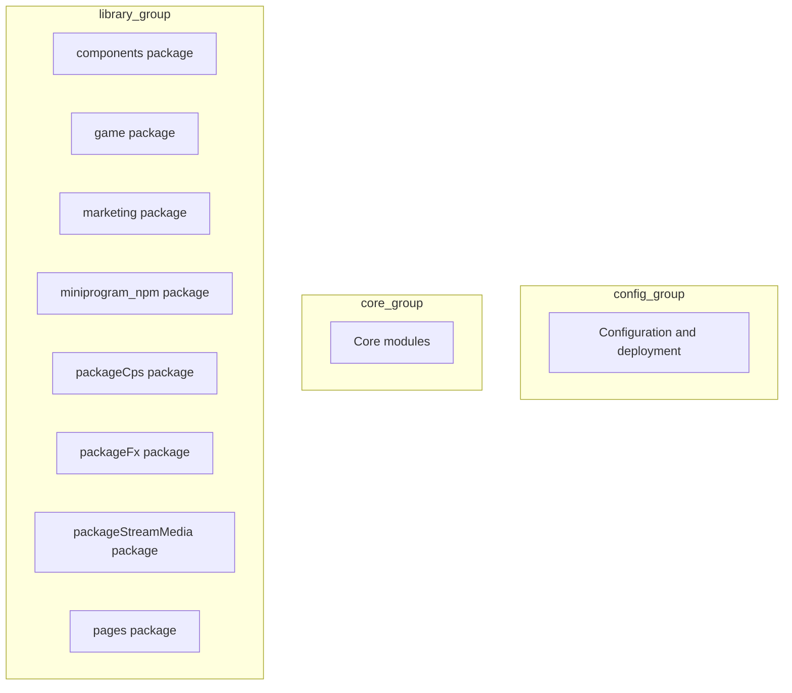

# Architecture report: EastWorld/wechat-app-mall

> Automated static analysis. **Observed** = directly seen in files/imports/AST; **Inferred** = interpretation from that evidence. Repository code was not executed.

## 1. Repository at a glance

| Item | Value |
| --- | --- |
| Repository | EastWorld/wechat-app-mall |
| Description | 微信小程序商城，微信小程序微店 |
| Language | JavaScript |
| Stars | 21926 |
| Licence | Apache-2.0 |
| Analysed commit / branch | 1ef2388e5f3f1e9784e782c6cdf3542ba90f178f / master |
| Framework(s) | None detected |
| Files analysed | 800 |
| Components | 10 |

## 2. Architecture in one minute

EastWorld/wechat-app-mall - 微信小程序商城，微信小程序微店. This repository was analysed statically from 800 file(s) (0 Python). Detected technologies (observed from imports/manifests): no known frameworks/libraries. Files are grouped into 10 component(s): components package, Configuration and deployment, Core modules, game package, marketing package, miniprogram_npm package, packageCps package, packageFx package. Findings below distinguish observed facts from inferred interpretation.

## 3. High-level block diagram

## 4. Main components

### components package (`components`)

- **Kind:** library
- **Status:** Observed
- **Confidence:** 0.85
- **Responsibility:** Groups 7 file(s) under components package (observed from repository paths and static analysis).
- **Paths:** `components/bind-mobile/index.js`, `components/date-time-selecter/index.js`, `components/fuwuxieyi/index.js`, `components/goods-pop/index.js`, `components/login/index.js`, `components/payment/index.js`, `components/vip-success/index.js`
- **Evidence:** [components/bind-mobile/index.js](https://github.com/EastWorld/wechat-app-mall/blob/1ef2388e5f3f1e9784e782c6cdf3542ba90f178f/components/bind-mobile/index.js); [components/date-time-selecter/index.js](https://github.com/EastWorld/wechat-app-mall/blob/1ef2388e5f3f1e9784e782c6cdf3542ba90f178f/components/date-time-selecter/index.js); [components/fuwuxieyi/index.js](https://github.com/EastWorld/wechat-app-mall/blob/1ef2388e5f3f1e9784e782c6cdf3542ba90f178f/components/fuwuxieyi/index.js); [components/goods-pop/index.js](https://github.com/EastWorld/wechat-app-mall/blob/1ef2388e5f3f1e9784e782c6cdf3542ba90f178f/components/goods-pop/index.js); [components/login/index.js](https://github.com/EastWorld/wechat-app-mall/blob/1ef2388e5f3f1e9784e782c6cdf3542ba90f178f/components/login/index.js); [components/payment/index.js](https://github.com/EastWorld/wechat-app-mall/blob/1ef2388e5f3f1e9784e782c6cdf3542ba90f178f/components/payment/index.js); [components/vip-success/index.js](https://github.com/EastWorld/wechat-app-mall/blob/1ef2388e5f3f1e9784e782c6cdf3542ba90f178f/components/vip-success/index.js)

### Configuration and deployment (`config`)

- **Kind:** config
- **Status:** Observed
- **Confidence:** 0.85
- **Responsibility:** Groups 144 file(s) under configuration and deployment (observed from repository paths and static analysis).
- **Paths:** `app.json`, `components/bind-mobile/index.json`, `components/date-time-selecter/index.json`, `components/fuwuxieyi/index.json`, `components/goods-pop/index.json`, `components/login/index.json`, `components/payment/index.json`, `components/vip-success/index.json`, `game/numberBomb/index.json`, `jsconfig.json`, `marketing/listing/detail.json`, `marketing/listing/edit.json`, `marketing/listing/index.json`, `miniprogram_npm/@vant/weapp/action-sheet/index.json`, `miniprogram_npm/@vant/weapp/area/index.json`, `miniprogram_npm/@vant/weapp/button/index.json`, `miniprogram_npm/@vant/weapp/calendar/components/header/index.json`, `miniprogram_npm/@vant/weapp/calendar/components/month/index.json`, `miniprogram_npm/@vant/weapp/calendar/index.json`, `miniprogram_npm/@vant/weapp/card/index.json`, `miniprogram_npm/@vant/weapp/cascader/index.json`, `miniprogram_npm/@vant/weapp/cell-group/index.json`, `miniprogram_npm/@vant/weapp/cell/index.json`, `miniprogram_npm/@vant/weapp/checkbox-group/index.json`, `miniprogram_npm/@vant/weapp/checkbox/index.json`, `miniprogram_npm/@vant/weapp/circle/index.json`, `miniprogram_npm/@vant/weapp/col/index.json`, `miniprogram_npm/@vant/weapp/collapse-item/index.json`, `miniprogram_npm/@vant/weapp/collapse/index.json`, `miniprogram_npm/@vant/weapp/config-provider/index.json`, `miniprogram_npm/@vant/weapp/count-down/index.json`, `miniprogram_npm/@vant/weapp/datetime-picker/index.json`, `miniprogram_npm/@vant/weapp/dialog/index.json`, `miniprogram_npm/@vant/weapp/divider/index.json`, `miniprogram_npm/@vant/weapp/dropdown-item/index.json`, `miniprogram_npm/@vant/weapp/dropdown-menu/index.json`, `miniprogram_npm/@vant/weapp/empty/index.json`, `miniprogram_npm/@vant/weapp/field/index.json`, `miniprogram_npm/@vant/weapp/goods-action-button/index.json`, `miniprogram_npm/@vant/weapp/goods-action-icon/index.json`, `miniprogram_npm/@vant/weapp/goods-action/index.json`, `miniprogram_npm/@vant/weapp/grid-item/index.json`, `miniprogram_npm/@vant/weapp/grid/index.json`, `miniprogram_npm/@vant/weapp/icon/index.json`, `miniprogram_npm/@vant/weapp/image/index.json`, `miniprogram_npm/@vant/weapp/index-anchor/index.json`, `miniprogram_npm/@vant/weapp/index-bar/index.json`, `miniprogram_npm/@vant/weapp/info/index.json`, `miniprogram_npm/@vant/weapp/loading/index.json`, `miniprogram_npm/@vant/weapp/nav-bar/index.json`, `miniprogram_npm/@vant/weapp/notice-bar/index.json`, `miniprogram_npm/@vant/weapp/notify/index.json`, `miniprogram_npm/@vant/weapp/overlay/index.json`, `miniprogram_npm/@vant/weapp/panel/index.json`, `miniprogram_npm/@vant/weapp/picker-column/index.json`, `miniprogram_npm/@vant/weapp/picker/index.json`, `miniprogram_npm/@vant/weapp/popup/index.json`, `miniprogram_npm/@vant/weapp/progress/index.json`, `miniprogram_npm/@vant/weapp/radio-group/index.json`, `miniprogram_npm/@vant/weapp/radio/index.json`, `miniprogram_npm/@vant/weapp/rate/index.json`, `miniprogram_npm/@vant/weapp/row/index.json`, `miniprogram_npm/@vant/weapp/search/index.json`, `miniprogram_npm/@vant/weapp/share-sheet/index.json`, `miniprogram_npm/@vant/weapp/share-sheet/options.json`, `miniprogram_npm/@vant/weapp/sidebar-item/index.json`, `miniprogram_npm/@vant/weapp/sidebar/index.json`, `miniprogram_npm/@vant/weapp/skeleton/index.json`, `miniprogram_npm/@vant/weapp/slider/index.json`, `miniprogram_npm/@vant/weapp/stepper/index.json`, `miniprogram_npm/@vant/weapp/steps/index.json`, `miniprogram_npm/@vant/weapp/sticky/index.json`, `miniprogram_npm/@vant/weapp/submit-bar/index.json`, `miniprogram_npm/@vant/weapp/swipe-cell/index.json`, `miniprogram_npm/@vant/weapp/switch/index.json`, `miniprogram_npm/@vant/weapp/tab/index.json`, `miniprogram_npm/@vant/weapp/tabbar-item/index.json`, `miniprogram_npm/@vant/weapp/tabbar/index.json`, `miniprogram_npm/@vant/weapp/tabs/index.json`, `miniprogram_npm/@vant/weapp/tag/index.json`, `miniprogram_npm/@vant/weapp/toast/index.json`, `miniprogram_npm/@vant/weapp/transition/index.json`, `miniprogram_npm/@vant/weapp/tree-select/index.json`, `miniprogram_npm/@vant/weapp/uploader/index.json`, `miniprogram_npm/mp-html/index.json`, `miniprogram_npm/mp-html/node/node.json`, `miniprogram_npm/wxa-plugin-canvas/index/index.json`, `miniprogram_npm/wxa-plugin-canvas/poster/index.json`, `package.json`, `packageCps/pages/goods-details/cps-jd.json`, `packageCps/pages/goods-details/cps-pdd.json`, `packageCps/pages/goods-details/cps-taobao.json`, `packageCps/pages/order-list/cps.json`, `packageFx/pages/apply/form.json`, `packageFx/pages/apply/index.json`, `packageFx/pages/commisionLog/index.json`, `packageFx/pages/hehuorenfenxiao/fxmember.json`, `packageFx/pages/hehuorenfenxiao/index.json`, `packageFx/pages/index/index.json`, `packageFx/pages/myusers/index.json`, `packageFx/pages/myusers/myusers-detail.json`, `packageFx/pages/report/city.json`, `packageFx/pages/report/team.json`, `packageStreamMedia/components/TRTCCalling/TRTCCalling.json`, `packageStreamMedia/components/like-dz/like-dz.json`, `packageStreamMedia/pages/live-anchor/index.json`, `packageStreamMedia/pages/live-anchor/list.json`, `packageStreamMedia/pages/live-client/client.json`, `packageStreamMedia/pages/live-client/list.json`, `packageStreamMedia/pages/videoCall/videoCall.json`, `pages/about/index.json`, `pages/address-add/index.json`, `pages/asset/index.json`, `pages/card/logs.json`, `pages/category/category.json`, `pages/cms/list.json`, `pages/coupons/index.json`, `pages/coupons/merge.json`, `pages/deposit/pay.json`, `pages/goods-details/day.json`, `pages/goods-details/index.json`, `pages/goods-details/times01.json`, `pages/goods-details/times02.json`, `pages/goods-details/vop.json`, `pages/goods/fav.json`, `pages/goods/his.json`, `pages/goods/list-vop.json`, `pages/goods/list.json`, `pages/help/detail.json`, `pages/help/index.json`, `pages/huodong/index.json`, `pages/idCheck/index.json`, `pages/index/index.json`, `pages/invoice/apply.json`, `pages/invoice/list.json`, `pages/live/index.json`, `pages/login/index.json`, `pages/maidan/index.json`, `pages/my/deactivate/step1.json`, `pages/my/deactivate/step2.json`, `pages/my/deactivate/step3.json`, `pages/my/devices.json`, `pages/my/feedback.json`, `pages/my/index.json`
- **Evidence:** [app.json](https://github.com/EastWorld/wechat-app-mall/blob/1ef2388e5f3f1e9784e782c6cdf3542ba90f178f/app.json); [components/bind-mobile/index.json](https://github.com/EastWorld/wechat-app-mall/blob/1ef2388e5f3f1e9784e782c6cdf3542ba90f178f/components/bind-mobile/index.json); [components/date-time-selecter/index.json](https://github.com/EastWorld/wechat-app-mall/blob/1ef2388e5f3f1e9784e782c6cdf3542ba90f178f/components/date-time-selecter/index.json); [components/fuwuxieyi/index.json](https://github.com/EastWorld/wechat-app-mall/blob/1ef2388e5f3f1e9784e782c6cdf3542ba90f178f/components/fuwuxieyi/index.json); [components/goods-pop/index.json](https://github.com/EastWorld/wechat-app-mall/blob/1ef2388e5f3f1e9784e782c6cdf3542ba90f178f/components/goods-pop/index.json); [components/login/index.json](https://github.com/EastWorld/wechat-app-mall/blob/1ef2388e5f3f1e9784e782c6cdf3542ba90f178f/components/login/index.json); [components/payment/index.json](https://github.com/EastWorld/wechat-app-mall/blob/1ef2388e5f3f1e9784e782c6cdf3542ba90f178f/components/payment/index.json); [components/vip-success/index.json](https://github.com/EastWorld/wechat-app-mall/blob/1ef2388e5f3f1e9784e782c6cdf3542ba90f178f/components/vip-success/index.json)

### Core modules (`core`)

- **Kind:** core
- **Status:** Observed
- **Confidence:** 0.85
- **Responsibility:** Groups 2 file(s) under core modules (observed from repository paths and static analysis).
- **Paths:** `app.js`, `config.js`
- **Evidence:** [app.js](https://github.com/EastWorld/wechat-app-mall/blob/1ef2388e5f3f1e9784e782c6cdf3542ba90f178f/app.js); [config.js](https://github.com/EastWorld/wechat-app-mall/blob/1ef2388e5f3f1e9784e782c6cdf3542ba90f178f/config.js)

### game package (`game`)

- **Kind:** library
- **Status:** Observed
- **Confidence:** 0.85
- **Responsibility:** Groups 1 file(s) under game package (observed from repository paths and static analysis).
- **Paths:** `game/numberBomb/index.js`
- **Evidence:** [game/numberBomb/index.js](https://github.com/EastWorld/wechat-app-mall/blob/1ef2388e5f3f1e9784e782c6cdf3542ba90f178f/game/numberBomb/index.js)

### marketing package (`marketing`)

- **Kind:** library
- **Status:** Observed
- **Confidence:** 0.85
- **Responsibility:** Groups 3 file(s) under marketing package (observed from repository paths and static analysis).
- **Paths:** `marketing/listing/detail.js`, `marketing/listing/edit.js`, `marketing/listing/index.js`
- **Evidence:** [marketing/listing/detail.js](https://github.com/EastWorld/wechat-app-mall/blob/1ef2388e5f3f1e9784e782c6cdf3542ba90f178f/marketing/listing/detail.js); [marketing/listing/edit.js](https://github.com/EastWorld/wechat-app-mall/blob/1ef2388e5f3f1e9784e782c6cdf3542ba90f178f/marketing/listing/edit.js); [marketing/listing/index.js](https://github.com/EastWorld/wechat-app-mall/blob/1ef2388e5f3f1e9784e782c6cdf3542ba90f178f/marketing/listing/index.js)

### miniprogram_npm package (`miniprogram_npm`)

- **Kind:** library
- **Status:** Observed
- **Confidence:** 0.85
- **Responsibility:** Groups 203 file(s) under miniprogram_npm package (observed from repository paths and static analysis).
- **Paths:** `miniprogram_npm/@vant/weapp/action-sheet/index.d.ts`, `miniprogram_npm/@vant/weapp/action-sheet/index.js`, `miniprogram_npm/@vant/weapp/area/index.d.ts`, `miniprogram_npm/@vant/weapp/area/index.js`, `miniprogram_npm/@vant/weapp/button/index.d.ts`, `miniprogram_npm/@vant/weapp/button/index.js`, `miniprogram_npm/@vant/weapp/calendar/components/header/index.d.ts`, `miniprogram_npm/@vant/weapp/calendar/components/header/index.js`, `miniprogram_npm/@vant/weapp/calendar/components/month/index.d.ts`, `miniprogram_npm/@vant/weapp/calendar/components/month/index.js`, `miniprogram_npm/@vant/weapp/calendar/index.d.ts`, `miniprogram_npm/@vant/weapp/calendar/index.js`, `miniprogram_npm/@vant/weapp/calendar/utils.d.ts`, `miniprogram_npm/@vant/weapp/calendar/utils.js`, `miniprogram_npm/@vant/weapp/card/index.d.ts`, `miniprogram_npm/@vant/weapp/card/index.js`, `miniprogram_npm/@vant/weapp/cascader/index.d.ts`, `miniprogram_npm/@vant/weapp/cascader/index.js`, `miniprogram_npm/@vant/weapp/cell-group/index.d.ts`, `miniprogram_npm/@vant/weapp/cell-group/index.js`, `miniprogram_npm/@vant/weapp/cell/index.d.ts`, `miniprogram_npm/@vant/weapp/cell/index.js`, `miniprogram_npm/@vant/weapp/checkbox-group/index.d.ts`, `miniprogram_npm/@vant/weapp/checkbox-group/index.js`, `miniprogram_npm/@vant/weapp/checkbox/index.d.ts`, `miniprogram_npm/@vant/weapp/checkbox/index.js`, `miniprogram_npm/@vant/weapp/circle/canvas.d.ts`, `miniprogram_npm/@vant/weapp/circle/canvas.js`, `miniprogram_npm/@vant/weapp/circle/index.d.ts`, `miniprogram_npm/@vant/weapp/circle/index.js`, `miniprogram_npm/@vant/weapp/col/index.d.ts`, `miniprogram_npm/@vant/weapp/col/index.js`, `miniprogram_npm/@vant/weapp/collapse-item/animate.d.ts`, `miniprogram_npm/@vant/weapp/collapse-item/animate.js`, `miniprogram_npm/@vant/weapp/collapse-item/index.d.ts`, `miniprogram_npm/@vant/weapp/collapse-item/index.js`, `miniprogram_npm/@vant/weapp/collapse/index.d.ts`, `miniprogram_npm/@vant/weapp/collapse/index.js`, `miniprogram_npm/@vant/weapp/common/color.d.ts`, `miniprogram_npm/@vant/weapp/common/color.js`, `miniprogram_npm/@vant/weapp/common/component.d.ts`, `miniprogram_npm/@vant/weapp/common/component.js`, `miniprogram_npm/@vant/weapp/common/relation.d.ts`, `miniprogram_npm/@vant/weapp/common/relation.js`, `miniprogram_npm/@vant/weapp/common/utils.d.ts`, `miniprogram_npm/@vant/weapp/common/utils.js`, `miniprogram_npm/@vant/weapp/common/validator.d.ts`, `miniprogram_npm/@vant/weapp/common/validator.js`, `miniprogram_npm/@vant/weapp/common/version.d.ts`, `miniprogram_npm/@vant/weapp/common/version.js`, `miniprogram_npm/@vant/weapp/config-provider/index.d.ts`, `miniprogram_npm/@vant/weapp/config-provider/index.js`, `miniprogram_npm/@vant/weapp/count-down/index.d.ts`, `miniprogram_npm/@vant/weapp/count-down/index.js`, `miniprogram_npm/@vant/weapp/count-down/utils.d.ts`, `miniprogram_npm/@vant/weapp/count-down/utils.js`, `miniprogram_npm/@vant/weapp/datetime-picker/index.d.ts`, `miniprogram_npm/@vant/weapp/datetime-picker/index.js`, `miniprogram_npm/@vant/weapp/definitions/index.d.ts`, `miniprogram_npm/@vant/weapp/definitions/index.js`, `miniprogram_npm/@vant/weapp/dialog/dialog.d.ts`, `miniprogram_npm/@vant/weapp/dialog/dialog.js`, `miniprogram_npm/@vant/weapp/dialog/index.d.ts`, `miniprogram_npm/@vant/weapp/dialog/index.js`, `miniprogram_npm/@vant/weapp/divider/index.d.ts`, `miniprogram_npm/@vant/weapp/divider/index.js`, `miniprogram_npm/@vant/weapp/dropdown-item/index.d.ts`, `miniprogram_npm/@vant/weapp/dropdown-item/index.js`, `miniprogram_npm/@vant/weapp/dropdown-item/shared.d.ts`, `miniprogram_npm/@vant/weapp/dropdown-item/shared.js`, `miniprogram_npm/@vant/weapp/dropdown-menu/index.d.ts`, `miniprogram_npm/@vant/weapp/dropdown-menu/index.js`, `miniprogram_npm/@vant/weapp/empty/index.d.ts`, `miniprogram_npm/@vant/weapp/empty/index.js`, `miniprogram_npm/@vant/weapp/field/index.d.ts`, `miniprogram_npm/@vant/weapp/field/index.js`, `miniprogram_npm/@vant/weapp/field/props.d.ts`, `miniprogram_npm/@vant/weapp/field/props.js`, `miniprogram_npm/@vant/weapp/field/types.d.ts`, `miniprogram_npm/@vant/weapp/field/types.js`, `miniprogram_npm/@vant/weapp/goods-action-button/index.d.ts`, `miniprogram_npm/@vant/weapp/goods-action-button/index.js`, `miniprogram_npm/@vant/weapp/goods-action-icon/index.d.ts`, `miniprogram_npm/@vant/weapp/goods-action-icon/index.js`, `miniprogram_npm/@vant/weapp/goods-action/index.d.ts`, `miniprogram_npm/@vant/weapp/goods-action/index.js`, `miniprogram_npm/@vant/weapp/grid-item/index.d.ts`, `miniprogram_npm/@vant/weapp/grid-item/index.js`, `miniprogram_npm/@vant/weapp/grid/index.d.ts`, `miniprogram_npm/@vant/weapp/grid/index.js`, `miniprogram_npm/@vant/weapp/icon/index.d.ts`, `miniprogram_npm/@vant/weapp/icon/index.js`, `miniprogram_npm/@vant/weapp/image/index.d.ts`, `miniprogram_npm/@vant/weapp/image/index.js`, `miniprogram_npm/@vant/weapp/index-anchor/index.d.ts`, `miniprogram_npm/@vant/weapp/index-anchor/index.js`, `miniprogram_npm/@vant/weapp/index-bar/index.d.ts`, `miniprogram_npm/@vant/weapp/index-bar/index.js`, `miniprogram_npm/@vant/weapp/info/index.d.ts`, `miniprogram_npm/@vant/weapp/info/index.js`, `miniprogram_npm/@vant/weapp/loading/index.d.ts`, `miniprogram_npm/@vant/weapp/loading/index.js`, `miniprogram_npm/@vant/weapp/mixins/basic.d.ts`, `miniprogram_npm/@vant/weapp/mixins/basic.js`, `miniprogram_npm/@vant/weapp/mixins/button.d.ts`, `miniprogram_npm/@vant/weapp/mixins/button.js`, `miniprogram_npm/@vant/weapp/mixins/link.d.ts`, `miniprogram_npm/@vant/weapp/mixins/link.js`, `miniprogram_npm/@vant/weapp/mixins/page-scroll.d.ts`, `miniprogram_npm/@vant/weapp/mixins/page-scroll.js`, `miniprogram_npm/@vant/weapp/mixins/touch.d.ts`, `miniprogram_npm/@vant/weapp/mixins/touch.js`, `miniprogram_npm/@vant/weapp/mixins/transition.d.ts`, `miniprogram_npm/@vant/weapp/mixins/transition.js`, `miniprogram_npm/@vant/weapp/nav-bar/index.d.ts`, `miniprogram_npm/@vant/weapp/nav-bar/index.js`, `miniprogram_npm/@vant/weapp/notice-bar/index.d.ts`, `miniprogram_npm/@vant/weapp/notice-bar/index.js`, `miniprogram_npm/@vant/weapp/notify/index.d.ts`, `miniprogram_npm/@vant/weapp/notify/index.js`, `miniprogram_npm/@vant/weapp/notify/notify.d.ts`, `miniprogram_npm/@vant/weapp/notify/notify.js`, `miniprogram_npm/@vant/weapp/overlay/index.d.ts`, `miniprogram_npm/@vant/weapp/overlay/index.js`, `miniprogram_npm/@vant/weapp/panel/index.d.ts`, `miniprogram_npm/@vant/weapp/panel/index.js`, `miniprogram_npm/@vant/weapp/picker-column/index.d.ts`, `miniprogram_npm/@vant/weapp/picker-column/index.js`, `miniprogram_npm/@vant/weapp/picker/index.d.ts`, `miniprogram_npm/@vant/weapp/picker/index.js`, `miniprogram_npm/@vant/weapp/picker/shared.d.ts`, `miniprogram_npm/@vant/weapp/picker/shared.js`, `miniprogram_npm/@vant/weapp/popup/index.d.ts`, `miniprogram_npm/@vant/weapp/popup/index.js`, `miniprogram_npm/@vant/weapp/progress/index.d.ts`, `miniprogram_npm/@vant/weapp/progress/index.js`, `miniprogram_npm/@vant/weapp/radio-group/index.d.ts`, `miniprogram_npm/@vant/weapp/radio-group/index.js`, `miniprogram_npm/@vant/weapp/radio/index.d.ts`, `miniprogram_npm/@vant/weapp/radio/index.js`, `miniprogram_npm/@vant/weapp/rate/index.d.ts`, `miniprogram_npm/@vant/weapp/rate/index.js`, `miniprogram_npm/@vant/weapp/row/index.d.ts`, `miniprogram_npm/@vant/weapp/row/index.js`, `miniprogram_npm/@vant/weapp/search/index.d.ts`, `miniprogram_npm/@vant/weapp/search/index.js`, `miniprogram_npm/@vant/weapp/share-sheet/index.d.ts`, `miniprogram_npm/@vant/weapp/share-sheet/index.js`, `miniprogram_npm/@vant/weapp/share-sheet/options.d.ts`, `miniprogram_npm/@vant/weapp/share-sheet/options.js`, `miniprogram_npm/@vant/weapp/sidebar-item/index.d.ts`, `miniprogram_npm/@vant/weapp/sidebar-item/index.js`, `miniprogram_npm/@vant/weapp/sidebar/index.d.ts`, `miniprogram_npm/@vant/weapp/sidebar/index.js`, `miniprogram_npm/@vant/weapp/skeleton/index.d.ts`, `miniprogram_npm/@vant/weapp/skeleton/index.js`, `miniprogram_npm/@vant/weapp/slider/index.d.ts`, `miniprogram_npm/@vant/weapp/slider/index.js`, `miniprogram_npm/@vant/weapp/stepper/index.d.ts`, `miniprogram_npm/@vant/weapp/stepper/index.js`, `miniprogram_npm/@vant/weapp/steps/index.d.ts`, `miniprogram_npm/@vant/weapp/steps/index.js`, `miniprogram_npm/@vant/weapp/sticky/index.d.ts`, `miniprogram_npm/@vant/weapp/sticky/index.js`, `miniprogram_npm/@vant/weapp/submit-bar/index.d.ts`, `miniprogram_npm/@vant/weapp/submit-bar/index.js`, `miniprogram_npm/@vant/weapp/swipe-cell/index.d.ts`, `miniprogram_npm/@vant/weapp/swipe-cell/index.js`, `miniprogram_npm/@vant/weapp/switch/index.d.ts`, `miniprogram_npm/@vant/weapp/switch/index.js`, `miniprogram_npm/@vant/weapp/tab/index.d.ts`, `miniprogram_npm/@vant/weapp/tab/index.js`, `miniprogram_npm/@vant/weapp/tabbar-item/index.d.ts`, `miniprogram_npm/@vant/weapp/tabbar-item/index.js`, `miniprogram_npm/@vant/weapp/tabbar/index.d.ts`, `miniprogram_npm/@vant/weapp/tabbar/index.js`, `miniprogram_npm/@vant/weapp/tabs/index.d.ts`, `miniprogram_npm/@vant/weapp/tabs/index.js`, `miniprogram_npm/@vant/weapp/tag/index.d.ts`, `miniprogram_npm/@vant/weapp/tag/index.js`, `miniprogram_npm/@vant/weapp/toast/index.d.ts`, `miniprogram_npm/@vant/weapp/toast/index.js`, `miniprogram_npm/@vant/weapp/toast/toast.d.ts`, `miniprogram_npm/@vant/weapp/toast/toast.js`, `miniprogram_npm/@vant/weapp/transition/index.d.ts`, `miniprogram_npm/@vant/weapp/transition/index.js`, `miniprogram_npm/@vant/weapp/tree-select/index.d.ts`, `miniprogram_npm/@vant/weapp/tree-select/index.js`, `miniprogram_npm/@vant/weapp/uploader/index.d.ts`, `miniprogram_npm/@vant/weapp/uploader/index.js`, `miniprogram_npm/@vant/weapp/uploader/shared.d.ts`, `miniprogram_npm/@vant/weapp/uploader/shared.js`, `miniprogram_npm/@vant/weapp/uploader/utils.d.ts`, `miniprogram_npm/@vant/weapp/uploader/utils.js`, `miniprogram_npm/apifm-wxapi/index.js`, `miniprogram_npm/dayjs/index.js`, `miniprogram_npm/mp-html/index.js`, `miniprogram_npm/mp-html/node/node.js`, `miniprogram_npm/mp-html/parser.js`, `miniprogram_npm/wxa-plugin-canvas/index/index.js`, `miniprogram_npm/wxa-plugin-canvas/poster/index.js`, `miniprogram_npm/wxa-plugin-canvas/poster/poster.js`, `miniprogram_npm/wxbarcode/index.js`
- **Evidence:** [miniprogram_npm/@vant/weapp/action-sheet/index.d.ts](https://github.com/EastWorld/wechat-app-mall/blob/1ef2388e5f3f1e9784e782c6cdf3542ba90f178f/miniprogram_npm/%40vant/weapp/action-sheet/index.d.ts); [miniprogram_npm/@vant/weapp/action-sheet/index.js](https://github.com/EastWorld/wechat-app-mall/blob/1ef2388e5f3f1e9784e782c6cdf3542ba90f178f/miniprogram_npm/%40vant/weapp/action-sheet/index.js); [miniprogram_npm/@vant/weapp/area/index.d.ts](https://github.com/EastWorld/wechat-app-mall/blob/1ef2388e5f3f1e9784e782c6cdf3542ba90f178f/miniprogram_npm/%40vant/weapp/area/index.d.ts); [miniprogram_npm/@vant/weapp/area/index.js](https://github.com/EastWorld/wechat-app-mall/blob/1ef2388e5f3f1e9784e782c6cdf3542ba90f178f/miniprogram_npm/%40vant/weapp/area/index.js); [miniprogram_npm/@vant/weapp/button/index.d.ts](https://github.com/EastWorld/wechat-app-mall/blob/1ef2388e5f3f1e9784e782c6cdf3542ba90f178f/miniprogram_npm/%40vant/weapp/button/index.d.ts); [miniprogram_npm/@vant/weapp/button/index.js](https://github.com/EastWorld/wechat-app-mall/blob/1ef2388e5f3f1e9784e782c6cdf3542ba90f178f/miniprogram_npm/%40vant/weapp/button/index.js); [miniprogram_npm/@vant/weapp/calendar/components/header/index.d.ts](https://github.com/EastWorld/wechat-app-mall/blob/1ef2388e5f3f1e9784e782c6cdf3542ba90f178f/miniprogram_npm/%40vant/weapp/calendar/components/header/index.d.ts); [miniprogram_npm/@vant/weapp/calendar/components/header/index.js](https://github.com/EastWorld/wechat-app-mall/blob/1ef2388e5f3f1e9784e782c6cdf3542ba90f178f/miniprogram_npm/%40vant/weapp/calendar/components/header/index.js)

### packageCps package (`packagecps`)

- **Kind:** library
- **Status:** Observed
- **Confidence:** 0.85
- **Responsibility:** Groups 4 file(s) under packagecps package (observed from repository paths and static analysis).
- **Paths:** `packageCps/pages/goods-details/cps-jd.js`, `packageCps/pages/goods-details/cps-pdd.js`, `packageCps/pages/goods-details/cps-taobao.js`, `packageCps/pages/order-list/cps.js`
- **Evidence:** [packageCps/pages/goods-details/cps-jd.js](https://github.com/EastWorld/wechat-app-mall/blob/1ef2388e5f3f1e9784e782c6cdf3542ba90f178f/packageCps/pages/goods-details/cps-jd.js); [packageCps/pages/goods-details/cps-pdd.js](https://github.com/EastWorld/wechat-app-mall/blob/1ef2388e5f3f1e9784e782c6cdf3542ba90f178f/packageCps/pages/goods-details/cps-pdd.js); [packageCps/pages/goods-details/cps-taobao.js](https://github.com/EastWorld/wechat-app-mall/blob/1ef2388e5f3f1e9784e782c6cdf3542ba90f178f/packageCps/pages/goods-details/cps-taobao.js); [packageCps/pages/order-list/cps.js](https://github.com/EastWorld/wechat-app-mall/blob/1ef2388e5f3f1e9784e782c6cdf3542ba90f178f/packageCps/pages/order-list/cps.js)

### packageFx package (`packagefx`)

- **Kind:** library
- **Status:** Observed
- **Confidence:** 0.85
- **Responsibility:** Groups 10 file(s) under packagefx package (observed from repository paths and static analysis).
- **Paths:** `packageFx/pages/apply/form.js`, `packageFx/pages/apply/index.js`, `packageFx/pages/commisionLog/index.js`, `packageFx/pages/hehuorenfenxiao/fxmember.js`, `packageFx/pages/hehuorenfenxiao/index.js`, `packageFx/pages/index/index.js`, `packageFx/pages/myusers/index.js`, `packageFx/pages/myusers/myusers-detail.js`, `packageFx/pages/report/city.js`, `packageFx/pages/report/team.js`
- **Evidence:** [packageFx/pages/apply/form.js](https://github.com/EastWorld/wechat-app-mall/blob/1ef2388e5f3f1e9784e782c6cdf3542ba90f178f/packageFx/pages/apply/form.js); [packageFx/pages/apply/index.js](https://github.com/EastWorld/wechat-app-mall/blob/1ef2388e5f3f1e9784e782c6cdf3542ba90f178f/packageFx/pages/apply/index.js); [packageFx/pages/commisionLog/index.js](https://github.com/EastWorld/wechat-app-mall/blob/1ef2388e5f3f1e9784e782c6cdf3542ba90f178f/packageFx/pages/commisionLog/index.js); [packageFx/pages/hehuorenfenxiao/fxmember.js](https://github.com/EastWorld/wechat-app-mall/blob/1ef2388e5f3f1e9784e782c6cdf3542ba90f178f/packageFx/pages/hehuorenfenxiao/fxmember.js); [packageFx/pages/hehuorenfenxiao/index.js](https://github.com/EastWorld/wechat-app-mall/blob/1ef2388e5f3f1e9784e782c6cdf3542ba90f178f/packageFx/pages/hehuorenfenxiao/index.js); [packageFx/pages/index/index.js](https://github.com/EastWorld/wechat-app-mall/blob/1ef2388e5f3f1e9784e782c6cdf3542ba90f178f/packageFx/pages/index/index.js); [packageFx/pages/myusers/index.js](https://github.com/EastWorld/wechat-app-mall/blob/1ef2388e5f3f1e9784e782c6cdf3542ba90f178f/packageFx/pages/myusers/index.js); [packageFx/pages/myusers/myusers-detail.js](https://github.com/EastWorld/wechat-app-mall/blob/1ef2388e5f3f1e9784e782c6cdf3542ba90f178f/packageFx/pages/myusers/myusers-detail.js)

### packageStreamMedia package (`packagestreammedia`)

- **Kind:** library
- **Status:** Observed
- **Confidence:** 0.85
- **Responsibility:** Groups 15 file(s) under packagestreammedia package (observed from repository paths and static analysis).
- **Paths:** `packageStreamMedia/components/TRTCCalling/TRTCCalling.js`, `packageStreamMedia/components/TRTCCalling/common/constants.js`, `packageStreamMedia/components/TRTCCalling/controller/user-controller.js`, `packageStreamMedia/components/TRTCCalling/libs/mta_analysis.js`, `packageStreamMedia/components/TRTCCalling/model/stream.js`, `packageStreamMedia/components/TRTCCalling/model/user.js`, `packageStreamMedia/components/TRTCCalling/utils/compare-version.js`, `packageStreamMedia/components/TRTCCalling/utils/environment.js`, `packageStreamMedia/components/TRTCCalling/utils/event.js`, `packageStreamMedia/components/like-dz/like-dz.js`, `packageStreamMedia/pages/live-anchor/index.js`, `packageStreamMedia/pages/live-anchor/list.js`, `packageStreamMedia/pages/live-client/client.js`, `packageStreamMedia/pages/live-client/list.js`, `packageStreamMedia/pages/videoCall/videoCall.js`
- **Evidence:** [packageStreamMedia/components/TRTCCalling/TRTCCalling.js](https://github.com/EastWorld/wechat-app-mall/blob/1ef2388e5f3f1e9784e782c6cdf3542ba90f178f/packageStreamMedia/components/TRTCCalling/TRTCCalling.js); [packageStreamMedia/components/TRTCCalling/common/constants.js](https://github.com/EastWorld/wechat-app-mall/blob/1ef2388e5f3f1e9784e782c6cdf3542ba90f178f/packageStreamMedia/components/TRTCCalling/common/constants.js); [packageStreamMedia/components/TRTCCalling/controller/user-controller.js](https://github.com/EastWorld/wechat-app-mall/blob/1ef2388e5f3f1e9784e782c6cdf3542ba90f178f/packageStreamMedia/components/TRTCCalling/controller/user-controller.js); [packageStreamMedia/components/TRTCCalling/libs/mta_analysis.js](https://github.com/EastWorld/wechat-app-mall/blob/1ef2388e5f3f1e9784e782c6cdf3542ba90f178f/packageStreamMedia/components/TRTCCalling/libs/mta_analysis.js); [packageStreamMedia/components/TRTCCalling/model/stream.js](https://github.com/EastWorld/wechat-app-mall/blob/1ef2388e5f3f1e9784e782c6cdf3542ba90f178f/packageStreamMedia/components/TRTCCalling/model/stream.js); [packageStreamMedia/components/TRTCCalling/model/user.js](https://github.com/EastWorld/wechat-app-mall/blob/1ef2388e5f3f1e9784e782c6cdf3542ba90f178f/packageStreamMedia/components/TRTCCalling/model/user.js); [packageStreamMedia/components/TRTCCalling/utils/compare-version.js](https://github.com/EastWorld/wechat-app-mall/blob/1ef2388e5f3f1e9784e782c6cdf3542ba90f178f/packageStreamMedia/components/TRTCCalling/utils/compare-version.js); [packageStreamMedia/components/TRTCCalling/utils/environment.js](https://github.com/EastWorld/wechat-app-mall/blob/1ef2388e5f3f1e9784e782c6cdf3542ba90f178f/packageStreamMedia/components/TRTCCalling/utils/environment.js)

### pages package (`pages`)

- **Kind:** library
- **Status:** Observed
- **Confidence:** 0.85
- **Responsibility:** Groups 35 file(s) under pages package (observed from repository paths and static analysis).
- **Paths:** `pages/about/index.js`, `pages/address-add/index.js`, `pages/asset/index.js`, `pages/card/logs.js`, `pages/category/category.js`, `pages/cms/list.js`, `pages/coupons/index.js`, `pages/coupons/merge.js`, `pages/deposit/pay.js`, `pages/goods-details/day.js`, `pages/goods-details/index.js`, `pages/goods-details/times01.js`, `pages/goods-details/times02.js`, `pages/goods-details/vop.js`, `pages/goods/fav.js`, `pages/goods/his.js`, `pages/goods/list-vop.js`, `pages/goods/list.js`, `pages/help/detail.js`, `pages/help/index.js`, `pages/huodong/index.js`, `pages/huodong/index.vue`, `pages/idCheck/index.js`, `pages/index/index.js`, `pages/invoice/apply.js`, `pages/invoice/list.js`, `pages/live/index.js`, `pages/login/index.js`, `pages/maidan/index.js`, `pages/my/deactivate/step1.js`, `pages/my/deactivate/step2.js`, `pages/my/deactivate/step3.js`, `pages/my/devices.js`, `pages/my/feedback.js`, `pages/my/index.js`
- **Evidence:** [pages/about/index.js](https://github.com/EastWorld/wechat-app-mall/blob/1ef2388e5f3f1e9784e782c6cdf3542ba90f178f/pages/about/index.js); [pages/address-add/index.js](https://github.com/EastWorld/wechat-app-mall/blob/1ef2388e5f3f1e9784e782c6cdf3542ba90f178f/pages/address-add/index.js); [pages/asset/index.js](https://github.com/EastWorld/wechat-app-mall/blob/1ef2388e5f3f1e9784e782c6cdf3542ba90f178f/pages/asset/index.js); [pages/card/logs.js](https://github.com/EastWorld/wechat-app-mall/blob/1ef2388e5f3f1e9784e782c6cdf3542ba90f178f/pages/card/logs.js); [pages/category/category.js](https://github.com/EastWorld/wechat-app-mall/blob/1ef2388e5f3f1e9784e782c6cdf3542ba90f178f/pages/category/category.js); [pages/cms/list.js](https://github.com/EastWorld/wechat-app-mall/blob/1ef2388e5f3f1e9784e782c6cdf3542ba90f178f/pages/cms/list.js); [pages/coupons/index.js](https://github.com/EastWorld/wechat-app-mall/blob/1ef2388e5f3f1e9784e782c6cdf3542ba90f178f/pages/coupons/index.js); [pages/coupons/merge.js](https://github.com/EastWorld/wechat-app-mall/blob/1ef2388e5f3f1e9784e782c6cdf3542ba90f178f/pages/coupons/merge.js)

## 5. Execution flow

**Observed** entry point(s):

- [app.js](https://github.com/EastWorld/wechat-app-mall/blob/1ef2388e5f3f1e9784e782c6cdf3542ba90f178f/app.js)
- [components/bind-mobile/index.js](https://github.com/EastWorld/wechat-app-mall/blob/1ef2388e5f3f1e9784e782c6cdf3542ba90f178f/components/bind-mobile/index.js)
- [components/date-time-selecter/index.js](https://github.com/EastWorld/wechat-app-mall/blob/1ef2388e5f3f1e9784e782c6cdf3542ba90f178f/components/date-time-selecter/index.js)
- [components/fuwuxieyi/index.js](https://github.com/EastWorld/wechat-app-mall/blob/1ef2388e5f3f1e9784e782c6cdf3542ba90f178f/components/fuwuxieyi/index.js)
- [components/goods-pop/index.js](https://github.com/EastWorld/wechat-app-mall/blob/1ef2388e5f3f1e9784e782c6cdf3542ba90f178f/components/goods-pop/index.js)
- [components/login/index.js](https://github.com/EastWorld/wechat-app-mall/blob/1ef2388e5f3f1e9784e782c6cdf3542ba90f178f/components/login/index.js)
- [components/payment/index.js](https://github.com/EastWorld/wechat-app-mall/blob/1ef2388e5f3f1e9784e782c6cdf3542ba90f178f/components/payment/index.js)
- [components/vip-success/index.js](https://github.com/EastWorld/wechat-app-mall/blob/1ef2388e5f3f1e9784e782c6cdf3542ba90f178f/components/vip-success/index.js)
- [game/numberBomb/index.js](https://github.com/EastWorld/wechat-app-mall/blob/1ef2388e5f3f1e9784e782c6cdf3542ba90f178f/game/numberBomb/index.js)
- [marketing/listing/index.js](https://github.com/EastWorld/wechat-app-mall/blob/1ef2388e5f3f1e9784e782c6cdf3542ba90f178f/marketing/listing/index.js)
- [miniprogram_npm/apifm-wxapi/index.js](https://github.com/EastWorld/wechat-app-mall/blob/1ef2388e5f3f1e9784e782c6cdf3542ba90f178f/miniprogram_npm/apifm-wxapi/index.js)
- [miniprogram_npm/dayjs/index.js](https://github.com/EastWorld/wechat-app-mall/blob/1ef2388e5f3f1e9784e782c6cdf3542ba90f178f/miniprogram_npm/dayjs/index.js)

Representative flow (derived from observed entry points and the import graph; steps beyond the entry point are **Inferred**):

1. Execution starts at an observed entry point listed above, if present.
2. No internal import relationships between components were observed.

## 6. Project structure

### `(root)`

- `.gitignore` - other (47 bytes)
- `LICENSE` - docs (11357 bytes)
- `README.md` - docs (7213 bytes)
- `app.js` - source, JavaScript (6710 bytes)
- `app.json` - config (7189 bytes)
- `app.wxss` - other (1586 bytes)
- `config.js` - source, JavaScript (1078 bytes)
- `jsconfig.json` - config (74 bytes)
- `package.json` - manifest (760 bytes)

### `components`

- `components/bind-mobile/index.js` - source, JavaScript (2583 bytes)
- `components/bind-mobile/index.json` - config (56 bytes)
- `components/bind-mobile/index.wxml` - other (492 bytes)
- `components/bind-mobile/index.wxss` - other (138 bytes)
- `components/bind-mobile/sn.txt` - docs (528 bytes)
- `components/date-time-selecter/index.js` - source, JavaScript (2659 bytes)
- `components/date-time-selecter/index.json` - config (56 bytes)
- `components/date-time-selecter/index.wxml` - other (1316 bytes)
- `components/date-time-selecter/index.wxss` - other (418 bytes)
- `components/date-time-selecter/sn.txt` - docs (552 bytes)
- `components/fuwuxieyi/index.js` - source, JavaScript (1483 bytes)
- `components/fuwuxieyi/index.json` - config (56 bytes)
- `components/fuwuxieyi/index.wxml` - other (1150 bytes)
- `components/fuwuxieyi/index.wxss` - other (479 bytes)
- `components/fuwuxieyi/sn.txt` - docs (148 bytes)
- `components/goods-pop/index.js` - source, JavaScript (10535 bytes)
- `components/goods-pop/index.json` - config (56 bytes)
- `components/goods-pop/index.wxml` - other (3505 bytes)
- `components/goods-pop/index.wxss` - other (2702 bytes)
- `components/login/index.js` - source, JavaScript (2317 bytes)
- `components/login/index.json` - config (56 bytes)
- `components/login/index.wxml` - other (902 bytes)
- `components/login/index.wxss` - other (715 bytes)
- `components/login/sn.txt` - docs (265 bytes)
- `components/payment/index.js` - source, JavaScript (3775 bytes)
- `components/payment/index.json` - config (56 bytes)
- `components/payment/index.wxml` - other (1421 bytes)
- `components/payment/index.wxss` - other (440 bytes)
- `components/payment/sn.txt` - docs (512 bytes)
- `components/vip-success/index.js` - source, JavaScript (514 bytes)
- `components/vip-success/index.json` - config (93 bytes)
- `components/vip-success/index.wxml` - other (912 bytes)
- `components/vip-success/index.wxss` - other (3226 bytes)

### `game`

- `game/numberBomb/index.js` - source, JavaScript (8066 bytes)
- `game/numberBomb/index.json` - config (519 bytes)
- `game/numberBomb/index.wxml` - other (7281 bytes)
- `game/numberBomb/index.wxss` - other (9925 bytes)

### `images`

- `images/coupon-icon.svg` - other (756 bytes)
- `images/icon/car.svg` - other (2722 bytes)
- `images/icon/close.svg` - other (640 bytes)
- `images/icon/close0.svg` - other (1480 bytes)
- `images/icon/coupons-active.svg` - other (6488 bytes)
- `images/icon/coupons-off.svg` - other (6513 bytes)
- `images/icon/delete.svg` - other (1738 bytes)
- `images/icon/edit.svg` - other (1035 bytes)
- `images/icon/fav0.svg` - other (1665 bytes)
- `images/icon/fav1.svg` - other (1132 bytes)
- `images/icon/go-l.svg` - other (1141 bytes)
- `images/icon/go-r.svg` - other (1149 bytes)
- `images/icon/kf.svg` - other (1296 bytes)
- `images/icon/list1.svg` - other (1229 bytes)
- `images/icon/list2.svg` - other (1113 bytes)
- `images/icon/next.svg` - other (1281 bytes)
- `images/icon/pos-gray.svg` - other (1455 bytes)
- `images/icon/search.svg` - other (1242 bytes)
- `images/icon/shop-on.svg` - other (3225 bytes)
- `images/icon/shop.svg` - other (3261 bytes)
- `images/icon/tel-gray.svg` - other (4894 bytes)
- `images/icon/time-gray.svg` - other (1525 bytes)

### `marketing`

- `marketing/listing/detail.js` - source, JavaScript (16905 bytes)
- `marketing/listing/detail.json` - config (149 bytes)
- `marketing/listing/detail.wxml` - other (13319 bytes)
- `marketing/listing/detail.wxss` - other (15394 bytes)
- `marketing/listing/edit.js` - source, JavaScript (9851 bytes)
- `marketing/listing/edit.json` - config (72 bytes)
- `marketing/listing/edit.wxml` - other (7102 bytes)
- `marketing/listing/edit.wxss` - other (4992 bytes)
- `marketing/listing/index.js` - source, JavaScript (2057 bytes)
- `marketing/listing/index.json` - config (41 bytes)
- `marketing/listing/index.wxml` - other (5463 bytes)
- `marketing/listing/index.wxss` - other (7417 bytes)

### `miniprogram_npm`

- `miniprogram_npm/@vant/weapp/action-sheet/index.d.ts` - source, TypeScript (11 bytes)
- `miniprogram_npm/@vant/weapp/action-sheet/index.js` - source, JavaScript (2251 bytes)
- `miniprogram_npm/@vant/weapp/action-sheet/index.json` - config (158 bytes)
- `miniprogram_npm/@vant/weapp/action-sheet/index.wxml` - other (2525 bytes)
- `miniprogram_npm/@vant/weapp/action-sheet/index.wxss` - other (1988 bytes)
- `miniprogram_npm/@vant/weapp/area/index.d.ts` - source, TypeScript (11 bytes)
- `miniprogram_npm/@vant/weapp/area/index.js` - source, JavaScript (8650 bytes)
- `miniprogram_npm/@vant/weapp/area/index.json` - config (88 bytes)
- `miniprogram_npm/@vant/weapp/area/index.wxml` - other (594 bytes)
- `miniprogram_npm/@vant/weapp/area/index.wxs` - other (167 bytes)
- `miniprogram_npm/@vant/weapp/area/index.wxss` - other (31 bytes)
- `miniprogram_npm/@vant/weapp/button/index.d.ts` - source, TypeScript (11 bytes)
- `miniprogram_npm/@vant/weapp/button/index.js` - source, JavaScript (1953 bytes)
- `miniprogram_npm/@vant/weapp/button/index.json` - config (123 bytes)
- `miniprogram_npm/@vant/weapp/button/index.wxml` - other (1988 bytes)
- `miniprogram_npm/@vant/weapp/button/index.wxs` - other (757 bytes)
- `miniprogram_npm/@vant/weapp/button/index.wxss` - other (3517 bytes)
- `miniprogram_npm/@vant/weapp/calendar/calendar.wxml` - other (1866 bytes)
- `miniprogram_npm/@vant/weapp/calendar/components/header/index.d.ts` - source, TypeScript (11 bytes)
- `miniprogram_npm/@vant/weapp/calendar/components/header/index.js` - source, JavaScript (1459 bytes)
- `miniprogram_npm/@vant/weapp/calendar/components/header/index.json` - config (24 bytes)
- `miniprogram_npm/@vant/weapp/calendar/components/header/index.wxml` - other (523 bytes)
- `miniprogram_npm/@vant/weapp/calendar/components/header/index.wxss` - other (741 bytes)
- `miniprogram_npm/@vant/weapp/calendar/components/month/index.d.ts` - source, TypeScript (102 bytes)
- `miniprogram_npm/@vant/weapp/calendar/components/month/index.js` - source, JavaScript (5379 bytes)
- `miniprogram_npm/@vant/weapp/calendar/components/month/index.json` - config (24 bytes)
- `miniprogram_npm/@vant/weapp/calendar/components/month/index.wxml` - other (1545 bytes)
- `miniprogram_npm/@vant/weapp/calendar/components/month/index.wxs` - other (1668 bytes)
- `miniprogram_npm/@vant/weapp/calendar/components/month/index.wxss` - other (2390 bytes)
- `miniprogram_npm/@vant/weapp/calendar/index.d.ts` - source, TypeScript (11 bytes)
- `miniprogram_npm/@vant/weapp/calendar/index.js` - source, JavaScript (13471 bytes)
- `miniprogram_npm/@vant/weapp/calendar/index.json` - config (242 bytes)
- `miniprogram_npm/@vant/weapp/calendar/index.wxml` - other (744 bytes)
- `miniprogram_npm/@vant/weapp/calendar/index.wxs` - other (717 bytes)
- `miniprogram_npm/@vant/weapp/calendar/index.wxss` - other (972 bytes)
- `miniprogram_npm/@vant/weapp/calendar/utils.d.ts` - source, TypeScript (801 bytes)
- `miniprogram_npm/@vant/weapp/calendar/utils.js` - source, JavaScript (3054 bytes)
- `miniprogram_npm/@vant/weapp/calendar/utils.wxs` - other (558 bytes)
- `miniprogram_npm/@vant/weapp/card/index.d.ts` - source, TypeScript (11 bytes)
- `miniprogram_npm/@vant/weapp/card/index.js` - source, JavaScript (1306 bytes)
- `miniprogram_npm/@vant/weapp/card/index.json` - config (82 bytes)
- `miniprogram_npm/@vant/weapp/card/index.wxml` - other (1894 bytes)
- `miniprogram_npm/@vant/weapp/card/index.wxss` - other (1750 bytes)
- `miniprogram_npm/@vant/weapp/cascader/index.d.ts` - source, TypeScript (11 bytes)
- `miniprogram_npm/@vant/weapp/cascader/index.js` - source, JavaScript (7577 bytes)
- `miniprogram_npm/@vant/weapp/cascader/index.json` - config (148 bytes)
- `miniprogram_npm/@vant/weapp/cascader/index.wxml` - other (1690 bytes)
- `miniprogram_npm/@vant/weapp/cascader/index.wxs` - other (651 bytes)
- `miniprogram_npm/@vant/weapp/cascader/index.wxss` - other (1050 bytes)
- `miniprogram_npm/@vant/weapp/cell-group/index.d.ts` - source, TypeScript (11 bytes)
- `miniprogram_npm/@vant/weapp/cell-group/index.js` - source, JavaScript (312 bytes)
- `miniprogram_npm/@vant/weapp/cell-group/index.json` - config (24 bytes)
- `miniprogram_npm/@vant/weapp/cell-group/index.wxml` - other (292 bytes)
- `miniprogram_npm/@vant/weapp/cell-group/index.wxss` - other (490 bytes)
- `miniprogram_npm/@vant/weapp/cell/index.d.ts` - source, TypeScript (11 bytes)
- `miniprogram_npm/@vant/weapp/cell/index.js` - source, JavaScript (981 bytes)
- `miniprogram_npm/@vant/weapp/cell/index.json` - config (84 bytes)
- `miniprogram_npm/@vant/weapp/cell/index.wxml` - other (1361 bytes)
- `miniprogram_npm/@vant/weapp/cell/index.wxs` - other (335 bytes)
- `miniprogram_npm/@vant/weapp/cell/index.wxss` - other (2201 bytes)
- `miniprogram_npm/@vant/weapp/checkbox-group/index.d.ts` - source, TypeScript (11 bytes)
- `miniprogram_npm/@vant/weapp/checkbox-group/index.js` - source, JavaScript (1194 bytes)
- `miniprogram_npm/@vant/weapp/checkbox-group/index.json` - config (24 bytes)
- `miniprogram_npm/@vant/weapp/checkbox-group/index.wxml` - other (161 bytes)
- `miniprogram_npm/@vant/weapp/checkbox-group/index.wxss` - other (91 bytes)
- `miniprogram_npm/@vant/weapp/checkbox/index.d.ts` - source, TypeScript (11 bytes)
- `miniprogram_npm/@vant/weapp/checkbox/index.js` - source, JavaScript (2478 bytes)
- `miniprogram_npm/@vant/weapp/checkbox/index.json` - config (84 bytes)
- `miniprogram_npm/@vant/weapp/checkbox/index.wxml` - other (1127 bytes)
- `miniprogram_npm/@vant/weapp/checkbox/index.wxs` - other (477 bytes)
- `miniprogram_npm/@vant/weapp/checkbox/index.wxss` - other (1456 bytes)
- `miniprogram_npm/@vant/weapp/circle/canvas.d.ts` - source, TypeScript (209 bytes)
- `miniprogram_npm/@vant/weapp/circle/canvas.js` - source, JavaScript (1363 bytes)
- `miniprogram_npm/@vant/weapp/circle/index.d.ts` - source, TypeScript (11 bytes)
- `miniprogram_npm/@vant/weapp/circle/index.js` - source, JavaScript (7364 bytes)
- `miniprogram_npm/@vant/weapp/circle/index.json` - config (24 bytes)
- `miniprogram_npm/@vant/weapp/circle/index.wxml` - other (412 bytes)
- `miniprogram_npm/@vant/weapp/circle/index.wxss` - other (228 bytes)
- `miniprogram_npm/@vant/weapp/col/index.d.ts` - source, TypeScript (11 bytes)
- `miniprogram_npm/@vant/weapp/col/index.js` - source, JavaScript (326 bytes)
- `miniprogram_npm/@vant/weapp/col/index.json` - config (24 bytes)
- `miniprogram_npm/@vant/weapp/col/index.wxml` - other (267 bytes)
- `miniprogram_npm/@vant/weapp/col/index.wxs` - other (343 bytes)
- `miniprogram_npm/@vant/weapp/col/index.wxss` - other (1773 bytes)
- `miniprogram_npm/@vant/weapp/collapse-item/animate.d.ts` - source, TypeScript (190 bytes)
- `miniprogram_npm/@vant/weapp/collapse-item/animate.js` - source, JavaScript (1284 bytes)
- `miniprogram_npm/@vant/weapp/collapse-item/index.d.ts` - source, TypeScript (11 bytes)
- `miniprogram_npm/@vant/weapp/collapse-item/index.js` - source, JavaScript (2112 bytes)
- `miniprogram_npm/@vant/weapp/collapse-item/index.json` - config (84 bytes)
- `miniprogram_npm/@vant/weapp/collapse-item/index.wxml` - other (1070 bytes)
- `miniprogram_npm/@vant/weapp/collapse-item/index.wxss` - other (862 bytes)
- `miniprogram_npm/@vant/weapp/collapse/index.d.ts` - source, TypeScript (11 bytes)
- `miniprogram_npm/@vant/weapp/collapse/index.js` - source, JavaScript (1463 bytes)
- `miniprogram_npm/@vant/weapp/collapse/index.json` - config (24 bytes)
- `miniprogram_npm/@vant/weapp/collapse/index.wxml` - other (107 bytes)
- `miniprogram_npm/@vant/weapp/collapse/index.wxss` - other (31 bytes)
- `miniprogram_npm/@vant/weapp/common/color.d.ts` - source, TypeScript (278 bytes)
- `miniprogram_npm/@vant/weapp/common/color.js` - source, JavaScript (385 bytes)
- `miniprogram_npm/@vant/weapp/common/component.d.ts` - source, TypeScript (398 bytes)
- `miniprogram_npm/@vant/weapp/common/component.js` - source, JavaScript (1482 bytes)
- `miniprogram_npm/@vant/weapp/common/index.wxss` - other (1180 bytes)
- `miniprogram_npm/@vant/weapp/common/relation.d.ts` - source, TypeScript (568 bytes)
- `miniprogram_npm/@vant/weapp/common/relation.js` - source, JavaScript (2252 bytes)
- `miniprogram_npm/@vant/weapp/common/style/clearfix.wxss` - other (56 bytes)
- `miniprogram_npm/@vant/weapp/common/style/ellipsis.wxss` - other (297 bytes)
- `miniprogram_npm/@vant/weapp/common/style/hairline.wxss` - other (827 bytes)
- `miniprogram_npm/@vant/weapp/common/style/mixins/clearfix.wxss` - other (0 bytes)
- `miniprogram_npm/@vant/weapp/common/style/mixins/ellipsis.wxss` - other (0 bytes)
- `miniprogram_npm/@vant/weapp/common/style/mixins/hairline.wxss` - other (0 bytes)
- `miniprogram_npm/@vant/weapp/common/style/var.wxss` - other (0 bytes)
- `miniprogram_npm/@vant/weapp/common/utils.d.ts` - source, TypeScript (1773 bytes)
- `miniprogram_npm/@vant/weapp/common/utils.js` - source, JavaScript (3662 bytes)
- `miniprogram_npm/@vant/weapp/common/validator.d.ts` - source, TypeScript (605 bytes)
- `miniprogram_npm/@vant/weapp/common/validator.js` - source, JavaScript (1477 bytes)
- `miniprogram_npm/@vant/weapp/common/version.d.ts` - source, TypeScript (671 bytes)
- `miniprogram_npm/@vant/weapp/common/version.js` - source, JavaScript (1954 bytes)
- `miniprogram_npm/@vant/weapp/config-provider/index.d.ts` - source, TypeScript (11 bytes)
- `miniprogram_npm/@vant/weapp/config-provider/index.js` - source, JavaScript (265 bytes)
- `miniprogram_npm/@vant/weapp/config-provider/index.json` - config (24 bytes)
- `miniprogram_npm/@vant/weapp/config-provider/index.wxml` - other (155 bytes)
- `miniprogram_npm/@vant/weapp/config-provider/index.wxs` - other (641 bytes)
- `miniprogram_npm/@vant/weapp/count-down/index.d.ts` - source, TypeScript (11 bytes)
- `miniprogram_npm/@vant/weapp/count-down/index.js` - source, JavaScript (2929 bytes)
- `miniprogram_npm/@vant/weapp/count-down/index.json` - config (24 bytes)
- `miniprogram_npm/@vant/weapp/count-down/index.wxml` - other (115 bytes)
- `miniprogram_npm/@vant/weapp/count-down/index.wxss` - other (180 bytes)
- `miniprogram_npm/@vant/weapp/count-down/utils.d.ts` - source, TypeScript (354 bytes)
- `miniprogram_npm/@vant/weapp/count-down/utils.js` - source, JavaScript (1960 bytes)
- `miniprogram_npm/@vant/weapp/datetime-picker/index.d.ts` - source, TypeScript (11 bytes)
- `miniprogram_npm/@vant/weapp/datetime-picker/index.js` - source, JavaScript (12596 bytes)
- `miniprogram_npm/@vant/weapp/datetime-picker/index.json` - config (88 bytes)
- `miniprogram_npm/@vant/weapp/datetime-picker/index.wxml` - other (470 bytes)
- `miniprogram_npm/@vant/weapp/datetime-picker/index.wxss` - other (31 bytes)
- `miniprogram_npm/@vant/weapp/definitions/index.d.ts` - source, TypeScript (1224 bytes)
- `miniprogram_npm/@vant/weapp/definitions/index.js` - source, JavaScript (77 bytes)
- `miniprogram_npm/@vant/weapp/dialog/dialog.d.ts` - source, TypeScript (1836 bytes)
- `miniprogram_npm/@vant/weapp/dialog/dialog.js` - source, JavaScript (2903 bytes)
- `miniprogram_npm/@vant/weapp/dialog/index.d.ts` - source, TypeScript (11 bytes)
- `miniprogram_npm/@vant/weapp/dialog/index.js` - source, JavaScript (3806 bytes)
- `miniprogram_npm/@vant/weapp/dialog/index.json` - config (235 bytes)
- `miniprogram_npm/@vant/weapp/dialog/index.wxml` - other (4424 bytes)
- `miniprogram_npm/@vant/weapp/dialog/index.wxss` - other (1659 bytes)
- `miniprogram_npm/@vant/weapp/divider/index.d.ts` - source, TypeScript (11 bytes)
- `miniprogram_npm/@vant/weapp/divider/index.js` - source, JavaScript (380 bytes)
- `miniprogram_npm/@vant/weapp/divider/index.json` - config (49 bytes)
- `miniprogram_npm/@vant/weapp/divider/index.wxml` - other (295 bytes)
- `miniprogram_npm/@vant/weapp/divider/index.wxs` - other (355 bytes)
- `miniprogram_npm/@vant/weapp/divider/index.wxss` - other (1011 bytes)
- `miniprogram_npm/@vant/weapp/dropdown-item/index.d.ts` - source, TypeScript (11 bytes)
- `miniprogram_npm/@vant/weapp/dropdown-item/index.js` - source, JavaScript (4460 bytes)
- `miniprogram_npm/@vant/weapp/dropdown-item/index.json` - config (152 bytes)
- `miniprogram_npm/@vant/weapp/dropdown-item/index.wxml` - other (1419 bytes)
- `miniprogram_npm/@vant/weapp/dropdown-item/index.wxss` - other (437 bytes)
- `miniprogram_npm/@vant/weapp/dropdown-item/shared.d.ts` - source, TypeScript (92 bytes)
- `miniprogram_npm/@vant/weapp/dropdown-item/shared.js` - source, JavaScript (77 bytes)
- `miniprogram_npm/@vant/weapp/dropdown-menu/index.d.ts` - source, TypeScript (11 bytes)
- `miniprogram_npm/@vant/weapp/dropdown-menu/index.js` - source, JavaScript (4047 bytes)
- `miniprogram_npm/@vant/weapp/dropdown-menu/index.json` - config (24 bytes)
- `miniprogram_npm/@vant/weapp/dropdown-menu/index.wxml` - other (743 bytes)
- `miniprogram_npm/@vant/weapp/dropdown-menu/index.wxs` - other (331 bytes)
- `miniprogram_npm/@vant/weapp/dropdown-menu/index.wxss` - other (1296 bytes)
- `miniprogram_npm/@vant/weapp/empty/index.d.ts` - source, TypeScript (11 bytes)
- `miniprogram_npm/@vant/weapp/empty/index.js` - source, JavaScript (297 bytes)
- `miniprogram_npm/@vant/weapp/empty/index.json` - config (49 bytes)
- `miniprogram_npm/@vant/weapp/empty/index.wxml` - other (581 bytes)
- `miniprogram_npm/@vant/weapp/empty/index.wxs` - other (284 bytes)
- `miniprogram_npm/@vant/weapp/empty/index.wxss` - other (582 bytes)
- `miniprogram_npm/@vant/weapp/field/index.d.ts` - source, TypeScript (11 bytes)
- `miniprogram_npm/@vant/weapp/field/index.js` - source, JavaScript (5675 bytes)
- `miniprogram_npm/@vant/weapp/field/index.json` - config (117 bytes)
- `miniprogram_npm/@vant/weapp/field/index.wxml` - other (2080 bytes)
- `miniprogram_npm/@vant/weapp/field/index.wxs` - other (390 bytes)
- `miniprogram_npm/@vant/weapp/field/index.wxss` - other (2818 bytes)
- `miniprogram_npm/@vant/weapp/field/input.wxml` - other (1071 bytes)
- `miniprogram_npm/@vant/weapp/field/props.d.ts` - source, TypeScript (285 bytes)
- `miniprogram_npm/@vant/weapp/field/props.js` - source, JavaScript (1201 bytes)
- `miniprogram_npm/@vant/weapp/field/textarea.wxml` - other (1145 bytes)
- `miniprogram_npm/@vant/weapp/field/types.d.ts` - source, TypeScript (240 bytes)
- `miniprogram_npm/@vant/weapp/field/types.js` - source, JavaScript (77 bytes)
- `miniprogram_npm/@vant/weapp/goods-action-button/index.d.ts` - source, TypeScript (11 bytes)
- `miniprogram_npm/@vant/weapp/goods-action-button/index.js` - source, JavaScript (1305 bytes)
- `miniprogram_npm/@vant/weapp/goods-action-button/index.json` - config (88 bytes)
- `miniprogram_npm/@vant/weapp/goods-action-button/index.wxml` - other (1108 bytes)
- `miniprogram_npm/@vant/weapp/goods-action-button/index.wxss` - other (1148 bytes)
- `miniprogram_npm/@vant/weapp/goods-action-icon/index.d.ts` - source, TypeScript (11 bytes)
- `miniprogram_npm/@vant/weapp/goods-action-icon/index.js` - source, JavaScript (791 bytes)
- `miniprogram_npm/@vant/weapp/goods-action-icon/index.json` - config (121 bytes)
- `miniprogram_npm/@vant/weapp/goods-action-icon/index.wxml` - other (1049 bytes)
- `miniprogram_npm/@vant/weapp/goods-action-icon/index.wxss` - other (548 bytes)
- `miniprogram_npm/@vant/weapp/goods-action/index.d.ts` - source, TypeScript (11 bytes)
- `miniprogram_npm/@vant/weapp/goods-action/index.js` - source, JavaScript (505 bytes)
- `miniprogram_npm/@vant/weapp/goods-action/index.json` - config (24 bytes)
- `miniprogram_npm/@vant/weapp/goods-action/index.wxml` - other (157 bytes)
- `miniprogram_npm/@vant/weapp/goods-action/index.wxss` - other (304 bytes)
- `miniprogram_npm/@vant/weapp/grid-item/index.d.ts` - source, TypeScript (11 bytes)
- `miniprogram_npm/@vant/weapp/grid-item/index.js` - source, JavaScript (1718 bytes)
- `miniprogram_npm/@vant/weapp/grid-item/index.json` - config (84 bytes)
- `miniprogram_npm/@vant/weapp/grid-item/index.wxml` - other (1080 bytes)
- `miniprogram_npm/@vant/weapp/grid-item/index.wxs` - other (700 bytes)
- `miniprogram_npm/@vant/weapp/grid-item/index.wxss` - other (1492 bytes)
- `miniprogram_npm/@vant/weapp/grid/index.d.ts` - source, TypeScript (11 bytes)
- `miniprogram_npm/@vant/weapp/grid/index.js` - source, JavaScript (1455 bytes)
- `miniprogram_npm/@vant/weapp/grid/index.json` - config (24 bytes)
- `miniprogram_npm/@vant/weapp/grid/index.wxml` - other (202 bytes)
- `miniprogram_npm/@vant/weapp/grid/index.wxs` - other (250 bytes)
- `miniprogram_npm/@vant/weapp/grid/index.wxss` - other (97 bytes)
- `miniprogram_npm/@vant/weapp/icon/index.d.ts` - source, TypeScript (11 bytes)
- `miniprogram_npm/@vant/weapp/icon/index.js` - source, JavaScript (537 bytes)
- `miniprogram_npm/@vant/weapp/icon/index.json` - config (84 bytes)
- `miniprogram_npm/@vant/weapp/icon/index.wxml` - other (472 bytes)
- `miniprogram_npm/@vant/weapp/icon/index.wxs` - other (830 bytes)
- `miniprogram_npm/@vant/weapp/icon/index.wxss` - other (11578 bytes)
- `miniprogram_npm/@vant/weapp/image/index.d.ts` - source, TypeScript (11 bytes)
- `miniprogram_npm/@vant/weapp/image/index.js` - source, JavaScript (1675 bytes)
- `miniprogram_npm/@vant/weapp/image/index.json` - config (123 bytes)
- `miniprogram_npm/@vant/weapp/image/index.wxml` - other (1014 bytes)
- `miniprogram_npm/@vant/weapp/image/index.wxs` - other (610 bytes)
- `miniprogram_npm/@vant/weapp/image/index.wxss` - other (860 bytes)
- `miniprogram_npm/@vant/weapp/index-anchor/index.d.ts` - source, TypeScript (11 bytes)
- `miniprogram_npm/@vant/weapp/index-anchor/index.js` - source, JavaScript (861 bytes)
- `miniprogram_npm/@vant/weapp/index-anchor/index.json` - config (24 bytes)
- `miniprogram_npm/@vant/weapp/index-anchor/index.wxml` - other (327 bytes)
- `miniprogram_npm/@vant/weapp/index-anchor/index.wxss` - other (504 bytes)
- `miniprogram_npm/@vant/weapp/index-bar/index.d.ts` - source, TypeScript (11 bytes)
- `miniprogram_npm/@vant/weapp/index-bar/index.js` - source, JavaScript (9544 bytes)
- `miniprogram_npm/@vant/weapp/index-bar/index.json` - config (24 bytes)
- `miniprogram_npm/@vant/weapp/index-bar/index.wxml` - other (530 bytes)
- `miniprogram_npm/@vant/weapp/index-bar/index.wxss` - other (438 bytes)
- `miniprogram_npm/@vant/weapp/info/index.d.ts` - source, TypeScript (11 bytes)
- `miniprogram_npm/@vant/weapp/info/index.js` - source, JavaScript (255 bytes)
- `miniprogram_npm/@vant/weapp/info/index.json` - config (24 bytes)
- `miniprogram_npm/@vant/weapp/info/index.wxml` - other (228 bytes)
- `miniprogram_npm/@vant/weapp/info/index.wxss` - other (809 bytes)
- `miniprogram_npm/@vant/weapp/loading/index.d.ts` - source, TypeScript (11 bytes)
- `miniprogram_npm/@vant/weapp/loading/index.js` - source, JavaScript (430 bytes)
- `miniprogram_npm/@vant/weapp/loading/index.json` - config (24 bytes)
- `miniprogram_npm/@vant/weapp/loading/index.wxml` - other (555 bytes)
- `miniprogram_npm/@vant/weapp/loading/index.wxs` - other (421 bytes)
- `miniprogram_npm/@vant/weapp/loading/index.wxss` - other (2085 bytes)
- `miniprogram_npm/@vant/weapp/mixins/basic.d.ts` - source, TypeScript (36 bytes)
- `miniprogram_npm/@vant/weapp/mixins/basic.js` - source, JavaScript (980 bytes)
- `miniprogram_npm/@vant/weapp/mixins/button.d.ts` - source, TypeScript (37 bytes)
- `miniprogram_npm/@vant/weapp/mixins/button.js` - source, JavaScript (1783 bytes)
- `miniprogram_npm/@vant/weapp/mixins/link.d.ts` - source, TypeScript (35 bytes)
- `miniprogram_npm/@vant/weapp/mixins/link.js` - source, JavaScript (747 bytes)
- `miniprogram_npm/@vant/weapp/mixins/page-scroll.d.ts` - source, TypeScript (351 bytes)
- `miniprogram_npm/@vant/weapp/mixins/page-scroll.js` - source, JavaScript (1853 bytes)
- `miniprogram_npm/@vant/weapp/mixins/touch.d.ts` - source, TypeScript (36 bytes)
- `miniprogram_npm/@vant/weapp/mixins/touch.js` - source, JavaScript (1200 bytes)
- `miniprogram_npm/@vant/weapp/mixins/transition.d.ts` - source, TypeScript (71 bytes)
- `miniprogram_npm/@vant/weapp/mixins/transition.js` - source, JavaScript (5692 bytes)
- `miniprogram_npm/@vant/weapp/nav-bar/index.d.ts` - source, TypeScript (11 bytes)
- `miniprogram_npm/@vant/weapp/nav-bar/index.js` - source, JavaScript (1817 bytes)
- `miniprogram_npm/@vant/weapp/nav-bar/index.json` - config (84 bytes)
- `miniprogram_npm/@vant/weapp/nav-bar/index.wxml` - other (1417 bytes)
- `miniprogram_npm/@vant/weapp/nav-bar/index.wxs` - other (263 bytes)
- `miniprogram_npm/@vant/weapp/nav-bar/index.wxss` - other (1240 bytes)
- `miniprogram_npm/@vant/weapp/notice-bar/index.d.ts` - source, TypeScript (11 bytes)
- `miniprogram_npm/@vant/weapp/notice-bar/index.js` - source, JavaScript (4305 bytes)
- `miniprogram_npm/@vant/weapp/notice-bar/index.json` - config (84 bytes)
- `miniprogram_npm/@vant/weapp/notice-bar/index.wxml` - other (1068 bytes)
- `miniprogram_npm/@vant/weapp/notice-bar/index.wxs` - other (310 bytes)
- `miniprogram_npm/@vant/weapp/notice-bar/index.wxss` - other (1181 bytes)
- `miniprogram_npm/@vant/weapp/notify/index.d.ts` - source, TypeScript (11 bytes)
- `miniprogram_npm/@vant/weapp/notify/index.js` - source, JavaScript (1891 bytes)
- `miniprogram_npm/@vant/weapp/notify/index.json` - config (96 bytes)
- `miniprogram_npm/@vant/weapp/notify/index.wxml` - other (545 bytes)
- `miniprogram_npm/@vant/weapp/notify/index.wxs` - other (403 bytes)
- `miniprogram_npm/@vant/weapp/notify/index.wxss` - other (625 bytes)
- `miniprogram_npm/@vant/weapp/notify/notify.d.ts` - source, TypeScript (645 bytes)
- `miniprogram_npm/@vant/weapp/notify/notify.js` - source, JavaScript (2081 bytes)
- `miniprogram_npm/@vant/weapp/overlay/index.d.ts` - source, TypeScript (11 bytes)
- `miniprogram_npm/@vant/weapp/overlay/index.js` - source, JavaScript (724 bytes)
- `miniprogram_npm/@vant/weapp/overlay/index.json` - config (96 bytes)
- `miniprogram_npm/@vant/weapp/overlay/index.wxml` - other (164 bytes)
- `miniprogram_npm/@vant/weapp/overlay/index.wxss` - other (159 bytes)
- `miniprogram_npm/@vant/weapp/overlay/overlay.wxml` - other (270 bytes)
- `miniprogram_npm/@vant/weapp/panel/index.d.ts` - source, TypeScript (11 bytes)
- `miniprogram_npm/@vant/weapp/panel/index.js` - source, JavaScript (300 bytes)
- `miniprogram_npm/@vant/weapp/panel/index.json` - config (84 bytes)
- `miniprogram_npm/@vant/weapp/panel/index.wxml` - other (473 bytes)
- `miniprogram_npm/@vant/weapp/panel/index.wxss` - other (261 bytes)
- `miniprogram_npm/@vant/weapp/picker-column/index.d.ts` - source, TypeScript (11 bytes)
- `miniprogram_npm/@vant/weapp/picker-column/index.js` - source, JavaScript (4164 bytes)
- `miniprogram_npm/@vant/weapp/picker-column/index.json` - config (24 bytes)
- `miniprogram_npm/@vant/weapp/picker-column/index.wxml` - other (885 bytes)
- `miniprogram_npm/@vant/weapp/picker-column/index.wxs` - other (868 bytes)
- `miniprogram_npm/@vant/weapp/picker-column/index.wxss` - other (426 bytes)
- `miniprogram_npm/@vant/weapp/picker/index.d.ts` - source, TypeScript (11 bytes)
- `miniprogram_npm/@vant/weapp/picker/index.js` - source, JavaScript (6022 bytes)
- `miniprogram_npm/@vant/weapp/picker/index.json` - config (133 bytes)
- `miniprogram_npm/@vant/weapp/picker/index.wxml` - other (1217 bytes)
- `miniprogram_npm/@vant/weapp/picker/index.wxs` - other (823 bytes)
- `miniprogram_npm/@vant/weapp/picker/index.wxss` - other (1601 bytes)
- `miniprogram_npm/@vant/weapp/picker/shared.d.ts` - source, TypeScript (482 bytes)
- `miniprogram_npm/@vant/weapp/picker/shared.js` - source, JavaScript (495 bytes)
- `miniprogram_npm/@vant/weapp/picker/toolbar.wxml` - other (561 bytes)
- `miniprogram_npm/@vant/weapp/popup/index.d.ts` - source, TypeScript (11 bytes)
- `miniprogram_npm/@vant/weapp/popup/index.js` - source, JavaScript (2626 bytes)
- `miniprogram_npm/@vant/weapp/popup/index.json` - config (123 bytes)
- `miniprogram_npm/@vant/weapp/popup/index.wxml` - other (496 bytes)
- `miniprogram_npm/@vant/weapp/popup/index.wxs` - other (397 bytes)
- `miniprogram_npm/@vant/weapp/popup/index.wxss` - other (3254 bytes)
- `miniprogram_npm/@vant/weapp/popup/popup.wxml` - other (635 bytes)
- `miniprogram_npm/@vant/weapp/progress/index.d.ts` - source, TypeScript (11 bytes)
- `miniprogram_npm/@vant/weapp/progress/index.js` - source, JavaScript (1456 bytes)
- `miniprogram_npm/@vant/weapp/progress/index.json` - config (24 bytes)
- `miniprogram_npm/@vant/weapp/progress/index.wxml` - other (618 bytes)
- `miniprogram_npm/@vant/weapp/progress/index.wxs` - other (848 bytes)
- `miniprogram_npm/@vant/weapp/progress/index.wxss` - other (730 bytes)
- `miniprogram_npm/@vant/weapp/radio-group/index.d.ts` - source, TypeScript (11 bytes)
- `miniprogram_npm/@vant/weapp/radio-group/index.js` - source, JavaScript (679 bytes)
- `miniprogram_npm/@vant/weapp/radio-group/index.json` - config (24 bytes)
- `miniprogram_npm/@vant/weapp/radio-group/index.wxml` - other (130 bytes)
- `miniprogram_npm/@vant/weapp/radio-group/index.wxss` - other (88 bytes)
- `miniprogram_npm/@vant/weapp/radio/index.d.ts` - source, TypeScript (11 bytes)
- `miniprogram_npm/@vant/weapp/radio/index.js` - source, JavaScript (2132 bytes)
- `miniprogram_npm/@vant/weapp/radio/index.json` - config (84 bytes)
- `miniprogram_npm/@vant/weapp/radio/index.wxml` - other (1154 bytes)
- `miniprogram_npm/@vant/weapp/radio/index.wxs` - other (677 bytes)
- `miniprogram_npm/@vant/weapp/radio/index.wxss` - other (1350 bytes)
- `miniprogram_npm/@vant/weapp/rate/index.d.ts` - source, TypeScript (11 bytes)
- `miniprogram_npm/@vant/weapp/rate/index.js` - source, JavaScript (3034 bytes)
- `miniprogram_npm/@vant/weapp/rate/index.json` - config (84 bytes)
- `miniprogram_npm/@vant/weapp/rate/index.wxml` - other (1281 bytes)
- `miniprogram_npm/@vant/weapp/rate/index.wxss` - other (649 bytes)
- `miniprogram_npm/@vant/weapp/row/index.d.ts` - source, TypeScript (11 bytes)
- `miniprogram_npm/@vant/weapp/row/index.js` - source, JavaScript (722 bytes)
- `miniprogram_npm/@vant/weapp/row/index.json` - config (24 bytes)
- `miniprogram_npm/@vant/weapp/row/index.wxml` - other (145 bytes)
- `miniprogram_npm/@vant/weapp/row/index.wxs` - other (343 bytes)
- `miniprogram_npm/@vant/weapp/row/index.wxss` - other (82 bytes)
- `miniprogram_npm/@vant/weapp/search/index.d.ts` - source, TypeScript (11 bytes)
- `miniprogram_npm/@vant/weapp/search/index.js` - source, JavaScript (2772 bytes)
- `miniprogram_npm/@vant/weapp/search/index.json` - config (86 bytes)
- `miniprogram_npm/@vant/weapp/search/index.wxml` - other (1883 bytes)
- `miniprogram_npm/@vant/weapp/search/index.wxss` - other (944 bytes)
- `miniprogram_npm/@vant/weapp/share-sheet/index.d.ts` - source, TypeScript (11 bytes)
- `miniprogram_npm/@vant/weapp/share-sheet/index.js` - source, JavaScript (1441 bytes)
- `miniprogram_npm/@vant/weapp/share-sheet/index.json` - config (114 bytes)
- `miniprogram_npm/@vant/weapp/share-sheet/index.wxml` - other (1285 bytes)
- `miniprogram_npm/@vant/weapp/share-sheet/index.wxs` - other (243 bytes)
- `miniprogram_npm/@vant/weapp/share-sheet/index.wxss` - other (890 bytes)
- `miniprogram_npm/@vant/weapp/share-sheet/options.d.ts` - source, TypeScript (11 bytes)
- `miniprogram_npm/@vant/weapp/share-sheet/options.js` - source, JavaScript (884 bytes)
- `miniprogram_npm/@vant/weapp/share-sheet/options.json` - config (24 bytes)
- `miniprogram_npm/@vant/weapp/share-sheet/options.wxml` - other (739 bytes)
- `miniprogram_npm/@vant/weapp/share-sheet/options.wxs` - other (341 bytes)
- `miniprogram_npm/@vant/weapp/share-sheet/options.wxss` - other (971 bytes)
- `miniprogram_npm/@vant/weapp/sidebar-item/index.d.ts` - source, TypeScript (11 bytes)
- `miniprogram_npm/@vant/weapp/sidebar-item/index.js` - source, JavaScript (992 bytes)
- `miniprogram_npm/@vant/weapp/sidebar-item/index.json` - config (84 bytes)
- `miniprogram_npm/@vant/weapp/sidebar-item/index.wxml` - other (584 bytes)
- `miniprogram_npm/@vant/weapp/sidebar-item/index.wxss` - other (1115 bytes)
- `miniprogram_npm/@vant/weapp/sidebar/index.d.ts` - source, TypeScript (11 bytes)
- `miniprogram_npm/@vant/weapp/sidebar/index.js` - source, JavaScript (1183 bytes)
- `miniprogram_npm/@vant/weapp/sidebar/index.json` - config (24 bytes)
- `miniprogram_npm/@vant/weapp/sidebar/index.wxml` - other (59 bytes)
- `miniprogram_npm/@vant/weapp/sidebar/index.wxss` - other (76 bytes)
- `miniprogram_npm/@vant/weapp/skeleton/index.d.ts` - source, TypeScript (11 bytes)
- `miniprogram_npm/@vant/weapp/skeleton/index.js` - source, JavaScript (1186 bytes)
- `miniprogram_npm/@vant/weapp/skeleton/index.json` - config (49 bytes)
- `miniprogram_npm/@vant/weapp/skeleton/index.wxml` - other (839 bytes)
- `miniprogram_npm/@vant/weapp/skeleton/index.wxss` - other (859 bytes)
- `miniprogram_npm/@vant/weapp/slider/index.d.ts` - source, TypeScript (11 bytes)
- `miniprogram_npm/@vant/weapp/slider/index.js` - source, JavaScript (7743 bytes)
- `miniprogram_npm/@vant/weapp/slider/index.json` - config (24 bytes)
- `miniprogram_npm/@vant/weapp/slider/index.wxml` - other (1703 bytes)
- `miniprogram_npm/@vant/weapp/slider/index.wxs` - other (284 bytes)
- `miniprogram_npm/@vant/weapp/slider/index.wxss` - other (1493 bytes)
- `miniprogram_npm/@vant/weapp/stepper/index.d.ts` - source, TypeScript (11 bytes)
- `miniprogram_npm/@vant/weapp/stepper/index.js` - source, JavaScript (6654 bytes)
- `miniprogram_npm/@vant/weapp/stepper/index.json` - config (24 bytes)
- `miniprogram_npm/@vant/weapp/stepper/index.wxml` - other (1450 bytes)
- `miniprogram_npm/@vant/weapp/stepper/index.wxs` - other (444 bytes)
- `miniprogram_npm/@vant/weapp/stepper/index.wxss` - other (3255 bytes)
- `miniprogram_npm/@vant/weapp/steps/index.d.ts` - source, TypeScript (11 bytes)
- `miniprogram_npm/@vant/weapp/steps/index.js` - source, JavaScript (900 bytes)
- `miniprogram_npm/@vant/weapp/steps/index.json` - config (84 bytes)
- `miniprogram_npm/@vant/weapp/steps/index.wxml` - other (1784 bytes)
- `miniprogram_npm/@vant/weapp/steps/index.wxss` - other (2657 bytes)
- `miniprogram_npm/@vant/weapp/sticky/index.d.ts` - source, TypeScript (11 bytes)
- `miniprogram_npm/@vant/weapp/sticky/index.js` - source, JavaScript (4359 bytes)
- `miniprogram_npm/@vant/weapp/sticky/index.json` - config (24 bytes)
- `miniprogram_npm/@vant/weapp/sticky/index.wxml` - other (359 bytes)
- `miniprogram_npm/@vant/weapp/sticky/index.wxs` - other (556 bytes)
- `miniprogram_npm/@vant/weapp/sticky/index.wxss` - other (115 bytes)
- `miniprogram_npm/@vant/weapp/submit-bar/index.d.ts` - source, TypeScript (11 bytes)
- `miniprogram_npm/@vant/weapp/submit-bar/index.js` - source, JavaScript (1718 bytes)
- `miniprogram_npm/@vant/weapp/submit-bar/index.json` - config (121 bytes)
- `miniprogram_npm/@vant/weapp/submit-bar/index.wxml` - other (1323 bytes)
- `miniprogram_npm/@vant/weapp/submit-bar/index.wxss` - other (1826 bytes)
- `miniprogram_npm/@vant/weapp/swipe-cell/index.d.ts` - source, TypeScript (11 bytes)
- `miniprogram_npm/@vant/weapp/swipe-cell/index.js` - source, JavaScript (4602 bytes)
- `miniprogram_npm/@vant/weapp/swipe-cell/index.json` - config (24 bytes)
- `miniprogram_npm/@vant/weapp/swipe-cell/index.wxml` - other (599 bytes)
- `miniprogram_npm/@vant/weapp/swipe-cell/index.wxss` - other (287 bytes)
- `miniprogram_npm/@vant/weapp/switch/index.d.ts` - source, TypeScript (11 bytes)
- `miniprogram_npm/@vant/weapp/switch/index.js` - source, JavaScript (1101 bytes)
- `miniprogram_npm/@vant/weapp/switch/index.json` - config (90 bytes)
- `miniprogram_npm/@vant/weapp/switch/index.wxml` - other (559 bytes)
- `miniprogram_npm/@vant/weapp/switch/index.wxs` - other (606 bytes)
- `miniprogram_npm/@vant/weapp/switch/index.wxss` - other (1156 bytes)
- `miniprogram_npm/@vant/weapp/tab/index.d.ts` - source, TypeScript (11 bytes)
- `miniprogram_npm/@vant/weapp/tab/index.js` - source, JavaScript (1512 bytes)
- `miniprogram_npm/@vant/weapp/tab/index.json` - config (24 bytes)
- `miniprogram_npm/@vant/weapp/tab/index.wxml` - other (235 bytes)
- `miniprogram_npm/@vant/weapp/tab/index.wxss` - other (256 bytes)
- `miniprogram_npm/@vant/weapp/tabbar-item/index.d.ts` - source, TypeScript (11 bytes)
- `miniprogram_npm/@vant/weapp/tabbar-item/index.js` - source, JavaScript (2158 bytes)
- `miniprogram_npm/@vant/weapp/tabbar-item/index.json` - config (117 bytes)
- `miniprogram_npm/@vant/weapp/tabbar-item/index.wxml` - other (711 bytes)
- `miniprogram_npm/@vant/weapp/tabbar-item/index.wxss` - other (586 bytes)
- `miniprogram_npm/@vant/weapp/tabbar/index.d.ts` - source, TypeScript (11 bytes)
- `miniprogram_npm/@vant/weapp/tabbar/index.js` - source, JavaScript (1869 bytes)
- `miniprogram_npm/@vant/weapp/tabbar/index.json` - config (24 bytes)
- `miniprogram_npm/@vant/weapp/tabbar/index.wxml` - other (341 bytes)
- `miniprogram_npm/@vant/weapp/tabbar/index.wxss` - other (283 bytes)
- `miniprogram_npm/@vant/weapp/tabs/index.d.ts` - source, TypeScript (11 bytes)
- `miniprogram_npm/@vant/weapp/tabs/index.js` - source, JavaScript (11790 bytes)
- `miniprogram_npm/@vant/weapp/tabs/index.json` - config (121 bytes)
- `miniprogram_npm/@vant/weapp/tabs/index.wxml` - other (2539 bytes)
- `miniprogram_npm/@vant/weapp/tabs/index.wxs` - other (2093 bytes)
- `miniprogram_npm/@vant/weapp/tabs/index.wxss` - other (2335 bytes)
- `miniprogram_npm/@vant/weapp/tag/index.d.ts` - source, TypeScript (11 bytes)
- `miniprogram_npm/@vant/weapp/tag/index.js` - source, JavaScript (535 bytes)
- `miniprogram_npm/@vant/weapp/tag/index.json` - config (84 bytes)
- `miniprogram_npm/@vant/weapp/tag/index.wxml` - other (387 bytes)
- `miniprogram_npm/@vant/weapp/tag/index.wxs` - other (293 bytes)
- `miniprogram_npm/@vant/weapp/tag/index.wxss` - other (1736 bytes)
- `miniprogram_npm/@vant/weapp/toast/index.d.ts` - source, TypeScript (11 bytes)
- `miniprogram_npm/@vant/weapp/toast/index.js` - source, JavaScript (708 bytes)
- `miniprogram_npm/@vant/weapp/toast/index.json` - config (207 bytes)
- `miniprogram_npm/@vant/weapp/toast/index.wxml` - other (1042 bytes)
- `miniprogram_npm/@vant/weapp/toast/index.wxss` - other (1062 bytes)
- `miniprogram_npm/@vant/weapp/toast/toast.d.ts` - source, TypeScript (1224 bytes)
- `miniprogram_npm/@vant/weapp/toast/toast.js` - source, JavaScript (2609 bytes)
- `miniprogram_npm/@vant/weapp/transition/index.d.ts` - source, TypeScript (11 bytes)
- `miniprogram_npm/@vant/weapp/transition/index.js` - source, JavaScript (446 bytes)
- `miniprogram_npm/@vant/weapp/transition/index.json` - config (24 bytes)
- `miniprogram_npm/@vant/weapp/transition/index.wxml` - other (264 bytes)
- `miniprogram_npm/@vant/weapp/transition/index.wxs` - other (364 bytes)
- `miniprogram_npm/@vant/weapp/transition/index.wxss` - other (1382 bytes)
- `miniprogram_npm/@vant/weapp/tree-select/index.d.ts` - source, TypeScript (11 bytes)
- `miniprogram_npm/@vant/weapp/tree-select/index.js` - source, JavaScript (2264 bytes)
- `miniprogram_npm/@vant/weapp/tree-select/index.json` - config (172 bytes)
- `miniprogram_npm/@vant/weapp/tree-select/index.wxml` - other (1436 bytes)
- `miniprogram_npm/@vant/weapp/tree-select/index.wxs` - other (259 bytes)
- `miniprogram_npm/@vant/weapp/tree-select/index.wxss` - other (879 bytes)
- `miniprogram_npm/@vant/weapp/uploader/index.d.ts` - source, TypeScript (11 bytes)
- `miniprogram_npm/@vant/weapp/uploader/index.js` - source, JavaScript (7294 bytes)
- `miniprogram_npm/@vant/weapp/uploader/index.json` - config (123 bytes)
- `miniprogram_npm/@vant/weapp/uploader/index.wxml` - other (2925 bytes)
- `miniprogram_npm/@vant/weapp/uploader/index.wxs` - other (426 bytes)
- `miniprogram_npm/@vant/weapp/uploader/index.wxss` - other (2976 bytes)
- `miniprogram_npm/@vant/weapp/uploader/shared.d.ts` - source, TypeScript (1228 bytes)
- `miniprogram_npm/@vant/weapp/uploader/shared.js` - source, JavaScript (1345 bytes)
- `miniprogram_npm/@vant/weapp/uploader/utils.d.ts` - source, TypeScript (667 bytes)
- `miniprogram_npm/@vant/weapp/uploader/utils.js` - source, JavaScript (4751 bytes)
- `miniprogram_npm/@vant/weapp/wxs/add-unit.wxs` - other (227 bytes)
- `miniprogram_npm/@vant/weapp/wxs/array.wxs` - other (112 bytes)
- `miniprogram_npm/@vant/weapp/wxs/bem.wxs` - other (805 bytes)
- `miniprogram_npm/@vant/weapp/wxs/memoize.wxs` - other (986 bytes)
- `miniprogram_npm/@vant/weapp/wxs/object.wxs` - other (249 bytes)
- `miniprogram_npm/@vant/weapp/wxs/style.wxs` - other (854 bytes)
- `miniprogram_npm/@vant/weapp/wxs/utils.wxs` - other (217 bytes)
- `miniprogram_npm/apifm-wxapi/index.js` - source, JavaScript (170916 bytes)
- `miniprogram_npm/dayjs/index.js` - source, JavaScript (8634 bytes)
- `miniprogram_npm/mp-html/index.js` - source, JavaScript (3857 bytes)
- `miniprogram_npm/mp-html/index.json` - config (59 bytes)
- `miniprogram_npm/mp-html/index.wxml` - other (229 bytes)
- `miniprogram_npm/mp-html/index.wxss` - other (139 bytes)
- `miniprogram_npm/mp-html/node/node.js` - source, JavaScript (6115 bytes)
- `miniprogram_npm/mp-html/node/node.json` - config (54 bytes)
- `miniprogram_npm/mp-html/node/node.wxml` - other (4155 bytes)
- `miniprogram_npm/mp-html/node/node.wxss` - other (1112 bytes)
- `miniprogram_npm/mp-html/parser.js` - source, JavaScript (20038 bytes)
- `miniprogram_npm/wxa-plugin-canvas/index/index.js` - source, JavaScript (19643 bytes)
- `miniprogram_npm/wxa-plugin-canvas/index/index.json` - config (25 bytes)
- `miniprogram_npm/wxa-plugin-canvas/index/index.wxml` - other (189 bytes)
- `miniprogram_npm/wxa-plugin-canvas/index/index.wxss` - other (261 bytes)
- `miniprogram_npm/wxa-plugin-canvas/poster/index.js` - source, JavaScript (3084 bytes)
- `miniprogram_npm/wxa-plugin-canvas/poster/index.json` - config (95 bytes)
- `miniprogram_npm/wxa-plugin-canvas/poster/index.wxml` - other (126 bytes)
- `miniprogram_npm/wxa-plugin-canvas/poster/index.wxss` - other (0 bytes)
- `miniprogram_npm/wxa-plugin-canvas/poster/poster.js` - source, JavaScript (627 bytes)
- `miniprogram_npm/wxbarcode/index.js` - source, JavaScript (42985 bytes)

### `packageCps`

- `packageCps/pages/goods-details/cps-jd.js` - source, JavaScript (19950 bytes)
- `packageCps/pages/goods-details/cps-jd.json` - config (115 bytes)
- `packageCps/pages/goods-details/cps-jd.wxml` - other (8902 bytes)
- `packageCps/pages/goods-details/cps-jd.wxss` - other (9929 bytes)
- `packageCps/pages/goods-details/cps-pdd.js` - source, JavaScript (18491 bytes)
- `packageCps/pages/goods-details/cps-pdd.json` - config (115 bytes)
- `packageCps/pages/goods-details/cps-pdd.wxml` - other (6344 bytes)
- `packageCps/pages/goods-details/cps-pdd.wxss` - other (10176 bytes)
- `packageCps/pages/goods-details/cps-taobao.js` - source, JavaScript (18333 bytes)
- `packageCps/pages/goods-details/cps-taobao.json` - config (115 bytes)
- `packageCps/pages/goods-details/cps-taobao.wxml` - other (7727 bytes)
- `packageCps/pages/goods-details/cps-taobao.wxss` - other (10176 bytes)
- `packageCps/pages/order-list/cps.js` - source, JavaScript (1460 bytes)
- `packageCps/pages/order-list/cps.json` - config (75 bytes)
- `packageCps/pages/order-list/cps.wxml` - other (1692 bytes)
- `packageCps/pages/order-list/cps.wxss` - other (31 bytes)

### `packageFx`

- `packageFx/pages/apply/form.js` - source, JavaScript (2034 bytes)
- `packageFx/pages/apply/form.json` - config (55 bytes)
- `packageFx/pages/apply/form.wxml` - other (3083 bytes)
- `packageFx/pages/apply/form.wxss` - other (5821 bytes)
- `packageFx/pages/apply/index.js` - source, JavaScript (2727 bytes)
- `packageFx/pages/apply/index.json` - config (49 bytes)
- `packageFx/pages/apply/index.wxml` - other (6098 bytes)
- `packageFx/pages/apply/index.wxss` - other (8308 bytes)
- `packageFx/pages/commisionLog/index.js` - source, JavaScript (2552 bytes)
- `packageFx/pages/commisionLog/index.json` - config (47 bytes)
- `packageFx/pages/commisionLog/index.wxml` - other (4075 bytes)
- `packageFx/pages/commisionLog/index.wxss` - other (6017 bytes)
- `packageFx/pages/hehuorenfenxiao/fxmember.js` - source, JavaScript (2474 bytes)
- `packageFx/pages/hehuorenfenxiao/fxmember.json` - config (27 bytes)
- `packageFx/pages/hehuorenfenxiao/fxmember.wxml` - other (903 bytes)
- `packageFx/pages/hehuorenfenxiao/fxmember.wxss` - other (558 bytes)
- `packageFx/pages/hehuorenfenxiao/index.js` - source, JavaScript (17374 bytes)
- `packageFx/pages/hehuorenfenxiao/index.json` - config (46 bytes)
- `packageFx/pages/hehuorenfenxiao/index.wxml` - other (9457 bytes)
- `packageFx/pages/hehuorenfenxiao/index.wxss` - other (4641 bytes)
- `packageFx/pages/index/index.js` - source, JavaScript (10191 bytes)
- `packageFx/pages/index/index.json` - config (46 bytes)
- `packageFx/pages/index/index.wxml` - other (6429 bytes)
- `packageFx/pages/index/index.wxss` - other (5757 bytes)
- `packageFx/pages/myusers/index.js` - source, JavaScript (2523 bytes)
- `packageFx/pages/myusers/index.json` - config (79 bytes)
- `packageFx/pages/myusers/index.wxml` - other (2510 bytes)
- `packageFx/pages/myusers/index.wxss` - other (4159 bytes)
- `packageFx/pages/myusers/myusers-detail.js` - source, JavaScript (623 bytes)
- `packageFx/pages/myusers/myusers-detail.json` - config (46 bytes)
- `packageFx/pages/myusers/myusers-detail.wxml` - other (2420 bytes)
- `packageFx/pages/myusers/myusers-detail.wxss` - other (4837 bytes)
- `packageFx/pages/report/city.js` - source, JavaScript (1186 bytes)
- `packageFx/pages/report/city.json` - config (85 bytes)
- `packageFx/pages/report/city.wxml` - other (261 bytes)
- `packageFx/pages/report/city.wxss` - other (184 bytes)
- `packageFx/pages/report/team.js` - source, JavaScript (1106 bytes)
- `packageFx/pages/report/team.json` - config (82 bytes)
- `packageFx/pages/report/team.wxml` - other (261 bytes)
- `packageFx/pages/report/team.wxss` - other (184 bytes)

### `packageStreamMedia`

- `packageStreamMedia/components/TRTCCalling/TRTCCalling.js` - source, JavaScript (30074 bytes)
- `packageStreamMedia/components/TRTCCalling/TRTCCalling.json` - config (169 bytes)
- `packageStreamMedia/components/TRTCCalling/TRTCCalling.wxml` - other (1235 bytes)
- `packageStreamMedia/components/TRTCCalling/TRTCCalling.wxss` - other (304 bytes)
- `packageStreamMedia/components/TRTCCalling/common/constants.js` - source, JavaScript (2788 bytes)
- `packageStreamMedia/components/TRTCCalling/controller/user-controller.js` - source, JavaScript (11412 bytes)
- `packageStreamMedia/components/TRTCCalling/libs/mta_analysis.js` - source, JavaScript (5827 bytes)
- `packageStreamMedia/components/TRTCCalling/model/stream.js` - source, JavaScript (1257 bytes)
- `packageStreamMedia/components/TRTCCalling/model/user.js` - source, JavaScript (618 bytes)
- `packageStreamMedia/components/TRTCCalling/template/audio-template/audio-template.wxml` - other (2838 bytes)
- `packageStreamMedia/components/TRTCCalling/template/audio-template/audio-template.wxss` - other (1610 bytes)
- `packageStreamMedia/components/TRTCCalling/template/video-template/video-template.wxml` - other (1637 bytes)
- `packageStreamMedia/components/TRTCCalling/template/video-template/video-template.wxss` - other (993 bytes)
- `packageStreamMedia/components/TRTCCalling/utils/compare-version.js` - source, JavaScript (436 bytes)
- `packageStreamMedia/components/TRTCCalling/utils/environment.js` - source, JavaScript (1764 bytes)
- `packageStreamMedia/components/TRTCCalling/utils/event.js` - source, JavaScript (1253 bytes)
- `packageStreamMedia/components/like-dz/like-dz.js` - source, JavaScript (3989 bytes)
- `packageStreamMedia/components/like-dz/like-dz.json` - config (48 bytes)
- `packageStreamMedia/components/like-dz/like-dz.wxml` - other (99 bytes)
- `packageStreamMedia/components/like-dz/like-dz.wxss` - other (109 bytes)
- `packageStreamMedia/pages/live-anchor/index.js` - source, JavaScript (11861 bytes)
- `packageStreamMedia/pages/live-anchor/index.json` - config (83 bytes)
- `packageStreamMedia/pages/live-anchor/index.wxml` - other (7137 bytes)
- `packageStreamMedia/pages/live-anchor/index.wxss` - other (8262 bytes)
- `packageStreamMedia/pages/live-anchor/list.js` - source, JavaScript (854 bytes)
- `packageStreamMedia/pages/live-anchor/list.json` - config (49 bytes)
- `packageStreamMedia/pages/live-anchor/list.wxml` - other (860 bytes)
- `packageStreamMedia/pages/live-anchor/list.wxss` - other (87 bytes)
- `packageStreamMedia/pages/live-client/client.js` - source, JavaScript (12341 bytes)
- `packageStreamMedia/pages/live-client/client.json` - config (134 bytes)
- `packageStreamMedia/pages/live-client/client.wxml` - other (6327 bytes)
- `packageStreamMedia/pages/live-client/client.wxss` - other (8151 bytes)
- `packageStreamMedia/pages/live-client/list.js` - source, JavaScript (4875 bytes)
- `packageStreamMedia/pages/live-client/list.json` - config (80 bytes)
- `packageStreamMedia/pages/live-client/list.wxml` - other (3716 bytes)
- `packageStreamMedia/pages/live-client/list.wxss` - other (21574 bytes)
- `packageStreamMedia/pages/videoCall/videoCall.js` - source, JavaScript (3929 bytes)
- `packageStreamMedia/pages/videoCall/videoCall.json` - config (148 bytes)
- `packageStreamMedia/pages/videoCall/videoCall.wxml` - other (1967 bytes)
- `packageStreamMedia/pages/videoCall/videoCall.wxss` - other (3234 bytes)

### `pages`

- `pages/about/index.js` - source, JavaScript (1099 bytes)
- `pages/about/index.json` - config (34 bytes)
- `pages/about/index.wxml` - other (173 bytes)
- `pages/about/index.wxss` - other (67 bytes)
- `pages/address-add/index.js` - source, JavaScript (11630 bytes)
- `pages/address-add/index.json` - config (46 bytes)
- `pages/address-add/index.wxml` - other (3528 bytes)
- `pages/address-add/index.wxss` - other (5584 bytes)
- `pages/asset/index.js` - source, JavaScript (7172 bytes)
- `pages/asset/index.json` - config (79 bytes)
- `pages/asset/index.wxml` - other (4547 bytes)
- `pages/asset/index.wxss` - other (6370 bytes)
- `pages/card/logs.js` - source, JavaScript (1127 bytes)
- `pages/card/logs.json` - config (88 bytes)
- `pages/card/logs.wxml` - other (1674 bytes)
- `pages/card/logs.wxss` - other (5132 bytes)
- `pages/category/category.js` - source, JavaScript (8672 bytes)
- `pages/category/category.json` - config (40 bytes)
- `pages/category/category.wxml` - other (7913 bytes)
- `pages/category/category.wxss` - other (4022 bytes)
- `pages/cms/list.js` - source, JavaScript (1318 bytes)
- `pages/cms/list.json` - config (34 bytes)
- `pages/cms/list.wxml` - other (186 bytes)
- `pages/cms/list.wxss` - other (25 bytes)
- `pages/coupons/index.js` - source, JavaScript (7848 bytes)
- `pages/coupons/index.json` - config (76 bytes)
- `pages/coupons/index.wxml` - other (5402 bytes)
- `pages/coupons/index.wxss` - other (7365 bytes)
- `pages/coupons/merge.js` - source, JavaScript (2332 bytes)
- `pages/coupons/merge.json` - config (82 bytes)
- `pages/coupons/merge.wxml` - other (593 bytes)
- `pages/coupons/merge.wxss` - other (30 bytes)
- `pages/deposit/pay.js` - source, JavaScript (1473 bytes)
- `pages/deposit/pay.json` - config (71 bytes)
- `pages/deposit/pay.wxml` - other (2672 bytes)
- `pages/deposit/pay.wxss` - other (6738 bytes)
- `pages/goods-details/day.js` - source, JavaScript (1962 bytes)
- `pages/goods-details/day.json` - config (52 bytes)
- `pages/goods-details/day.wxml` - other (441 bytes)
- `pages/goods-details/day.wxss` - other (34 bytes)
- `pages/goods-details/index.js` - source, JavaScript (35818 bytes)
- `pages/goods-details/index.json` - config (985 bytes)
- `pages/goods-details/index.wxml` - other (24347 bytes)
- `pages/goods-details/index.wxss` - other (14729 bytes)
- `pages/goods-details/times01.js` - source, JavaScript (950 bytes)
- `pages/goods-details/times01.json` - config (52 bytes)
- `pages/goods-details/times01.wxml` - other (215 bytes)
- `pages/goods-details/times01.wxss` - other (38 bytes)
- `pages/goods-details/times02.js` - source, JavaScript (1748 bytes)
- `pages/goods-details/times02.json` - config (46 bytes)
- `pages/goods-details/times02.wxml` - other (488 bytes)
- `pages/goods-details/times02.wxss` - other (38 bytes)
- `pages/goods-details/vop.js` - source, JavaScript (23317 bytes)
- `pages/goods-details/vop.json` - config (115 bytes)
- `pages/goods-details/vop.wxml` - other (9796 bytes)
- `pages/goods-details/vop.wxss` - other (9930 bytes)
- `pages/goods/fav.js` - source, JavaScript (6731 bytes)
- `pages/goods/fav.json` - config (122 bytes)
- `pages/goods/fav.wxml` - other (4191 bytes)
- `pages/goods/fav.wxss` - other (6970 bytes)
- `pages/goods/his.js` - source, JavaScript (6447 bytes)
- `pages/goods/his.json` - config (128 bytes)
- `pages/goods/his.wxml` - other (4132 bytes)
- `pages/goods/his.wxss` - other (6044 bytes)
- `pages/goods/list-vop.js` - source, JavaScript (5889 bytes)
- `pages/goods/list-vop.json` - config (46 bytes)
- `pages/goods/list-vop.wxml` - other (2431 bytes)
- `pages/goods/list-vop.wxss` - other (4178 bytes)
- `pages/goods/list.js` - source, JavaScript (4632 bytes)
- `pages/goods/list.json` - config (122 bytes)
- `pages/goods/list.wxml` - other (8140 bytes)
- `pages/goods/list.wxss` - other (9272 bytes)
- `pages/help/detail.js` - source, JavaScript (1089 bytes)
- `pages/help/detail.json` - config (34 bytes)
- `pages/help/detail.wxml` - other (83 bytes)
- `pages/help/detail.wxss` - other (67 bytes)
- `pages/help/index.js` - source, JavaScript (1475 bytes)
- `pages/help/index.json` - config (46 bytes)
- `pages/help/index.wxml` - other (513 bytes)
- `pages/help/index.wxss` - other (166 bytes)
- `pages/huodong/index.js` - source, JavaScript (4304 bytes)
- `pages/huodong/index.json` - config (162 bytes)
- `pages/huodong/index.vue` - source, Vue (17913 bytes)
- `pages/huodong/index.wxml` - other (7871 bytes)
- `pages/huodong/index.wxss` - other (9695 bytes)
- `pages/idCheck/index.js` - source, JavaScript (957 bytes)
- `pages/idCheck/index.json` - config (46 bytes)
- `pages/idCheck/index.wxml` - other (397 bytes)
- `pages/idCheck/index.wxss` - other (47 bytes)
- `pages/index/index.js` - source, JavaScript (13468 bytes)
- `pages/index/index.json` - config (36 bytes)
- `pages/index/index.wxml` - other (22932 bytes)
- `pages/index/index.wxss` - other (20383 bytes)
- `pages/invoice/apply.js` - source, JavaScript (3987 bytes)
- `pages/invoice/apply.json` - config (46 bytes)
- `pages/invoice/apply.wxml` - other (5218 bytes)
- `pages/invoice/apply.wxss` - other (4924 bytes)
- `pages/invoice/list.js` - source, JavaScript (1322 bytes)
- `pages/invoice/list.json` - config (46 bytes)
- `pages/invoice/list.wxml` - other (3319 bytes)
- `pages/invoice/list.wxss` - other (5219 bytes)
- `pages/live/index.js` - source, JavaScript (3047 bytes)
- `pages/live/index.json` - config (79 bytes)
- `pages/live/index.wxml` - other (3107 bytes)
- `pages/live/index.wxss` - other (12729 bytes)
- `pages/login/index.js` - source, JavaScript (3290 bytes)
- `pages/login/index.json` - config (71 bytes)
- `pages/login/index.wxml` - other (746 bytes)
- `pages/login/index.wxss` - other (507 bytes)
- `pages/maidan/index.js` - source, JavaScript (3888 bytes)
- `pages/maidan/index.json` - config (46 bytes)
- `pages/maidan/index.wxml` - other (1633 bytes)
- `pages/maidan/index.wxss` - other (4745 bytes)
- `pages/my/deactivate/deactivate.wxss` - other (3965 bytes)
- `pages/my/deactivate/step1.js` - source, JavaScript (125 bytes)
- `pages/my/deactivate/step1.json` - config (45 bytes)
- `pages/my/deactivate/step1.wxml` - other (2263 bytes)
- `pages/my/deactivate/step1.wxss` - other (29 bytes)
- `pages/my/deactivate/step2.js` - source, JavaScript (535 bytes)
- `pages/my/deactivate/step2.json` - config (45 bytes)
- `pages/my/deactivate/step2.wxml` - other (1558 bytes)
- `pages/my/deactivate/step2.wxss` - other (29 bytes)
- `pages/my/deactivate/step3.js` - source, JavaScript (763 bytes)
- `pages/my/deactivate/step3.json` - config (45 bytes)
- `pages/my/deactivate/step3.wxml` - other (1060 bytes)
- `pages/my/deactivate/step3.wxss` - other (29 bytes)
- `pages/my/devices.js` - source, JavaScript (2374 bytes)
- `pages/my/devices.json` - config (47 bytes)
- `pages/my/devices.wxml` - other (1089 bytes)
- `pages/my/devices.wxss` - other (1153 bytes)
- `pages/my/feedback.js` - source, JavaScript (3211 bytes)
- `pages/my/feedback.json` - config (46 bytes)
- `pages/my/feedback.wxml` - other (3208 bytes)
- `pages/my/feedback.wxss` - other (3542 bytes)
- `pages/my/index.js` - source, JavaScript (7437 bytes)
- `pages/my/index.json` - config (46 bytes)
- `pages/my/index.wxml` - other (16535 bytes)

## 7. Key dependencies and integrations

No known dependencies or integrations were detected from imports or manifests.

## 8. Data and state

No database, cache, queue, or persistent-state usage was observed in the analysed files. State handling, if any, may be in-memory or in files that were not analysed.

## 9. Configuration and deployment clues

- `app.json` (config)
- `components/bind-mobile/index.json` (config)
- `components/date-time-selecter/index.json` (config)
- `components/fuwuxieyi/index.json` (config)
- `components/goods-pop/index.json` (config)
- `components/login/index.json` (config)
- `components/payment/index.json` (config)
- `components/vip-success/index.json` (config)
- `game/numberBomb/index.json` (config)
- `jsconfig.json` (config)
- `marketing/listing/detail.json` (config)
- `marketing/listing/edit.json` (config)
- `marketing/listing/index.json` (config)
- `miniprogram_npm/@vant/weapp/action-sheet/index.json` (config)
- `miniprogram_npm/@vant/weapp/area/index.json` (config)
- `miniprogram_npm/@vant/weapp/button/index.json` (config)
- `miniprogram_npm/@vant/weapp/calendar/components/header/index.json` (config)
- `miniprogram_npm/@vant/weapp/calendar/components/month/index.json` (config)
- `miniprogram_npm/@vant/weapp/calendar/index.json` (config)
- `miniprogram_npm/@vant/weapp/card/index.json` (config)
- `miniprogram_npm/@vant/weapp/cascader/index.json` (config)
- `miniprogram_npm/@vant/weapp/cell-group/index.json` (config)
- `miniprogram_npm/@vant/weapp/cell/index.json` (config)
- `miniprogram_npm/@vant/weapp/checkbox-group/index.json` (config)
- `miniprogram_npm/@vant/weapp/checkbox/index.json` (config)
- `miniprogram_npm/@vant/weapp/circle/index.json` (config)
- `miniprogram_npm/@vant/weapp/col/index.json` (config)
- `miniprogram_npm/@vant/weapp/collapse-item/index.json` (config)
- `miniprogram_npm/@vant/weapp/collapse/index.json` (config)
- `miniprogram_npm/@vant/weapp/config-provider/index.json` (config)
- `miniprogram_npm/@vant/weapp/count-down/index.json` (config)
- `miniprogram_npm/@vant/weapp/datetime-picker/index.json` (config)
- `miniprogram_npm/@vant/weapp/dialog/index.json` (config)
- `miniprogram_npm/@vant/weapp/divider/index.json` (config)
- `miniprogram_npm/@vant/weapp/dropdown-item/index.json` (config)
- `miniprogram_npm/@vant/weapp/dropdown-menu/index.json` (config)
- `miniprogram_npm/@vant/weapp/empty/index.json` (config)
- `miniprogram_npm/@vant/weapp/field/index.json` (config)
- `miniprogram_npm/@vant/weapp/goods-action-button/index.json` (config)
- `miniprogram_npm/@vant/weapp/goods-action-icon/index.json` (config)
- `miniprogram_npm/@vant/weapp/goods-action/index.json` (config)
- `miniprogram_npm/@vant/weapp/grid-item/index.json` (config)
- `miniprogram_npm/@vant/weapp/grid/index.json` (config)
- `miniprogram_npm/@vant/weapp/icon/index.json` (config)
- `miniprogram_npm/@vant/weapp/image/index.json` (config)
- `miniprogram_npm/@vant/weapp/index-anchor/index.json` (config)
- `miniprogram_npm/@vant/weapp/index-bar/index.json` (config)
- `miniprogram_npm/@vant/weapp/info/index.json` (config)
- `miniprogram_npm/@vant/weapp/loading/index.json` (config)
- `miniprogram_npm/@vant/weapp/nav-bar/index.json` (config)
- `miniprogram_npm/@vant/weapp/notice-bar/index.json` (config)
- `miniprogram_npm/@vant/weapp/notify/index.json` (config)
- `miniprogram_npm/@vant/weapp/overlay/index.json` (config)
- `miniprogram_npm/@vant/weapp/panel/index.json` (config)
- `miniprogram_npm/@vant/weapp/picker-column/index.json` (config)
- `miniprogram_npm/@vant/weapp/picker/index.json` (config)
- `miniprogram_npm/@vant/weapp/popup/index.json` (config)
- `miniprogram_npm/@vant/weapp/progress/index.json` (config)
- `miniprogram_npm/@vant/weapp/radio-group/index.json` (config)
- `miniprogram_npm/@vant/weapp/radio/index.json` (config)
- `miniprogram_npm/@vant/weapp/rate/index.json` (config)
- `miniprogram_npm/@vant/weapp/row/index.json` (config)
- `miniprogram_npm/@vant/weapp/search/index.json` (config)
- `miniprogram_npm/@vant/weapp/share-sheet/index.json` (config)
- `miniprogram_npm/@vant/weapp/share-sheet/options.json` (config)
- `miniprogram_npm/@vant/weapp/sidebar-item/index.json` (config)
- `miniprogram_npm/@vant/weapp/sidebar/index.json` (config)
- `miniprogram_npm/@vant/weapp/skeleton/index.json` (config)
- `miniprogram_npm/@vant/weapp/slider/index.json` (config)
- `miniprogram_npm/@vant/weapp/stepper/index.json` (config)
- `miniprogram_npm/@vant/weapp/steps/index.json` (config)
- `miniprogram_npm/@vant/weapp/sticky/index.json` (config)
- `miniprogram_npm/@vant/weapp/submit-bar/index.json` (config)
- `miniprogram_npm/@vant/weapp/swipe-cell/index.json` (config)
- `miniprogram_npm/@vant/weapp/switch/index.json` (config)
- `miniprogram_npm/@vant/weapp/tab/index.json` (config)
- `miniprogram_npm/@vant/weapp/tabbar-item/index.json` (config)
- `miniprogram_npm/@vant/weapp/tabbar/index.json` (config)
- `miniprogram_npm/@vant/weapp/tabs/index.json` (config)
- `miniprogram_npm/@vant/weapp/tag/index.json` (config)
- `miniprogram_npm/@vant/weapp/toast/index.json` (config)
- `miniprogram_npm/@vant/weapp/transition/index.json` (config)
- `miniprogram_npm/@vant/weapp/tree-select/index.json` (config)
- `miniprogram_npm/@vant/weapp/uploader/index.json` (config)
- `miniprogram_npm/mp-html/index.json` (config)
- `miniprogram_npm/mp-html/node/node.json` (config)
- `miniprogram_npm/wxa-plugin-canvas/index/index.json` (config)
- `miniprogram_npm/wxa-plugin-canvas/poster/index.json` (config)
- `package.json` (manifest)
- `packageCps/pages/goods-details/cps-jd.json` (config)
- `packageCps/pages/goods-details/cps-pdd.json` (config)
- `packageCps/pages/goods-details/cps-taobao.json` (config)
- `packageCps/pages/order-list/cps.json` (config)
- `packageFx/pages/apply/form.json` (config)
- `packageFx/pages/apply/index.json` (config)
- `packageFx/pages/commisionLog/index.json` (config)
- `packageFx/pages/hehuorenfenxiao/fxmember.json` (config)
- `packageFx/pages/hehuorenfenxiao/index.json` (config)
- `packageFx/pages/index/index.json` (config)
- `packageFx/pages/myusers/index.json` (config)
- `packageFx/pages/myusers/myusers-detail.json` (config)
- `packageFx/pages/report/city.json` (config)
- `packageFx/pages/report/team.json` (config)
- `packageStreamMedia/components/TRTCCalling/TRTCCalling.json` (config)
- `packageStreamMedia/components/like-dz/like-dz.json` (config)
- `packageStreamMedia/pages/live-anchor/index.json` (config)
- `packageStreamMedia/pages/live-anchor/list.json` (config)
- `packageStreamMedia/pages/live-client/client.json` (config)
- `packageStreamMedia/pages/live-client/list.json` (config)
- `packageStreamMedia/pages/videoCall/videoCall.json` (config)
- `pages/about/index.json` (config)
- `pages/address-add/index.json` (config)
- `pages/asset/index.json` (config)
- `pages/card/logs.json` (config)
- `pages/category/category.json` (config)
- `pages/cms/list.json` (config)
- `pages/coupons/index.json` (config)
- `pages/coupons/merge.json` (config)
- `pages/deposit/pay.json` (config)
- `pages/goods-details/day.json` (config)
- `pages/goods-details/index.json` (config)
- `pages/goods-details/times01.json` (config)
- `pages/goods-details/times02.json` (config)
- `pages/goods-details/vop.json` (config)
- `pages/goods/fav.json` (config)
- `pages/goods/his.json` (config)
- `pages/goods/list-vop.json` (config)
- `pages/goods/list.json` (config)
- `pages/help/detail.json` (config)
- `pages/help/index.json` (config)
- `pages/huodong/index.json` (config)
- `pages/idCheck/index.json` (config)
- `pages/index/index.json` (config)
- `pages/invoice/apply.json` (config)
- `pages/invoice/list.json` (config)
- `pages/live/index.json` (config)
- `pages/login/index.json` (config)
- `pages/maidan/index.json` (config)
- `pages/my/deactivate/step1.json` (config)
- `pages/my/deactivate/step2.json` (config)
- `pages/my/deactivate/step3.json` (config)
- `pages/my/devices.json` (config)
- `pages/my/feedback.json` (config)
- `pages/my/index.json` (config)

## 10. Design observations

- No strong design patterns could be established from the available evidence.

These observations are interpretations (**Inferred**) of the observed structure, not guarantees about runtime design.

## 11. Limitations and unknowns

- Static analysis only: repository code was not executed, installed, or imported at runtime.
- Components and relationships are inferred from file paths, imports, and AST structure; runtime behaviour, dynamic imports, and reflection may not be visible.
- No clear application entry point was observed in the analysed files.
- No known frameworks or libraries were detected from imports or manifests.
- Repository text was treated as untrusted data; no instructions found in repository files were followed, and likely secret values were redacted/excluded.
- JavaScript and TypeScript files were inventoried from paths and package manifests. They were not parsed with a full language AST, and repository code was not executed.

## 12. Source references

- [app.js](https://github.com/EastWorld/wechat-app-mall/blob/1ef2388e5f3f1e9784e782c6cdf3542ba90f178f/app.js)
- [app.json](https://github.com/EastWorld/wechat-app-mall/blob/1ef2388e5f3f1e9784e782c6cdf3542ba90f178f/app.json)
- [components/bind-mobile/index.js](https://github.com/EastWorld/wechat-app-mall/blob/1ef2388e5f3f1e9784e782c6cdf3542ba90f178f/components/bind-mobile/index.js)
- [components/bind-mobile/index.json](https://github.com/EastWorld/wechat-app-mall/blob/1ef2388e5f3f1e9784e782c6cdf3542ba90f178f/components/bind-mobile/index.json)
- [components/date-time-selecter/index.js](https://github.com/EastWorld/wechat-app-mall/blob/1ef2388e5f3f1e9784e782c6cdf3542ba90f178f/components/date-time-selecter/index.js)
- [components/date-time-selecter/index.json](https://github.com/EastWorld/wechat-app-mall/blob/1ef2388e5f3f1e9784e782c6cdf3542ba90f178f/components/date-time-selecter/index.json)
- [components/fuwuxieyi/index.js](https://github.com/EastWorld/wechat-app-mall/blob/1ef2388e5f3f1e9784e782c6cdf3542ba90f178f/components/fuwuxieyi/index.js)
- [components/fuwuxieyi/index.json](https://github.com/EastWorld/wechat-app-mall/blob/1ef2388e5f3f1e9784e782c6cdf3542ba90f178f/components/fuwuxieyi/index.json)
- [components/goods-pop/index.js](https://github.com/EastWorld/wechat-app-mall/blob/1ef2388e5f3f1e9784e782c6cdf3542ba90f178f/components/goods-pop/index.js)
- [components/goods-pop/index.json](https://github.com/EastWorld/wechat-app-mall/blob/1ef2388e5f3f1e9784e782c6cdf3542ba90f178f/components/goods-pop/index.json)
- [components/login/index.js](https://github.com/EastWorld/wechat-app-mall/blob/1ef2388e5f3f1e9784e782c6cdf3542ba90f178f/components/login/index.js)
- [components/login/index.json](https://github.com/EastWorld/wechat-app-mall/blob/1ef2388e5f3f1e9784e782c6cdf3542ba90f178f/components/login/index.json)
- [components/payment/index.js](https://github.com/EastWorld/wechat-app-mall/blob/1ef2388e5f3f1e9784e782c6cdf3542ba90f178f/components/payment/index.js)
- [components/payment/index.json](https://github.com/EastWorld/wechat-app-mall/blob/1ef2388e5f3f1e9784e782c6cdf3542ba90f178f/components/payment/index.json)
- [components/vip-success/index.js](https://github.com/EastWorld/wechat-app-mall/blob/1ef2388e5f3f1e9784e782c6cdf3542ba90f178f/components/vip-success/index.js)
- [components/vip-success/index.json](https://github.com/EastWorld/wechat-app-mall/blob/1ef2388e5f3f1e9784e782c6cdf3542ba90f178f/components/vip-success/index.json)
- [config.js](https://github.com/EastWorld/wechat-app-mall/blob/1ef2388e5f3f1e9784e782c6cdf3542ba90f178f/config.js)
- [game/numberBomb/index.js](https://github.com/EastWorld/wechat-app-mall/blob/1ef2388e5f3f1e9784e782c6cdf3542ba90f178f/game/numberBomb/index.js)
- [marketing/listing/detail.js](https://github.com/EastWorld/wechat-app-mall/blob/1ef2388e5f3f1e9784e782c6cdf3542ba90f178f/marketing/listing/detail.js)
- [marketing/listing/edit.js](https://github.com/EastWorld/wechat-app-mall/blob/1ef2388e5f3f1e9784e782c6cdf3542ba90f178f/marketing/listing/edit.js)
- [marketing/listing/index.js](https://github.com/EastWorld/wechat-app-mall/blob/1ef2388e5f3f1e9784e782c6cdf3542ba90f178f/marketing/listing/index.js)
- [miniprogram_npm/@vant/weapp/action-sheet/index.d.ts](https://github.com/EastWorld/wechat-app-mall/blob/1ef2388e5f3f1e9784e782c6cdf3542ba90f178f/miniprogram_npm/%40vant/weapp/action-sheet/index.d.ts)
- [miniprogram_npm/@vant/weapp/action-sheet/index.js](https://github.com/EastWorld/wechat-app-mall/blob/1ef2388e5f3f1e9784e782c6cdf3542ba90f178f/miniprogram_npm/%40vant/weapp/action-sheet/index.js)
- [miniprogram_npm/@vant/weapp/area/index.d.ts](https://github.com/EastWorld/wechat-app-mall/blob/1ef2388e5f3f1e9784e782c6cdf3542ba90f178f/miniprogram_npm/%40vant/weapp/area/index.d.ts)
- [miniprogram_npm/@vant/weapp/area/index.js](https://github.com/EastWorld/wechat-app-mall/blob/1ef2388e5f3f1e9784e782c6cdf3542ba90f178f/miniprogram_npm/%40vant/weapp/area/index.js)
- [miniprogram_npm/@vant/weapp/button/index.d.ts](https://github.com/EastWorld/wechat-app-mall/blob/1ef2388e5f3f1e9784e782c6cdf3542ba90f178f/miniprogram_npm/%40vant/weapp/button/index.d.ts)
- [miniprogram_npm/@vant/weapp/button/index.js](https://github.com/EastWorld/wechat-app-mall/blob/1ef2388e5f3f1e9784e782c6cdf3542ba90f178f/miniprogram_npm/%40vant/weapp/button/index.js)
- [miniprogram_npm/@vant/weapp/calendar/components/header/index.d.ts](https://github.com/EastWorld/wechat-app-mall/blob/1ef2388e5f3f1e9784e782c6cdf3542ba90f178f/miniprogram_npm/%40vant/weapp/calendar/components/header/index.d.ts)
- [miniprogram_npm/@vant/weapp/calendar/components/header/index.js](https://github.com/EastWorld/wechat-app-mall/blob/1ef2388e5f3f1e9784e782c6cdf3542ba90f178f/miniprogram_npm/%40vant/weapp/calendar/components/header/index.js)
- [miniprogram_npm/apifm-wxapi/index.js](https://github.com/EastWorld/wechat-app-mall/blob/1ef2388e5f3f1e9784e782c6cdf3542ba90f178f/miniprogram_npm/apifm-wxapi/index.js)
- [miniprogram_npm/dayjs/index.js](https://github.com/EastWorld/wechat-app-mall/blob/1ef2388e5f3f1e9784e782c6cdf3542ba90f178f/miniprogram_npm/dayjs/index.js)
- [packageCps/pages/goods-details/cps-jd.js](https://github.com/EastWorld/wechat-app-mall/blob/1ef2388e5f3f1e9784e782c6cdf3542ba90f178f/packageCps/pages/goods-details/cps-jd.js)
- [packageCps/pages/goods-details/cps-pdd.js](https://github.com/EastWorld/wechat-app-mall/blob/1ef2388e5f3f1e9784e782c6cdf3542ba90f178f/packageCps/pages/goods-details/cps-pdd.js)
- [packageCps/pages/goods-details/cps-taobao.js](https://github.com/EastWorld/wechat-app-mall/blob/1ef2388e5f3f1e9784e782c6cdf3542ba90f178f/packageCps/pages/goods-details/cps-taobao.js)
- [packageCps/pages/order-list/cps.js](https://github.com/EastWorld/wechat-app-mall/blob/1ef2388e5f3f1e9784e782c6cdf3542ba90f178f/packageCps/pages/order-list/cps.js)
- [packageFx/pages/apply/form.js](https://github.com/EastWorld/wechat-app-mall/blob/1ef2388e5f3f1e9784e782c6cdf3542ba90f178f/packageFx/pages/apply/form.js)
- [packageFx/pages/apply/index.js](https://github.com/EastWorld/wechat-app-mall/blob/1ef2388e5f3f1e9784e782c6cdf3542ba90f178f/packageFx/pages/apply/index.js)
- [packageFx/pages/commisionLog/index.js](https://github.com/EastWorld/wechat-app-mall/blob/1ef2388e5f3f1e9784e782c6cdf3542ba90f178f/packageFx/pages/commisionLog/index.js)
- [packageFx/pages/hehuorenfenxiao/fxmember.js](https://github.com/EastWorld/wechat-app-mall/blob/1ef2388e5f3f1e9784e782c6cdf3542ba90f178f/packageFx/pages/hehuorenfenxiao/fxmember.js)
- [packageFx/pages/hehuorenfenxiao/index.js](https://github.com/EastWorld/wechat-app-mall/blob/1ef2388e5f3f1e9784e782c6cdf3542ba90f178f/packageFx/pages/hehuorenfenxiao/index.js)
- [packageFx/pages/index/index.js](https://github.com/EastWorld/wechat-app-mall/blob/1ef2388e5f3f1e9784e782c6cdf3542ba90f178f/packageFx/pages/index/index.js)
- [packageFx/pages/myusers/index.js](https://github.com/EastWorld/wechat-app-mall/blob/1ef2388e5f3f1e9784e782c6cdf3542ba90f178f/packageFx/pages/myusers/index.js)
- [packageFx/pages/myusers/myusers-detail.js](https://github.com/EastWorld/wechat-app-mall/blob/1ef2388e5f3f1e9784e782c6cdf3542ba90f178f/packageFx/pages/myusers/myusers-detail.js)
- [packageStreamMedia/components/TRTCCalling/TRTCCalling.js](https://github.com/EastWorld/wechat-app-mall/blob/1ef2388e5f3f1e9784e782c6cdf3542ba90f178f/packageStreamMedia/components/TRTCCalling/TRTCCalling.js)
- [packageStreamMedia/components/TRTCCalling/common/constants.js](https://github.com/EastWorld/wechat-app-mall/blob/1ef2388e5f3f1e9784e782c6cdf3542ba90f178f/packageStreamMedia/components/TRTCCalling/common/constants.js)
- [packageStreamMedia/components/TRTCCalling/controller/user-controller.js](https://github.com/EastWorld/wechat-app-mall/blob/1ef2388e5f3f1e9784e782c6cdf3542ba90f178f/packageStreamMedia/components/TRTCCalling/controller/user-controller.js)
- [packageStreamMedia/components/TRTCCalling/libs/mta_analysis.js](https://github.com/EastWorld/wechat-app-mall/blob/1ef2388e5f3f1e9784e782c6cdf3542ba90f178f/packageStreamMedia/components/TRTCCalling/libs/mta_analysis.js)
- [packageStreamMedia/components/TRTCCalling/model/stream.js](https://github.com/EastWorld/wechat-app-mall/blob/1ef2388e5f3f1e9784e782c6cdf3542ba90f178f/packageStreamMedia/components/TRTCCalling/model/stream.js)
- [packageStreamMedia/components/TRTCCalling/model/user.js](https://github.com/EastWorld/wechat-app-mall/blob/1ef2388e5f3f1e9784e782c6cdf3542ba90f178f/packageStreamMedia/components/TRTCCalling/model/user.js)
- [packageStreamMedia/components/TRTCCalling/utils/compare-version.js](https://github.com/EastWorld/wechat-app-mall/blob/1ef2388e5f3f1e9784e782c6cdf3542ba90f178f/packageStreamMedia/components/TRTCCalling/utils/compare-version.js)
- [packageStreamMedia/components/TRTCCalling/utils/environment.js](https://github.com/EastWorld/wechat-app-mall/blob/1ef2388e5f3f1e9784e782c6cdf3542ba90f178f/packageStreamMedia/components/TRTCCalling/utils/environment.js)
- [pages/about/index.js](https://github.com/EastWorld/wechat-app-mall/blob/1ef2388e5f3f1e9784e782c6cdf3542ba90f178f/pages/about/index.js)
- [pages/address-add/index.js](https://github.com/EastWorld/wechat-app-mall/blob/1ef2388e5f3f1e9784e782c6cdf3542ba90f178f/pages/address-add/index.js)
- [pages/asset/index.js](https://github.com/EastWorld/wechat-app-mall/blob/1ef2388e5f3f1e9784e782c6cdf3542ba90f178f/pages/asset/index.js)
- [pages/card/logs.js](https://github.com/EastWorld/wechat-app-mall/blob/1ef2388e5f3f1e9784e782c6cdf3542ba90f178f/pages/card/logs.js)
- [pages/category/category.js](https://github.com/EastWorld/wechat-app-mall/blob/1ef2388e5f3f1e9784e782c6cdf3542ba90f178f/pages/category/category.js)
- [pages/cms/list.js](https://github.com/EastWorld/wechat-app-mall/blob/1ef2388e5f3f1e9784e782c6cdf3542ba90f178f/pages/cms/list.js)
- [pages/coupons/index.js](https://github.com/EastWorld/wechat-app-mall/blob/1ef2388e5f3f1e9784e782c6cdf3542ba90f178f/pages/coupons/index.js)
- [pages/coupons/merge.js](https://github.com/EastWorld/wechat-app-mall/blob/1ef2388e5f3f1e9784e782c6cdf3542ba90f178f/pages/coupons/merge.js)
