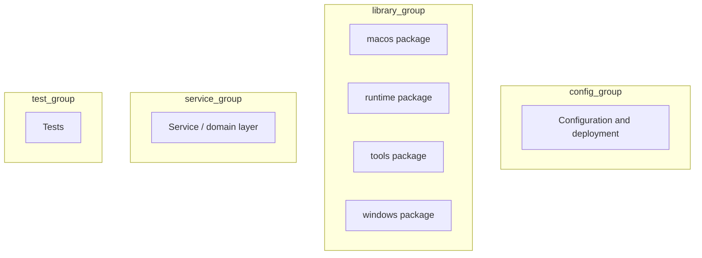

# Architecture report: Fei-Away/Codex-Dream-Skin

> Automated static analysis. **Observed** = directly seen in files/imports/AST; **Inferred** = interpretation from that evidence. Repository code was not executed.

## 1. Repository at a glance

| Item | Value |
| --- | --- |
| Repository | Fei-Away/Codex-Dream-Skin |
| Description | Codex Dream Skin |
| Language | JavaScript |
| Stars | 15410 |
| Licence | MIT |
| Analysed commit / branch | 6fc42df48a6a5365011f55cc349e20c038e56d1d / main |
| Framework(s) | None detected |
| Files analysed | 266 |
| Components | 7 |

## 2. Architecture in one minute

Fei-Away/Codex-Dream-Skin - Codex Dream Skin. This repository was analysed statically from 266 file(s) (0 Python). Detected technologies (observed from imports/manifests): GitHub Actions. Files are grouped into 7 component(s): Configuration and deployment, macos package, runtime package, Service / domain layer, Tests, tools package, windows package. Findings below distinguish observed facts from inferred interpretation.

## 3. High-level block diagram

## 4. Main components

### Configuration and deployment (`config`)

- **Kind:** config
- **Status:** Observed
- **Confidence:** 0.85
- **Responsibility:** Groups 15 file(s) under configuration and deployment (observed from repository paths and static analysis).
- **Paths:** `macos/agents/openai.yaml`, `macos/assets/safe-css-policy.json`, `macos/assets/selectors.json`, `macos/assets/theme.json`, `macos/package.json`, `macos/presets/preset-arina-hashimoto/theme.json`, `macos/presets/preset-gothic-void-crusade/theme.json`, `runtime/safe-css-policy.json`, `tools/selectors.json`, `windows/agents/openai.yaml`, `windows/assets/safe-css-policy.json`, `windows/assets/selectors.json`, `windows/assets/theme.json`, `windows/installer/node-runtime.json`, `windows/presets/preset-gothic-void-crusade/theme.json`
- **Evidence:** [macos/agents/openai.yaml](https://github.com/Fei-Away/Codex-Dream-Skin/blob/6fc42df48a6a5365011f55cc349e20c038e56d1d/macos/agents/openai.yaml); [macos/assets/safe-css-policy.json](https://github.com/Fei-Away/Codex-Dream-Skin/blob/6fc42df48a6a5365011f55cc349e20c038e56d1d/macos/assets/safe-css-policy.json); [macos/assets/selectors.json](https://github.com/Fei-Away/Codex-Dream-Skin/blob/6fc42df48a6a5365011f55cc349e20c038e56d1d/macos/assets/selectors.json); [macos/assets/theme.json](https://github.com/Fei-Away/Codex-Dream-Skin/blob/6fc42df48a6a5365011f55cc349e20c038e56d1d/macos/assets/theme.json); [macos/package.json](https://github.com/Fei-Away/Codex-Dream-Skin/blob/6fc42df48a6a5365011f55cc349e20c038e56d1d/macos/package.json); [macos/presets/preset-arina-hashimoto/theme.json](https://github.com/Fei-Away/Codex-Dream-Skin/blob/6fc42df48a6a5365011f55cc349e20c038e56d1d/macos/presets/preset-arina-hashimoto/theme.json); [macos/presets/preset-gothic-void-crusade/theme.json](https://github.com/Fei-Away/Codex-Dream-Skin/blob/6fc42df48a6a5365011f55cc349e20c038e56d1d/macos/presets/preset-gothic-void-crusade/theme.json); [runtime/safe-css-policy.json](https://github.com/Fei-Away/Codex-Dream-Skin/blob/6fc42df48a6a5365011f55cc349e20c038e56d1d/runtime/safe-css-policy.json)

### macos package (`macos`)

- **Kind:** library
- **Status:** Observed
- **Confidence:** 0.85
- **Responsibility:** Groups 42 file(s) under macos package (observed from repository paths and static analysis).
- **Paths:** `macos/assets/renderer-inject.js`, `macos/assets/safe-css-validator.mjs`, `macos/assets/theme-package-validator.mjs`, `macos/assets/theme-preferences.mjs`, `macos/menubar/codex_dream_skin.10s.sh`, `macos/scripts/apply-community-theme-macos.sh`, `macos/scripts/apply-from-menubar-macos.sh`, `macos/scripts/build-client-release.sh`, `macos/scripts/build-dmg.sh`, `macos/scripts/build-menubar-app.sh`, `macos/scripts/build-release.sh`, `macos/scripts/check-image-dimensions.mjs`, `macos/scripts/check-update-macos.sh`, `macos/scripts/common-macos.sh`, `macos/scripts/customize-theme-macos.sh`, `macos/scripts/doctor-macos.sh`, `macos/scripts/extract-theme-zip-macos.sh`, `macos/scripts/generate-app-icon.sh`, `macos/scripts/image-metadata.mjs`, `macos/scripts/import-theme-zip-macos.sh`, `macos/scripts/injector.mjs`, `macos/scripts/install-dream-skin-macos.sh`, `macos/scripts/install-menubar-macos.sh`, `macos/scripts/load-image-theme-macos.sh`, `macos/scripts/localization-macos.sh`, `macos/scripts/pause-dream-skin-macos.sh`, `macos/scripts/prepare-standalone-docs.sh`, `macos/scripts/publish-theme-import.mjs`, `macos/scripts/recover-theme-imports-macos.sh`, `macos/scripts/restore-dream-skin-macos.sh`, `macos/scripts/snapshot-active-theme-macos.sh`, `macos/scripts/snapshot-theme-zip.mjs`, `macos/scripts/stage-theme.mjs`, `macos/scripts/start-dream-skin-macos.sh`, `macos/scripts/status-dream-skin-macos.sh`, `macos/scripts/switch-theme-macos.sh`, `macos/scripts/theme-config.mjs`, `macos/scripts/theme-content-fingerprint.mjs`, `macos/scripts/theme-switch-lock-macos.sh`, `macos/scripts/validate-safe-css-file.mjs`, `macos/scripts/verify-dream-skin-macos.sh`, `macos/scripts/write-theme.mjs`
- **Evidence:** [macos/assets/renderer-inject.js](https://github.com/Fei-Away/Codex-Dream-Skin/blob/6fc42df48a6a5365011f55cc349e20c038e56d1d/macos/assets/renderer-inject.js); [macos/assets/safe-css-validator.mjs](https://github.com/Fei-Away/Codex-Dream-Skin/blob/6fc42df48a6a5365011f55cc349e20c038e56d1d/macos/assets/safe-css-validator.mjs); [macos/assets/theme-package-validator.mjs](https://github.com/Fei-Away/Codex-Dream-Skin/blob/6fc42df48a6a5365011f55cc349e20c038e56d1d/macos/assets/theme-package-validator.mjs); [macos/assets/theme-preferences.mjs](https://github.com/Fei-Away/Codex-Dream-Skin/blob/6fc42df48a6a5365011f55cc349e20c038e56d1d/macos/assets/theme-preferences.mjs); [macos/menubar/codex_dream_skin.10s.sh](https://github.com/Fei-Away/Codex-Dream-Skin/blob/6fc42df48a6a5365011f55cc349e20c038e56d1d/macos/menubar/codex_dream_skin.10s.sh); [macos/scripts/apply-community-theme-macos.sh](https://github.com/Fei-Away/Codex-Dream-Skin/blob/6fc42df48a6a5365011f55cc349e20c038e56d1d/macos/scripts/apply-community-theme-macos.sh); [macos/scripts/apply-from-menubar-macos.sh](https://github.com/Fei-Away/Codex-Dream-Skin/blob/6fc42df48a6a5365011f55cc349e20c038e56d1d/macos/scripts/apply-from-menubar-macos.sh); [macos/scripts/build-client-release.sh](https://github.com/Fei-Away/Codex-Dream-Skin/blob/6fc42df48a6a5365011f55cc349e20c038e56d1d/macos/scripts/build-client-release.sh)

### runtime package (`runtime`)

- **Kind:** library
- **Status:** Observed
- **Confidence:** 0.85
- **Responsibility:** Groups 6 file(s) under runtime package (observed from repository paths and static analysis).
- **Paths:** `runtime/image-metadata.mjs`, `runtime/renderer-inject.js`, `runtime/safe-css-validator.mjs`, `runtime/theme-package-validator.mjs`, `runtime/theme-preferences.mjs`, `runtime/validate-safe-css-file.mjs`
- **Evidence:** [runtime/image-metadata.mjs](https://github.com/Fei-Away/Codex-Dream-Skin/blob/6fc42df48a6a5365011f55cc349e20c038e56d1d/runtime/image-metadata.mjs); [runtime/renderer-inject.js](https://github.com/Fei-Away/Codex-Dream-Skin/blob/6fc42df48a6a5365011f55cc349e20c038e56d1d/runtime/renderer-inject.js); [runtime/safe-css-validator.mjs](https://github.com/Fei-Away/Codex-Dream-Skin/blob/6fc42df48a6a5365011f55cc349e20c038e56d1d/runtime/safe-css-validator.mjs); [runtime/theme-package-validator.mjs](https://github.com/Fei-Away/Codex-Dream-Skin/blob/6fc42df48a6a5365011f55cc349e20c038e56d1d/runtime/theme-package-validator.mjs); [runtime/theme-preferences.mjs](https://github.com/Fei-Away/Codex-Dream-Skin/blob/6fc42df48a6a5365011f55cc349e20c038e56d1d/runtime/theme-preferences.mjs); [runtime/validate-safe-css-file.mjs](https://github.com/Fei-Away/Codex-Dream-Skin/blob/6fc42df48a6a5365011f55cc349e20c038e56d1d/runtime/validate-safe-css-file.mjs)

### Service / domain layer (`service_layer`)

- **Kind:** service
- **Status:** Observed
- **Confidence:** 0.85
- **Responsibility:** Groups 1 file(s) under service / domain layer (observed from repository paths and static analysis).
- **Paths:** `windows/theme-manager/Core/ThemeStore.cs`
- **Evidence:** [windows/theme-manager/Core/ThemeStore.cs](https://github.com/Fei-Away/Codex-Dream-Skin/blob/6fc42df48a6a5365011f55cc349e20c038e56d1d/windows/theme-manager/Core/ThemeStore.cs)

### Tests (`tests`)

- **Kind:** test
- **Status:** Observed
- **Confidence:** 0.85
- **Responsibility:** Groups 61 file(s) under tests (observed from repository paths and static analysis).
- **Paths:** `macos/menubar-app/Tests/DreamSkinCoreTests/CoreTests.swift`, `macos/menubar-app/Tests/DreamSkinCoreTests/SavedThemeDeletionTests.swift`, `macos/menubar-app/Tests/DreamSkinCoreTests/ThemeTransparencyTests.swift`, `macos/tests/bounded-community-http.test.mjs`, `macos/tests/bounded-community-http.test.swift`, `macos/tests/community-apply-transaction.test.sh`, `macos/tests/discovery-backoff.test.mjs`, `macos/tests/fixtures/latest-release.headers`, `macos/tests/fixtures/latest-release.json`, `macos/tests/image-metadata.test.mjs`, `macos/tests/injector-bootstrap.test.mjs`, `macos/tests/installer-preflight.test.sh`, `macos/tests/localization-contract.test.mjs`, `macos/tests/payload-template-integrity.test.mjs`, `macos/tests/process-identity-locale.test.mjs`, `macos/tests/release-workflow.test.mjs`, `macos/tests/renderer-inject.test.mjs`, `macos/tests/renderer-verification.test.mjs`, `macos/tests/restart-cancellation.test.mjs`, `macos/tests/run-tests.sh`, `macos/tests/runtime-css-nested-has.test.mjs`, `macos/tests/safe-css-validator.test.mjs`, `macos/tests/shell-braced-vars-before-cjk.test.mjs`, `macos/tests/theme-config.test.mjs`, `macos/tests/theme-import-identity.test.sh`, `macos/tests/theme-import-kill-hook.cjs`, `macos/tests/theme-import-publish.test.mjs`, `macos/tests/theme-package-validator.test.mjs`, `macos/tests/theme-stage.test.mjs`, `macos/tests/theme-zip-extract.test.sh`, `macos/tests/theme-zip-snapshot.test.mjs`, `macos/tests/update-fallback.test.mjs`, `macos/tests/update-version-source.test.mjs`, `macos/tests/window-readiness.test.mjs`, `macos/tests/write-theme-contract.test.mjs`, `windows/tests/background-replacement-contract.test.mjs`, `windows/tests/codex-home.tests.ps1`, `windows/tests/community-theme-link.tests.ps1`, `windows/tests/config-startup-rollback.tests.ps1`, `windows/tests/image-metadata.test.mjs`, `windows/tests/injector-bootstrap.test.mjs`, `windows/tests/injector-one-shot.test.mjs`, `windows/tests/injector-window-readiness.test.mjs`, `windows/tests/installer-static.tests.ps1`, `windows/tests/localization-contract.test.mjs`, `windows/tests/native-stderr.tests.ps1`, `windows/tests/payload-template-integrity.test.mjs`, `windows/tests/renderer-inject.test.mjs`, `windows/tests/run-tests.ps1`, `windows/tests/start-cdp-failure-appearance-recovery.tests.ps1`, `windows/tests/start-post-launch-appearance-recovery.tests.ps1`, `windows/tests/start-renderer-readiness.tests.ps1`, `windows/tests/start-result-contract.tests.ps1`, `windows/tests/start-verified-skin-preserved.tests.ps1`, `windows/tests/theme-manager-maintenance.tests.ps1`, `windows/tests/theme-path-containment.test.mjs`, `windows/tests/theme-schema-contract.test.mjs`, `windows/tests/theme-zip-import.tests.ps1`, `windows/tests/tray-apply-result.tests.ps1`, `windows/theme-manager/Tests/DreamSkin.ThemeManager.Tests.csproj`, `windows/theme-manager/Tests/Program.cs`
- **Evidence:** [macos/menubar-app/Tests/DreamSkinCoreTests/CoreTests.swift](https://github.com/Fei-Away/Codex-Dream-Skin/blob/6fc42df48a6a5365011f55cc349e20c038e56d1d/macos/menubar-app/Tests/DreamSkinCoreTests/CoreTests.swift); [macos/menubar-app/Tests/DreamSkinCoreTests/SavedThemeDeletionTests.swift](https://github.com/Fei-Away/Codex-Dream-Skin/blob/6fc42df48a6a5365011f55cc349e20c038e56d1d/macos/menubar-app/Tests/DreamSkinCoreTests/SavedThemeDeletionTests.swift); [macos/menubar-app/Tests/DreamSkinCoreTests/ThemeTransparencyTests.swift](https://github.com/Fei-Away/Codex-Dream-Skin/blob/6fc42df48a6a5365011f55cc349e20c038e56d1d/macos/menubar-app/Tests/DreamSkinCoreTests/ThemeTransparencyTests.swift); [macos/tests/bounded-community-http.test.mjs](https://github.com/Fei-Away/Codex-Dream-Skin/blob/6fc42df48a6a5365011f55cc349e20c038e56d1d/macos/tests/bounded-community-http.test.mjs); [macos/tests/bounded-community-http.test.swift](https://github.com/Fei-Away/Codex-Dream-Skin/blob/6fc42df48a6a5365011f55cc349e20c038e56d1d/macos/tests/bounded-community-http.test.swift); [macos/tests/community-apply-transaction.test.sh](https://github.com/Fei-Away/Codex-Dream-Skin/blob/6fc42df48a6a5365011f55cc349e20c038e56d1d/macos/tests/community-apply-transaction.test.sh); [macos/tests/discovery-backoff.test.mjs](https://github.com/Fei-Away/Codex-Dream-Skin/blob/6fc42df48a6a5365011f55cc349e20c038e56d1d/macos/tests/discovery-backoff.test.mjs); [macos/tests/fixtures/latest-release.headers](https://github.com/Fei-Away/Codex-Dream-Skin/blob/6fc42df48a6a5365011f55cc349e20c038e56d1d/macos/tests/fixtures/latest-release.headers)

### tools package (`tools`)

- **Kind:** library
- **Status:** Observed
- **Confidence:** 0.85
- **Responsibility:** Groups 16 file(s) under tools package (observed from repository paths and static analysis).
- **Paths:** `tools/active-page-verification.test.mjs`, `tools/build-theme-manager.mjs`, `tools/capture-dom-fixture.mjs`, `tools/check-selector-provenance.mjs`, `tools/check-selector-provenance.test.mjs`, `tools/css-predicate-cache.mjs`, `tools/css-predicate-cache.test.mjs`, `tools/doctor-selectors.mjs`, `tools/doctor-selectors.test.mjs`, `tools/renderer-runtime.test.mjs`, `tools/sync-runtime-assets.mjs`, `tools/theme-preferences.test.mjs`, `tools/windows-home-css.mjs`, `tools/windows-home-css.test.mjs`, `tools/windows-motion-css.mjs`, `tools/windows-motion-css.test.mjs`
- **Evidence:** [tools/active-page-verification.test.mjs](https://github.com/Fei-Away/Codex-Dream-Skin/blob/6fc42df48a6a5365011f55cc349e20c038e56d1d/tools/active-page-verification.test.mjs); [tools/build-theme-manager.mjs](https://github.com/Fei-Away/Codex-Dream-Skin/blob/6fc42df48a6a5365011f55cc349e20c038e56d1d/tools/build-theme-manager.mjs); [tools/capture-dom-fixture.mjs](https://github.com/Fei-Away/Codex-Dream-Skin/blob/6fc42df48a6a5365011f55cc349e20c038e56d1d/tools/capture-dom-fixture.mjs); [tools/check-selector-provenance.mjs](https://github.com/Fei-Away/Codex-Dream-Skin/blob/6fc42df48a6a5365011f55cc349e20c038e56d1d/tools/check-selector-provenance.mjs); [tools/check-selector-provenance.test.mjs](https://github.com/Fei-Away/Codex-Dream-Skin/blob/6fc42df48a6a5365011f55cc349e20c038e56d1d/tools/check-selector-provenance.test.mjs); [tools/css-predicate-cache.mjs](https://github.com/Fei-Away/Codex-Dream-Skin/blob/6fc42df48a6a5365011f55cc349e20c038e56d1d/tools/css-predicate-cache.mjs); [tools/css-predicate-cache.test.mjs](https://github.com/Fei-Away/Codex-Dream-Skin/blob/6fc42df48a6a5365011f55cc349e20c038e56d1d/tools/css-predicate-cache.test.mjs); [tools/doctor-selectors.mjs](https://github.com/Fei-Away/Codex-Dream-Skin/blob/6fc42df48a6a5365011f55cc349e20c038e56d1d/tools/doctor-selectors.mjs)

### windows package (`windows`)

- **Kind:** library
- **Status:** Observed
- **Confidence:** 0.85
- **Responsibility:** Groups 12 file(s) under windows package (observed from repository paths and static analysis).
- **Paths:** `windows/assets/renderer-inject.js`, `windows/assets/safe-css-validator.mjs`, `windows/assets/theme-package-validator.mjs`, `windows/assets/theme-preferences.mjs`, `windows/scripts/image-metadata.mjs`, `windows/scripts/injector.mjs`, `windows/scripts/validate-safe-css-file.mjs`, `windows/theme-manager/App/AssemblyInfo.cs`, `windows/theme-manager/App/NativeOperations.cs`, `windows/theme-manager/App/Program.cs`, `windows/theme-manager/App/SingleInstance.cs`, `windows/theme-manager/NativeTests/Program.cs`
- **Evidence:** [windows/assets/renderer-inject.js](https://github.com/Fei-Away/Codex-Dream-Skin/blob/6fc42df48a6a5365011f55cc349e20c038e56d1d/windows/assets/renderer-inject.js); [windows/assets/safe-css-validator.mjs](https://github.com/Fei-Away/Codex-Dream-Skin/blob/6fc42df48a6a5365011f55cc349e20c038e56d1d/windows/assets/safe-css-validator.mjs); [windows/assets/theme-package-validator.mjs](https://github.com/Fei-Away/Codex-Dream-Skin/blob/6fc42df48a6a5365011f55cc349e20c038e56d1d/windows/assets/theme-package-validator.mjs); [windows/assets/theme-preferences.mjs](https://github.com/Fei-Away/Codex-Dream-Skin/blob/6fc42df48a6a5365011f55cc349e20c038e56d1d/windows/assets/theme-preferences.mjs); [windows/scripts/image-metadata.mjs](https://github.com/Fei-Away/Codex-Dream-Skin/blob/6fc42df48a6a5365011f55cc349e20c038e56d1d/windows/scripts/image-metadata.mjs); [windows/scripts/injector.mjs](https://github.com/Fei-Away/Codex-Dream-Skin/blob/6fc42df48a6a5365011f55cc349e20c038e56d1d/windows/scripts/injector.mjs); [windows/scripts/validate-safe-css-file.mjs](https://github.com/Fei-Away/Codex-Dream-Skin/blob/6fc42df48a6a5365011f55cc349e20c038e56d1d/windows/scripts/validate-safe-css-file.mjs); [windows/theme-manager/App/AssemblyInfo.cs](https://github.com/Fei-Away/Codex-Dream-Skin/blob/6fc42df48a6a5365011f55cc349e20c038e56d1d/windows/theme-manager/App/AssemblyInfo.cs)

## 5. Execution flow

No entry point was observed; the startup flow below is therefore limited.

Representative flow (derived from observed entry points and the import graph; steps beyond the entry point are **Inferred**):

1. Execution starts at an observed entry point listed above, if present.
2. No internal import relationships between components were observed.

## 6. Project structure

### `(root)`

- `.editorconfig` - config (226 bytes)
- `.gitattributes` - other (1316 bytes)
- `.gitignore` - other (803 bytes)
- `AGENTS.md` - docs (8291 bytes)
- `LICENSE` - docs (1093 bytes)
- `README.md` - docs (15987 bytes)
- `README.zh-CN.md` - docs (15112 bytes)
- `SECURITY.md` - docs (4702 bytes)

### `.github`

- `.github/CONTRIBUTING.en.md` - docs (4739 bytes)
- `.github/CONTRIBUTING.md` - docs (4284 bytes)
- `.github/ISSUE_TEMPLATE/bug_report.yml` - config (7034 bytes)
- `.github/ISSUE_TEMPLATE/config.yml` - config (1450 bytes)
- `.github/ISSUE_TEMPLATE/feature_request.yml` - config (3233 bytes)
- `.github/pull_request_template.md` - docs (2394 bytes)
- `.github/workflows/ci.yml` - ci, YAML (11793 bytes)
- `.github/workflows/release.yml` - ci, YAML (26737 bytes)

### `docs`

- `docs/PROJECT.md` - docs (5556 bytes)
- `docs/background-generation-prompts.md` - docs (46628 bytes)
- `docs/compat-26-930-windows-validation.md` - docs (24329 bytes)
- `docs/compat-profile-design.md` - docs (5442 bytes)
- `docs/handoff-2026-08-27.md` - docs (15561 bytes)
- `docs/images/dreamskin-mark.svg` - docs (465 bytes)
- `docs/images/sponsor-passion8.svg` - docs (915 bytes)
- `docs/install-macos.md` - docs (7845 bytes)
- `docs/install-windows.md` - docs (5823 bytes)
- `docs/platforms.md` - docs (9860 bytes)
- `docs/pr-324-windows-validation.md` - docs (12128 bytes)
- `docs/pr-351-windows-validation.md` - docs (9633 bytes)
- `docs/promo-copy.md` - docs (2106 bytes)
- `docs/reference-background-prompt-guide.en.md` - docs (30507 bytes)
- `docs/reference-background-prompt-guide.md` - docs (32934 bytes)
- `docs/releases/README.md` - docs (6386 bytes)
- `docs/releases/v1.5.18.md` - docs (2120 bytes)
- `docs/releases/v1.5.19-en.md` - docs (3483 bytes)
- `docs/releases/v1.5.19.md` - docs (2607 bytes)
- `docs/releases/v1.5.20-en.md` - docs (3299 bytes)
- `docs/releases/v1.5.20.md` - docs (2700 bytes)
- `docs/releases/v1.5.21-en.md` - docs (1783 bytes)
- `docs/releases/v1.5.21.md` - docs (1560 bytes)
- `docs/theme-management.md` - docs (3678 bytes)
- `docs/validation/issues-427-429-windows.md` - docs (6891 bytes)
- `docs/windows-26-930-performance.md` - docs (4171 bytes)

### `macos`

- `macos/.gitignore` - other (114 bytes)
- `macos/CHANGELOG.md` - docs (38017 bytes)
- `macos/CLIENT_DEPLOY_PROMPT.md` - docs (4803 bytes)
- `macos/Customize Codex Dream Skin.command` - other (299 bytes)
- `macos/Install Codex Dream Skin.command` - other (120 bytes)
- `macos/Install Menu Bar.command` - other (83 bytes)
- `macos/LICENSE` - docs (1093 bytes)
- `macos/NOTICE.md` - docs (3633 bytes)
- `macos/README.md` - docs (12380 bytes)
- `macos/Restore Codex Dream Skin.command` - other (329 bytes)
- `macos/SKILL.md` - docs (3434 bytes)
- `macos/Start Codex Dream Skin.command` - other (317 bytes)
- `macos/VERSION` - other (7 bytes)
- `macos/Verify Codex Dream Skin.command` - other (400 bytes)
- `macos/agents/openai.yaml` - config (282 bytes)
- `macos/assets/dream-skin.css` - other (91376 bytes)
- `macos/assets/renderer-inject.js` - source, JavaScript (61079 bytes)
- `macos/assets/safe-css-policy.json` - config (2009 bytes)
- `macos/assets/safe-css-validator.mjs` - source, JavaScript (22877 bytes)
- `macos/assets/selectors.json` - config (12232 bytes)
- `macos/assets/theme-package-validator.mjs` - source, JavaScript (21428 bytes)
- `macos/assets/theme-preferences.mjs` - source, JavaScript (2081 bytes)
- `macos/assets/theme.json` - config (791 bytes)
- `macos/client-delivery/使用说明.txt` - docs (414 bytes)
- `macos/client-delivery/给 Codex 的部署提示词.md` - docs (4803 bytes)
- `macos/menubar-app/.gitignore` - other (18 bytes)
- `macos/menubar-app/Package.swift` - other (658 bytes)
- `macos/menubar-app/Resources/Info.plist.template` - other (1511 bytes)
- `macos/menubar-app/Sources/CodexDreamSkinMenuBar/AppDelegate.swift` - other (72107 bytes)
- `macos/menubar-app/Sources/CodexDreamSkinMenuBar/BoundedCommunityHTTPClient.swift` - other (5149 bytes)
- `macos/menubar-app/Sources/CodexDreamSkinMenuBar/ScriptRunner.swift` - other (1454 bytes)
- `macos/menubar-app/Sources/CodexDreamSkinMenuBar/main.swift` - other (133 bytes)
- `macos/menubar-app/Sources/DreamSkinCore/CommunityRecovery.swift` - other (4474 bytes)
- `macos/menubar-app/Sources/DreamSkinCore/CommunityThemeLink.swift` - other (4521 bytes)
- `macos/menubar-app/Sources/DreamSkinCore/Localization.swift` - other (23312 bytes)
- `macos/menubar-app/Sources/DreamSkinCore/SavedThemeDeletion.swift` - other (4605 bytes)
- `macos/menubar-app/Sources/DreamSkinCore/SavedThemeLibrary.swift` - other (1276 bytes)
- `macos/menubar-app/Sources/DreamSkinCore/SemanticVersion.swift` - other (1215 bytes)
- `macos/menubar-app/Sources/DreamSkinCore/StatusSnapshot.swift` - other (2937 bytes)
- `macos/menubar-app/Sources/DreamSkinCore/ThemeTransparency.swift` - other (2447 bytes)
- `macos/menubar-app/Tests/DreamSkinCoreTests/CoreTests.swift` - test (13927 bytes)
- `macos/menubar-app/Tests/DreamSkinCoreTests/SavedThemeDeletionTests.swift` - test (5316 bytes)
- `macos/menubar-app/Tests/DreamSkinCoreTests/ThemeTransparencyTests.swift` - test (1990 bytes)
- `macos/menubar-app/Tools/generate-icon.swift` - other (2405 bytes)
- `macos/menubar/codex_dream_skin.10s.sh` - source, Shell (7176 bytes)
- `macos/package.json` - manifest (239 bytes)
- `macos/presets/README.md` - docs (9206 bytes)
- `macos/presets/preset-arina-hashimoto/theme.json` - config (499 bytes)
- `macos/presets/preset-gothic-void-crusade/theme.json` - config (949 bytes)
- `macos/references/acceptance-report-2026-07-15.md` - docs (1492 bytes)
- `macos/references/asset-provenance.md` - docs (434 bytes)
- `macos/references/incident-review.md` - docs (1269 bytes)
- `macos/references/qa-inventory.md` - docs (3232 bytes)
- `macos/references/runtime-notes.md` - docs (1961 bytes)
- `macos/scripts/apply-community-theme-macos.sh` - source, Shell (4969 bytes)
- `macos/scripts/apply-from-menubar-macos.sh` - source, Shell (5248 bytes)
- `macos/scripts/build-client-release.sh` - source, Shell (3169 bytes)
- `macos/scripts/build-dmg.sh` - source, Shell (5394 bytes)
- `macos/scripts/build-menubar-app.sh` - source, Shell (7058 bytes)
- `macos/scripts/build-release.sh` - source, Shell (2534 bytes)
- `macos/scripts/check-image-dimensions.mjs` - source, JavaScript (2575 bytes)
- `macos/scripts/check-update-macos.sh` - source, Shell (6180 bytes)
- `macos/scripts/common-macos.sh` - source, Shell (33783 bytes)
- `macos/scripts/customize-theme-macos.sh` - source, Shell (4060 bytes)
- `macos/scripts/doctor-macos.sh` - source, Shell (2132 bytes)
- `macos/scripts/extract-theme-zip-macos.sh` - source, Shell (9257 bytes)
- `macos/scripts/generate-app-icon.sh` - source, Shell (1584 bytes)
- `macos/scripts/image-metadata.mjs` - source, JavaScript (5084 bytes)
- `macos/scripts/import-theme-zip-macos.sh` - source, Shell (4751 bytes)
- `macos/scripts/injector.mjs` - source, JavaScript (91211 bytes)
- `macos/scripts/install-dream-skin-macos.sh` - source, Shell (6203 bytes)
- `macos/scripts/install-menubar-macos.sh` - source, Shell (3587 bytes)
- `macos/scripts/load-image-theme-macos.sh` - source, Shell (5290 bytes)
- `macos/scripts/localization-macos.sh` - source, Shell (8755 bytes)
- `macos/scripts/pause-dream-skin-macos.sh` - source, Shell (7859 bytes)
- `macos/scripts/prepare-standalone-docs.sh` - source, Shell (4618 bytes)
- `macos/scripts/publish-theme-import.mjs` - source, JavaScript (38451 bytes)
- `macos/scripts/recover-theme-imports-macos.sh` - source, Shell (372 bytes)
- `macos/scripts/restore-dream-skin-macos.sh` - source, Shell (3971 bytes)
- `macos/scripts/snapshot-active-theme-macos.sh` - source, Shell (2069 bytes)
- `macos/scripts/snapshot-theme-zip.mjs` - source, JavaScript (2674 bytes)
- `macos/scripts/stage-theme.mjs` - source, JavaScript (5314 bytes)
- `macos/scripts/start-dream-skin-macos.sh` - source, Shell (8497 bytes)
- `macos/scripts/status-dream-skin-macos.sh` - source, Shell (9151 bytes)
- `macos/scripts/switch-theme-macos.sh` - source, Shell (7952 bytes)
- `macos/scripts/theme-config.mjs` - source, JavaScript (13555 bytes)
- `macos/scripts/theme-content-fingerprint.mjs` - source, JavaScript (739 bytes)
- `macos/scripts/theme-switch-lock-macos.sh` - source, Shell (4033 bytes)
- `macos/scripts/validate-safe-css-file.mjs` - source, JavaScript (1414 bytes)
- `macos/scripts/verify-dream-skin-macos.sh` - source, Shell (844 bytes)
- `macos/scripts/write-theme.mjs` - source, JavaScript (6514 bytes)
- `macos/tests/bounded-community-http.test.mjs` - test, JavaScript (3641 bytes)
- `macos/tests/bounded-community-http.test.swift` - test (2885 bytes)
- `macos/tests/community-apply-transaction.test.sh` - test, Shell (6166 bytes)
- `macos/tests/discovery-backoff.test.mjs` - test, JavaScript (3742 bytes)
- `macos/tests/fixtures/latest-release.headers` - test (86 bytes)
- `macos/tests/fixtures/latest-release.json` - test (76 bytes)
- `macos/tests/image-metadata.test.mjs` - test, JavaScript (3905 bytes)
- `macos/tests/injector-bootstrap.test.mjs` - test, JavaScript (11171 bytes)
- `macos/tests/installer-preflight.test.sh` - test, Shell (3695 bytes)
- `macos/tests/localization-contract.test.mjs` - test, JavaScript (4887 bytes)
- `macos/tests/payload-template-integrity.test.mjs` - test, JavaScript (10739 bytes)
- `macos/tests/process-identity-locale.test.mjs` - test, JavaScript (5820 bytes)
- `macos/tests/release-workflow.test.mjs` - test, JavaScript (1244 bytes)
- `macos/tests/renderer-inject.test.mjs` - test, JavaScript (208 bytes)
- `macos/tests/renderer-verification.test.mjs` - test, JavaScript (6426 bytes)
- `macos/tests/restart-cancellation.test.mjs` - test, JavaScript (11040 bytes)
- `macos/tests/run-tests.sh` - test, Shell (57445 bytes)
- `macos/tests/runtime-css-nested-has.test.mjs` - test, JavaScript (4292 bytes)
- `macos/tests/safe-css-validator.test.mjs` - test, JavaScript (12860 bytes)
- `macos/tests/shell-braced-vars-before-cjk.test.mjs` - test, JavaScript (1783 bytes)
- `macos/tests/theme-config.test.mjs` - test, JavaScript (3385 bytes)
- `macos/tests/theme-import-identity.test.sh` - test, Shell (5170 bytes)
- `macos/tests/theme-import-kill-hook.cjs` - test, JavaScript (776 bytes)
- `macos/tests/theme-import-publish.test.mjs` - test, JavaScript (28051 bytes)
- `macos/tests/theme-package-validator.test.mjs` - test, JavaScript (18383 bytes)
- `macos/tests/theme-stage.test.mjs` - test, JavaScript (4466 bytes)
- `macos/tests/theme-zip-extract.test.sh` - test, Shell (5779 bytes)
- `macos/tests/theme-zip-snapshot.test.mjs` - test, JavaScript (6361 bytes)
- `macos/tests/update-fallback.test.mjs` - test, JavaScript (5405 bytes)
- `macos/tests/update-version-source.test.mjs` - test, JavaScript (2691 bytes)
- `macos/tests/window-readiness.test.mjs` - test, JavaScript (15133 bytes)
- `macos/tests/write-theme-contract.test.mjs` - test, JavaScript (2236 bytes)

### `runtime`

- `runtime/dream-skin.css` - other (84454 bytes)
- `runtime/image-metadata.mjs` - source, JavaScript (5084 bytes)
- `runtime/renderer-inject.js` - source, JavaScript (52671 bytes)
- `runtime/safe-css-policy.json` - config (2009 bytes)
- `runtime/safe-css-validator.mjs` - source, JavaScript (22877 bytes)
- `runtime/theme-package-validator.mjs` - source, JavaScript (21428 bytes)
- `runtime/theme-preferences.mjs` - source, JavaScript (2081 bytes)
- `runtime/validate-safe-css-file.mjs` - source, JavaScript (1406 bytes)

### `tools`

- `tools/active-page-verification.test.mjs` - source, JavaScript (6314 bytes)
- `tools/build-theme-manager.mjs` - source, JavaScript (784 bytes)
- `tools/capture-dom-fixture.mjs` - source, JavaScript (29714 bytes)
- `tools/check-selector-provenance.mjs` - source, JavaScript (5371 bytes)
- `tools/check-selector-provenance.test.mjs` - source, JavaScript (4942 bytes)
- `tools/css-predicate-cache.mjs` - source, JavaScript (3686 bytes)
- `tools/css-predicate-cache.test.mjs` - source, JavaScript (3974 bytes)
- `tools/doctor-selectors.mjs` - source, JavaScript (11894 bytes)
- `tools/doctor-selectors.test.mjs` - source, JavaScript (3627 bytes)
- `tools/renderer-runtime.test.mjs` - source, JavaScript (71777 bytes)
- `tools/selectors.json` - config (12232 bytes)
- `tools/sync-runtime-assets.mjs` - source, JavaScript (8912 bytes)
- `tools/theme-preferences.test.mjs` - source, JavaScript (3598 bytes)
- `tools/windows-home-css.mjs` - source, JavaScript (706 bytes)
- `tools/windows-home-css.test.mjs` - source, JavaScript (908 bytes)
- `tools/windows-motion-css.mjs` - source, JavaScript (806 bytes)
- `tools/windows-motion-css.test.mjs` - source, JavaScript (904 bytes)
- `tools/windows-shell.css` - other (3768 bytes)

### `windows`

- `windows/CHANGELOG.md` - docs (38214 bytes)
- `windows/README.en.md` - docs (13589 bytes)
- `windows/README.md` - docs (12286 bytes)
- `windows/SKILL.md` - docs (9195 bytes)
- `windows/VERSION` - other (7 bytes)
- `windows/agents/openai.yaml` - config (238 bytes)
- `windows/assets/dream-skin.css` - other (96409 bytes)
- `windows/assets/renderer-inject.js` - source, JavaScript (61079 bytes)
- `windows/assets/safe-css-policy.json` - config (2009 bytes)
- `windows/assets/safe-css-validator.mjs` - source, JavaScript (22877 bytes)
- `windows/assets/selectors.json` - config (12232 bytes)
- `windows/assets/theme-package-validator.mjs` - source, JavaScript (21428 bytes)
- `windows/assets/theme-preferences.mjs` - source, JavaScript (2081 bytes)
- `windows/assets/theme.json` - config (504 bytes)
- `windows/installer/build-release.ps1` - other (20320 bytes)
- `windows/installer/codex-dream-skin.iss` - other (7288 bytes)
- `windows/installer/languages/ChineseSimplified.isl` - other (20905 bytes)
- `windows/installer/languages/Inno-Setup-License.txt` - docs (1491 bytes)
- `windows/installer/node-runtime.json` - config (366 bytes)
- `windows/installer/setup-bootstrap.ps1` - other (7951 bytes)
- `windows/presets/preset-gothic-void-crusade/theme.json` - config (949 bytes)
- `windows/references/qa-inventory.md` - docs (5722 bytes)
- `windows/references/runtime-notes.md` - docs (5981 bytes)
- `windows/scripts/apply-community-theme.ps1` - other (43999 bytes)
- `windows/scripts/check-update.ps1` - other (4258 bytes)
- `windows/scripts/common-windows.ps1` - other (63209 bytes)
- `windows/scripts/config-utf8.ps1` - other (64111 bytes)
- `windows/scripts/image-metadata.mjs` - source, JavaScript (6164 bytes)
- `windows/scripts/injector.mjs` - source, JavaScript (80855 bytes)
- `windows/scripts/install-dream-skin.ps1` - other (5079 bytes)
- `windows/scripts/localization-windows.ps1` - other (16720 bytes)
- `windows/scripts/restore-dream-skin.ps1` - other (8588 bytes)
- `windows/scripts/start-dream-skin.ps1` - other (38605 bytes)
- `windows/scripts/theme-windows.ps1` - other (105334 bytes)
- `windows/scripts/tray-dream-skin.ps1` - other (21466 bytes)
- `windows/scripts/validate-safe-css-file.mjs` - source, JavaScript (1414 bytes)
- `windows/scripts/verify-dream-skin.ps1` - other (2757 bytes)
- `windows/tests/background-replacement-contract.test.mjs` - test, JavaScript (1525 bytes)
- `windows/tests/codex-home.tests.ps1` - test (6813 bytes)
- `windows/tests/community-theme-link.tests.ps1` - test (49016 bytes)
- `windows/tests/config-startup-rollback.tests.ps1` - test (25488 bytes)
- `windows/tests/image-metadata.test.mjs` - test, JavaScript (2157 bytes)
- `windows/tests/injector-bootstrap.test.mjs` - test, JavaScript (11036 bytes)
- `windows/tests/injector-one-shot.test.mjs` - test, JavaScript (2313 bytes)
- `windows/tests/injector-window-readiness.test.mjs` - test, JavaScript (20642 bytes)
- `windows/tests/installer-static.tests.ps1` - test (13678 bytes)
- `windows/tests/localization-contract.test.mjs` - test, JavaScript (5421 bytes)
- `windows/tests/native-stderr.tests.ps1` - test (6772 bytes)
- `windows/tests/payload-template-integrity.test.mjs` - test, JavaScript (10292 bytes)
- `windows/tests/renderer-inject.test.mjs` - test, JavaScript (208 bytes)
- `windows/tests/run-tests.ps1` - test (95988 bytes)
- `windows/tests/start-cdp-failure-appearance-recovery.tests.ps1` - test (8953 bytes)
- `windows/tests/start-post-launch-appearance-recovery.tests.ps1` - test (8396 bytes)
- `windows/tests/start-renderer-readiness.tests.ps1` - test (8561 bytes)
- `windows/tests/start-result-contract.tests.ps1` - test (8727 bytes)
- `windows/tests/start-verified-skin-preserved.tests.ps1` - test (21348 bytes)
- `windows/tests/theme-manager-maintenance.tests.ps1` - test (6486 bytes)
- `windows/tests/theme-path-containment.test.mjs` - test, JavaScript (1874 bytes)
- `windows/tests/theme-schema-contract.test.mjs` - test, JavaScript (1877 bytes)
- `windows/tests/theme-zip-import.tests.ps1` - test (72642 bytes)
- `windows/tests/tray-apply-result.tests.ps1` - test (9214 bytes)
- `windows/theme-manager/.gitignore` - other (39 bytes)
- `windows/theme-manager/App/AssemblyInfo.cs` - source, C# (108 bytes)
- `windows/theme-manager/App/DreamSkin.ThemeManager.csproj` - other (694 bytes)
- `windows/theme-manager/App/NativeOperations.cs` - source, C# (4898 bytes)
- `windows/theme-manager/App/Program.cs` - source, C# (10254 bytes)
- `windows/theme-manager/App/SingleInstance.cs` - source, C# (2143 bytes)
- `windows/theme-manager/App/app.manifest` - other (389 bytes)
- `windows/theme-manager/Core/DreamSkin.ThemeManager.Core.csproj` - other (260 bytes)
- `windows/theme-manager/Core/ThemeStore.cs` - source, C# (8894 bytes)
- `windows/theme-manager/NativeTests/DreamSkin.ThemeManager.NativeTests.csproj` - other (452 bytes)
- `windows/theme-manager/NativeTests/Program.cs` - source, C# (6160 bytes)
- `windows/theme-manager/README.md` - docs (2189 bytes)
- `windows/theme-manager/Tests/DreamSkin.ThemeManager.Tests.csproj` - test (392 bytes)
- `windows/theme-manager/Tests/Program.cs` - test, C# (6577 bytes)

## 7. Key dependencies and integrations

| Name | Category | Status | Confidence | Evidence |
| --- | --- | --- | --- | --- |
| GitHub Actions | ci | Observed | 0.90 | [.github/workflows/ci.yml](https://github.com/Fei-Away/Codex-Dream-Skin/blob/6fc42df48a6a5365011f55cc349e20c038e56d1d/.github/workflows/ci.yml); [.github/workflows/release.yml](https://github.com/Fei-Away/Codex-Dream-Skin/blob/6fc42df48a6a5365011f55cc349e20c038e56d1d/.github/workflows/release.yml) |

## 8. Data and state

No database, cache, queue, or persistent-state usage was observed in the analysed files. State handling, if any, may be in-memory or in files that were not analysed.

## 9. Configuration and deployment clues

- `.editorconfig` (config)
- `.github/ISSUE_TEMPLATE/bug_report.yml` (config)
- `.github/ISSUE_TEMPLATE/config.yml` (config)
- `.github/ISSUE_TEMPLATE/feature_request.yml` (config)
- `.github/workflows/ci.yml` (ci)
- `.github/workflows/release.yml` (ci)
- `macos/agents/openai.yaml` (config)
- `macos/assets/safe-css-policy.json` (config)
- `macos/assets/selectors.json` (config)
- `macos/assets/theme.json` (config)
- `macos/package.json` (manifest)
- `macos/presets/preset-arina-hashimoto/theme.json` (config)
- `macos/presets/preset-gothic-void-crusade/theme.json` (config)
- `runtime/safe-css-policy.json` (config)
- `tools/selectors.json` (config)
- `windows/agents/openai.yaml` (config)
- `windows/assets/safe-css-policy.json` (config)
- `windows/assets/selectors.json` (config)
- `windows/assets/theme.json` (config)
- `windows/installer/node-runtime.json` (config)
- `windows/presets/preset-gothic-void-crusade/theme.json` (config)

## 10. Design observations

- Service/domain code is distinct from entry and data code, suggesting layered separation (Inferred).
- Tests are present alongside source code (Observed from test file paths).

These observations are interpretations (**Inferred**) of the observed structure, not guarantees about runtime design.

## 11. Limitations and unknowns

- Static analysis only: repository code was not executed, installed, or imported at runtime.
- Components and relationships are inferred from file paths, imports, and AST structure; runtime behaviour, dynamic imports, and reflection may not be visible.
- No clear application entry point was observed in the analysed files.
- Repository text was treated as untrusted data; no instructions found in repository files were followed, and likely secret values were redacted/excluded.
- JavaScript and TypeScript files were inventoried from paths and package manifests. They were not parsed with a full language AST, and repository code was not executed.

## 12. Source references

- [.github/workflows/ci.yml](https://github.com/Fei-Away/Codex-Dream-Skin/blob/6fc42df48a6a5365011f55cc349e20c038e56d1d/.github/workflows/ci.yml)
- [.github/workflows/release.yml](https://github.com/Fei-Away/Codex-Dream-Skin/blob/6fc42df48a6a5365011f55cc349e20c038e56d1d/.github/workflows/release.yml)
- [macos/agents/openai.yaml](https://github.com/Fei-Away/Codex-Dream-Skin/blob/6fc42df48a6a5365011f55cc349e20c038e56d1d/macos/agents/openai.yaml)
- [macos/assets/renderer-inject.js](https://github.com/Fei-Away/Codex-Dream-Skin/blob/6fc42df48a6a5365011f55cc349e20c038e56d1d/macos/assets/renderer-inject.js)
- [macos/assets/safe-css-policy.json](https://github.com/Fei-Away/Codex-Dream-Skin/blob/6fc42df48a6a5365011f55cc349e20c038e56d1d/macos/assets/safe-css-policy.json)
- [macos/assets/safe-css-validator.mjs](https://github.com/Fei-Away/Codex-Dream-Skin/blob/6fc42df48a6a5365011f55cc349e20c038e56d1d/macos/assets/safe-css-validator.mjs)
- [macos/assets/selectors.json](https://github.com/Fei-Away/Codex-Dream-Skin/blob/6fc42df48a6a5365011f55cc349e20c038e56d1d/macos/assets/selectors.json)
- [macos/assets/theme-package-validator.mjs](https://github.com/Fei-Away/Codex-Dream-Skin/blob/6fc42df48a6a5365011f55cc349e20c038e56d1d/macos/assets/theme-package-validator.mjs)
- [macos/assets/theme-preferences.mjs](https://github.com/Fei-Away/Codex-Dream-Skin/blob/6fc42df48a6a5365011f55cc349e20c038e56d1d/macos/assets/theme-preferences.mjs)
- [macos/assets/theme.json](https://github.com/Fei-Away/Codex-Dream-Skin/blob/6fc42df48a6a5365011f55cc349e20c038e56d1d/macos/assets/theme.json)
- [macos/menubar-app/Tests/DreamSkinCoreTests/CoreTests.swift](https://github.com/Fei-Away/Codex-Dream-Skin/blob/6fc42df48a6a5365011f55cc349e20c038e56d1d/macos/menubar-app/Tests/DreamSkinCoreTests/CoreTests.swift)
- [macos/menubar-app/Tests/DreamSkinCoreTests/SavedThemeDeletionTests.swift](https://github.com/Fei-Away/Codex-Dream-Skin/blob/6fc42df48a6a5365011f55cc349e20c038e56d1d/macos/menubar-app/Tests/DreamSkinCoreTests/SavedThemeDeletionTests.swift)
- [macos/menubar-app/Tests/DreamSkinCoreTests/ThemeTransparencyTests.swift](https://github.com/Fei-Away/Codex-Dream-Skin/blob/6fc42df48a6a5365011f55cc349e20c038e56d1d/macos/menubar-app/Tests/DreamSkinCoreTests/ThemeTransparencyTests.swift)
- [macos/menubar/codex_dream_skin.10s.sh](https://github.com/Fei-Away/Codex-Dream-Skin/blob/6fc42df48a6a5365011f55cc349e20c038e56d1d/macos/menubar/codex_dream_skin.10s.sh)
- [macos/package.json](https://github.com/Fei-Away/Codex-Dream-Skin/blob/6fc42df48a6a5365011f55cc349e20c038e56d1d/macos/package.json)
- [macos/presets/preset-arina-hashimoto/theme.json](https://github.com/Fei-Away/Codex-Dream-Skin/blob/6fc42df48a6a5365011f55cc349e20c038e56d1d/macos/presets/preset-arina-hashimoto/theme.json)
- [macos/presets/preset-gothic-void-crusade/theme.json](https://github.com/Fei-Away/Codex-Dream-Skin/blob/6fc42df48a6a5365011f55cc349e20c038e56d1d/macos/presets/preset-gothic-void-crusade/theme.json)
- [macos/scripts/apply-community-theme-macos.sh](https://github.com/Fei-Away/Codex-Dream-Skin/blob/6fc42df48a6a5365011f55cc349e20c038e56d1d/macos/scripts/apply-community-theme-macos.sh)
- [macos/scripts/apply-from-menubar-macos.sh](https://github.com/Fei-Away/Codex-Dream-Skin/blob/6fc42df48a6a5365011f55cc349e20c038e56d1d/macos/scripts/apply-from-menubar-macos.sh)
- [macos/scripts/build-client-release.sh](https://github.com/Fei-Away/Codex-Dream-Skin/blob/6fc42df48a6a5365011f55cc349e20c038e56d1d/macos/scripts/build-client-release.sh)
- [macos/tests/bounded-community-http.test.mjs](https://github.com/Fei-Away/Codex-Dream-Skin/blob/6fc42df48a6a5365011f55cc349e20c038e56d1d/macos/tests/bounded-community-http.test.mjs)
- [macos/tests/bounded-community-http.test.swift](https://github.com/Fei-Away/Codex-Dream-Skin/blob/6fc42df48a6a5365011f55cc349e20c038e56d1d/macos/tests/bounded-community-http.test.swift)
- [macos/tests/community-apply-transaction.test.sh](https://github.com/Fei-Away/Codex-Dream-Skin/blob/6fc42df48a6a5365011f55cc349e20c038e56d1d/macos/tests/community-apply-transaction.test.sh)
- [macos/tests/discovery-backoff.test.mjs](https://github.com/Fei-Away/Codex-Dream-Skin/blob/6fc42df48a6a5365011f55cc349e20c038e56d1d/macos/tests/discovery-backoff.test.mjs)
- [macos/tests/fixtures/latest-release.headers](https://github.com/Fei-Away/Codex-Dream-Skin/blob/6fc42df48a6a5365011f55cc349e20c038e56d1d/macos/tests/fixtures/latest-release.headers)
- [runtime/image-metadata.mjs](https://github.com/Fei-Away/Codex-Dream-Skin/blob/6fc42df48a6a5365011f55cc349e20c038e56d1d/runtime/image-metadata.mjs)
- [runtime/renderer-inject.js](https://github.com/Fei-Away/Codex-Dream-Skin/blob/6fc42df48a6a5365011f55cc349e20c038e56d1d/runtime/renderer-inject.js)
- [runtime/safe-css-policy.json](https://github.com/Fei-Away/Codex-Dream-Skin/blob/6fc42df48a6a5365011f55cc349e20c038e56d1d/runtime/safe-css-policy.json)
- [runtime/safe-css-validator.mjs](https://github.com/Fei-Away/Codex-Dream-Skin/blob/6fc42df48a6a5365011f55cc349e20c038e56d1d/runtime/safe-css-validator.mjs)
- [runtime/theme-package-validator.mjs](https://github.com/Fei-Away/Codex-Dream-Skin/blob/6fc42df48a6a5365011f55cc349e20c038e56d1d/runtime/theme-package-validator.mjs)
- [runtime/theme-preferences.mjs](https://github.com/Fei-Away/Codex-Dream-Skin/blob/6fc42df48a6a5365011f55cc349e20c038e56d1d/runtime/theme-preferences.mjs)
- [runtime/validate-safe-css-file.mjs](https://github.com/Fei-Away/Codex-Dream-Skin/blob/6fc42df48a6a5365011f55cc349e20c038e56d1d/runtime/validate-safe-css-file.mjs)
- [tools/active-page-verification.test.mjs](https://github.com/Fei-Away/Codex-Dream-Skin/blob/6fc42df48a6a5365011f55cc349e20c038e56d1d/tools/active-page-verification.test.mjs)
- [tools/build-theme-manager.mjs](https://github.com/Fei-Away/Codex-Dream-Skin/blob/6fc42df48a6a5365011f55cc349e20c038e56d1d/tools/build-theme-manager.mjs)
- [tools/capture-dom-fixture.mjs](https://github.com/Fei-Away/Codex-Dream-Skin/blob/6fc42df48a6a5365011f55cc349e20c038e56d1d/tools/capture-dom-fixture.mjs)
- [tools/check-selector-provenance.mjs](https://github.com/Fei-Away/Codex-Dream-Skin/blob/6fc42df48a6a5365011f55cc349e20c038e56d1d/tools/check-selector-provenance.mjs)
- [tools/check-selector-provenance.test.mjs](https://github.com/Fei-Away/Codex-Dream-Skin/blob/6fc42df48a6a5365011f55cc349e20c038e56d1d/tools/check-selector-provenance.test.mjs)
- [tools/css-predicate-cache.mjs](https://github.com/Fei-Away/Codex-Dream-Skin/blob/6fc42df48a6a5365011f55cc349e20c038e56d1d/tools/css-predicate-cache.mjs)
- [tools/css-predicate-cache.test.mjs](https://github.com/Fei-Away/Codex-Dream-Skin/blob/6fc42df48a6a5365011f55cc349e20c038e56d1d/tools/css-predicate-cache.test.mjs)
- [tools/doctor-selectors.mjs](https://github.com/Fei-Away/Codex-Dream-Skin/blob/6fc42df48a6a5365011f55cc349e20c038e56d1d/tools/doctor-selectors.mjs)
- [windows/assets/renderer-inject.js](https://github.com/Fei-Away/Codex-Dream-Skin/blob/6fc42df48a6a5365011f55cc349e20c038e56d1d/windows/assets/renderer-inject.js)
- [windows/assets/safe-css-validator.mjs](https://github.com/Fei-Away/Codex-Dream-Skin/blob/6fc42df48a6a5365011f55cc349e20c038e56d1d/windows/assets/safe-css-validator.mjs)
- [windows/assets/theme-package-validator.mjs](https://github.com/Fei-Away/Codex-Dream-Skin/blob/6fc42df48a6a5365011f55cc349e20c038e56d1d/windows/assets/theme-package-validator.mjs)
- [windows/assets/theme-preferences.mjs](https://github.com/Fei-Away/Codex-Dream-Skin/blob/6fc42df48a6a5365011f55cc349e20c038e56d1d/windows/assets/theme-preferences.mjs)
- [windows/scripts/image-metadata.mjs](https://github.com/Fei-Away/Codex-Dream-Skin/blob/6fc42df48a6a5365011f55cc349e20c038e56d1d/windows/scripts/image-metadata.mjs)
- [windows/scripts/injector.mjs](https://github.com/Fei-Away/Codex-Dream-Skin/blob/6fc42df48a6a5365011f55cc349e20c038e56d1d/windows/scripts/injector.mjs)
- [windows/scripts/validate-safe-css-file.mjs](https://github.com/Fei-Away/Codex-Dream-Skin/blob/6fc42df48a6a5365011f55cc349e20c038e56d1d/windows/scripts/validate-safe-css-file.mjs)
- [windows/theme-manager/App/AssemblyInfo.cs](https://github.com/Fei-Away/Codex-Dream-Skin/blob/6fc42df48a6a5365011f55cc349e20c038e56d1d/windows/theme-manager/App/AssemblyInfo.cs)
- [windows/theme-manager/Core/ThemeStore.cs](https://github.com/Fei-Away/Codex-Dream-Skin/blob/6fc42df48a6a5365011f55cc349e20c038e56d1d/windows/theme-manager/Core/ThemeStore.cs)
