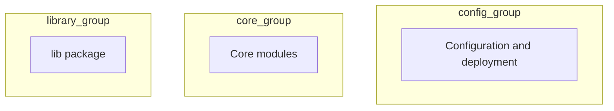

# Architecture report: Flipboard/react-canvas

> Automated static analysis. **Observed** = directly seen in files/imports/AST; **Inferred** = interpretation from that evidence. Repository code was not executed.

## 1. Repository at a glance

| Item | Value |
| --- | --- |
| Repository | Flipboard/react-canvas |
| Description | High performance <canvas> rendering for React components |
| Language | JavaScript |
| Stars | 13190 |
| Licence | BSD-3-Clause |
| Analysed commit / branch | 0b71180b4061a55410efb4578df2b65c1bf00a8e / master |
| Framework(s) | React |
| Files analysed | 47 |
| Components | 3 |

## 2. Architecture in one minute

Flipboard/react-canvas - High performance <canvas> rendering for React components. This repository was analysed statically from 47 file(s) (0 Python). Detected technologies (observed from imports/manifests): React, Jest, webpack. Files are grouped into 3 component(s): Configuration and deployment, Core modules, lib package. Findings below distinguish observed facts from inferred interpretation.

## 3. High-level block diagram

## 4. Main components

### Configuration and deployment (`config`)

- **Kind:** config
- **Status:** Observed
- **Confidence:** 0.85
- **Responsibility:** Groups 1 file(s) under configuration and deployment (observed from repository paths and static analysis).
- **Paths:** `package.json`
- **Evidence:** [package.json](https://github.com/Flipboard/react-canvas/blob/0b71180b4061a55410efb4578df2b65c1bf00a8e/package.json)

### Core modules (`core`)

- **Kind:** core
- **Status:** Observed
- **Confidence:** 0.85
- **Responsibility:** Groups 2 file(s) under core modules (observed from repository paths and static analysis).
- **Paths:** `gulpfile.js`, `webpack.config.js`
- **Evidence:** [gulpfile.js](https://github.com/Flipboard/react-canvas/blob/0b71180b4061a55410efb4578df2b65c1bf00a8e/gulpfile.js); [webpack.config.js](https://github.com/Flipboard/react-canvas/blob/0b71180b4061a55410efb4578df2b65c1bf00a8e/webpack.config.js)

### lib package (`lib`)

- **Kind:** library
- **Status:** Observed
- **Confidence:** 0.85
- **Responsibility:** Groups 27 file(s) under lib package (observed from repository paths and static analysis).
- **Paths:** `lib/Canvas.js`, `lib/CanvasUtils.js`, `lib/ContainerMixin.js`, `lib/DrawingUtils.js`, `lib/Easing.js`, `lib/EventTypes.js`, `lib/FontFace.js`, `lib/FontUtils.js`, `lib/FrameUtils.js`, `lib/Gradient.js`, `lib/Group.js`, `lib/Image.js`, `lib/ImageCache.js`, `lib/Layer.js`, `lib/LayerMixin.js`, `lib/Layout.js`, `lib/ListView.js`, `lib/ReactCanvas.js`, `lib/RenderLayer.js`, `lib/Surface.js`, `lib/Text.js`, `lib/__tests__/clamp-test.js`, `lib/clamp.js`, `lib/createComponent.js`, `lib/hitTest.js`, `lib/layoutNode.js`, `lib/measureText.js`
- **Evidence:** [lib/Canvas.js](https://github.com/Flipboard/react-canvas/blob/0b71180b4061a55410efb4578df2b65c1bf00a8e/lib/Canvas.js); [lib/CanvasUtils.js](https://github.com/Flipboard/react-canvas/blob/0b71180b4061a55410efb4578df2b65c1bf00a8e/lib/CanvasUtils.js); [lib/ContainerMixin.js](https://github.com/Flipboard/react-canvas/blob/0b71180b4061a55410efb4578df2b65c1bf00a8e/lib/ContainerMixin.js); [lib/DrawingUtils.js](https://github.com/Flipboard/react-canvas/blob/0b71180b4061a55410efb4578df2b65c1bf00a8e/lib/DrawingUtils.js); [lib/Easing.js](https://github.com/Flipboard/react-canvas/blob/0b71180b4061a55410efb4578df2b65c1bf00a8e/lib/Easing.js); [lib/EventTypes.js](https://github.com/Flipboard/react-canvas/blob/0b71180b4061a55410efb4578df2b65c1bf00a8e/lib/EventTypes.js); [lib/FontFace.js](https://github.com/Flipboard/react-canvas/blob/0b71180b4061a55410efb4578df2b65c1bf00a8e/lib/FontFace.js); [lib/FontUtils.js](https://github.com/Flipboard/react-canvas/blob/0b71180b4061a55410efb4578df2b65c1bf00a8e/lib/FontUtils.js)

## 5. Execution flow

**Observed** entry point(s):

- [lib/ReactCanvas.js](https://github.com/Flipboard/react-canvas/blob/0b71180b4061a55410efb4578df2b65c1bf00a8e/lib/ReactCanvas.js)

Representative flow (derived from observed entry points and the import graph; steps beyond the entry point are **Inferred**):

1. Execution starts at an observed entry point listed above, if present.
2. No internal import relationships between components were observed.

## 6. Project structure

### `(root)`

- `.babelrc` - other (26 bytes)
- `.gitignore` - other (42 bytes)
- `LICENSE` - docs (1475 bytes)
- `README.md` - docs (8412 bytes)
- `gulpfile.js` - source, JavaScript (863 bytes)
- `package.json` - manifest (1216 bytes)
- `webpack.config.js` - source, JavaScript (612 bytes)

### `examples`

- `examples/common/data.js` - source, JavaScript (7290 bytes)
- `examples/common/examples.css` - other (244 bytes)
- `examples/common/touch-emulator.js` - source, JavaScript (11296 bytes)
- `examples/css-layout/app.js` - source, JavaScript (2881 bytes)
- `examples/css-layout/index.html` - other (540 bytes)
- `examples/gradient/app.js` - source, JavaScript (982 bytes)
- `examples/gradient/index.html` - other (536 bytes)
- `examples/listview/app.js` - source, JavaScript (1410 bytes)
- `examples/listview/components/Item.js` - source, JavaScript (1394 bytes)
- `examples/listview/index.html` - other (536 bytes)
- `examples/timeline/app.js` - source, JavaScript (1686 bytes)
- `examples/timeline/components/Page.js` - source, JavaScript (3815 bytes)
- `examples/timeline/index.html` - other (536 bytes)

### `lib`

- `lib/Canvas.js` - source, JavaScript (925 bytes)
- `lib/CanvasUtils.js` - source, JavaScript (5752 bytes)
- `lib/ContainerMixin.js` - source, JavaScript (3808 bytes)
- `lib/DrawingUtils.js` - source, JavaScript (11992 bytes)
- `lib/Easing.js` - source, JavaScript (603 bytes)
- `lib/EventTypes.js` - source, JavaScript (291 bytes)
- `lib/FontFace.js` - source, JavaScript (1191 bytes)
- `lib/FontUtils.js` - source, JavaScript (4714 bytes)
- `lib/FrameUtils.js` - source, JavaScript (2945 bytes)
- `lib/Gradient.js` - source, JavaScript (954 bytes)
- `lib/Group.js` - source, JavaScript (1067 bytes)
- `lib/Image.js` - source, JavaScript (4079 bytes)
- `lib/ImageCache.js` - source, JavaScript (3228 bytes)
- `lib/Layer.js` - source, JavaScript (709 bytes)
- `lib/LayerMixin.js` - source, JavaScript (2565 bytes)
- `lib/Layout.js` - source, JavaScript (24896 bytes)
- `lib/ListView.js` - source, JavaScript (4997 bytes)
- `lib/ReactCanvas.js` - source, JavaScript (363 bytes)
- `lib/RenderLayer.js` - source, JavaScript (4763 bytes)
- `lib/Surface.js` - source, JavaScript (6319 bytes)
- `lib/Text.js` - source, JavaScript (1403 bytes)
- `lib/__tests__/clamp-test.js` - source, JavaScript (413 bytes)
- `lib/clamp.js` - source, JavaScript (266 bytes)
- `lib/createComponent.js` - source, JavaScript (708 bytes)
- `lib/hitTest.js` - source, JavaScript (2472 bytes)
- `lib/layoutNode.js` - source, JavaScript (1137 bytes)
- `lib/measureText.js` - source, JavaScript (2853 bytes)

## 7. Key dependencies and integrations

| Name | Category | Status | Confidence | Evidence |
| --- | --- | --- | --- | --- |
| React | framework | Observed | 0.90 | [package.json:2](https://github.com/Flipboard/react-canvas/blob/0b71180b4061a55410efb4578df2b65c1bf00a8e/package.json#L2); [package.json:35](https://github.com/Flipboard/react-canvas/blob/0b71180b4061a55410efb4578df2b65c1bf00a8e/package.json#L35) |
| Jest | tooling | Observed | 0.85 | [package.json:12](https://github.com/Flipboard/react-canvas/blob/0b71180b4061a55410efb4578df2b65c1bf00a8e/package.json#L12) |
| webpack | tooling | Observed | 0.85 | [package.json:37](https://github.com/Flipboard/react-canvas/blob/0b71180b4061a55410efb4578df2b65c1bf00a8e/package.json#L37) |

## 8. Data and state

No database, cache, queue, or persistent-state usage was observed in the analysed files. State handling, if any, may be in-memory or in files that were not analysed.

## 9. Configuration and deployment clues

- `package.json` (manifest)

## 10. Design observations

- No strong design patterns could be established from the available evidence.

These observations are interpretations (**Inferred**) of the observed structure, not guarantees about runtime design.

## 11. Limitations and unknowns

- Static analysis only: repository code was not executed, installed, or imported at runtime.
- Components and relationships are inferred from file paths, imports, and AST structure; runtime behaviour, dynamic imports, and reflection may not be visible.
- No clear application entry point was observed in the analysed files.
- Repository text was treated as untrusted data; no instructions found in repository files were followed, and likely secret values were redacted/excluded.
- JavaScript and TypeScript files were inventoried from paths and package manifests. They were not parsed with a full language AST, and repository code was not executed.

## 12. Source references

- [gulpfile.js](https://github.com/Flipboard/react-canvas/blob/0b71180b4061a55410efb4578df2b65c1bf00a8e/gulpfile.js)
- [lib/Canvas.js](https://github.com/Flipboard/react-canvas/blob/0b71180b4061a55410efb4578df2b65c1bf00a8e/lib/Canvas.js)
- [lib/CanvasUtils.js](https://github.com/Flipboard/react-canvas/blob/0b71180b4061a55410efb4578df2b65c1bf00a8e/lib/CanvasUtils.js)
- [lib/ContainerMixin.js](https://github.com/Flipboard/react-canvas/blob/0b71180b4061a55410efb4578df2b65c1bf00a8e/lib/ContainerMixin.js)
- [lib/DrawingUtils.js](https://github.com/Flipboard/react-canvas/blob/0b71180b4061a55410efb4578df2b65c1bf00a8e/lib/DrawingUtils.js)
- [lib/Easing.js](https://github.com/Flipboard/react-canvas/blob/0b71180b4061a55410efb4578df2b65c1bf00a8e/lib/Easing.js)
- [lib/EventTypes.js](https://github.com/Flipboard/react-canvas/blob/0b71180b4061a55410efb4578df2b65c1bf00a8e/lib/EventTypes.js)
- [lib/FontFace.js](https://github.com/Flipboard/react-canvas/blob/0b71180b4061a55410efb4578df2b65c1bf00a8e/lib/FontFace.js)
- [lib/FontUtils.js](https://github.com/Flipboard/react-canvas/blob/0b71180b4061a55410efb4578df2b65c1bf00a8e/lib/FontUtils.js)
- [lib/ReactCanvas.js](https://github.com/Flipboard/react-canvas/blob/0b71180b4061a55410efb4578df2b65c1bf00a8e/lib/ReactCanvas.js)
- [package.json](https://github.com/Flipboard/react-canvas/blob/0b71180b4061a55410efb4578df2b65c1bf00a8e/package.json)
- [package.json:2](https://github.com/Flipboard/react-canvas/blob/0b71180b4061a55410efb4578df2b65c1bf00a8e/package.json#L2)
- [package.json:12](https://github.com/Flipboard/react-canvas/blob/0b71180b4061a55410efb4578df2b65c1bf00a8e/package.json#L12)
- [package.json:35](https://github.com/Flipboard/react-canvas/blob/0b71180b4061a55410efb4578df2b65c1bf00a8e/package.json#L35)
- [package.json:37](https://github.com/Flipboard/react-canvas/blob/0b71180b4061a55410efb4578df2b65c1bf00a8e/package.json#L37)
- [webpack.config.js](https://github.com/Flipboard/react-canvas/blob/0b71180b4061a55410efb4578df2b65c1bf00a8e/webpack.config.js)
