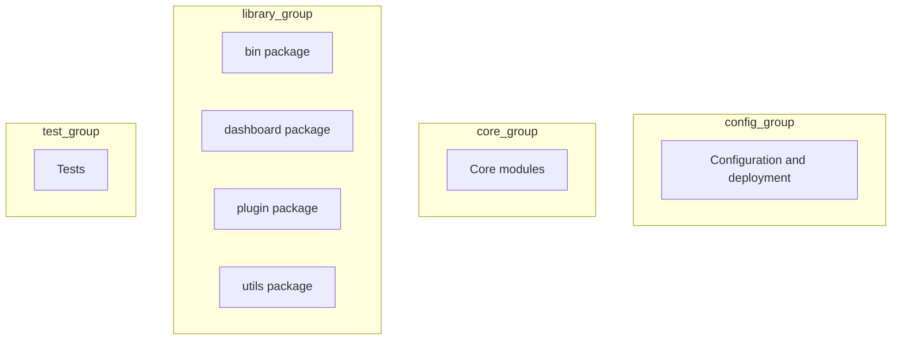

# Architecture report: FormidableLabs/webpack-dashboard

> Automated static analysis. **Observed** = directly seen in files/imports/AST; **Inferred** = interpretation from that evidence. Repository code was not executed.

## 1. Repository at a glance

| Item | Value |
| --- | --- |
| Repository | FormidableLabs/webpack-dashboard |
| Description | A CLI dashboard for webpack dev server |
| Language | JavaScript |
| Stars | 13945 |
| Licence | MIT |
| Analysed commit / branch | 9333a27e4b8f784fee13132df4f88e73aca3ca31 / master |
| Framework(s) | None detected |
| Files analysed | 52 |
| Components | 7 |

## 2. Architecture in one minute

FormidableLabs/webpack-dashboard - A CLI dashboard for webpack dev server. This repository was analysed statically from 52 file(s) (0 Python). Detected technologies (observed from imports/manifests): GitHub Actions, TypeScript, webpack. Files are grouped into 7 component(s): bin package, Configuration and deployment, Core modules, dashboard package, plugin package, Tests, utils package. Findings below distinguish observed facts from inferred interpretation.

## 3. High-level block diagram

## 4. Main components

### bin package (`bin`)

- **Kind:** library
- **Status:** Observed
- **Confidence:** 0.85
- **Responsibility:** Groups 1 file(s) under bin package (observed from repository paths and static analysis).
- **Paths:** `bin/webpack-dashboard.js`
- **Evidence:** [bin/webpack-dashboard.js](https://github.com/FormidableLabs/webpack-dashboard/blob/9333a27e4b8f784fee13132df4f88e73aca3ca31/bin/webpack-dashboard.js)

### Configuration and deployment (`config`)

- **Kind:** config
- **Status:** Observed
- **Confidence:** 0.85
- **Responsibility:** Groups 1 file(s) under configuration and deployment (observed from repository paths and static analysis).
- **Paths:** `package.json`
- **Evidence:** [package.json](https://github.com/FormidableLabs/webpack-dashboard/blob/9333a27e4b8f784fee13132df4f88e73aca3ca31/package.json)

### Core modules (`core`)

- **Kind:** core
- **Status:** Observed
- **Confidence:** 0.85
- **Responsibility:** Groups 1 file(s) under core modules (observed from repository paths and static analysis).
- **Paths:** `index.js`
- **Evidence:** [index.js](https://github.com/FormidableLabs/webpack-dashboard/blob/9333a27e4b8f784fee13132df4f88e73aca3ca31/index.js)

### dashboard package (`dashboard`)

- **Kind:** library
- **Status:** Observed
- **Confidence:** 0.85
- **Responsibility:** Groups 1 file(s) under dashboard package (observed from repository paths and static analysis).
- **Paths:** `dashboard/index.js`
- **Evidence:** [dashboard/index.js](https://github.com/FormidableLabs/webpack-dashboard/blob/9333a27e4b8f784fee13132df4f88e73aca3ca31/dashboard/index.js)

### plugin package (`plugin`)

- **Kind:** library
- **Status:** Observed
- **Confidence:** 0.85
- **Responsibility:** Groups 2 file(s) under plugin package (observed from repository paths and static analysis).
- **Paths:** `plugin/index.d.ts`, `plugin/index.js`
- **Evidence:** [plugin/index.d.ts](https://github.com/FormidableLabs/webpack-dashboard/blob/9333a27e4b8f784fee13132df4f88e73aca3ca31/plugin/index.d.ts); [plugin/index.js](https://github.com/FormidableLabs/webpack-dashboard/blob/9333a27e4b8f784fee13132df4f88e73aca3ca31/plugin/index.js)

### Tests (`tests`)

- **Kind:** test
- **Status:** Observed
- **Confidence:** 0.85
- **Responsibility:** Groups 10 file(s) under tests (observed from repository paths and static analysis).
- **Paths:** `test/.eslintrc.json`, `test/base.spec.js`, `test/bin/webpack-dashboard.spec.js`, `test/dashboard/index.spec.js`, `test/plugin/index.spec.js`, `test/setup.js`, `test/utils/format-assets.spec.js`, `test/utils/format-modules.spec.js`, `test/utils/format-output.spec.js`, `test/utils/format-versions.spec.js`
- **Evidence:** [test/.eslintrc.json](https://github.com/FormidableLabs/webpack-dashboard/blob/9333a27e4b8f784fee13132df4f88e73aca3ca31/test/.eslintrc.json); [test/base.spec.js](https://github.com/FormidableLabs/webpack-dashboard/blob/9333a27e4b8f784fee13132df4f88e73aca3ca31/test/base.spec.js); [test/bin/webpack-dashboard.spec.js](https://github.com/FormidableLabs/webpack-dashboard/blob/9333a27e4b8f784fee13132df4f88e73aca3ca31/test/bin/webpack-dashboard.spec.js); [test/dashboard/index.spec.js](https://github.com/FormidableLabs/webpack-dashboard/blob/9333a27e4b8f784fee13132df4f88e73aca3ca31/test/dashboard/index.spec.js); [test/plugin/index.spec.js](https://github.com/FormidableLabs/webpack-dashboard/blob/9333a27e4b8f784fee13132df4f88e73aca3ca31/test/plugin/index.spec.js); [test/setup.js](https://github.com/FormidableLabs/webpack-dashboard/blob/9333a27e4b8f784fee13132df4f88e73aca3ca31/test/setup.js); [test/utils/format-assets.spec.js](https://github.com/FormidableLabs/webpack-dashboard/blob/9333a27e4b8f784fee13132df4f88e73aca3ca31/test/utils/format-assets.spec.js); [test/utils/format-modules.spec.js](https://github.com/FormidableLabs/webpack-dashboard/blob/9333a27e4b8f784fee13132df4f88e73aca3ca31/test/utils/format-modules.spec.js)

### utils package (`utils`)

- **Kind:** library
- **Status:** Observed
- **Confidence:** 0.85
- **Responsibility:** Groups 7 file(s) under utils package (observed from repository paths and static analysis).
- **Paths:** `utils/error-serialization.js`, `utils/format-assets.js`, `utils/format-duplicates.js`, `utils/format-modules.js`, `utils/format-output.js`, `utils/format-problems.js`, `utils/format-versions.js`
- **Evidence:** [utils/error-serialization.js](https://github.com/FormidableLabs/webpack-dashboard/blob/9333a27e4b8f784fee13132df4f88e73aca3ca31/utils/error-serialization.js); [utils/format-assets.js](https://github.com/FormidableLabs/webpack-dashboard/blob/9333a27e4b8f784fee13132df4f88e73aca3ca31/utils/format-assets.js); [utils/format-duplicates.js](https://github.com/FormidableLabs/webpack-dashboard/blob/9333a27e4b8f784fee13132df4f88e73aca3ca31/utils/format-duplicates.js); [utils/format-modules.js](https://github.com/FormidableLabs/webpack-dashboard/blob/9333a27e4b8f784fee13132df4f88e73aca3ca31/utils/format-modules.js); [utils/format-output.js](https://github.com/FormidableLabs/webpack-dashboard/blob/9333a27e4b8f784fee13132df4f88e73aca3ca31/utils/format-output.js); [utils/format-problems.js](https://github.com/FormidableLabs/webpack-dashboard/blob/9333a27e4b8f784fee13132df4f88e73aca3ca31/utils/format-problems.js); [utils/format-versions.js](https://github.com/FormidableLabs/webpack-dashboard/blob/9333a27e4b8f784fee13132df4f88e73aca3ca31/utils/format-versions.js)

## 5. Execution flow

**Observed** entry point(s):

- [bin/webpack-dashboard.js](https://github.com/FormidableLabs/webpack-dashboard/blob/9333a27e4b8f784fee13132df4f88e73aca3ca31/bin/webpack-dashboard.js)
- [dashboard/index.js](https://github.com/FormidableLabs/webpack-dashboard/blob/9333a27e4b8f784fee13132df4f88e73aca3ca31/dashboard/index.js)
- [examples/duplicates-esm/src/index.js](https://github.com/FormidableLabs/webpack-dashboard/blob/9333a27e4b8f784fee13132df4f88e73aca3ca31/examples/duplicates-esm/src/index.js)
- [examples/simple/src/index.js](https://github.com/FormidableLabs/webpack-dashboard/blob/9333a27e4b8f784fee13132df4f88e73aca3ca31/examples/simple/src/index.js)
- [examples/tree-shaking/src/index.js](https://github.com/FormidableLabs/webpack-dashboard/blob/9333a27e4b8f784fee13132df4f88e73aca3ca31/examples/tree-shaking/src/index.js)
- [index.js](https://github.com/FormidableLabs/webpack-dashboard/blob/9333a27e4b8f784fee13132df4f88e73aca3ca31/index.js)
- [plugin/index.js](https://github.com/FormidableLabs/webpack-dashboard/blob/9333a27e4b8f784fee13132df4f88e73aca3ca31/plugin/index.js)

Representative flow (derived from observed entry points and the import graph; steps beyond the entry point are **Inferred**):

1. Execution starts at an observed entry point listed above, if present.
2. No internal import relationships between components were observed.

## 6. Project structure

### `(root)`

- `.editorconfig` - config (228 bytes)
- `.eslintignore` - other (6 bytes)
- `.eslintrc.json` - config (173 bytes)
- `.gitignore` - other (144 bytes)
- `.mocharc.yml` - config (43 bytes)
- `.npmignore` - other (108 bytes)
- `.nycrc` - other (90 bytes)
- `.prettierignore` - other (49 bytes)
- `.prettierrc` - other (79 bytes)
- `CHANGELOG.md` - docs (7471 bytes)
- `CODE_OF_CONDUCT.md` - docs (3285 bytes)
- `CONTRIBUTING.md` - docs (2842 bytes)
- `ISSUE_TEMPLATE.md` - docs (593 bytes)
- `LICENSE` - docs (1112 bytes)
- `README.md` - docs (7883 bytes)
- `index.js` - source, JavaScript (92 bytes)
- `package.json` - manifest (2635 bytes)

### `.changeset`

- `.changeset/cold-wolves-occur.md` - docs (125 bytes)
- `.changeset/config.json` - config (242 bytes)

### `.github`

- `.github/workflows/ci.yml` - ci, YAML (696 bytes)
- `.github/workflows/release.yml` - ci, YAML (925 bytes)

### `bin`

- `bin/webpack-dashboard.js` - source, JavaScript (2973 bytes)

### `dashboard`

- `dashboard/index.js` - source, JavaScript (12656 bytes)

### `docs`

- `docs/getting-started.md` - docs (2501 bytes)

### `examples`

- `examples/.eslintrc.json` - config (55 bytes)
- `examples/config/webpack.config.js` - source, JavaScript (1301 bytes)
- `examples/config/webpack.config.ts` - source, TypeScript (767 bytes)
- `examples/duplicates-esm/package.json` - manifest (180 bytes)
- `examples/duplicates-esm/src/index.js` - source, JavaScript (158 bytes)
- `examples/simple/package.json` - manifest (101 bytes)
- `examples/simple/src/index.js` - source, JavaScript (90 bytes)
- `examples/tree-shaking/package.json` - manifest (178 bytes)
- `examples/tree-shaking/src/index.js` - source, JavaScript (158 bytes)

### `plugin`

- `plugin/index.d.ts` - source, TypeScript (439 bytes)
- `plugin/index.js` - source, JavaScript (8909 bytes)

### `test`

- `test/.eslintrc.json` - test (92 bytes)
- `test/base.spec.js` - test, JavaScript (1436 bytes)
- `test/bin/webpack-dashboard.spec.js` - test, JavaScript (343 bytes)
- `test/dashboard/index.spec.js` - test, JavaScript (9680 bytes)
- `test/plugin/index.spec.js` - test, JavaScript (4331 bytes)
- `test/setup.js` - test, JavaScript (184 bytes)
- `test/utils/format-assets.spec.js` - test, JavaScript (1515 bytes)
- `test/utils/format-modules.spec.js` - test, JavaScript (1433 bytes)
- `test/utils/format-output.spec.js` - test, JavaScript (1381 bytes)
- `test/utils/format-versions.spec.js` - test, JavaScript (1061 bytes)

### `utils`

- `utils/error-serialization.js` - source, JavaScript (377 bytes)
- `utils/format-assets.js` - source, JavaScript (770 bytes)
- `utils/format-duplicates.js` - source, JavaScript (1045 bytes)
- `utils/format-modules.js` - source, JavaScript (2444 bytes)
- `utils/format-output.js` - source, JavaScript (1932 bytes)
- `utils/format-problems.js` - source, JavaScript (630 bytes)
- `utils/format-versions.js` - source, JavaScript (852 bytes)

## 7. Key dependencies and integrations

| Name | Category | Status | Confidence | Evidence |
| --- | --- | --- | --- | --- |
| GitHub Actions | ci | Observed | 0.90 | [.github/workflows/ci.yml](https://github.com/FormidableLabs/webpack-dashboard/blob/9333a27e4b8f784fee13132df4f88e73aca3ca31/.github/workflows/ci.yml); [.github/workflows/release.yml](https://github.com/FormidableLabs/webpack-dashboard/blob/9333a27e4b8f784fee13132df4f88e73aca3ca31/.github/workflows/release.yml) |
| TypeScript | tooling | Observed | 0.85 | [package.json:75](https://github.com/FormidableLabs/webpack-dashboard/blob/9333a27e4b8f784fee13132df4f88e73aca3ca31/package.json#L75) |
| webpack | tooling | Observed | 0.90 | [package.json:2](https://github.com/FormidableLabs/webpack-dashboard/blob/9333a27e4b8f784fee13132df4f88e73aca3ca31/package.json#L2) |

## 8. Data and state

No database, cache, queue, or persistent-state usage was observed in the analysed files. State handling, if any, may be in-memory or in files that were not analysed.

## 9. Configuration and deployment clues

- `.changeset/config.json` (config)
- `.editorconfig` (config)
- `.eslintrc.json` (config)
- `.github/workflows/ci.yml` (ci)
- `.github/workflows/release.yml` (ci)
- `.mocharc.yml` (config)
- `examples/.eslintrc.json` (config)
- `examples/duplicates-esm/package.json` (manifest)
- `examples/simple/package.json` (manifest)
- `examples/tree-shaking/package.json` (manifest)
- `package.json` (manifest)

## 10. Design observations

- Tests are present alongside source code (Observed from test file paths).

These observations are interpretations (**Inferred**) of the observed structure, not guarantees about runtime design.

## 11. Limitations and unknowns

- Static analysis only: repository code was not executed, installed, or imported at runtime.
- Components and relationships are inferred from file paths, imports, and AST structure; runtime behaviour, dynamic imports, and reflection may not be visible.
- 15 file(s) were skipped during inventory (1 x lockfile excluded; 14 x vendored/generated directory excluded).
- No clear application entry point was observed in the analysed files.
- Repository text was treated as untrusted data; no instructions found in repository files were followed, and likely secret values were redacted/excluded.
- JavaScript and TypeScript files were inventoried from paths and package manifests. They were not parsed with a full language AST, and repository code was not executed.

## 12. Source references

- [.github/workflows/ci.yml](https://github.com/FormidableLabs/webpack-dashboard/blob/9333a27e4b8f784fee13132df4f88e73aca3ca31/.github/workflows/ci.yml)
- [.github/workflows/release.yml](https://github.com/FormidableLabs/webpack-dashboard/blob/9333a27e4b8f784fee13132df4f88e73aca3ca31/.github/workflows/release.yml)
- [bin/webpack-dashboard.js](https://github.com/FormidableLabs/webpack-dashboard/blob/9333a27e4b8f784fee13132df4f88e73aca3ca31/bin/webpack-dashboard.js)
- [dashboard/index.js](https://github.com/FormidableLabs/webpack-dashboard/blob/9333a27e4b8f784fee13132df4f88e73aca3ca31/dashboard/index.js)
- [examples/duplicates-esm/src/index.js](https://github.com/FormidableLabs/webpack-dashboard/blob/9333a27e4b8f784fee13132df4f88e73aca3ca31/examples/duplicates-esm/src/index.js)
- [examples/simple/src/index.js](https://github.com/FormidableLabs/webpack-dashboard/blob/9333a27e4b8f784fee13132df4f88e73aca3ca31/examples/simple/src/index.js)
- [examples/tree-shaking/src/index.js](https://github.com/FormidableLabs/webpack-dashboard/blob/9333a27e4b8f784fee13132df4f88e73aca3ca31/examples/tree-shaking/src/index.js)
- [index.js](https://github.com/FormidableLabs/webpack-dashboard/blob/9333a27e4b8f784fee13132df4f88e73aca3ca31/index.js)
- [package.json](https://github.com/FormidableLabs/webpack-dashboard/blob/9333a27e4b8f784fee13132df4f88e73aca3ca31/package.json)
- [package.json:2](https://github.com/FormidableLabs/webpack-dashboard/blob/9333a27e4b8f784fee13132df4f88e73aca3ca31/package.json#L2)
- [package.json:75](https://github.com/FormidableLabs/webpack-dashboard/blob/9333a27e4b8f784fee13132df4f88e73aca3ca31/package.json#L75)
- [plugin/index.d.ts](https://github.com/FormidableLabs/webpack-dashboard/blob/9333a27e4b8f784fee13132df4f88e73aca3ca31/plugin/index.d.ts)
- [plugin/index.js](https://github.com/FormidableLabs/webpack-dashboard/blob/9333a27e4b8f784fee13132df4f88e73aca3ca31/plugin/index.js)
- [test/.eslintrc.json](https://github.com/FormidableLabs/webpack-dashboard/blob/9333a27e4b8f784fee13132df4f88e73aca3ca31/test/.eslintrc.json)
- [test/base.spec.js](https://github.com/FormidableLabs/webpack-dashboard/blob/9333a27e4b8f784fee13132df4f88e73aca3ca31/test/base.spec.js)
- [test/bin/webpack-dashboard.spec.js](https://github.com/FormidableLabs/webpack-dashboard/blob/9333a27e4b8f784fee13132df4f88e73aca3ca31/test/bin/webpack-dashboard.spec.js)
- [test/dashboard/index.spec.js](https://github.com/FormidableLabs/webpack-dashboard/blob/9333a27e4b8f784fee13132df4f88e73aca3ca31/test/dashboard/index.spec.js)
- [test/plugin/index.spec.js](https://github.com/FormidableLabs/webpack-dashboard/blob/9333a27e4b8f784fee13132df4f88e73aca3ca31/test/plugin/index.spec.js)
- [test/setup.js](https://github.com/FormidableLabs/webpack-dashboard/blob/9333a27e4b8f784fee13132df4f88e73aca3ca31/test/setup.js)
- [test/utils/format-assets.spec.js](https://github.com/FormidableLabs/webpack-dashboard/blob/9333a27e4b8f784fee13132df4f88e73aca3ca31/test/utils/format-assets.spec.js)
- [test/utils/format-modules.spec.js](https://github.com/FormidableLabs/webpack-dashboard/blob/9333a27e4b8f784fee13132df4f88e73aca3ca31/test/utils/format-modules.spec.js)
- [utils/error-serialization.js](https://github.com/FormidableLabs/webpack-dashboard/blob/9333a27e4b8f784fee13132df4f88e73aca3ca31/utils/error-serialization.js)
- [utils/format-assets.js](https://github.com/FormidableLabs/webpack-dashboard/blob/9333a27e4b8f784fee13132df4f88e73aca3ca31/utils/format-assets.js)
- [utils/format-duplicates.js](https://github.com/FormidableLabs/webpack-dashboard/blob/9333a27e4b8f784fee13132df4f88e73aca3ca31/utils/format-duplicates.js)
- [utils/format-modules.js](https://github.com/FormidableLabs/webpack-dashboard/blob/9333a27e4b8f784fee13132df4f88e73aca3ca31/utils/format-modules.js)
- [utils/format-output.js](https://github.com/FormidableLabs/webpack-dashboard/blob/9333a27e4b8f784fee13132df4f88e73aca3ca31/utils/format-output.js)
- [utils/format-problems.js](https://github.com/FormidableLabs/webpack-dashboard/blob/9333a27e4b8f784fee13132df4f88e73aca3ca31/utils/format-problems.js)
- [utils/format-versions.js](https://github.com/FormidableLabs/webpack-dashboard/blob/9333a27e4b8f784fee13132df4f88e73aca3ca31/utils/format-versions.js)
