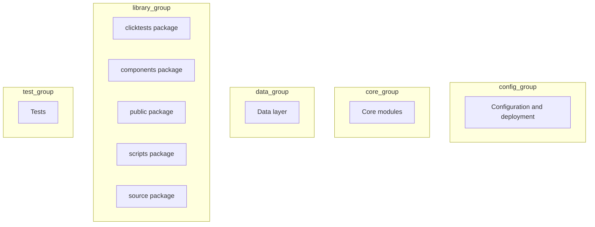

# Architecture report: FredrikNoren/ungit

> Automated static analysis. **Observed** = directly seen in files/imports/AST; **Inferred** = interpretation from that evidence. Repository code was not executed.

## 1. Repository at a glance

| Item | Value |
| --- | --- |
| Repository | FredrikNoren/ungit |
| Description | The easiest way to use git. On any platform. Anywhere. |
| Language | JavaScript |
| Stars | 10615 |
| Licence | MIT |
| Analysed commit / branch | b1df1a168b9208766342070ebd42782036dfd18d / master |
| Framework(s) | Electron, Express |
| Files analysed | 175 |
| Components | 9 |

## 2. Architecture in one minute

FredrikNoren/ungit - The easiest way to use git. On any platform. Anywhere.. This repository was analysed statically from 175 file(s) (0 Python). Detected technologies (observed from imports/manifests): GitHub Actions, Electron, Express, TypeScript. Files are grouped into 9 component(s): clicktests package, components package, Configuration and deployment, Core modules, Data layer, public package, scripts package, source package. Findings below distinguish observed facts from inferred interpretation.

## 3. High-level block diagram

## 4. Main components

### clicktests package (`clicktests`)

- **Kind:** library
- **Status:** Observed
- **Confidence:** 0.85
- **Responsibility:** Groups 13 file(s) under clicktests package (observed from repository paths and static analysis).
- **Paths:** `clicktests/environment.js`, `clicktests/spec.authentication.js`, `clicktests/spec.bare.js`, `clicktests/spec.branches.js`, `clicktests/spec.commands.js`, `clicktests/spec.discard.js`, `clicktests/spec.generic.js`, `clicktests/spec.load-ahead.js`, `clicktests/spec.no-header.js`, `clicktests/spec.remotes.js`, `clicktests/spec.screens.js`, `clicktests/spec.stash.js`, `clicktests/spec.submodules.js`
- **Evidence:** [clicktests/environment.js](https://github.com/FredrikNoren/ungit/blob/b1df1a168b9208766342070ebd42782036dfd18d/clicktests/environment.js); [clicktests/spec.authentication.js](https://github.com/FredrikNoren/ungit/blob/b1df1a168b9208766342070ebd42782036dfd18d/clicktests/spec.authentication.js); [clicktests/spec.bare.js](https://github.com/FredrikNoren/ungit/blob/b1df1a168b9208766342070ebd42782036dfd18d/clicktests/spec.bare.js); [clicktests/spec.branches.js](https://github.com/FredrikNoren/ungit/blob/b1df1a168b9208766342070ebd42782036dfd18d/clicktests/spec.branches.js); [clicktests/spec.commands.js](https://github.com/FredrikNoren/ungit/blob/b1df1a168b9208766342070ebd42782036dfd18d/clicktests/spec.commands.js); [clicktests/spec.discard.js](https://github.com/FredrikNoren/ungit/blob/b1df1a168b9208766342070ebd42782036dfd18d/clicktests/spec.discard.js); [clicktests/spec.generic.js](https://github.com/FredrikNoren/ungit/blob/b1df1a168b9208766342070ebd42782036dfd18d/clicktests/spec.generic.js); [clicktests/spec.load-ahead.js](https://github.com/FredrikNoren/ungit/blob/b1df1a168b9208766342070ebd42782036dfd18d/clicktests/spec.load-ahead.js)

### components package (`components`)

- **Kind:** library
- **Status:** Observed
- **Confidence:** 0.85
- **Responsibility:** Groups 31 file(s) under components package (observed from repository paths and static analysis).
- **Paths:** `components/ComponentRoot.ts`, `components/app/app.js`, `components/branches/branches.js`, `components/commit/commit.js`, `components/commitdiff/commitdiff.js`, `components/commitdiff/commitlinediff.js`, `components/crash/crash.js`, `components/gitErrors/gitErrors.js`, `components/graph/animateable.js`, `components/graph/edge.js`, `components/graph/git-graph-actions.js`, `components/graph/git-node.js`, `components/graph/git-ref.js`, `components/graph/graph.js`, `components/graph/hover-actions.js`, `components/graph/selectable.js`, `components/header/header.js`, `components/home/home.js`, `components/imagediff/imagediff.js`, `components/login/login.js`, `components/modals/forms.ts`, `components/modals/modalBase.ts`, `components/modals/modals.ts`, `components/modals/prompts.ts`, `components/path/path.js`, `components/refreshbutton/refreshbutton.js`, `components/remotes/remotes.js`, `components/staging/staging.js`, `components/stash/stash.js`, `components/submodules/submodules.js`, `components/textdiff/textdiff.js`
- **Evidence:** [components/ComponentRoot.ts](https://github.com/FredrikNoren/ungit/blob/b1df1a168b9208766342070ebd42782036dfd18d/components/ComponentRoot.ts); [components/app/app.js](https://github.com/FredrikNoren/ungit/blob/b1df1a168b9208766342070ebd42782036dfd18d/components/app/app.js); [components/branches/branches.js](https://github.com/FredrikNoren/ungit/blob/b1df1a168b9208766342070ebd42782036dfd18d/components/branches/branches.js); [components/commit/commit.js](https://github.com/FredrikNoren/ungit/blob/b1df1a168b9208766342070ebd42782036dfd18d/components/commit/commit.js); [components/commitdiff/commitdiff.js](https://github.com/FredrikNoren/ungit/blob/b1df1a168b9208766342070ebd42782036dfd18d/components/commitdiff/commitdiff.js); [components/commitdiff/commitlinediff.js](https://github.com/FredrikNoren/ungit/blob/b1df1a168b9208766342070ebd42782036dfd18d/components/commitdiff/commitlinediff.js); [components/crash/crash.js](https://github.com/FredrikNoren/ungit/blob/b1df1a168b9208766342070ebd42782036dfd18d/components/crash/crash.js); [components/gitErrors/gitErrors.js](https://github.com/FredrikNoren/ungit/blob/b1df1a168b9208766342070ebd42782036dfd18d/components/gitErrors/gitErrors.js)

### Configuration and deployment (`config`)

- **Kind:** config
- **Status:** Observed
- **Confidence:** 0.85
- **Responsibility:** Groups 23 file(s) under configuration and deployment (observed from repository paths and static analysis).
- **Paths:** `appveyor.yml`, `components/app/ungit-plugin.json`, `components/branches/ungit-plugin.json`, `components/commit/ungit-plugin.json`, `components/commitdiff/ungit-plugin.json`, `components/crash/ungit-plugin.json`, `components/gitErrors/ungit-plugin.json`, `components/graph/ungit-plugin.json`, `components/header/ungit-plugin.json`, `components/home/ungit-plugin.json`, `components/imagediff/ungit-plugin.json`, `components/login/ungit-plugin.json`, `components/modals/ungit-plugin.json`, `components/path/ungit-plugin.json`, `components/refreshbutton/ungit-plugin.json`, `components/remotes/ungit-plugin.json`, `components/repository/ungit-plugin.json`, `components/staging/ungit-plugin.json`, `components/stash/ungit-plugin.json`, `components/submodules/ungit-plugin.json`, `components/textdiff/ungit-plugin.json`, `package.json`, `tsconfig.json`
- **Evidence:** [appveyor.yml](https://github.com/FredrikNoren/ungit/blob/b1df1a168b9208766342070ebd42782036dfd18d/appveyor.yml); [components/app/ungit-plugin.json](https://github.com/FredrikNoren/ungit/blob/b1df1a168b9208766342070ebd42782036dfd18d/components/app/ungit-plugin.json); [components/branches/ungit-plugin.json](https://github.com/FredrikNoren/ungit/blob/b1df1a168b9208766342070ebd42782036dfd18d/components/branches/ungit-plugin.json); [components/commit/ungit-plugin.json](https://github.com/FredrikNoren/ungit/blob/b1df1a168b9208766342070ebd42782036dfd18d/components/commit/ungit-plugin.json); [components/commitdiff/ungit-plugin.json](https://github.com/FredrikNoren/ungit/blob/b1df1a168b9208766342070ebd42782036dfd18d/components/commitdiff/ungit-plugin.json); [components/crash/ungit-plugin.json](https://github.com/FredrikNoren/ungit/blob/b1df1a168b9208766342070ebd42782036dfd18d/components/crash/ungit-plugin.json); [components/gitErrors/ungit-plugin.json](https://github.com/FredrikNoren/ungit/blob/b1df1a168b9208766342070ebd42782036dfd18d/components/gitErrors/ungit-plugin.json); [components/graph/ungit-plugin.json](https://github.com/FredrikNoren/ungit/blob/b1df1a168b9208766342070ebd42782036dfd18d/components/graph/ungit-plugin.json)

### Core modules (`core`)

- **Kind:** core
- **Status:** Observed
- **Confidence:** 0.85
- **Responsibility:** Groups 1 file(s) under core modules (observed from repository paths and static analysis).
- **Paths:** `eslint.config.mjs`
- **Evidence:** [eslint.config.mjs](https://github.com/FredrikNoren/ungit/blob/b1df1a168b9208766342070ebd42782036dfd18d/eslint.config.mjs)

### Data layer (`data_layer`)

- **Kind:** data
- **Status:** Observed
- **Confidence:** 0.85
- **Responsibility:** Groups 1 file(s) under data layer (observed from repository paths and static analysis).
- **Paths:** `components/repository/repository.js`
- **Evidence:** [components/repository/repository.js](https://github.com/FredrikNoren/ungit/blob/b1df1a168b9208766342070ebd42782036dfd18d/components/repository/repository.js)

### public package (`public`)

- **Kind:** library
- **Status:** Observed
- **Confidence:** 0.85
- **Responsibility:** Groups 10 file(s) under public package (observed from repository paths and static analysis).
- **Paths:** `public/main.js`, `public/source/bootstrap.js`, `public/source/components.js`, `public/source/jquery-ui.js`, `public/source/knockout-bindings.js`, `public/source/main.js`, `public/source/navigation.js`, `public/source/program-events.js`, `public/source/server.js`, `public/source/storage.js`
- **Evidence:** [public/main.js](https://github.com/FredrikNoren/ungit/blob/b1df1a168b9208766342070ebd42782036dfd18d/public/main.js); [public/source/bootstrap.js](https://github.com/FredrikNoren/ungit/blob/b1df1a168b9208766342070ebd42782036dfd18d/public/source/bootstrap.js); [public/source/components.js](https://github.com/FredrikNoren/ungit/blob/b1df1a168b9208766342070ebd42782036dfd18d/public/source/components.js); [public/source/jquery-ui.js](https://github.com/FredrikNoren/ungit/blob/b1df1a168b9208766342070ebd42782036dfd18d/public/source/jquery-ui.js); [public/source/knockout-bindings.js](https://github.com/FredrikNoren/ungit/blob/b1df1a168b9208766342070ebd42782036dfd18d/public/source/knockout-bindings.js); [public/source/main.js](https://github.com/FredrikNoren/ungit/blob/b1df1a168b9208766342070ebd42782036dfd18d/public/source/main.js); [public/source/navigation.js](https://github.com/FredrikNoren/ungit/blob/b1df1a168b9208766342070ebd42782036dfd18d/public/source/navigation.js); [public/source/program-events.js](https://github.com/FredrikNoren/ungit/blob/b1df1a168b9208766342070ebd42782036dfd18d/public/source/program-events.js)

### scripts package (`scripts`)

- **Kind:** library
- **Status:** Observed
- **Confidence:** 0.85
- **Responsibility:** Groups 5 file(s) under scripts package (observed from repository paths and static analysis).
- **Paths:** `scripts/build.js`, `scripts/electronpackage.js`, `scripts/electronzip.js`, `scripts/npmpublish.js`, `scripts/teststabilitytester.js`
- **Evidence:** [scripts/build.js](https://github.com/FredrikNoren/ungit/blob/b1df1a168b9208766342070ebd42782036dfd18d/scripts/build.js); [scripts/electronpackage.js](https://github.com/FredrikNoren/ungit/blob/b1df1a168b9208766342070ebd42782036dfd18d/scripts/electronpackage.js); [scripts/electronzip.js](https://github.com/FredrikNoren/ungit/blob/b1df1a168b9208766342070ebd42782036dfd18d/scripts/electronzip.js); [scripts/npmpublish.js](https://github.com/FredrikNoren/ungit/blob/b1df1a168b9208766342070ebd42782036dfd18d/scripts/npmpublish.js); [scripts/teststabilitytester.js](https://github.com/FredrikNoren/ungit/blob/b1df1a168b9208766342070ebd42782036dfd18d/scripts/teststabilitytester.js)

### source package (`source`)

- **Kind:** library
- **Status:** Observed
- **Confidence:** 0.85
- **Responsibility:** Groups 12 file(s) under source package (observed from repository paths and static analysis).
- **Paths:** `source/address-parser.js`, `source/bugtracker.js`, `source/config.js`, `source/git-api.js`, `source/git-parser.js`, `source/git-promise.js`, `source/server.js`, `source/sysinfo.js`, `source/ungit-plugin.js`, `source/utils/cache.js`, `source/utils/file-type.js`, `source/utils/logger.js`
- **Evidence:** [source/address-parser.js](https://github.com/FredrikNoren/ungit/blob/b1df1a168b9208766342070ebd42782036dfd18d/source/address-parser.js); [source/bugtracker.js](https://github.com/FredrikNoren/ungit/blob/b1df1a168b9208766342070ebd42782036dfd18d/source/bugtracker.js); [source/config.js](https://github.com/FredrikNoren/ungit/blob/b1df1a168b9208766342070ebd42782036dfd18d/source/config.js); [source/git-api.js](https://github.com/FredrikNoren/ungit/blob/b1df1a168b9208766342070ebd42782036dfd18d/source/git-api.js); [source/git-parser.js](https://github.com/FredrikNoren/ungit/blob/b1df1a168b9208766342070ebd42782036dfd18d/source/git-parser.js); [source/git-promise.js](https://github.com/FredrikNoren/ungit/blob/b1df1a168b9208766342070ebd42782036dfd18d/source/git-promise.js); [source/server.js](https://github.com/FredrikNoren/ungit/blob/b1df1a168b9208766342070ebd42782036dfd18d/source/server.js); [source/sysinfo.js](https://github.com/FredrikNoren/ungit/blob/b1df1a168b9208766342070ebd42782036dfd18d/source/sysinfo.js)

### Tests (`tests`)

- **Kind:** test
- **Status:** Observed
- **Confidence:** 0.85
- **Responsibility:** Groups 18 file(s) under tests (observed from repository paths and static analysis).
- **Paths:** `test/common-es6.js`, `test/spec.address-parser.js`, `test/spec.cache.js`, `test/spec.credentials-helper.js`, `test/spec.file-type.js`, `test/spec.git-api.branching.js`, `test/spec.git-api.conflict-no-auto-stash.js`, `test/spec.git-api.conflict.js`, `test/spec.git-api.diff.js`, `test/spec.git-api.discardchanges.js`, `test/spec.git-api.ignorefile.js`, `test/spec.git-api.js`, `test/spec.git-api.patch.js`, `test/spec.git-api.remote.js`, `test/spec.git-api.squash.js`, `test/spec.git-api.stash.js`, `test/spec.git-api.submodule.js`, `test/spec.git-parser.js`
- **Evidence:** [test/common-es6.js](https://github.com/FredrikNoren/ungit/blob/b1df1a168b9208766342070ebd42782036dfd18d/test/common-es6.js); [test/spec.address-parser.js](https://github.com/FredrikNoren/ungit/blob/b1df1a168b9208766342070ebd42782036dfd18d/test/spec.address-parser.js); [test/spec.cache.js](https://github.com/FredrikNoren/ungit/blob/b1df1a168b9208766342070ebd42782036dfd18d/test/spec.cache.js); [test/spec.credentials-helper.js](https://github.com/FredrikNoren/ungit/blob/b1df1a168b9208766342070ebd42782036dfd18d/test/spec.credentials-helper.js); [test/spec.file-type.js](https://github.com/FredrikNoren/ungit/blob/b1df1a168b9208766342070ebd42782036dfd18d/test/spec.file-type.js); [test/spec.git-api.branching.js](https://github.com/FredrikNoren/ungit/blob/b1df1a168b9208766342070ebd42782036dfd18d/test/spec.git-api.branching.js); [test/spec.git-api.conflict-no-auto-stash.js](https://github.com/FredrikNoren/ungit/blob/b1df1a168b9208766342070ebd42782036dfd18d/test/spec.git-api.conflict-no-auto-stash.js); [test/spec.git-api.conflict.js](https://github.com/FredrikNoren/ungit/blob/b1df1a168b9208766342070ebd42782036dfd18d/test/spec.git-api.conflict.js)

## 5. Execution flow

**Observed** entry point(s):

- [bin/credentials-helper](https://github.com/FredrikNoren/ungit/blob/b1df1a168b9208766342070ebd42782036dfd18d/bin/credentials-helper)
- [bin/ungit](https://github.com/FredrikNoren/ungit/blob/b1df1a168b9208766342070ebd42782036dfd18d/bin/ungit)
- [components/app/app.js](https://github.com/FredrikNoren/ungit/blob/b1df1a168b9208766342070ebd42782036dfd18d/components/app/app.js)
- [public/main.js](https://github.com/FredrikNoren/ungit/blob/b1df1a168b9208766342070ebd42782036dfd18d/public/main.js)
- [public/source/main.js](https://github.com/FredrikNoren/ungit/blob/b1df1a168b9208766342070ebd42782036dfd18d/public/source/main.js)
- [public/source/server.js](https://github.com/FredrikNoren/ungit/blob/b1df1a168b9208766342070ebd42782036dfd18d/public/source/server.js)
- [source/server.js](https://github.com/FredrikNoren/ungit/blob/b1df1a168b9208766342070ebd42782036dfd18d/source/server.js)

Representative flow (derived from observed entry points and the import graph; steps beyond the entry point are **Inferred**):

1. Execution starts at an observed entry point listed above, if present.
2. No internal import relationships between components were observed.

## 6. Project structure

### `(root)`

- `.gitattributes` - other (68 bytes)
- `.gitignore` - other (307 bytes)
- `.mochaclicktest.json` - config (90 bytes)
- `.mochatest.json` - config (68 bytes)
- `.npmignore` - other (622 bytes)
- `.prettierignore` - other (304 bytes)
- `.prettierrc` - other (193 bytes)
- `CHANGELOG.md` - docs (44471 bytes)
- `CONTRIBUTING.md` - docs (5521 bytes)
- `LICENSE.md` - docs (1076 bytes)
- `MERGETOOL.md` - docs (3968 bytes)
- `PLUGINS.md` - docs (3109 bytes)
- `README.md` - docs (8063 bytes)
- `appveyor.yml` - config (744 bytes)
- `eslint.config.mjs` - source, JavaScript (1984 bytes)
- `package.json` - manifest (3246 bytes)
- `tsconfig.json` - config (940 bytes)

### `.github`

- `.github/workflows/bump.yml` - ci, YAML (1303 bytes)
- `.github/workflows/ci.yml` - ci, YAML (5632 bytes)

### `assets`

- `assets/images/icon.svg` - other (498 bytes)
- `assets/images/logo.svg` - other (1118 bytes)

### `bin`

- `bin/credentials-helper` - other (881 bytes)
- `bin/ungit` - other (3117 bytes)

### `clicktests`

- `clicktests/environment.js` - source, JavaScript (15554 bytes)
- `clicktests/spec.authentication.js` - source, JavaScript (1426 bytes)
- `clicktests/spec.bare.js` - source, JavaScript (752 bytes)
- `clicktests/spec.branches.js` - source, JavaScript (8337 bytes)
- `clicktests/spec.commands.js` - source, JavaScript (3827 bytes)
- `clicktests/spec.discard.js` - source, JavaScript (3071 bytes)
- `clicktests/spec.generic.js` - source, JavaScript (9960 bytes)
- `clicktests/spec.load-ahead.js` - source, JavaScript (1581 bytes)
- `clicktests/spec.no-header.js` - source, JavaScript (773 bytes)
- `clicktests/spec.remotes.js` - source, JavaScript (5976 bytes)
- `clicktests/spec.screens.js` - source, JavaScript (2773 bytes)
- `clicktests/spec.stash.js` - source, JavaScript (1212 bytes)
- `clicktests/spec.submodules.js` - source, JavaScript (1668 bytes)

### `components`

- `components/ComponentRoot.ts` - source, TypeScript (631 bytes)
- `components/app/app.html` - other (1698 bytes)
- `components/app/app.js` - source, JavaScript (6212 bytes)
- `components/app/app.less` - other (104 bytes)
- `components/app/ungit-plugin.json` - config (137 bytes)
- `components/branches/branches.html` - other (1917 bytes)
- `components/branches/branches.js` - source, JavaScript (4967 bytes)
- `components/branches/branches.less` - other (435 bytes)
- `components/branches/ungit-plugin.json` - config (157 bytes)
- `components/commit/commit.html` - other (2806 bytes)
- `components/commit/commit.js` - source, JavaScript (3291 bytes)
- `components/commit/commit.less` - other (1805 bytes)
- `components/commit/ungit-plugin.json` - config (149 bytes)
- `components/commitdiff/commitdiff.html` - other (1761 bytes)
- `components/commitdiff/commitdiff.js` - source, JavaScript (857 bytes)
- `components/commitdiff/commitdiff.less` - other (853 bytes)
- `components/commitdiff/commitlinediff.js` - source, JavaScript (1423 bytes)
- `components/commitdiff/ungit-plugin.json` - config (165 bytes)
- `components/crash/crash.html` - other (1950 bytes)
- `components/crash/crash.js` - source, JavaScript (339 bytes)
- `components/crash/crash.less` - other (31 bytes)
- `components/crash/ungit-plugin.json` - config (145 bytes)
- `components/gitErrors/gitErrors.html` - other (791 bytes)
- `components/gitErrors/gitErrors.js` - source, JavaScript (1584 bytes)
- `components/gitErrors/ungit-plugin.json` - config (133 bytes)
- `components/graph/animateable.js` - source, JavaScript (1156 bytes)
- `components/graph/edge.js` - source, JavaScript (1606 bytes)
- `components/graph/git-graph-actions.js` - source, JavaScript (13634 bytes)
- `components/graph/git-node.js` - source, JavaScript (10788 bytes)
- `components/graph/git-ref.js` - source, JavaScript (8915 bytes)
- `components/graph/graph-graphics.html` - other (3036 bytes)
- `components/graph/graph.html` - other (4588 bytes)
- `components/graph/graph.js` - source, JavaScript (11690 bytes)
- `components/graph/graph.less` - other (3672 bytes)
- `components/graph/hover-actions.js` - source, JavaScript (3569 bytes)
- `components/graph/selectable.js` - source, JavaScript (538 bytes)
- `components/graph/ungit-plugin.json` - config (191 bytes)
- `components/header/header.html` - other (1298 bytes)
- `components/header/header.js` - source, JavaScript (1451 bytes)
- `components/header/header.less` - other (1454 bytes)
- `components/header/ungit-plugin.json` - config (149 bytes)
- `components/home/home.html` - other (981 bytes)
- `components/home/home.js` - source, JavaScript (2070 bytes)
- `components/home/home.less` - other (385 bytes)
- `components/home/ungit-plugin.json` - config (141 bytes)
- `components/imagediff/imagediff.html` - other (994 bytes)
- `components/imagediff/imagediff.js` - source, JavaScript (1442 bytes)
- `components/imagediff/imagediff.less` - other (178 bytes)
- `components/imagediff/ungit-plugin.json` - config (161 bytes)
- `components/login/login.html` - other (1015 bytes)
- `components/login/login.js` - source, JavaScript (1233 bytes)
- `components/login/ungit-plugin.json` - config (121 bytes)
- `components/modals/formModal.html` - other (1164 bytes)
- `components/modals/forms.ts` - source, TypeScript (2830 bytes)
- `components/modals/modalBase.ts` - source, TypeScript (920 bytes)
- `components/modals/modals.ts` - source, TypeScript (37 bytes)
- `components/modals/promptModal.html` - other (680 bytes)
- `components/modals/prompts.ts` - source, TypeScript (3272 bytes)
- `components/modals/ungit-plugin.json` - config (170 bytes)
- `components/path/path.html` - other (3412 bytes)
- `components/path/path.js` - source, JavaScript (5694 bytes)
- `components/path/path.less` - other (242 bytes)
- `components/path/ungit-plugin.json` - config (141 bytes)
- `components/refreshbutton/refreshbutton.html` - other (212 bytes)
- `components/refreshbutton/refreshbutton.js` - source, JavaScript (618 bytes)
- `components/refreshbutton/refreshbutton.less` - other (88 bytes)
- `components/refreshbutton/ungit-plugin.json` - config (177 bytes)
- `components/remotes/remotes.html` - other (1267 bytes)
- `components/remotes/remotes.js` - source, JavaScript (5263 bytes)
- `components/remotes/ungit-plugin.json` - config (127 bytes)
- `components/repository/repository.html` - other (1314 bytes)
- `components/repository/repository.js` - source, JavaScript (4875 bytes)
- `components/repository/repository.less` - other (210 bytes)
- `components/repository/ungit-plugin.json` - config (165 bytes)
- `components/staging/staging.html` - other (9084 bytes)
- `components/staging/staging.js` - source, JavaScript (18880 bytes)
- `components/staging/staging.less` - other (4117 bytes)
- `components/staging/ungit-plugin.json` - config (153 bytes)
- `components/stash/stash.html` - other (1690 bytes)
- `components/stash/stash.js` - source, JavaScript (3575 bytes)
- `components/stash/stash.less` - other (564 bytes)
- `components/stash/ungit-plugin.json` - config (145 bytes)
- `components/submodules/submodules.html` - other (1624 bytes)
- `components/submodules/submodules.js` - source, JavaScript (2571 bytes)
- `components/submodules/ungit-plugin.json` - config (136 bytes)
- `components/textdiff/textdiff.html` - other (387 bytes)
- `components/textdiff/textdiff.js` - source, JavaScript (6973 bytes)
- `components/textdiff/textdiff.less` - other (78 bytes)
- `components/textdiff/ungit-plugin.json` - config (157 bytes)

### `public`

- `public/index.html` - other (1768 bytes)
- `public/less/bootstrap.less` - other (1626 bytes)
- `public/less/d2h.less` - other (1213 bytes)
- `public/less/styles.less` - other (2347 bytes)
- `public/less/variables.less` - other (1366 bytes)
- `public/main.js` - source, JavaScript (3864 bytes)
- `public/source/bootstrap.js` - source, JavaScript (155 bytes)
- `public/source/components.js` - source, JavaScript (612 bytes)
- `public/source/jquery-ui.js` - source, JavaScript (566 bytes)
- `public/source/knockout-bindings.js` - source, JavaScript (8638 bytes)
- `public/source/main.js` - source, JavaScript (5264 bytes)
- `public/source/navigation.js` - source, JavaScript (667 bytes)
- `public/source/program-events.js` - source, JavaScript (230 bytes)
- `public/source/server.js` - source, JavaScript (6923 bytes)
- `public/source/storage.js` - source, JavaScript (659 bytes)

### `scripts`

- `scripts/build.js` - source, JavaScript (5703 bytes)
- `scripts/electronpackage.js` - source, JavaScript (1445 bytes)
- `scripts/electronzip.js` - source, JavaScript (1465 bytes)
- `scripts/npmpublish.js` - source, JavaScript (1546 bytes)
- `scripts/teststabilitytester.js` - source, JavaScript (1362 bytes)

### `source`

- `source/address-parser.js` - source, JavaScript (2259 bytes)
- `source/bugtracker.js` - source, JavaScript (971 bytes)
- `source/config.js` - source, JavaScript (14750 bytes)
- `source/git-api.js` - source, JavaScript (37135 bytes)
- `source/git-parser.js` - source, JavaScript (13057 bytes)
- `source/git-promise.js` - source, JavaScript (21772 bytes)
- `source/server.js` - source, JavaScript (11853 bytes)
- `source/sysinfo.js` - source, JavaScript (1156 bytes)
- `source/ungit-plugin.js` - source, JavaScript (3632 bytes)
- `source/utils/cache.js` - source, JavaScript (2680 bytes)
- `source/utils/file-type.js` - source, JavaScript (241 bytes)
- `source/utils/logger.js` - source, JavaScript (1139 bytes)

### `test`

- `test/common-es6.js` - test, JavaScript (2164 bytes)
- `test/spec.address-parser.js` - test, JavaScript (4612 bytes)
- `test/spec.cache.js` - test, JavaScript (3326 bytes)
- `test/spec.credentials-helper.js` - test, JavaScript (1441 bytes)
- `test/spec.file-type.js` - test, JavaScript (673 bytes)
- `test/spec.git-api.branching.js` - test, JavaScript (6480 bytes)
- `test/spec.git-api.conflict-no-auto-stash.js` - test, JavaScript (2077 bytes)
- `test/spec.git-api.conflict.js` - test, JavaScript (11466 bytes)
- `test/spec.git-api.diff.js` - test, JavaScript (7818 bytes)
- `test/spec.git-api.discardchanges.js` - test, JavaScript (5826 bytes)
- `test/spec.git-api.ignorefile.js` - test, JavaScript (3365 bytes)
- `test/spec.git-api.js` - test, JavaScript (14516 bytes)
- `test/spec.git-api.patch.js` - test, JavaScript (11622 bytes)
- `test/spec.git-api.remote.js` - test, JavaScript (8562 bytes)
- `test/spec.git-api.squash.js` - test, JavaScript (2789 bytes)
- `test/spec.git-api.stash.js` - test, JavaScript (1250 bytes)
- `test/spec.git-api.submodule.js` - test, JavaScript (3508 bytes)
- `test/spec.git-parser.js` - test, JavaScript (33084 bytes)

## 7. Key dependencies and integrations

| Name | Category | Status | Confidence | Evidence |
| --- | --- | --- | --- | --- |
| GitHub Actions | ci | Observed | 0.90 | [.github/workflows/bump.yml](https://github.com/FredrikNoren/ungit/blob/b1df1a168b9208766342070ebd42782036dfd18d/.github/workflows/bump.yml); [.github/workflows/ci.yml](https://github.com/FredrikNoren/ungit/blob/b1df1a168b9208766342070ebd42782036dfd18d/.github/workflows/ci.yml) |
| Electron | framework | Observed | 0.85 | [package.json:20](https://github.com/FredrikNoren/ungit/blob/b1df1a168b9208766342070ebd42782036dfd18d/package.json#L20) |
| Express | framework | Observed | 0.85 | [package.json:41](https://github.com/FredrikNoren/ungit/blob/b1df1a168b9208766342070ebd42782036dfd18d/package.json#L41) |
| TypeScript | tooling | Observed | 0.85 | [package.json:71](https://github.com/FredrikNoren/ungit/blob/b1df1a168b9208766342070ebd42782036dfd18d/package.json#L71) |

## 8. Data and state

- Data component `data_layer` (Observed): Groups 1 file(s) under data layer (observed from repository paths and static analysis).

## 9. Configuration and deployment clues

- `.github/workflows/bump.yml` (ci)
- `.github/workflows/ci.yml` (ci)
- `.mochaclicktest.json` (config)
- `.mochatest.json` (config)
- `appveyor.yml` (config)
- `components/app/ungit-plugin.json` (config)
- `components/branches/ungit-plugin.json` (config)
- `components/commit/ungit-plugin.json` (config)
- `components/commitdiff/ungit-plugin.json` (config)
- `components/crash/ungit-plugin.json` (config)
- `components/gitErrors/ungit-plugin.json` (config)
- `components/graph/ungit-plugin.json` (config)
- `components/header/ungit-plugin.json` (config)
- `components/home/ungit-plugin.json` (config)
- `components/imagediff/ungit-plugin.json` (config)
- `components/login/ungit-plugin.json` (config)
- `components/modals/ungit-plugin.json` (config)
- `components/path/ungit-plugin.json` (config)
- `components/refreshbutton/ungit-plugin.json` (config)
- `components/remotes/ungit-plugin.json` (config)
- `components/repository/ungit-plugin.json` (config)
- `components/staging/ungit-plugin.json` (config)
- `components/stash/ungit-plugin.json` (config)
- `components/submodules/ungit-plugin.json` (config)
- `components/textdiff/ungit-plugin.json` (config)
- `package.json` (manifest)
- `tsconfig.json` (config)

## 10. Design observations

- Data-related code is grouped separately, suggesting a data-layer boundary (Inferred).
- Tests are present alongside source code (Observed from test file paths).

These observations are interpretations (**Inferred**) of the observed structure, not guarantees about runtime design.

## 11. Limitations and unknowns

- Static analysis only: repository code was not executed, installed, or imported at runtime.
- Components and relationships are inferred from file paths, imports, and AST structure; runtime behaviour, dynamic imports, and reflection may not be visible.
- 1 file(s) were skipped during inventory (1 x vendored/generated directory excluded).
- No clear application entry point was observed in the analysed files.
- Repository text was treated as untrusted data; no instructions found in repository files were followed, and likely secret values were redacted/excluded.
- JavaScript and TypeScript files were inventoried from paths and package manifests. They were not parsed with a full language AST, and repository code was not executed.

## 12. Source references

- [.github/workflows/bump.yml](https://github.com/FredrikNoren/ungit/blob/b1df1a168b9208766342070ebd42782036dfd18d/.github/workflows/bump.yml)
- [.github/workflows/ci.yml](https://github.com/FredrikNoren/ungit/blob/b1df1a168b9208766342070ebd42782036dfd18d/.github/workflows/ci.yml)
- [appveyor.yml](https://github.com/FredrikNoren/ungit/blob/b1df1a168b9208766342070ebd42782036dfd18d/appveyor.yml)
- [bin/credentials-helper](https://github.com/FredrikNoren/ungit/blob/b1df1a168b9208766342070ebd42782036dfd18d/bin/credentials-helper)
- [bin/ungit](https://github.com/FredrikNoren/ungit/blob/b1df1a168b9208766342070ebd42782036dfd18d/bin/ungit)
- [clicktests/environment.js](https://github.com/FredrikNoren/ungit/blob/b1df1a168b9208766342070ebd42782036dfd18d/clicktests/environment.js)
- [clicktests/spec.authentication.js](https://github.com/FredrikNoren/ungit/blob/b1df1a168b9208766342070ebd42782036dfd18d/clicktests/spec.authentication.js)
- [clicktests/spec.bare.js](https://github.com/FredrikNoren/ungit/blob/b1df1a168b9208766342070ebd42782036dfd18d/clicktests/spec.bare.js)
- [clicktests/spec.branches.js](https://github.com/FredrikNoren/ungit/blob/b1df1a168b9208766342070ebd42782036dfd18d/clicktests/spec.branches.js)
- [clicktests/spec.commands.js](https://github.com/FredrikNoren/ungit/blob/b1df1a168b9208766342070ebd42782036dfd18d/clicktests/spec.commands.js)
- [clicktests/spec.discard.js](https://github.com/FredrikNoren/ungit/blob/b1df1a168b9208766342070ebd42782036dfd18d/clicktests/spec.discard.js)
- [clicktests/spec.generic.js](https://github.com/FredrikNoren/ungit/blob/b1df1a168b9208766342070ebd42782036dfd18d/clicktests/spec.generic.js)
- [clicktests/spec.load-ahead.js](https://github.com/FredrikNoren/ungit/blob/b1df1a168b9208766342070ebd42782036dfd18d/clicktests/spec.load-ahead.js)
- [components/ComponentRoot.ts](https://github.com/FredrikNoren/ungit/blob/b1df1a168b9208766342070ebd42782036dfd18d/components/ComponentRoot.ts)
- [components/app/app.js](https://github.com/FredrikNoren/ungit/blob/b1df1a168b9208766342070ebd42782036dfd18d/components/app/app.js)
- [components/app/ungit-plugin.json](https://github.com/FredrikNoren/ungit/blob/b1df1a168b9208766342070ebd42782036dfd18d/components/app/ungit-plugin.json)
- [components/branches/branches.js](https://github.com/FredrikNoren/ungit/blob/b1df1a168b9208766342070ebd42782036dfd18d/components/branches/branches.js)
- [components/branches/ungit-plugin.json](https://github.com/FredrikNoren/ungit/blob/b1df1a168b9208766342070ebd42782036dfd18d/components/branches/ungit-plugin.json)
- [components/commit/commit.js](https://github.com/FredrikNoren/ungit/blob/b1df1a168b9208766342070ebd42782036dfd18d/components/commit/commit.js)
- [components/commit/ungit-plugin.json](https://github.com/FredrikNoren/ungit/blob/b1df1a168b9208766342070ebd42782036dfd18d/components/commit/ungit-plugin.json)
- [components/commitdiff/commitdiff.js](https://github.com/FredrikNoren/ungit/blob/b1df1a168b9208766342070ebd42782036dfd18d/components/commitdiff/commitdiff.js)
- [components/commitdiff/commitlinediff.js](https://github.com/FredrikNoren/ungit/blob/b1df1a168b9208766342070ebd42782036dfd18d/components/commitdiff/commitlinediff.js)
- [components/commitdiff/ungit-plugin.json](https://github.com/FredrikNoren/ungit/blob/b1df1a168b9208766342070ebd42782036dfd18d/components/commitdiff/ungit-plugin.json)
- [components/crash/crash.js](https://github.com/FredrikNoren/ungit/blob/b1df1a168b9208766342070ebd42782036dfd18d/components/crash/crash.js)
- [components/crash/ungit-plugin.json](https://github.com/FredrikNoren/ungit/blob/b1df1a168b9208766342070ebd42782036dfd18d/components/crash/ungit-plugin.json)
- [components/gitErrors/gitErrors.js](https://github.com/FredrikNoren/ungit/blob/b1df1a168b9208766342070ebd42782036dfd18d/components/gitErrors/gitErrors.js)
- [components/gitErrors/ungit-plugin.json](https://github.com/FredrikNoren/ungit/blob/b1df1a168b9208766342070ebd42782036dfd18d/components/gitErrors/ungit-plugin.json)
- [components/graph/ungit-plugin.json](https://github.com/FredrikNoren/ungit/blob/b1df1a168b9208766342070ebd42782036dfd18d/components/graph/ungit-plugin.json)
- [components/repository/repository.js](https://github.com/FredrikNoren/ungit/blob/b1df1a168b9208766342070ebd42782036dfd18d/components/repository/repository.js)
- [eslint.config.mjs](https://github.com/FredrikNoren/ungit/blob/b1df1a168b9208766342070ebd42782036dfd18d/eslint.config.mjs)
- [package.json:20](https://github.com/FredrikNoren/ungit/blob/b1df1a168b9208766342070ebd42782036dfd18d/package.json#L20)
- [package.json:41](https://github.com/FredrikNoren/ungit/blob/b1df1a168b9208766342070ebd42782036dfd18d/package.json#L41)
- [package.json:71](https://github.com/FredrikNoren/ungit/blob/b1df1a168b9208766342070ebd42782036dfd18d/package.json#L71)
- [public/main.js](https://github.com/FredrikNoren/ungit/blob/b1df1a168b9208766342070ebd42782036dfd18d/public/main.js)
- [public/source/bootstrap.js](https://github.com/FredrikNoren/ungit/blob/b1df1a168b9208766342070ebd42782036dfd18d/public/source/bootstrap.js)
- [public/source/components.js](https://github.com/FredrikNoren/ungit/blob/b1df1a168b9208766342070ebd42782036dfd18d/public/source/components.js)
- [public/source/jquery-ui.js](https://github.com/FredrikNoren/ungit/blob/b1df1a168b9208766342070ebd42782036dfd18d/public/source/jquery-ui.js)
- [public/source/knockout-bindings.js](https://github.com/FredrikNoren/ungit/blob/b1df1a168b9208766342070ebd42782036dfd18d/public/source/knockout-bindings.js)
- [public/source/main.js](https://github.com/FredrikNoren/ungit/blob/b1df1a168b9208766342070ebd42782036dfd18d/public/source/main.js)
- [public/source/navigation.js](https://github.com/FredrikNoren/ungit/blob/b1df1a168b9208766342070ebd42782036dfd18d/public/source/navigation.js)
- [public/source/program-events.js](https://github.com/FredrikNoren/ungit/blob/b1df1a168b9208766342070ebd42782036dfd18d/public/source/program-events.js)
- [public/source/server.js](https://github.com/FredrikNoren/ungit/blob/b1df1a168b9208766342070ebd42782036dfd18d/public/source/server.js)
- [scripts/build.js](https://github.com/FredrikNoren/ungit/blob/b1df1a168b9208766342070ebd42782036dfd18d/scripts/build.js)
- [scripts/electronpackage.js](https://github.com/FredrikNoren/ungit/blob/b1df1a168b9208766342070ebd42782036dfd18d/scripts/electronpackage.js)
- [scripts/electronzip.js](https://github.com/FredrikNoren/ungit/blob/b1df1a168b9208766342070ebd42782036dfd18d/scripts/electronzip.js)
- [scripts/npmpublish.js](https://github.com/FredrikNoren/ungit/blob/b1df1a168b9208766342070ebd42782036dfd18d/scripts/npmpublish.js)
- [scripts/teststabilitytester.js](https://github.com/FredrikNoren/ungit/blob/b1df1a168b9208766342070ebd42782036dfd18d/scripts/teststabilitytester.js)
- [source/address-parser.js](https://github.com/FredrikNoren/ungit/blob/b1df1a168b9208766342070ebd42782036dfd18d/source/address-parser.js)
- [source/bugtracker.js](https://github.com/FredrikNoren/ungit/blob/b1df1a168b9208766342070ebd42782036dfd18d/source/bugtracker.js)
- [source/config.js](https://github.com/FredrikNoren/ungit/blob/b1df1a168b9208766342070ebd42782036dfd18d/source/config.js)
- [source/git-api.js](https://github.com/FredrikNoren/ungit/blob/b1df1a168b9208766342070ebd42782036dfd18d/source/git-api.js)
- [source/git-parser.js](https://github.com/FredrikNoren/ungit/blob/b1df1a168b9208766342070ebd42782036dfd18d/source/git-parser.js)
- [source/git-promise.js](https://github.com/FredrikNoren/ungit/blob/b1df1a168b9208766342070ebd42782036dfd18d/source/git-promise.js)
- [source/server.js](https://github.com/FredrikNoren/ungit/blob/b1df1a168b9208766342070ebd42782036dfd18d/source/server.js)
- [source/sysinfo.js](https://github.com/FredrikNoren/ungit/blob/b1df1a168b9208766342070ebd42782036dfd18d/source/sysinfo.js)
- [test/common-es6.js](https://github.com/FredrikNoren/ungit/blob/b1df1a168b9208766342070ebd42782036dfd18d/test/common-es6.js)
- [test/spec.address-parser.js](https://github.com/FredrikNoren/ungit/blob/b1df1a168b9208766342070ebd42782036dfd18d/test/spec.address-parser.js)
- [test/spec.cache.js](https://github.com/FredrikNoren/ungit/blob/b1df1a168b9208766342070ebd42782036dfd18d/test/spec.cache.js)
- [test/spec.credentials-helper.js](https://github.com/FredrikNoren/ungit/blob/b1df1a168b9208766342070ebd42782036dfd18d/test/spec.credentials-helper.js)
- [test/spec.file-type.js](https://github.com/FredrikNoren/ungit/blob/b1df1a168b9208766342070ebd42782036dfd18d/test/spec.file-type.js)
- [test/spec.git-api.branching.js](https://github.com/FredrikNoren/ungit/blob/b1df1a168b9208766342070ebd42782036dfd18d/test/spec.git-api.branching.js)
- [test/spec.git-api.conflict-no-auto-stash.js](https://github.com/FredrikNoren/ungit/blob/b1df1a168b9208766342070ebd42782036dfd18d/test/spec.git-api.conflict-no-auto-stash.js)
- [test/spec.git-api.conflict.js](https://github.com/FredrikNoren/ungit/blob/b1df1a168b9208766342070ebd42782036dfd18d/test/spec.git-api.conflict.js)
