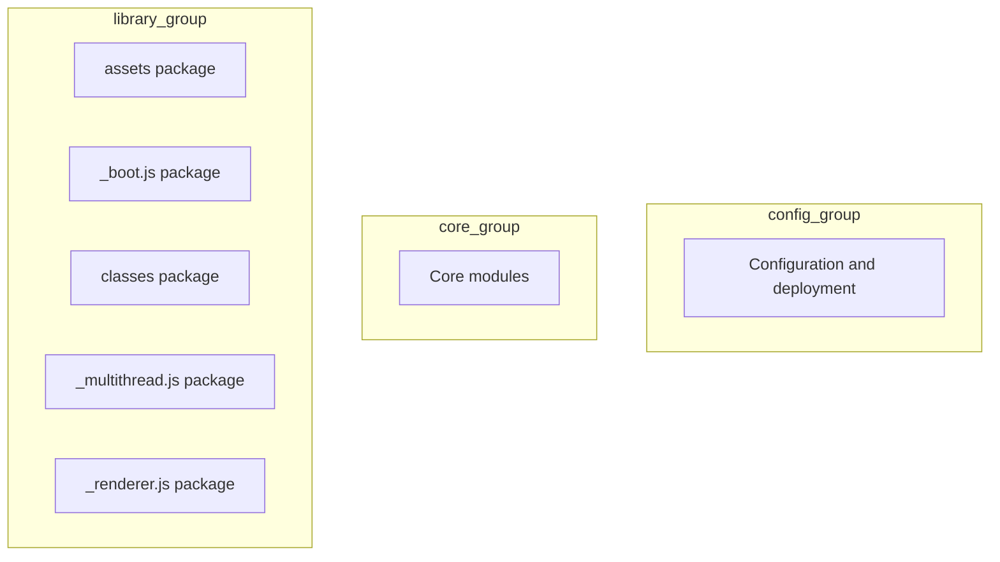

# Architecture report: GitSquared/edex-ui

> Automated static analysis. **Observed** = directly seen in files/imports/AST; **Inferred** = interpretation from that evidence. Repository code was not executed.

## 1. Repository at a glance

| Item | Value |
| --- | --- |
| Repository | GitSquared/edex-ui |
| Description | A cross-platform, customizable science fiction terminal emulator with advanced monitoring & touchscreen support. |
| Language | JavaScript |
| Stars | 45041 |
| Licence | GPL-3.0 |
| Analysed commit / branch | 04a00c4079908788b371c6ecdefff96d0d9950f8 / master |
| Framework(s) | Electron |
| Files analysed | 99 |
| Components | 7 |

## 2. Architecture in one minute

GitSquared/edex-ui - A cross-platform, customizable science fiction terminal emulator with advanced monitoring & touchscreen support.. This repository was analysed statically from 99 file(s) (0 Python). Detected technologies (observed from imports/manifests): GitHub Actions, Electron, Docker. Files are grouped into 7 component(s): assets package, _boot.js package, classes package, Configuration and deployment, Core modules, _multithread.js package, _renderer.js package. Findings below distinguish observed facts from inferred interpretation.

## 3. High-level block diagram

## 4. Main components

### assets package (`assets`)

- **Kind:** library
- **Status:** Observed
- **Confidence:** 0.85
- **Responsibility:** Groups 1 file(s) under assets package (observed from repository paths and static analysis).
- **Paths:** `src/assets/misc/file-icons-match.js`
- **Evidence:** [src/assets/misc/file-icons-match.js](https://github.com/GitSquared/edex-ui/blob/04a00c4079908788b371c6ecdefff96d0d9950f8/src/assets/misc/file-icons-match.js)

### _boot.js package (`boot_js`)

- **Kind:** library
- **Status:** Observed
- **Confidence:** 0.85
- **Responsibility:** Groups 1 file(s) under _boot.js package (observed from repository paths and static analysis).
- **Paths:** `src/_boot.js`
- **Evidence:** [src/_boot.js](https://github.com/GitSquared/edex-ui/blob/04a00c4079908788b371c6ecdefff96d0d9950f8/src/_boot.js)

### classes package (`classes`)

- **Kind:** library
- **Status:** Observed
- **Confidence:** 0.85
- **Responsibility:** Groups 18 file(s) under classes package (observed from repository paths and static analysis).
- **Paths:** `src/classes/audiofx.class.js`, `src/classes/clock.class.js`, `src/classes/conninfo.class.js`, `src/classes/cpuinfo.class.js`, `src/classes/docReader.class.js`, `src/classes/filesystem.class.js`, `src/classes/fuzzyFinder.class.js`, `src/classes/hardwareInspector.class.js`, `src/classes/keyboard.class.js`, `src/classes/locationGlobe.class.js`, `src/classes/mediaPlayer.class.js`, `src/classes/modal.class.js`, `src/classes/netstat.class.js`, `src/classes/ramwatcher.class.js`, `src/classes/sysinfo.class.js`, `src/classes/terminal.class.js`, `src/classes/toplist.class.js`, `src/classes/updateChecker.class.js`
- **Evidence:** [src/classes/audiofx.class.js](https://github.com/GitSquared/edex-ui/blob/04a00c4079908788b371c6ecdefff96d0d9950f8/src/classes/audiofx.class.js); [src/classes/clock.class.js](https://github.com/GitSquared/edex-ui/blob/04a00c4079908788b371c6ecdefff96d0d9950f8/src/classes/clock.class.js); [src/classes/conninfo.class.js](https://github.com/GitSquared/edex-ui/blob/04a00c4079908788b371c6ecdefff96d0d9950f8/src/classes/conninfo.class.js); [src/classes/cpuinfo.class.js](https://github.com/GitSquared/edex-ui/blob/04a00c4079908788b371c6ecdefff96d0d9950f8/src/classes/cpuinfo.class.js); [src/classes/docReader.class.js](https://github.com/GitSquared/edex-ui/blob/04a00c4079908788b371c6ecdefff96d0d9950f8/src/classes/docReader.class.js); [src/classes/filesystem.class.js](https://github.com/GitSquared/edex-ui/blob/04a00c4079908788b371c6ecdefff96d0d9950f8/src/classes/filesystem.class.js); [src/classes/fuzzyFinder.class.js](https://github.com/GitSquared/edex-ui/blob/04a00c4079908788b371c6ecdefff96d0d9950f8/src/classes/fuzzyFinder.class.js); [src/classes/hardwareInspector.class.js](https://github.com/GitSquared/edex-ui/blob/04a00c4079908788b371c6ecdefff96d0d9950f8/src/classes/hardwareInspector.class.js)

### Configuration and deployment (`config`)

- **Kind:** config
- **Status:** Observed
- **Confidence:** 0.85
- **Responsibility:** Groups 42 file(s) under configuration and deployment (observed from repository paths and static analysis).
- **Paths:** `package.json`, `src/assets/kb_layouts/da-DK.json`, `src/assets/kb_layouts/de-DE.json`, `src/assets/kb_layouts/en-COLEMAK.json`, `src/assets/kb_layouts/en-DVORAK.json`, `src/assets/kb_layouts/en-GB.json`, `src/assets/kb_layouts/en-NORMAN.json`, `src/assets/kb_layouts/en-US.json`, `src/assets/kb_layouts/en-WORKMAN.json`, `src/assets/kb_layouts/es-ES.json`, `src/assets/kb_layouts/es-LAT.json`, `src/assets/kb_layouts/fr-BEPO.json`, `src/assets/kb_layouts/fr-FR.json`, `src/assets/kb_layouts/hu-HU.json`, `src/assets/kb_layouts/it-IT.json`, `src/assets/kb_layouts/nl-BE.json`, `src/assets/kb_layouts/pt-BR.json`, `src/assets/kb_layouts/sv-SE.json`, `src/assets/kb_layouts/tr-TR-F.json`, `src/assets/kb_layouts/tr-TR-Q.json`, `src/assets/themes/apollo-notype.json`, `src/assets/themes/apollo.json`, `src/assets/themes/blade.json`, `src/assets/themes/chalkboard-ligatures.json`, `src/assets/themes/chalkboard-notype.json`, `src/assets/themes/chalkboard.json`, `src/assets/themes/cyborg-focus.json`, `src/assets/themes/cyborg.json`, `src/assets/themes/interstellar.json`, `src/assets/themes/matrix.json`, `src/assets/themes/navy-disrupted.json`, `src/assets/themes/navy-notype.json`, `src/assets/themes/navy.json`, `src/assets/themes/nord.json`, `src/assets/themes/red.json`, `src/assets/themes/tron-colorfilter.json`, `src/assets/themes/tron-disrupted.json`, `src/assets/themes/tron-fulltype.json`, `src/assets/themes/tron-notype.json`, `src/assets/themes/tron-typeleft.json`, `src/assets/themes/tron.json`, `src/package.json`
- **Evidence:** [package.json](https://github.com/GitSquared/edex-ui/blob/04a00c4079908788b371c6ecdefff96d0d9950f8/package.json); [src/assets/kb_layouts/da-DK.json](https://github.com/GitSquared/edex-ui/blob/04a00c4079908788b371c6ecdefff96d0d9950f8/src/assets/kb_layouts/da-DK.json); [src/assets/kb_layouts/de-DE.json](https://github.com/GitSquared/edex-ui/blob/04a00c4079908788b371c6ecdefff96d0d9950f8/src/assets/kb_layouts/de-DE.json); [src/assets/kb_layouts/en-COLEMAK.json](https://github.com/GitSquared/edex-ui/blob/04a00c4079908788b371c6ecdefff96d0d9950f8/src/assets/kb_layouts/en-COLEMAK.json); [src/assets/kb_layouts/en-DVORAK.json](https://github.com/GitSquared/edex-ui/blob/04a00c4079908788b371c6ecdefff96d0d9950f8/src/assets/kb_layouts/en-DVORAK.json); [src/assets/kb_layouts/en-GB.json](https://github.com/GitSquared/edex-ui/blob/04a00c4079908788b371c6ecdefff96d0d9950f8/src/assets/kb_layouts/en-GB.json); [src/assets/kb_layouts/en-NORMAN.json](https://github.com/GitSquared/edex-ui/blob/04a00c4079908788b371c6ecdefff96d0d9950f8/src/assets/kb_layouts/en-NORMAN.json); [src/assets/kb_layouts/en-US.json](https://github.com/GitSquared/edex-ui/blob/04a00c4079908788b371c6ecdefff96d0d9950f8/src/assets/kb_layouts/en-US.json)

### Core modules (`core`)

- **Kind:** core
- **Status:** Observed
- **Confidence:** 0.85
- **Responsibility:** Groups 2 file(s) under core modules (observed from repository paths and static analysis).
- **Paths:** `file-icons-generator.js`, `prebuild-minify.js`
- **Evidence:** [file-icons-generator.js](https://github.com/GitSquared/edex-ui/blob/04a00c4079908788b371c6ecdefff96d0d9950f8/file-icons-generator.js); [prebuild-minify.js](https://github.com/GitSquared/edex-ui/blob/04a00c4079908788b371c6ecdefff96d0d9950f8/prebuild-minify.js)

### _multithread.js package (`multithread_js`)

- **Kind:** library
- **Status:** Observed
- **Confidence:** 0.85
- **Responsibility:** Groups 1 file(s) under _multithread.js package (observed from repository paths and static analysis).
- **Paths:** `src/_multithread.js`
- **Evidence:** [src/_multithread.js](https://github.com/GitSquared/edex-ui/blob/04a00c4079908788b371c6ecdefff96d0d9950f8/src/_multithread.js)

### _renderer.js package (`renderer_js`)

- **Kind:** library
- **Status:** Observed
- **Confidence:** 0.85
- **Responsibility:** Groups 1 file(s) under _renderer.js package (observed from repository paths and static analysis).
- **Paths:** `src/_renderer.js`
- **Evidence:** [src/_renderer.js](https://github.com/GitSquared/edex-ui/blob/04a00c4079908788b371c6ecdefff96d0d9950f8/src/_renderer.js)

## 5. Execution flow

**Observed** entry point(s):

- [src/_boot.js](https://github.com/GitSquared/edex-ui/blob/04a00c4079908788b371c6ecdefff96d0d9950f8/src/_boot.js)

Representative flow (derived from observed entry points and the import graph; steps beyond the entry point are **Inferred**):

1. Execution starts at an observed entry point listed above, if present.
2. No internal import relationships between components were observed.

## 6. Project structure

### `(root)`

- `.gitignore` - other (668 bytes)
- `.gitmodules` - other (678 bytes)
- `LICENSE` - docs (32472 bytes)
- `README.md` - docs (11836 bytes)
- `SECURITY.md` - docs (859 bytes)
- `file-icons-generator.js` - source, JavaScript (13421 bytes)
- `package.json` - manifest (3956 bytes)
- `prebuild-minify.js` - source, JavaScript (3642 bytes)

### `.github`

- `.github/FUNDING.yml` - config (102 bytes)
- `.github/ISSUE_TEMPLATE/config.yml` - config (368 bytes)
- `.github/ISSUE_TEMPLATE/issue_template.md` - docs (1132 bytes)
- `.github/workflows/build-binaries.yaml` - ci, YAML (6939 bytes)
- `.github/workflows/codeql-analysis.yml` - ci, YAML (2451 bytes)

### `media`

- `media/logo.svg` - other (1545 bytes)

### `src`

- `src/_boot.js` - source, JavaScript (13324 bytes)
- `src/_multithread.js` - source, JavaScript (2372 bytes)
- `src/_renderer.js` - source, JavaScript (46120 bytes)
- `src/assets/css/boot_screen.css` - other (2583 bytes)
- `src/assets/css/extra_ratios.css` - other (4520 bytes)
- `src/assets/css/filesystem.css` - other (6633 bytes)
- `src/assets/css/keyboard.css` - other (7592 bytes)
- `src/assets/css/main.css` - other (1895 bytes)
- `src/assets/css/main_shell.css` - other (4348 bytes)
- `src/assets/css/media_player.css` - other (2008 bytes)
- `src/assets/css/mod_clock.css` - other (1032 bytes)
- `src/assets/css/mod_column.css` - other (1121 bytes)
- `src/assets/css/mod_conninfo.css` - other (2086 bytes)
- `src/assets/css/mod_cpuinfo.css` - other (2435 bytes)
- `src/assets/css/mod_fuzzyFinder.css` - other (1021 bytes)
- `src/assets/css/mod_globe.css` - other (1744 bytes)
- `src/assets/css/mod_hardwareInspector.css` - other (1143 bytes)
- `src/assets/css/mod_netstat.css` - other (1675 bytes)
- `src/assets/css/mod_processlist.css` - other (845 bytes)
- `src/assets/css/mod_ramwatcher.css` - other (2850 bytes)
- `src/assets/css/mod_sysinfo.css` - other (1079 bytes)
- `src/assets/css/mod_toplist.css` - other (1571 bytes)
- `src/assets/css/modal.css` - other (5818 bytes)
- `src/assets/kb_layouts/da-DK.json` - config (11120 bytes)
- `src/assets/kb_layouts/de-DE.json` - config (10717 bytes)
- `src/assets/kb_layouts/en-COLEMAK.json` - config (10785 bytes)
- `src/assets/kb_layouts/en-DVORAK.json` - config (10766 bytes)
- `src/assets/kb_layouts/en-GB.json` - config (8799 bytes)
- `src/assets/kb_layouts/en-NORMAN.json` - config (10774 bytes)
- `src/assets/kb_layouts/en-US.json` - config (10773 bytes)
- `src/assets/kb_layouts/en-WORKMAN.json` - config (10772 bytes)
- `src/assets/kb_layouts/es-ES.json` - config (11174 bytes)
- `src/assets/kb_layouts/es-LAT.json` - config (11127 bytes)
- `src/assets/kb_layouts/fr-BEPO.json` - config (14607 bytes)
- `src/assets/kb_layouts/fr-FR.json` - config (11357 bytes)
- `src/assets/kb_layouts/hu-HU.json` - config (8647 bytes)
- `src/assets/kb_layouts/it-IT.json` - config (11191 bytes)
- `src/assets/kb_layouts/nl-BE.json` - config (11407 bytes)
- `src/assets/kb_layouts/pt-BR.json` - config (8881 bytes)
- `src/assets/kb_layouts/sv-SE.json` - config (11120 bytes)
- `src/assets/kb_layouts/tr-TR-F.json` - config (11042 bytes)
- `src/assets/kb_layouts/tr-TR-Q.json` - config (11167 bytes)
- `src/assets/misc/boot_log.txt` - docs (4205 bytes)
- `src/assets/misc/file-icons-match.js` - source, JavaScript (150085 bytes)
- `src/assets/themes/apollo-notype.json` - config (837 bytes)
- `src/assets/themes/apollo.json` - config (684 bytes)
- `src/assets/themes/blade.json` - config (684 bytes)
- `src/assets/themes/chalkboard-ligatures.json` - config (1150 bytes)
- `src/assets/themes/chalkboard-notype.json` - config (1303 bytes)
- `src/assets/themes/chalkboard.json` - config (1150 bytes)
- `src/assets/themes/cyborg-focus.json` - config (2815 bytes)
- `src/assets/themes/cyborg.json` - config (1156 bytes)
- `src/assets/themes/interstellar.json` - config (678 bytes)
- `src/assets/themes/matrix.json` - config (671 bytes)
- `src/assets/themes/navy-disrupted.json` - config (1882 bytes)
- `src/assets/themes/navy-notype.json` - config (1302 bytes)
- `src/assets/themes/navy.json` - config (1149 bytes)
- `src/assets/themes/nord.json` - config (1107 bytes)
- `src/assets/themes/red.json` - config (682 bytes)
- `src/assets/themes/tron-colorfilter.json` - config (799 bytes)
- `src/assets/themes/tron-disrupted.json` - config (1417 bytes)
- `src/assets/themes/tron-fulltype.json` - config (876 bytes)
- `src/assets/themes/tron-notype.json` - config (841 bytes)
- `src/assets/themes/tron-typeleft.json` - config (767 bytes)
- `src/assets/themes/tron.json` - config (684 bytes)
- `src/classes/audiofx.class.js` - source, JavaScript (2603 bytes)
- `src/classes/clock.class.js` - source, JavaScript (1737 bytes)
- `src/classes/conninfo.class.js` - source, JavaScript (3925 bytes)
- `src/classes/cpuinfo.class.js` - source, JavaScript (7015 bytes)
- `src/classes/docReader.class.js` - source, JavaScript (3362 bytes)
- `src/classes/filesystem.class.js` - source, JavaScript (37103 bytes)
- `src/classes/fuzzyFinder.class.js` - source, JavaScript (5381 bytes)
- `src/classes/hardwareInspector.class.js` - source, JavaScript (1765 bytes)
- `src/classes/keyboard.class.js` - source, JavaScript (46167 bytes)
- `src/classes/locationGlobe.class.js` - source, JavaScript (9288 bytes)
- `src/classes/mediaPlayer.class.js` - source, JavaScript (7725 bytes)
- `src/classes/modal.class.js` - source, JavaScript (7832 bytes)
- `src/classes/netstat.class.js` - source, JavaScript (7775 bytes)
- `src/classes/ramwatcher.class.js` - source, JavaScript (3723 bytes)
- `src/classes/sysinfo.class.js` - source, JavaScript (4080 bytes)
- `src/classes/terminal.class.js` - source, JavaScript (20732 bytes)
- `src/classes/toplist.class.js` - source, JavaScript (9508 bytes)
- `src/classes/updateChecker.class.js` - source, JavaScript (2937 bytes)
- `src/package.json` - manifest (1350 bytes)
- `src/ui.html` - other (3423 bytes)

## 7. Key dependencies and integrations

| Name | Category | Status | Confidence | Evidence |
| --- | --- | --- | --- | --- |
| GitHub Actions | ci | Observed | 0.90 | [.github/workflows/build-binaries.yaml](https://github.com/GitSquared/edex-ui/blob/04a00c4079908788b371c6ecdefff96d0d9950f8/.github/workflows/build-binaries.yaml); [.github/workflows/codeql-analysis.yml](https://github.com/GitSquared/edex-ui/blob/04a00c4079908788b371c6ecdefff96d0d9950f8/.github/workflows/codeql-analysis.yml) |
| Electron | framework | Observed | 0.85 | [package.json:16](https://github.com/GitSquared/edex-ui/blob/04a00c4079908788b371c6ecdefff96d0d9950f8/package.json#L16) |
| Docker | tooling | Observed | 0.70 | [.github/workflows/build-binaries.yaml:56](https://github.com/GitSquared/edex-ui/blob/04a00c4079908788b371c6ecdefff96d0d9950f8/.github/workflows/build-binaries.yaml#L56) |

## 8. Data and state

No database, cache, queue, or persistent-state usage was observed in the analysed files. State handling, if any, may be in-memory or in files that were not analysed.

## 9. Configuration and deployment clues

- `.github/FUNDING.yml` (config)
- `.github/ISSUE_TEMPLATE/config.yml` (config)
- `.github/workflows/build-binaries.yaml` (ci)
- `.github/workflows/codeql-analysis.yml` (ci)
- `package.json` (manifest)
- `src/assets/kb_layouts/da-DK.json` (config)
- `src/assets/kb_layouts/de-DE.json` (config)
- `src/assets/kb_layouts/en-COLEMAK.json` (config)
- `src/assets/kb_layouts/en-DVORAK.json` (config)
- `src/assets/kb_layouts/en-GB.json` (config)
- `src/assets/kb_layouts/en-NORMAN.json` (config)
- `src/assets/kb_layouts/en-US.json` (config)
- `src/assets/kb_layouts/en-WORKMAN.json` (config)
- `src/assets/kb_layouts/es-ES.json` (config)
- `src/assets/kb_layouts/es-LAT.json` (config)
- `src/assets/kb_layouts/fr-BEPO.json` (config)
- `src/assets/kb_layouts/fr-FR.json` (config)
- `src/assets/kb_layouts/hu-HU.json` (config)
- `src/assets/kb_layouts/it-IT.json` (config)
- `src/assets/kb_layouts/nl-BE.json` (config)
- `src/assets/kb_layouts/pt-BR.json` (config)
- `src/assets/kb_layouts/sv-SE.json` (config)
- `src/assets/kb_layouts/tr-TR-F.json` (config)
- `src/assets/kb_layouts/tr-TR-Q.json` (config)
- `src/assets/themes/apollo-notype.json` (config)
- `src/assets/themes/apollo.json` (config)
- `src/assets/themes/blade.json` (config)
- `src/assets/themes/chalkboard-ligatures.json` (config)
- `src/assets/themes/chalkboard-notype.json` (config)
- `src/assets/themes/chalkboard.json` (config)
- `src/assets/themes/cyborg-focus.json` (config)
- `src/assets/themes/cyborg.json` (config)
- `src/assets/themes/interstellar.json` (config)
- `src/assets/themes/matrix.json` (config)
- `src/assets/themes/navy-disrupted.json` (config)
- `src/assets/themes/navy-notype.json` (config)
- `src/assets/themes/navy.json` (config)
- `src/assets/themes/nord.json` (config)
- `src/assets/themes/red.json` (config)
- `src/assets/themes/tron-colorfilter.json` (config)
- `src/assets/themes/tron-disrupted.json` (config)
- `src/assets/themes/tron-fulltype.json` (config)
- `src/assets/themes/tron-notype.json` (config)
- `src/assets/themes/tron-typeleft.json` (config)
- `src/assets/themes/tron.json` (config)
- `src/package.json` (manifest)

## 10. Design observations

- No strong design patterns could be established from the available evidence.

These observations are interpretations (**Inferred**) of the observed structure, not guarantees about runtime design.

## 11. Limitations and unknowns

- Static analysis only: repository code was not executed, installed, or imported at runtime.
- Components and relationships are inferred from file paths, imports, and AST structure; runtime behaviour, dynamic imports, and reflection may not be visible.
- 1 file(s) were skipped during inventory (1 x lockfile excluded).
- No clear application entry point was observed in the analysed files.
- Repository text was treated as untrusted data; no instructions found in repository files were followed, and likely secret values were redacted/excluded.
- JavaScript and TypeScript files were inventoried from paths and package manifests. They were not parsed with a full language AST, and repository code was not executed.
- The GitHub repository was marked archived at selection time.

## 12. Source references

- [.github/workflows/build-binaries.yaml](https://github.com/GitSquared/edex-ui/blob/04a00c4079908788b371c6ecdefff96d0d9950f8/.github/workflows/build-binaries.yaml)
- [.github/workflows/build-binaries.yaml:56](https://github.com/GitSquared/edex-ui/blob/04a00c4079908788b371c6ecdefff96d0d9950f8/.github/workflows/build-binaries.yaml#L56)
- [.github/workflows/codeql-analysis.yml](https://github.com/GitSquared/edex-ui/blob/04a00c4079908788b371c6ecdefff96d0d9950f8/.github/workflows/codeql-analysis.yml)
- [file-icons-generator.js](https://github.com/GitSquared/edex-ui/blob/04a00c4079908788b371c6ecdefff96d0d9950f8/file-icons-generator.js)
- [package.json](https://github.com/GitSquared/edex-ui/blob/04a00c4079908788b371c6ecdefff96d0d9950f8/package.json)
- [package.json:16](https://github.com/GitSquared/edex-ui/blob/04a00c4079908788b371c6ecdefff96d0d9950f8/package.json#L16)
- [prebuild-minify.js](https://github.com/GitSquared/edex-ui/blob/04a00c4079908788b371c6ecdefff96d0d9950f8/prebuild-minify.js)
- [src/_boot.js](https://github.com/GitSquared/edex-ui/blob/04a00c4079908788b371c6ecdefff96d0d9950f8/src/_boot.js)
- [src/_multithread.js](https://github.com/GitSquared/edex-ui/blob/04a00c4079908788b371c6ecdefff96d0d9950f8/src/_multithread.js)
- [src/_renderer.js](https://github.com/GitSquared/edex-ui/blob/04a00c4079908788b371c6ecdefff96d0d9950f8/src/_renderer.js)
- [src/assets/kb_layouts/da-DK.json](https://github.com/GitSquared/edex-ui/blob/04a00c4079908788b371c6ecdefff96d0d9950f8/src/assets/kb_layouts/da-DK.json)
- [src/assets/kb_layouts/de-DE.json](https://github.com/GitSquared/edex-ui/blob/04a00c4079908788b371c6ecdefff96d0d9950f8/src/assets/kb_layouts/de-DE.json)
- [src/assets/kb_layouts/en-COLEMAK.json](https://github.com/GitSquared/edex-ui/blob/04a00c4079908788b371c6ecdefff96d0d9950f8/src/assets/kb_layouts/en-COLEMAK.json)
- [src/assets/kb_layouts/en-DVORAK.json](https://github.com/GitSquared/edex-ui/blob/04a00c4079908788b371c6ecdefff96d0d9950f8/src/assets/kb_layouts/en-DVORAK.json)
- [src/assets/kb_layouts/en-GB.json](https://github.com/GitSquared/edex-ui/blob/04a00c4079908788b371c6ecdefff96d0d9950f8/src/assets/kb_layouts/en-GB.json)
- [src/assets/kb_layouts/en-NORMAN.json](https://github.com/GitSquared/edex-ui/blob/04a00c4079908788b371c6ecdefff96d0d9950f8/src/assets/kb_layouts/en-NORMAN.json)
- [src/assets/kb_layouts/en-US.json](https://github.com/GitSquared/edex-ui/blob/04a00c4079908788b371c6ecdefff96d0d9950f8/src/assets/kb_layouts/en-US.json)
- [src/assets/misc/file-icons-match.js](https://github.com/GitSquared/edex-ui/blob/04a00c4079908788b371c6ecdefff96d0d9950f8/src/assets/misc/file-icons-match.js)
- [src/classes/audiofx.class.js](https://github.com/GitSquared/edex-ui/blob/04a00c4079908788b371c6ecdefff96d0d9950f8/src/classes/audiofx.class.js)
- [src/classes/clock.class.js](https://github.com/GitSquared/edex-ui/blob/04a00c4079908788b371c6ecdefff96d0d9950f8/src/classes/clock.class.js)
- [src/classes/conninfo.class.js](https://github.com/GitSquared/edex-ui/blob/04a00c4079908788b371c6ecdefff96d0d9950f8/src/classes/conninfo.class.js)
- [src/classes/cpuinfo.class.js](https://github.com/GitSquared/edex-ui/blob/04a00c4079908788b371c6ecdefff96d0d9950f8/src/classes/cpuinfo.class.js)
- [src/classes/docReader.class.js](https://github.com/GitSquared/edex-ui/blob/04a00c4079908788b371c6ecdefff96d0d9950f8/src/classes/docReader.class.js)
- [src/classes/filesystem.class.js](https://github.com/GitSquared/edex-ui/blob/04a00c4079908788b371c6ecdefff96d0d9950f8/src/classes/filesystem.class.js)
- [src/classes/fuzzyFinder.class.js](https://github.com/GitSquared/edex-ui/blob/04a00c4079908788b371c6ecdefff96d0d9950f8/src/classes/fuzzyFinder.class.js)
- [src/classes/hardwareInspector.class.js](https://github.com/GitSquared/edex-ui/blob/04a00c4079908788b371c6ecdefff96d0d9950f8/src/classes/hardwareInspector.class.js)
