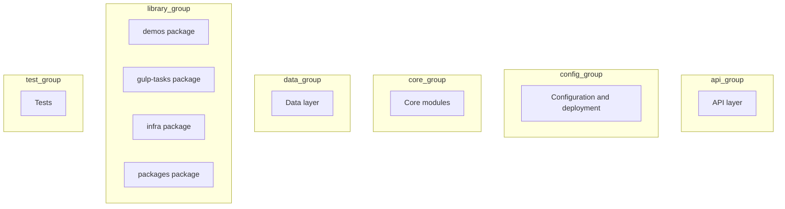

# Architecture report: GoogleChrome/workbox

> Automated static analysis. **Observed** = directly seen in files/imports/AST; **Inferred** = interpretation from that evidence. Repository code was not executed.

## 1. Repository at a glance

| Item | Value |
| --- | --- |
| Repository | GoogleChrome/workbox |
| Description | 📦 Workbox: JavaScript libraries for Progressive Web Apps |
| Language | JavaScript |
| Stars | 13049 |
| Licence | MIT |
| Analysed commit / branch | 4ea3138a120fd2c87389b54130e25f47e0fd7089 / v7 |
| Framework(s) | Express |
| Files analysed | 717 |
| Components | 9 |

## 2. Architecture in one minute

GoogleChrome/workbox - 📦 Workbox: JavaScript libraries for Progressive Web Apps. This repository was analysed statically from 717 file(s) (0 Python). Detected technologies (observed from imports/manifests): GitHub Actions, Express, TypeScript, webpack. Files are grouped into 9 component(s): API layer, Configuration and deployment, Core modules, Data layer, demos package, gulp-tasks package, infra package, packages package. Findings below distinguish observed facts from inferred interpretation.

## 3. High-level block diagram

## 4. Main components

### API layer (`api_layer`)

- **Kind:** api
- **Status:** Observed
- **Confidence:** 0.85
- **Responsibility:** Groups 11 file(s) under api layer (observed from repository paths and static analysis).
- **Paths:** `infra/testing/server/routes/build-file.js`, `infra/testing/server/routes/comlink.js`, `infra/testing/server/routes/integration-html.js`, `infra/testing/server/routes/sw-bundle.js`, `infra/testing/server/routes/templates-update.js`, `infra/testing/server/routes/templates.js`, `infra/testing/server/routes/test-sw.js`, `infra/testing/server/routes/test-window.js`, `infra/testing/server/routes/unique-etag.js`, `infra/testing/server/routes/unique-value.js`, `packages/workbox-sw/controllers/WorkboxSW.mjs`
- **Evidence:** [infra/testing/server/routes/build-file.js](https://github.com/GoogleChrome/workbox/blob/4ea3138a120fd2c87389b54130e25f47e0fd7089/infra/testing/server/routes/build-file.js); [infra/testing/server/routes/comlink.js](https://github.com/GoogleChrome/workbox/blob/4ea3138a120fd2c87389b54130e25f47e0fd7089/infra/testing/server/routes/comlink.js); [infra/testing/server/routes/integration-html.js](https://github.com/GoogleChrome/workbox/blob/4ea3138a120fd2c87389b54130e25f47e0fd7089/infra/testing/server/routes/integration-html.js); [infra/testing/server/routes/sw-bundle.js](https://github.com/GoogleChrome/workbox/blob/4ea3138a120fd2c87389b54130e25f47e0fd7089/infra/testing/server/routes/sw-bundle.js); [infra/testing/server/routes/templates-update.js](https://github.com/GoogleChrome/workbox/blob/4ea3138a120fd2c87389b54130e25f47e0fd7089/infra/testing/server/routes/templates-update.js); [infra/testing/server/routes/templates.js](https://github.com/GoogleChrome/workbox/blob/4ea3138a120fd2c87389b54130e25f47e0fd7089/infra/testing/server/routes/templates.js); [infra/testing/server/routes/test-sw.js](https://github.com/GoogleChrome/workbox/blob/4ea3138a120fd2c87389b54130e25f47e0fd7089/infra/testing/server/routes/test-sw.js); [infra/testing/server/routes/test-window.js](https://github.com/GoogleChrome/workbox/blob/4ea3138a120fd2c87389b54130e25f47e0fd7089/infra/testing/server/routes/test-window.js)

### Configuration and deployment (`config`)

- **Kind:** config
- **Status:** Observed
- **Confidence:** 0.85
- **Responsibility:** Groups 60 file(s) under configuration and deployment (observed from repository paths and static analysis).
- **Paths:** `cdn-details.json`, `demos/src/workbox-background-sync-demo/package.json`, `demos/src/workbox-broadcast-update-demo/package.json`, `demos/src/workbox-cacheable-response/package.json`, `demos/src/workbox-core/package.json`, `demos/src/workbox-expiration/package.json`, `demos/src/workbox-google-analytics/package.json`, `demos/src/workbox-navigation-preload/package.json`, `demos/src/workbox-precaching/package.json`, `demos/src/workbox-range-requests/package.json`, `demos/src/workbox-routing/package.json`, `demos/src/workbox-streams/package.json`, `demos/src/workbox-sw/package.json`, `demos/src/workbox-window/package.json`, `gulp-tasks/utils/node-projects-babel.config.json`, `infra/templates/reference-docs/jsdoc/lang/en.yaml`, `lerna.json`, `package.json`, `packages/workbox-background-sync/package.json`, `packages/workbox-background-sync/tsconfig.json`, `packages/workbox-broadcast-update/package.json`, `packages/workbox-broadcast-update/tsconfig.json`, `packages/workbox-build/package.json`, `packages/workbox-build/src/cdn-details.json`, `packages/workbox-build/src/schema/GenerateSWOptions.json`, `packages/workbox-build/src/schema/GetManifestOptions.json`, `packages/workbox-build/src/schema/InjectManifestOptions.json`, `packages/workbox-build/src/schema/WebpackGenerateSWOptions.json`, `packages/workbox-build/src/schema/WebpackInjectManifestOptions.json`, `packages/workbox-build/tsconfig.json`, `packages/workbox-cacheable-response/package.json`, `packages/workbox-cacheable-response/tsconfig.json`, `packages/workbox-cli/package.json`, `packages/workbox-cli/tsconfig.json`, `packages/workbox-core/package.json`, `packages/workbox-core/tsconfig.json`, `packages/workbox-expiration/package.json`, `packages/workbox-expiration/tsconfig.json`, `packages/workbox-google-analytics/package.json`, `packages/workbox-google-analytics/tsconfig.json`, `packages/workbox-navigation-preload/package.json`, `packages/workbox-navigation-preload/tsconfig.json`, `packages/workbox-precaching/package.json`, `packages/workbox-precaching/tsconfig.json`, `packages/workbox-range-requests/package.json`, `packages/workbox-range-requests/tsconfig.json`, `packages/workbox-recipes/package.json`, `packages/workbox-recipes/tsconfig.json`, `packages/workbox-routing/package.json`, `packages/workbox-routing/tsconfig.json`, `packages/workbox-strategies/package.json`, `packages/workbox-strategies/tsconfig.json`, `packages/workbox-streams/package.json`, `packages/workbox-streams/tsconfig.json`, `packages/workbox-sw/package.json`, `packages/workbox-webpack-plugin/package.json`, `packages/workbox-webpack-plugin/tsconfig.json`, `packages/workbox-window/package.json`, `packages/workbox-window/tsconfig.json`, `tsconfig.json`
- **Evidence:** [cdn-details.json](https://github.com/GoogleChrome/workbox/blob/4ea3138a120fd2c87389b54130e25f47e0fd7089/cdn-details.json); [demos/src/workbox-background-sync-demo/package.json](https://github.com/GoogleChrome/workbox/blob/4ea3138a120fd2c87389b54130e25f47e0fd7089/demos/src/workbox-background-sync-demo/package.json); [demos/src/workbox-broadcast-update-demo/package.json](https://github.com/GoogleChrome/workbox/blob/4ea3138a120fd2c87389b54130e25f47e0fd7089/demos/src/workbox-broadcast-update-demo/package.json); [demos/src/workbox-cacheable-response/package.json](https://github.com/GoogleChrome/workbox/blob/4ea3138a120fd2c87389b54130e25f47e0fd7089/demos/src/workbox-cacheable-response/package.json); [demos/src/workbox-core/package.json](https://github.com/GoogleChrome/workbox/blob/4ea3138a120fd2c87389b54130e25f47e0fd7089/demos/src/workbox-core/package.json); [demos/src/workbox-expiration/package.json](https://github.com/GoogleChrome/workbox/blob/4ea3138a120fd2c87389b54130e25f47e0fd7089/demos/src/workbox-expiration/package.json); [demos/src/workbox-google-analytics/package.json](https://github.com/GoogleChrome/workbox/blob/4ea3138a120fd2c87389b54130e25f47e0fd7089/demos/src/workbox-google-analytics/package.json); [demos/src/workbox-navigation-preload/package.json](https://github.com/GoogleChrome/workbox/blob/4ea3138a120fd2c87389b54130e25f47e0fd7089/demos/src/workbox-navigation-preload/package.json)

### Core modules (`core`)

- **Kind:** core
- **Status:** Observed
- **Confidence:** 0.85
- **Responsibility:** Groups 4 file(s) under core modules (observed from repository paths and static analysis).
- **Paths:** `gulpfile.js`, `javascript.eslintrc.js`, `prettier.config.js`, `typescript.eslintrc.js`
- **Evidence:** [gulpfile.js](https://github.com/GoogleChrome/workbox/blob/4ea3138a120fd2c87389b54130e25f47e0fd7089/gulpfile.js); [javascript.eslintrc.js](https://github.com/GoogleChrome/workbox/blob/4ea3138a120fd2c87389b54130e25f47e0fd7089/javascript.eslintrc.js); [prettier.config.js](https://github.com/GoogleChrome/workbox/blob/4ea3138a120fd2c87389b54130e25f47e0fd7089/prettier.config.js); [typescript.eslintrc.js](https://github.com/GoogleChrome/workbox/blob/4ea3138a120fd2c87389b54130e25f47e0fd7089/typescript.eslintrc.js)

### Data layer (`data_layer`)

- **Kind:** data
- **Status:** Observed
- **Confidence:** 0.85
- **Responsibility:** Groups 5 file(s) under data layer (observed from repository paths and static analysis).
- **Paths:** `packages/workbox-core/src/models/messages/messageGenerator.ts`, `packages/workbox-core/src/models/messages/messages.ts`, `packages/workbox-core/src/models/pluginEvents.ts`, `packages/workbox-core/src/models/quotaErrorCallbacks.ts`, `packages/workbox-expiration/src/models/CacheTimestampsModel.ts`
- **Evidence:** [packages/workbox-core/src/models/messages/messageGenerator.ts](https://github.com/GoogleChrome/workbox/blob/4ea3138a120fd2c87389b54130e25f47e0fd7089/packages/workbox-core/src/models/messages/messageGenerator.ts); [packages/workbox-core/src/models/messages/messages.ts](https://github.com/GoogleChrome/workbox/blob/4ea3138a120fd2c87389b54130e25f47e0fd7089/packages/workbox-core/src/models/messages/messages.ts); [packages/workbox-core/src/models/pluginEvents.ts](https://github.com/GoogleChrome/workbox/blob/4ea3138a120fd2c87389b54130e25f47e0fd7089/packages/workbox-core/src/models/pluginEvents.ts); [packages/workbox-core/src/models/quotaErrorCallbacks.ts](https://github.com/GoogleChrome/workbox/blob/4ea3138a120fd2c87389b54130e25f47e0fd7089/packages/workbox-core/src/models/quotaErrorCallbacks.ts); [packages/workbox-expiration/src/models/CacheTimestampsModel.ts](https://github.com/GoogleChrome/workbox/blob/4ea3138a120fd2c87389b54130e25f47e0fd7089/packages/workbox-expiration/src/models/CacheTimestampsModel.ts)

### demos package (`demos`)

- **Kind:** library
- **Status:** Observed
- **Confidence:** 0.85
- **Responsibility:** Groups 29 file(s) under demos package (observed from repository paths and static analysis).
- **Paths:** `demos/src/workbox-background-sync-demo/sw.js`, `demos/src/workbox-background-sync-demo/updateServer.js`, `demos/src/workbox-broadcast-update-demo/sw.js`, `demos/src/workbox-broadcast-update-demo/updateServer.js`, `demos/src/workbox-cacheable-response/server.js`, `demos/src/workbox-cacheable-response/sw.js`, `demos/src/workbox-core/sw.js`, `demos/src/workbox-core/updateServer.js`, `demos/src/workbox-expiration/sw.js`, `demos/src/workbox-expiration/updateServer.js`, `demos/src/workbox-google-analytics/sw.js`, `demos/src/workbox-google-analytics/updateServer.js`, `demos/src/workbox-navigation-preload/sw.js`, `demos/src/workbox-navigation-preload/updateServer.js`, `demos/src/workbox-precaching/sw-1.js`, `demos/src/workbox-precaching/sw-2.js`, `demos/src/workbox-precaching/updateServer.js`, `demos/src/workbox-range-requests/sw.js`, `demos/src/workbox-range-requests/updateServer.js`, `demos/src/workbox-routing/sw.js`, `demos/src/workbox-routing/updateServer.js`, `demos/src/workbox-strategies/sw.js`, `demos/src/workbox-strategies/updateServer.js`, `demos/src/workbox-streams/server.js`, `demos/src/workbox-streams/sw.js`, `demos/src/workbox-sw/sw.js`, `demos/src/workbox-sw/updateServer.js`, `demos/src/workbox-window/sw.js`, `demos/src/workbox-window/updateServer.js`
- **Evidence:** [demos/src/workbox-background-sync-demo/sw.js](https://github.com/GoogleChrome/workbox/blob/4ea3138a120fd2c87389b54130e25f47e0fd7089/demos/src/workbox-background-sync-demo/sw.js); [demos/src/workbox-background-sync-demo/updateServer.js](https://github.com/GoogleChrome/workbox/blob/4ea3138a120fd2c87389b54130e25f47e0fd7089/demos/src/workbox-background-sync-demo/updateServer.js); [demos/src/workbox-broadcast-update-demo/sw.js](https://github.com/GoogleChrome/workbox/blob/4ea3138a120fd2c87389b54130e25f47e0fd7089/demos/src/workbox-broadcast-update-demo/sw.js); [demos/src/workbox-broadcast-update-demo/updateServer.js](https://github.com/GoogleChrome/workbox/blob/4ea3138a120fd2c87389b54130e25f47e0fd7089/demos/src/workbox-broadcast-update-demo/updateServer.js); [demos/src/workbox-cacheable-response/server.js](https://github.com/GoogleChrome/workbox/blob/4ea3138a120fd2c87389b54130e25f47e0fd7089/demos/src/workbox-cacheable-response/server.js); [demos/src/workbox-cacheable-response/sw.js](https://github.com/GoogleChrome/workbox/blob/4ea3138a120fd2c87389b54130e25f47e0fd7089/demos/src/workbox-cacheable-response/sw.js); [demos/src/workbox-core/sw.js](https://github.com/GoogleChrome/workbox/blob/4ea3138a120fd2c87389b54130e25f47e0fd7089/demos/src/workbox-core/sw.js); [demos/src/workbox-core/updateServer.js](https://github.com/GoogleChrome/workbox/blob/4ea3138a120fd2c87389b54130e25f47e0fd7089/demos/src/workbox-core/updateServer.js)

### gulp-tasks package (`gulp_tasks`)

- **Kind:** library
- **Status:** Observed
- **Confidence:** 0.85
- **Responsibility:** Groups 30 file(s) under gulp-tasks package (observed from repository paths and static analysis).
- **Paths:** `gulp-tasks/analyze-properties.js`, `gulp-tasks/build-node-packages.js`, `gulp-tasks/build-packages.js`, `gulp-tasks/build-sw-packages.js`, `gulp-tasks/build-window-packages.js`, `gulp-tasks/build.js`, `gulp-tasks/docs.js`, `gulp-tasks/lint.js`, `gulp-tasks/publish-cdn.js`, `gulp-tasks/publish-github.js`, `gulp-tasks/publish-glitch.js`, `gulp-tasks/publish-lerna.js`, `gulp-tasks/publish.js`, `gulp-tasks/test-integration.js`, `gulp-tasks/test-node.js`, `gulp-tasks/test-server.js`, `gulp-tasks/test.js`, `gulp-tasks/transpile-typescript.js`, `gulp-tasks/utils/analyse-properties.js`, `gulp-tasks/utils/cdn-helper.js`, `gulp-tasks/utils/constants.js`, `gulp-tasks/utils/get-packages.js`, `gulp-tasks/utils/github-helper.js`, `gulp-tasks/utils/output-filename-to-package-map.js`, `gulp-tasks/utils/package-runner.js`, `gulp-tasks/utils/pkg-path-to-name.js`, `gulp-tasks/utils/publish-helpers.js`, `gulp-tasks/utils/rollup-helper.js`, `gulp-tasks/utils/version-module.js`, `gulp-tasks/utils/versioned-cdn-url.js`
- **Evidence:** [gulp-tasks/analyze-properties.js](https://github.com/GoogleChrome/workbox/blob/4ea3138a120fd2c87389b54130e25f47e0fd7089/gulp-tasks/analyze-properties.js); [gulp-tasks/build-node-packages.js](https://github.com/GoogleChrome/workbox/blob/4ea3138a120fd2c87389b54130e25f47e0fd7089/gulp-tasks/build-node-packages.js); [gulp-tasks/build-packages.js](https://github.com/GoogleChrome/workbox/blob/4ea3138a120fd2c87389b54130e25f47e0fd7089/gulp-tasks/build-packages.js); [gulp-tasks/build-sw-packages.js](https://github.com/GoogleChrome/workbox/blob/4ea3138a120fd2c87389b54130e25f47e0fd7089/gulp-tasks/build-sw-packages.js); [gulp-tasks/build-window-packages.js](https://github.com/GoogleChrome/workbox/blob/4ea3138a120fd2c87389b54130e25f47e0fd7089/gulp-tasks/build-window-packages.js); [gulp-tasks/build.js](https://github.com/GoogleChrome/workbox/blob/4ea3138a120fd2c87389b54130e25f47e0fd7089/gulp-tasks/build.js); [gulp-tasks/docs.js](https://github.com/GoogleChrome/workbox/blob/4ea3138a120fd2c87389b54130e25f47e0fd7089/gulp-tasks/docs.js); [gulp-tasks/lint.js](https://github.com/GoogleChrome/workbox/blob/4ea3138a120fd2c87389b54130e25f47e0fd7089/gulp-tasks/lint.js)

### infra package (`infra`)

- **Kind:** library
- **Status:** Observed
- **Confidence:** 0.85
- **Responsibility:** Groups 34 file(s) under infra package (observed from repository paths and static analysis).
- **Paths:** `infra/pr-bot/aggregate-size-plugin.js`, `infra/templates/reference-docs/jsdoc/lib/publishjob.js`, `infra/templates/reference-docs/jsdoc/publish.js`, `infra/testing/activate-and-control.js`, `infra/testing/activate-sw-safari.js`, `infra/testing/auto-stub-logger.mjs`, `infra/testing/clean-sw.js`, `infra/testing/comlink/node-interface.js`, `infra/testing/comlink/sw-interface.js`, `infra/testing/comlink/window-interface.js`, `infra/testing/confirm-directory-contains.js`, `infra/testing/env-it.js`, `infra/testing/expectError.js`, `infra/testing/generate-variant-tests.js`, `infra/testing/helpers/compareResponses.mjs`, `infra/testing/helpers/extendable-event-utils.mjs`, `infra/testing/helpers/generateOpaqueResponse.mjs`, `infra/testing/helpers/generateUniqueResponse.mjs`, `infra/testing/helpers/sleep.mjs`, `infra/testing/server/cross-origin-server.js`, `infra/testing/server/index.js`, `infra/testing/server/request-counter.js`, `infra/testing/server/template-data.js`, `infra/testing/validator/service-worker-runtime.js`, `infra/testing/wait-until.js`, `infra/testing/webdriver/IframeManager.js`, `infra/testing/webdriver/executeAsyncAndCatch.js`, `infra/testing/webdriver/runUnitTests.js`, `infra/testing/webdriver/unregisterAllSWs.js`, `infra/testing/webdriver/windowLoaded.js`, `infra/testing/webpack-build-check.js`, `infra/type-overrides.d.ts`, `infra/utils/AsyncDebounce.js`, `infra/utils/log-helper.js`
- **Evidence:** [infra/pr-bot/aggregate-size-plugin.js](https://github.com/GoogleChrome/workbox/blob/4ea3138a120fd2c87389b54130e25f47e0fd7089/infra/pr-bot/aggregate-size-plugin.js); [infra/templates/reference-docs/jsdoc/lib/publishjob.js](https://github.com/GoogleChrome/workbox/blob/4ea3138a120fd2c87389b54130e25f47e0fd7089/infra/templates/reference-docs/jsdoc/lib/publishjob.js); [infra/templates/reference-docs/jsdoc/publish.js](https://github.com/GoogleChrome/workbox/blob/4ea3138a120fd2c87389b54130e25f47e0fd7089/infra/templates/reference-docs/jsdoc/publish.js); [infra/testing/activate-and-control.js](https://github.com/GoogleChrome/workbox/blob/4ea3138a120fd2c87389b54130e25f47e0fd7089/infra/testing/activate-and-control.js); [infra/testing/activate-sw-safari.js](https://github.com/GoogleChrome/workbox/blob/4ea3138a120fd2c87389b54130e25f47e0fd7089/infra/testing/activate-sw-safari.js); [infra/testing/auto-stub-logger.mjs](https://github.com/GoogleChrome/workbox/blob/4ea3138a120fd2c87389b54130e25f47e0fd7089/infra/testing/auto-stub-logger.mjs); [infra/testing/clean-sw.js](https://github.com/GoogleChrome/workbox/blob/4ea3138a120fd2c87389b54130e25f47e0fd7089/infra/testing/clean-sw.js); [infra/testing/comlink/node-interface.js](https://github.com/GoogleChrome/workbox/blob/4ea3138a120fd2c87389b54130e25f47e0fd7089/infra/testing/comlink/node-interface.js)

### packages package (`packages`)

- **Kind:** library
- **Status:** Observed
- **Confidence:** 0.85
- **Responsibility:** Groups 201 file(s) under packages package (observed from repository paths and static analysis).
- **Paths:** `packages/workbox-background-sync/src/BackgroundSyncPlugin.ts`, `packages/workbox-background-sync/src/Queue.ts`, `packages/workbox-background-sync/src/QueueStore.ts`, `packages/workbox-background-sync/src/StorableRequest.ts`, `packages/workbox-background-sync/src/_version.ts`, `packages/workbox-background-sync/src/index.ts`, `packages/workbox-background-sync/src/lib/QueueDb.ts`, `packages/workbox-background-sync/src/lib/QueueStore.ts`, `packages/workbox-background-sync/src/lib/StorableRequest.ts`, `packages/workbox-broadcast-update/src/BroadcastCacheUpdate.ts`, `packages/workbox-broadcast-update/src/BroadcastUpdatePlugin.ts`, `packages/workbox-broadcast-update/src/_version.ts`, `packages/workbox-broadcast-update/src/index.ts`, `packages/workbox-broadcast-update/src/responsesAreSame.ts`, `packages/workbox-broadcast-update/src/utils/constants.ts`, `packages/workbox-build/.ncurc.js`, `packages/workbox-build/src/_types.js`, `packages/workbox-build/src/generate-sw.ts`, `packages/workbox-build/src/get-manifest.ts`, `packages/workbox-build/src/index.ts`, `packages/workbox-build/src/inject-manifest.ts`, `packages/workbox-build/src/lib/additional-manifest-entries-transform.ts`, `packages/workbox-build/src/lib/bundle.ts`, `packages/workbox-build/src/lib/cdn-utils.ts`, `packages/workbox-build/src/lib/copy-workbox-libraries.ts`, `packages/workbox-build/src/lib/errors.ts`, `packages/workbox-build/src/lib/escape-regexp.ts`, `packages/workbox-build/src/lib/get-composite-details.ts`, `packages/workbox-build/src/lib/get-file-details.ts`, `packages/workbox-build/src/lib/get-file-hash.ts`, `packages/workbox-build/src/lib/get-file-manifest-entries.ts`, `packages/workbox-build/src/lib/get-file-size.ts`, `packages/workbox-build/src/lib/get-source-map-url.ts`, `packages/workbox-build/src/lib/get-string-details.ts`, `packages/workbox-build/src/lib/get-string-hash.ts`, `packages/workbox-build/src/lib/maximum-size-transform.ts`, `packages/workbox-build/src/lib/modify-url-prefix-transform.ts`, `packages/workbox-build/src/lib/module-registry.ts`, `packages/workbox-build/src/lib/no-revision-for-urls-matching-transform.ts`, `packages/workbox-build/src/lib/populate-sw-template.ts`, `packages/workbox-build/src/lib/rebase-path.ts`, `packages/workbox-build/src/lib/replace-and-update-source-map.ts`, `packages/workbox-build/src/lib/runtime-caching-converter.ts`, `packages/workbox-build/src/lib/stringify-without-comments.ts`, `packages/workbox-build/src/lib/transform-manifest.ts`, `packages/workbox-build/src/lib/translate-url-to-sourcemap-paths.ts`, `packages/workbox-build/src/lib/validate-options.ts`, `packages/workbox-build/src/lib/write-sw-using-default-template.ts`, `packages/workbox-build/src/rollup-plugin-off-main-thread.d.ts`, `packages/workbox-build/src/strip-comments.d.ts`, `packages/workbox-build/src/templates/sw-template.ts`, `packages/workbox-build/src/types.ts`, `packages/workbox-cacheable-response/src/CacheableResponse.ts`, `packages/workbox-cacheable-response/src/CacheableResponsePlugin.ts`, `packages/workbox-cacheable-response/src/_version.ts`, `packages/workbox-cacheable-response/src/index.ts`, `packages/workbox-cli/src/app.ts`, `packages/workbox-cli/src/bin.ts`, `packages/workbox-cli/src/lib/cleanup-stack-trace.ts`, `packages/workbox-cli/src/lib/constants.ts`, `packages/workbox-cli/src/lib/errors.ts`, `packages/workbox-cli/src/lib/help-text.ts`, `packages/workbox-cli/src/lib/logger.ts`, `packages/workbox-cli/src/lib/questions/ask-config-location.ts`, `packages/workbox-cli/src/lib/questions/ask-extensions-to-cache.ts`, `packages/workbox-cli/src/lib/questions/ask-questions.ts`, `packages/workbox-cli/src/lib/questions/ask-root-of-web-app.ts`, `packages/workbox-cli/src/lib/questions/ask-start_url-query-params.ts`, `packages/workbox-cli/src/lib/questions/ask-sw-dest.ts`, `packages/workbox-cli/src/lib/questions/ask-sw-src.ts`, `packages/workbox-cli/src/lib/read-config.ts`, `packages/workbox-cli/src/lib/run-wizard.ts`, `packages/workbox-core/src/_private.ts`, `packages/workbox-core/src/_private/Deferred.ts`, `packages/workbox-core/src/_private/WorkboxError.ts`, `packages/workbox-core/src/_private/assert.ts`, `packages/workbox-core/src/_private/cacheMatchIgnoreParams.ts`, `packages/workbox-core/src/_private/cacheNames.ts`, `packages/workbox-core/src/_private/canConstructReadableStream.ts`, `packages/workbox-core/src/_private/canConstructResponseFromBodyStream.ts`, `packages/workbox-core/src/_private/dontWaitFor.ts`, `packages/workbox-core/src/_private/executeQuotaErrorCallbacks.ts`, `packages/workbox-core/src/_private/getFriendlyURL.ts`, `packages/workbox-core/src/_private/logger.ts`, `packages/workbox-core/src/_private/resultingClientExists.ts`, `packages/workbox-core/src/_private/timeout.ts`, `packages/workbox-core/src/_private/waitUntil.ts`, `packages/workbox-core/src/_version.ts`, `packages/workbox-core/src/cacheNames.ts`, `packages/workbox-core/src/clientsClaim.ts`, `packages/workbox-core/src/copyResponse.ts`, `packages/workbox-core/src/index.ts`, `packages/workbox-core/src/registerQuotaErrorCallback.ts`, `packages/workbox-core/src/setCacheNameDetails.ts`, `packages/workbox-core/src/skipWaiting.ts`, `packages/workbox-core/src/types.ts`, `packages/workbox-core/src/utils/pluginUtils.ts`, `packages/workbox-core/src/utils/welcome.ts`, `packages/workbox-expiration/src/CacheExpiration.ts`, `packages/workbox-expiration/src/ExpirationPlugin.ts`, `packages/workbox-expiration/src/_version.ts`, `packages/workbox-expiration/src/index.ts`, `packages/workbox-google-analytics/src/_version.ts`, `packages/workbox-google-analytics/src/index.ts`, `packages/workbox-google-analytics/src/initialize.ts`, `packages/workbox-google-analytics/src/utils/constants.ts`, `packages/workbox-navigation-preload/src/_version.ts`, `packages/workbox-navigation-preload/src/disable.ts`, `packages/workbox-navigation-preload/src/enable.ts`, `packages/workbox-navigation-preload/src/index.ts`, `packages/workbox-navigation-preload/src/isSupported.ts`, `packages/workbox-precaching/src/PrecacheController.ts`, `packages/workbox-precaching/src/PrecacheFallbackPlugin.ts`, `packages/workbox-precaching/src/PrecacheRoute.ts`, `packages/workbox-precaching/src/PrecacheStrategy.ts`, `packages/workbox-precaching/src/_types.ts`, `packages/workbox-precaching/src/_version.ts`, `packages/workbox-precaching/src/addPlugins.ts`, `packages/workbox-precaching/src/addRoute.ts`, `packages/workbox-precaching/src/cleanupOutdatedCaches.ts`, `packages/workbox-precaching/src/createHandlerBoundToURL.ts`, `packages/workbox-precaching/src/getCacheKeyForURL.ts`, `packages/workbox-precaching/src/index.ts`, `packages/workbox-precaching/src/matchPrecache.ts`, `packages/workbox-precaching/src/precache.ts`, `packages/workbox-precaching/src/precacheAndRoute.ts`, `packages/workbox-precaching/src/utils/PrecacheCacheKeyPlugin.ts`, `packages/workbox-precaching/src/utils/PrecacheInstallReportPlugin.ts`, `packages/workbox-precaching/src/utils/createCacheKey.ts`, `packages/workbox-precaching/src/utils/deleteOutdatedCaches.ts`, `packages/workbox-precaching/src/utils/generateURLVariations.ts`, `packages/workbox-precaching/src/utils/getCacheKeyForURL.ts`, `packages/workbox-precaching/src/utils/getOrCreatePrecacheController.ts`, `packages/workbox-precaching/src/utils/printCleanupDetails.ts`, `packages/workbox-precaching/src/utils/printInstallDetails.ts`, `packages/workbox-precaching/src/utils/removeIgnoredSearchParams.ts`, `packages/workbox-range-requests/src/RangeRequestsPlugin.ts`, `packages/workbox-range-requests/src/_version.ts`, `packages/workbox-range-requests/src/createPartialResponse.ts`, `packages/workbox-range-requests/src/index.ts`, `packages/workbox-range-requests/src/utils/calculateEffectiveBoundaries.ts`, `packages/workbox-range-requests/src/utils/parseRangeHeader.ts`, `packages/workbox-recipes/src/_version.ts`, `packages/workbox-recipes/src/googleFontsCache.ts`, `packages/workbox-recipes/src/imageCache.ts`, `packages/workbox-recipes/src/index.ts`, `packages/workbox-recipes/src/offlineFallback.ts`, `packages/workbox-recipes/src/pageCache.ts`, `packages/workbox-recipes/src/staticResourceCache.ts`, `packages/workbox-recipes/src/warmStrategyCache.ts`, `packages/workbox-routing/src/NavigationRoute.ts`, `packages/workbox-routing/src/RegExpRoute.ts`, `packages/workbox-routing/src/Route.ts`, `packages/workbox-routing/src/Router.ts`, `packages/workbox-routing/src/_types.ts`, `packages/workbox-routing/src/_version.ts`, `packages/workbox-routing/src/index.ts`, `packages/workbox-routing/src/registerRoute.ts`, `packages/workbox-routing/src/setCatchHandler.ts`, `packages/workbox-routing/src/setDefaultHandler.ts`, `packages/workbox-routing/src/utils/constants.ts`, `packages/workbox-routing/src/utils/getOrCreateDefaultRouter.ts`, `packages/workbox-routing/src/utils/normalizeHandler.ts`, `packages/workbox-strategies/src/CacheFirst.ts`, `packages/workbox-strategies/src/CacheOnly.ts`, `packages/workbox-strategies/src/NetworkFirst.ts`, `packages/workbox-strategies/src/NetworkOnly.ts`, `packages/workbox-strategies/src/StaleWhileRevalidate.ts`, `packages/workbox-strategies/src/Strategy.ts`, `packages/workbox-strategies/src/StrategyHandler.ts`, `packages/workbox-strategies/src/_version.ts`, `packages/workbox-strategies/src/index.ts`, `packages/workbox-strategies/src/plugins/cacheOkAndOpaquePlugin.ts`, `packages/workbox-strategies/src/utils/messages.ts`, `packages/workbox-streams/src/_types.ts`, `packages/workbox-streams/src/_version.ts`, `packages/workbox-streams/src/concatenate.ts`, `packages/workbox-streams/src/concatenateToResponse.ts`, `packages/workbox-streams/src/index.ts`, `packages/workbox-streams/src/isSupported.ts`, `packages/workbox-streams/src/strategy.ts`, `packages/workbox-streams/src/utils/createHeaders.ts`, `packages/workbox-sw/_types.mjs`, `packages/workbox-sw/_version.mjs`, `packages/workbox-sw/index.mjs`, `packages/workbox-webpack-plugin/src/generate-sw.ts`, `packages/workbox-webpack-plugin/src/index.ts`, `packages/workbox-webpack-plugin/src/inject-manifest.ts`, `packages/workbox-webpack-plugin/src/lib/get-asset-hash.ts`, `packages/workbox-webpack-plugin/src/lib/get-manifest-entries-from-compilation.ts`, `packages/workbox-webpack-plugin/src/lib/get-script-files-for-chunks.ts`, `packages/workbox-webpack-plugin/src/lib/get-sourcemap-asset-name.ts`, `packages/workbox-webpack-plugin/src/lib/relative-to-output-path.ts`, `packages/workbox-webpack-plugin/src/lib/resolve-webpack-url.ts`, `packages/workbox-window/src/Workbox.ts`, `packages/workbox-window/src/_version.ts`, `packages/workbox-window/src/index.ts`, `packages/workbox-window/src/messageSW.ts`, `packages/workbox-window/src/utils/WorkboxEvent.ts`, `packages/workbox-window/src/utils/WorkboxEventTarget.ts`, `packages/workbox-window/src/utils/urlsMatch.ts`
- **Evidence:** [packages/workbox-background-sync/src/BackgroundSyncPlugin.ts](https://github.com/GoogleChrome/workbox/blob/4ea3138a120fd2c87389b54130e25f47e0fd7089/packages/workbox-background-sync/src/BackgroundSyncPlugin.ts); [packages/workbox-background-sync/src/Queue.ts](https://github.com/GoogleChrome/workbox/blob/4ea3138a120fd2c87389b54130e25f47e0fd7089/packages/workbox-background-sync/src/Queue.ts); [packages/workbox-background-sync/src/QueueStore.ts](https://github.com/GoogleChrome/workbox/blob/4ea3138a120fd2c87389b54130e25f47e0fd7089/packages/workbox-background-sync/src/QueueStore.ts); [packages/workbox-background-sync/src/StorableRequest.ts](https://github.com/GoogleChrome/workbox/blob/4ea3138a120fd2c87389b54130e25f47e0fd7089/packages/workbox-background-sync/src/StorableRequest.ts); [packages/workbox-background-sync/src/_version.ts](https://github.com/GoogleChrome/workbox/blob/4ea3138a120fd2c87389b54130e25f47e0fd7089/packages/workbox-background-sync/src/_version.ts); [packages/workbox-background-sync/src/index.ts](https://github.com/GoogleChrome/workbox/blob/4ea3138a120fd2c87389b54130e25f47e0fd7089/packages/workbox-background-sync/src/index.ts); [packages/workbox-background-sync/src/lib/QueueDb.ts](https://github.com/GoogleChrome/workbox/blob/4ea3138a120fd2c87389b54130e25f47e0fd7089/packages/workbox-background-sync/src/lib/QueueDb.ts); [packages/workbox-background-sync/src/lib/QueueStore.ts](https://github.com/GoogleChrome/workbox/blob/4ea3138a120fd2c87389b54130e25f47e0fd7089/packages/workbox-background-sync/src/lib/QueueStore.ts)

### Tests (`tests`)

- **Kind:** test
- **Status:** Observed
- **Confidence:** 0.85
- **Responsibility:** Groups 250 file(s) under tests (observed from repository paths and static analysis).
- **Paths:** `test/all/node/test-exports.js`, `test/all/node/test-jsdocs.js`, `test/all/node/test-package.js`, `test/all/node/test-prod-builds.js`, `test/all/node/test-yarn-installation.js`, `test/workbox-background-sync/integration/test-all.js`, `test/workbox-background-sync/static/basic-example/example.txt`, `test/workbox-background-sync/static/basic-example/index.html`, `test/workbox-background-sync/static/basic-example/sw.js`, `test/workbox-background-sync/sw/lib/test-QueueDb.mjs`, `test/workbox-background-sync/sw/lib/test-QueueStore.mjs`, `test/workbox-background-sync/sw/lib/test-StorableRequest.mjs`, `test/workbox-background-sync/sw/test-BackgroundSyncPlugin.mjs`, `test/workbox-background-sync/sw/test-Queue.mjs`, `test/workbox-broadcast-update/integration/test-all.js`, `test/workbox-broadcast-update/static/index.html`, `test/workbox-broadcast-update/static/sw.js`, `test/workbox-broadcast-update/sw/test-BroadcastCacheUpdate.mjs`, `test/workbox-broadcast-update/sw/test-BroadcastUpdatePlugin.mjs`, `test/workbox-broadcast-update/sw/test-responsesAreSame.mjs`, `test/workbox-build/node/dependency-check.js`, `test/workbox-build/node/generate-sw.js`, `test/workbox-build/node/get-manifest.js`, `test/workbox-build/node/inject-manifest.js`, `test/workbox-build/node/lib/additional-manifest-entries-transform.js`, `test/workbox-build/node/lib/bundle.js`, `test/workbox-build/node/lib/cdn-utils.js`, `test/workbox-build/node/lib/copy-workbox-libraries.js`, `test/workbox-build/node/lib/escape-regexp.js`, `test/workbox-build/node/lib/get-composite-details.js`, `test/workbox-build/node/lib/get-file-details.js`, `test/workbox-build/node/lib/get-file-hash.js`, `test/workbox-build/node/lib/get-file-manifest-entries.js`, `test/workbox-build/node/lib/get-file-size.js`, `test/workbox-build/node/lib/get-string-details.js`, `test/workbox-build/node/lib/get-string-hash.js`, `test/workbox-build/node/lib/modify-url-prefix-transform.js`, `test/workbox-build/node/lib/module-registry.js`, `test/workbox-build/node/lib/no-revision-for-urls-matching-transform.js`, `test/workbox-build/node/lib/populate-sw-template.js`, `test/workbox-build/node/lib/replace-and-update-source-map.js`, `test/workbox-build/node/lib/runtime-caching-converter.js`, `test/workbox-build/node/lib/transform-manifest.js`, `test/workbox-build/node/lib/translate-url-to-sourcemap-paths.js`, `test/workbox-build/node/lib/validate-options.js`, `test/workbox-build/node/lib/write-sw-using-default-template.js`, `test/workbox-build/static/example-project-1/.hidden-directory/hello.html`, `test/workbox-build/static/example-project-1/.hidden-directory/hello.js`, `test/workbox-build/static/example-project-1/index.html`, `test/workbox-build/static/example-project-1/page-1.html`, `test/workbox-build/static/example-project-1/page-2.html`, `test/workbox-build/static/example-project-1/styles/stylesheet-1.css`, `test/workbox-build/static/example-project-1/styles/stylesheet-2.css`, `test/workbox-build/static/example-project-1/webpackEntry.js`, `test/workbox-build/static/sw-injections/bad-multiple-injection.js`, `test/workbox-build/static/sw-injections/bad-no-injection.js`, `test/workbox-build/static/sw-injections/basic-with-invalid-sourcemap.js.nolint`, `test/workbox-build/static/sw-injections/basic-with-sourcemap-data-url.js.nolint`, `test/workbox-build/static/sw-injections/basic-with-sourcemap.js.nolint`, `test/workbox-build/static/sw-injections/basic.js`, `test/workbox-build/static/sw-injections/custom-injection-point.js`, `test/workbox-build/static/sw-injections/multiple-calls.js`, `test/workbox-build/static/sw-injections/precache-and-route-options.js`, `test/workbox-build/static/sw-injections/sample-import.js`, `test/workbox-cacheable-response/integration/test-all.js`, `test/workbox-cacheable-response/static/cacheable-response-plugin/example-1.txt`, `test/workbox-cacheable-response/static/cacheable-response-plugin/sw.js`, `test/workbox-cacheable-response/sw/test-CacheableResponse.mjs`, `test/workbox-cacheable-response/sw/test-CacheableResponsePlugin.mjs`, `test/workbox-cli/node/app.js`, `test/workbox-cli/node/dependency-check.js`, `test/workbox-cli/node/lib/cleanup-stack-trace.js`, `test/workbox-cli/node/lib/help-text.js`, `test/workbox-cli/node/lib/logger.js`, `test/workbox-cli/node/lib/questions/ask-config-location.js`, `test/workbox-cli/node/lib/questions/ask-extensions-to-cache.js`, `test/workbox-cli/node/lib/questions/ask-questions.js`, `test/workbox-cli/node/lib/questions/ask-root-of-web-app.js`, `test/workbox-cli/node/lib/questions/ask-start_url-query-params.js`, `test/workbox-cli/node/lib/questions/ask-sw-dest.js`, `test/workbox-cli/node/lib/questions/ask-sw-src.js`, `test/workbox-cli/node/lib/run-wizard.js`, `test/workbox-core/integration/test-all.js`, `test/workbox-core/static/core-in-browser/index.html`, `test/workbox-core/static/core-in-browser/sw.js`, `test/workbox-core/static/logger.html`, `test/workbox-core/sw/_private/test-Deferred.mjs`, `test/workbox-core/sw/_private/test-assert.mjs`, `test/workbox-core/sw/_private/test-cacheMatchIgnoreParams.mjs`, `test/workbox-core/sw/_private/test-executeQuotaErrorCallbacks.mjs`, `test/workbox-core/sw/_private/test-getFriendlyURL.mjs`, `test/workbox-core/sw/_private/test-logger.mjs`, `test/workbox-core/sw/_private/test-resultingClientExists.mjs`, `test/workbox-core/sw/_private/test-timeout.mjs`, `test/workbox-core/sw/_private/test-waitUntil.mjs`, `test/workbox-core/sw/models/messages/test-messageGenerator.mjs`, `test/workbox-core/sw/test-cacheNames.mjs`, `test/workbox-core/sw/test-clientsClaim.mjs`, `test/workbox-core/sw/test-copyResponse.mjs`, `test/workbox-core/sw/test-registerQuotaErrorCallback.mjs`, `test/workbox-core/sw/test-skipWaiting.mjs`, `test/workbox-expiration/integration/test-all.js`, `test/workbox-expiration/static/expiration-plugin/example-1.txt`, `test/workbox-expiration/static/expiration-plugin/example-2.txt`, `test/workbox-expiration/static/expiration-plugin/sw-deletion.js`, `test/workbox-expiration/static/expiration-plugin/sw-max-age-seconds.js`, `test/workbox-expiration/static/expiration-plugin/sw-max-entries.js`, `test/workbox-expiration/static/isURLExpired.html`, `test/workbox-expiration/sw/test-CacheExpiration.mjs`, `test/workbox-expiration/sw/test-CacheTimestampsModel.mjs`, `test/workbox-expiration/sw/test-ExpirationPlugin.mjs`, `test/workbox-google-analytics/integration/test-all.js`, `test/workbox-google-analytics/static/basic-example/index.html`, `test/workbox-google-analytics/static/basic-example/sw.js`, `test/workbox-google-analytics/sw/test-initialize.mjs`, `test/workbox-navigation-preload/integration/test-disable.js`, `test/workbox-navigation-preload/integration/test-enable.js`, `test/workbox-navigation-preload/integration/test-sw.js`, `test/workbox-navigation-preload/static/sw-custom-header.js`, `test/workbox-navigation-preload/static/sw-default-header.js`, `test/workbox-navigation-preload/static/sw-disable.js`, `test/workbox-navigation-preload/sw/test-disable.mjs`, `test/workbox-navigation-preload/sw/test-enable.mjs`, `test/workbox-navigation-preload/sw/test-isSupported.mjs`, `test/workbox-precaching/integration/test-cleanup-outdated-caches.js`, `test/workbox-precaching/integration/test-precache-and-update.js`, `test/workbox-precaching/integration/test-sw.js`, `test/workbox-precaching/static/addToCacheList.html`, `test/workbox-precaching/static/cleanup-outdated-caches/sw.js`, `test/workbox-precaching/static/cleanup-outdated-caches/test.txt`, `test/workbox-precaching/static/precache-and-update/hashed-file.abcd1234.txt`, `test/workbox-precaching/static/precache-and-update/index.html`, `test/workbox-precaching/static/precache-and-update/styles/index.css`, `test/workbox-precaching/static/precache-and-update/sw-1.js`, `test/workbox-precaching/static/precache-and-update/sw-2.js`, `test/workbox-precaching/static/precache.html`, `test/workbox-precaching/static/project/example-2.html`, `test/workbox-precaching/static/project/example-a.html`, `test/workbox-precaching/static/project/example-b.html`, `test/workbox-precaching/static/project/example-timestamp.html`, `test/workbox-precaching/static/project/example.html`, `test/workbox-precaching/static/project/index.html`, `test/workbox-precaching/sw/resetDefaultPrecacheController.mjs`, `test/workbox-precaching/sw/test-PrecacheController.mjs`, `test/workbox-precaching/sw/test-PrecacheFallbackPlugin.mjs`, `test/workbox-precaching/sw/test-PrecacheRoute.mjs`, `test/workbox-precaching/sw/test-PrecacheStrategy.mjs`, `test/workbox-precaching/sw/test-addPlugins.mjs`, `test/workbox-precaching/sw/test-addRoute.mjs`, `test/workbox-precaching/sw/test-cleanupOutdatedCaches.mjs`, `test/workbox-precaching/sw/test-createHandlerBoundToURL.mjs`, `test/workbox-precaching/sw/test-getCacheKeyForURL.mjs`, `test/workbox-precaching/sw/test-matchPrecache.mjs`, `test/workbox-precaching/sw/test-precache.mjs`, `test/workbox-precaching/sw/test-precacheAndRoute.mjs`, `test/workbox-precaching/sw/utils/test-deleteOutdatedCaches.mjs`, `test/workbox-precaching/sw/utils/test-printCleanupDetails.mjs`, `test/workbox-precaching/sw/utils/test-printInstallDetails.mjs`, `test/workbox-range-requests/integration/test-all.js`, `test/workbox-range-requests/static/index.html`, `test/workbox-range-requests/static/sw.js`, `test/workbox-range-requests/sw/test-RangeRequestsPlugin.mjs`, `test/workbox-range-requests/sw/test-createPartialResponse.mjs`, `test/workbox-range-requests/sw/utils/test-calculateEffectiveBoundaries.mjs`, `test/workbox-range-requests/sw/utils/test-parseRangeHeader.mjs`, `test/workbox-routing/integration/test-navigation-route.js`, `test/workbox-routing/integration/test-routing-basic.js`, `test/workbox-routing/integration/test-routing-regex.js`, `test/workbox-routing/integration/test-sw.js`, `test/workbox-routing/static/routing-basic/index.html`, `test/workbox-routing/static/routing-basic/sw.js`, `test/workbox-routing/static/routing-navigation/index.html`, `test/workbox-routing/static/routing-navigation/sw.js`, `test/workbox-routing/static/routing-regex/index.html`, `test/workbox-routing/static/routing-regex/sw.js`, `test/workbox-routing/static/routing.html`, `test/workbox-routing/static/sw.js`, `test/workbox-routing/sw/test-NavigationRoute.mjs`, `test/workbox-routing/sw/test-RegExpRoute.mjs`, `test/workbox-routing/sw/test-Route.mjs`, `test/workbox-routing/sw/test-Router.mjs`, `test/workbox-routing/sw/test-registerRoute.mjs`, `test/workbox-routing/sw/test-setCatchHandler.mjs`, `test/workbox-routing/sw/test-setDefaultHandler.mjs`, `test/workbox-routing/sw/utils/test-normalizeHandler.mjs`, `test/workbox-strategies/integration/test-cacheFirst.js`, `test/workbox-strategies/integration/test-cacheOnly.js`, `test/workbox-strategies/integration/test-networkFirst.js`, `test/workbox-strategies/integration/test-networkOnly.js`, `test/workbox-strategies/integration/test-staleWhileRevalidate.js`, `test/workbox-strategies/integration/test-sw.js`, `test/workbox-strategies/static/cache-first/example.txt`, `test/workbox-strategies/static/cache-first/sw.js`, `test/workbox-strategies/static/cache-only/sw.js`, `test/workbox-strategies/static/network-first/sw.js`, `test/workbox-strategies/static/network-only/sw.js`, `test/workbox-strategies/static/stale-while-revalidate/sw.js`, `test/workbox-strategies/sw/plugins/test-cacheOkAndOpaquePlugin.mjs`, `test/workbox-strategies/sw/test-CacheFirst.mjs`, `test/workbox-strategies/sw/test-CacheOnly.mjs`, `test/workbox-strategies/sw/test-NetworkFirst.mjs`, `test/workbox-strategies/sw/test-NetworkOnly.mjs`, `test/workbox-strategies/sw/test-StaleWhileRevalidate.mjs`, `test/workbox-strategies/sw/test-Strategy.mjs`, `test/workbox-strategies/sw/test-StrategyHandler.mjs`, `test/workbox-strategies/sw/test-UsageWithRouter.mjs`, `test/workbox-streams/integration/test-all.js`, `test/workbox-streams/static/4.txt`, `test/workbox-streams/static/index.html`, `test/workbox-streams/static/sw.js`, `test/workbox-streams/sw/test-isSupported.mjs`, `test/workbox-streams/sw/utils/test-createHeaders.mjs`, `test/workbox-sw/integration/test-all.js`, `test/workbox-sw/static/example.css`, `test/workbox-sw/static/example.js`, `test/workbox-sw/static/index.html`, `test/workbox-sw/static/integration/index.html`, `test/workbox-sw/static/integration/invalid-sw.js`, `test/workbox-sw/static/integration/valid-sw.js`, `test/workbox-sw/static/sw.js`, `test/workbox-sw/sw/controllers/test-WorkboxSW.mjs`, `test/workbox-webpack-plugin/node/dependency-check.js`, `test/workbox-webpack-plugin/node/v4/generate-sw.js`, `test/workbox-webpack-plugin/node/v4/inject-manifest.js`, `test/workbox-webpack-plugin/node/v4/lib/create-webpack-asset-plugin.js`, `test/workbox-webpack-plugin/node/v5/generate-sw.js`, `test/workbox-webpack-plugin/node/v5/inject-manifest.js`, `test/workbox-webpack-plugin/node/v5/lib/create-webpack-asset-plugin.js`, `test/workbox-webpack-plugin/static/bad-multiple-injection.js`, `test/workbox-webpack-plugin/static/example-project-1/index.html`, `test/workbox-webpack-plugin/static/example-project-1/page-1.html`, `test/workbox-webpack-plugin/static/example-project-1/page-2.html`, `test/workbox-webpack-plugin/static/example-project-1/splitChunksEntry.js`, `test/workbox-webpack-plugin/static/example-project-1/styles/stylesheet-1.css`, `test/workbox-webpack-plugin/static/example-project-1/styles/stylesheet-2.css`, `test/workbox-webpack-plugin/static/example-project-1/webpackEntry.js`, `test/workbox-webpack-plugin/static/injected-manifest.js`, `test/workbox-webpack-plugin/static/injected-manifest.json`, `test/workbox-webpack-plugin/static/module-import-sw.js`, `test/workbox-webpack-plugin/static/sw-src-define-plugin.js`, `test/workbox-webpack-plugin/static/sw-src-missing-sourcemap.js`, `test/workbox-webpack-plugin/static/sw-src.js`, `test/workbox-webpack-plugin/static/sw.ts`, `test/workbox-webpack-plugin/static/wasm-project/index.js`, `test/workbox-webpack-plugin/static/wasm-project/worker.js`, `test/workbox-window/integration/test-all.js`, `test/workbox-window/static/index.html`, `test/workbox-window/window/sw-error.js`, `test/workbox-window/window/sw-message-reply.js`, `test/workbox-window/window/test-Workbox.mjs`
- **Evidence:** [test/all/node/test-exports.js](https://github.com/GoogleChrome/workbox/blob/4ea3138a120fd2c87389b54130e25f47e0fd7089/test/all/node/test-exports.js); [test/all/node/test-jsdocs.js](https://github.com/GoogleChrome/workbox/blob/4ea3138a120fd2c87389b54130e25f47e0fd7089/test/all/node/test-jsdocs.js); [test/all/node/test-package.js](https://github.com/GoogleChrome/workbox/blob/4ea3138a120fd2c87389b54130e25f47e0fd7089/test/all/node/test-package.js); [test/all/node/test-prod-builds.js](https://github.com/GoogleChrome/workbox/blob/4ea3138a120fd2c87389b54130e25f47e0fd7089/test/all/node/test-prod-builds.js); [test/all/node/test-yarn-installation.js](https://github.com/GoogleChrome/workbox/blob/4ea3138a120fd2c87389b54130e25f47e0fd7089/test/all/node/test-yarn-installation.js); [test/workbox-background-sync/integration/test-all.js](https://github.com/GoogleChrome/workbox/blob/4ea3138a120fd2c87389b54130e25f47e0fd7089/test/workbox-background-sync/integration/test-all.js); [test/workbox-background-sync/static/basic-example/example.txt](https://github.com/GoogleChrome/workbox/blob/4ea3138a120fd2c87389b54130e25f47e0fd7089/test/workbox-background-sync/static/basic-example/example.txt); [test/workbox-background-sync/static/basic-example/index.html](https://github.com/GoogleChrome/workbox/blob/4ea3138a120fd2c87389b54130e25f47e0fd7089/test/workbox-background-sync/static/basic-example/index.html)

## 5. Execution flow

**Observed** entry point(s):

- [demos/src/workbox-cacheable-response/server.js](https://github.com/GoogleChrome/workbox/blob/4ea3138a120fd2c87389b54130e25f47e0fd7089/demos/src/workbox-cacheable-response/server.js)
- [demos/src/workbox-streams/server.js](https://github.com/GoogleChrome/workbox/blob/4ea3138a120fd2c87389b54130e25f47e0fd7089/demos/src/workbox-streams/server.js)
- [infra/testing/server/index.js](https://github.com/GoogleChrome/workbox/blob/4ea3138a120fd2c87389b54130e25f47e0fd7089/infra/testing/server/index.js)
- [packages/workbox-background-sync/src/index.ts](https://github.com/GoogleChrome/workbox/blob/4ea3138a120fd2c87389b54130e25f47e0fd7089/packages/workbox-background-sync/src/index.ts)
- [packages/workbox-broadcast-update/src/index.ts](https://github.com/GoogleChrome/workbox/blob/4ea3138a120fd2c87389b54130e25f47e0fd7089/packages/workbox-broadcast-update/src/index.ts)
- [packages/workbox-build/src/index.ts](https://github.com/GoogleChrome/workbox/blob/4ea3138a120fd2c87389b54130e25f47e0fd7089/packages/workbox-build/src/index.ts)
- [packages/workbox-cacheable-response/src/index.ts](https://github.com/GoogleChrome/workbox/blob/4ea3138a120fd2c87389b54130e25f47e0fd7089/packages/workbox-cacheable-response/src/index.ts)
- [packages/workbox-cli/src/app.ts](https://github.com/GoogleChrome/workbox/blob/4ea3138a120fd2c87389b54130e25f47e0fd7089/packages/workbox-cli/src/app.ts)
- [packages/workbox-core/src/index.ts](https://github.com/GoogleChrome/workbox/blob/4ea3138a120fd2c87389b54130e25f47e0fd7089/packages/workbox-core/src/index.ts)
- [packages/workbox-expiration/src/index.ts](https://github.com/GoogleChrome/workbox/blob/4ea3138a120fd2c87389b54130e25f47e0fd7089/packages/workbox-expiration/src/index.ts)
- [packages/workbox-google-analytics/src/index.ts](https://github.com/GoogleChrome/workbox/blob/4ea3138a120fd2c87389b54130e25f47e0fd7089/packages/workbox-google-analytics/src/index.ts)
- [packages/workbox-navigation-preload/src/index.ts](https://github.com/GoogleChrome/workbox/blob/4ea3138a120fd2c87389b54130e25f47e0fd7089/packages/workbox-navigation-preload/src/index.ts)

Representative flow (derived from observed entry points and the import graph; steps beyond the entry point are **Inferred**):

1. Execution starts at an observed entry point listed above, if present.
2. No internal import relationships between components were observed.

## 6. Project structure

### `(root)`

- `.gitattributes` - other (34 bytes)
- `.gitignore` - other (1114 bytes)
- `.ncurc.js` - source, JavaScript (388 bytes)
- `.nvmrc` - other (3 bytes)
- `.prettierignore` - other (277 bytes)
- `CODE_OF_CONDUCT.md` - docs (205 bytes)
- `CONTRIBUTING.md` - docs (3595 bytes)
- `LICENSE` - docs (1050 bytes)
- `README.md` - docs (1453 bytes)
- `cdn-details.json` - config (109 bytes)
- `gulpfile.js` - source, JavaScript (1218 bytes)
- `javascript.eslintrc.js` - source, JavaScript (3068 bytes)
- `jsdoc.conf` - other (360 bytes)
- `lerna.json` - config (75 bytes)
- `package.json` - manifest (3836 bytes)
- `prettier.config.js` - source, JavaScript (192 bytes)
- `tsconfig.json` - config (1319 bytes)
- `typescript.eslintrc.js` - source, JavaScript (1760 bytes)

### `.github`

- `.github/ISSUE_TEMPLATE.md` - docs (575 bytes)
- `.github/PULL_REQUEST_TEMPLATE.md` - docs (223 bytes)
- `.github/dependabot.yml` - config (569 bytes)
- `.github/workflows/pull-request.yml` - ci, YAML (1911 bytes)
- `.github/workflows/scorecards-analysis.yml` - ci, YAML (1873 bytes)

### `.husky`

- `.husky/.gitignore` - other (2 bytes)
- `.husky/pre-commit` - other (178 bytes)
- `.husky/pre-push` - other (171 bytes)

### `demos`

- `demos/README.md` - docs (200 bytes)
- `demos/src/workbox-background-sync-demo/index.html` - other (2466 bytes)
- `demos/src/workbox-background-sync-demo/package.json` - manifest (288 bytes)
- `demos/src/workbox-background-sync-demo/public/example.txt` - docs (12 bytes)
- `demos/src/workbox-background-sync-demo/sw.js` - source, JavaScript (515 bytes)
- `demos/src/workbox-background-sync-demo/updateServer.js` - source, JavaScript (1238 bytes)
- `demos/src/workbox-broadcast-update-demo/index.html` - other (2257 bytes)
- `demos/src/workbox-broadcast-update-demo/package.json` - manifest (290 bytes)
- `demos/src/workbox-broadcast-update-demo/sw.js` - source, JavaScript (1032 bytes)
- `demos/src/workbox-broadcast-update-demo/updateServer.js` - source, JavaScript (1238 bytes)
- `demos/src/workbox-cacheable-response/index.html` - other (3034 bytes)
- `demos/src/workbox-cacheable-response/package.json` - manifest (307 bytes)
- `demos/src/workbox-cacheable-response/server.js` - source, JavaScript (1794 bytes)
- `demos/src/workbox-cacheable-response/sw.js` - source, JavaScript (848 bytes)
- `demos/src/workbox-core/index.html` - other (2722 bytes)
- `demos/src/workbox-core/package.json` - manifest (266 bytes)
- `demos/src/workbox-core/sw.js` - source, JavaScript (1296 bytes)
- `demos/src/workbox-core/updateServer.js` - source, JavaScript (1203 bytes)
- `demos/src/workbox-expiration/index.html` - other (4824 bytes)
- `demos/src/workbox-expiration/package.json` - manifest (278 bytes)
- `demos/src/workbox-expiration/sw.js` - source, JavaScript (984 bytes)
- `demos/src/workbox-expiration/updateServer.js` - source, JavaScript (1238 bytes)
- `demos/src/workbox-google-analytics/index.html` - other (2803 bytes)
- `demos/src/workbox-google-analytics/package.json` - manifest (290 bytes)
- `demos/src/workbox-google-analytics/sw.js` - source, JavaScript (232 bytes)
- `demos/src/workbox-google-analytics/updateServer.js` - source, JavaScript (1238 bytes)
- `demos/src/workbox-navigation-preload/index.html` - other (1766 bytes)
- `demos/src/workbox-navigation-preload/package.json` - manifest (294 bytes)
- `demos/src/workbox-navigation-preload/sw.js` - source, JavaScript (769 bytes)
- `demos/src/workbox-navigation-preload/updateServer.js` - source, JavaScript (1238 bytes)
- `demos/src/workbox-precaching/index.html` - other (2479 bytes)
- `demos/src/workbox-precaching/package.json` - manifest (278 bytes)
- `demos/src/workbox-precaching/public/hello-world.1234.txt` - docs (50 bytes)
- `demos/src/workbox-precaching/public/hello-world.5678.txt` - docs (51 bytes)
- `demos/src/workbox-precaching/public/test-file.txt` - docs (37 bytes)
- `demos/src/workbox-precaching/sw-1.js` - source, JavaScript (274 bytes)
- `demos/src/workbox-precaching/sw-2.js` - source, JavaScript (274 bytes)
- `demos/src/workbox-precaching/updateServer.js` - source, JavaScript (1338 bytes)
- `demos/src/workbox-range-requests/index.html` - other (2381 bytes)
- `demos/src/workbox-range-requests/package.json` - manifest (286 bytes)
- `demos/src/workbox-range-requests/sw.js` - source, JavaScript (413 bytes)
- `demos/src/workbox-range-requests/updateServer.js` - source, JavaScript (1238 bytes)
- `demos/src/workbox-routing/index.html` - other (1935 bytes)
- `demos/src/workbox-routing/package.json` - manifest (272 bytes)
- `demos/src/workbox-routing/sw.js` - source, JavaScript (1001 bytes)
- `demos/src/workbox-routing/updateServer.js` - source, JavaScript (1239 bytes)
- `demos/src/workbox-strategies/index.html` - other (4778 bytes)
- `demos/src/workbox-strategies/public/cache-first.txt` - docs (21 bytes)
- `demos/src/workbox-strategies/public/network-first.txt` - docs (23 bytes)
- `demos/src/workbox-strategies/public/network-only.txt` - docs (22 bytes)
- `demos/src/workbox-strategies/public/stale-while-revalidate.txt` - docs (31 bytes)
- `demos/src/workbox-strategies/sw.js` - source, JavaScript (2311 bytes)
- `demos/src/workbox-strategies/updateServer.js` - source, JavaScript (1240 bytes)
- `demos/src/workbox-streams/index.html` - other (2150 bytes)
- `demos/src/workbox-streams/package.json` - manifest (266 bytes)
- `demos/src/workbox-streams/server.js` - source, JavaScript (1658 bytes)
- `demos/src/workbox-streams/sw.js` - source, JavaScript (1461 bytes)
- `demos/src/workbox-sw/README.md` - docs (18 bytes)
- `demos/src/workbox-sw/index.html` - other (1976 bytes)
- `demos/src/workbox-sw/package.json` - manifest (262 bytes)
- `demos/src/workbox-sw/sw.js` - source, JavaScript (783 bytes)
- `demos/src/workbox-sw/updateServer.js` - source, JavaScript (1238 bytes)
- `demos/src/workbox-window/index.html` - other (2671 bytes)
- `demos/src/workbox-window/package.json` - manifest (270 bytes)
- `demos/src/workbox-window/sw.js` - source, JavaScript (301 bytes)
- `demos/src/workbox-window/updateServer.js` - source, JavaScript (1238 bytes)

### `gulp-tasks`

- `gulp-tasks/analyze-properties.js` - source, JavaScript (519 bytes)
- `gulp-tasks/build-node-packages.js` - source, JavaScript (3114 bytes)
- `gulp-tasks/build-packages.js` - source, JavaScript (2478 bytes)
- `gulp-tasks/build-sw-packages.js` - source, JavaScript (5718 bytes)
- `gulp-tasks/build-window-packages.js` - source, JavaScript (3400 bytes)
- `gulp-tasks/build.js` - source, JavaScript (1371 bytes)
- `gulp-tasks/docs.js` - source, JavaScript (1585 bytes)
- `gulp-tasks/lint.js` - source, JavaScript (837 bytes)
- `gulp-tasks/publish-cdn.js` - source, JavaScript (2362 bytes)
- `gulp-tasks/publish-github.js` - source, JavaScript (1852 bytes)
- `gulp-tasks/publish-glitch.js` - source, JavaScript (2372 bytes)
- `gulp-tasks/publish-lerna.js` - source, JavaScript (1074 bytes)
- `gulp-tasks/publish.js` - source, JavaScript (1283 bytes)
- `gulp-tasks/test-integration.js` - source, JavaScript (5244 bytes)
- `gulp-tasks/test-node.js` - source, JavaScript (2940 bytes)
- `gulp-tasks/test-server.js` - source, JavaScript (948 bytes)
- `gulp-tasks/test.js` - source, JavaScript (861 bytes)
- `gulp-tasks/transpile-typescript.js` - source, JavaScript (2948 bytes)
- `gulp-tasks/utils/analyse-properties.js` - source, JavaScript (3633 bytes)
- `gulp-tasks/utils/cdn-helper.js` - source, JavaScript (2367 bytes)
- `gulp-tasks/utils/constants.js` - source, JavaScript (755 bytes)
- `gulp-tasks/utils/get-packages.js` - source, JavaScript (724 bytes)
- `gulp-tasks/utils/github-helper.js` - source, JavaScript (2105 bytes)
- `gulp-tasks/utils/node-projects-babel.config.json` - config (72 bytes)
- `gulp-tasks/utils/output-filename-to-package-map.js` - source, JavaScript (650 bytes)
- `gulp-tasks/utils/package-runner.js` - source, JavaScript (4365 bytes)
- `gulp-tasks/utils/pkg-path-to-name.js` - source, JavaScript (450 bytes)
- `gulp-tasks/utils/publish-helpers.js` - source, JavaScript (4055 bytes)
- `gulp-tasks/utils/rollup-helper.js` - source, JavaScript (3285 bytes)
- `gulp-tasks/utils/version-module.js` - source, JavaScript (1171 bytes)
- `gulp-tasks/utils/versioned-cdn-url.js` - source, JavaScript (408 bytes)

### `infra`

- `infra/pr-bot/aggregate-size-plugin.js` - source, JavaScript (2499 bytes)
- `infra/templates/reference-docs/jsdoc/lang/en.yaml` - config (1254 bytes)
- `infra/templates/reference-docs/jsdoc/lib/publishjob.js` - source, JavaScript (3091 bytes)
- `infra/templates/reference-docs/jsdoc/publish.js` - source, JavaScript (2678 bytes)
- `infra/templates/reference-docs/jsdoc/static/jsdoc.css` - other (917 bytes)
- `infra/templates/reference-docs/jsdoc/views/augments.hbs` - other (154 bytes)
- `infra/templates/reference-docs/jsdoc/views/classes-links.hbs` - other (374 bytes)
- `infra/templates/reference-docs/jsdoc/views/details-table-row.hbs` - other (1223 bytes)
- `infra/templates/reference-docs/jsdoc/views/details-table.hbs` - other (482 bytes)
- `infra/templates/reference-docs/jsdoc/views/implements.hbs` - other (162 bytes)
- `infra/templates/reference-docs/jsdoc/views/index-all.hbs` - other (242 bytes)
- `infra/templates/reference-docs/jsdoc/views/index.hbs` - other (312 bytes)
- `infra/templates/reference-docs/jsdoc/views/layout.hbs` - other (2967 bytes)
- `infra/templates/reference-docs/jsdoc/views/params.hbs` - other (184 bytes)
- `infra/templates/reference-docs/jsdoc/views/properties.hbs` - other (304 bytes)
- `infra/templates/reference-docs/jsdoc/views/see.hbs` - other (162 bytes)
- `infra/templates/reference-docs/jsdoc/views/signature.hbs` - other (632 bytes)
- `infra/templates/reference-docs/jsdoc/views/symbol-content.hbs` - other (1496 bytes)
- `infra/templates/reference-docs/jsdoc/views/symbol-detail.hbs` - other (946 bytes)
- `infra/templates/reference-docs/jsdoc/views/symbol-header.hbs` - other (1214 bytes)
- `infra/templates/reference-docs/jsdoc/views/symbol-index-section.hbs` - other (196 bytes)
- `infra/templates/reference-docs/jsdoc/views/symbol-index.hbs` - other (522 bytes)
- `infra/templates/reference-docs/jsdoc/views/symbol-labels.hbs` - other (330 bytes)
- `infra/templates/reference-docs/jsdoc/views/symbol-overview.hbs` - other (1875 bytes)
- `infra/templates/reference-docs/jsdoc/views/toc-yaml.hbs` - other (176 bytes)
- `infra/testing/activate-and-control.js` - source, JavaScript (2790 bytes)
- `infra/testing/activate-sw-safari.js` - source, JavaScript (2865 bytes)
- `infra/testing/auto-stub-logger.mjs` - source, JavaScript (780 bytes)
- `infra/testing/clean-sw.js` - source, JavaScript (865 bytes)
- `infra/testing/comlink/node-interface.js` - source, JavaScript (824 bytes)
- `infra/testing/comlink/sw-interface.js` - source, JavaScript (2091 bytes)
- `infra/testing/comlink/window-interface.js` - source, JavaScript (734 bytes)
- `infra/testing/confirm-directory-contains.js` - source, JavaScript (628 bytes)
- `infra/testing/env-it.js` - source, JavaScript (1341 bytes)
- `infra/testing/expectError.js` - source, JavaScript (909 bytes)
- `infra/testing/generate-variant-tests.js` - source, JavaScript (1389 bytes)
- `infra/testing/helpers/compareResponses.mjs` - source, JavaScript (508 bytes)
- `infra/testing/helpers/extendable-event-utils.mjs` - source, JavaScript (1623 bytes)
- `infra/testing/helpers/generateOpaqueResponse.mjs` - source, JavaScript (445 bytes)
- `infra/testing/helpers/generateUniqueResponse.mjs` - source, JavaScript (312 bytes)
- `infra/testing/helpers/sleep.mjs` - source, JavaScript (380 bytes)
- `infra/testing/server/cross-origin-server.js` - source, JavaScript (737 bytes)
- `infra/testing/server/index.js` - source, JavaScript (2113 bytes)
- `infra/testing/server/request-counter.js` - source, JavaScript (926 bytes)
- `infra/testing/server/routes/build-file.js` - source, JavaScript (1446 bytes)
- `infra/testing/server/routes/comlink.js` - source, JavaScript (382 bytes)
- `infra/testing/server/routes/integration-html.js` - source, JavaScript (435 bytes)
- `infra/testing/server/routes/sw-bundle.js` - source, JavaScript (2734 bytes)
- `infra/testing/server/routes/templates-update.js` - source, JavaScript (557 bytes)
- `infra/testing/server/routes/templates.js` - source, JavaScript (1201 bytes)
- `infra/testing/server/routes/test-sw.js` - source, JavaScript (1404 bytes)
- `infra/testing/server/routes/test-window.js` - source, JavaScript (1130 bytes)
- `infra/testing/server/routes/unique-etag.js` - source, JavaScript (385 bytes)
- `infra/testing/server/routes/unique-value.js` - source, JavaScript (366 bytes)
- `infra/testing/server/static/integration.html` - other (282 bytes)
- `infra/testing/server/template-data.js` - source, JavaScript (720 bytes)
- `infra/testing/server/templates/integration.html.njk` - other (360 bytes)
- `infra/testing/server/templates/sw-clients-claim.js.njk` - other (390 bytes)
- `infra/testing/server/templates/sw-no-skip-waiting.js.njk` - other (200 bytes)
- `infra/testing/server/templates/sw-script-version.js.njk` - other (585 bytes)
- `infra/testing/server/templates/sw-skip-waiting-deferred.js.njk` - other (413 bytes)
- `infra/testing/server/templates/sw-skip-waiting-on-message.js.njk` - other (313 bytes)
- `infra/testing/server/templates/sw-skip-waiting.js.njk` - other (273 bytes)
- `infra/testing/server/templates/sw-window-ready.js.njk` - other (735 bytes)
- `infra/testing/server/templates/test-sw-runner.js.njk` - other (2878 bytes)
- `infra/testing/server/templates/test-sw.html.njk` - other (2046 bytes)
- `infra/testing/server/templates/test-window.html.njk` - other (2463 bytes)
- `infra/testing/validator/service-worker-runtime.js` - source, JavaScript (6831 bytes)
- `infra/testing/wait-until.js` - source, JavaScript (511 bytes)
- `infra/testing/webdriver/IframeManager.js` - source, JavaScript (1873 bytes)
- `infra/testing/webdriver/executeAsyncAndCatch.js` - source, JavaScript (786 bytes)
- `infra/testing/webdriver/runUnitTests.js` - source, JavaScript (1142 bytes)
- `infra/testing/webdriver/unregisterAllSWs.js` - source, JavaScript (758 bytes)
- `infra/testing/webdriver/windowLoaded.js` - source, JavaScript (934 bytes)
- `infra/testing/webpack-build-check.js` - source, JavaScript (744 bytes)
- `infra/type-overrides.d.ts` - source, TypeScript (2111 bytes)
- `infra/utils/AsyncDebounce.js` - source, JavaScript (733 bytes)
- `infra/utils/log-helper.js` - source, JavaScript (686 bytes)

### `packages`

- `packages/workbox-background-sync/README.md` - docs (124 bytes)
- `packages/workbox-background-sync/package.json` - manifest (864 bytes)
- `packages/workbox-background-sync/src/BackgroundSyncPlugin.ts` - source, TypeScript (1198 bytes)
- `packages/workbox-background-sync/src/Queue.ts` - source, TypeScript (16454 bytes)
- `packages/workbox-background-sync/src/QueueStore.ts` - source, TypeScript (423 bytes)
- `packages/workbox-background-sync/src/StorableRequest.ts` - source, TypeScript (433 bytes)
- `packages/workbox-background-sync/src/_version.ts` - source, TypeScript (71 bytes)
- `packages/workbox-background-sync/src/index.ts` - source, TypeScript (983 bytes)
- `packages/workbox-background-sync/src/lib/QueueDb.ts` - source, TypeScript (5176 bytes)
- `packages/workbox-background-sync/src/lib/QueueStore.ts` - source, TypeScript (5084 bytes)
- `packages/workbox-background-sync/src/lib/StorableRequest.ts` - source, TypeScript (4168 bytes)
- `packages/workbox-background-sync/tsconfig.json` - config (255 bytes)
- `packages/workbox-broadcast-update/README.md` - docs (125 bytes)
- `packages/workbox-broadcast-update/package.json` - manifest (829 bytes)
- `packages/workbox-broadcast-update/src/BroadcastCacheUpdate.ts` - source, TypeScript (7619 bytes)
- `packages/workbox-broadcast-update/src/BroadcastUpdatePlugin.ts` - source, TypeScript (2265 bytes)
- `packages/workbox-broadcast-update/src/_version.ts` - source, TypeScript (72 bytes)
- `packages/workbox-broadcast-update/src/index.ts` - source, TypeScript (588 bytes)
- `packages/workbox-broadcast-update/src/responsesAreSame.ts` - source, TypeScript (2053 bytes)
- `packages/workbox-broadcast-update/src/utils/constants.ts` - source, TypeScript (482 bytes)
- `packages/workbox-broadcast-update/tsconfig.json` - config (255 bytes)
- `packages/workbox-build/.ncurc.js` - source, JavaScript (603 bytes)
- `packages/workbox-build/README.md` - docs (108 bytes)
- `packages/workbox-build/package.json` - manifest (2160 bytes)
- `packages/workbox-build/src/_types.js` - source, JavaScript (4934 bytes)
- `packages/workbox-build/src/cdn-details.json` - config (137 bytes)
- `packages/workbox-build/src/generate-sw.ts` - source, TypeScript (3387 bytes)
- `packages/workbox-build/src/get-manifest.ts` - source, TypeScript (1199 bytes)
- `packages/workbox-build/src/index.ts` - source, TypeScript (591 bytes)
- `packages/workbox-build/src/inject-manifest.ts` - source, TypeScript (5346 bytes)
- `packages/workbox-build/src/lib/additional-manifest-entries-transform.ts` - source, TypeScript (1671 bytes)
- `packages/workbox-build/src/lib/bundle.ts` - source, TypeScript (4382 bytes)
- `packages/workbox-build/src/lib/cdn-utils.ts` - source, TypeScript (1245 bytes)
- `packages/workbox-build/src/lib/copy-workbox-libraries.ts` - source, TypeScript (3096 bytes)
- `packages/workbox-build/src/lib/errors.ts` - source, TypeScript (6884 bytes)
- `packages/workbox-build/src/lib/escape-regexp.ts` - source, TypeScript (380 bytes)
- `packages/workbox-build/src/lib/get-composite-details.ts` - source, TypeScript (746 bytes)
- `packages/workbox-build/src/lib/get-file-details.ts` - source, TypeScript (1838 bytes)
- `packages/workbox-build/src/lib/get-file-hash.ts` - source, TypeScript (598 bytes)
- `packages/workbox-build/src/lib/get-file-manifest-entries.ts` - source, TypeScript (3600 bytes)
- `packages/workbox-build/src/lib/get-file-size.ts` - source, TypeScript (589 bytes)
- `packages/workbox-build/src/lib/get-source-map-url.ts` - source, TypeScript (781 bytes)
- `packages/workbox-build/src/lib/get-string-details.ts` - source, TypeScript (430 bytes)
- `packages/workbox-build/src/lib/get-string-hash.ts` - source, TypeScript (370 bytes)
- `packages/workbox-build/src/lib/maximum-size-transform.ts` - source, TypeScript (859 bytes)
- `packages/workbox-build/src/lib/modify-url-prefix-transform.ts` - source, TypeScript (1798 bytes)
- `packages/workbox-build/src/lib/module-registry.ts` - source, TypeScript (2303 bytes)
- `packages/workbox-build/src/lib/no-revision-for-urls-matching-transform.ts` - source, TypeScript (787 bytes)
- `packages/workbox-build/src/lib/populate-sw-template.ts` - source, TypeScript (3633 bytes)
- `packages/workbox-build/src/lib/rebase-path.ts` - source, TypeScript (741 bytes)
- `packages/workbox-build/src/lib/replace-and-update-source-map.ts` - source, TypeScript (3528 bytes)
- `packages/workbox-build/src/lib/runtime-caching-converter.ts` - source, TypeScript (6253 bytes)
- `packages/workbox-build/src/lib/stringify-without-comments.ts` - source, TypeScript (764 bytes)
- `packages/workbox-build/src/lib/transform-manifest.ts` - source, TypeScript (5244 bytes)
- `packages/workbox-build/src/lib/translate-url-to-sourcemap-paths.ts` - source, TypeScript (1005 bytes)
- `packages/workbox-build/src/lib/validate-options.ts` - source, TypeScript (6743 bytes)
- `packages/workbox-build/src/lib/write-sw-using-default-template.ts` - source, TypeScript (2339 bytes)
- `packages/workbox-build/src/rollup-plugin-off-main-thread.d.ts` - source, TypeScript (62 bytes)
- `packages/workbox-build/src/schema/GenerateSWOptions.json` - config (30919 bytes)
- `packages/workbox-build/src/schema/GetManifestOptions.json` - config (5893 bytes)
- `packages/workbox-build/src/schema/InjectManifestOptions.json` - config (6588 bytes)
- `packages/workbox-build/src/schema/WebpackGenerateSWOptions.json` - config (30175 bytes)
- `packages/workbox-build/src/schema/WebpackInjectManifestOptions.json` - config (6489 bytes)
- `packages/workbox-build/src/strip-comments.d.ts` - source, TypeScript (33 bytes)
- `packages/workbox-build/src/templates/sw-template.ts` - source, TypeScript (2462 bytes)
- `packages/workbox-build/src/types.ts` - source, TypeScript (21983 bytes)
- `packages/workbox-build/tsconfig.json` - config (661 bytes)
- `packages/workbox-cacheable-response/README.md` - docs (127 bytes)
- `packages/workbox-cacheable-response/package.json` - manifest (828 bytes)
- `packages/workbox-cacheable-response/src/CacheableResponse.ts` - source, TypeScript (4875 bytes)
- `packages/workbox-cacheable-response/src/CacheableResponsePlugin.ts` - source, TypeScript (1834 bytes)
- `packages/workbox-cacheable-response/src/_version.ts` - source, TypeScript (74 bytes)
- `packages/workbox-cacheable-response/src/index.ts` - source, TypeScript (496 bytes)
- `packages/workbox-cacheable-response/tsconfig.json` - config (255 bytes)
- `packages/workbox-cli/README.md` - docs (112 bytes)
- `packages/workbox-cli/package.json` - manifest (1379 bytes)
- `packages/workbox-cli/src/app.ts` - source, TypeScript (4489 bytes)
- `packages/workbox-cli/src/bin.ts` - source, TypeScript (1181 bytes)
- `packages/workbox-cli/src/lib/cleanup-stack-trace.ts` - source, TypeScript (966 bytes)
- `packages/workbox-cli/src/lib/constants.ts` - source, TypeScript (383 bytes)
- `packages/workbox-cli/src/lib/errors.ts` - source, TypeScript (1611 bytes)
- `packages/workbox-cli/src/lib/help-text.ts` - source, TypeScript (2114 bytes)
- `packages/workbox-cli/src/lib/logger.ts` - source, TypeScript (520 bytes)
- `packages/workbox-cli/src/lib/questions/ask-config-location.ts` - source, TypeScript (1222 bytes)
- `packages/workbox-cli/src/lib/questions/ask-extensions-to-cache.ts` - source, TypeScript (2934 bytes)
- `packages/workbox-cli/src/lib/questions/ask-questions.ts` - source, TypeScript (1532 bytes)
- `packages/workbox-cli/src/lib/questions/ask-root-of-web-app.ts` - source, TypeScript (2352 bytes)
- `packages/workbox-cli/src/lib/questions/ask-start_url-query-params.ts` - source, TypeScript (2465 bytes)
- `packages/workbox-cli/src/lib/questions/ask-sw-dest.ts` - source, TypeScript (1091 bytes)
- `packages/workbox-cli/src/lib/questions/ask-sw-src.ts` - source, TypeScript (930 bytes)
- `packages/workbox-cli/src/lib/read-config.ts` - source, TypeScript (556 bytes)
- `packages/workbox-cli/src/lib/run-wizard.ts` - source, TypeScript (1207 bytes)
- `packages/workbox-cli/tsconfig.json` - config (313 bytes)
- `packages/workbox-core/README.md` - docs (113 bytes)
- `packages/workbox-core/package.json` - manifest (699 bytes)
- `packages/workbox-core/src/_private.ts` - source, TypeScript (1437 bytes)
- `packages/workbox-core/src/_private/Deferred.ts` - source, TypeScript (868 bytes)
- `packages/workbox-core/src/_private/WorkboxError.ts` - source, TypeScript (1118 bytes)
- `packages/workbox-core/src/_private/assert.ts` - source, TypeScript (2510 bytes)
- `packages/workbox-core/src/_private/cacheMatchIgnoreParams.ts` - source, TypeScript (1666 bytes)
- `packages/workbox-core/src/_private/cacheNames.ts` - source, TypeScript (2051 bytes)
- `packages/workbox-core/src/_private/canConstructReadableStream.ts` - source, TypeScript (957 bytes)
- `packages/workbox-core/src/_private/canConstructResponseFromBodyStream.ts` - source, TypeScript (992 bytes)
- `packages/workbox-core/src/_private/dontWaitFor.ts` - source, TypeScript (421 bytes)
- `packages/workbox-core/src/_private/executeQuotaErrorCallbacks.ts` - source, TypeScript (1029 bytes)
- `packages/workbox-core/src/_private/getFriendlyURL.ts` - source, TypeScript (557 bytes)
- `packages/workbox-core/src/_private/logger.ts` - source, TypeScript (2799 bytes)
- `packages/workbox-core/src/_private/resultingClientExists.ts` - source, TypeScript (1741 bytes)
- `packages/workbox-core/src/_private/timeout.ts` - source, TypeScript (535 bytes)
- `packages/workbox-core/src/_private/waitUntil.ts` - source, TypeScript (640 bytes)
- `packages/workbox-core/src/_version.ts` - source, TypeScript (60 bytes)
- `packages/workbox-core/src/cacheNames.ts` - source, TypeScript (1272 bytes)
- `packages/workbox-core/src/clientsClaim.ts` - source, TypeScript (595 bytes)
- `packages/workbox-core/src/copyResponse.ts` - source, TypeScript (2494 bytes)
- `packages/workbox-core/src/index.ts` - source, TypeScript (940 bytes)
- `packages/workbox-core/src/models/messages/messageGenerator.ts` - source, TypeScript (731 bytes)
- `packages/workbox-core/src/models/messages/messages.ts` - source, TypeScript (11191 bytes)
- `packages/workbox-core/src/models/pluginEvents.ts` - source, TypeScript (553 bytes)
- `packages/workbox-core/src/models/quotaErrorCallbacks.ts` - source, TypeScript (452 bytes)
- `packages/workbox-core/src/registerQuotaErrorCallback.ts` - source, TypeScript (1091 bytes)
- `packages/workbox-core/src/setCacheNameDetails.ts` - source, TypeScript (2186 bytes)
- `packages/workbox-core/src/skipWaiting.ts` - source, TypeScript (955 bytes)
- `packages/workbox-core/src/types.ts` - source, TypeScript (8048 bytes)
- `packages/workbox-core/src/utils/pluginUtils.ts` - source, TypeScript (433 bytes)
- `packages/workbox-core/src/utils/welcome.ts` - source, TypeScript (1175 bytes)
- `packages/workbox-core/tsconfig.json` - config (207 bytes)
- `packages/workbox-expiration/README.md` - docs (119 bytes)
- `packages/workbox-expiration/package.json` - manifest (829 bytes)
- `packages/workbox-expiration/src/CacheExpiration.ts` - source, TypeScript (6629 bytes)
- `packages/workbox-expiration/src/ExpirationPlugin.ts` - source, TypeScript (10710 bytes)
- `packages/workbox-expiration/src/_version.ts` - source, TypeScript (66 bytes)
- `packages/workbox-expiration/src/index.ts` - source, TypeScript (452 bytes)
- `packages/workbox-expiration/src/models/CacheTimestampsModel.ts` - source, TypeScript (6348 bytes)
- `packages/workbox-expiration/tsconfig.json` - config (255 bytes)
- `packages/workbox-google-analytics/README.md` - docs (125 bytes)
- `packages/workbox-google-analytics/package.json` - manifest (990 bytes)
- `packages/workbox-google-analytics/src/_version.ts` - source, TypeScript (72 bytes)
- `packages/workbox-google-analytics/src/index.ts` - source, TypeScript (387 bytes)
- `packages/workbox-google-analytics/src/initialize.ts` - source, TypeScript (7495 bytes)
- `packages/workbox-google-analytics/src/utils/constants.ts` - source, TypeScript (936 bytes)
- `packages/workbox-google-analytics/tsconfig.json` - config (385 bytes)
- `packages/workbox-navigation-preload/README.md` - docs (127 bytes)
- `packages/workbox-navigation-preload/package.json` - manifest (808 bytes)
- `packages/workbox-navigation-preload/src/_version.ts` - source, TypeScript (74 bytes)
- `packages/workbox-navigation-preload/src/disable.ts` - source, TypeScript (1047 bytes)
- `packages/workbox-navigation-preload/src/enable.ts` - source, TypeScript (1600 bytes)
- `packages/workbox-navigation-preload/src/index.ts` - source, TypeScript (868 bytes)
- `packages/workbox-navigation-preload/src/isSupported.ts` - source, TypeScript (575 bytes)
- `packages/workbox-navigation-preload/tsconfig.json` - config (232 bytes)
- `packages/workbox-precaching/README.md` - docs (119 bytes)
- `packages/workbox-precaching/package.json` - manifest (790 bytes)
- `packages/workbox-precaching/src/PrecacheController.ts` - source, TypeScript (12333 bytes)
- `packages/workbox-precaching/src/PrecacheFallbackPlugin.ts` - source, TypeScript (2130 bytes)
- `packages/workbox-precaching/src/PrecacheRoute.ts` - source, TypeScript (2853 bytes)
- `packages/workbox-precaching/src/PrecacheStrategy.ts` - source, TypeScript (10661 bytes)
- `packages/workbox-precaching/src/_types.ts` - source, TypeScript (2473 bytes)
- `packages/workbox-precaching/src/_version.ts` - source, TypeScript (66 bytes)
- `packages/workbox-precaching/src/addPlugins.ts` - source, TypeScript (669 bytes)
- `packages/workbox-precaching/src/addRoute.ts` - source, TypeScript (1257 bytes)
- `packages/workbox-precaching/src/cleanupOutdatedCaches.ts` - source, TypeScript (1269 bytes)
- `packages/workbox-precaching/src/createHandlerBoundToURL.ts` - source, TypeScript (1218 bytes)
- `packages/workbox-precaching/src/getCacheKeyForURL.ts` - source, TypeScript (1187 bytes)
- `packages/workbox-precaching/src/index.ts` - source, TypeScript (1522 bytes)
- `packages/workbox-precaching/src/matchPrecache.ts` - source, TypeScript (1019 bytes)
- `packages/workbox-precaching/src/precache.ts` - source, TypeScript (1192 bytes)
- `packages/workbox-precaching/src/precacheAndRoute.ts` - source, TypeScript (995 bytes)
- `packages/workbox-precaching/src/utils/PrecacheCacheKeyPlugin.ts` - source, TypeScript (1279 bytes)
- `packages/workbox-precaching/src/utils/PrecacheInstallReportPlugin.ts` - source, TypeScript (1523 bytes)
- `packages/workbox-precaching/src/utils/createCacheKey.ts` - source, TypeScript (1919 bytes)
- `packages/workbox-precaching/src/utils/deleteOutdatedCaches.ts` - source, TypeScript (1670 bytes)
- `packages/workbox-precaching/src/utils/generateURLVariations.ts` - source, TypeScript (1597 bytes)
- `packages/workbox-precaching/src/utils/getCacheKeyForURL.ts` - source, TypeScript (1112 bytes)
- `packages/workbox-precaching/src/utils/getOrCreatePrecacheController.ts` - source, TypeScript (568 bytes)
- `packages/workbox-precaching/src/utils/printCleanupDetails.ts` - source, TypeScript (1038 bytes)
- `packages/workbox-precaching/src/utils/printInstallDetails.ts` - source, TypeScript (1474 bytes)
- `packages/workbox-precaching/src/utils/removeIgnoredSearchParams.ts` - source, TypeScript (1071 bytes)
- `packages/workbox-precaching/tsconfig.json` - config (317 bytes)
- `packages/workbox-range-requests/README.md` - docs (123 bytes)
- `packages/workbox-range-requests/package.json` - manifest (851 bytes)
- `packages/workbox-range-requests/src/RangeRequestsPlugin.ts` - source, TypeScript (1722 bytes)
- `packages/workbox-range-requests/src/_version.ts` - source, TypeScript (70 bytes)
- `packages/workbox-range-requests/src/createPartialResponse.ts` - source, TypeScript (3682 bytes)
- `packages/workbox-range-requests/src/index.ts` - source, TypeScript (432 bytes)
- `packages/workbox-range-requests/src/utils/calculateEffectiveBoundaries.ts` - source, TypeScript (1786 bytes)
- `packages/workbox-range-requests/src/utils/parseRangeHeader.ts` - source, TypeScript (1902 bytes)
- `packages/workbox-range-requests/tsconfig.json` - config (232 bytes)
- `packages/workbox-recipes/README.md` - docs (116 bytes)
- `packages/workbox-recipes/package.json` - manifest (962 bytes)
- `packages/workbox-recipes/src/_version.ts` - source, TypeScript (63 bytes)
- `packages/workbox-recipes/src/googleFontsCache.ts` - source, TypeScript (2291 bytes)
- `packages/workbox-recipes/src/imageCache.ts` - source, TypeScript (2594 bytes)
- `packages/workbox-recipes/src/index.ts` - source, TypeScript (952 bytes)
- `packages/workbox-recipes/src/offlineFallback.ts` - source, TypeScript (2717 bytes)
- `packages/workbox-recipes/src/pageCache.ts` - source, TypeScript (2260 bytes)
- `packages/workbox-recipes/src/staticResourceCache.ts` - source, TypeScript (2290 bytes)
- `packages/workbox-recipes/src/warmStrategyCache.ts` - source, TypeScript (815 bytes)
- `packages/workbox-recipes/tsconfig.json` - config (445 bytes)
- `packages/workbox-routing/README.md` - docs (116 bytes)
- `packages/workbox-routing/package.json` - manifest (771 bytes)
- `packages/workbox-routing/src/NavigationRoute.ts` - source, TypeScript (4634 bytes)
- `packages/workbox-routing/src/RegExpRoute.ts` - source, TypeScript (3083 bytes)
- `packages/workbox-routing/src/Route.ts` - source, TypeScript (2362 bytes)
- `packages/workbox-routing/src/Router.ts` - source, TypeScript (16061 bytes)
- `packages/workbox-routing/src/_types.ts` - source, TypeScript (2751 bytes)
- `packages/workbox-routing/src/_version.ts` - source, TypeScript (63 bytes)
- `packages/workbox-routing/src/index.ts` - source, TypeScript (766 bytes)
- `packages/workbox-routing/src/registerRoute.ts` - source, TypeScript (3998 bytes)
- `packages/workbox-routing/src/setCatchHandler.ts` - source, TypeScript (816 bytes)
- `packages/workbox-routing/src/setDefaultHandler.ts` - source, TypeScript (919 bytes)
- `packages/workbox-routing/src/utils/constants.ts` - source, TypeScript (721 bytes)
- `packages/workbox-routing/src/utils/getOrCreateDefaultRouter.ts` - source, TypeScript (740 bytes)
- `packages/workbox-routing/src/utils/normalizeHandler.ts` - source, TypeScript (1186 bytes)
- `packages/workbox-routing/tsconfig.json` - config (255 bytes)
- `packages/workbox-strategies/README.md` - docs (119 bytes)
- `packages/workbox-strategies/package.json` - manifest (782 bytes)
- `packages/workbox-strategies/src/CacheFirst.ts` - source, TypeScript (3038 bytes)
- `packages/workbox-strategies/src/CacheOnly.ts` - source, TypeScript (2241 bytes)
- `packages/workbox-strategies/src/NetworkFirst.ts` - source, TypeScript (8115 bytes)
- `packages/workbox-strategies/src/NetworkOnly.ts` - source, TypeScript (3963 bytes)
- `packages/workbox-strategies/src/StaleWhileRevalidate.ts` - source, TypeScript (5006 bytes)
- `packages/workbox-strategies/src/Strategy.ts` - source, TypeScript (9597 bytes)
- `packages/workbox-strategies/src/StrategyHandler.ts` - source, TypeScript (21404 bytes)
- `packages/workbox-strategies/src/_version.ts` - source, TypeScript (66 bytes)
- `packages/workbox-strategies/src/index.ts` - source, TypeScript (1202 bytes)
- `packages/workbox-strategies/src/plugins/cacheOkAndOpaquePlugin.ts` - source, TypeScript (703 bytes)
- `packages/workbox-strategies/src/utils/messages.ts` - source, TypeScript (740 bytes)
- `packages/workbox-strategies/tsconfig.json` - config (255 bytes)
- `packages/workbox-streams/README.md` - docs (137 bytes)
- `packages/workbox-streams/package.json` - manifest (812 bytes)
- `packages/workbox-streams/src/_types.ts` - source, TypeScript (742 bytes)
- `packages/workbox-streams/src/_version.ts` - source, TypeScript (63 bytes)
- `packages/workbox-streams/src/concatenate.ts` - source, TypeScript (4480 bytes)
- `packages/workbox-streams/src/concatenateToResponse.ts` - source, TypeScript (1496 bytes)
- `packages/workbox-streams/src/index.ts` - source, TypeScript (602 bytes)
- `packages/workbox-streams/src/isSupported.ts` - source, TypeScript (852 bytes)
- `packages/workbox-streams/src/strategy.ts` - source, TypeScript (3312 bytes)
- `packages/workbox-streams/src/utils/createHeaders.ts` - source, TypeScript (1079 bytes)
- `packages/workbox-streams/tsconfig.json` - config (232 bytes)
- `packages/workbox-sw/README.md` - docs (111 bytes)
- `packages/workbox-sw/_types.mjs` - source, JavaScript (712 bytes)
- `packages/workbox-sw/_version.mjs` - source, JavaScript (66 bytes)
- `packages/workbox-sw/controllers/WorkboxSW.mjs` - source, JavaScript (5625 bytes)
- `packages/workbox-sw/index.mjs` - source, JavaScript (375 bytes)
- `packages/workbox-sw/package.json` - manifest (701 bytes)
- `packages/workbox-webpack-plugin/README.md` - docs (118 bytes)
- `packages/workbox-webpack-plugin/package.json` - manifest (1159 bytes)
- `packages/workbox-webpack-plugin/src/generate-sw.ts` - source, TypeScript (7955 bytes)
- `packages/workbox-webpack-plugin/src/index.ts` - source, TypeScript (524 bytes)
- `packages/workbox-webpack-plugin/src/inject-manifest.ts` - source, TypeScript (12421 bytes)
- `packages/workbox-webpack-plugin/src/lib/get-asset-hash.ts` - source, TypeScript (767 bytes)
- `packages/workbox-webpack-plugin/src/lib/get-manifest-entries-from-compilation.ts` - source, TypeScript (7612 bytes)
- `packages/workbox-webpack-plugin/src/lib/get-script-files-for-chunks.ts` - source, TypeScript (1471 bytes)
- `packages/workbox-webpack-plugin/src/lib/get-sourcemap-asset-name.ts` - source, TypeScript (1940 bytes)
- `packages/workbox-webpack-plugin/src/lib/relative-to-output-path.ts` - source, TypeScript (932 bytes)
- `packages/workbox-webpack-plugin/src/lib/resolve-webpack-url.ts` - source, TypeScript (949 bytes)
- `packages/workbox-webpack-plugin/tsconfig.json` - config (348 bytes)
- `packages/workbox-window/README.md` - docs (115 bytes)
- `packages/workbox-window/package.json` - manifest (900 bytes)
- `packages/workbox-window/src/Workbox.ts` - source, TypeScript (30012 bytes)
- `packages/workbox-window/src/_version.ts` - source, TypeScript (62 bytes)
- `packages/workbox-window/src/index.ts` - source, TypeScript (453 bytes)
- `packages/workbox-window/src/messageSW.ts` - source, TypeScript (1181 bytes)
- `packages/workbox-window/src/utils/WorkboxEvent.ts` - source, TypeScript (1565 bytes)
- `packages/workbox-window/src/utils/WorkboxEventTarget.ts` - source, TypeScript (2044 bytes)
- `packages/workbox-window/src/utils/urlsMatch.ts` - source, TypeScript (615 bytes)
- `packages/workbox-window/tsconfig.json` - config (282 bytes)

### `test`

- `test/all/node/test-exports.js` - test, JavaScript (4431 bytes)
- `test/all/node/test-jsdocs.js` - test, JavaScript (2172 bytes)
- `test/all/node/test-package.js` - test, JavaScript (8320 bytes)
- `test/all/node/test-prod-builds.js` - test, JavaScript (2397 bytes)
- `test/all/node/test-yarn-installation.js` - test, JavaScript (1140 bytes)
- `test/workbox-background-sync/integration/test-all.js` - test, JavaScript (1853 bytes)
- `test/workbox-background-sync/static/basic-example/example.txt` - test (11 bytes)
- `test/workbox-background-sync/static/basic-example/index.html` - test (98 bytes)
- `test/workbox-background-sync/static/basic-example/sw.js` - test, JavaScript (1373 bytes)
- `test/workbox-background-sync/sw/lib/test-QueueDb.mjs` - test, JavaScript (13996 bytes)
- `test/workbox-background-sync/sw/lib/test-QueueStore.mjs` - test, JavaScript (19446 bytes)
- `test/workbox-background-sync/sw/lib/test-StorableRequest.mjs` - test, JavaScript (5285 bytes)
- `test/workbox-background-sync/sw/test-BackgroundSyncPlugin.mjs` - test, JavaScript (1334 bytes)
- `test/workbox-background-sync/sw/test-Queue.mjs` - test, JavaScript (27554 bytes)
- `test/workbox-broadcast-update/integration/test-all.js` - test, JavaScript (6916 bytes)
- `test/workbox-broadcast-update/static/index.html` - test (280 bytes)
- `test/workbox-broadcast-update/static/sw.js` - test, JavaScript (1287 bytes)
- `test/workbox-broadcast-update/sw/test-BroadcastCacheUpdate.mjs` - test, JavaScript (4893 bytes)
- `test/workbox-broadcast-update/sw/test-BroadcastUpdatePlugin.mjs` - test, JavaScript (1012 bytes)
- `test/workbox-broadcast-update/sw/test-responsesAreSame.mjs` - test, JavaScript (2692 bytes)
- `test/workbox-build/node/dependency-check.js` - test, JavaScript (2732 bytes)
- `test/workbox-build/node/generate-sw.js` - test, JavaScript (35176 bytes)
- `test/workbox-build/node/get-manifest.js` - test, JavaScript (12155 bytes)
- `test/workbox-build/node/inject-manifest.js` - test, JavaScript (14308 bytes)
- `test/workbox-build/node/lib/additional-manifest-entries-transform.js` - test, JavaScript (2013 bytes)
- `test/workbox-build/node/lib/bundle.js` - test, JavaScript (4375 bytes)
- `test/workbox-build/node/lib/cdn-utils.js` - test, JavaScript (1527 bytes)
- `test/workbox-build/node/lib/copy-workbox-libraries.js` - test, JavaScript (2175 bytes)
- `test/workbox-build/node/lib/escape-regexp.js` - test, JavaScript (814 bytes)
- `test/workbox-build/node/lib/get-composite-details.js` - test, JavaScript (1174 bytes)
- `test/workbox-build/node/lib/get-file-details.js` - test, JavaScript (2852 bytes)
- `test/workbox-build/node/lib/get-file-hash.js` - test, JavaScript (1486 bytes)
- `test/workbox-build/node/lib/get-file-manifest-entries.js` - test, JavaScript (4726 bytes)
- `test/workbox-build/node/lib/get-file-size.js` - test, JavaScript (1665 bytes)
- `test/workbox-build/node/lib/get-string-details.js` - test, JavaScript (1054 bytes)
- `test/workbox-build/node/lib/get-string-hash.js` - test, JavaScript (714 bytes)
- `test/workbox-build/node/lib/modify-url-prefix-transform.js` - test, JavaScript (3078 bytes)
- `test/workbox-build/node/lib/module-registry.js` - test, JavaScript (2067 bytes)
- `test/workbox-build/node/lib/no-revision-for-urls-matching-transform.js` - test, JavaScript (2760 bytes)
- `test/workbox-build/node/lib/populate-sw-template.js` - test, JavaScript (7946 bytes)
- `test/workbox-build/node/lib/replace-and-update-source-map.js` - test, JavaScript (1836 bytes)
- `test/workbox-build/node/lib/runtime-caching-converter.js` - test, JavaScript (13172 bytes)
- `test/workbox-build/node/lib/transform-manifest.js` - test, JavaScript (4849 bytes)
- `test/workbox-build/node/lib/translate-url-to-sourcemap-paths.js` - test, JavaScript (2469 bytes)
- `test/workbox-build/node/lib/validate-options.js` - test, JavaScript (2133 bytes)
- `test/workbox-build/node/lib/write-sw-using-default-template.js` - test, JavaScript (3971 bytes)
- `test/workbox-build/static/example-project-1/.hidden-directory/hello.html` - test (33 bytes)
- `test/workbox-build/static/example-project-1/.hidden-directory/hello.js` - test, JavaScript (43 bytes)
- `test/workbox-build/static/example-project-1/index.html` - test (2415 bytes)
- `test/workbox-build/static/example-project-1/page-1.html` - test (16 bytes)
- `test/workbox-build/static/example-project-1/page-2.html` - test (16 bytes)
- `test/workbox-build/static/example-project-1/styles/stylesheet-1.css` - test (34 bytes)
- `test/workbox-build/static/example-project-1/styles/stylesheet-2.css` - test (35 bytes)
- `test/workbox-build/static/example-project-1/webpackEntry.js` - test, JavaScript (182 bytes)
- `test/workbox-build/static/sw-injections/bad-multiple-injection.js` - test, JavaScript (318 bytes)
- `test/workbox-build/static/sw-injections/bad-no-injection.js` - test, JavaScript (249 bytes)
- `test/workbox-build/static/sw-injections/basic-with-invalid-sourcemap.js.nolint` - test (14901 bytes)
- `test/workbox-build/static/sw-injections/basic-with-sourcemap-data-url.js.nolint` - test (15314 bytes)
- `test/workbox-build/static/sw-injections/basic-with-sourcemap.js.nolint` - test (14907 bytes)
- `test/workbox-build/static/sw-injections/basic.js` - test, JavaScript (240 bytes)
- `test/workbox-build/static/sw-injections/custom-injection-point.js` - test, JavaScript (251 bytes)
- `test/workbox-build/static/sw-injections/multiple-calls.js` - test, JavaScript (529 bytes)
- `test/workbox-build/static/sw-injections/precache-and-route-options.js` - test, JavaScript (264 bytes)
- `test/workbox-build/static/sw-injections/sample-import.js` - test, JavaScript (182 bytes)
- `test/workbox-cacheable-response/integration/test-all.js` - test, JavaScript (2132 bytes)
- `test/workbox-cacheable-response/static/cacheable-response-plugin/example-1.txt` - test (14 bytes)
- `test/workbox-cacheable-response/static/cacheable-response-plugin/sw.js` - test, JavaScript (903 bytes)
- `test/workbox-cacheable-response/sw/test-CacheableResponse.mjs` - test, JavaScript (7136 bytes)
- `test/workbox-cacheable-response/sw/test-CacheableResponsePlugin.mjs` - test, JavaScript (2180 bytes)
- `test/workbox-cli/node/app.js` - test, JavaScript (9288 bytes)
- `test/workbox-cli/node/dependency-check.js` - test, JavaScript (1854 bytes)
- `test/workbox-cli/node/lib/cleanup-stack-trace.js` - test, JavaScript (1709 bytes)
- `test/workbox-cli/node/lib/help-text.js` - test, JavaScript (472 bytes)
- `test/workbox-cli/node/lib/logger.js` - test, JavaScript (1419 bytes)
- `test/workbox-cli/node/lib/questions/ask-config-location.js` - test, JavaScript (1568 bytes)
- `test/workbox-cli/node/lib/questions/ask-extensions-to-cache.js` - test, JavaScript (4082 bytes)
- `test/workbox-cli/node/lib/questions/ask-questions.js` - test, JavaScript (3400 bytes)
- `test/workbox-cli/node/lib/questions/ask-root-of-web-app.js` - test, JavaScript (5797 bytes)
- `test/workbox-cli/node/lib/questions/ask-start_url-query-params.js` - test, JavaScript (5852 bytes)
- `test/workbox-cli/node/lib/questions/ask-sw-dest.js` - test, JavaScript (1483 bytes)
- `test/workbox-cli/node/lib/questions/ask-sw-src.js` - test, JavaScript (966 bytes)
- `test/workbox-cli/node/lib/run-wizard.js` - test, JavaScript (1489 bytes)
- `test/workbox-core/integration/test-all.js` - test, JavaScript (1168 bytes)
- `test/workbox-core/static/core-in-browser/index.html` - test (212 bytes)
- `test/workbox-core/static/core-in-browser/sw.js` - test, JavaScript (992 bytes)
- `test/workbox-core/static/logger.html` - test (3117 bytes)
- `test/workbox-core/sw/_private/test-Deferred.mjs` - test, JavaScript (1061 bytes)
- `test/workbox-core/sw/_private/test-assert.mjs` - test, JavaScript (4798 bytes)
- `test/workbox-core/sw/_private/test-cacheMatchIgnoreParams.mjs` - test, JavaScript (2552 bytes)
- `test/workbox-core/sw/_private/test-executeQuotaErrorCallbacks.mjs` - test, JavaScript (1747 bytes)
- `test/workbox-core/sw/_private/test-getFriendlyURL.mjs` - test, JavaScript (1639 bytes)
- `test/workbox-core/sw/_private/test-logger.mjs` - test, JavaScript (5989 bytes)
- `test/workbox-core/sw/_private/test-resultingClientExists.mjs` - test, JavaScript (1753 bytes)
- `test/workbox-core/sw/_private/test-timeout.mjs` - test, JavaScript (899 bytes)
- `test/workbox-core/sw/_private/test-waitUntil.mjs` - test, JavaScript (935 bytes)
- `test/workbox-core/sw/models/messages/test-messageGenerator.mjs` - test, JavaScript (2489 bytes)
- `test/workbox-core/sw/test-cacheNames.mjs` - test, JavaScript (6605 bytes)
- `test/workbox-core/sw/test-clientsClaim.mjs` - test, JavaScript (755 bytes)
- `test/workbox-core/sw/test-copyResponse.mjs` - test, JavaScript (4244 bytes)
- `test/workbox-core/sw/test-registerQuotaErrorCallback.mjs` - test, JavaScript (559 bytes)
- `test/workbox-core/sw/test-skipWaiting.mjs` - test, JavaScript (1005 bytes)
- `test/workbox-expiration/integration/test-all.js` - test, JavaScript (6057 bytes)
- `test/workbox-expiration/static/expiration-plugin/example-1.txt` - test (14 bytes)
- `test/workbox-expiration/static/expiration-plugin/example-2.txt` - test (14 bytes)
- `test/workbox-expiration/static/expiration-plugin/sw-deletion.js` - test, JavaScript (1317 bytes)
- `test/workbox-expiration/static/expiration-plugin/sw-max-age-seconds.js` - test, JavaScript (888 bytes)
- `test/workbox-expiration/static/expiration-plugin/sw-max-entries.js` - test, JavaScript (881 bytes)
- `test/workbox-expiration/static/isURLExpired.html` - test (1072 bytes)
- `test/workbox-expiration/sw/test-CacheExpiration.mjs` - test, JavaScript (12170 bytes)
- `test/workbox-expiration/sw/test-CacheTimestampsModel.mjs` - test, JavaScript (6897 bytes)
- `test/workbox-expiration/sw/test-ExpirationPlugin.mjs` - test, JavaScript (8559 bytes)
- `test/workbox-google-analytics/integration/test-all.js` - test, JavaScript (5818 bytes)
- `test/workbox-google-analytics/static/basic-example/index.html` - test (2591 bytes)
- `test/workbox-google-analytics/static/basic-example/sw.js` - test, JavaScript (2329 bytes)
- `test/workbox-google-analytics/sw/test-initialize.mjs` - test, JavaScript (17513 bytes)
- `test/workbox-navigation-preload/integration/test-disable.js` - test, JavaScript (2243 bytes)
- `test/workbox-navigation-preload/integration/test-enable.js` - test, JavaScript (2859 bytes)
- `test/workbox-navigation-preload/integration/test-sw.js` - test, JavaScript (447 bytes)
- `test/workbox-navigation-preload/static/sw-custom-header.js` - test, JavaScript (954 bytes)
- `test/workbox-navigation-preload/static/sw-default-header.js` - test, JavaScript (932 bytes)
- `test/workbox-navigation-preload/static/sw-disable.js` - test, JavaScript (862 bytes)
- `test/workbox-navigation-preload/sw/test-disable.mjs` - test, JavaScript (2457 bytes)
- `test/workbox-navigation-preload/sw/test-enable.mjs` - test, JavaScript (2951 bytes)
- `test/workbox-navigation-preload/sw/test-isSupported.mjs` - test, JavaScript (542 bytes)
- `test/workbox-precaching/integration/test-cleanup-outdated-caches.js` - test, JavaScript (2212 bytes)
- `test/workbox-precaching/integration/test-precache-and-update.js` - test, JavaScript (5407 bytes)
- `test/workbox-precaching/integration/test-sw.js` - test, JavaScript (431 bytes)
- `test/workbox-precaching/static/addToCacheList.html` - test (766 bytes)
- `test/workbox-precaching/static/cleanup-outdated-caches/sw.js` - test, JavaScript (660 bytes)
- `test/workbox-precaching/static/cleanup-outdated-caches/test.txt` - test (9 bytes)
- `test/workbox-precaching/static/precache-and-update/hashed-file.abcd1234.txt` - test (40 bytes)
- `test/workbox-precaching/static/precache-and-update/index.html` - test (360 bytes)
- `test/workbox-precaching/static/precache-and-update/styles/index.css` - test (38 bytes)
- `test/workbox-precaching/static/precache-and-update/sw-1.js` - test, JavaScript (828 bytes)
- `test/workbox-precaching/static/precache-and-update/sw-2.js` - test, JavaScript (679 bytes)
- `test/workbox-precaching/static/precache.html` - test (1797 bytes)
- `test/workbox-precaching/static/project/example-2.html` - test (25 bytes)
- `test/workbox-precaching/static/project/example-a.html` - test (15 bytes)
- `test/workbox-precaching/static/project/example-b.html` - test (15 bytes)
- `test/workbox-precaching/static/project/example-timestamp.html` - test (33 bytes)
- `test/workbox-precaching/static/project/example.html` - test (23 bytes)
- `test/workbox-precaching/static/project/index.html` - test (21 bytes)
- `test/workbox-precaching/sw/resetDefaultPrecacheController.mjs` - test, JavaScript (538 bytes)
- `test/workbox-precaching/sw/test-PrecacheController.mjs` - test, JavaScript (33363 bytes)
- `test/workbox-precaching/sw/test-PrecacheFallbackPlugin.mjs` - test, JavaScript (2947 bytes)
- `test/workbox-precaching/sw/test-PrecacheRoute.mjs` - test, JavaScript (5004 bytes)
- `test/workbox-precaching/sw/test-PrecacheStrategy.mjs` - test, JavaScript (16296 bytes)
- `test/workbox-precaching/sw/test-addPlugins.mjs` - test, JavaScript (936 bytes)
- `test/workbox-precaching/sw/test-addRoute.mjs` - test, JavaScript (1307 bytes)
- `test/workbox-precaching/sw/test-cleanupOutdatedCaches.mjs` - test, JavaScript (898 bytes)
- `test/workbox-precaching/sw/test-createHandlerBoundToURL.mjs` - test, JavaScript (3635 bytes)
- `test/workbox-precaching/sw/test-getCacheKeyForURL.mjs` - test, JavaScript (1265 bytes)
- `test/workbox-precaching/sw/test-matchPrecache.mjs` - test, JavaScript (1842 bytes)
- `test/workbox-precaching/sw/test-precache.mjs` - test, JavaScript (2407 bytes)
- `test/workbox-precaching/sw/test-precacheAndRoute.mjs` - test, JavaScript (2269 bytes)
- `test/workbox-precaching/sw/utils/test-deleteOutdatedCaches.mjs` - test, JavaScript (4062 bytes)
- `test/workbox-precaching/sw/utils/test-printCleanupDetails.mjs` - test, JavaScript (1227 bytes)
- `test/workbox-precaching/sw/utils/test-printInstallDetails.mjs` - test, JavaScript (783 bytes)
- `test/workbox-range-requests/integration/test-all.js` - test, JavaScript (2389 bytes)
- `test/workbox-range-requests/static/index.html` - test (151 bytes)
- `test/workbox-range-requests/static/sw.js` - test, JavaScript (987 bytes)
- `test/workbox-range-requests/sw/test-RangeRequestsPlugin.mjs` - test, JavaScript (1769 bytes)
- `test/workbox-range-requests/sw/test-createPartialResponse.mjs` - test, JavaScript (3797 bytes)
- `test/workbox-range-requests/sw/utils/test-calculateEffectiveBoundaries.mjs` - test, JavaScript (2686 bytes)
- `test/workbox-range-requests/sw/utils/test-parseRangeHeader.mjs` - test, JavaScript (2399 bytes)
- `test/workbox-routing/integration/test-navigation-route.js` - test, JavaScript (1131 bytes)
- `test/workbox-routing/integration/test-routing-basic.js` - test, JavaScript (2605 bytes)
- `test/workbox-routing/integration/test-routing-regex.js` - test, JavaScript (2854 bytes)
- `test/workbox-routing/integration/test-sw.js` - test, JavaScript (425 bytes)
- `test/workbox-routing/static/routing-basic/index.html` - test (98 bytes)
- `test/workbox-routing/static/routing-basic/sw.js` - test, JavaScript (867 bytes)
- `test/workbox-routing/static/routing-navigation/index.html` - test (98 bytes)
- `test/workbox-routing/static/routing-navigation/sw.js` - test, JavaScript (614 bytes)
- `test/workbox-routing/static/routing-regex/index.html` - test (143 bytes)
- `test/workbox-routing/static/routing-regex/sw.js` - test, JavaScript (1151 bytes)
- `test/workbox-routing/static/routing.html` - test (396 bytes)
- `test/workbox-routing/static/sw.js` - test, JavaScript (852 bytes)
- `test/workbox-routing/sw/test-NavigationRoute.mjs` - test, JavaScript (5261 bytes)
- `test/workbox-routing/sw/test-RegExpRoute.mjs` - test, JavaScript (4070 bytes)
- `test/workbox-routing/sw/test-Route.mjs` - test, JavaScript (5477 bytes)
- `test/workbox-routing/sw/test-Router.mjs` - test, JavaScript (33010 bytes)
- `test/workbox-routing/sw/test-registerRoute.mjs` - test, JavaScript (11373 bytes)
- `test/workbox-routing/sw/test-setCatchHandler.mjs` - test, JavaScript (1169 bytes)
- `test/workbox-routing/sw/test-setDefaultHandler.mjs` - test, JavaScript (1185 bytes)
- `test/workbox-routing/sw/utils/test-normalizeHandler.mjs` - test, JavaScript (3102 bytes)
- `test/workbox-strategies/integration/test-cacheFirst.js` - test, JavaScript (2318 bytes)
- `test/workbox-strategies/integration/test-cacheOnly.js` - test, JavaScript (1550 bytes)
- `test/workbox-strategies/integration/test-networkFirst.js` - test, JavaScript (2502 bytes)
- `test/workbox-strategies/integration/test-networkOnly.js` - test, JavaScript (1862 bytes)
- `test/workbox-strategies/integration/test-staleWhileRevalidate.js` - test, JavaScript (2601 bytes)
- `test/workbox-strategies/integration/test-sw.js` - test, JavaScript (431 bytes)
- `test/workbox-strategies/static/cache-first/example.txt` - test (6 bytes)
- `test/workbox-strategies/static/cache-first/sw.js` - test, JavaScript (678 bytes)
- `test/workbox-strategies/static/cache-only/sw.js` - test, JavaScript (797 bytes)
- `test/workbox-strategies/static/network-first/sw.js` - test, JavaScript (835 bytes)
- `test/workbox-strategies/static/network-only/sw.js` - test, JavaScript (845 bytes)
- `test/workbox-strategies/static/stale-while-revalidate/sw.js` - test, JavaScript (701 bytes)
- `test/workbox-strategies/sw/plugins/test-cacheOkAndOpaquePlugin.mjs` - test, JavaScript (1274 bytes)
- `test/workbox-strategies/sw/test-CacheFirst.mjs` - test, JavaScript (10823 bytes)
- `test/workbox-strategies/sw/test-CacheOnly.mjs` - test, JavaScript (5714 bytes)
- `test/workbox-strategies/sw/test-NetworkFirst.mjs` - test, JavaScript (12456 bytes)
- `test/workbox-strategies/sw/test-NetworkOnly.mjs` - test, JavaScript (5557 bytes)
- `test/workbox-strategies/sw/test-StaleWhileRevalidate.mjs` - test, JavaScript (7891 bytes)
- `test/workbox-strategies/sw/test-Strategy.mjs` - test, JavaScript (17224 bytes)
- `test/workbox-strategies/sw/test-StrategyHandler.mjs` - test, JavaScript (44045 bytes)
- `test/workbox-strategies/sw/test-UsageWithRouter.mjs` - test, JavaScript (1724 bytes)
- `test/workbox-streams/integration/test-all.js` - test, JavaScript (3019 bytes)
- `test/workbox-streams/static/4.txt` - test (2 bytes)
- `test/workbox-streams/static/index.html` - test (144 bytes)
- `test/workbox-streams/static/sw.js` - test, JavaScript (2269 bytes)
- `test/workbox-streams/sw/test-isSupported.mjs` - test, JavaScript (533 bytes)
- `test/workbox-streams/sw/utils/test-createHeaders.mjs` - test, JavaScript (1523 bytes)
- `test/workbox-sw/integration/test-all.js` - test, JavaScript (1599 bytes)
- `test/workbox-sw/static/example.css` - test (38 bytes)
- `test/workbox-sw/static/example.js` - test, JavaScript (207 bytes)
- `test/workbox-sw/static/index.html` - test (687 bytes)
- `test/workbox-sw/static/integration/index.html` - test (151 bytes)
- `test/workbox-sw/static/integration/invalid-sw.js` - test, JavaScript (559 bytes)
- `test/workbox-sw/static/integration/valid-sw.js` - test, JavaScript (809 bytes)
- `test/workbox-sw/static/sw.js` - test, JavaScript (621 bytes)
- `test/workbox-sw/sw/controllers/test-WorkboxSW.mjs` - test, JavaScript (6233 bytes)
- `test/workbox-webpack-plugin/node/dependency-check.js` - test, JavaScript (2218 bytes)
- `test/workbox-webpack-plugin/node/v4/generate-sw.js` - test, JavaScript (50060 bytes)
- `test/workbox-webpack-plugin/node/v4/inject-manifest.js` - test, JavaScript (62546 bytes)
- `test/workbox-webpack-plugin/node/v4/lib/create-webpack-asset-plugin.js` - test, JavaScript (854 bytes)
- `test/workbox-webpack-plugin/node/v5/generate-sw.js` - test, JavaScript (48601 bytes)
- `test/workbox-webpack-plugin/node/v5/inject-manifest.js` - test, JavaScript (60821 bytes)
- `test/workbox-webpack-plugin/node/v5/lib/create-webpack-asset-plugin.js` - test, JavaScript (627 bytes)
- `test/workbox-webpack-plugin/static/bad-multiple-injection.js` - test, JavaScript (318 bytes)
- `test/workbox-webpack-plugin/static/example-project-1/index.html` - test (2415 bytes)
- `test/workbox-webpack-plugin/static/example-project-1/page-1.html` - test (16 bytes)
- `test/workbox-webpack-plugin/static/example-project-1/page-2.html` - test (16 bytes)
- `test/workbox-webpack-plugin/static/example-project-1/splitChunksEntry.js` - test, JavaScript (234 bytes)
- `test/workbox-webpack-plugin/static/example-project-1/styles/stylesheet-1.css` - test (34 bytes)
- `test/workbox-webpack-plugin/static/example-project-1/styles/stylesheet-2.css` - test (35 bytes)
- `test/workbox-webpack-plugin/static/example-project-1/webpackEntry.js` - test, JavaScript (214 bytes)
- `test/workbox-webpack-plugin/static/injected-manifest.js` - test, JavaScript (219 bytes)
- `test/workbox-webpack-plugin/static/injected-manifest.json` - test (19 bytes)
- `test/workbox-webpack-plugin/static/module-import-sw.js` - test, JavaScript (293 bytes)
- `test/workbox-webpack-plugin/static/sw-src-define-plugin.js` - test, JavaScript (375 bytes)
- `test/workbox-webpack-plugin/static/sw-src-missing-sourcemap.js` - test, JavaScript (308 bytes)
- `test/workbox-webpack-plugin/static/sw-src.js` - test, JavaScript (244 bytes)
- `test/workbox-webpack-plugin/static/sw.ts` - test, TypeScript (312 bytes)
- `test/workbox-webpack-plugin/static/wasm-project/index.js` - test, JavaScript (228 bytes)
- `test/workbox-webpack-plugin/static/wasm-project/worker.js` - test, JavaScript (254 bytes)
- `test/workbox-window/integration/test-all.js` - test, JavaScript (9260 bytes)
- `test/workbox-window/static/index.html` - test (1466 bytes)
- `test/workbox-window/window/sw-error.js` - test, JavaScript (225 bytes)
- `test/workbox-window/window/sw-message-reply.js` - test, JavaScript (850 bytes)
- `test/workbox-window/window/test-Workbox.mjs` - test, JavaScript (42017 bytes)

## 7. Key dependencies and integrations

| Name | Category | Status | Confidence | Evidence |
| --- | --- | --- | --- | --- |
| GitHub Actions | ci | Observed | 0.90 | [.github/workflows/pull-request.yml](https://github.com/GoogleChrome/workbox/blob/4ea3138a120fd2c87389b54130e25f47e0fd7089/.github/workflows/pull-request.yml); [.github/workflows/scorecards-analysis.yml](https://github.com/GoogleChrome/workbox/blob/4ea3138a120fd2c87389b54130e25f47e0fd7089/.github/workflows/scorecards-analysis.yml) |
| Express | framework | Observed | 0.90 | [demos/src/workbox-background-sync-demo/package.json:9](https://github.com/GoogleChrome/workbox/blob/4ea3138a120fd2c87389b54130e25f47e0fd7089/demos/src/workbox-background-sync-demo/package.json#L9); [demos/src/workbox-broadcast-update-demo/package.json:9](https://github.com/GoogleChrome/workbox/blob/4ea3138a120fd2c87389b54130e25f47e0fd7089/demos/src/workbox-broadcast-update-demo/package.json#L9); [demos/src/workbox-cacheable-response/package.json:10](https://github.com/GoogleChrome/workbox/blob/4ea3138a120fd2c87389b54130e25f47e0fd7089/demos/src/workbox-cacheable-response/package.json#L10); [demos/src/workbox-core/package.json:9](https://github.com/GoogleChrome/workbox/blob/4ea3138a120fd2c87389b54130e25f47e0fd7089/demos/src/workbox-core/package.json#L9) |
| TypeScript | tooling | Observed | 0.85 | [package.json:19](https://github.com/GoogleChrome/workbox/blob/4ea3138a120fd2c87389b54130e25f47e0fd7089/package.json#L19) |
| webpack | tooling | Observed | 0.85 | [packages/workbox-webpack-plugin/package.json:2](https://github.com/GoogleChrome/workbox/blob/4ea3138a120fd2c87389b54130e25f47e0fd7089/packages/workbox-webpack-plugin/package.json#L2) |

## 8. Data and state

- Data component `data_layer` (Observed): Groups 5 file(s) under data layer (observed from repository paths and static analysis).

## 9. Configuration and deployment clues

- `.github/dependabot.yml` (config)
- `.github/workflows/pull-request.yml` (ci)
- `.github/workflows/scorecards-analysis.yml` (ci)
- `cdn-details.json` (config)
- `demos/src/workbox-background-sync-demo/package.json` (manifest)
- `demos/src/workbox-broadcast-update-demo/package.json` (manifest)
- `demos/src/workbox-cacheable-response/package.json` (manifest)
- `demos/src/workbox-core/package.json` (manifest)
- `demos/src/workbox-expiration/package.json` (manifest)
- `demos/src/workbox-google-analytics/package.json` (manifest)
- `demos/src/workbox-navigation-preload/package.json` (manifest)
- `demos/src/workbox-precaching/package.json` (manifest)
- `demos/src/workbox-range-requests/package.json` (manifest)
- `demos/src/workbox-routing/package.json` (manifest)
- `demos/src/workbox-streams/package.json` (manifest)
- `demos/src/workbox-sw/package.json` (manifest)
- `demos/src/workbox-window/package.json` (manifest)
- `gulp-tasks/utils/node-projects-babel.config.json` (config)
- `infra/templates/reference-docs/jsdoc/lang/en.yaml` (config)
- `lerna.json` (config)
- `package.json` (manifest)
- `packages/workbox-background-sync/package.json` (manifest)
- `packages/workbox-background-sync/tsconfig.json` (config)
- `packages/workbox-broadcast-update/package.json` (manifest)
- `packages/workbox-broadcast-update/tsconfig.json` (config)
- `packages/workbox-build/package.json` (manifest)
- `packages/workbox-build/src/cdn-details.json` (config)
- `packages/workbox-build/src/schema/GenerateSWOptions.json` (config)
- `packages/workbox-build/src/schema/GetManifestOptions.json` (config)
- `packages/workbox-build/src/schema/InjectManifestOptions.json` (config)
- `packages/workbox-build/src/schema/WebpackGenerateSWOptions.json` (config)
- `packages/workbox-build/src/schema/WebpackInjectManifestOptions.json` (config)
- `packages/workbox-build/tsconfig.json` (config)
- `packages/workbox-cacheable-response/package.json` (manifest)
- `packages/workbox-cacheable-response/tsconfig.json` (config)
- `packages/workbox-cli/package.json` (manifest)
- `packages/workbox-cli/tsconfig.json` (config)
- `packages/workbox-core/package.json` (manifest)
- `packages/workbox-core/tsconfig.json` (config)
- `packages/workbox-expiration/package.json` (manifest)
- `packages/workbox-expiration/tsconfig.json` (config)
- `packages/workbox-google-analytics/package.json` (manifest)
- `packages/workbox-google-analytics/tsconfig.json` (config)
- `packages/workbox-navigation-preload/package.json` (manifest)
- `packages/workbox-navigation-preload/tsconfig.json` (config)
- `packages/workbox-precaching/package.json` (manifest)
- `packages/workbox-precaching/tsconfig.json` (config)
- `packages/workbox-range-requests/package.json` (manifest)
- `packages/workbox-range-requests/tsconfig.json` (config)
- `packages/workbox-recipes/package.json` (manifest)
- `packages/workbox-recipes/tsconfig.json` (config)
- `packages/workbox-routing/package.json` (manifest)
- `packages/workbox-routing/tsconfig.json` (config)
- `packages/workbox-strategies/package.json` (manifest)
- `packages/workbox-strategies/tsconfig.json` (config)
- `packages/workbox-streams/package.json` (manifest)
- `packages/workbox-streams/tsconfig.json` (config)
- `packages/workbox-sw/package.json` (manifest)
- `packages/workbox-webpack-plugin/package.json` (manifest)
- `packages/workbox-webpack-plugin/tsconfig.json` (config)
- `packages/workbox-window/package.json` (manifest)
- `packages/workbox-window/tsconfig.json` (config)
- `tsconfig.json` (config)

## 10. Design observations

- An entry/API layer is separated from other code (Inferred from paths and decorators).
- Data-related code is grouped separately, suggesting a data-layer boundary (Inferred).
- Tests are present alongside source code (Observed from test file paths).

These observations are interpretations (**Inferred**) of the observed structure, not guarantees about runtime design.

## 11. Limitations and unknowns

- Static analysis only: repository code was not executed, installed, or imported at runtime.
- Components and relationships are inferred from file paths, imports, and AST structure; runtime behaviour, dynamic imports, and reflection may not be visible.
- 17 file(s) were skipped during inventory (17 x lockfile excluded).
- No clear application entry point was observed in the analysed files.
- Repository text was treated as untrusted data; no instructions found in repository files were followed, and likely secret values were redacted/excluded.
- JavaScript and TypeScript files were inventoried from paths and package manifests. They were not parsed with a full language AST, and repository code was not executed.

## 12. Source references

- [.github/workflows/pull-request.yml](https://github.com/GoogleChrome/workbox/blob/4ea3138a120fd2c87389b54130e25f47e0fd7089/.github/workflows/pull-request.yml)
- [.github/workflows/scorecards-analysis.yml](https://github.com/GoogleChrome/workbox/blob/4ea3138a120fd2c87389b54130e25f47e0fd7089/.github/workflows/scorecards-analysis.yml)
- [cdn-details.json](https://github.com/GoogleChrome/workbox/blob/4ea3138a120fd2c87389b54130e25f47e0fd7089/cdn-details.json)
- [demos/src/workbox-background-sync-demo/package.json](https://github.com/GoogleChrome/workbox/blob/4ea3138a120fd2c87389b54130e25f47e0fd7089/demos/src/workbox-background-sync-demo/package.json)
- [demos/src/workbox-background-sync-demo/package.json:9](https://github.com/GoogleChrome/workbox/blob/4ea3138a120fd2c87389b54130e25f47e0fd7089/demos/src/workbox-background-sync-demo/package.json#L9)
- [demos/src/workbox-background-sync-demo/sw.js](https://github.com/GoogleChrome/workbox/blob/4ea3138a120fd2c87389b54130e25f47e0fd7089/demos/src/workbox-background-sync-demo/sw.js)
- [demos/src/workbox-background-sync-demo/updateServer.js](https://github.com/GoogleChrome/workbox/blob/4ea3138a120fd2c87389b54130e25f47e0fd7089/demos/src/workbox-background-sync-demo/updateServer.js)
- [demos/src/workbox-broadcast-update-demo/package.json](https://github.com/GoogleChrome/workbox/blob/4ea3138a120fd2c87389b54130e25f47e0fd7089/demos/src/workbox-broadcast-update-demo/package.json)
- [demos/src/workbox-broadcast-update-demo/package.json:9](https://github.com/GoogleChrome/workbox/blob/4ea3138a120fd2c87389b54130e25f47e0fd7089/demos/src/workbox-broadcast-update-demo/package.json#L9)
- [demos/src/workbox-broadcast-update-demo/sw.js](https://github.com/GoogleChrome/workbox/blob/4ea3138a120fd2c87389b54130e25f47e0fd7089/demos/src/workbox-broadcast-update-demo/sw.js)
- [demos/src/workbox-broadcast-update-demo/updateServer.js](https://github.com/GoogleChrome/workbox/blob/4ea3138a120fd2c87389b54130e25f47e0fd7089/demos/src/workbox-broadcast-update-demo/updateServer.js)
- [demos/src/workbox-cacheable-response/package.json](https://github.com/GoogleChrome/workbox/blob/4ea3138a120fd2c87389b54130e25f47e0fd7089/demos/src/workbox-cacheable-response/package.json)
- [demos/src/workbox-cacheable-response/package.json:10](https://github.com/GoogleChrome/workbox/blob/4ea3138a120fd2c87389b54130e25f47e0fd7089/demos/src/workbox-cacheable-response/package.json#L10)
- [demos/src/workbox-cacheable-response/server.js](https://github.com/GoogleChrome/workbox/blob/4ea3138a120fd2c87389b54130e25f47e0fd7089/demos/src/workbox-cacheable-response/server.js)
- [demos/src/workbox-cacheable-response/sw.js](https://github.com/GoogleChrome/workbox/blob/4ea3138a120fd2c87389b54130e25f47e0fd7089/demos/src/workbox-cacheable-response/sw.js)
- [demos/src/workbox-core/package.json](https://github.com/GoogleChrome/workbox/blob/4ea3138a120fd2c87389b54130e25f47e0fd7089/demos/src/workbox-core/package.json)
- [demos/src/workbox-core/package.json:9](https://github.com/GoogleChrome/workbox/blob/4ea3138a120fd2c87389b54130e25f47e0fd7089/demos/src/workbox-core/package.json#L9)
- [demos/src/workbox-core/sw.js](https://github.com/GoogleChrome/workbox/blob/4ea3138a120fd2c87389b54130e25f47e0fd7089/demos/src/workbox-core/sw.js)
- [demos/src/workbox-core/updateServer.js](https://github.com/GoogleChrome/workbox/blob/4ea3138a120fd2c87389b54130e25f47e0fd7089/demos/src/workbox-core/updateServer.js)
- [demos/src/workbox-expiration/package.json](https://github.com/GoogleChrome/workbox/blob/4ea3138a120fd2c87389b54130e25f47e0fd7089/demos/src/workbox-expiration/package.json)
- [demos/src/workbox-expiration/package.json:9](https://github.com/GoogleChrome/workbox/blob/4ea3138a120fd2c87389b54130e25f47e0fd7089/demos/src/workbox-expiration/package.json#L9)
- [demos/src/workbox-google-analytics/package.json](https://github.com/GoogleChrome/workbox/blob/4ea3138a120fd2c87389b54130e25f47e0fd7089/demos/src/workbox-google-analytics/package.json)
- [demos/src/workbox-google-analytics/package.json:9](https://github.com/GoogleChrome/workbox/blob/4ea3138a120fd2c87389b54130e25f47e0fd7089/demos/src/workbox-google-analytics/package.json#L9)
- [demos/src/workbox-navigation-preload/package.json](https://github.com/GoogleChrome/workbox/blob/4ea3138a120fd2c87389b54130e25f47e0fd7089/demos/src/workbox-navigation-preload/package.json)
- [demos/src/workbox-navigation-preload/package.json:9](https://github.com/GoogleChrome/workbox/blob/4ea3138a120fd2c87389b54130e25f47e0fd7089/demos/src/workbox-navigation-preload/package.json#L9)
- [demos/src/workbox-precaching/package.json:9](https://github.com/GoogleChrome/workbox/blob/4ea3138a120fd2c87389b54130e25f47e0fd7089/demos/src/workbox-precaching/package.json#L9)
- [demos/src/workbox-streams/server.js](https://github.com/GoogleChrome/workbox/blob/4ea3138a120fd2c87389b54130e25f47e0fd7089/demos/src/workbox-streams/server.js)
- [gulp-tasks/analyze-properties.js](https://github.com/GoogleChrome/workbox/blob/4ea3138a120fd2c87389b54130e25f47e0fd7089/gulp-tasks/analyze-properties.js)
- [gulp-tasks/build-node-packages.js](https://github.com/GoogleChrome/workbox/blob/4ea3138a120fd2c87389b54130e25f47e0fd7089/gulp-tasks/build-node-packages.js)
- [gulp-tasks/build-packages.js](https://github.com/GoogleChrome/workbox/blob/4ea3138a120fd2c87389b54130e25f47e0fd7089/gulp-tasks/build-packages.js)
- [gulp-tasks/build-sw-packages.js](https://github.com/GoogleChrome/workbox/blob/4ea3138a120fd2c87389b54130e25f47e0fd7089/gulp-tasks/build-sw-packages.js)
- [gulp-tasks/build-window-packages.js](https://github.com/GoogleChrome/workbox/blob/4ea3138a120fd2c87389b54130e25f47e0fd7089/gulp-tasks/build-window-packages.js)
- [gulp-tasks/build.js](https://github.com/GoogleChrome/workbox/blob/4ea3138a120fd2c87389b54130e25f47e0fd7089/gulp-tasks/build.js)
- [gulp-tasks/docs.js](https://github.com/GoogleChrome/workbox/blob/4ea3138a120fd2c87389b54130e25f47e0fd7089/gulp-tasks/docs.js)
- [gulp-tasks/lint.js](https://github.com/GoogleChrome/workbox/blob/4ea3138a120fd2c87389b54130e25f47e0fd7089/gulp-tasks/lint.js)
- [gulpfile.js](https://github.com/GoogleChrome/workbox/blob/4ea3138a120fd2c87389b54130e25f47e0fd7089/gulpfile.js)
- [infra/pr-bot/aggregate-size-plugin.js](https://github.com/GoogleChrome/workbox/blob/4ea3138a120fd2c87389b54130e25f47e0fd7089/infra/pr-bot/aggregate-size-plugin.js)
- [infra/templates/reference-docs/jsdoc/lib/publishjob.js](https://github.com/GoogleChrome/workbox/blob/4ea3138a120fd2c87389b54130e25f47e0fd7089/infra/templates/reference-docs/jsdoc/lib/publishjob.js)
- [infra/templates/reference-docs/jsdoc/publish.js](https://github.com/GoogleChrome/workbox/blob/4ea3138a120fd2c87389b54130e25f47e0fd7089/infra/templates/reference-docs/jsdoc/publish.js)
- [infra/testing/activate-and-control.js](https://github.com/GoogleChrome/workbox/blob/4ea3138a120fd2c87389b54130e25f47e0fd7089/infra/testing/activate-and-control.js)
- [infra/testing/activate-sw-safari.js](https://github.com/GoogleChrome/workbox/blob/4ea3138a120fd2c87389b54130e25f47e0fd7089/infra/testing/activate-sw-safari.js)
- [infra/testing/auto-stub-logger.mjs](https://github.com/GoogleChrome/workbox/blob/4ea3138a120fd2c87389b54130e25f47e0fd7089/infra/testing/auto-stub-logger.mjs)
- [infra/testing/clean-sw.js](https://github.com/GoogleChrome/workbox/blob/4ea3138a120fd2c87389b54130e25f47e0fd7089/infra/testing/clean-sw.js)
- [infra/testing/comlink/node-interface.js](https://github.com/GoogleChrome/workbox/blob/4ea3138a120fd2c87389b54130e25f47e0fd7089/infra/testing/comlink/node-interface.js)
- [infra/testing/server/index.js](https://github.com/GoogleChrome/workbox/blob/4ea3138a120fd2c87389b54130e25f47e0fd7089/infra/testing/server/index.js)
- [infra/testing/server/routes/build-file.js](https://github.com/GoogleChrome/workbox/blob/4ea3138a120fd2c87389b54130e25f47e0fd7089/infra/testing/server/routes/build-file.js)
- [infra/testing/server/routes/comlink.js](https://github.com/GoogleChrome/workbox/blob/4ea3138a120fd2c87389b54130e25f47e0fd7089/infra/testing/server/routes/comlink.js)
- [infra/testing/server/routes/integration-html.js](https://github.com/GoogleChrome/workbox/blob/4ea3138a120fd2c87389b54130e25f47e0fd7089/infra/testing/server/routes/integration-html.js)
- [infra/testing/server/routes/sw-bundle.js](https://github.com/GoogleChrome/workbox/blob/4ea3138a120fd2c87389b54130e25f47e0fd7089/infra/testing/server/routes/sw-bundle.js)
- [infra/testing/server/routes/templates-update.js](https://github.com/GoogleChrome/workbox/blob/4ea3138a120fd2c87389b54130e25f47e0fd7089/infra/testing/server/routes/templates-update.js)
- [infra/testing/server/routes/templates.js](https://github.com/GoogleChrome/workbox/blob/4ea3138a120fd2c87389b54130e25f47e0fd7089/infra/testing/server/routes/templates.js)
- [infra/testing/server/routes/test-sw.js](https://github.com/GoogleChrome/workbox/blob/4ea3138a120fd2c87389b54130e25f47e0fd7089/infra/testing/server/routes/test-sw.js)
- [infra/testing/server/routes/test-window.js](https://github.com/GoogleChrome/workbox/blob/4ea3138a120fd2c87389b54130e25f47e0fd7089/infra/testing/server/routes/test-window.js)
- [javascript.eslintrc.js](https://github.com/GoogleChrome/workbox/blob/4ea3138a120fd2c87389b54130e25f47e0fd7089/javascript.eslintrc.js)
- [package.json:19](https://github.com/GoogleChrome/workbox/blob/4ea3138a120fd2c87389b54130e25f47e0fd7089/package.json#L19)
- [packages/workbox-background-sync/src/BackgroundSyncPlugin.ts](https://github.com/GoogleChrome/workbox/blob/4ea3138a120fd2c87389b54130e25f47e0fd7089/packages/workbox-background-sync/src/BackgroundSyncPlugin.ts)
- [packages/workbox-background-sync/src/Queue.ts](https://github.com/GoogleChrome/workbox/blob/4ea3138a120fd2c87389b54130e25f47e0fd7089/packages/workbox-background-sync/src/Queue.ts)
- [packages/workbox-background-sync/src/QueueStore.ts](https://github.com/GoogleChrome/workbox/blob/4ea3138a120fd2c87389b54130e25f47e0fd7089/packages/workbox-background-sync/src/QueueStore.ts)
- [packages/workbox-background-sync/src/StorableRequest.ts](https://github.com/GoogleChrome/workbox/blob/4ea3138a120fd2c87389b54130e25f47e0fd7089/packages/workbox-background-sync/src/StorableRequest.ts)
- [packages/workbox-background-sync/src/_version.ts](https://github.com/GoogleChrome/workbox/blob/4ea3138a120fd2c87389b54130e25f47e0fd7089/packages/workbox-background-sync/src/_version.ts)
- [packages/workbox-background-sync/src/index.ts](https://github.com/GoogleChrome/workbox/blob/4ea3138a120fd2c87389b54130e25f47e0fd7089/packages/workbox-background-sync/src/index.ts)
- [packages/workbox-background-sync/src/lib/QueueDb.ts](https://github.com/GoogleChrome/workbox/blob/4ea3138a120fd2c87389b54130e25f47e0fd7089/packages/workbox-background-sync/src/lib/QueueDb.ts)
- [packages/workbox-background-sync/src/lib/QueueStore.ts](https://github.com/GoogleChrome/workbox/blob/4ea3138a120fd2c87389b54130e25f47e0fd7089/packages/workbox-background-sync/src/lib/QueueStore.ts)
- [packages/workbox-broadcast-update/src/index.ts](https://github.com/GoogleChrome/workbox/blob/4ea3138a120fd2c87389b54130e25f47e0fd7089/packages/workbox-broadcast-update/src/index.ts)
- [packages/workbox-build/src/index.ts](https://github.com/GoogleChrome/workbox/blob/4ea3138a120fd2c87389b54130e25f47e0fd7089/packages/workbox-build/src/index.ts)
- [packages/workbox-cacheable-response/src/index.ts](https://github.com/GoogleChrome/workbox/blob/4ea3138a120fd2c87389b54130e25f47e0fd7089/packages/workbox-cacheable-response/src/index.ts)
- [packages/workbox-cli/src/app.ts](https://github.com/GoogleChrome/workbox/blob/4ea3138a120fd2c87389b54130e25f47e0fd7089/packages/workbox-cli/src/app.ts)
- [packages/workbox-core/src/index.ts](https://github.com/GoogleChrome/workbox/blob/4ea3138a120fd2c87389b54130e25f47e0fd7089/packages/workbox-core/src/index.ts)
- [packages/workbox-core/src/models/messages/messageGenerator.ts](https://github.com/GoogleChrome/workbox/blob/4ea3138a120fd2c87389b54130e25f47e0fd7089/packages/workbox-core/src/models/messages/messageGenerator.ts)
- [packages/workbox-core/src/models/messages/messages.ts](https://github.com/GoogleChrome/workbox/blob/4ea3138a120fd2c87389b54130e25f47e0fd7089/packages/workbox-core/src/models/messages/messages.ts)
- [packages/workbox-core/src/models/pluginEvents.ts](https://github.com/GoogleChrome/workbox/blob/4ea3138a120fd2c87389b54130e25f47e0fd7089/packages/workbox-core/src/models/pluginEvents.ts)
- [packages/workbox-core/src/models/quotaErrorCallbacks.ts](https://github.com/GoogleChrome/workbox/blob/4ea3138a120fd2c87389b54130e25f47e0fd7089/packages/workbox-core/src/models/quotaErrorCallbacks.ts)
- [packages/workbox-expiration/src/index.ts](https://github.com/GoogleChrome/workbox/blob/4ea3138a120fd2c87389b54130e25f47e0fd7089/packages/workbox-expiration/src/index.ts)
- [packages/workbox-expiration/src/models/CacheTimestampsModel.ts](https://github.com/GoogleChrome/workbox/blob/4ea3138a120fd2c87389b54130e25f47e0fd7089/packages/workbox-expiration/src/models/CacheTimestampsModel.ts)
- [packages/workbox-google-analytics/src/index.ts](https://github.com/GoogleChrome/workbox/blob/4ea3138a120fd2c87389b54130e25f47e0fd7089/packages/workbox-google-analytics/src/index.ts)
- [packages/workbox-navigation-preload/src/index.ts](https://github.com/GoogleChrome/workbox/blob/4ea3138a120fd2c87389b54130e25f47e0fd7089/packages/workbox-navigation-preload/src/index.ts)
- [packages/workbox-webpack-plugin/package.json:2](https://github.com/GoogleChrome/workbox/blob/4ea3138a120fd2c87389b54130e25f47e0fd7089/packages/workbox-webpack-plugin/package.json#L2)
- [prettier.config.js](https://github.com/GoogleChrome/workbox/blob/4ea3138a120fd2c87389b54130e25f47e0fd7089/prettier.config.js)
- [test/all/node/test-exports.js](https://github.com/GoogleChrome/workbox/blob/4ea3138a120fd2c87389b54130e25f47e0fd7089/test/all/node/test-exports.js)
- [test/all/node/test-jsdocs.js](https://github.com/GoogleChrome/workbox/blob/4ea3138a120fd2c87389b54130e25f47e0fd7089/test/all/node/test-jsdocs.js)
- [test/all/node/test-package.js](https://github.com/GoogleChrome/workbox/blob/4ea3138a120fd2c87389b54130e25f47e0fd7089/test/all/node/test-package.js)
- [test/all/node/test-prod-builds.js](https://github.com/GoogleChrome/workbox/blob/4ea3138a120fd2c87389b54130e25f47e0fd7089/test/all/node/test-prod-builds.js)
- [test/all/node/test-yarn-installation.js](https://github.com/GoogleChrome/workbox/blob/4ea3138a120fd2c87389b54130e25f47e0fd7089/test/all/node/test-yarn-installation.js)
- [test/workbox-background-sync/integration/test-all.js](https://github.com/GoogleChrome/workbox/blob/4ea3138a120fd2c87389b54130e25f47e0fd7089/test/workbox-background-sync/integration/test-all.js)
- [test/workbox-background-sync/static/basic-example/example.txt](https://github.com/GoogleChrome/workbox/blob/4ea3138a120fd2c87389b54130e25f47e0fd7089/test/workbox-background-sync/static/basic-example/example.txt)
- [test/workbox-background-sync/static/basic-example/index.html](https://github.com/GoogleChrome/workbox/blob/4ea3138a120fd2c87389b54130e25f47e0fd7089/test/workbox-background-sync/static/basic-example/index.html)
- [typescript.eslintrc.js](https://github.com/GoogleChrome/workbox/blob/4ea3138a120fd2c87389b54130e25f47e0fd7089/typescript.eslintrc.js)
