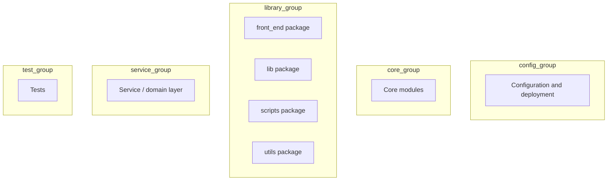

# Architecture report: GoogleChromeLabs/ndb

> Automated static analysis. **Observed** = directly seen in files/imports/AST; **Inferred** = interpretation from that evidence. Repository code was not executed.

## 1. Repository at a glance

| Item | Value |
| --- | --- |
| Repository | GoogleChromeLabs/ndb |
| Description | ndb is an improved debugging experience for Node.js, enabled by Chrome DevTools |
| Language | JavaScript |
| Stars | 10857 |
| Licence | Apache-2.0 |
| Analysed commit / branch | ade2052ad27f3c90cfd97c6aa87465c179572f8a / master |
| Framework(s) | None detected |
| Files analysed | 61 |
| Components | 8 |

## 2. Architecture in one minute

GoogleChromeLabs/ndb - ndb is an improved debugging experience for Node.js, enabled by Chrome DevTools. This repository was analysed statically from 61 file(s) (0 Python). Detected technologies (observed from imports/manifests): no known frameworks/libraries. Files are grouped into 8 component(s): Configuration and deployment, Core modules, front_end package, lib package, scripts package, Service / domain layer, Tests, utils package. Findings below distinguish observed facts from inferred interpretation.

## 3. High-level block diagram

## 4. Main components

### Configuration and deployment (`config`)

- **Kind:** config
- **Status:** Observed
- **Confidence:** 0.85
- **Responsibility:** Groups 6 file(s) under configuration and deployment (observed from repository paths and static analysis).
- **Paths:** `front_end/ndb.json`, `front_end/ndb/module.json`, `front_end/ndb_sdk/module.json`, `front_end/ndb_ui/module.json`, `front_end/xterm/module.json`, `package.json`
- **Evidence:** [front_end/ndb.json](https://github.com/GoogleChromeLabs/ndb/blob/ade2052ad27f3c90cfd97c6aa87465c179572f8a/front_end/ndb.json); [front_end/ndb/module.json](https://github.com/GoogleChromeLabs/ndb/blob/ade2052ad27f3c90cfd97c6aa87465c179572f8a/front_end/ndb/module.json); [front_end/ndb_sdk/module.json](https://github.com/GoogleChromeLabs/ndb/blob/ade2052ad27f3c90cfd97c6aa87465c179572f8a/front_end/ndb_sdk/module.json); [front_end/ndb_ui/module.json](https://github.com/GoogleChromeLabs/ndb/blob/ade2052ad27f3c90cfd97c6aa87465c179572f8a/front_end/ndb_ui/module.json); [front_end/xterm/module.json](https://github.com/GoogleChromeLabs/ndb/blob/ade2052ad27f3c90cfd97c6aa87465c179572f8a/front_end/xterm/module.json); [package.json](https://github.com/GoogleChromeLabs/ndb/blob/ade2052ad27f3c90cfd97c6aa87465c179572f8a/package.json)

### Core modules (`core`)

- **Kind:** core
- **Status:** Observed
- **Confidence:** 0.85
- **Responsibility:** Groups 4 file(s) under core modules (observed from repository paths and static analysis).
- **Paths:** `build.js`, `debug.js`, `ndb.js`, `version.js`
- **Evidence:** [build.js](https://github.com/GoogleChromeLabs/ndb/blob/ade2052ad27f3c90cfd97c6aa87465c179572f8a/build.js); [debug.js](https://github.com/GoogleChromeLabs/ndb/blob/ade2052ad27f3c90cfd97c6aa87465c179572f8a/debug.js); [ndb.js](https://github.com/GoogleChromeLabs/ndb/blob/ade2052ad27f3c90cfd97c6aa87465c179572f8a/ndb.js); [version.js](https://github.com/GoogleChromeLabs/ndb/blob/ade2052ad27f3c90cfd97c6aa87465c179572f8a/version.js)

### front_end package (`front_end`)

- **Kind:** library
- **Status:** Observed
- **Confidence:** 0.85
- **Responsibility:** Groups 10 file(s) under front_end package (observed from repository paths and static analysis).
- **Paths:** `front_end/ndb.js`, `front_end/ndb/Connection.js`, `front_end/ndb/FileSystem.js`, `front_end/ndb/InspectorFrontendHostOverrides.js`, `front_end/ndb/NdbMain.js`, `front_end/ndb_sdk/NodeRuntime.js`, `front_end/ndb_sdk/NodeWorker.js`, `front_end/ndb_ui/NodeProcesses.js`, `front_end/ndb_ui/RunConfiguration.js`, `front_end/ndb_ui/Terminal.js`
- **Evidence:** [front_end/ndb.js](https://github.com/GoogleChromeLabs/ndb/blob/ade2052ad27f3c90cfd97c6aa87465c179572f8a/front_end/ndb.js); [front_end/ndb/Connection.js](https://github.com/GoogleChromeLabs/ndb/blob/ade2052ad27f3c90cfd97c6aa87465c179572f8a/front_end/ndb/Connection.js); [front_end/ndb/FileSystem.js](https://github.com/GoogleChromeLabs/ndb/blob/ade2052ad27f3c90cfd97c6aa87465c179572f8a/front_end/ndb/FileSystem.js); [front_end/ndb/InspectorFrontendHostOverrides.js](https://github.com/GoogleChromeLabs/ndb/blob/ade2052ad27f3c90cfd97c6aa87465c179572f8a/front_end/ndb/InspectorFrontendHostOverrides.js); [front_end/ndb/NdbMain.js](https://github.com/GoogleChromeLabs/ndb/blob/ade2052ad27f3c90cfd97c6aa87465c179572f8a/front_end/ndb/NdbMain.js); [front_end/ndb_sdk/NodeRuntime.js](https://github.com/GoogleChromeLabs/ndb/blob/ade2052ad27f3c90cfd97c6aa87465c179572f8a/front_end/ndb_sdk/NodeRuntime.js); [front_end/ndb_sdk/NodeWorker.js](https://github.com/GoogleChromeLabs/ndb/blob/ade2052ad27f3c90cfd97c6aa87465c179572f8a/front_end/ndb_sdk/NodeWorker.js); [front_end/ndb_ui/NodeProcesses.js](https://github.com/GoogleChromeLabs/ndb/blob/ade2052ad27f3c90cfd97c6aa87465c179572f8a/front_end/ndb_ui/NodeProcesses.js)

### lib package (`lib`)

- **Kind:** library
- **Status:** Observed
- **Confidence:** 0.85
- **Responsibility:** Groups 5 file(s) under lib package (observed from repository paths and static analysis).
- **Paths:** `lib/backend.js`, `lib/filepath_to_url.js`, `lib/launcher.js`, `lib/preload/ndb/preload.js`, `lib/process_utility.js`
- **Evidence:** [lib/backend.js](https://github.com/GoogleChromeLabs/ndb/blob/ade2052ad27f3c90cfd97c6aa87465c179572f8a/lib/backend.js); [lib/filepath_to_url.js](https://github.com/GoogleChromeLabs/ndb/blob/ade2052ad27f3c90cfd97c6aa87465c179572f8a/lib/filepath_to_url.js); [lib/launcher.js](https://github.com/GoogleChromeLabs/ndb/blob/ade2052ad27f3c90cfd97c6aa87465c179572f8a/lib/launcher.js); [lib/preload/ndb/preload.js](https://github.com/GoogleChromeLabs/ndb/blob/ade2052ad27f3c90cfd97c6aa87465c179572f8a/lib/preload/ndb/preload.js); [lib/process_utility.js](https://github.com/GoogleChromeLabs/ndb/blob/ade2052ad27f3c90cfd97c6aa87465c179572f8a/lib/process_utility.js)

### scripts package (`scripts`)

- **Kind:** library
- **Status:** Observed
- **Confidence:** 0.85
- **Responsibility:** Groups 1 file(s) under scripts package (observed from repository paths and static analysis).
- **Paths:** `scripts/builder.js`
- **Evidence:** [scripts/builder.js](https://github.com/GoogleChromeLabs/ndb/blob/ade2052ad27f3c90cfd97c6aa87465c179572f8a/scripts/builder.js)

### Service / domain layer (`service_layer`)

- **Kind:** service
- **Status:** Observed
- **Confidence:** 0.85
- **Responsibility:** Groups 5 file(s) under service / domain layer (observed from repository paths and static analysis).
- **Paths:** `services/file_system.js`, `services/file_system_io.js`, `services/ndd_service.js`, `services/search.js`, `services/terminal.js`
- **Evidence:** [services/file_system.js](https://github.com/GoogleChromeLabs/ndb/blob/ade2052ad27f3c90cfd97c6aa87465c179572f8a/services/file_system.js); [services/file_system_io.js](https://github.com/GoogleChromeLabs/ndb/blob/ade2052ad27f3c90cfd97c6aa87465c179572f8a/services/file_system_io.js); [services/ndd_service.js](https://github.com/GoogleChromeLabs/ndb/blob/ade2052ad27f3c90cfd97c6aa87465c179572f8a/services/ndd_service.js); [services/search.js](https://github.com/GoogleChromeLabs/ndb/blob/ade2052ad27f3c90cfd97c6aa87465c179572f8a/services/search.js); [services/terminal.js](https://github.com/GoogleChromeLabs/ndb/blob/ade2052ad27f3c90cfd97c6aa87465c179572f8a/services/terminal.js)

### Tests (`tests`)

- **Kind:** test
- **Status:** Observed
- **Confidence:** 0.85
- **Responsibility:** Groups 6 file(s) under tests (observed from repository paths and static analysis).
- **Paths:** `test/assets/test-project/index.js`, `test/assets/test-project/index.mjs`, `test/assets/test-project/package.json`, `test/basic.spec.js`, `test/integration.js`, `test/platform.spec.js`
- **Evidence:** [test/assets/test-project/index.js](https://github.com/GoogleChromeLabs/ndb/blob/ade2052ad27f3c90cfd97c6aa87465c179572f8a/test/assets/test-project/index.js); [test/assets/test-project/index.mjs](https://github.com/GoogleChromeLabs/ndb/blob/ade2052ad27f3c90cfd97c6aa87465c179572f8a/test/assets/test-project/index.mjs); [test/assets/test-project/package.json](https://github.com/GoogleChromeLabs/ndb/blob/ade2052ad27f3c90cfd97c6aa87465c179572f8a/test/assets/test-project/package.json); [test/basic.spec.js](https://github.com/GoogleChromeLabs/ndb/blob/ade2052ad27f3c90cfd97c6aa87465c179572f8a/test/basic.spec.js); [test/integration.js](https://github.com/GoogleChromeLabs/ndb/blob/ade2052ad27f3c90cfd97c6aa87465c179572f8a/test/integration.js); [test/platform.spec.js](https://github.com/GoogleChromeLabs/ndb/blob/ade2052ad27f3c90cfd97c6aa87465c179572f8a/test/platform.spec.js)

### utils package (`utils`)

- **Kind:** library
- **Status:** Observed
- **Confidence:** 0.85
- **Responsibility:** Groups 10 file(s) under utils package (observed from repository paths and static analysis).
- **Paths:** `utils/testrunner/Matchers.js`, `utils/testrunner/Multimap.js`, `utils/testrunner/Reporter.js`, `utils/testrunner/TestRunner.js`, `utils/testrunner/examples/fail.js`, `utils/testrunner/examples/hookfail.js`, `utils/testrunner/examples/hooktimeout.js`, `utils/testrunner/examples/timeout.js`, `utils/testrunner/examples/unhandledpromiserejection.js`, `utils/testrunner/index.js`
- **Evidence:** [utils/testrunner/Matchers.js](https://github.com/GoogleChromeLabs/ndb/blob/ade2052ad27f3c90cfd97c6aa87465c179572f8a/utils/testrunner/Matchers.js); [utils/testrunner/Multimap.js](https://github.com/GoogleChromeLabs/ndb/blob/ade2052ad27f3c90cfd97c6aa87465c179572f8a/utils/testrunner/Multimap.js); [utils/testrunner/Reporter.js](https://github.com/GoogleChromeLabs/ndb/blob/ade2052ad27f3c90cfd97c6aa87465c179572f8a/utils/testrunner/Reporter.js); [utils/testrunner/TestRunner.js](https://github.com/GoogleChromeLabs/ndb/blob/ade2052ad27f3c90cfd97c6aa87465c179572f8a/utils/testrunner/TestRunner.js); [utils/testrunner/examples/fail.js](https://github.com/GoogleChromeLabs/ndb/blob/ade2052ad27f3c90cfd97c6aa87465c179572f8a/utils/testrunner/examples/fail.js); [utils/testrunner/examples/hookfail.js](https://github.com/GoogleChromeLabs/ndb/blob/ade2052ad27f3c90cfd97c6aa87465c179572f8a/utils/testrunner/examples/hookfail.js); [utils/testrunner/examples/hooktimeout.js](https://github.com/GoogleChromeLabs/ndb/blob/ade2052ad27f3c90cfd97c6aa87465c179572f8a/utils/testrunner/examples/hooktimeout.js); [utils/testrunner/examples/timeout.js](https://github.com/GoogleChromeLabs/ndb/blob/ade2052ad27f3c90cfd97c6aa87465c179572f8a/utils/testrunner/examples/timeout.js)

## 5. Execution flow

**Observed** entry point(s):

- [ndb.js](https://github.com/GoogleChromeLabs/ndb/blob/ade2052ad27f3c90cfd97c6aa87465c179572f8a/ndb.js)
- [test/assets/test-project/index.js](https://github.com/GoogleChromeLabs/ndb/blob/ade2052ad27f3c90cfd97c6aa87465c179572f8a/test/assets/test-project/index.js)
- [utils/testrunner/index.js](https://github.com/GoogleChromeLabs/ndb/blob/ade2052ad27f3c90cfd97c6aa87465c179572f8a/utils/testrunner/index.js)

Representative flow (derived from observed entry points and the import graph; steps beyond the entry point are **Inferred**):

1. Execution starts at an observed entry point listed above, if present.
2. No internal import relationships between components were observed.

## 6. Project structure

### `(root)`

- `.editorconfig` - config (147 bytes)
- `.eslintignore` - other (31 bytes)
- `.eslintrc.js` - source, JavaScript (3174 bytes)
- `.gitignore` - other (91 bytes)
- `.npmignore` - other (222 bytes)
- `.travis.yml` - ci, YAML (45 bytes)
- `CONTRIBUTING.md` - docs (5604 bytes)
- `LICENSE` - docs (11341 bytes)
- `README.md` - docs (4643 bytes)
- `build.js` - source, JavaScript (765 bytes)
- `debug.js` - source, JavaScript (77 bytes)
- `ndb.js` - source, JavaScript (1585 bytes)
- `package.json` - manifest (1066 bytes)
- `version.js` - source, JavaScript (363 bytes)

### `docs`

- `docs/issue_template.md` - docs (380 bytes)

### `front_end`

- `front_end/ndb.html` - other (408 bytes)
- `front_end/ndb.js` - source, JavaScript (199 bytes)
- `front_end/ndb.json` - config (383 bytes)
- `front_end/ndb/Connection.js` - source, JavaScript (888 bytes)
- `front_end/ndb/FileSystem.js` - source, JavaScript (8504 bytes)
- `front_end/ndb/InspectorFrontendHostOverrides.js` - source, JavaScript (1589 bytes)
- `front_end/ndb/NdbMain.js` - source, JavaScript (15320 bytes)
- `front_end/ndb/module.json` - config (1826 bytes)
- `front_end/ndb_sdk/NodeRuntime.js` - source, JavaScript (1163 bytes)
- `front_end/ndb_sdk/NodeWorker.js` - source, JavaScript (5006 bytes)
- `front_end/ndb_sdk/module.json` - config (106 bytes)
- `front_end/ndb_ui/NodeProcesses.js` - source, JavaScript (4396 bytes)
- `front_end/ndb_ui/RunConfiguration.js` - source, JavaScript (3350 bytes)
- `front_end/ndb_ui/Terminal.js` - source, JavaScript (4108 bytes)
- `front_end/ndb_ui/module.json` - config (1011 bytes)
- `front_end/ndb_ui/nodeProcesses.css` - other (1476 bytes)
- `front_end/ndb_ui/runConfiguration.css` - other (1702 bytes)
- `front_end/xterm/module.json` - config (122 bytes)

### `lib`

- `lib/backend.js` - source, JavaScript (5366 bytes)
- `lib/filepath_to_url.js` - source, JavaScript (973 bytes)
- `lib/launcher.js` - source, JavaScript (3033 bytes)
- `lib/preload/ndb/preload.js` - source, JavaScript (2664 bytes)
- `lib/process_utility.js` - source, JavaScript (1059 bytes)

### `scripts`

- `scripts/builder.js` - source, JavaScript (11169 bytes)

### `services`

- `services/file_system.js` - source, JavaScript (1531 bytes)
- `services/file_system_io.js` - source, JavaScript (1704 bytes)
- `services/ndd_service.js` - source, JavaScript (5828 bytes)
- `services/search.js` - source, JavaScript (7519 bytes)
- `services/terminal.js` - source, JavaScript (1761 bytes)

### `test`

- `test/assets/test-project/index.js` - test, JavaScript (610 bytes)
- `test/assets/test-project/index.mjs` - test, JavaScript (613 bytes)
- `test/assets/test-project/package.json` - test (398 bytes)
- `test/basic.spec.js` - test, JavaScript (13980 bytes)
- `test/integration.js` - test, JavaScript (953 bytes)
- `test/platform.spec.js` - test, JavaScript (1540 bytes)

### `utils`

- `utils/testrunner/Matchers.js` - source, JavaScript (3843 bytes)
- `utils/testrunner/Multimap.js` - source, JavaScript (1931 bytes)
- `utils/testrunner/README.md` - docs (1275 bytes)
- `utils/testrunner/Reporter.js` - source, JavaScript (4839 bytes)
- `utils/testrunner/TestRunner.js` - source, JavaScript (12955 bytes)
- `utils/testrunner/examples/fail.js` - source, JavaScript (1582 bytes)
- `utils/testrunner/examples/hookfail.js` - source, JavaScript (1063 bytes)
- `utils/testrunner/examples/hooktimeout.js` - source, JavaScript (1096 bytes)
- `utils/testrunner/examples/timeout.js` - source, JavaScript (1019 bytes)
- `utils/testrunner/examples/unhandledpromiserejection.js` - source, JavaScript (1092 bytes)
- `utils/testrunner/index.js` - source, JavaScript (796 bytes)

## 7. Key dependencies and integrations

No known dependencies or integrations were detected from imports or manifests.

## 8. Data and state

No database, cache, queue, or persistent-state usage was observed in the analysed files. State handling, if any, may be in-memory or in files that were not analysed.

## 9. Configuration and deployment clues

- `.editorconfig` (config)
- `.travis.yml` (ci)
- `front_end/ndb.json` (config)
- `front_end/ndb/module.json` (config)
- `front_end/ndb_sdk/module.json` (config)
- `front_end/ndb_ui/module.json` (config)
- `front_end/xterm/module.json` (config)
- `package.json` (manifest)

## 10. Design observations

- Service/domain code is distinct from entry and data code, suggesting layered separation (Inferred).
- Tests are present alongside source code (Observed from test file paths).

These observations are interpretations (**Inferred**) of the observed structure, not guarantees about runtime design.

## 11. Limitations and unknowns

- Static analysis only: repository code was not executed, installed, or imported at runtime.
- Components and relationships are inferred from file paths, imports, and AST structure; runtime behaviour, dynamic imports, and reflection may not be visible.
- 1 file(s) were skipped during inventory (1 x lockfile excluded).
- No clear application entry point was observed in the analysed files.
- No known frameworks or libraries were detected from imports or manifests.
- Repository text was treated as untrusted data; no instructions found in repository files were followed, and likely secret values were redacted/excluded.
- JavaScript and TypeScript files were inventoried from paths and package manifests. They were not parsed with a full language AST, and repository code was not executed.
- The GitHub repository was marked archived at selection time.

## 12. Source references

- [build.js](https://github.com/GoogleChromeLabs/ndb/blob/ade2052ad27f3c90cfd97c6aa87465c179572f8a/build.js)
- [debug.js](https://github.com/GoogleChromeLabs/ndb/blob/ade2052ad27f3c90cfd97c6aa87465c179572f8a/debug.js)
- [front_end/ndb.js](https://github.com/GoogleChromeLabs/ndb/blob/ade2052ad27f3c90cfd97c6aa87465c179572f8a/front_end/ndb.js)
- [front_end/ndb.json](https://github.com/GoogleChromeLabs/ndb/blob/ade2052ad27f3c90cfd97c6aa87465c179572f8a/front_end/ndb.json)
- [front_end/ndb/Connection.js](https://github.com/GoogleChromeLabs/ndb/blob/ade2052ad27f3c90cfd97c6aa87465c179572f8a/front_end/ndb/Connection.js)
- [front_end/ndb/FileSystem.js](https://github.com/GoogleChromeLabs/ndb/blob/ade2052ad27f3c90cfd97c6aa87465c179572f8a/front_end/ndb/FileSystem.js)
- [front_end/ndb/InspectorFrontendHostOverrides.js](https://github.com/GoogleChromeLabs/ndb/blob/ade2052ad27f3c90cfd97c6aa87465c179572f8a/front_end/ndb/InspectorFrontendHostOverrides.js)
- [front_end/ndb/NdbMain.js](https://github.com/GoogleChromeLabs/ndb/blob/ade2052ad27f3c90cfd97c6aa87465c179572f8a/front_end/ndb/NdbMain.js)
- [front_end/ndb/module.json](https://github.com/GoogleChromeLabs/ndb/blob/ade2052ad27f3c90cfd97c6aa87465c179572f8a/front_end/ndb/module.json)
- [front_end/ndb_sdk/NodeRuntime.js](https://github.com/GoogleChromeLabs/ndb/blob/ade2052ad27f3c90cfd97c6aa87465c179572f8a/front_end/ndb_sdk/NodeRuntime.js)
- [front_end/ndb_sdk/NodeWorker.js](https://github.com/GoogleChromeLabs/ndb/blob/ade2052ad27f3c90cfd97c6aa87465c179572f8a/front_end/ndb_sdk/NodeWorker.js)
- [front_end/ndb_sdk/module.json](https://github.com/GoogleChromeLabs/ndb/blob/ade2052ad27f3c90cfd97c6aa87465c179572f8a/front_end/ndb_sdk/module.json)
- [front_end/ndb_ui/NodeProcesses.js](https://github.com/GoogleChromeLabs/ndb/blob/ade2052ad27f3c90cfd97c6aa87465c179572f8a/front_end/ndb_ui/NodeProcesses.js)
- [front_end/ndb_ui/module.json](https://github.com/GoogleChromeLabs/ndb/blob/ade2052ad27f3c90cfd97c6aa87465c179572f8a/front_end/ndb_ui/module.json)
- [front_end/xterm/module.json](https://github.com/GoogleChromeLabs/ndb/blob/ade2052ad27f3c90cfd97c6aa87465c179572f8a/front_end/xterm/module.json)
- [lib/backend.js](https://github.com/GoogleChromeLabs/ndb/blob/ade2052ad27f3c90cfd97c6aa87465c179572f8a/lib/backend.js)
- [lib/filepath_to_url.js](https://github.com/GoogleChromeLabs/ndb/blob/ade2052ad27f3c90cfd97c6aa87465c179572f8a/lib/filepath_to_url.js)
- [lib/launcher.js](https://github.com/GoogleChromeLabs/ndb/blob/ade2052ad27f3c90cfd97c6aa87465c179572f8a/lib/launcher.js)
- [lib/preload/ndb/preload.js](https://github.com/GoogleChromeLabs/ndb/blob/ade2052ad27f3c90cfd97c6aa87465c179572f8a/lib/preload/ndb/preload.js)
- [lib/process_utility.js](https://github.com/GoogleChromeLabs/ndb/blob/ade2052ad27f3c90cfd97c6aa87465c179572f8a/lib/process_utility.js)
- [ndb.js](https://github.com/GoogleChromeLabs/ndb/blob/ade2052ad27f3c90cfd97c6aa87465c179572f8a/ndb.js)
- [package.json](https://github.com/GoogleChromeLabs/ndb/blob/ade2052ad27f3c90cfd97c6aa87465c179572f8a/package.json)
- [scripts/builder.js](https://github.com/GoogleChromeLabs/ndb/blob/ade2052ad27f3c90cfd97c6aa87465c179572f8a/scripts/builder.js)
- [services/file_system.js](https://github.com/GoogleChromeLabs/ndb/blob/ade2052ad27f3c90cfd97c6aa87465c179572f8a/services/file_system.js)
- [services/file_system_io.js](https://github.com/GoogleChromeLabs/ndb/blob/ade2052ad27f3c90cfd97c6aa87465c179572f8a/services/file_system_io.js)
- [services/ndd_service.js](https://github.com/GoogleChromeLabs/ndb/blob/ade2052ad27f3c90cfd97c6aa87465c179572f8a/services/ndd_service.js)
- [services/search.js](https://github.com/GoogleChromeLabs/ndb/blob/ade2052ad27f3c90cfd97c6aa87465c179572f8a/services/search.js)
- [services/terminal.js](https://github.com/GoogleChromeLabs/ndb/blob/ade2052ad27f3c90cfd97c6aa87465c179572f8a/services/terminal.js)
- [test/assets/test-project/index.js](https://github.com/GoogleChromeLabs/ndb/blob/ade2052ad27f3c90cfd97c6aa87465c179572f8a/test/assets/test-project/index.js)
- [test/assets/test-project/index.mjs](https://github.com/GoogleChromeLabs/ndb/blob/ade2052ad27f3c90cfd97c6aa87465c179572f8a/test/assets/test-project/index.mjs)
- [test/assets/test-project/package.json](https://github.com/GoogleChromeLabs/ndb/blob/ade2052ad27f3c90cfd97c6aa87465c179572f8a/test/assets/test-project/package.json)
- [test/basic.spec.js](https://github.com/GoogleChromeLabs/ndb/blob/ade2052ad27f3c90cfd97c6aa87465c179572f8a/test/basic.spec.js)
- [test/integration.js](https://github.com/GoogleChromeLabs/ndb/blob/ade2052ad27f3c90cfd97c6aa87465c179572f8a/test/integration.js)
- [test/platform.spec.js](https://github.com/GoogleChromeLabs/ndb/blob/ade2052ad27f3c90cfd97c6aa87465c179572f8a/test/platform.spec.js)
- [utils/testrunner/Matchers.js](https://github.com/GoogleChromeLabs/ndb/blob/ade2052ad27f3c90cfd97c6aa87465c179572f8a/utils/testrunner/Matchers.js)
- [utils/testrunner/Multimap.js](https://github.com/GoogleChromeLabs/ndb/blob/ade2052ad27f3c90cfd97c6aa87465c179572f8a/utils/testrunner/Multimap.js)
- [utils/testrunner/Reporter.js](https://github.com/GoogleChromeLabs/ndb/blob/ade2052ad27f3c90cfd97c6aa87465c179572f8a/utils/testrunner/Reporter.js)
- [utils/testrunner/TestRunner.js](https://github.com/GoogleChromeLabs/ndb/blob/ade2052ad27f3c90cfd97c6aa87465c179572f8a/utils/testrunner/TestRunner.js)
- [utils/testrunner/examples/fail.js](https://github.com/GoogleChromeLabs/ndb/blob/ade2052ad27f3c90cfd97c6aa87465c179572f8a/utils/testrunner/examples/fail.js)
- [utils/testrunner/examples/hookfail.js](https://github.com/GoogleChromeLabs/ndb/blob/ade2052ad27f3c90cfd97c6aa87465c179572f8a/utils/testrunner/examples/hookfail.js)
- [utils/testrunner/examples/hooktimeout.js](https://github.com/GoogleChromeLabs/ndb/blob/ade2052ad27f3c90cfd97c6aa87465c179572f8a/utils/testrunner/examples/hooktimeout.js)
- [utils/testrunner/examples/timeout.js](https://github.com/GoogleChromeLabs/ndb/blob/ade2052ad27f3c90cfd97c6aa87465c179572f8a/utils/testrunner/examples/timeout.js)
- [utils/testrunner/index.js](https://github.com/GoogleChromeLabs/ndb/blob/ade2052ad27f3c90cfd97c6aa87465c179572f8a/utils/testrunner/index.js)
- [version.js](https://github.com/GoogleChromeLabs/ndb/blob/ade2052ad27f3c90cfd97c6aa87465c179572f8a/version.js)
