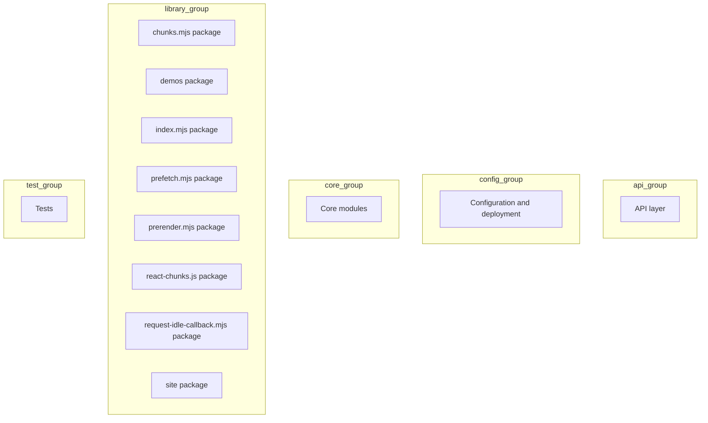

# Architecture report: GoogleChromeLabs/quicklink

> Automated static analysis. **Observed** = directly seen in files/imports/AST; **Inferred** = interpretation from that evidence. Repository code was not executed.

## 1. Repository at a glance

| Item | Value |
| --- | --- |
| Repository | GoogleChromeLabs/quicklink |
| Description | ⚡️Faster subsequent page-loads by prefetching in-viewport links during idle time |
| Language | JavaScript |
| Stars | 11306 |
| Licence | Apache-2.0 |
| Analysed commit / branch | e2f081b78f518a108a47b9046428a36f96f74f1e / main |
| Framework(s) | React |
| Files analysed | 161 |
| Components | 12 |

## 2. Architecture in one minute

GoogleChromeLabs/quicklink - ⚡️Faster subsequent page-loads by prefetching in-viewport links during idle time. This repository was analysed statically from 161 file(s) (0 Python). Detected technologies (observed from imports/manifests): GitHub Actions, React. Files are grouped into 12 component(s): API layer, chunks.mjs package, Configuration and deployment, Core modules, demos package, index.mjs package, prefetch.mjs package, prerender.mjs package. Findings below distinguish observed facts from inferred interpretation.

## 3. High-level block diagram

## 4. Main components

### API layer (`api_layer`)

- **Kind:** api
- **Status:** Observed
- **Confidence:** 0.85
- **Responsibility:** Groups 4 file(s) under api layer (observed from repository paths and static analysis).
- **Paths:** `site/src/demos/spa/routes/about.js`, `site/src/demos/spa/routes/blog.js`, `site/src/demos/spa/routes/contact.js`, `site/src/demos/spa/routes/home.js`
- **Evidence:** [site/src/demos/spa/routes/about.js](https://github.com/GoogleChromeLabs/quicklink/blob/e2f081b78f518a108a47b9046428a36f96f74f1e/site/src/demos/spa/routes/about.js); [site/src/demos/spa/routes/blog.js](https://github.com/GoogleChromeLabs/quicklink/blob/e2f081b78f518a108a47b9046428a36f96f74f1e/site/src/demos/spa/routes/blog.js); [site/src/demos/spa/routes/contact.js](https://github.com/GoogleChromeLabs/quicklink/blob/e2f081b78f518a108a47b9046428a36f96f74f1e/site/src/demos/spa/routes/contact.js); [site/src/demos/spa/routes/home.js](https://github.com/GoogleChromeLabs/quicklink/blob/e2f081b78f518a108a47b9046428a36f96f74f1e/site/src/demos/spa/routes/home.js)

### chunks.mjs package (`chunks_mjs`)

- **Kind:** library
- **Status:** Observed
- **Confidence:** 0.85
- **Responsibility:** Groups 1 file(s) under chunks.mjs package (observed from repository paths and static analysis).
- **Paths:** `src/chunks.mjs`
- **Evidence:** [src/chunks.mjs](https://github.com/GoogleChromeLabs/quicklink/blob/e2f081b78f518a108a47b9046428a36f96f74f1e/src/chunks.mjs)

### Configuration and deployment (`config`)

- **Kind:** config
- **Status:** Observed
- **Confidence:** 0.85
- **Responsibility:** Groups 7 file(s) under configuration and deployment (observed from repository paths and static analysis).
- **Paths:** `demos/hrefFn/2.json`, `package.json`, `site/.config/configstore/update-notifier-pnpm.json`, `site/.stylelintrc.json`, `site/firebase.json`, `site/package.json`, `site/watch.json`
- **Evidence:** [demos/hrefFn/2.json](https://github.com/GoogleChromeLabs/quicklink/blob/e2f081b78f518a108a47b9046428a36f96f74f1e/demos/hrefFn/2.json); [package.json](https://github.com/GoogleChromeLabs/quicklink/blob/e2f081b78f518a108a47b9046428a36f96f74f1e/package.json); [site/.config/configstore/update-notifier-pnpm.json](https://github.com/GoogleChromeLabs/quicklink/blob/e2f081b78f518a108a47b9046428a36f96f74f1e/site/.config/configstore/update-notifier-pnpm.json); [site/.stylelintrc.json](https://github.com/GoogleChromeLabs/quicklink/blob/e2f081b78f518a108a47b9046428a36f96f74f1e/site/.stylelintrc.json); [site/firebase.json](https://github.com/GoogleChromeLabs/quicklink/blob/e2f081b78f518a108a47b9046428a36f96f74f1e/site/firebase.json); [site/package.json](https://github.com/GoogleChromeLabs/quicklink/blob/e2f081b78f518a108a47b9046428a36f96f74f1e/site/package.json); [site/watch.json](https://github.com/GoogleChromeLabs/quicklink/blob/e2f081b78f518a108a47b9046428a36f96f74f1e/site/watch.json)

### Core modules (`core`)

- **Kind:** core
- **Status:** Observed
- **Confidence:** 0.85
- **Responsibility:** Groups 2 file(s) under core modules (observed from repository paths and static analysis).
- **Paths:** `eslint.config.js`, `rollup.config.mjs`
- **Evidence:** [eslint.config.js](https://github.com/GoogleChromeLabs/quicklink/blob/e2f081b78f518a108a47b9046428a36f96f74f1e/eslint.config.js); [rollup.config.mjs](https://github.com/GoogleChromeLabs/quicklink/blob/e2f081b78f518a108a47b9046428a36f96f74f1e/rollup.config.mjs)

### demos package (`demos`)

- **Kind:** library
- **Status:** Observed
- **Confidence:** 0.85
- **Responsibility:** Groups 2 file(s) under demos package (observed from repository paths and static analysis).
- **Paths:** `demos/network-idle.js`, `demos/sw.js`
- **Evidence:** [demos/network-idle.js](https://github.com/GoogleChromeLabs/quicklink/blob/e2f081b78f518a108a47b9046428a36f96f74f1e/demos/network-idle.js); [demos/sw.js](https://github.com/GoogleChromeLabs/quicklink/blob/e2f081b78f518a108a47b9046428a36f96f74f1e/demos/sw.js)

### index.mjs package (`index_mjs`)

- **Kind:** library
- **Status:** Observed
- **Confidence:** 0.85
- **Responsibility:** Groups 1 file(s) under index.mjs package (observed from repository paths and static analysis).
- **Paths:** `src/index.mjs`
- **Evidence:** [src/index.mjs](https://github.com/GoogleChromeLabs/quicklink/blob/e2f081b78f518a108a47b9046428a36f96f74f1e/src/index.mjs)

### prefetch.mjs package (`prefetch_mjs`)

- **Kind:** library
- **Status:** Observed
- **Confidence:** 0.85
- **Responsibility:** Groups 1 file(s) under prefetch.mjs package (observed from repository paths and static analysis).
- **Paths:** `src/prefetch.mjs`
- **Evidence:** [src/prefetch.mjs](https://github.com/GoogleChromeLabs/quicklink/blob/e2f081b78f518a108a47b9046428a36f96f74f1e/src/prefetch.mjs)

### prerender.mjs package (`prerender_mjs`)

- **Kind:** library
- **Status:** Observed
- **Confidence:** 0.85
- **Responsibility:** Groups 1 file(s) under prerender.mjs package (observed from repository paths and static analysis).
- **Paths:** `src/prerender.mjs`
- **Evidence:** [src/prerender.mjs](https://github.com/GoogleChromeLabs/quicklink/blob/e2f081b78f518a108a47b9046428a36f96f74f1e/src/prerender.mjs)

### react-chunks.js package (`react_chunks_js`)

- **Kind:** library
- **Status:** Observed
- **Confidence:** 0.85
- **Responsibility:** Groups 1 file(s) under react-chunks.js package (observed from repository paths and static analysis).
- **Paths:** `src/react-chunks.js`
- **Evidence:** [src/react-chunks.js](https://github.com/GoogleChromeLabs/quicklink/blob/e2f081b78f518a108a47b9046428a36f96f74f1e/src/react-chunks.js)

### request-idle-callback.mjs package (`request_idle_callback_mjs`)

- **Kind:** library
- **Status:** Observed
- **Confidence:** 0.85
- **Responsibility:** Groups 1 file(s) under request-idle-callback.mjs package (observed from repository paths and static analysis).
- **Paths:** `src/request-idle-callback.mjs`
- **Evidence:** [src/request-idle-callback.mjs](https://github.com/GoogleChromeLabs/quicklink/blob/e2f081b78f518a108a47b9046428a36f96f74f1e/src/request-idle-callback.mjs)

### site package (`site`)

- **Kind:** library
- **Status:** Observed
- **Confidence:** 0.85
- **Responsibility:** Groups 4 file(s) under site package (observed from repository paths and static analysis).
- **Paths:** `site/.eleventy.js`, `site/src/_data/site.js`, `site/src/assets/js/script.js`, `site/src/demos/spa/app.js`
- **Evidence:** [site/.eleventy.js](https://github.com/GoogleChromeLabs/quicklink/blob/e2f081b78f518a108a47b9046428a36f96f74f1e/site/.eleventy.js); [site/src/_data/site.js](https://github.com/GoogleChromeLabs/quicklink/blob/e2f081b78f518a108a47b9046428a36f96f74f1e/site/src/_data/site.js); [site/src/assets/js/script.js](https://github.com/GoogleChromeLabs/quicklink/blob/e2f081b78f518a108a47b9046428a36f96f74f1e/site/src/assets/js/script.js); [site/src/demos/spa/app.js](https://github.com/GoogleChromeLabs/quicklink/blob/e2f081b78f518a108a47b9046428a36f96f74f1e/site/src/demos/spa/app.js)

### Tests (`tests`)

- **Kind:** test
- **Status:** Observed
- **Confidence:** 0.85
- **Responsibility:** Groups 32 file(s) under tests (observed from repository paths and static analysis).
- **Paths:** `test/fixtures/1.html`, `test/fixtures/2.html`, `test/fixtures/3.html`, `test/fixtures/4.html`, `test/fixtures/index.html`, `test/fixtures/main.css`, `test/fixtures/rmanifest.json`, `test/fixtures/test-allow-origin-all.html`, `test/fixtures/test-allow-origin.html`, `test/fixtures/test-basic-usage.html`, `test/fixtures/test-custom-dom-source.html`, `test/fixtures/test-custom-href-function.html`, `test/fixtures/test-delay.html`, `test/fixtures/test-es-modules.html`, `test/fixtures/test-ignore-basic.html`, `test/fixtures/test-ignore-download.html`, `test/fixtures/test-ignore-multiple.html`, `test/fixtures/test-limit.html`, `test/fixtures/test-node-list.html`, `test/fixtures/test-prefetch-chunks.html`, `test/fixtures/test-prefetch-duplicate-shared.html`, `test/fixtures/test-prefetch-duplicate.html`, `test/fixtures/test-prefetch-multiple.html`, `test/fixtures/test-prefetch-single.html`, `test/fixtures/test-prerender-andPrefetch.html`, `test/fixtures/test-prerender-only.html`, `test/fixtures/test-prerender-wrapper-multiple.html`, `test/fixtures/test-prerender-wrapper-single.html`, `test/fixtures/test-same-origin.html`, `test/fixtures/test-threshold.html`, `test/fixtures/test-throttle.html`, `test/quicklink.spec.js`
- **Evidence:** [test/fixtures/1.html](https://github.com/GoogleChromeLabs/quicklink/blob/e2f081b78f518a108a47b9046428a36f96f74f1e/test/fixtures/1.html); [test/fixtures/2.html](https://github.com/GoogleChromeLabs/quicklink/blob/e2f081b78f518a108a47b9046428a36f96f74f1e/test/fixtures/2.html); [test/fixtures/3.html](https://github.com/GoogleChromeLabs/quicklink/blob/e2f081b78f518a108a47b9046428a36f96f74f1e/test/fixtures/3.html); [test/fixtures/4.html](https://github.com/GoogleChromeLabs/quicklink/blob/e2f081b78f518a108a47b9046428a36f96f74f1e/test/fixtures/4.html); [test/fixtures/index.html](https://github.com/GoogleChromeLabs/quicklink/blob/e2f081b78f518a108a47b9046428a36f96f74f1e/test/fixtures/index.html); [test/fixtures/main.css](https://github.com/GoogleChromeLabs/quicklink/blob/e2f081b78f518a108a47b9046428a36f96f74f1e/test/fixtures/main.css); [test/fixtures/rmanifest.json](https://github.com/GoogleChromeLabs/quicklink/blob/e2f081b78f518a108a47b9046428a36f96f74f1e/test/fixtures/rmanifest.json); [test/fixtures/test-allow-origin-all.html](https://github.com/GoogleChromeLabs/quicklink/blob/e2f081b78f518a108a47b9046428a36f96f74f1e/test/fixtures/test-allow-origin-all.html)

## 5. Execution flow

No entry point was observed; the startup flow below is therefore limited.

Representative flow (derived from observed entry points and the import graph; steps beyond the entry point are **Inferred**):

1. Execution starts at an observed entry point listed above, if present.
2. No internal import relationships between components were observed.

## 6. Project structure

### `(root)`

- `.browserslistrc` - other (64 bytes)
- `.editorconfig` - config (217 bytes)
- `.gitattributes` - other (71 bytes)
- `.gitignore` - other (493 bytes)
- `.size-limit.json` - config (342 bytes)
- `CHANGELOG.md` - docs (32748 bytes)
- `CONTRIBUTING.md` - docs (2572 bytes)
- `LICENSE` - docs (11357 bytes)
- `README.md` - docs (20461 bytes)
- `eslint.config.js` - source, JavaScript (3424 bytes)
- `package.json` - manifest (2839 bytes)
- `rollup.config.mjs` - source, JavaScript (3408 bytes)

### `.github`

- `.github/ISSUE_TEMPLATE/bug_report.md` - docs (698 bytes)
- `.github/ISSUE_TEMPLATE/feature_request.md` - docs (430 bytes)
- `.github/dependabot.yml` - config (221 bytes)
- `.github/workflows/ci.yml` - ci, YAML (929 bytes)
- `.github/workflows/codeql.yml` - ci, YAML (1239 bytes)
- `.github/workflows/lint.yml` - ci, YAML (840 bytes)
- `.github/workflows/site.yml` - ci, YAML (861 bytes)
- `.github/workflows/size-limit.yml` - ci, YAML (883 bytes)

### `assets`

- `assets/images/logos/quicklink.svg` - other (8168 bytes)

### `demos`

- `demos/basic.html` - other (1305 bytes)
- `demos/hrefFn/2.html` - other (480 bytes)
- `demos/hrefFn/2.json` - config (267 bytes)
- `demos/hrefFn/hrefFn_demo.html` - other (1902 bytes)
- `demos/network-idle.html` - other (1352 bytes)
- `demos/network-idle.js` - source, JavaScript (2975 bytes)
- `demos/news-workbox/README.md` - docs (683 bytes)
- `demos/news/README.md` - docs (616 bytes)
- `demos/spa/README.md` - docs (734 bytes)
- `demos/sw.js` - source, JavaScript (762 bytes)

### `site`

- `site/.browserslistrc` - other (64 bytes)
- `site/.config/configstore/update-notifier-pnpm.json` - config (165 bytes)
- `site/.config/glitch-package-manager` - other (5 bytes)
- `site/.eleventy.js` - source, JavaScript (2650 bytes)
- `site/.eleventyignore` - other (10 bytes)
- `site/.firebaserc` - other (57 bytes)
- `site/.gitignore` - other (188 bytes)
- `site/.stylelintignore` - other (55 bytes)
- `site/.stylelintrc.json` - config (400 bytes)
- `site/LICENSE` - docs (11358 bytes)
- `site/README.md` - docs (669 bytes)
- `site/firebase.json` - config (1291 bytes)
- `site/index.njk` - other (663 bytes)
- `site/package.json` - manifest (989 bytes)
- `site/src/_data/site.js` - source, JavaScript (3568 bytes)
- `site/src/_includes/components/chrome-extension.njk` - other (1117 bytes)
- `site/src/_includes/components/copy-snippet.njk` - other (879 bytes)
- `site/src/_includes/components/download.njk` - other (651 bytes)
- `site/src/_includes/components/github-fork.njk` - other (249 bytes)
- `site/src/_includes/components/github-star.njk` - other (232 bytes)
- `site/src/_includes/components/heading.njk` - other (311 bytes)
- `site/src/_includes/components/installation.njk` - other (402 bytes)
- `site/src/_includes/components/over-prefetching.njk` - other (1596 bytes)
- `site/src/_includes/components/react.njk` - other (1401 bytes)
- `site/src/_includes/components/trusted-by.njk` - other (654 bytes)
- `site/src/_includes/components/usage.njk` - other (1663 bytes)
- `site/src/_includes/components/use-with.njk` - other (525 bytes)
- `site/src/_includes/components/why-prefetch.njk` - other (351 bytes)
- `site/src/_includes/components/why-quicklink.njk` - other (651 bytes)
- `site/src/_includes/layouts/base.njk` - other (1330 bytes)
- `site/src/_includes/layouts/favicons.njk` - other (462 bytes)
- `site/src/_includes/layouts/font-icons/chain-solid.svg` - other (860 bytes)
- `site/src/_includes/layouts/font-icons/download-solid.svg` - other (608 bytes)
- `site/src/_includes/layouts/footer.njk` - other (329 bytes)
- `site/src/_includes/layouts/head.njk` - other (890 bytes)
- `site/src/_includes/layouts/header.njk` - other (852 bytes)
- `site/src/_includes/layouts/highlighted-section-wrapper.njk` - other (106 bytes)
- `site/src/_includes/layouts/normal-section-wrapper.njk` - other (75 bytes)
- `site/src/_includes/layouts/social.njk` - other (529 bytes)
- `site/src/api.njk` - other (12719 bytes)
- `site/src/approach.njk` - other (5150 bytes)
- `site/src/assets/images/graphs/prefetch-improve-svgomg.svg` - other (91433 bytes)
- `site/src/assets/images/graphs/prefetch-quicklink-svgomg.svg` - other (41265 bytes)
- `site/src/assets/images/graphs/prefetching.svg` - other (53086 bytes)
- `site/src/assets/images/graphs/what-is-prefetch-svgomg.svg` - other (81187 bytes)
- `site/src/assets/images/icons/safari-pinned-tab.svg` - other (2189 bytes)
- `site/src/assets/images/logos/angular.svg` - other (342 bytes)
- `site/src/assets/images/logos/drupal.svg` - other (5109 bytes)
- `site/src/assets/images/logos/magento.svg` - other (384 bytes)
- `site/src/assets/images/logos/quicklink.svg` - other (8168 bytes)
- `site/src/assets/images/logos/react.svg` - other (3801 bytes)
- `site/src/assets/images/logos/vue.svg` - other (3374 bytes)
- `site/src/assets/images/logos/wordpress.svg` - other (7345 bytes)
- `site/src/assets/js/script.js` - source, JavaScript (1593 bytes)
- `site/src/assets/styles/_copy-snippet.scss` - other (1972 bytes)
- `site/src/assets/styles/github-markdown.scss` - other (769 bytes)
- `site/src/assets/styles/main.scss` - other (5329 bytes)
- `site/src/demo.njk` - other (4933 bytes)
- `site/src/demos/mini-ecomm-quicklink/index.html` - other (3199 bytes)
- `site/src/demos/mini-ecomm-quicklink/product/1.html` - other (1226 bytes)
- `site/src/demos/mini-ecomm-quicklink/product/2.html` - other (1180 bytes)
- `site/src/demos/mini-ecomm-quicklink/product/3.html` - other (1189 bytes)
- `site/src/demos/mini-ecomm-quicklink/product/4.html` - other (1170 bytes)
- `site/src/demos/mini-ecomm-quicklink/product/5.html` - other (1192 bytes)
- `site/src/demos/mini-ecomm-quicklink/product/6.html` - other (1143 bytes)
- `site/src/demos/mini-ecomm-quicklink/product/7.html` - other (1158 bytes)
- `site/src/demos/mini-ecomm-quicklink/product/8.html` - other (1190 bytes)
- `site/src/demos/mini-ecomm-quicklink/style.css` - other (3673 bytes)
- `site/src/demos/mini-ecomm/index.html` - other (2943 bytes)
- `site/src/demos/mini-ecomm/product/1.html` - other (1214 bytes)
- `site/src/demos/mini-ecomm/product/2.html` - other (1168 bytes)
- `site/src/demos/mini-ecomm/product/3.html` - other (1177 bytes)
- `site/src/demos/mini-ecomm/product/4.html` - other (1158 bytes)
- `site/src/demos/mini-ecomm/product/5.html` - other (1180 bytes)
- `site/src/demos/mini-ecomm/product/6.html` - other (1131 bytes)
- `site/src/demos/mini-ecomm/product/7.html` - other (1146 bytes)
- `site/src/demos/mini-ecomm/product/8.html` - other (1178 bytes)
- `site/src/demos/mini-ecomm/style.css` - other (3673 bytes)
- `site/src/demos/spa/app.js` - source, JavaScript (954 bytes)
- `site/src/demos/spa/index.html` - other (994 bytes)
- `site/src/demos/spa/routes/about.js` - source, JavaScript (1315 bytes)
- `site/src/demos/spa/routes/blog.js` - source, JavaScript (1288 bytes)
- `site/src/demos/spa/routes/contact.js` - source, JavaScript (932 bytes)
- `site/src/demos/spa/routes/home.js` - source, JavaScript (1236 bytes)
- `site/src/demos/spa/style.css` - other (2066 bytes)
- `site/src/index.njk` - other (779 bytes)
- `site/src/measure.njk` - other (10771 bytes)
- `site/src/robots.njk` - other (203 bytes)
- `site/src/site.webmanifest` - other (432 bytes)
- `site/src/sitemap.njk` - other (356 bytes)
- `site/watch.json` - config (248 bytes)

### `src`

- `src/chunks.mjs` - source, JavaScript (5815 bytes)
- `src/index.mjs` - source, JavaScript (12280 bytes)
- `src/prefetch.mjs` - source, JavaScript (4835 bytes)
- `src/prerender.mjs` - source, JavaScript (2421 bytes)
- `src/react-chunks.js` - source, JavaScript (2379 bytes)
- `src/request-idle-callback.mjs` - source, JavaScript (950 bytes)

### `test`

- `test/fixtures/1.html` - test (480 bytes)
- `test/fixtures/2.html` - test (480 bytes)
- `test/fixtures/3.html` - test (480 bytes)
- `test/fixtures/4.html` - test (480 bytes)
- `test/fixtures/index.html` - test (853 bytes)
- `test/fixtures/main.css` - test (81 bytes)
- `test/fixtures/rmanifest.json` - test (1015 bytes)
- `test/fixtures/test-allow-origin-all.html` - test (744 bytes)
- `test/fixtures/test-allow-origin.html` - test (737 bytes)
- `test/fixtures/test-basic-usage.html` - test (664 bytes)
- `test/fixtures/test-custom-dom-source.html` - test (639 bytes)
- `test/fixtures/test-custom-href-function.html` - test (570 bytes)
- `test/fixtures/test-delay.html` - test (599 bytes)
- `test/fixtures/test-es-modules.html` - test (587 bytes)
- `test/fixtures/test-ignore-basic.html` - test (749 bytes)
- `test/fixtures/test-ignore-download.html` - test (579 bytes)
- `test/fixtures/test-ignore-multiple.html` - test (917 bytes)
- `test/fixtures/test-limit.html` - test (494 bytes)
- `test/fixtures/test-node-list.html` - test (712 bytes)
- `test/fixtures/test-prefetch-chunks.html` - test (1701 bytes)
- `test/fixtures/test-prefetch-duplicate-shared.html` - test (654 bytes)
- `test/fixtures/test-prefetch-duplicate.html` - test (619 bytes)
- `test/fixtures/test-prefetch-multiple.html` - test (619 bytes)
- `test/fixtures/test-prefetch-single.html` - test (597 bytes)
- `test/fixtures/test-prerender-andPrefetch.html` - test (613 bytes)
- `test/fixtures/test-prerender-only.html` - test (602 bytes)
- `test/fixtures/test-prerender-wrapper-multiple.html` - test (626 bytes)
- `test/fixtures/test-prerender-wrapper-single.html` - test (594 bytes)
- `test/fixtures/test-same-origin.html` - test (668 bytes)
- `test/fixtures/test-threshold.html` - test (886 bytes)
- `test/fixtures/test-throttle.html` - test (497 bytes)
- `test/quicklink.spec.js` - test, JavaScript (13632 bytes)

### `translations`

- `translations/zh-cn/README.md` - docs (9760 bytes)

## 7. Key dependencies and integrations

| Name | Category | Status | Confidence | Evidence |
| --- | --- | --- | --- | --- |
| GitHub Actions | ci | Observed | 0.90 | [.github/workflows/ci.yml](https://github.com/GoogleChromeLabs/quicklink/blob/e2f081b78f518a108a47b9046428a36f96f74f1e/.github/workflows/ci.yml); [.github/workflows/codeql.yml](https://github.com/GoogleChromeLabs/quicklink/blob/e2f081b78f518a108a47b9046428a36f96f74f1e/.github/workflows/codeql.yml); [.github/workflows/lint.yml](https://github.com/GoogleChromeLabs/quicklink/blob/e2f081b78f518a108a47b9046428a36f96f74f1e/.github/workflows/lint.yml); [.github/workflows/site.yml](https://github.com/GoogleChromeLabs/quicklink/blob/e2f081b78f518a108a47b9046428a36f96f74f1e/.github/workflows/site.yml) |
| React | framework | Observed | 0.90 | [package.json:30](https://github.com/GoogleChromeLabs/quicklink/blob/e2f081b78f518a108a47b9046428a36f96f74f1e/package.json#L30); [package.json:52](https://github.com/GoogleChromeLabs/quicklink/blob/e2f081b78f518a108a47b9046428a36f96f74f1e/package.json#L52) |

## 8. Data and state

No database, cache, queue, or persistent-state usage was observed in the analysed files. State handling, if any, may be in-memory or in files that were not analysed.

## 9. Configuration and deployment clues

- `.editorconfig` (config)
- `.github/dependabot.yml` (config)
- `.github/workflows/ci.yml` (ci)
- `.github/workflows/codeql.yml` (ci)
- `.github/workflows/lint.yml` (ci)
- `.github/workflows/site.yml` (ci)
- `.github/workflows/size-limit.yml` (ci)
- `.size-limit.json` (config)
- `demos/hrefFn/2.json` (config)
- `package.json` (manifest)
- `site/.config/configstore/update-notifier-pnpm.json` (config)
- `site/.stylelintrc.json` (config)
- `site/firebase.json` (config)
- `site/package.json` (manifest)
- `site/watch.json` (config)

## 10. Design observations

- An entry/API layer is separated from other code (Inferred from paths and decorators).
- Tests are present alongside source code (Observed from test file paths).

These observations are interpretations (**Inferred**) of the observed structure, not guarantees about runtime design.

## 11. Limitations and unknowns

- Static analysis only: repository code was not executed, installed, or imported at runtime.
- Components and relationships are inferred from file paths, imports, and AST structure; runtime behaviour, dynamic imports, and reflection may not be visible.
- 3 file(s) were skipped during inventory (1 x lockfile excluded; 2 x vendored/generated directory excluded).
- No clear application entry point was observed in the analysed files.
- Repository text was treated as untrusted data; no instructions found in repository files were followed, and likely secret values were redacted/excluded.
- JavaScript and TypeScript files were inventoried from paths and package manifests. They were not parsed with a full language AST, and repository code was not executed.

## 12. Source references

- [.github/workflows/ci.yml](https://github.com/GoogleChromeLabs/quicklink/blob/e2f081b78f518a108a47b9046428a36f96f74f1e/.github/workflows/ci.yml)
- [.github/workflows/codeql.yml](https://github.com/GoogleChromeLabs/quicklink/blob/e2f081b78f518a108a47b9046428a36f96f74f1e/.github/workflows/codeql.yml)
- [.github/workflows/lint.yml](https://github.com/GoogleChromeLabs/quicklink/blob/e2f081b78f518a108a47b9046428a36f96f74f1e/.github/workflows/lint.yml)
- [.github/workflows/site.yml](https://github.com/GoogleChromeLabs/quicklink/blob/e2f081b78f518a108a47b9046428a36f96f74f1e/.github/workflows/site.yml)
- [.github/workflows/size-limit.yml](https://github.com/GoogleChromeLabs/quicklink/blob/e2f081b78f518a108a47b9046428a36f96f74f1e/.github/workflows/size-limit.yml)
- [demos/hrefFn/2.json](https://github.com/GoogleChromeLabs/quicklink/blob/e2f081b78f518a108a47b9046428a36f96f74f1e/demos/hrefFn/2.json)
- [demos/network-idle.js](https://github.com/GoogleChromeLabs/quicklink/blob/e2f081b78f518a108a47b9046428a36f96f74f1e/demos/network-idle.js)
- [demos/sw.js](https://github.com/GoogleChromeLabs/quicklink/blob/e2f081b78f518a108a47b9046428a36f96f74f1e/demos/sw.js)
- [eslint.config.js](https://github.com/GoogleChromeLabs/quicklink/blob/e2f081b78f518a108a47b9046428a36f96f74f1e/eslint.config.js)
- [package.json](https://github.com/GoogleChromeLabs/quicklink/blob/e2f081b78f518a108a47b9046428a36f96f74f1e/package.json)
- [package.json:30](https://github.com/GoogleChromeLabs/quicklink/blob/e2f081b78f518a108a47b9046428a36f96f74f1e/package.json#L30)
- [package.json:52](https://github.com/GoogleChromeLabs/quicklink/blob/e2f081b78f518a108a47b9046428a36f96f74f1e/package.json#L52)
- [rollup.config.mjs](https://github.com/GoogleChromeLabs/quicklink/blob/e2f081b78f518a108a47b9046428a36f96f74f1e/rollup.config.mjs)
- [site/.config/configstore/update-notifier-pnpm.json](https://github.com/GoogleChromeLabs/quicklink/blob/e2f081b78f518a108a47b9046428a36f96f74f1e/site/.config/configstore/update-notifier-pnpm.json)
- [site/.eleventy.js](https://github.com/GoogleChromeLabs/quicklink/blob/e2f081b78f518a108a47b9046428a36f96f74f1e/site/.eleventy.js)
- [site/.stylelintrc.json](https://github.com/GoogleChromeLabs/quicklink/blob/e2f081b78f518a108a47b9046428a36f96f74f1e/site/.stylelintrc.json)
- [site/firebase.json](https://github.com/GoogleChromeLabs/quicklink/blob/e2f081b78f518a108a47b9046428a36f96f74f1e/site/firebase.json)
- [site/package.json](https://github.com/GoogleChromeLabs/quicklink/blob/e2f081b78f518a108a47b9046428a36f96f74f1e/site/package.json)
- [site/src/_data/site.js](https://github.com/GoogleChromeLabs/quicklink/blob/e2f081b78f518a108a47b9046428a36f96f74f1e/site/src/_data/site.js)
- [site/src/assets/js/script.js](https://github.com/GoogleChromeLabs/quicklink/blob/e2f081b78f518a108a47b9046428a36f96f74f1e/site/src/assets/js/script.js)
- [site/src/demos/spa/app.js](https://github.com/GoogleChromeLabs/quicklink/blob/e2f081b78f518a108a47b9046428a36f96f74f1e/site/src/demos/spa/app.js)
- [site/src/demos/spa/routes/about.js](https://github.com/GoogleChromeLabs/quicklink/blob/e2f081b78f518a108a47b9046428a36f96f74f1e/site/src/demos/spa/routes/about.js)
- [site/src/demos/spa/routes/blog.js](https://github.com/GoogleChromeLabs/quicklink/blob/e2f081b78f518a108a47b9046428a36f96f74f1e/site/src/demos/spa/routes/blog.js)
- [site/src/demos/spa/routes/contact.js](https://github.com/GoogleChromeLabs/quicklink/blob/e2f081b78f518a108a47b9046428a36f96f74f1e/site/src/demos/spa/routes/contact.js)
- [site/src/demos/spa/routes/home.js](https://github.com/GoogleChromeLabs/quicklink/blob/e2f081b78f518a108a47b9046428a36f96f74f1e/site/src/demos/spa/routes/home.js)
- [site/watch.json](https://github.com/GoogleChromeLabs/quicklink/blob/e2f081b78f518a108a47b9046428a36f96f74f1e/site/watch.json)
- [src/chunks.mjs](https://github.com/GoogleChromeLabs/quicklink/blob/e2f081b78f518a108a47b9046428a36f96f74f1e/src/chunks.mjs)
- [src/index.mjs](https://github.com/GoogleChromeLabs/quicklink/blob/e2f081b78f518a108a47b9046428a36f96f74f1e/src/index.mjs)
- [src/prefetch.mjs](https://github.com/GoogleChromeLabs/quicklink/blob/e2f081b78f518a108a47b9046428a36f96f74f1e/src/prefetch.mjs)
- [src/prerender.mjs](https://github.com/GoogleChromeLabs/quicklink/blob/e2f081b78f518a108a47b9046428a36f96f74f1e/src/prerender.mjs)
- [src/react-chunks.js](https://github.com/GoogleChromeLabs/quicklink/blob/e2f081b78f518a108a47b9046428a36f96f74f1e/src/react-chunks.js)
- [src/request-idle-callback.mjs](https://github.com/GoogleChromeLabs/quicklink/blob/e2f081b78f518a108a47b9046428a36f96f74f1e/src/request-idle-callback.mjs)
- [test/fixtures/1.html](https://github.com/GoogleChromeLabs/quicklink/blob/e2f081b78f518a108a47b9046428a36f96f74f1e/test/fixtures/1.html)
- [test/fixtures/2.html](https://github.com/GoogleChromeLabs/quicklink/blob/e2f081b78f518a108a47b9046428a36f96f74f1e/test/fixtures/2.html)
- [test/fixtures/3.html](https://github.com/GoogleChromeLabs/quicklink/blob/e2f081b78f518a108a47b9046428a36f96f74f1e/test/fixtures/3.html)
- [test/fixtures/4.html](https://github.com/GoogleChromeLabs/quicklink/blob/e2f081b78f518a108a47b9046428a36f96f74f1e/test/fixtures/4.html)
- [test/fixtures/index.html](https://github.com/GoogleChromeLabs/quicklink/blob/e2f081b78f518a108a47b9046428a36f96f74f1e/test/fixtures/index.html)
- [test/fixtures/main.css](https://github.com/GoogleChromeLabs/quicklink/blob/e2f081b78f518a108a47b9046428a36f96f74f1e/test/fixtures/main.css)
- [test/fixtures/rmanifest.json](https://github.com/GoogleChromeLabs/quicklink/blob/e2f081b78f518a108a47b9046428a36f96f74f1e/test/fixtures/rmanifest.json)
- [test/fixtures/test-allow-origin-all.html](https://github.com/GoogleChromeLabs/quicklink/blob/e2f081b78f518a108a47b9046428a36f96f74f1e/test/fixtures/test-allow-origin-all.html)
