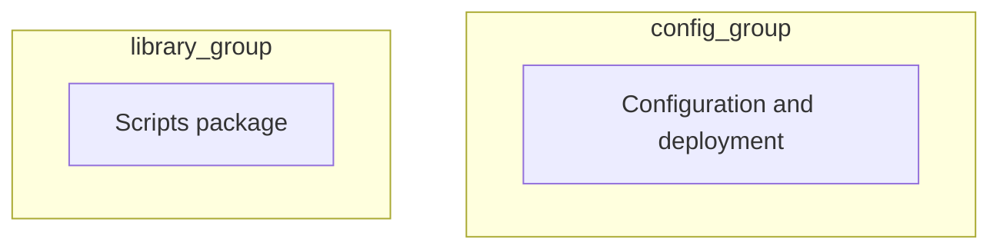

# Architecture report: Hackl0us/SS-Rule-Snippet

> Automated static analysis. **Observed** = directly seen in files/imports/AST; **Inferred** = interpretation from that evidence. Repository code was not executed.

## 1. Repository at a glance

| Item | Value |
| --- | --- |
| Repository | Hackl0us/SS-Rule-Snippet |
| Description | 搜集、整理、维护 Surge / Quantumult (X) / Shadowrocket / Surfboard / clash (Premium) 实用规则。 |
| Language | JavaScript |
| Stars | 11197 |
| Licence | AGPL-3.0 |
| Analysed commit / branch | 6fb5c342fbe3c63a3baa4f0e8bb32046631809f6 / main |
| Framework(s) | None detected |
| Files analysed | 105 |
| Components | 2 |

## 2. Architecture in one minute

Hackl0us/SS-Rule-Snippet - 搜集、整理、维护 Surge / Quantumult (X) / Shadowrocket / Surfboard / clash (Premium) 实用规则。. This repository was analysed statically from 105 file(s) (0 Python). Detected technologies (observed from imports/manifests): GitHub Actions. Files are grouped into 2 component(s): Configuration and deployment, Scripts package. Findings below distinguish observed facts from inferred interpretation.

## 3. High-level block diagram

## 4. Main components

### Configuration and deployment (`config`)

- **Kind:** config
- **Status:** Observed
- **Confidence:** 0.85
- **Responsibility:** Groups 14 file(s) under configuration and deployment (observed from repository paths and static analysis).
- **Paths:** `LAZY_RULES/Clash_Premium.yaml`, `LAZY_RULES/clash.yaml`, `Rulesets/Clash/App/social/Telegram.yaml`, `Rulesets/Clash/App/social/WhatsApp.yaml`, `Rulesets/Clash/App/stream/DisneyPlus.yaml`, `Rulesets/Clash/App/stream/Netflix.yaml`, `Rulesets/Clash/Basic/Apple-News.yaml`, `Rulesets/Clash/Basic/Apple-direct.yaml`, `Rulesets/Clash/Basic/Apple-proxy.yaml`, `Rulesets/Clash/Basic/CN.yaml`, `Rulesets/Clash/Basic/LAN.yaml`, `Rulesets/Clash/Basic/common-ad-keyword.yaml`, `Rulesets/Clash/Basic/foreign.yaml`, `Scripts/hackl0us.boxjs.json`
- **Evidence:** [LAZY_RULES/Clash_Premium.yaml](https://github.com/Hackl0us/SS-Rule-Snippet/blob/6fb5c342fbe3c63a3baa4f0e8bb32046631809f6/LAZY_RULES/Clash_Premium.yaml); [LAZY_RULES/clash.yaml](https://github.com/Hackl0us/SS-Rule-Snippet/blob/6fb5c342fbe3c63a3baa4f0e8bb32046631809f6/LAZY_RULES/clash.yaml); [Rulesets/Clash/App/social/Telegram.yaml](https://github.com/Hackl0us/SS-Rule-Snippet/blob/6fb5c342fbe3c63a3baa4f0e8bb32046631809f6/Rulesets/Clash/App/social/Telegram.yaml); [Rulesets/Clash/App/social/WhatsApp.yaml](https://github.com/Hackl0us/SS-Rule-Snippet/blob/6fb5c342fbe3c63a3baa4f0e8bb32046631809f6/Rulesets/Clash/App/social/WhatsApp.yaml); [Rulesets/Clash/App/stream/DisneyPlus.yaml](https://github.com/Hackl0us/SS-Rule-Snippet/blob/6fb5c342fbe3c63a3baa4f0e8bb32046631809f6/Rulesets/Clash/App/stream/DisneyPlus.yaml); [Rulesets/Clash/App/stream/Netflix.yaml](https://github.com/Hackl0us/SS-Rule-Snippet/blob/6fb5c342fbe3c63a3baa4f0e8bb32046631809f6/Rulesets/Clash/App/stream/Netflix.yaml); [Rulesets/Clash/Basic/Apple-News.yaml](https://github.com/Hackl0us/SS-Rule-Snippet/blob/6fb5c342fbe3c63a3baa4f0e8bb32046631809f6/Rulesets/Clash/Basic/Apple-News.yaml); [Rulesets/Clash/Basic/Apple-direct.yaml](https://github.com/Hackl0us/SS-Rule-Snippet/blob/6fb5c342fbe3c63a3baa4f0e8bb32046631809f6/Rulesets/Clash/Basic/Apple-direct.yaml)

### Scripts package (`scripts`)

- **Kind:** library
- **Status:** Observed
- **Confidence:** 0.85
- **Responsibility:** Groups 2 file(s) under scripts package (observed from repository paths and static analysis).
- **Paths:** `Scripts/Surge/weather_aqi_us/iOS14_Weather_AQI_US.js`, `Scripts/Surge/weather_aqi_us/iOS15_Weather_AQI_US.js`
- **Evidence:** [Scripts/Surge/weather_aqi_us/iOS14_Weather_AQI_US.js](https://github.com/Hackl0us/SS-Rule-Snippet/blob/6fb5c342fbe3c63a3baa4f0e8bb32046631809f6/Scripts/Surge/weather_aqi_us/iOS14_Weather_AQI_US.js); [Scripts/Surge/weather_aqi_us/iOS15_Weather_AQI_US.js](https://github.com/Hackl0us/SS-Rule-Snippet/blob/6fb5c342fbe3c63a3baa4f0e8bb32046631809f6/Scripts/Surge/weather_aqi_us/iOS15_Weather_AQI_US.js)

## 5. Execution flow

No entry point was observed; the startup flow below is therefore limited.

Representative flow (derived from observed entry points and the import graph; steps beyond the entry point are **Inferred**):

1. Execution starts at an observed entry point listed above, if present.
2. No internal import relationships between components were observed.

## 6. Project structure

### `(root)`

- `.gitignore` - other (215 bytes)
- `Changelog.md` - docs (13848 bytes)
- `LICENSE` - docs (34523 bytes)
- `README.md` - docs (11321 bytes)

### `.github`

- `.github/workflows/purge_cdn_cache.yaml` - ci, YAML (246 bytes)

### `LAZY_RULES`

- `LAZY_RULES/Clash_Premium.yaml` - config (14187 bytes)
- `LAZY_RULES/Quantumult.conf` - other (16378 bytes)
- `LAZY_RULES/QuantumultX.conf` - other (16303 bytes)
- `LAZY_RULES/Shadowrocket.conf` - other (17515 bytes)
- `LAZY_RULES/Surge.conf` - other (3901 bytes)
- `LAZY_RULES/clash.yaml` - config (29837 bytes)

### `Module`

- `Module/Surge/Gboard_zhHans_patch.sgmodule` - other (305 bytes)

### `Rulesets`

- `Rulesets/Clash/App/social/Telegram.yaml` - config (387 bytes)
- `Rulesets/Clash/App/social/WhatsApp.yaml` - config (161 bytes)
- `Rulesets/Clash/App/stream/DisneyPlus.yaml` - config (209 bytes)
- `Rulesets/Clash/App/stream/Netflix.yaml` - config (182 bytes)
- `Rulesets/Clash/Basic/Apple-News.yaml` - config (100 bytes)
- `Rulesets/Clash/Basic/Apple-direct.yaml` - config (587 bytes)
- `Rulesets/Clash/Basic/Apple-proxy.yaml` - config (334 bytes)
- `Rulesets/Clash/Basic/CN.yaml` - config (3669 bytes)
- `Rulesets/Clash/Basic/LAN.yaml` - config (268 bytes)
- `Rulesets/Clash/Basic/common-ad-keyword.yaml` - config (761 bytes)
- `Rulesets/Clash/Basic/foreign.yaml` - config (8462 bytes)
- `Rulesets/Quantumult/App/social/Telegram.list` - other (306 bytes)
- `Rulesets/Quantumult/App/social/WhatsApp.list` - other (152 bytes)
- `Rulesets/Quantumult/App/stream/DisneyPlus.list` - other (228 bytes)
- `Rulesets/Quantumult/App/stream/Netflix.list` - other (173 bytes)
- `Rulesets/Quantumult/Basic/Apple-News.list` - other (459 bytes)
- `Rulesets/Quantumult/Basic/Apple-direct.list` - other (689 bytes)
- `Rulesets/Quantumult/Basic/Apple-proxy.list` - other (330 bytes)
- `Rulesets/Quantumult/Basic/CN.list` - other (3855 bytes)
- `Rulesets/Quantumult/Basic/LAN.list` - other (283 bytes)
- `Rulesets/Quantumult/Basic/common-ad-keyword.list` - other (779 bytes)
- `Rulesets/Quantumult/Basic/foreign.list` - other (8472 bytes)
- `Rulesets/Quantumult/rewrite.list` - other (93 bytes)
- `Rulesets/Surge/App/social/Discord.list` - other (82 bytes)
- `Rulesets/Surge/App/social/KaKaoTalk.list` - other (114 bytes)
- `Rulesets/Surge/App/social/LINE.list` - other (2165 bytes)
- `Rulesets/Surge/App/social/Pinterest.list` - other (76 bytes)
- `Rulesets/Surge/App/social/Slack.list` - other (120 bytes)
- `Rulesets/Surge/App/social/Telegram.list` - other (338 bytes)
- `Rulesets/Surge/App/social/WhatsApp.list` - other (132 bytes)
- `Rulesets/Surge/App/stream/DisneyPlus.list` - other (198 bytes)
- `Rulesets/Surge/App/stream/Netflix.list` - other (153 bytes)
- `Rulesets/Surge/App/stream/Spotify.list` - other (91 bytes)
- `Rulesets/Surge/App/stream/TVB.list` - other (115 bytes)
- `Rulesets/Surge/App/stream/YouTube.list` - other (532 bytes)
- `Rulesets/Surge/App/tools/LastPass.list` - other (70 bytes)
- `Rulesets/Surge/App/tools/TeamViewer.list` - other (187 bytes)
- `Rulesets/Surge/Basic/Apple-News.list` - other (457 bytes)
- `Rulesets/Surge/Basic/Apple-direct.list` - other (650 bytes)
- `Rulesets/Surge/Basic/Apple-proxy.list` - other (289 bytes)
- `Rulesets/Surge/Basic/CN.list` - other (3206 bytes)
- `Rulesets/Surge/Basic/common-ad-keyword.list` - other (644 bytes)
- `Rulesets/Surge/Basic/foreign.list` - other (7344 bytes)
- `Rulesets/Surge/Custom/CN-ad.list` - other (4771 bytes)
- `Rulesets/Surge/Custom/academic-direct.list` - other (1222 bytes)
- `Rulesets/Surge/Custom/academic-proxy.list` - other (253 bytes)
- `Rulesets/Surge/Custom/ad-domains.list` - other (11672 bytes)
- `Rulesets/Surge/Custom/adult.list` - other (349 bytes)
- `Rulesets/Surge/Custom/foreign-list.list` - other (7165 bytes)
- `Rulesets/Surge/Custom/video-ad.list` - other (5518 bytes)

### `Scripts`

- `Scripts/Surge/weather_aqi_us/iOS14_Weather_AQI_US.js` - source, JavaScript (12701 bytes)
- `Scripts/Surge/weather_aqi_us/iOS15_Weather_AQI_US.js` - source, JavaScript (12939 bytes)
- `Scripts/Surge/weather_aqi_us/iOS_Weather_AQI_US.conf` - other (513 bytes)
- `Scripts/Surge/weather_aqi_us/iOS_Weather_AQI_US.sgmodule` - other (731 bytes)
- `Scripts/hackl0us.boxjs.json` - config (1086 bytes)

### `归档`

- `归档/Surfboard.conf` - other (17622 bytes)
- `归档/Surge 2.conf` - other (19227 bytes)
- `归档/Surge Legacy Global.conf` - other (2219 bytes)

### `规则片段集`

- `规则片段集/App 规则集/工具/Cydia.txt` - docs (709 bytes)
- `规则片段集/App 规则集/工具/LastPass.txt` - docs (122 bytes)
- `规则片段集/App 规则集/工具/TeamViewer.txt` - docs (240 bytes)
- `规则片段集/App 规则集/流媒体/DisneyPlus.txt` - docs (524 bytes)
- `规则片段集/App 规则集/流媒体/Netflix.txt` - docs (190 bytes)
- `规则片段集/App 规则集/流媒体/Spotify.txt` - docs (675 bytes)
- `规则片段集/App 规则集/流媒体/TVB.txt` - docs (152 bytes)
- `规则片段集/App 规则集/流媒体/Youtube.txt` - docs (583 bytes)
- `规则片段集/App 规则集/社交分享/Discord.txt` - docs (124 bytes)
- `规则片段集/App 规则集/社交分享/KaKaoTalk.txt` - docs (168 bytes)
- `规则片段集/App 规则集/社交分享/LINE.txt` - docs (2612 bytes)
- `规则片段集/App 规则集/社交分享/Pinterest.txt` - docs (125 bytes)
- `规则片段集/App 规则集/社交分享/Slack.txt` - docs (190 bytes)
- `规则片段集/App 规则集/社交分享/Telegram.txt` - docs (434 bytes)
- `规则片段集/App 规则集/社交分享/WhatsApp.txt` - docs (181 bytes)
- `规则片段集/功能性规则集/Proxyee Down 代理.txt` - docs (1191 bytes)
- `规则片段集/功能性规则集/TikTok 解锁.txt` - docs (455 bytes)
- `规则片段集/功能性规则集/修复Siri高延迟或不可用.txt` - docs (184 bytes)
- `规则片段集/功能性规则集/手机端使用知乎网页版.txt` - docs (823 bytes)
- `规则片段集/功能性规则集/维基百科(Wikipedia)排版优化.txt` - docs (894 bytes)
- `规则片段集/基础规则集/AppleNews解锁.txt` - docs (487 bytes)
- `规则片段集/基础规则集/Apple服务优化.txt` - docs (1730 bytes)
- `规则片段集/基础规则集/国内直连.txt` - docs (4036 bytes)
- `规则片段集/基础规则集/国外代理.txt` - docs (9056 bytes)
- `规则片段集/基础规则集/常见广告域名.txt` - docs (872 bytes)
- `规则片段集/基础规则集/最终规则.txt` - docs (432 bytes)
- `规则片段集/自选规则集/GFW 黑名单/GFW.txt` - docs (168494 bytes)
- `规则片段集/自选规则集/GFW 黑名单/Tinylist.txt` - docs (10495 bytes)
- `规则片段集/自选规则集/国内网站广告追踪屏蔽.txt` - docs (7811 bytes)
- `规则片段集/自选规则集/学术网站-代理.txt` - docs (259 bytes)
- `规则片段集/自选规则集/学术网站-直连.txt` - docs (1549 bytes)
- `规则片段集/自选规则集/屏蔽视频广告.txt` - docs (6725 bytes)
- `规则片段集/自选规则集/常见国外网站列表.txt` - docs (8676 bytes)
- `规则片段集/自选规则集/广告域名列表.txt` - docs (14661 bytes)
- `规则片段集/自选规则集/成人网站.txt` - docs (417 bytes)

## 7. Key dependencies and integrations

| Name | Category | Status | Confidence | Evidence |
| --- | --- | --- | --- | --- |
| GitHub Actions | ci | Observed | 0.85 | [.github/workflows/purge_cdn_cache.yaml](https://github.com/Hackl0us/SS-Rule-Snippet/blob/6fb5c342fbe3c63a3baa4f0e8bb32046631809f6/.github/workflows/purge_cdn_cache.yaml) |

## 8. Data and state

No database, cache, queue, or persistent-state usage was observed in the analysed files. State handling, if any, may be in-memory or in files that were not analysed.

## 9. Configuration and deployment clues

- `.github/workflows/purge_cdn_cache.yaml` (ci)
- `LAZY_RULES/Clash_Premium.yaml` (config)
- `LAZY_RULES/clash.yaml` (config)
- `Rulesets/Clash/App/social/Telegram.yaml` (config)
- `Rulesets/Clash/App/social/WhatsApp.yaml` (config)
- `Rulesets/Clash/App/stream/DisneyPlus.yaml` (config)
- `Rulesets/Clash/App/stream/Netflix.yaml` (config)
- `Rulesets/Clash/Basic/Apple-News.yaml` (config)
- `Rulesets/Clash/Basic/Apple-direct.yaml` (config)
- `Rulesets/Clash/Basic/Apple-proxy.yaml` (config)
- `Rulesets/Clash/Basic/CN.yaml` (config)
- `Rulesets/Clash/Basic/LAN.yaml` (config)
- `Rulesets/Clash/Basic/common-ad-keyword.yaml` (config)
- `Rulesets/Clash/Basic/foreign.yaml` (config)
- `Scripts/hackl0us.boxjs.json` (config)

## 10. Design observations

- No strong design patterns could be established from the available evidence.

These observations are interpretations (**Inferred**) of the observed structure, not guarantees about runtime design.

## 11. Limitations and unknowns

- Static analysis only: repository code was not executed, installed, or imported at runtime.
- Components and relationships are inferred from file paths, imports, and AST structure; runtime behaviour, dynamic imports, and reflection may not be visible.
- No clear application entry point was observed in the analysed files.
- Repository text was treated as untrusted data; no instructions found in repository files were followed, and likely secret values were redacted/excluded.
- JavaScript and TypeScript files were inventoried from paths and package manifests. They were not parsed with a full language AST, and repository code was not executed.

## 12. Source references

- [.github/workflows/purge_cdn_cache.yaml](https://github.com/Hackl0us/SS-Rule-Snippet/blob/6fb5c342fbe3c63a3baa4f0e8bb32046631809f6/.github/workflows/purge_cdn_cache.yaml)
- [LAZY_RULES/Clash_Premium.yaml](https://github.com/Hackl0us/SS-Rule-Snippet/blob/6fb5c342fbe3c63a3baa4f0e8bb32046631809f6/LAZY_RULES/Clash_Premium.yaml)
- [LAZY_RULES/clash.yaml](https://github.com/Hackl0us/SS-Rule-Snippet/blob/6fb5c342fbe3c63a3baa4f0e8bb32046631809f6/LAZY_RULES/clash.yaml)
- [Rulesets/Clash/App/social/Telegram.yaml](https://github.com/Hackl0us/SS-Rule-Snippet/blob/6fb5c342fbe3c63a3baa4f0e8bb32046631809f6/Rulesets/Clash/App/social/Telegram.yaml)
- [Rulesets/Clash/App/social/WhatsApp.yaml](https://github.com/Hackl0us/SS-Rule-Snippet/blob/6fb5c342fbe3c63a3baa4f0e8bb32046631809f6/Rulesets/Clash/App/social/WhatsApp.yaml)
- [Rulesets/Clash/App/stream/DisneyPlus.yaml](https://github.com/Hackl0us/SS-Rule-Snippet/blob/6fb5c342fbe3c63a3baa4f0e8bb32046631809f6/Rulesets/Clash/App/stream/DisneyPlus.yaml)
- [Rulesets/Clash/App/stream/Netflix.yaml](https://github.com/Hackl0us/SS-Rule-Snippet/blob/6fb5c342fbe3c63a3baa4f0e8bb32046631809f6/Rulesets/Clash/App/stream/Netflix.yaml)
- [Rulesets/Clash/Basic/Apple-News.yaml](https://github.com/Hackl0us/SS-Rule-Snippet/blob/6fb5c342fbe3c63a3baa4f0e8bb32046631809f6/Rulesets/Clash/Basic/Apple-News.yaml)
- [Rulesets/Clash/Basic/Apple-direct.yaml](https://github.com/Hackl0us/SS-Rule-Snippet/blob/6fb5c342fbe3c63a3baa4f0e8bb32046631809f6/Rulesets/Clash/Basic/Apple-direct.yaml)
- [Scripts/Surge/weather_aqi_us/iOS14_Weather_AQI_US.js](https://github.com/Hackl0us/SS-Rule-Snippet/blob/6fb5c342fbe3c63a3baa4f0e8bb32046631809f6/Scripts/Surge/weather_aqi_us/iOS14_Weather_AQI_US.js)
- [Scripts/Surge/weather_aqi_us/iOS15_Weather_AQI_US.js](https://github.com/Hackl0us/SS-Rule-Snippet/blob/6fb5c342fbe3c63a3baa4f0e8bb32046631809f6/Scripts/Surge/weather_aqi_us/iOS15_Weather_AQI_US.js)
