# Architecture report: HelloZeroNet/ZeroNet

> Automated static analysis. **Observed** = directly seen in files/imports/AST; **Inferred** = interpretation from that evidence. Repository code was not executed.

## 1. Repository at a glance

| Item | Value |
| --- | --- |
| Repository | HelloZeroNet/ZeroNet |
| Description | ZeroNet - Decentralized websites using Bitcoin crypto and BitTorrent network |
| Language | JavaScript |
| Stars | 18777 |
| Licence | Other |
| Analysed commit / branch | 454c0b2e7e000fda7000cba49027541fbf327b96 / py3 |
| Framework(s) | None detected |
| Files analysed | 532 |
| Components | 22 |

## 2. Architecture in one minute

HelloZeroNet/ZeroNet - ZeroNet - Decentralized websites using Bitcoin crypto and BitTorrent network. This repository was analysed statically from 532 file(s) (239 Python). Detected technologies (observed from imports/manifests): GitHub Actions, SQLite, Docker, pytest. Files are grouped into 22 component(s): Configuration and deployment, Connection package, Content package, Crypt package, Data layer, Debug package, Application entry point, External integrations. Observed entry point(s): src/Content/ContentDbDict.py, src/Db/Db.py, src/Debug/Debug.py. Findings below distinguish observed facts from inferred interpretation.

## 3. High-level block diagram

```mermaid
flowchart TD
    subgraph config_group
        config["Configuration and deployment"]
    end
    subgraph data_group
        data_layer["Data layer"]
    end
    subgraph entrypoint_group
        entrypoint["Application entry point"]
    end
    subgraph external_group
        external_integrations["External integrations"]
    end
    subgraph library_group
        connection["Connection package"]
        content["Content package"]
        crypt["Crypt package"]
        debug["Debug package"]
        file["File package"]
        init_py["__init__.py package"]
        lib["lib package"]
        peer["Peer package"]
        plugin["Plugin package"]
        plugins["plugins package"]
        site["Site package"]
        tor["Tor package"]
        translate["Translate package"]
        ui["Ui package"]
        user["User package"]
        util["util package"]
        worker["Worker package"]
    end
    subgraph test_group
        tests["Tests"]
    end
    config -->|imports| entrypoint
    config -->|imports| plugin
    connection -->|imports| config
    connection -->|imports| crypt
    connection -->|imports| debug
    connection -->|imports| external_integrations
    connection -->|imports| site
    connection -->|imports| tor
    connection -->|imports| util
    content -->|imports| config
    content -->|imports| crypt
    content -->|imports| debug
    content -->|imports| entrypoint
    content -->|imports| peer
    content -->|imports| plugin
    content -->|imports| util
    crypt -->|imports| config
    crypt -->|imports| lib
    crypt -->|imports| util
    data_layer -->|imports| util
    debug -->|imports| config
    entrypoint -->|imports| config
    entrypoint -->|imports| connection
    entrypoint -->|imports| content
    entrypoint -->|imports| crypt
    entrypoint -->|imports| data_layer
    entrypoint -->|imports| debug
    entrypoint -->|imports| file
    entrypoint -->|imports| lib
    entrypoint -->|imports| peer
    entrypoint -->|imports| plugin
    entrypoint -->|imports| plugins
    entrypoint -->|imports| site
    entrypoint -->|imports| ui
    entrypoint -->|imports| user
    entrypoint -->|imports| util
    file -->|imports| config
    file -->|imports| connection
    file -->|imports| debug
    file -->|imports| external_integrations
    file -->|imports| peer
    file -->|imports| plugin
    file -->|imports| site
    file -->|imports| util
    lib -->|imports| external_integrations
    peer -->|imports| config
    peer -->|imports| debug
    peer -->|imports| entrypoint
    peer -->|imports| plugin
    peer -->|imports| util
    plugins -->|imports| config
    plugins -->|imports| connection
    plugins -->|imports| content
    plugins -->|imports| crypt
    plugins -->|imports| data_layer
    plugins -->|imports| debug
    plugins -->|imports| entrypoint
    plugins -->|imports| external_integrations
    plugins -->|imports| lib
    plugins -->|imports| peer
    plugins -->|imports| plugin
    plugins -->|imports| site
    plugins -->|imports| translate
    plugins -->|imports| ui
    plugins -->|imports| user
    plugins -->|imports| util
    plugins -->|imports| worker
    site -->|imports| config
    site -->|imports| content
    site -->|imports| crypt
    site -->|imports| data_layer
    site -->|imports| debug
    site -->|imports| entrypoint
    site -->|imports| file
    site -->|imports| peer
    site -->|imports| plugin
    site -->|imports| translate
    site -->|imports| util
    site -->|imports| worker
    tests -->|imports| config
    tests -->|imports| connection
    tests -->|imports| content
    tests -->|imports| crypt
    tests -->|imports| data_layer
    tests -->|imports| debug
    tests -->|imports| external_integrations
    tests -->|imports| file
    tests -->|imports| peer
    tests -->|imports| plugin
    tests -->|imports| site
    tests -->|imports| tor
    tests -->|imports| translate
    tests -->|imports| ui
    tests -->|imports| user
    tests -->|imports| util
    tests -->|imports| worker
    tor -->|imports| config
    tor -->|imports| crypt
    tor -->|imports| debug
    tor -->|imports| entrypoint
    tor -->|imports| external_integrations
    tor -->|imports| plugin
    tor -->|imports| site
    translate -->|imports| config
    translate -->|imports| debug
    ui -->|imports| config
    ui -->|imports| content
    ui -->|imports| crypt
    ui -->|imports| debug
    ui -->|imports| entrypoint
    ui -->|imports| external_integrations
    ui -->|imports| lib
    ui -->|imports| plugin
    ui -->|imports| site
    ui -->|imports| translate
    ui -->|imports| user
    ui -->|imports| util
    user -->|imports| config
    user -->|imports| crypt
    user -->|imports| debug
    user -->|imports| plugin
    user -->|imports| util
    util -->|imports| config
    util -->|imports| debug
    util -->|imports| external_integrations
    worker -->|imports| config
    worker -->|imports| content
    worker -->|imports| debug
    worker -->|imports| plugin
    worker -->|imports| util
```

## 4. Main components

### Configuration and deployment (`config`)

- **Kind:** config
- **Status:** Observed
- **Confidence:** 0.85
- **Responsibility:** Groups 92 file(s) under configuration and deployment (observed from repository paths and static analysis). Observed top-level classes: Config, ErrorLogHandler.
- **Paths:** `Dockerfile`, `Dockerfile.arm64v8`, `plugins/AnnounceBitTorrent/plugin_info.json`, `plugins/AnnounceLocal/plugin_info.json`, `plugins/AnnounceShare/plugin_info.json`, `plugins/AnnounceZero/plugin_info.json`, `plugins/Benchmark/plugin_info.json`, `plugins/Chart/plugin_info.json`, `plugins/ContentFilter/languages/hu.json`, `plugins/ContentFilter/languages/it.json`, `plugins/ContentFilter/languages/jp.json`, `plugins/ContentFilter/languages/pt-br.json`, `plugins/ContentFilter/languages/zh-tw.json`, `plugins/ContentFilter/languages/zh.json`, `plugins/ContentFilter/plugin_info.json`, `plugins/Cors/plugin_info.json`, `plugins/CryptMessage/plugin_info.json`, `plugins/FilePack/plugin_info.json`, `plugins/MergerSite/languages/es.json`, `plugins/MergerSite/languages/fr.json`, `plugins/MergerSite/languages/hu.json`, `plugins/MergerSite/languages/it.json`, `plugins/MergerSite/languages/jp.json`, `plugins/MergerSite/languages/pt-br.json`, `plugins/MergerSite/languages/tr.json`, `plugins/MergerSite/languages/zh-tw.json`, `plugins/MergerSite/languages/zh.json`, `plugins/OptionalManager/languages/es.json`, `plugins/OptionalManager/languages/fr.json`, `plugins/OptionalManager/languages/hu.json`, `plugins/OptionalManager/languages/jp.json`, `plugins/OptionalManager/languages/pt-br.json`, `plugins/OptionalManager/languages/zh-tw.json`, `plugins/OptionalManager/languages/zh.json`, `plugins/PeerDb/plugin_info.json`, `plugins/Sidebar/languages/da.json`, `plugins/Sidebar/languages/de.json`, `plugins/Sidebar/languages/es.json`, `plugins/Sidebar/languages/fr.json`, `plugins/Sidebar/languages/hu.json`, `plugins/Sidebar/languages/it.json`, `plugins/Sidebar/languages/jp.json`, `plugins/Sidebar/languages/pl.json`, `plugins/Sidebar/languages/pt-br.json`, `plugins/Sidebar/languages/ru.json`, `plugins/Sidebar/languages/tr.json`, `plugins/Sidebar/languages/zh-tw.json`, `plugins/Sidebar/languages/zh.json`, `plugins/Sidebar/plugin_info.json`, `plugins/Stats/plugin_info.json`, `plugins/TranslateSite/plugin_info.json`, `plugins/Trayicon/languages/es.json`, `plugins/Trayicon/languages/fr.json`, `plugins/Trayicon/languages/hu.json`, `plugins/Trayicon/languages/it.json`, `plugins/Trayicon/languages/jp.json`, `plugins/Trayicon/languages/pl.json`, `plugins/Trayicon/languages/pt-br.json`, `plugins/Trayicon/languages/tr.json`, `plugins/Trayicon/languages/zh-tw.json`, `plugins/Trayicon/languages/zh.json`, `plugins/Trayicon/plugin_info.json`, `plugins/UiConfig/languages/hu.json`, `plugins/UiConfig/languages/jp.json`, `plugins/UiConfig/languages/pl.json`, `plugins/UiConfig/languages/pt-br.json`, `plugins/UiConfig/languages/zh.json`, `plugins/UiConfig/plugin_info.json`, `plugins/UiFileManager/languages/hu.json`, `plugins/UiFileManager/languages/jp.json`, `plugins/disabled-Bootstrapper/plugin_info.json`, `plugins/disabled-Multiuser/plugin_info.json`, `plugins/disabled-UiPassword/plugin_info.json`, `requirements.txt`, `src/Config.py`, `src/Translate/languages/da.json`, `src/Translate/languages/de.json`, `src/Translate/languages/es.json`, `src/Translate/languages/fa.json`, `src/Translate/languages/fr.json`, `src/Translate/languages/hu.json`, `src/Translate/languages/it.json`, `src/Translate/languages/jp.json`, `src/Translate/languages/nl.json`, `src/Translate/languages/pl.json`, `src/Translate/languages/pt-br.json`, `src/Translate/languages/ru.json`, `src/Translate/languages/sk.json`, `src/Translate/languages/sl.json`, `src/Translate/languages/tr.json`, `src/Translate/languages/zh-tw.json`, `src/Translate/languages/zh.json`
- **Evidence:** [Dockerfile](https://github.com/HelloZeroNet/ZeroNet/blob/454c0b2e7e000fda7000cba49027541fbf327b96/Dockerfile); [Dockerfile.arm64v8](https://github.com/HelloZeroNet/ZeroNet/blob/454c0b2e7e000fda7000cba49027541fbf327b96/Dockerfile.arm64v8); [plugins/AnnounceBitTorrent/plugin_info.json](https://github.com/HelloZeroNet/ZeroNet/blob/454c0b2e7e000fda7000cba49027541fbf327b96/plugins/AnnounceBitTorrent/plugin_info.json); [plugins/AnnounceLocal/plugin_info.json](https://github.com/HelloZeroNet/ZeroNet/blob/454c0b2e7e000fda7000cba49027541fbf327b96/plugins/AnnounceLocal/plugin_info.json); [plugins/AnnounceShare/plugin_info.json](https://github.com/HelloZeroNet/ZeroNet/blob/454c0b2e7e000fda7000cba49027541fbf327b96/plugins/AnnounceShare/plugin_info.json); [plugins/AnnounceZero/plugin_info.json](https://github.com/HelloZeroNet/ZeroNet/blob/454c0b2e7e000fda7000cba49027541fbf327b96/plugins/AnnounceZero/plugin_info.json); [plugins/Benchmark/plugin_info.json](https://github.com/HelloZeroNet/ZeroNet/blob/454c0b2e7e000fda7000cba49027541fbf327b96/plugins/Benchmark/plugin_info.json); [plugins/Chart/plugin_info.json](https://github.com/HelloZeroNet/ZeroNet/blob/454c0b2e7e000fda7000cba49027541fbf327b96/plugins/Chart/plugin_info.json)

### Connection package (`connection`)

- **Kind:** library
- **Status:** Observed
- **Confidence:** 0.85
- **Responsibility:** Groups 3 file(s) under connection package (observed from repository paths and static analysis). Observed top-level classes: Connection, ConnectionServer.
- **Paths:** `src/Connection/Connection.py`, `src/Connection/ConnectionServer.py`, `src/Connection/__init__.py`
- **Evidence:** [src/Connection/Connection.py:17](https://github.com/HelloZeroNet/ZeroNet/blob/454c0b2e7e000fda7000cba49027541fbf327b96/src/Connection/Connection.py#L17); [src/Connection/ConnectionServer.py:23](https://github.com/HelloZeroNet/ZeroNet/blob/454c0b2e7e000fda7000cba49027541fbf327b96/src/Connection/ConnectionServer.py#L23); [src/Connection/__init__.py](https://github.com/HelloZeroNet/ZeroNet/blob/454c0b2e7e000fda7000cba49027541fbf327b96/src/Connection/__init__.py)

### Content package (`content`)

- **Kind:** library
- **Status:** Observed
- **Confidence:** 0.85
- **Responsibility:** Groups 3 file(s) under content package (observed from repository paths and static analysis). Observed top-level classes: ContentDb, ContentManager, SignError, VerifyError. Observed top-level functions: getContentDb.
- **Paths:** `src/Content/ContentDb.py`, `src/Content/ContentManager.py`, `src/Content/__init__.py`
- **Evidence:** [src/Content/ContentDb.py:10](https://github.com/HelloZeroNet/ZeroNet/blob/454c0b2e7e000fda7000cba49027541fbf327b96/src/Content/ContentDb.py#L10); [src/Content/ContentManager.py:22](https://github.com/HelloZeroNet/ZeroNet/blob/454c0b2e7e000fda7000cba49027541fbf327b96/src/Content/ContentManager.py#L22); [src/Content/__init__.py](https://github.com/HelloZeroNet/ZeroNet/blob/454c0b2e7e000fda7000cba49027541fbf327b96/src/Content/__init__.py)

### Crypt package (`crypt`)

- **Kind:** library
- **Status:** Observed
- **Confidence:** 0.85
- **Responsibility:** Groups 6 file(s) under crypt package (observed from repository paths and static analysis). Observed top-level classes: CryptConnectionManager, Sha512t. Observed top-level functions: hdPrivatekey, loadLib, newPrivatekey, newSeed, privatekeyToAddress, privatekeyToPublickey.
- **Paths:** `src/Crypt/Crypt.py`, `src/Crypt/CryptBitcoin.py`, `src/Crypt/CryptConnection.py`, `src/Crypt/CryptHash.py`, `src/Crypt/CryptRsa.py`, `src/Crypt/__init__.py`
- **Evidence:** [src/Crypt/Crypt.py](https://github.com/HelloZeroNet/ZeroNet/blob/454c0b2e7e000fda7000cba49027541fbf327b96/src/Crypt/Crypt.py); [src/Crypt/CryptBitcoin.py:19](https://github.com/HelloZeroNet/ZeroNet/blob/454c0b2e7e000fda7000cba49027541fbf327b96/src/Crypt/CryptBitcoin.py#L19); [src/Crypt/CryptConnection.py:12](https://github.com/HelloZeroNet/ZeroNet/blob/454c0b2e7e000fda7000cba49027541fbf327b96/src/Crypt/CryptConnection.py#L12); [src/Crypt/CryptHash.py:6](https://github.com/HelloZeroNet/ZeroNet/blob/454c0b2e7e000fda7000cba49027541fbf327b96/src/Crypt/CryptHash.py#L6); [src/Crypt/CryptRsa.py:4](https://github.com/HelloZeroNet/ZeroNet/blob/454c0b2e7e000fda7000cba49027541fbf327b96/src/Crypt/CryptRsa.py#L4); [src/Crypt/__init__.py](https://github.com/HelloZeroNet/ZeroNet/blob/454c0b2e7e000fda7000cba49027541fbf327b96/src/Crypt/__init__.py)

### Data layer (`data_layer`)

- **Kind:** data
- **Status:** Observed
- **Confidence:** 0.85
- **Responsibility:** Groups 3 file(s) under data layer (observed from repository paths and static analysis). Observed top-level classes: DbCursor, DbQuery.
- **Paths:** `src/Db/DbCursor.py`, `src/Db/DbQuery.py`, `src/Db/__init__.py`
- **Evidence:** [src/Db/DbCursor.py:8](https://github.com/HelloZeroNet/ZeroNet/blob/454c0b2e7e000fda7000cba49027541fbf327b96/src/Db/DbCursor.py#L8); [src/Db/DbQuery.py:5](https://github.com/HelloZeroNet/ZeroNet/blob/454c0b2e7e000fda7000cba49027541fbf327b96/src/Db/DbQuery.py#L5); [src/Db/__init__.py](https://github.com/HelloZeroNet/ZeroNet/blob/454c0b2e7e000fda7000cba49027541fbf327b96/src/Db/__init__.py)

### Debug package (`debug`)

- **Kind:** library
- **Status:** Observed
- **Confidence:** 0.85
- **Responsibility:** Groups 3 file(s) under debug package (observed from repository paths and static analysis). Observed top-level classes: DebugLock, DebugReloader.
- **Paths:** `src/Debug/DebugLock.py`, `src/Debug/DebugReloader.py`, `src/Debug/__init__.py`
- **Evidence:** [src/Debug/DebugLock.py:9](https://github.com/HelloZeroNet/ZeroNet/blob/454c0b2e7e000fda7000cba49027541fbf327b96/src/Debug/DebugLock.py#L9); [src/Debug/DebugReloader.py:21](https://github.com/HelloZeroNet/ZeroNet/blob/454c0b2e7e000fda7000cba49027541fbf327b96/src/Debug/DebugReloader.py#L21); [src/Debug/__init__.py](https://github.com/HelloZeroNet/ZeroNet/blob/454c0b2e7e000fda7000cba49027541fbf327b96/src/Debug/__init__.py)

### Application entry point (`entrypoint`)

- **Kind:** entrypoint
- **Status:** Observed
- **Confidence:** 0.85
- **Responsibility:** Groups 24 file(s) under application entry point (observed from repository paths and static analysis). Observed top-level classes: Actions, BigfilePiecefield, BigfilePiecefieldPacked, Cached, ContentDbDict, Db. Observed top-level functions: GenerateDummyWindow, LoadIcon, _collect_idg_data, _communicate_with_igd, _create_close_message, _create_open_message.
- **Paths:** `plugins/Bigfile/BigfilePiecefield.py`, `plugins/Sidebar/ZipStream.py`, `plugins/Trayicon/lib/notificationicon.py`, `plugins/Trayicon/lib/winfolders.py`, `src/Content/ContentDbDict.py`, `src/Db/Db.py`, `src/Debug/Debug.py`, `src/Debug/DebugHook.py`, `src/Debug/DebugMedia.py`, `src/Peer/PeerHashfield.py`, `src/Plugin/PluginManager.py`, `src/lib/cssvendor/cssvendor.py`, `src/lib/libsecp256k1message/libsecp256k1message.py`, `src/main.py`, `src/util/Cached.py`, `src/util/Event.py`, `src/util/Noparallel.py`, `src/util/Pooled.py`, `src/util/QueryJson.py`, `src/util/RateLimit.py`, `src/util/UpnpPunch.py`, `start.py`, `update.py`, `zeronet.py`
- **Evidence:** [plugins/Bigfile/BigfilePiecefield.py:4](https://github.com/HelloZeroNet/ZeroNet/blob/454c0b2e7e000fda7000cba49027541fbf327b96/plugins/Bigfile/BigfilePiecefield.py#L4); [plugins/Sidebar/ZipStream.py:5](https://github.com/HelloZeroNet/ZeroNet/blob/454c0b2e7e000fda7000cba49027541fbf327b96/plugins/Sidebar/ZipStream.py#L5); [plugins/Trayicon/lib/notificationicon.py:53](https://github.com/HelloZeroNet/ZeroNet/blob/454c0b2e7e000fda7000cba49027541fbf327b96/plugins/Trayicon/lib/notificationicon.py#L53); [plugins/Trayicon/lib/winfolders.py:44](https://github.com/HelloZeroNet/ZeroNet/blob/454c0b2e7e000fda7000cba49027541fbf327b96/plugins/Trayicon/lib/winfolders.py#L44); [src/Content/ContentDbDict.py:9](https://github.com/HelloZeroNet/ZeroNet/blob/454c0b2e7e000fda7000cba49027541fbf327b96/src/Content/ContentDbDict.py#L9); [src/Db/Db.py:29](https://github.com/HelloZeroNet/ZeroNet/blob/454c0b2e7e000fda7000cba49027541fbf327b96/src/Db/Db.py#L29); [src/Debug/Debug.py:8](https://github.com/HelloZeroNet/ZeroNet/blob/454c0b2e7e000fda7000cba49027541fbf327b96/src/Debug/Debug.py#L8); [src/Debug/DebugHook.py:14](https://github.com/HelloZeroNet/ZeroNet/blob/454c0b2e7e000fda7000cba49027541fbf327b96/src/Debug/DebugHook.py#L14)

### External integrations (`external_integrations`)

- **Kind:** external
- **Status:** Inferred
- **Confidence:** 0.70
- **Responsibility:** Groups 0 file(s) under external integrations (observed from repository paths and static analysis).
- **Evidence:** [plugins/AnnounceBitTorrent/AnnounceBitTorrentPlugin.py:4](https://github.com/HelloZeroNet/ZeroNet/blob/454c0b2e7e000fda7000cba49027541fbf327b96/plugins/AnnounceBitTorrent/AnnounceBitTorrentPlugin.py#L4); [plugins/AnnounceLocal/BroadcastServer.py:1](https://github.com/HelloZeroNet/ZeroNet/blob/454c0b2e7e000fda7000cba49027541fbf327b96/plugins/AnnounceLocal/BroadcastServer.py#L1); [plugins/Benchmark/BenchmarkDb.py:62](https://github.com/HelloZeroNet/ZeroNet/blob/454c0b2e7e000fda7000cba49027541fbf327b96/plugins/Benchmark/BenchmarkDb.py#L62); [plugins/PeerDb/PeerDbPlugin.py:2](https://github.com/HelloZeroNet/ZeroNet/blob/454c0b2e7e000fda7000cba49027541fbf327b96/plugins/PeerDb/PeerDbPlugin.py#L2); [plugins/Stats/StatsPlugin.py:319](https://github.com/HelloZeroNet/ZeroNet/blob/454c0b2e7e000fda7000cba49027541fbf327b96/plugins/Stats/StatsPlugin.py#L319); [plugins/Stats/StatsPlugin.py:576](https://github.com/HelloZeroNet/ZeroNet/blob/454c0b2e7e000fda7000cba49027541fbf327b96/plugins/Stats/StatsPlugin.py#L576)

### File package (`file`)

- **Kind:** library
- **Status:** Observed
- **Confidence:** 0.85
- **Responsibility:** Groups 3 file(s) under file package (observed from repository paths and static analysis). Observed top-level classes: FileRequest, FileServer, RequestError.
- **Paths:** `src/File/FileRequest.py`, `src/File/FileServer.py`, `src/File/__init__.py`
- **Evidence:** [src/File/FileRequest.py:22](https://github.com/HelloZeroNet/ZeroNet/blob/454c0b2e7e000fda7000cba49027541fbf327b96/src/File/FileRequest.py#L22); [src/File/FileServer.py:23](https://github.com/HelloZeroNet/ZeroNet/blob/454c0b2e7e000fda7000cba49027541fbf327b96/src/File/FileServer.py#L23); [src/File/__init__.py](https://github.com/HelloZeroNet/ZeroNet/blob/454c0b2e7e000fda7000cba49027541fbf327b96/src/File/__init__.py)

### __init__.py package (`init_py`)

- **Kind:** library
- **Status:** Observed
- **Confidence:** 0.85
- **Responsibility:** Groups 1 file(s) under __init__.py package (observed from repository paths and static analysis).
- **Paths:** `src/__init__.py`
- **Evidence:** [src/__init__.py](https://github.com/HelloZeroNet/ZeroNet/blob/454c0b2e7e000fda7000cba49027541fbf327b96/src/__init__.py)

### lib package (`lib`)

- **Kind:** library
- **Status:** Observed
- **Confidence:** 0.85
- **Responsibility:** Groups 27 file(s) under lib package (observed from repository paths and static analysis). Observed top-level classes: AES, AESBackend, AESBlockModeOfOperation, AESModeOfOperationCBC, AESModeOfOperationCFB, AESModeOfOperationCTR. Observed top-level functions: F0, F1, F2, F3, F4, R.
- **Paths:** `src/lib/__init__.py`, `src/lib/bencode_open/__init__.py`, `src/lib/cssvendor/__init__.py`, `src/lib/gevent_ws/__init__.py`, `src/lib/libsecp256k1message/__init__.py`, `src/lib/pyaes/__init__.py`, `src/lib/pyaes/aes.py`, `src/lib/pyaes/blockfeeder.py`, `src/lib/pyaes/util.py`, `src/lib/sslcrypto/__init__.py`, `src/lib/sslcrypto/_aes.py`, `src/lib/sslcrypto/_ecc.py`, `src/lib/sslcrypto/_ripemd.py`, `src/lib/sslcrypto/fallback/__init__.py`, `src/lib/sslcrypto/fallback/_jacobian.py`, `src/lib/sslcrypto/fallback/_util.py`, `src/lib/sslcrypto/fallback/aes.py`, `src/lib/sslcrypto/fallback/ecc.py`, `src/lib/sslcrypto/fallback/rsa.py`, `src/lib/sslcrypto/openssl/__init__.py`, `src/lib/sslcrypto/openssl/aes.py`, `src/lib/sslcrypto/openssl/discovery.py`, `src/lib/sslcrypto/openssl/ecc.py`, `src/lib/sslcrypto/openssl/library.py`, `src/lib/sslcrypto/openssl/rsa.py`, `src/lib/subtl/__init__.py`, `src/lib/subtl/subtl.py`
- **Evidence:** [src/lib/__init__.py](https://github.com/HelloZeroNet/ZeroNet/blob/454c0b2e7e000fda7000cba49027541fbf327b96/src/lib/__init__.py); [src/lib/bencode_open/__init__.py:1](https://github.com/HelloZeroNet/ZeroNet/blob/454c0b2e7e000fda7000cba49027541fbf327b96/src/lib/bencode_open/__init__.py#L1); [src/lib/cssvendor/__init__.py](https://github.com/HelloZeroNet/ZeroNet/blob/454c0b2e7e000fda7000cba49027541fbf327b96/src/lib/cssvendor/__init__.py); [src/lib/gevent_ws/__init__.py:25](https://github.com/HelloZeroNet/ZeroNet/blob/454c0b2e7e000fda7000cba49027541fbf327b96/src/lib/gevent_ws/__init__.py#L25); [src/lib/libsecp256k1message/__init__.py](https://github.com/HelloZeroNet/ZeroNet/blob/454c0b2e7e000fda7000cba49027541fbf327b96/src/lib/libsecp256k1message/__init__.py); [src/lib/pyaes/__init__.py](https://github.com/HelloZeroNet/ZeroNet/blob/454c0b2e7e000fda7000cba49027541fbf327b96/src/lib/pyaes/__init__.py); [src/lib/pyaes/aes.py:61](https://github.com/HelloZeroNet/ZeroNet/blob/454c0b2e7e000fda7000cba49027541fbf327b96/src/lib/pyaes/aes.py#L61); [src/lib/pyaes/blockfeeder.py:54](https://github.com/HelloZeroNet/ZeroNet/blob/454c0b2e7e000fda7000cba49027541fbf327b96/src/lib/pyaes/blockfeeder.py#L54)

### Peer package (`peer`)

- **Kind:** library
- **Status:** Observed
- **Confidence:** 0.85
- **Responsibility:** Groups 3 file(s) under peer package (observed from repository paths and static analysis). Observed top-level classes: Peer, PeerPortchecker.
- **Paths:** `src/Peer/Peer.py`, `src/Peer/PeerPortchecker.py`, `src/Peer/__init__.py`
- **Evidence:** [src/Peer/Peer.py:22](https://github.com/HelloZeroNet/ZeroNet/blob/454c0b2e7e000fda7000cba49027541fbf327b96/src/Peer/Peer.py#L22); [src/Peer/PeerPortchecker.py:11](https://github.com/HelloZeroNet/ZeroNet/blob/454c0b2e7e000fda7000cba49027541fbf327b96/src/Peer/PeerPortchecker.py#L11); [src/Peer/__init__.py](https://github.com/HelloZeroNet/ZeroNet/blob/454c0b2e7e000fda7000cba49027541fbf327b96/src/Peer/__init__.py)

### Plugin package (`plugin`)

- **Kind:** library
- **Status:** Observed
- **Confidence:** 0.85
- **Responsibility:** Groups 1 file(s) under plugin package (observed from repository paths and static analysis).
- **Paths:** `src/Plugin/__init__.py`
- **Evidence:** [src/Plugin/__init__.py](https://github.com/HelloZeroNet/ZeroNet/blob/454c0b2e7e000fda7000cba49027541fbf327b96/src/Plugin/__init__.py)

### plugins package (`plugins`)

- **Kind:** library
- **Status:** Observed
- **Confidence:** 0.85
- **Responsibility:** Groups 135 file(s) under plugins package (observed from repository paths and static analysis). Observed top-level classes: ActionsPlugin, BigFile, BootstrapperDb, BroadcastServer, ChartCollector, ChartDb. Observed top-level functions: checkMergerPath, closeArchive, decodePubkey, eciesDecrypt, eciesDecryptMulti, eciesEncrypt.
- **Paths:** `plugins/AnnounceBitTorrent/AnnounceBitTorrentPlugin.py`, `plugins/AnnounceBitTorrent/__init__.py`, `plugins/AnnounceLocal/AnnounceLocalPlugin.py`, `plugins/AnnounceLocal/BroadcastServer.py`, `plugins/AnnounceLocal/__init__.py`, `plugins/AnnounceShare/AnnounceSharePlugin.py`, `plugins/AnnounceShare/__init__.py`, `plugins/AnnounceZero/AnnounceZeroPlugin.py`, `plugins/AnnounceZero/__init__.py`, `plugins/Benchmark/BenchmarkDb.py`, `plugins/Benchmark/BenchmarkPack.py`, `plugins/Benchmark/BenchmarkPlugin.py`, `plugins/Benchmark/__init__.py`, `plugins/Bigfile/BigfilePlugin.py`, `plugins/Bigfile/__init__.py`, `plugins/Chart/ChartCollector.py`, `plugins/Chart/ChartDb.py`, `plugins/Chart/ChartPlugin.py`, `plugins/Chart/__init__.py`, `plugins/ContentFilter/ContentFilterPlugin.py`, `plugins/ContentFilter/ContentFilterStorage.py`, `plugins/ContentFilter/__init__.py`, `plugins/ContentFilter/media/js/ZeroFrame.js`, `plugins/Cors/CorsPlugin.py`, `plugins/Cors/__init__.py`, `plugins/CryptMessage/CryptMessage.py`, `plugins/CryptMessage/CryptMessagePlugin.py`, `plugins/CryptMessage/__init__.py`, `plugins/FilePack/FilePackPlugin.py`, `plugins/FilePack/__init__.py`, `plugins/MergerSite/MergerSitePlugin.py`, `plugins/MergerSite/__init__.py`, `plugins/Newsfeed/NewsfeedPlugin.py`, `plugins/Newsfeed/__init__.py`, `plugins/OptionalManager/ContentDbPlugin.py`, `plugins/OptionalManager/OptionalManagerPlugin.py`, `plugins/OptionalManager/UiWebsocketPlugin.py`, `plugins/OptionalManager/__init__.py`, `plugins/PeerDb/PeerDbPlugin.py`, `plugins/PeerDb/__init__.py`, `plugins/Sidebar/ConsolePlugin.py`, `plugins/Sidebar/SidebarPlugin.py`, `plugins/Sidebar/__init__.py`, `plugins/Sidebar/media/Scrollable.js`, `plugins/Sidebar/media/all.js`, `plugins/Sidebar/media/morphdom.js`, `plugins/Sidebar/media_globe/Detector.js`, `plugins/Sidebar/media_globe/Tween.js`, `plugins/Sidebar/media_globe/globe.js`, `plugins/Stats/StatsPlugin.py`, `plugins/Stats/__init__.py`, `plugins/TranslateSite/TranslateSitePlugin.py`, `plugins/TranslateSite/__init__.py`, `plugins/Trayicon/TrayiconPlugin.py`, `plugins/Trayicon/__init__.py`, `plugins/Trayicon/lib/__init__.py`, `plugins/UiConfig/UiConfigPlugin.py`, `plugins/UiConfig/__init__.py`, `plugins/UiConfig/media/js/all.js`, `plugins/UiConfig/media/js/lib/maquette.js`, `plugins/UiFileManager/UiFileManagerPlugin.py`, `plugins/UiFileManager/__init__.py`, `plugins/UiFileManager/media/codemirror/extension/dialog/dialog.js`, `plugins/UiFileManager/media/codemirror/extension/edit/closebrackets.js`, `plugins/UiFileManager/media/codemirror/extension/edit/closetag.js`, `plugins/UiFileManager/media/codemirror/extension/edit/continuelist.js`, `plugins/UiFileManager/media/codemirror/extension/edit/matchbrackets.js`, `plugins/UiFileManager/media/codemirror/extension/edit/matchtags.js`, `plugins/UiFileManager/media/codemirror/extension/edit/trailingspace.js`, `plugins/UiFileManager/media/codemirror/extension/fold/brace-fold.js`, `plugins/UiFileManager/media/codemirror/extension/fold/comment-fold.js`, `plugins/UiFileManager/media/codemirror/extension/fold/foldcode.js`, `plugins/UiFileManager/media/codemirror/extension/fold/foldgutter.js`, `plugins/UiFileManager/media/codemirror/extension/fold/indent-fold.js`, `plugins/UiFileManager/media/codemirror/extension/fold/markdown-fold.js`, `plugins/UiFileManager/media/codemirror/extension/fold/xml-fold.js`, `plugins/UiFileManager/media/codemirror/extension/hint/anyword-hint.js`, `plugins/UiFileManager/media/codemirror/extension/hint/html-hint.js`, `plugins/UiFileManager/media/codemirror/extension/hint/show-hint.js`, `plugins/UiFileManager/media/codemirror/extension/hint/sql-hint.js`, `plugins/UiFileManager/media/codemirror/extension/hint/xml-hint.js`, `plugins/UiFileManager/media/codemirror/extension/lint/json-lint.js`, `plugins/UiFileManager/media/codemirror/extension/lint/jsonlint.js`, `plugins/UiFileManager/media/codemirror/extension/lint/lint.js`, `plugins/UiFileManager/media/codemirror/extension/scroll/annotatescrollbar.js`, `plugins/UiFileManager/media/codemirror/extension/scroll/scrollpastend.js`, `plugins/UiFileManager/media/codemirror/extension/scroll/simplescrollbars.js`, `plugins/UiFileManager/media/codemirror/extension/search/jump-to-line.js`, `plugins/UiFileManager/media/codemirror/extension/search/match-highlighter.js`, `plugins/UiFileManager/media/codemirror/extension/search/matchesonscrollbar.js`, `plugins/UiFileManager/media/codemirror/extension/search/search.js`, `plugins/UiFileManager/media/codemirror/extension/search/searchcursor.js`, `plugins/UiFileManager/media/codemirror/extension/selection/active-line.js`, `plugins/UiFileManager/media/codemirror/extension/selection/mark-selection.js`, `plugins/UiFileManager/media/codemirror/extension/selection/selection-pointer.js`, `plugins/UiFileManager/media/codemirror/extension/simple.js`, `plugins/UiFileManager/media/codemirror/extension/sublime.js`, `plugins/UiFileManager/media/codemirror/mode/coffeescript.js`, `plugins/UiFileManager/media/codemirror/mode/css.js`, `plugins/UiFileManager/media/codemirror/mode/go.js`, `plugins/UiFileManager/media/codemirror/mode/htmlembedded.js`, `plugins/UiFileManager/media/codemirror/mode/htmlmixed.js`, `plugins/UiFileManager/media/codemirror/mode/javascript.js`, `plugins/UiFileManager/media/codemirror/mode/markdown.js`, `plugins/UiFileManager/media/codemirror/mode/python.js`, `plugins/UiFileManager/media/codemirror/mode/rust.js`, `plugins/UiFileManager/media/codemirror/mode/xml.js`, `plugins/UiFileManager/media/js/all.js`, `plugins/UiFileManager/media/js/lib/maquette.js`, `plugins/UiPluginManager/UiPluginManagerPlugin.py`, `plugins/UiPluginManager/__init__.py`, `plugins/UiPluginManager/media/js/all.js`, `plugins/UiPluginManager/media/js/lib/maquette.js`, `plugins/Zeroname/SiteManagerPlugin.py`, `plugins/Zeroname/__init__.py`, `plugins/Zeroname/updater/zeroname_updater.py`, `plugins/__init__.py`, `plugins/disabled-Bootstrapper/BootstrapperDb.py`, `plugins/disabled-Bootstrapper/BootstrapperPlugin.py`, `plugins/disabled-Bootstrapper/__init__.py`, `plugins/disabled-Dnschain/SiteManagerPlugin.py`, `plugins/disabled-Dnschain/UiRequestPlugin.py`, `plugins/disabled-Dnschain/__init__.py`, `plugins/disabled-DonationMessage/DonationMessagePlugin.py`, `plugins/disabled-DonationMessage/__init__.py`, `plugins/disabled-Multiuser/MultiuserPlugin.py`, `plugins/disabled-Multiuser/UserPlugin.py`, `plugins/disabled-Multiuser/__init__.py`, `plugins/disabled-StemPort/StemPortPlugin.py`, `plugins/disabled-StemPort/__init__.py`, `plugins/disabled-UiPassword/UiPasswordPlugin.py`, `plugins/disabled-UiPassword/__init__.py`, `plugins/disabled-ZeronameLocal/SiteManagerPlugin.py`, `plugins/disabled-ZeronameLocal/UiRequestPlugin.py`, `plugins/disabled-ZeronameLocal/__init__.py`
- **Evidence:** [plugins/AnnounceBitTorrent/AnnounceBitTorrentPlugin.py:20](https://github.com/HelloZeroNet/ZeroNet/blob/454c0b2e7e000fda7000cba49027541fbf327b96/plugins/AnnounceBitTorrent/AnnounceBitTorrentPlugin.py#L20); [plugins/AnnounceBitTorrent/__init__.py](https://github.com/HelloZeroNet/ZeroNet/blob/454c0b2e7e000fda7000cba49027541fbf327b96/plugins/AnnounceBitTorrent/__init__.py); [plugins/AnnounceLocal/AnnounceLocalPlugin.py:11](https://github.com/HelloZeroNet/ZeroNet/blob/454c0b2e7e000fda7000cba49027541fbf327b96/plugins/AnnounceLocal/AnnounceLocalPlugin.py#L11); [plugins/AnnounceLocal/BroadcastServer.py:11](https://github.com/HelloZeroNet/ZeroNet/blob/454c0b2e7e000fda7000cba49027541fbf327b96/plugins/AnnounceLocal/BroadcastServer.py#L11); [plugins/AnnounceLocal/__init__.py](https://github.com/HelloZeroNet/ZeroNet/blob/454c0b2e7e000fda7000cba49027541fbf327b96/plugins/AnnounceLocal/__init__.py); [plugins/AnnounceShare/AnnounceSharePlugin.py:14](https://github.com/HelloZeroNet/ZeroNet/blob/454c0b2e7e000fda7000cba49027541fbf327b96/plugins/AnnounceShare/AnnounceSharePlugin.py#L14); [plugins/AnnounceShare/__init__.py](https://github.com/HelloZeroNet/ZeroNet/blob/454c0b2e7e000fda7000cba49027541fbf327b96/plugins/AnnounceShare/__init__.py); [plugins/AnnounceZero/AnnounceZeroPlugin.py:15](https://github.com/HelloZeroNet/ZeroNet/blob/454c0b2e7e000fda7000cba49027541fbf327b96/plugins/AnnounceZero/AnnounceZeroPlugin.py#L15)

### Site package (`site`)

- **Kind:** library
- **Status:** Observed
- **Confidence:** 0.85
- **Responsibility:** Groups 5 file(s) under site package (observed from repository paths and static analysis). Observed top-level classes: AnnounceError, Site, SiteAnnouncer, SiteManager, SiteStorage.
- **Paths:** `src/Site/Site.py`, `src/Site/SiteAnnouncer.py`, `src/Site/SiteManager.py`, `src/Site/SiteStorage.py`, `src/Site/__init__.py`
- **Evidence:** [src/Site/Site.py:33](https://github.com/HelloZeroNet/ZeroNet/blob/454c0b2e7e000fda7000cba49027541fbf327b96/src/Site/Site.py#L33); [src/Site/SiteAnnouncer.py:17](https://github.com/HelloZeroNet/ZeroNet/blob/454c0b2e7e000fda7000cba49027541fbf327b96/src/Site/SiteAnnouncer.py#L17); [src/Site/SiteManager.py:20](https://github.com/HelloZeroNet/ZeroNet/blob/454c0b2e7e000fda7000cba49027541fbf327b96/src/Site/SiteManager.py#L20); [src/Site/SiteStorage.py:29](https://github.com/HelloZeroNet/ZeroNet/blob/454c0b2e7e000fda7000cba49027541fbf327b96/src/Site/SiteStorage.py#L29); [src/Site/__init__.py](https://github.com/HelloZeroNet/ZeroNet/blob/454c0b2e7e000fda7000cba49027541fbf327b96/src/Site/__init__.py)

### Tests (`tests`)

- **Kind:** test
- **Status:** Observed
- **Confidence:** 0.85
- **Responsibility:** Groups 79 file(s) under tests (observed from repository paths and static analysis). Observed routes: PATCH util.UpnpPunch._get_local_ips, PATCH util.UpnpPunch._collect_idg_data, PATCH util.UpnpPunch._send_requests, PATCH util.UpnpPunch._get_local_ips, PATCH util.UpnpPunch._collect_idg_data. Observed top-level classes: CachedObject, ExampleClass, Spy, TestAnnounce, TestAnnounceShare, TestBigfile. Observed top-level functions: announcer, announcer_remote, around, bootstrapper_db, browser, cleanup.
- **Paths:** `plugins/AnnounceLocal/Test/TestAnnounce.py`, `plugins/AnnounceLocal/Test/conftest.py`, `plugins/AnnounceLocal/Test/pytest.ini`, `plugins/AnnounceShare/Test/TestAnnounceShare.py`, `plugins/AnnounceShare/Test/conftest.py`, `plugins/AnnounceShare/Test/pytest.ini`, `plugins/Bigfile/Test/TestBigfile.py`, `plugins/Bigfile/Test/conftest.py`, `plugins/Bigfile/Test/pytest.ini`, `plugins/ContentFilter/Test/TestContentFilter.py`, `plugins/ContentFilter/Test/conftest.py`, `plugins/ContentFilter/Test/pytest.ini`, `plugins/CryptMessage/Test/TestCrypt.py`, `plugins/CryptMessage/Test/conftest.py`, `plugins/CryptMessage/Test/pytest.ini`, `plugins/OptionalManager/Test/TestOptionalManager.py`, `plugins/OptionalManager/Test/conftest.py`, `plugins/OptionalManager/Test/pytest.ini`, `plugins/disabled-Bootstrapper/Test/TestBootstrapper.py`, `plugins/disabled-Bootstrapper/Test/conftest.py`, `plugins/disabled-Bootstrapper/Test/pytest.ini`, `plugins/disabled-Multiuser/Test/TestMultiuser.py`, `plugins/disabled-Multiuser/Test/conftest.py`, `plugins/disabled-Multiuser/Test/pytest.ini`, `src/Test/BenchmarkSsl.py`, `src/Test/Spy.py`, `src/Test/TestCached.py`, `src/Test/TestConfig.py`, `src/Test/TestConnectionServer.py`, `src/Test/TestContent.py`, `src/Test/TestContentUser.py`, `src/Test/TestCryptBitcoin.py`, `src/Test/TestCryptConnection.py`, `src/Test/TestCryptHash.py`, `src/Test/TestDb.py`, `src/Test/TestDbQuery.py`, `src/Test/TestDebug.py`, `src/Test/TestDiff.py`, `src/Test/TestEvent.py`, `src/Test/TestFileRequest.py`, `src/Test/TestFlag.py`, `src/Test/TestHelper.py`, `src/Test/TestMsgpack.py`, `src/Test/TestNoparallel.py`, `src/Test/TestPeer.py`, `src/Test/TestRateLimit.py`, `src/Test/TestSafeRe.py`, `src/Test/TestSite.py`, `src/Test/TestSiteDownload.py`, `src/Test/TestSiteStorage.py`, `src/Test/TestThreadPool.py`, `src/Test/TestTor.py`, `src/Test/TestTranslate.py`, `src/Test/TestUiWebsocket.py`, `src/Test/TestUpnpPunch.py`, `src/Test/TestUser.py`, `src/Test/TestWeb.py`, `src/Test/TestWorkerTaskManager.py`, `src/Test/__init__.py`, `src/Test/conftest.py`, `src/Test/coverage.ini`, `src/Test/pytest.ini`, `src/Test/testdata/1TeSTvb4w2PWE81S2rEELgmX2GCCExQGT-original/content.json`, `src/Test/testdata/1TeSTvb4w2PWE81S2rEELgmX2GCCExQGT-original/css/all.css`, `src/Test/testdata/1TeSTvb4w2PWE81S2rEELgmX2GCCExQGT-original/data-default/data.json`, `src/Test/testdata/1TeSTvb4w2PWE81S2rEELgmX2GCCExQGT-original/data-default/users/content-default.json`, `src/Test/testdata/1TeSTvb4w2PWE81S2rEELgmX2GCCExQGT-original/data/data.json`, `src/Test/testdata/1TeSTvb4w2PWE81S2rEELgmX2GCCExQGT-original/data/optional.txt`, `src/Test/testdata/1TeSTvb4w2PWE81S2rEELgmX2GCCExQGT-original/data/test_include/content.json`, `src/Test/testdata/1TeSTvb4w2PWE81S2rEELgmX2GCCExQGT-original/data/test_include/data.json`, `src/Test/testdata/1TeSTvb4w2PWE81S2rEELgmX2GCCExQGT-original/data/users/1C5sgvWaSgfaTpV5kjBCnCiKtENNMYo69q/content.json`, `src/Test/testdata/1TeSTvb4w2PWE81S2rEELgmX2GCCExQGT-original/data/users/1C5sgvWaSgfaTpV5kjBCnCiKtENNMYo69q/data.json`, `src/Test/testdata/1TeSTvb4w2PWE81S2rEELgmX2GCCExQGT-original/data/users/1CjfbrbwtP8Y2QjPy12vpTATkUT7oSiPQ9/content.json`, `src/Test/testdata/1TeSTvb4w2PWE81S2rEELgmX2GCCExQGT-original/data/users/1CjfbrbwtP8Y2QjPy12vpTATkUT7oSiPQ9/data.json`, `src/Test/testdata/1TeSTvb4w2PWE81S2rEELgmX2GCCExQGT-original/data/users/1J6UrZMkarjVg5ax9W4qThir3BFUikbW6C/content.json`, `src/Test/testdata/1TeSTvb4w2PWE81S2rEELgmX2GCCExQGT-original/data/users/1J6UrZMkarjVg5ax9W4qThir3BFUikbW6C/data.json`, `src/Test/testdata/1TeSTvb4w2PWE81S2rEELgmX2GCCExQGT-original/data/users/content.json`, `src/Test/testdata/1TeSTvb4w2PWE81S2rEELgmX2GCCExQGT-original/dbschema.json`, `src/Test/testdata/1TeSTvb4w2PWE81S2rEELgmX2GCCExQGT-original/index.html`
- **Evidence:** [plugins/AnnounceLocal/Test/TestAnnounce.py:13](https://github.com/HelloZeroNet/ZeroNet/blob/454c0b2e7e000fda7000cba49027541fbf327b96/plugins/AnnounceLocal/Test/TestAnnounce.py#L13); [plugins/AnnounceLocal/Test/conftest.py](https://github.com/HelloZeroNet/ZeroNet/blob/454c0b2e7e000fda7000cba49027541fbf327b96/plugins/AnnounceLocal/Test/conftest.py); [plugins/AnnounceLocal/Test/pytest.ini](https://github.com/HelloZeroNet/ZeroNet/blob/454c0b2e7e000fda7000cba49027541fbf327b96/plugins/AnnounceLocal/Test/pytest.ini); [plugins/AnnounceShare/Test/TestAnnounceShare.py:10](https://github.com/HelloZeroNet/ZeroNet/blob/454c0b2e7e000fda7000cba49027541fbf327b96/plugins/AnnounceShare/Test/TestAnnounceShare.py#L10); [plugins/AnnounceShare/Test/conftest.py](https://github.com/HelloZeroNet/ZeroNet/blob/454c0b2e7e000fda7000cba49027541fbf327b96/plugins/AnnounceShare/Test/conftest.py); [plugins/AnnounceShare/Test/pytest.ini](https://github.com/HelloZeroNet/ZeroNet/blob/454c0b2e7e000fda7000cba49027541fbf327b96/plugins/AnnounceShare/Test/pytest.ini); [plugins/Bigfile/Test/TestBigfile.py:21](https://github.com/HelloZeroNet/ZeroNet/blob/454c0b2e7e000fda7000cba49027541fbf327b96/plugins/Bigfile/Test/TestBigfile.py#L21); [plugins/Bigfile/Test/conftest.py](https://github.com/HelloZeroNet/ZeroNet/blob/454c0b2e7e000fda7000cba49027541fbf327b96/plugins/Bigfile/Test/conftest.py)

### Tor package (`tor`)

- **Kind:** library
- **Status:** Observed
- **Confidence:** 0.85
- **Responsibility:** Groups 2 file(s) under tor package (observed from repository paths and static analysis). Observed top-level classes: TorManager.
- **Paths:** `src/Tor/TorManager.py`, `src/Tor/__init__.py`
- **Evidence:** [src/Tor/TorManager.py:24](https://github.com/HelloZeroNet/ZeroNet/blob/454c0b2e7e000fda7000cba49027541fbf327b96/src/Tor/TorManager.py#L24); [src/Tor/__init__.py](https://github.com/HelloZeroNet/ZeroNet/blob/454c0b2e7e000fda7000cba49027541fbf327b96/src/Tor/__init__.py)

### Translate package (`translate`)

- **Kind:** library
- **Status:** Observed
- **Confidence:** 0.85
- **Responsibility:** Groups 2 file(s) under translate package (observed from repository paths and static analysis). Observed top-level classes: EscapeProxy, Translate.
- **Paths:** `src/Translate/Translate.py`, `src/Translate/__init__.py`
- **Evidence:** [src/Translate/Translate.py:14](https://github.com/HelloZeroNet/ZeroNet/blob/454c0b2e7e000fda7000cba49027541fbf327b96/src/Translate/Translate.py#L14); [src/Translate/__init__.py](https://github.com/HelloZeroNet/ZeroNet/blob/454c0b2e7e000fda7000cba49027541fbf327b96/src/Translate/__init__.py)

### Ui package (`ui`)

- **Kind:** library
- **Status:** Observed
- **Confidence:** 0.85
- **Responsibility:** Groups 7 file(s) under ui package (observed from repository paths and static analysis). Observed top-level classes: SecurityError, UiRequest, UiServer, UiWSGIHandler, UiWebsocket.
- **Paths:** `src/Ui/UiRequest.py`, `src/Ui/UiServer.py`, `src/Ui/UiWebsocket.py`, `src/Ui/__init__.py`, `src/Ui/media/all.js`, `src/Ui/media/lib/jquery.cssanim.js`, `src/Ui/media/lib/jquery.easing.js`
- **Evidence:** [src/Ui/UiRequest.py:47](https://github.com/HelloZeroNet/ZeroNet/blob/454c0b2e7e000fda7000cba49027541fbf327b96/src/Ui/UiRequest.py#L47); [src/Ui/UiServer.py:18](https://github.com/HelloZeroNet/ZeroNet/blob/454c0b2e7e000fda7000cba49027541fbf327b96/src/Ui/UiServer.py#L18); [src/Ui/UiWebsocket.py:27](https://github.com/HelloZeroNet/ZeroNet/blob/454c0b2e7e000fda7000cba49027541fbf327b96/src/Ui/UiWebsocket.py#L27); [src/Ui/__init__.py](https://github.com/HelloZeroNet/ZeroNet/blob/454c0b2e7e000fda7000cba49027541fbf327b96/src/Ui/__init__.py); [src/Ui/media/all.js](https://github.com/HelloZeroNet/ZeroNet/blob/454c0b2e7e000fda7000cba49027541fbf327b96/src/Ui/media/all.js); [src/Ui/media/lib/jquery.cssanim.js](https://github.com/HelloZeroNet/ZeroNet/blob/454c0b2e7e000fda7000cba49027541fbf327b96/src/Ui/media/lib/jquery.cssanim.js); [src/Ui/media/lib/jquery.easing.js](https://github.com/HelloZeroNet/ZeroNet/blob/454c0b2e7e000fda7000cba49027541fbf327b96/src/Ui/media/lib/jquery.easing.js)

### User package (`user`)

- **Kind:** library
- **Status:** Observed
- **Confidence:** 0.85
- **Responsibility:** Groups 3 file(s) under user package (observed from repository paths and static analysis). Observed top-level classes: User, UserManager.
- **Paths:** `src/User/User.py`, `src/User/UserManager.py`, `src/User/__init__.py`
- **Evidence:** [src/User/User.py:17](https://github.com/HelloZeroNet/ZeroNet/blob/454c0b2e7e000fda7000cba49027541fbf327b96/src/User/User.py#L17); [src/User/UserManager.py:13](https://github.com/HelloZeroNet/ZeroNet/blob/454c0b2e7e000fda7000cba49027541fbf327b96/src/User/UserManager.py#L13); [src/User/__init__.py](https://github.com/HelloZeroNet/ZeroNet/blob/454c0b2e7e000fda7000cba49027541fbf327b96/src/User/__init__.py)

### util package (`util`)

- **Kind:** library
- **Status:** Observed
- **Confidence:** 0.85
- **Responsibility:** Groups 12 file(s) under util package (observed from repository paths and static analysis). Observed top-level classes: Event, FilePart, Flag, GreenletManager, Lock, MainLoopCaller. Observed top-level functions: atomicWrite, avg, bchr, cmp, createSocket, create_connection.
- **Paths:** `src/util/Diff.py`, `src/util/Electrum.py`, `src/util/Flag.py`, `src/util/GreenletManager.py`, `src/util/Msgpack.py`, `src/util/OpensslFindPatch.py`, `src/util/Platform.py`, `src/util/SafeRe.py`, `src/util/SocksProxy.py`, `src/util/ThreadPool.py`, `src/util/__init__.py`, `src/util/helper.py`
- **Evidence:** [src/util/Diff.py:6](https://github.com/HelloZeroNet/ZeroNet/blob/454c0b2e7e000fda7000cba49027541fbf327b96/src/util/Diff.py#L6); [src/util/Electrum.py:7](https://github.com/HelloZeroNet/ZeroNet/blob/454c0b2e7e000fda7000cba49027541fbf327b96/src/util/Electrum.py#L7); [src/util/Flag.py:4](https://github.com/HelloZeroNet/ZeroNet/blob/454c0b2e7e000fda7000cba49027541fbf327b96/src/util/Flag.py#L4); [src/util/GreenletManager.py:5](https://github.com/HelloZeroNet/ZeroNet/blob/454c0b2e7e000fda7000cba49027541fbf327b96/src/util/GreenletManager.py#L5); [src/util/Msgpack.py:9](https://github.com/HelloZeroNet/ZeroNet/blob/454c0b2e7e000fda7000cba49027541fbf327b96/src/util/Msgpack.py#L9); [src/util/OpensslFindPatch.py:11](https://github.com/HelloZeroNet/ZeroNet/blob/454c0b2e7e000fda7000cba49027541fbf327b96/src/util/OpensslFindPatch.py#L11); [src/util/Platform.py:5](https://github.com/HelloZeroNet/ZeroNet/blob/454c0b2e7e000fda7000cba49027541fbf327b96/src/util/Platform.py#L5); [src/util/SafeRe.py:4](https://github.com/HelloZeroNet/ZeroNet/blob/454c0b2e7e000fda7000cba49027541fbf327b96/src/util/SafeRe.py#L4)

### Worker package (`worker`)

- **Kind:** library
- **Status:** Observed
- **Confidence:** 0.85
- **Responsibility:** Groups 4 file(s) under worker package (observed from repository paths and static analysis). Observed top-level classes: CustomSortedList, Worker, WorkerDownloadError, WorkerIOError, WorkerManager, WorkerStop.
- **Paths:** `src/Worker/Worker.py`, `src/Worker/WorkerManager.py`, `src/Worker/WorkerTaskManager.py`, `src/Worker/__init__.py`
- **Evidence:** [src/Worker/Worker.py:11](https://github.com/HelloZeroNet/ZeroNet/blob/454c0b2e7e000fda7000cba49027541fbf327b96/src/Worker/Worker.py#L11); [src/Worker/WorkerManager.py:17](https://github.com/HelloZeroNet/ZeroNet/blob/454c0b2e7e000fda7000cba49027541fbf327b96/src/Worker/WorkerManager.py#L17); [src/Worker/WorkerTaskManager.py:5](https://github.com/HelloZeroNet/ZeroNet/blob/454c0b2e7e000fda7000cba49027541fbf327b96/src/Worker/WorkerTaskManager.py#L5); [src/Worker/__init__.py](https://github.com/HelloZeroNet/ZeroNet/blob/454c0b2e7e000fda7000cba49027541fbf327b96/src/Worker/__init__.py)

## 5. Execution flow

**Observed** entry point(s):

- [src/Content/ContentDbDict.py:124](https://github.com/HelloZeroNet/ZeroNet/blob/454c0b2e7e000fda7000cba49027541fbf327b96/src/Content/ContentDbDict.py#L124)
- [src/Db/Db.py:500](https://github.com/HelloZeroNet/ZeroNet/blob/454c0b2e7e000fda7000cba49027541fbf327b96/src/Db/Db.py#L500)
- [src/Debug/Debug.py:164](https://github.com/HelloZeroNet/ZeroNet/blob/454c0b2e7e000fda7000cba49027541fbf327b96/src/Debug/Debug.py#L164)
- [src/Debug/DebugHook.py:97](https://github.com/HelloZeroNet/ZeroNet/blob/454c0b2e7e000fda7000cba49027541fbf327b96/src/Debug/DebugHook.py#L97)
- [src/Debug/DebugMedia.py:131](https://github.com/HelloZeroNet/ZeroNet/blob/454c0b2e7e000fda7000cba49027541fbf327b96/src/Debug/DebugMedia.py#L131)
- [src/Peer/PeerHashfield.py:66](https://github.com/HelloZeroNet/ZeroNet/blob/454c0b2e7e000fda7000cba49027541fbf327b96/src/Peer/PeerHashfield.py#L66)
- [src/Plugin/PluginManager.py:270](https://github.com/HelloZeroNet/ZeroNet/blob/454c0b2e7e000fda7000cba49027541fbf327b96/src/Plugin/PluginManager.py#L270)
- [src/lib/cssvendor/cssvendor.py:24](https://github.com/HelloZeroNet/ZeroNet/blob/454c0b2e7e000fda7000cba49027541fbf327b96/src/lib/cssvendor/cssvendor.py#L24)
- [src/lib/libsecp256k1message/libsecp256k1message.py:146](https://github.com/HelloZeroNet/ZeroNet/blob/454c0b2e7e000fda7000cba49027541fbf327b96/src/lib/libsecp256k1message/libsecp256k1message.py#L146)
- [src/util/Cached.py:46](https://github.com/HelloZeroNet/ZeroNet/blob/454c0b2e7e000fda7000cba49027541fbf327b96/src/util/Cached.py#L46)
- [src/util/Event.py:28](https://github.com/HelloZeroNet/ZeroNet/blob/454c0b2e7e000fda7000cba49027541fbf327b96/src/util/Event.py#L28)
- [src/util/Noparallel.py:78](https://github.com/HelloZeroNet/ZeroNet/blob/454c0b2e7e000fda7000cba49027541fbf327b96/src/util/Noparallel.py#L78)

**Observed** routes (from decorators):

- `PATCH util.UpnpPunch._get_local_ips` -> `test_ask_to_open_port_success` in `src/Test/TestUpnpPunch.py:170`
- `PATCH util.UpnpPunch._collect_idg_data` -> `test_ask_to_open_port_success` in `src/Test/TestUpnpPunch.py:170`
- `PATCH util.UpnpPunch._send_requests` -> `test_ask_to_open_port_success` in `src/Test/TestUpnpPunch.py:170`
- `PATCH util.UpnpPunch._get_local_ips` -> `test_ask_to_open_port_failure` in `src/Test/TestUpnpPunch.py:189`
- `PATCH util.UpnpPunch._collect_idg_data` -> `test_ask_to_open_port_failure` in `src/Test/TestUpnpPunch.py:189`
- `PATCH util.UpnpPunch._send_requests` -> `test_ask_to_open_port_failure` in `src/Test/TestUpnpPunch.py:189`
- `PATCH util.UpnpPunch._collect_idg_data` -> `test_orchestrate_soap_request` in `src/Test/TestUpnpPunch.py:200`
- `PATCH util.UpnpPunch._send_requests` -> `test_orchestrate_soap_request` in `src/Test/TestUpnpPunch.py:200`
- `PATCH util.UpnpPunch._collect_idg_data` -> `test_orchestrate_soap_request_without_desc` in `src/Test/TestUpnpPunch.py:216`
- `PATCH util.UpnpPunch._send_requests` -> `test_orchestrate_soap_request_without_desc` in `src/Test/TestUpnpPunch.py:216`
- `PATCH util.UpnpPunch._get_local_ips` -> `test_communicate_with_igd_success` in `src/Test/TestUpnpPunch.py:248`
- `PATCH util.UpnpPunch._orchestrate_soap_request` -> `test_communicate_with_igd_success` in `src/Test/TestUpnpPunch.py:248`
- `PATCH util.UpnpPunch._get_local_ips` -> `test_communicate_with_igd_succeed_despite_single_failure` in `src/Test/TestUpnpPunch.py:257`
- `PATCH util.UpnpPunch._orchestrate_soap_request` -> `test_communicate_with_igd_succeed_despite_single_failure` in `src/Test/TestUpnpPunch.py:257`
- `PATCH util.UpnpPunch._get_local_ips` -> `test_communicate_with_igd_total_failure` in `src/Test/TestUpnpPunch.py:267`
- `PATCH util.UpnpPunch._orchestrate_soap_request` -> `test_communicate_with_igd_total_failure` in `src/Test/TestUpnpPunch.py:267`

Representative flow (derived from observed entry points and the import graph; steps beyond the entry point are **Inferred**):

1. Execution starts at an observed entry point listed above, if present.
2. `config` imports `entrypoint` (Configuration and deployment -> Application entry point).
3. `config` imports `plugin` (Configuration and deployment -> Plugin package).
4. `connection` imports `config` (Connection package -> Configuration and deployment).
5. `connection` imports `crypt` (Connection package -> Crypt package).
6. `connection` imports `debug` (Connection package -> Debug package).
7. `connection` imports `external_integrations` (Connection package -> External integrations).
8. `connection` imports `site` (Connection package -> Site package).
9. `connection` imports `tor` (Connection package -> Tor package).

## 6. Project structure

### `(root)`

- `.gitignore` - other (382 bytes)
- `.gitlab-ci.yml` - ci, YAML (1485 bytes)
- `.travis.yml` - ci, YAML (2152 bytes)
- `CHANGELOG.md` - docs (25053 bytes)
- `COPYING` - other (35149 bytes)
- `Dockerfile` - container (777 bytes)
- `Dockerfile.arm64v8` - container (777 bytes)
- `LICENSE` - docs (1617 bytes)
- `README-ru.md` - docs (11618 bytes)
- `README-zh-cn.md` - docs (5769 bytes)
- `README.md` - docs (6561 bytes)
- `Vagrantfile` - other (1189 bytes)
- `requirements.txt` - manifest (228 bytes)
- `start.py` - source, Python (291 bytes)
- `update.py` - source, Python (4582 bytes)
- `zeronet.py` - source, Python (4200 bytes)

### `.github`

- `.github/FUNDING.yml` - config (53 bytes)
- `.github/ISSUE_TEMPLATE/bug-report.md` - docs (664 bytes)
- `.github/ISSUE_TEMPLATE/feature_request.md` - docs (590 bytes)
- `.github/workflows/tests.yml` - ci, YAML (2162 bytes)

### `plugins`

- `plugins/AnnounceBitTorrent/AnnounceBitTorrentPlugin.py` - source, Python (5648 bytes)
- `plugins/AnnounceBitTorrent/__init__.py` - source, Python (38 bytes)
- `plugins/AnnounceBitTorrent/plugin_info.json` - config (121 bytes)
- `plugins/AnnounceLocal/AnnounceLocalPlugin.py` - source, Python (5961 bytes)
- `plugins/AnnounceLocal/BroadcastServer.py` - source, Python (4892 bytes)
- `plugins/AnnounceLocal/Test/TestAnnounce.py` - test, Python (4957 bytes)
- `plugins/AnnounceLocal/Test/conftest.py` - test, Python (85 bytes)
- `plugins/AnnounceLocal/Test/pytest.ini` - test (114 bytes)
- `plugins/AnnounceLocal/__init__.py` - source, Python (33 bytes)
- `plugins/AnnounceLocal/plugin_info.json` - config (115 bytes)
- `plugins/AnnounceShare/AnnounceSharePlugin.py` - source, Python (6831 bytes)
- `plugins/AnnounceShare/Test/TestAnnounceShare.py` - test, Python (969 bytes)
- `plugins/AnnounceShare/Test/conftest.py` - test, Python (59 bytes)
- `plugins/AnnounceShare/Test/pytest.ini` - test (114 bytes)
- `plugins/AnnounceShare/__init__.py` - source, Python (34 bytes)
- `plugins/AnnounceShare/plugin_info.json` - config (111 bytes)
- `plugins/AnnounceZero/AnnounceZeroPlugin.py` - source, Python (5736 bytes)
- `plugins/AnnounceZero/__init__.py` - source, Python (32 bytes)
- `plugins/AnnounceZero/plugin_info.json` - config (102 bytes)
- `plugins/Benchmark/BenchmarkDb.py` - source, Python (5314 bytes)
- `plugins/Benchmark/BenchmarkPack.py` - source, Python (11998 bytes)
- `plugins/Benchmark/BenchmarkPlugin.py` - source, Python (16761 bytes)
- `plugins/Benchmark/__init__.py` - source, Python (84 bytes)
- `plugins/Benchmark/media/benchmark.html` - other (5640 bytes)
- `plugins/Benchmark/plugin_info.json` - config (142 bytes)
- `plugins/Bigfile/BigfilePiecefield.py` - source, Python (4674 bytes)
- `plugins/Bigfile/BigfilePlugin.py` - source, Python (36039 bytes)
- `plugins/Bigfile/Test/TestBigfile.py` - test, Python (23500 bytes)
- `plugins/Bigfile/Test/conftest.py` - test, Python (32 bytes)
- `plugins/Bigfile/Test/pytest.ini` - test (114 bytes)
- `plugins/Bigfile/__init__.py` - source, Python (101 bytes)
- `plugins/Chart/ChartCollector.py` - source, Python (7496 bytes)
- `plugins/Chart/ChartDb.py` - source, Python (4759 bytes)
- `plugins/Chart/ChartPlugin.py` - source, Python (1938 bytes)
- `plugins/Chart/__init__.py` - source, Python (25 bytes)
- `plugins/Chart/plugin_info.json` - config (111 bytes)
- `plugins/ContentFilter/ContentFilterPlugin.py` - source, Python (10565 bytes)
- `plugins/ContentFilter/ContentFilterStorage.py` - source, Python (6435 bytes)
- `plugins/ContentFilter/Test/TestContentFilter.py` - test, Python (3528 bytes)
- `plugins/ContentFilter/Test/conftest.py` - test, Python (32 bytes)
- `plugins/ContentFilter/Test/pytest.ini` - test (114 bytes)
- `plugins/ContentFilter/__init__.py` - source, Python (34 bytes)
- `plugins/ContentFilter/languages/hu.json` - config (213 bytes)
- `plugins/ContentFilter/languages/it.json` - config (247 bytes)
- `plugins/ContentFilter/languages/jp.json` - config (235 bytes)
- `plugins/ContentFilter/languages/pt-br.json` - config (232 bytes)
- `plugins/ContentFilter/languages/zh-tw.json` - config (186 bytes)
- `plugins/ContentFilter/languages/zh.json` - config (186 bytes)
- `plugins/ContentFilter/media/blocklisted.html` - other (4046 bytes)
- `plugins/ContentFilter/media/js/ZeroFrame.js` - source, JavaScript (3371 bytes)
- `plugins/ContentFilter/plugin_info.json` - config (103 bytes)
- `plugins/Cors/CorsPlugin.py` - source, Python (5146 bytes)
- `plugins/Cors/__init__.py` - source, Python (24 bytes)
- `plugins/Cors/plugin_info.json` - config (87 bytes)
- `plugins/CryptMessage/CryptMessage.py` - source, Python (1471 bytes)
- `plugins/CryptMessage/CryptMessagePlugin.py` - source, Python (9178 bytes)
- `plugins/CryptMessage/Test/TestCrypt.py` - test, Python (6010 bytes)
- `plugins/CryptMessage/Test/conftest.py` - test, Python (31 bytes)
- `plugins/CryptMessage/Test/pytest.ini` - test (114 bytes)
- `plugins/CryptMessage/__init__.py` - source, Python (32 bytes)
- `plugins/CryptMessage/plugin_info.json` - config (138 bytes)
- `plugins/FilePack/FilePackPlugin.py` - source, Python (7786 bytes)
- `plugins/FilePack/__init__.py` - source, Python (28 bytes)
- `plugins/FilePack/plugin_info.json` - config (114 bytes)
- `plugins/MergerSite/MergerSitePlugin.py` - source, Python (18155 bytes)
- `plugins/MergerSite/__init__.py` - source, Python (30 bytes)
- `plugins/MergerSite/languages/es.json` - config (181 bytes)
- `plugins/MergerSite/languages/fr.json` - config (173 bytes)
- `plugins/MergerSite/languages/hu.json` - config (191 bytes)
- `plugins/MergerSite/languages/it.json` - config (180 bytes)
- `plugins/MergerSite/languages/jp.json` - config (229 bytes)
- `plugins/MergerSite/languages/pt-br.json` - config (179 bytes)
- `plugins/MergerSite/languages/tr.json` - config (177 bytes)
- `plugins/MergerSite/languages/zh-tw.json` - config (189 bytes)
- `plugins/MergerSite/languages/zh.json` - config (189 bytes)
- `plugins/Newsfeed/NewsfeedPlugin.py` - source, Python (7987 bytes)
- `plugins/Newsfeed/__init__.py` - source, Python (28 bytes)
- `plugins/OptionalManager/ContentDbPlugin.py` - source, Python (17062 bytes)
- `plugins/OptionalManager/OptionalManagerPlugin.py` - source, Python (10486 bytes)
- `plugins/OptionalManager/Test/TestOptionalManager.py` - test, Python (7313 bytes)
- `plugins/OptionalManager/Test/conftest.py` - test, Python (31 bytes)
- `plugins/OptionalManager/Test/pytest.ini` - test (114 bytes)
- `plugins/OptionalManager/UiWebsocketPlugin.py` - source, Python (14586 bytes)
- `plugins/OptionalManager/__init__.py` - source, Python (68 bytes)
- `plugins/OptionalManager/languages/es.json` - config (459 bytes)
- `plugins/OptionalManager/languages/fr.json` - config (464 bytes)
- `plugins/OptionalManager/languages/hu.json` - config (470 bytes)
- `plugins/OptionalManager/languages/jp.json` - config (551 bytes)
- `plugins/OptionalManager/languages/pt-br.json` - config (453 bytes)
- `plugins/OptionalManager/languages/zh-tw.json` - config (432 bytes)
- `plugins/OptionalManager/languages/zh.json` - config (441 bytes)
- `plugins/PeerDb/PeerDbPlugin.py` - source, Python (3946 bytes)
- `plugins/PeerDb/__init__.py` - source, Python (28 bytes)
- `plugins/PeerDb/plugin_info.json` - config (105 bytes)
- `plugins/Sidebar/ConsolePlugin.py` - source, Python (3329 bytes)
- `plugins/Sidebar/SidebarPlugin.py` - source, Python (31838 bytes)
- `plugins/Sidebar/ZipStream.py` - source, Python (1595 bytes)
- `plugins/Sidebar/__init__.py` - source, Python (55 bytes)
- `plugins/Sidebar/languages/da.json` - config (2731 bytes)
- `plugins/Sidebar/languages/de.json` - config (2851 bytes)
- `plugins/Sidebar/languages/es.json` - config (2895 bytes)
- `plugins/Sidebar/languages/fr.json` - config (2893 bytes)
- `plugins/Sidebar/languages/hu.json` - config (2884 bytes)
- `plugins/Sidebar/languages/it.json` - config (2750 bytes)
- `plugins/Sidebar/languages/jp.json` - config (4633 bytes)
- `plugins/Sidebar/languages/pl.json` - config (2910 bytes)
- `plugins/Sidebar/languages/pt-br.json` - config (3654 bytes)
- `plugins/Sidebar/languages/ru.json` - config (3766 bytes)
- `plugins/Sidebar/languages/tr.json` - config (2810 bytes)
- `plugins/Sidebar/languages/zh-tw.json` - config (2758 bytes)
- `plugins/Sidebar/languages/zh.json` - config (3542 bytes)
- `plugins/Sidebar/media/Class.coffee` - other (490 bytes)
- `plugins/Sidebar/media/Console.coffee` - other (6223 bytes)
- `plugins/Sidebar/media/Console.css` - other (2288 bytes)
- `plugins/Sidebar/media/Menu.coffee` - other (1360 bytes)
- `plugins/Sidebar/media/Menu.css` - other (1302 bytes)
- `plugins/Sidebar/media/Prototypes.coffee` - other (317 bytes)
- `plugins/Sidebar/media/RateLimit.coffee` - other (379 bytes)
- `plugins/Sidebar/media/Scrollable.js` - source, JavaScript (3264 bytes)
- `plugins/Sidebar/media/Scrollbable.css` - other (862 bytes)
- `plugins/Sidebar/media/Sidebar.coffee` - other (22253 bytes)
- `plugins/Sidebar/media/Sidebar.css` - other (8927 bytes)
- `plugins/Sidebar/media/all.css` - other (19710 bytes)
- `plugins/Sidebar/media/all.js` - source, JavaScript (64705 bytes)
- `plugins/Sidebar/media/morphdom.js` - source, JavaScript (12591 bytes)
- `plugins/Sidebar/media_globe/Detector.js` - source, JavaScript (1952 bytes)
- `plugins/Sidebar/media_globe/Tween.js` - source, JavaScript (4518 bytes)
- `plugins/Sidebar/media_globe/globe.js` - source, JavaScript (12800 bytes)
- `plugins/Sidebar/plugin_info.json` - config (155 bytes)
- `plugins/Stats/StatsPlugin.py` - source, Python (25746 bytes)
- `plugins/Stats/__init__.py` - source, Python (25 bytes)
- `plugins/Stats/plugin_info.json` - config (91 bytes)
- `plugins/TranslateSite/TranslateSitePlugin.py` - source, Python (3683 bytes)
- `plugins/TranslateSite/__init__.py` - source, Python (34 bytes)
- `plugins/TranslateSite/plugin_info.json` - config (137 bytes)
- `plugins/Trayicon/TrayiconPlugin.py` - source, Python (5482 bytes)
- `plugins/Trayicon/__init__.py` - source, Python (69 bytes)
- `plugins/Trayicon/languages/es.json` - config (532 bytes)
- `plugins/Trayicon/languages/fr.json` - config (544 bytes)
- `plugins/Trayicon/languages/hu.json` - config (540 bytes)
- `plugins/Trayicon/languages/it.json` - config (538 bytes)
- `plugins/Trayicon/languages/jp.json` - config (560 bytes)
- `plugins/Trayicon/languages/pl.json` - config (536 bytes)
- `plugins/Trayicon/languages/pt-br.json` - config (530 bytes)
- `plugins/Trayicon/languages/tr.json` - config (532 bytes)
- `plugins/Trayicon/languages/zh-tw.json` - config (539 bytes)
- `plugins/Trayicon/languages/zh.json` - config (539 bytes)
- `plugins/Trayicon/lib/__init__.py` - source, Python (0 bytes)
- `plugins/Trayicon/lib/notificationicon.py` - source, Python (24297 bytes)
- `plugins/Trayicon/lib/winfolders.py` - source, Python (1976 bytes)
- `plugins/Trayicon/plugin_info.json` - config (102 bytes)
- `plugins/UiConfig/UiConfigPlugin.py` - source, Python (2670 bytes)
- `plugins/UiConfig/__init__.py` - source, Python (29 bytes)
- `plugins/UiConfig/languages/hu.json` - config (1835 bytes)
- `plugins/UiConfig/languages/jp.json` - config (3698 bytes)
- `plugins/UiConfig/languages/pl.json` - config (3418 bytes)
- `plugins/UiConfig/languages/pt-br.json` - config (3252 bytes)
- `plugins/UiConfig/languages/zh.json` - config (3027 bytes)
- `plugins/UiConfig/media/config.html` - other (482 bytes)
- `plugins/UiConfig/media/css/Config.css` - other (4322 bytes)
- `plugins/UiConfig/media/css/all.css` - other (92968 bytes)
- `plugins/UiConfig/media/css/button.css` - other (725 bytes)
- `plugins/UiConfig/media/css/fonts.css` - other (83825 bytes)
- `plugins/UiConfig/media/js/ConfigStorage.coffee` - other (5824 bytes)
- `plugins/UiConfig/media/js/ConfigView.coffee` - other (3919 bytes)
- `plugins/UiConfig/media/js/UiConfig.coffee` - other (4073 bytes)
- `plugins/UiConfig/media/js/all.js` - source, JavaScript (75270 bytes)
- `plugins/UiConfig/media/js/lib/Class.coffee` - other (490 bytes)
- `plugins/UiConfig/media/js/lib/Promise.coffee` - other (1410 bytes)
- `plugins/UiConfig/media/js/lib/Prototypes.coffee` - other (235 bytes)
- `plugins/UiConfig/media/js/lib/maquette.js` - source, JavaScript (35517 bytes)
- `plugins/UiConfig/media/js/utils/Animation.coffee` - other (4263 bytes)
- `plugins/UiConfig/media/js/utils/Dollar.coffee` - other (114 bytes)
- `plugins/UiConfig/media/js/utils/ZeroFrame.coffee` - other (1931 bytes)
- `plugins/UiConfig/plugin_info.json` - config (113 bytes)
- `plugins/UiFileManager/UiFileManagerPlugin.py` - source, Python (3454 bytes)
- `plugins/UiFileManager/__init__.py` - source, Python (34 bytes)
- `plugins/UiFileManager/languages/hu.json` - config (622 bytes)
- `plugins/UiFileManager/languages/jp.json` - config (637 bytes)
- `plugins/UiFileManager/media/codemirror/LICENSE` - docs (1107 bytes)
- `plugins/UiFileManager/media/codemirror/all.css` - other (19401 bytes)
- `plugins/UiFileManager/media/codemirror/base/codemirror.css` - other (8705 bytes)
- `plugins/UiFileManager/media/codemirror/extension/dialog/dialog.css` - other (507 bytes)
- `plugins/UiFileManager/media/codemirror/extension/dialog/dialog.js` - source, JavaScript (5250 bytes)
- `plugins/UiFileManager/media/codemirror/extension/edit/closebrackets.js` - source, JavaScript (6792 bytes)
- `plugins/UiFileManager/media/codemirror/extension/edit/closetag.js` - source, JavaScript (8522 bytes)
- `plugins/UiFileManager/media/codemirror/extension/edit/continuelist.js` - source, JavaScript (3947 bytes)
- `plugins/UiFileManager/media/codemirror/extension/edit/matchbrackets.js` - source, JavaScript (6626 bytes)
- `plugins/UiFileManager/media/codemirror/extension/edit/matchtags.js` - source, JavaScript (2356 bytes)
- `plugins/UiFileManager/media/codemirror/extension/edit/trailingspace.js` - source, JavaScript (1004 bytes)
- `plugins/UiFileManager/media/codemirror/extension/fold/brace-fold.js` - source, JavaScript (3920 bytes)
- `plugins/UiFileManager/media/codemirror/extension/fold/comment-fold.js` - source, JavaScript (2162 bytes)
- `plugins/UiFileManager/media/codemirror/extension/fold/foldcode.js` - source, JavaScript (4921 bytes)
- `plugins/UiFileManager/media/codemirror/extension/fold/foldgutter.css` - other (435 bytes)
- `plugins/UiFileManager/media/codemirror/extension/fold/foldgutter.js` - source, JavaScript (5368 bytes)
- `plugins/UiFileManager/media/codemirror/extension/fold/indent-fold.js` - source, JavaScript (1674 bytes)
- `plugins/UiFileManager/media/codemirror/extension/fold/markdown-fold.js` - source, JavaScript (1606 bytes)
- `plugins/UiFileManager/media/codemirror/extension/fold/xml-fold.js` - source, JavaScript (6700 bytes)
- `plugins/UiFileManager/media/codemirror/extension/hint/anyword-hint.js` - source, JavaScript (1681 bytes)
- `plugins/UiFileManager/media/codemirror/extension/hint/html-hint.js` - source, JavaScript (11417 bytes)
- `plugins/UiFileManager/media/codemirror/extension/hint/show-hint.css` - other (623 bytes)
- `plugins/UiFileManager/media/codemirror/extension/hint/show-hint.js` - source, JavaScript (18031 bytes)
- `plugins/UiFileManager/media/codemirror/extension/hint/sql-hint.js` - source, JavaScript (9605 bytes)
- `plugins/UiFileManager/media/codemirror/extension/hint/xml-hint.js` - source, JavaScript (5362 bytes)
- `plugins/UiFileManager/media/codemirror/extension/lint/json-lint.js` - source, JavaScript (1333 bytes)
- `plugins/UiFileManager/media/codemirror/extension/lint/jsonlint.js` - source, JavaScript (8775 bytes)
- `plugins/UiFileManager/media/codemirror/extension/lint/lint.css` - other (2999 bytes)
- `plugins/UiFileManager/media/codemirror/extension/lint/lint.js` - source, JavaScript (8767 bytes)
- `plugins/UiFileManager/media/codemirror/extension/mdn-like-custom.css` - other (2344 bytes)
- `plugins/UiFileManager/media/codemirror/extension/scroll/annotatescrollbar.js` - source, JavaScript (4446 bytes)
- `plugins/UiFileManager/media/codemirror/extension/scroll/scrollpastend.js` - source, JavaScript (1582 bytes)
- `plugins/UiFileManager/media/codemirror/extension/scroll/simplescrollbars.css` - other (1347 bytes)
- `plugins/UiFileManager/media/codemirror/extension/scroll/simplescrollbars.js` - source, JavaScript (5463 bytes)
- `plugins/UiFileManager/media/codemirror/extension/search/jump-to-line.js` - source, JavaScript (2017 bytes)
- `plugins/UiFileManager/media/codemirror/extension/search/match-highlighter.js` - source, JavaScript (6213 bytes)
- `plugins/UiFileManager/media/codemirror/extension/search/matchesonscrollbar.css` - other (188 bytes)
- `plugins/UiFileManager/media/codemirror/extension/search/matchesonscrollbar.js` - source, JavaScript (3856 bytes)
- `plugins/UiFileManager/media/codemirror/extension/search/search.js` - source, JavaScript (10757 bytes)
- `plugins/UiFileManager/media/codemirror/extension/search/searchcursor.js` - source, JavaScript (12241 bytes)
- `plugins/UiFileManager/media/codemirror/extension/selection/active-line.js` - source, JavaScript (2507 bytes)
- `plugins/UiFileManager/media/codemirror/extension/selection/mark-selection.js` - source, JavaScript (3847 bytes)
- `plugins/UiFileManager/media/codemirror/extension/selection/selection-pointer.js` - source, JavaScript (3293 bytes)
- `plugins/UiFileManager/media/codemirror/extension/simple.js` - source, JavaScript (8044 bytes)
- `plugins/UiFileManager/media/codemirror/extension/sublime.js` - source, JavaScript (26264 bytes)
- `plugins/UiFileManager/media/codemirror/mode/coffeescript.js` - source, JavaScript (10036 bytes)
- `plugins/UiFileManager/media/codemirror/mode/css.js` - source, JavaScript (39869 bytes)
- `plugins/UiFileManager/media/codemirror/mode/go.js` - source, JavaScript (6031 bytes)
- `plugins/UiFileManager/media/codemirror/mode/htmlembedded.js` - source, JavaScript (1721 bytes)
- `plugins/UiFileManager/media/codemirror/mode/htmlmixed.js` - source, JavaScript (5622 bytes)
- `plugins/UiFileManager/media/codemirror/mode/javascript.js` - source, JavaScript (37805 bytes)
- `plugins/UiFileManager/media/codemirror/mode/markdown.js` - source, JavaScript (31340 bytes)
- `plugins/UiFileManager/media/codemirror/mode/python.js` - source, JavaScript (14723 bytes)
- `plugins/UiFileManager/media/codemirror/mode/rust.js` - source, JavaScript (3098 bytes)
- `plugins/UiFileManager/media/codemirror/mode/xml.js` - source, JavaScript (13227 bytes)
- `plugins/UiFileManager/media/css/Menu.css` - other (2135 bytes)
- `plugins/UiFileManager/media/css/Selectbar.css` - other (1395 bytes)
- `plugins/UiFileManager/media/css/UiFileManager.css` - other (8636 bytes)
- `plugins/UiFileManager/media/css/all.css` - other (19008 bytes)
- `plugins/UiFileManager/media/js/Config.coffee` - other (1944 bytes)
- `plugins/UiFileManager/media/js/FileEditor.coffee` - other (4681 bytes)
- `plugins/UiFileManager/media/js/FileItemList.coffee` - other (4973 bytes)
- `plugins/UiFileManager/media/js/FileList.coffee` - other (8037 bytes)
- `plugins/UiFileManager/media/js/UiFileManager.coffee` - other (2252 bytes)
- `plugins/UiFileManager/media/js/all.js` - source, JavaScript (109001 bytes)
- `plugins/UiFileManager/media/js/lib/Animation.coffee` - other (4263 bytes)
- `plugins/UiFileManager/media/js/lib/Class.coffee` - other (490 bytes)
- `plugins/UiFileManager/media/js/lib/Dollar.coffee` - other (114 bytes)
- `plugins/UiFileManager/media/js/lib/ItemList.coffee` - other (611 bytes)
- `plugins/UiFileManager/media/js/lib/Menu.coffee` - other (2765 bytes)
- `plugins/UiFileManager/media/js/lib/Promise.coffee` - other (1410 bytes)
- `plugins/UiFileManager/media/js/lib/Prototypes.coffee` - other (236 bytes)
- `plugins/UiFileManager/media/js/lib/RateLimitCb.coffee` - other (2334 bytes)
- `plugins/UiFileManager/media/js/lib/Text.coffee` - other (3938 bytes)
- `plugins/UiFileManager/media/js/lib/Time.coffee` - other (1755 bytes)
- `plugins/UiFileManager/media/js/lib/ZeroFrame.coffee` - other (1931 bytes)
- `plugins/UiFileManager/media/js/lib/maquette.js` - source, JavaScript (35517 bytes)
- `plugins/UiFileManager/media/list.html` - other (618 bytes)
- `plugins/UiPluginManager/UiPluginManagerPlugin.py` - source, Python (8530 bytes)
- `plugins/UiPluginManager/__init__.py` - source, Python (36 bytes)
- `plugins/UiPluginManager/media/css/PluginManager.css` - other (4776 bytes)
- `plugins/UiPluginManager/media/css/all.css` - other (93428 bytes)
- `plugins/UiPluginManager/media/css/button.css` - other (724 bytes)
- `plugins/UiPluginManager/media/css/fonts.css` - other (83825 bytes)
- `plugins/UiPluginManager/media/js/PluginList.coffee` - other (3984 bytes)
- `plugins/UiPluginManager/media/js/UiPluginManager.coffee` - other (2075 bytes)
- `plugins/UiPluginManager/media/js/all.js` - source, JavaScript (62247 bytes)
- `plugins/UiPluginManager/media/js/lib/Class.coffee` - other (490 bytes)
- `plugins/UiPluginManager/media/js/lib/Promise.coffee` - other (1410 bytes)
- `plugins/UiPluginManager/media/js/lib/Prototypes.coffee` - other (235 bytes)
- `plugins/UiPluginManager/media/js/lib/maquette.js` - source, JavaScript (35517 bytes)
- `plugins/UiPluginManager/media/js/utils/Animation.coffee` - other (4263 bytes)
- `plugins/UiPluginManager/media/js/utils/Dollar.coffee` - other (114 bytes)
- `plugins/UiPluginManager/media/js/utils/ZeroFrame.coffee` - other (1931 bytes)
- `plugins/UiPluginManager/media/plugin_manager.html` - other (445 bytes)
- `plugins/Zeroname/README.md` - docs (1198 bytes)
- `plugins/Zeroname/SiteManagerPlugin.py` - source, Python (2534 bytes)
- `plugins/Zeroname/__init__.py` - source, Python (32 bytes)
- `plugins/Zeroname/updater/zeroname_updater.py` - source, Python (8601 bytes)
- `plugins/__init__.py` - source, Python (0 bytes)
- `plugins/disabled-Bootstrapper/BootstrapperDb.py` - source, Python (6454 bytes)
- `plugins/disabled-Bootstrapper/BootstrapperPlugin.py` - source, Python (5508 bytes)
- `plugins/disabled-Bootstrapper/Test/TestBootstrapper.py` - test, Python (10944 bytes)
- `plugins/disabled-Bootstrapper/Test/conftest.py` - test, Python (31 bytes)
- `plugins/disabled-Bootstrapper/Test/pytest.ini` - test (146 bytes)
- `plugins/disabled-Bootstrapper/__init__.py` - source, Python (32 bytes)
- `plugins/disabled-Bootstrapper/plugin_info.json` - config (138 bytes)
- `plugins/disabled-Dnschain/SiteManagerPlugin.py` - source, Python (5145 bytes)
- `plugins/disabled-Dnschain/UiRequestPlugin.py` - source, Python (1322 bytes)
- `plugins/disabled-Dnschain/__init__.py` - source, Python (141 bytes)
- `plugins/disabled-DonationMessage/DonationMessagePlugin.py` - source, Python (976 bytes)
- `plugins/disabled-DonationMessage/__init__.py` - source, Python (36 bytes)
- `plugins/disabled-Multiuser/MultiuserPlugin.py` - source, Python (12721 bytes)
- `plugins/disabled-Multiuser/Test/TestMultiuser.py` - test, Python (488 bytes)
- `plugins/disabled-Multiuser/Test/conftest.py` - test, Python (32 bytes)
- `plugins/disabled-Multiuser/Test/pytest.ini` - test (114 bytes)
- `plugins/disabled-Multiuser/UserPlugin.py` - source, Python (994 bytes)
- `plugins/disabled-Multiuser/__init__.py` - source, Python (30 bytes)
- `plugins/disabled-Multiuser/plugin_info.json` - config (131 bytes)
- `plugins/disabled-StemPort/StemPortPlugin.py` - source, Python (4407 bytes)
- `plugins/disabled-StemPort/__init__.py` - source, Python (251 bytes)
- `plugins/disabled-UiPassword/UiPasswordPlugin.py` - source, Python (7145 bytes)
- `plugins/disabled-UiPassword/__init__.py` - source, Python (30 bytes)
- `plugins/disabled-UiPassword/login.html` - other (4104 bytes)
- `plugins/disabled-UiPassword/plugin_info.json` - config (119 bytes)
- `plugins/disabled-ZeronameLocal/SiteManagerPlugin.py` - source, Python (7319 bytes)
- `plugins/disabled-ZeronameLocal/UiRequestPlugin.py` - source, Python (1838 bytes)
- `plugins/disabled-ZeronameLocal/__init__.py` - source, Python (61 bytes)

### `src`

- `src/Config.py` - source, Python (33802 bytes)
- `src/Connection/Connection.py` - source, Python (26867 bytes)
- `src/Connection/ConnectionServer.py` - source, Python (15185 bytes)
- `src/Connection/__init__.py` - source, Python (82 bytes)
- `src/Content/ContentDb.py` - source, Python (6058 bytes)
- `src/Content/ContentDbDict.py` - source, Python (5003 bytes)
- `src/Content/ContentManager.py` - source, Python (51640 bytes)
- `src/Content/__init__.py` - source, Python (42 bytes)
- `src/Crypt/Crypt.py` - source, Python (118 bytes)
- `src/Crypt/CryptBitcoin.py` - source, Python (3354 bytes)
- `src/Crypt/CryptConnection.py` - source, Python (8738 bytes)
- `src/Crypt/CryptHash.py` - source, Python (1538 bytes)
- `src/Crypt/CryptRsa.py` - source, Python (1123 bytes)
- `src/Crypt/__init__.py` - source, Python (0 bytes)
- `src/Db/Db.py` - source, Python (20056 bytes)
- `src/Db/DbCursor.py` - source, Python (10467 bytes)
- `src/Db/DbQuery.py` - source, Python (1638 bytes)
- `src/Db/__init__.py` - source, Python (0 bytes)
- `src/Debug/Debug.py` - source, Python (5714 bytes)
- `src/Debug/DebugHook.py` - source, Python (3580 bytes)
- `src/Debug/DebugLock.py` - source, Python (642 bytes)
- `src/Debug/DebugMedia.py` - source, Python (5516 bytes)
- `src/Debug/DebugReloader.py` - source, Python (2387 bytes)
- `src/Debug/__init__.py` - source, Python (0 bytes)
- `src/File/FileRequest.py` - source, Python (19498 bytes)
- `src/File/FileServer.py` - source, Python (16226 bytes)
- `src/File/__init__.py` - source, Python (71 bytes)
- `src/Peer/Peer.py` - source, Python (16108 bytes)
- `src/Peer/PeerHashfield.py` - source, Python (2142 bytes)
- `src/Peer/PeerPortchecker.py` - source, Python (8014 bytes)
- `src/Peer/__init__.py` - source, Python (64 bytes)
- `src/Plugin/PluginManager.py` - source, Python (11198 bytes)
- `src/Plugin/__init__.py` - source, Python (0 bytes)
- `src/Site/Site.py` - source, Python (51824 bytes)
- `src/Site/SiteAnnouncer.py` - source, Python (11222 bytes)
- `src/Site/SiteManager.py` - source, Python (8098 bytes)
- `src/Site/SiteStorage.py` - source, Python (26470 bytes)
- `src/Site/__init__.py` - source, Python (0 bytes)
- `src/Test/BenchmarkSsl.py` - test, Python (5568 bytes)
- `src/Test/Spy.py` - test, Python (760 bytes)
- `src/Test/TestCached.py` - test, Python (1690 bytes)
- `src/Test/TestConfig.py` - test, Python (1279 bytes)
- `src/Test/TestConnectionServer.py` - test, Python (3966 bytes)
- `src/Test/TestContent.py` - test, Python (14909 bytes)
- `src/Test/TestContentUser.py` - test, Python (20170 bytes)
- `src/Test/TestCryptBitcoin.py` - test, Python (2282 bytes)
- `src/Test/TestCryptConnection.py` - test, Python (835 bytes)
- `src/Test/TestCryptHash.py` - test, Python (1311 bytes)
- `src/Test/TestDb.py` - test, Python (5450 bytes)
- `src/Test/TestDbQuery.py` - test, Python (1197 bytes)
- `src/Test/TestDebug.py` - test, Python (2630 bytes)
- `src/Test/TestDiff.py` - test, Python (1930 bytes)
- `src/Test/TestEvent.py` - test, Python (2471 bytes)
- `src/Test/TestFileRequest.py` - test, Python (5404 bytes)
- `src/Test/TestFlag.py` - test, Python (942 bytes)
- `src/Test/TestHelper.py` - test, Python (3315 bytes)
- `src/Test/TestMsgpack.py` - test, Python (3508 bytes)
- `src/Test/TestNoparallel.py` - test, Python (5080 bytes)
- `src/Test/TestPeer.py` - test, Python (6369 bytes)
- `src/Test/TestRateLimit.py` - test, Python (3735 bytes)
- `src/Test/TestSafeRe.py` - test, Python (1089 bytes)
- `src/Test/TestSite.py` - test, Python (3197 bytes)
- `src/Test/TestSiteDownload.py` - test, Python (28601 bytes)
- `src/Test/TestSiteStorage.py` - test, Python (747 bytes)
- `src/Test/TestThreadPool.py` - test, Python (4708 bytes)
- `src/Test/TestTor.py` - test, Python (6372 bytes)
- `src/Test/TestTranslate.py` - test, Python (2524 bytes)
- `src/Test/TestUiWebsocket.py` - test, Python (320 bytes)
- `src/Test/TestUpnpPunch.py` - test, Python (11117 bytes)
- `src/Test/TestUser.py` - test, Python (2601 bytes)
- `src/Test/TestWeb.py` - test, Python (5349 bytes)
- `src/Test/TestWorkerTaskManager.py` - test, Python (4560 bytes)
- `src/Test/__init__.py` - test, Python (0 bytes)
- `src/Test/conftest.py` - test, Python (16356 bytes)
- `src/Test/coverage.ini` - test (242 bytes)
- `src/Test/pytest.ini` - test (176 bytes)
- `src/Test/testdata/1TeSTvb4w2PWE81S2rEELgmX2GCCExQGT-original/content.json` - test (4274 bytes)
- `src/Test/testdata/1TeSTvb4w2PWE81S2rEELgmX2GCCExQGT-original/css/all.css` - test (112710 bytes)
- `src/Test/testdata/1TeSTvb4w2PWE81S2rEELgmX2GCCExQGT-original/data-default/data.json` - test (196 bytes)
- `src/Test/testdata/1TeSTvb4w2PWE81S2rEELgmX2GCCExQGT-original/data-default/users/content-default.json` - test (679 bytes)
- `src/Test/testdata/1TeSTvb4w2PWE81S2rEELgmX2GCCExQGT-original/data/data.json` - test (31126 bytes)
- `src/Test/testdata/1TeSTvb4w2PWE81S2rEELgmX2GCCExQGT-original/data/optional.txt` - test (6 bytes)
- `src/Test/testdata/1TeSTvb4w2PWE81S2rEELgmX2GCCExQGT-original/data/test_include/content.json` - test (408 bytes)
- `src/Test/testdata/1TeSTvb4w2PWE81S2rEELgmX2GCCExQGT-original/data/test_include/data.json` - test (505 bytes)
- `src/Test/testdata/1TeSTvb4w2PWE81S2rEELgmX2GCCExQGT-original/data/users/1C5sgvWaSgfaTpV5kjBCnCiKtENNMYo69q/content.json` - test (510 bytes)
- `src/Test/testdata/1TeSTvb4w2PWE81S2rEELgmX2GCCExQGT-original/data/users/1C5sgvWaSgfaTpV5kjBCnCiKtENNMYo69q/data.json` - test (161 bytes)
- `src/Test/testdata/1TeSTvb4w2PWE81S2rEELgmX2GCCExQGT-original/data/users/1CjfbrbwtP8Y2QjPy12vpTATkUT7oSiPQ9/content.json` - test (804 bytes)
- `src/Test/testdata/1TeSTvb4w2PWE81S2rEELgmX2GCCExQGT-original/data/users/1CjfbrbwtP8Y2QjPy12vpTATkUT7oSiPQ9/data.json` - test (168 bytes)
- `src/Test/testdata/1TeSTvb4w2PWE81S2rEELgmX2GCCExQGT-original/data/users/1J6UrZMkarjVg5ax9W4qThir3BFUikbW6C/content.json` - test (607 bytes)
- `src/Test/testdata/1TeSTvb4w2PWE81S2rEELgmX2GCCExQGT-original/data/users/1J6UrZMkarjVg5ax9W4qThir3BFUikbW6C/data.json` - test (168 bytes)
- `src/Test/testdata/1TeSTvb4w2PWE81S2rEELgmX2GCCExQGT-original/data/users/content.json` - test (847 bytes)
- `src/Test/testdata/1TeSTvb4w2PWE81S2rEELgmX2GCCExQGT-original/dbschema.json` - test (1527 bytes)
- `src/Test/testdata/1TeSTvb4w2PWE81S2rEELgmX2GCCExQGT-original/index.html` - test (4667 bytes)
- `src/Tor/TorManager.py` - source, Python (11973 bytes)
- `src/Tor/__init__.py` - source, Python (34 bytes)
- `src/Translate/Translate.py` - source, Python (4525 bytes)
- `src/Translate/__init__.py` - source, Python (24 bytes)
- `src/Translate/languages/da.json` - config (4243 bytes)
- `src/Translate/languages/de.json` - config (4453 bytes)
- `src/Translate/languages/es.json` - config (4487 bytes)
- `src/Translate/languages/fa.json` - config (5608 bytes)
- `src/Translate/languages/fr.json` - config (4392 bytes)
- `src/Translate/languages/hu.json` - config (4492 bytes)
- `src/Translate/languages/it.json` - config (4414 bytes)
- `src/Translate/languages/jp.json` - config (5819 bytes)
- `src/Translate/languages/nl.json` - config (4534 bytes)
- `src/Translate/languages/pl.json` - config (4651 bytes)
- `src/Translate/languages/pt-br.json` - config (4605 bytes)
- `src/Translate/languages/ru.json` - config (5680 bytes)
- `src/Translate/languages/sk.json` - config (4510 bytes)
- `src/Translate/languages/sl.json` - config (4265 bytes)
- `src/Translate/languages/tr.json` - config (4347 bytes)
- `src/Translate/languages/zh-tw.json` - config (4271 bytes)
- `src/Translate/languages/zh.json` - config (4319 bytes)
- `src/Ui/UiRequest.py` - source, Python (39821 bytes)
- `src/Ui/UiServer.py` - source, Python (8053 bytes)
- `src/Ui/UiWebsocket.py` - source, Python (55365 bytes)
- `src/Ui/__init__.py` - source, Python (100 bytes)
- `src/Ui/media/Fixbutton.coffee` - other (1210 bytes)
- `src/Ui/media/Infopanel.coffee` - other (1029 bytes)
- `src/Ui/media/Loading.coffee` - other (3604 bytes)
- `src/Ui/media/Notifications.coffee` - other (2463 bytes)
- `src/Ui/media/Wrapper.coffee` - other (27904 bytes)
- `src/Ui/media/Wrapper.css` - other (13878 bytes)
- `src/Ui/media/WrapperZeroFrame.coffee` - other (562 bytes)
- `src/Ui/media/ZeroSiteTheme.coffee` - other (1409 bytes)
- `src/Ui/media/all.css` - other (26528 bytes)
- `src/Ui/media/all.js` - source, JavaScript (155845 bytes)
- `src/Ui/media/img/logo-white.svg` - other (350 bytes)
- `src/Ui/media/img/logo.svg` - other (1001 bytes)
- `src/Ui/media/lib/RateLimit.coffee` - other (379 bytes)
- `src/Ui/media/lib/Translate.coffee` - other (26 bytes)
- `src/Ui/media/lib/ZeroWebsocket.coffee` - other (1911 bytes)
- `src/Ui/media/lib/jquery.cssanim.js` - source, JavaScript (935 bytes)
- `src/Ui/media/lib/jquery.csslater.coffee` - other (629 bytes)
- `src/Ui/media/lib/jquery.easing.js` - source, JavaScript (4092 bytes)
- `src/Ui/template/site_add.html` - other (1691 bytes)
- `src/Ui/template/wrapper.html` - other (4142 bytes)
- `src/User/User.py` - source, Python (6877 bytes)
- `src/User/UserManager.py` - source, Python (2348 bytes)
- `src/User/__init__.py` - source, Python (23 bytes)
- `src/Worker/Worker.py` - source, Python (8507 bytes)
- `src/Worker/WorkerManager.py` - source, Python (26184 bytes)
- `src/Worker/WorkerTaskManager.py` - source, Python (3496 bytes)
- `src/Worker/__init__.py` - source, Python (68 bytes)
- `src/__init__.py` - source, Python (0 bytes)
- `src/lib/__init__.py` - source, Python (0 bytes)
- `src/lib/bencode_open/LICENSE` - docs (1074 bytes)
- `src/lib/bencode_open/__init__.py` - source, Python (4410 bytes)
- `src/lib/cssvendor/__init__.py` - source, Python (0 bytes)
- `src/lib/cssvendor/cssvendor.py` - source, Python (1242 bytes)
- `src/lib/gevent_ws/__init__.py` - source, Python (8946 bytes)
- `src/lib/libsecp256k1message/__init__.py` - source, Python (34 bytes)
- `src/lib/libsecp256k1message/libsecp256k1message.py` - source, Python (6666 bytes)
- `src/lib/openssl/openssl.cnf` - other (2064 bytes)
- `src/lib/pyaes/LICENSE.txt` - docs (1081 bytes)
- `src/lib/pyaes/README.md` - docs (11564 bytes)
- `src/lib/pyaes/__init__.py` - source, Python (2087 bytes)
- `src/lib/pyaes/aes.py` - source, Python (60310 bytes)
- `src/lib/pyaes/blockfeeder.py` - source, Python (8123 bytes)
- `src/lib/pyaes/util.py` - source, Python (2050 bytes)
- `src/lib/sslcrypto/LICENSE` - docs (1322 bytes)
- `src/lib/sslcrypto/__init__.py` - source, Python (133 bytes)
- `src/lib/sslcrypto/_aes.py` - source, Python (1920 bytes)
- `src/lib/sslcrypto/_ecc.py` - source, Python (19226 bytes)
- `src/lib/sslcrypto/_ripemd.py` - source, Python (13476 bytes)
- `src/lib/sslcrypto/fallback/__init__.py` - source, Python (63 bytes)
- `src/lib/sslcrypto/fallback/_jacobian.py` - source, Python (5168 bytes)
- `src/lib/sslcrypto/fallback/_util.py` - source, Python (1888 bytes)
- `src/lib/sslcrypto/fallback/aes.py` - source, Python (3712 bytes)
- `src/lib/sslcrypto/fallback/ecc.py` - source, Python (6429 bytes)
- `src/lib/sslcrypto/fallback/rsa.py` - source, Python (120 bytes)
- `src/lib/sslcrypto/openssl/__init__.py` - source, Python (63 bytes)
- `src/lib/sslcrypto/openssl/aes.py` - source, Python (5098 bytes)
- `src/lib/sslcrypto/openssl/discovery.py` - source, Python (48 bytes)
- `src/lib/sslcrypto/openssl/ecc.py` - source, Python (20840 bytes)
- `src/lib/sslcrypto/openssl/library.py` - source, Python (2909 bytes)
- `src/lib/sslcrypto/openssl/rsa.py` - source, Python (164 bytes)
- `src/lib/subtl/LICENCE` - other (1492 bytes)
- `src/lib/subtl/README.md` - docs (807 bytes)
- `src/lib/subtl/__init__.py` - source, Python (0 bytes)
- `src/lib/subtl/subtl.py` - source, Python (6416 bytes)
- `src/main.py` - source, Python (22621 bytes)
- `src/util/Cached.py` - source, Python (1906 bytes)
- `src/util/Diff.py` - source, Python (1484 bytes)
- `src/util/Electrum.py` - source, Python (976 bytes)
- `src/util/Event.py` - source, Python (1608 bytes)
- `src/util/Flag.py` - source, Python (683 bytes)
- `src/util/GreenletManager.py` - source, Python (777 bytes)
- `src/util/Msgpack.py` - source, Python (2862 bytes)
- `src/util/Noparallel.py` - source, Python (6784 bytes)
- `src/util/OpensslFindPatch.py` - source, Python (2265 bytes)
- `src/util/Platform.py` - source, Python (1201 bytes)
- `src/util/Pooled.py` - source, Python (1679 bytes)
- `src/util/QueryJson.py` - source, Python (2198 bytes)
- `src/util/RateLimit.py` - source, Python (4337 bytes)
- `src/util/SafeRe.py` - source, Python (1061 bytes)
- `src/util/SocksProxy.py` - source, Python (767 bytes)
- `src/util/ThreadPool.py` - source, Python (5027 bytes)
- `src/util/UpnpPunch.py` - source, Python (12721 bytes)
- `src/util/__init__.py` - source, Python (118 bytes)
- `src/util/helper.py` - source, Python (10273 bytes)

### `tools`

- `tools/coffee/README.md` - docs (1044 bytes)
- `tools/coffee/coffee.cmd` - other (59 bytes)
- `tools/coffee/coffee.wsf` - other (2872 bytes)

## 7. Key dependencies and integrations

| Name | Category | Status | Confidence | Evidence |
| --- | --- | --- | --- | --- |
| GitHub Actions | ci | Observed | 0.85 | [.github/workflows/tests.yml](https://github.com/HelloZeroNet/ZeroNet/blob/454c0b2e7e000fda7000cba49027541fbf327b96/.github/workflows/tests.yml) |
| SQLite | database | Observed | 0.95 | [plugins/Benchmark/BenchmarkDb.py:62](https://github.com/HelloZeroNet/ZeroNet/blob/454c0b2e7e000fda7000cba49027541fbf327b96/plugins/Benchmark/BenchmarkDb.py#L62); [plugins/PeerDb/PeerDbPlugin.py:2](https://github.com/HelloZeroNet/ZeroNet/blob/454c0b2e7e000fda7000cba49027541fbf327b96/plugins/PeerDb/PeerDbPlugin.py#L2); [plugins/Stats/StatsPlugin.py:576](https://github.com/HelloZeroNet/ZeroNet/blob/454c0b2e7e000fda7000cba49027541fbf327b96/plugins/Stats/StatsPlugin.py#L576); [src/Db/Db.py:1](https://github.com/HelloZeroNet/ZeroNet/blob/454c0b2e7e000fda7000cba49027541fbf327b96/src/Db/Db.py#L1) |
| Docker | tooling | Observed | 0.90 | [Dockerfile](https://github.com/HelloZeroNet/ZeroNet/blob/454c0b2e7e000fda7000cba49027541fbf327b96/Dockerfile); [Dockerfile.arm64v8](https://github.com/HelloZeroNet/ZeroNet/blob/454c0b2e7e000fda7000cba49027541fbf327b96/Dockerfile.arm64v8) |
| pytest | tooling | Observed | 0.95 | [.github/workflows/tests.yml:26](https://github.com/HelloZeroNet/ZeroNet/blob/454c0b2e7e000fda7000cba49027541fbf327b96/.github/workflows/tests.yml#L26); [plugins/AnnounceLocal/Test/TestAnnounce.py:5](https://github.com/HelloZeroNet/ZeroNet/blob/454c0b2e7e000fda7000cba49027541fbf327b96/plugins/AnnounceLocal/Test/TestAnnounce.py#L5); [plugins/AnnounceShare/Test/TestAnnounceShare.py:1](https://github.com/HelloZeroNet/ZeroNet/blob/454c0b2e7e000fda7000cba49027541fbf327b96/plugins/AnnounceShare/Test/TestAnnounceShare.py#L1); [plugins/Bigfile/Test/TestBigfile.py:5](https://github.com/HelloZeroNet/ZeroNet/blob/454c0b2e7e000fda7000cba49027541fbf327b96/plugins/Bigfile/Test/TestBigfile.py#L5) |

## 8. Data and state

- **SQLite** (Observed, confidence 0.95) - evidence: [plugins/Benchmark/BenchmarkDb.py:62](https://github.com/HelloZeroNet/ZeroNet/blob/454c0b2e7e000fda7000cba49027541fbf327b96/plugins/Benchmark/BenchmarkDb.py#L62); [plugins/PeerDb/PeerDbPlugin.py:2](https://github.com/HelloZeroNet/ZeroNet/blob/454c0b2e7e000fda7000cba49027541fbf327b96/plugins/PeerDb/PeerDbPlugin.py#L2); [plugins/Stats/StatsPlugin.py:576](https://github.com/HelloZeroNet/ZeroNet/blob/454c0b2e7e000fda7000cba49027541fbf327b96/plugins/Stats/StatsPlugin.py#L576); [src/Db/Db.py:1](https://github.com/HelloZeroNet/ZeroNet/blob/454c0b2e7e000fda7000cba49027541fbf327b96/src/Db/Db.py#L1)
- Data component `data_layer` (Observed): Groups 3 file(s) under data layer (observed from repository paths and static analysis). Observed top-level classes: DbCursor, DbQuery.

## 9. Configuration and deployment clues

- `.github/FUNDING.yml` (config)
- `.github/workflows/tests.yml` (ci)
- `.gitlab-ci.yml` (ci)
- `.travis.yml` (ci)
- `Dockerfile` (container)
- `Dockerfile.arm64v8` (container)
- `plugins/AnnounceBitTorrent/plugin_info.json` (config)
- `plugins/AnnounceLocal/plugin_info.json` (config)
- `plugins/AnnounceShare/plugin_info.json` (config)
- `plugins/AnnounceZero/plugin_info.json` (config)
- `plugins/Benchmark/plugin_info.json` (config)
- `plugins/Chart/plugin_info.json` (config)
- `plugins/ContentFilter/languages/hu.json` (config)
- `plugins/ContentFilter/languages/it.json` (config)
- `plugins/ContentFilter/languages/jp.json` (config)
- `plugins/ContentFilter/languages/pt-br.json` (config)
- `plugins/ContentFilter/languages/zh-tw.json` (config)
- `plugins/ContentFilter/languages/zh.json` (config)
- `plugins/ContentFilter/plugin_info.json` (config)
- `plugins/Cors/plugin_info.json` (config)
- `plugins/CryptMessage/plugin_info.json` (config)
- `plugins/FilePack/plugin_info.json` (config)
- `plugins/MergerSite/languages/es.json` (config)
- `plugins/MergerSite/languages/fr.json` (config)
- `plugins/MergerSite/languages/hu.json` (config)
- `plugins/MergerSite/languages/it.json` (config)
- `plugins/MergerSite/languages/jp.json` (config)
- `plugins/MergerSite/languages/pt-br.json` (config)
- `plugins/MergerSite/languages/tr.json` (config)
- `plugins/MergerSite/languages/zh-tw.json` (config)
- `plugins/MergerSite/languages/zh.json` (config)
- `plugins/OptionalManager/languages/es.json` (config)
- `plugins/OptionalManager/languages/fr.json` (config)
- `plugins/OptionalManager/languages/hu.json` (config)
- `plugins/OptionalManager/languages/jp.json` (config)
- `plugins/OptionalManager/languages/pt-br.json` (config)
- `plugins/OptionalManager/languages/zh-tw.json` (config)
- `plugins/OptionalManager/languages/zh.json` (config)
- `plugins/PeerDb/plugin_info.json` (config)
- `plugins/Sidebar/languages/da.json` (config)
- `plugins/Sidebar/languages/de.json` (config)
- `plugins/Sidebar/languages/es.json` (config)
- `plugins/Sidebar/languages/fr.json` (config)
- `plugins/Sidebar/languages/hu.json` (config)
- `plugins/Sidebar/languages/it.json` (config)
- `plugins/Sidebar/languages/jp.json` (config)
- `plugins/Sidebar/languages/pl.json` (config)
- `plugins/Sidebar/languages/pt-br.json` (config)
- `plugins/Sidebar/languages/ru.json` (config)
- `plugins/Sidebar/languages/tr.json` (config)
- `plugins/Sidebar/languages/zh-tw.json` (config)
- `plugins/Sidebar/languages/zh.json` (config)
- `plugins/Sidebar/plugin_info.json` (config)
- `plugins/Stats/plugin_info.json` (config)
- `plugins/TranslateSite/plugin_info.json` (config)
- `plugins/Trayicon/languages/es.json` (config)
- `plugins/Trayicon/languages/fr.json` (config)
- `plugins/Trayicon/languages/hu.json` (config)
- `plugins/Trayicon/languages/it.json` (config)
- `plugins/Trayicon/languages/jp.json` (config)
- `plugins/Trayicon/languages/pl.json` (config)
- `plugins/Trayicon/languages/pt-br.json` (config)
- `plugins/Trayicon/languages/tr.json` (config)
- `plugins/Trayicon/languages/zh-tw.json` (config)
- `plugins/Trayicon/languages/zh.json` (config)
- `plugins/Trayicon/plugin_info.json` (config)
- `plugins/UiConfig/languages/hu.json` (config)
- `plugins/UiConfig/languages/jp.json` (config)
- `plugins/UiConfig/languages/pl.json` (config)
- `plugins/UiConfig/languages/pt-br.json` (config)
- `plugins/UiConfig/languages/zh.json` (config)
- `plugins/UiConfig/plugin_info.json` (config)
- `plugins/UiFileManager/languages/hu.json` (config)
- `plugins/UiFileManager/languages/jp.json` (config)
- `plugins/disabled-Bootstrapper/plugin_info.json` (config)
- `plugins/disabled-Multiuser/plugin_info.json` (config)
- `plugins/disabled-UiPassword/plugin_info.json` (config)
- `requirements.txt` (manifest)
- `src/Translate/languages/da.json` (config)
- `src/Translate/languages/de.json` (config)
- `src/Translate/languages/es.json` (config)
- `src/Translate/languages/fa.json` (config)
- `src/Translate/languages/fr.json` (config)
- `src/Translate/languages/hu.json` (config)
- `src/Translate/languages/it.json` (config)
- `src/Translate/languages/jp.json` (config)
- `src/Translate/languages/nl.json` (config)
- `src/Translate/languages/pl.json` (config)
- `src/Translate/languages/pt-br.json` (config)
- `src/Translate/languages/ru.json` (config)
- `src/Translate/languages/sk.json` (config)
- `src/Translate/languages/sl.json` (config)
- `src/Translate/languages/tr.json` (config)
- `src/Translate/languages/zh-tw.json` (config)
- `src/Translate/languages/zh.json` (config)

## 10. Design observations

- An entry/API layer is separated from other code (Inferred from paths and decorators).
- Data-related code is grouped separately, suggesting a data-layer boundary (Inferred).
- Tests are present alongside source code (Observed from test file paths).
- External integrations appear isolated behind a boundary component (Inferred from imports/paths).

These observations are interpretations (**Inferred**) of the observed structure, not guarantees about runtime design.

## 11. Limitations and unknowns

- Static analysis only: repository code was not executed, installed, or imported at runtime.
- Components and relationships are inferred from file paths, imports, and AST structure; runtime behaviour, dynamic imports, and reflection may not be visible.
- Repository text was treated as untrusted data; no instructions found in repository files were followed, and likely secret values were redacted/excluded.

## 12. Source references

- [.github/workflows/tests.yml](https://github.com/HelloZeroNet/ZeroNet/blob/454c0b2e7e000fda7000cba49027541fbf327b96/.github/workflows/tests.yml)
- [.github/workflows/tests.yml:26](https://github.com/HelloZeroNet/ZeroNet/blob/454c0b2e7e000fda7000cba49027541fbf327b96/.github/workflows/tests.yml#L26)
- [Dockerfile](https://github.com/HelloZeroNet/ZeroNet/blob/454c0b2e7e000fda7000cba49027541fbf327b96/Dockerfile)
- [Dockerfile.arm64v8](https://github.com/HelloZeroNet/ZeroNet/blob/454c0b2e7e000fda7000cba49027541fbf327b96/Dockerfile.arm64v8)
- [plugins/AnnounceBitTorrent/AnnounceBitTorrentPlugin.py:4](https://github.com/HelloZeroNet/ZeroNet/blob/454c0b2e7e000fda7000cba49027541fbf327b96/plugins/AnnounceBitTorrent/AnnounceBitTorrentPlugin.py#L4)
- [plugins/AnnounceBitTorrent/AnnounceBitTorrentPlugin.py:20](https://github.com/HelloZeroNet/ZeroNet/blob/454c0b2e7e000fda7000cba49027541fbf327b96/plugins/AnnounceBitTorrent/AnnounceBitTorrentPlugin.py#L20)
- [plugins/AnnounceBitTorrent/__init__.py](https://github.com/HelloZeroNet/ZeroNet/blob/454c0b2e7e000fda7000cba49027541fbf327b96/plugins/AnnounceBitTorrent/__init__.py)
- [plugins/AnnounceBitTorrent/plugin_info.json](https://github.com/HelloZeroNet/ZeroNet/blob/454c0b2e7e000fda7000cba49027541fbf327b96/plugins/AnnounceBitTorrent/plugin_info.json)
- [plugins/AnnounceLocal/AnnounceLocalPlugin.py:11](https://github.com/HelloZeroNet/ZeroNet/blob/454c0b2e7e000fda7000cba49027541fbf327b96/plugins/AnnounceLocal/AnnounceLocalPlugin.py#L11)
- [plugins/AnnounceLocal/BroadcastServer.py:1](https://github.com/HelloZeroNet/ZeroNet/blob/454c0b2e7e000fda7000cba49027541fbf327b96/plugins/AnnounceLocal/BroadcastServer.py#L1)
- [plugins/AnnounceLocal/BroadcastServer.py:11](https://github.com/HelloZeroNet/ZeroNet/blob/454c0b2e7e000fda7000cba49027541fbf327b96/plugins/AnnounceLocal/BroadcastServer.py#L11)
- [plugins/AnnounceLocal/Test/TestAnnounce.py:5](https://github.com/HelloZeroNet/ZeroNet/blob/454c0b2e7e000fda7000cba49027541fbf327b96/plugins/AnnounceLocal/Test/TestAnnounce.py#L5)
- [plugins/AnnounceLocal/Test/TestAnnounce.py:13](https://github.com/HelloZeroNet/ZeroNet/blob/454c0b2e7e000fda7000cba49027541fbf327b96/plugins/AnnounceLocal/Test/TestAnnounce.py#L13)
- [plugins/AnnounceLocal/Test/conftest.py](https://github.com/HelloZeroNet/ZeroNet/blob/454c0b2e7e000fda7000cba49027541fbf327b96/plugins/AnnounceLocal/Test/conftest.py)
- [plugins/AnnounceLocal/Test/pytest.ini](https://github.com/HelloZeroNet/ZeroNet/blob/454c0b2e7e000fda7000cba49027541fbf327b96/plugins/AnnounceLocal/Test/pytest.ini)
- [plugins/AnnounceLocal/__init__.py](https://github.com/HelloZeroNet/ZeroNet/blob/454c0b2e7e000fda7000cba49027541fbf327b96/plugins/AnnounceLocal/__init__.py)
- [plugins/AnnounceLocal/plugin_info.json](https://github.com/HelloZeroNet/ZeroNet/blob/454c0b2e7e000fda7000cba49027541fbf327b96/plugins/AnnounceLocal/plugin_info.json)
- [plugins/AnnounceShare/AnnounceSharePlugin.py:14](https://github.com/HelloZeroNet/ZeroNet/blob/454c0b2e7e000fda7000cba49027541fbf327b96/plugins/AnnounceShare/AnnounceSharePlugin.py#L14)
- [plugins/AnnounceShare/Test/TestAnnounceShare.py:1](https://github.com/HelloZeroNet/ZeroNet/blob/454c0b2e7e000fda7000cba49027541fbf327b96/plugins/AnnounceShare/Test/TestAnnounceShare.py#L1)
- [plugins/AnnounceShare/Test/TestAnnounceShare.py:10](https://github.com/HelloZeroNet/ZeroNet/blob/454c0b2e7e000fda7000cba49027541fbf327b96/plugins/AnnounceShare/Test/TestAnnounceShare.py#L10)
- [plugins/AnnounceShare/Test/conftest.py](https://github.com/HelloZeroNet/ZeroNet/blob/454c0b2e7e000fda7000cba49027541fbf327b96/plugins/AnnounceShare/Test/conftest.py)
- [plugins/AnnounceShare/Test/pytest.ini](https://github.com/HelloZeroNet/ZeroNet/blob/454c0b2e7e000fda7000cba49027541fbf327b96/plugins/AnnounceShare/Test/pytest.ini)
- [plugins/AnnounceShare/__init__.py](https://github.com/HelloZeroNet/ZeroNet/blob/454c0b2e7e000fda7000cba49027541fbf327b96/plugins/AnnounceShare/__init__.py)
- [plugins/AnnounceShare/plugin_info.json](https://github.com/HelloZeroNet/ZeroNet/blob/454c0b2e7e000fda7000cba49027541fbf327b96/plugins/AnnounceShare/plugin_info.json)
- [plugins/AnnounceZero/AnnounceZeroPlugin.py:15](https://github.com/HelloZeroNet/ZeroNet/blob/454c0b2e7e000fda7000cba49027541fbf327b96/plugins/AnnounceZero/AnnounceZeroPlugin.py#L15)
- [plugins/AnnounceZero/plugin_info.json](https://github.com/HelloZeroNet/ZeroNet/blob/454c0b2e7e000fda7000cba49027541fbf327b96/plugins/AnnounceZero/plugin_info.json)
- [plugins/Benchmark/BenchmarkDb.py:62](https://github.com/HelloZeroNet/ZeroNet/blob/454c0b2e7e000fda7000cba49027541fbf327b96/plugins/Benchmark/BenchmarkDb.py#L62)
- [plugins/Benchmark/plugin_info.json](https://github.com/HelloZeroNet/ZeroNet/blob/454c0b2e7e000fda7000cba49027541fbf327b96/plugins/Benchmark/plugin_info.json)
- [plugins/Bigfile/BigfilePiecefield.py:4](https://github.com/HelloZeroNet/ZeroNet/blob/454c0b2e7e000fda7000cba49027541fbf327b96/plugins/Bigfile/BigfilePiecefield.py#L4)
- [plugins/Bigfile/Test/TestBigfile.py:5](https://github.com/HelloZeroNet/ZeroNet/blob/454c0b2e7e000fda7000cba49027541fbf327b96/plugins/Bigfile/Test/TestBigfile.py#L5)
- [plugins/Bigfile/Test/TestBigfile.py:21](https://github.com/HelloZeroNet/ZeroNet/blob/454c0b2e7e000fda7000cba49027541fbf327b96/plugins/Bigfile/Test/TestBigfile.py#L21)
- [plugins/Bigfile/Test/conftest.py](https://github.com/HelloZeroNet/ZeroNet/blob/454c0b2e7e000fda7000cba49027541fbf327b96/plugins/Bigfile/Test/conftest.py)
- [plugins/Chart/plugin_info.json](https://github.com/HelloZeroNet/ZeroNet/blob/454c0b2e7e000fda7000cba49027541fbf327b96/plugins/Chart/plugin_info.json)
- [plugins/ContentFilter/Test/TestContentFilter.py:1](https://github.com/HelloZeroNet/ZeroNet/blob/454c0b2e7e000fda7000cba49027541fbf327b96/plugins/ContentFilter/Test/TestContentFilter.py#L1)
- [plugins/CryptMessage/Test/TestCrypt.py:1](https://github.com/HelloZeroNet/ZeroNet/blob/454c0b2e7e000fda7000cba49027541fbf327b96/plugins/CryptMessage/Test/TestCrypt.py#L1)
- [plugins/OptionalManager/Test/TestOptionalManager.py:3](https://github.com/HelloZeroNet/ZeroNet/blob/454c0b2e7e000fda7000cba49027541fbf327b96/plugins/OptionalManager/Test/TestOptionalManager.py#L3)
- [plugins/PeerDb/PeerDbPlugin.py:2](https://github.com/HelloZeroNet/ZeroNet/blob/454c0b2e7e000fda7000cba49027541fbf327b96/plugins/PeerDb/PeerDbPlugin.py#L2)
- [plugins/Sidebar/ZipStream.py:5](https://github.com/HelloZeroNet/ZeroNet/blob/454c0b2e7e000fda7000cba49027541fbf327b96/plugins/Sidebar/ZipStream.py#L5)
- [plugins/Stats/StatsPlugin.py:319](https://github.com/HelloZeroNet/ZeroNet/blob/454c0b2e7e000fda7000cba49027541fbf327b96/plugins/Stats/StatsPlugin.py#L319)
- [plugins/Stats/StatsPlugin.py:576](https://github.com/HelloZeroNet/ZeroNet/blob/454c0b2e7e000fda7000cba49027541fbf327b96/plugins/Stats/StatsPlugin.py#L576)
- [plugins/Trayicon/lib/notificationicon.py:53](https://github.com/HelloZeroNet/ZeroNet/blob/454c0b2e7e000fda7000cba49027541fbf327b96/plugins/Trayicon/lib/notificationicon.py#L53)
- [plugins/Trayicon/lib/winfolders.py:44](https://github.com/HelloZeroNet/ZeroNet/blob/454c0b2e7e000fda7000cba49027541fbf327b96/plugins/Trayicon/lib/winfolders.py#L44)
- [plugins/disabled-Bootstrapper/Test/TestBootstrapper.py:4](https://github.com/HelloZeroNet/ZeroNet/blob/454c0b2e7e000fda7000cba49027541fbf327b96/plugins/disabled-Bootstrapper/Test/TestBootstrapper.py#L4)
- [src/Connection/Connection.py:17](https://github.com/HelloZeroNet/ZeroNet/blob/454c0b2e7e000fda7000cba49027541fbf327b96/src/Connection/Connection.py#L17)
- [src/Connection/ConnectionServer.py:23](https://github.com/HelloZeroNet/ZeroNet/blob/454c0b2e7e000fda7000cba49027541fbf327b96/src/Connection/ConnectionServer.py#L23)
- [src/Connection/__init__.py](https://github.com/HelloZeroNet/ZeroNet/blob/454c0b2e7e000fda7000cba49027541fbf327b96/src/Connection/__init__.py)
- [src/Content/ContentDb.py:10](https://github.com/HelloZeroNet/ZeroNet/blob/454c0b2e7e000fda7000cba49027541fbf327b96/src/Content/ContentDb.py#L10)
- [src/Content/ContentDbDict.py:9](https://github.com/HelloZeroNet/ZeroNet/blob/454c0b2e7e000fda7000cba49027541fbf327b96/src/Content/ContentDbDict.py#L9)
- [src/Content/ContentDbDict.py:124](https://github.com/HelloZeroNet/ZeroNet/blob/454c0b2e7e000fda7000cba49027541fbf327b96/src/Content/ContentDbDict.py#L124)
- [src/Content/ContentManager.py:22](https://github.com/HelloZeroNet/ZeroNet/blob/454c0b2e7e000fda7000cba49027541fbf327b96/src/Content/ContentManager.py#L22)
- [src/Content/__init__.py](https://github.com/HelloZeroNet/ZeroNet/blob/454c0b2e7e000fda7000cba49027541fbf327b96/src/Content/__init__.py)
- [src/Crypt/Crypt.py](https://github.com/HelloZeroNet/ZeroNet/blob/454c0b2e7e000fda7000cba49027541fbf327b96/src/Crypt/Crypt.py)
- [src/Crypt/CryptBitcoin.py:19](https://github.com/HelloZeroNet/ZeroNet/blob/454c0b2e7e000fda7000cba49027541fbf327b96/src/Crypt/CryptBitcoin.py#L19)
- [src/Crypt/CryptConnection.py:12](https://github.com/HelloZeroNet/ZeroNet/blob/454c0b2e7e000fda7000cba49027541fbf327b96/src/Crypt/CryptConnection.py#L12)
- [src/Crypt/CryptHash.py:6](https://github.com/HelloZeroNet/ZeroNet/blob/454c0b2e7e000fda7000cba49027541fbf327b96/src/Crypt/CryptHash.py#L6)
- [src/Crypt/CryptRsa.py:4](https://github.com/HelloZeroNet/ZeroNet/blob/454c0b2e7e000fda7000cba49027541fbf327b96/src/Crypt/CryptRsa.py#L4)
- [src/Crypt/__init__.py](https://github.com/HelloZeroNet/ZeroNet/blob/454c0b2e7e000fda7000cba49027541fbf327b96/src/Crypt/__init__.py)
- [src/Db/Db.py:1](https://github.com/HelloZeroNet/ZeroNet/blob/454c0b2e7e000fda7000cba49027541fbf327b96/src/Db/Db.py#L1)
- [src/Db/Db.py:29](https://github.com/HelloZeroNet/ZeroNet/blob/454c0b2e7e000fda7000cba49027541fbf327b96/src/Db/Db.py#L29)
- [src/Db/Db.py:500](https://github.com/HelloZeroNet/ZeroNet/blob/454c0b2e7e000fda7000cba49027541fbf327b96/src/Db/Db.py#L500)
- [src/Db/DbCursor.py:8](https://github.com/HelloZeroNet/ZeroNet/blob/454c0b2e7e000fda7000cba49027541fbf327b96/src/Db/DbCursor.py#L8)
- [src/Db/DbQuery.py:5](https://github.com/HelloZeroNet/ZeroNet/blob/454c0b2e7e000fda7000cba49027541fbf327b96/src/Db/DbQuery.py#L5)
- [src/Db/__init__.py](https://github.com/HelloZeroNet/ZeroNet/blob/454c0b2e7e000fda7000cba49027541fbf327b96/src/Db/__init__.py)
- [src/Debug/Debug.py:8](https://github.com/HelloZeroNet/ZeroNet/blob/454c0b2e7e000fda7000cba49027541fbf327b96/src/Debug/Debug.py#L8)
- [src/Debug/Debug.py:164](https://github.com/HelloZeroNet/ZeroNet/blob/454c0b2e7e000fda7000cba49027541fbf327b96/src/Debug/Debug.py#L164)
- [src/Debug/DebugHook.py:14](https://github.com/HelloZeroNet/ZeroNet/blob/454c0b2e7e000fda7000cba49027541fbf327b96/src/Debug/DebugHook.py#L14)
- [src/Debug/DebugHook.py:97](https://github.com/HelloZeroNet/ZeroNet/blob/454c0b2e7e000fda7000cba49027541fbf327b96/src/Debug/DebugHook.py#L97)
- [src/Debug/DebugLock.py:9](https://github.com/HelloZeroNet/ZeroNet/blob/454c0b2e7e000fda7000cba49027541fbf327b96/src/Debug/DebugLock.py#L9)
- [src/Debug/DebugMedia.py:131](https://github.com/HelloZeroNet/ZeroNet/blob/454c0b2e7e000fda7000cba49027541fbf327b96/src/Debug/DebugMedia.py#L131)
- [src/Debug/DebugReloader.py:21](https://github.com/HelloZeroNet/ZeroNet/blob/454c0b2e7e000fda7000cba49027541fbf327b96/src/Debug/DebugReloader.py#L21)
- [src/Debug/__init__.py](https://github.com/HelloZeroNet/ZeroNet/blob/454c0b2e7e000fda7000cba49027541fbf327b96/src/Debug/__init__.py)
- [src/File/FileRequest.py:22](https://github.com/HelloZeroNet/ZeroNet/blob/454c0b2e7e000fda7000cba49027541fbf327b96/src/File/FileRequest.py#L22)
- [src/File/FileServer.py:23](https://github.com/HelloZeroNet/ZeroNet/blob/454c0b2e7e000fda7000cba49027541fbf327b96/src/File/FileServer.py#L23)
- [src/File/__init__.py](https://github.com/HelloZeroNet/ZeroNet/blob/454c0b2e7e000fda7000cba49027541fbf327b96/src/File/__init__.py)
- [src/Peer/Peer.py:22](https://github.com/HelloZeroNet/ZeroNet/blob/454c0b2e7e000fda7000cba49027541fbf327b96/src/Peer/Peer.py#L22)
- [src/Peer/PeerHashfield.py:66](https://github.com/HelloZeroNet/ZeroNet/blob/454c0b2e7e000fda7000cba49027541fbf327b96/src/Peer/PeerHashfield.py#L66)
- [src/Peer/PeerPortchecker.py:11](https://github.com/HelloZeroNet/ZeroNet/blob/454c0b2e7e000fda7000cba49027541fbf327b96/src/Peer/PeerPortchecker.py#L11)
- [src/Peer/__init__.py](https://github.com/HelloZeroNet/ZeroNet/blob/454c0b2e7e000fda7000cba49027541fbf327b96/src/Peer/__init__.py)
- [src/Plugin/PluginManager.py:270](https://github.com/HelloZeroNet/ZeroNet/blob/454c0b2e7e000fda7000cba49027541fbf327b96/src/Plugin/PluginManager.py#L270)
- [src/Plugin/__init__.py](https://github.com/HelloZeroNet/ZeroNet/blob/454c0b2e7e000fda7000cba49027541fbf327b96/src/Plugin/__init__.py)
- [src/Site/Site.py:33](https://github.com/HelloZeroNet/ZeroNet/blob/454c0b2e7e000fda7000cba49027541fbf327b96/src/Site/Site.py#L33)
- [src/Site/SiteAnnouncer.py:17](https://github.com/HelloZeroNet/ZeroNet/blob/454c0b2e7e000fda7000cba49027541fbf327b96/src/Site/SiteAnnouncer.py#L17)
- [src/Site/SiteManager.py:20](https://github.com/HelloZeroNet/ZeroNet/blob/454c0b2e7e000fda7000cba49027541fbf327b96/src/Site/SiteManager.py#L20)
- [src/Site/SiteStorage.py:9](https://github.com/HelloZeroNet/ZeroNet/blob/454c0b2e7e000fda7000cba49027541fbf327b96/src/Site/SiteStorage.py#L9)
- [src/Site/SiteStorage.py:29](https://github.com/HelloZeroNet/ZeroNet/blob/454c0b2e7e000fda7000cba49027541fbf327b96/src/Site/SiteStorage.py#L29)
- [src/Site/__init__.py](https://github.com/HelloZeroNet/ZeroNet/blob/454c0b2e7e000fda7000cba49027541fbf327b96/src/Site/__init__.py)
- [src/Tor/TorManager.py:24](https://github.com/HelloZeroNet/ZeroNet/blob/454c0b2e7e000fda7000cba49027541fbf327b96/src/Tor/TorManager.py#L24)
- [src/Tor/__init__.py](https://github.com/HelloZeroNet/ZeroNet/blob/454c0b2e7e000fda7000cba49027541fbf327b96/src/Tor/__init__.py)
- [src/Translate/Translate.py:14](https://github.com/HelloZeroNet/ZeroNet/blob/454c0b2e7e000fda7000cba49027541fbf327b96/src/Translate/Translate.py#L14)
- [src/Translate/__init__.py](https://github.com/HelloZeroNet/ZeroNet/blob/454c0b2e7e000fda7000cba49027541fbf327b96/src/Translate/__init__.py)
- [src/Ui/UiRequest.py:47](https://github.com/HelloZeroNet/ZeroNet/blob/454c0b2e7e000fda7000cba49027541fbf327b96/src/Ui/UiRequest.py#L47)
- [src/Ui/UiServer.py:18](https://github.com/HelloZeroNet/ZeroNet/blob/454c0b2e7e000fda7000cba49027541fbf327b96/src/Ui/UiServer.py#L18)
- [src/Ui/UiWebsocket.py:27](https://github.com/HelloZeroNet/ZeroNet/blob/454c0b2e7e000fda7000cba49027541fbf327b96/src/Ui/UiWebsocket.py#L27)
- [src/Ui/__init__.py](https://github.com/HelloZeroNet/ZeroNet/blob/454c0b2e7e000fda7000cba49027541fbf327b96/src/Ui/__init__.py)
- [src/Ui/media/all.js](https://github.com/HelloZeroNet/ZeroNet/blob/454c0b2e7e000fda7000cba49027541fbf327b96/src/Ui/media/all.js)
- [src/Ui/media/lib/jquery.cssanim.js](https://github.com/HelloZeroNet/ZeroNet/blob/454c0b2e7e000fda7000cba49027541fbf327b96/src/Ui/media/lib/jquery.cssanim.js)
- [src/Ui/media/lib/jquery.easing.js](https://github.com/HelloZeroNet/ZeroNet/blob/454c0b2e7e000fda7000cba49027541fbf327b96/src/Ui/media/lib/jquery.easing.js)
- [src/User/User.py:17](https://github.com/HelloZeroNet/ZeroNet/blob/454c0b2e7e000fda7000cba49027541fbf327b96/src/User/User.py#L17)
- [src/User/UserManager.py:13](https://github.com/HelloZeroNet/ZeroNet/blob/454c0b2e7e000fda7000cba49027541fbf327b96/src/User/UserManager.py#L13)
- [src/User/__init__.py](https://github.com/HelloZeroNet/ZeroNet/blob/454c0b2e7e000fda7000cba49027541fbf327b96/src/User/__init__.py)
- [src/Worker/Worker.py:11](https://github.com/HelloZeroNet/ZeroNet/blob/454c0b2e7e000fda7000cba49027541fbf327b96/src/Worker/Worker.py#L11)
- [src/Worker/WorkerManager.py:17](https://github.com/HelloZeroNet/ZeroNet/blob/454c0b2e7e000fda7000cba49027541fbf327b96/src/Worker/WorkerManager.py#L17)
- [src/Worker/WorkerTaskManager.py:5](https://github.com/HelloZeroNet/ZeroNet/blob/454c0b2e7e000fda7000cba49027541fbf327b96/src/Worker/WorkerTaskManager.py#L5)
- [src/Worker/__init__.py](https://github.com/HelloZeroNet/ZeroNet/blob/454c0b2e7e000fda7000cba49027541fbf327b96/src/Worker/__init__.py)
- [src/__init__.py](https://github.com/HelloZeroNet/ZeroNet/blob/454c0b2e7e000fda7000cba49027541fbf327b96/src/__init__.py)
- [src/lib/__init__.py](https://github.com/HelloZeroNet/ZeroNet/blob/454c0b2e7e000fda7000cba49027541fbf327b96/src/lib/__init__.py)
- [src/lib/bencode_open/__init__.py:1](https://github.com/HelloZeroNet/ZeroNet/blob/454c0b2e7e000fda7000cba49027541fbf327b96/src/lib/bencode_open/__init__.py#L1)
- [src/lib/cssvendor/__init__.py](https://github.com/HelloZeroNet/ZeroNet/blob/454c0b2e7e000fda7000cba49027541fbf327b96/src/lib/cssvendor/__init__.py)
- [src/lib/cssvendor/cssvendor.py:24](https://github.com/HelloZeroNet/ZeroNet/blob/454c0b2e7e000fda7000cba49027541fbf327b96/src/lib/cssvendor/cssvendor.py#L24)
- [src/lib/gevent_ws/__init__.py:25](https://github.com/HelloZeroNet/ZeroNet/blob/454c0b2e7e000fda7000cba49027541fbf327b96/src/lib/gevent_ws/__init__.py#L25)
- [src/lib/libsecp256k1message/__init__.py](https://github.com/HelloZeroNet/ZeroNet/blob/454c0b2e7e000fda7000cba49027541fbf327b96/src/lib/libsecp256k1message/__init__.py)
- [src/lib/libsecp256k1message/libsecp256k1message.py:146](https://github.com/HelloZeroNet/ZeroNet/blob/454c0b2e7e000fda7000cba49027541fbf327b96/src/lib/libsecp256k1message/libsecp256k1message.py#L146)
- [src/lib/pyaes/__init__.py](https://github.com/HelloZeroNet/ZeroNet/blob/454c0b2e7e000fda7000cba49027541fbf327b96/src/lib/pyaes/__init__.py)
- [src/lib/pyaes/aes.py:61](https://github.com/HelloZeroNet/ZeroNet/blob/454c0b2e7e000fda7000cba49027541fbf327b96/src/lib/pyaes/aes.py#L61)
- [src/lib/pyaes/blockfeeder.py:54](https://github.com/HelloZeroNet/ZeroNet/blob/454c0b2e7e000fda7000cba49027541fbf327b96/src/lib/pyaes/blockfeeder.py#L54)
- [src/util/Cached.py:46](https://github.com/HelloZeroNet/ZeroNet/blob/454c0b2e7e000fda7000cba49027541fbf327b96/src/util/Cached.py#L46)
- [src/util/Diff.py:6](https://github.com/HelloZeroNet/ZeroNet/blob/454c0b2e7e000fda7000cba49027541fbf327b96/src/util/Diff.py#L6)
- [src/util/Electrum.py:7](https://github.com/HelloZeroNet/ZeroNet/blob/454c0b2e7e000fda7000cba49027541fbf327b96/src/util/Electrum.py#L7)
- [src/util/Event.py:28](https://github.com/HelloZeroNet/ZeroNet/blob/454c0b2e7e000fda7000cba49027541fbf327b96/src/util/Event.py#L28)
- [src/util/Flag.py:4](https://github.com/HelloZeroNet/ZeroNet/blob/454c0b2e7e000fda7000cba49027541fbf327b96/src/util/Flag.py#L4)
- [src/util/GreenletManager.py:5](https://github.com/HelloZeroNet/ZeroNet/blob/454c0b2e7e000fda7000cba49027541fbf327b96/src/util/GreenletManager.py#L5)
- [src/util/Msgpack.py:9](https://github.com/HelloZeroNet/ZeroNet/blob/454c0b2e7e000fda7000cba49027541fbf327b96/src/util/Msgpack.py#L9)
- [src/util/Noparallel.py:78](https://github.com/HelloZeroNet/ZeroNet/blob/454c0b2e7e000fda7000cba49027541fbf327b96/src/util/Noparallel.py#L78)
- [src/util/OpensslFindPatch.py:11](https://github.com/HelloZeroNet/ZeroNet/blob/454c0b2e7e000fda7000cba49027541fbf327b96/src/util/OpensslFindPatch.py#L11)
- [src/util/Platform.py:5](https://github.com/HelloZeroNet/ZeroNet/blob/454c0b2e7e000fda7000cba49027541fbf327b96/src/util/Platform.py#L5)
- [src/util/SafeRe.py:4](https://github.com/HelloZeroNet/ZeroNet/blob/454c0b2e7e000fda7000cba49027541fbf327b96/src/util/SafeRe.py#L4)
