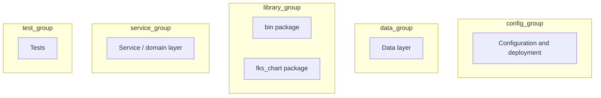

# Architecture report: JacksonTian/fks

> Automated static analysis. **Observed** = directly seen in files/imports/AST; **Inferred** = interpretation from that evidence. Repository code was not executed.

## 1. Repository at a glance

| Item | Value |
| --- | --- |
| Repository | JacksonTian/fks |
| Description | 前端技能汇总 Frontend Knowledge Structure |
| Language | JavaScript |
| Stars | 17900 |
| Licence | Not detected |
| Analysed commit / branch | 54722627d64b3b8918f4f4cf73752d3675dae99e / master |
| Framework(s) | None detected |
| Files analysed | 332 |
| Components | 6 |

## 2. Architecture in one minute

JacksonTian/fks - 前端技能汇总 Frontend Knowledge Structure. This repository was analysed statically from 332 file(s) (0 Python). Detected technologies (observed from imports/manifests): no known frameworks/libraries. Files are grouped into 6 component(s): bin package, Configuration and deployment, Data layer, fks_chart package, Service / domain layer, Tests. Findings below distinguish observed facts from inferred interpretation.

## 3. High-level block diagram

## 4. Main components

### bin package (`bin`)

- **Kind:** library
- **Status:** Observed
- **Confidence:** 0.85
- **Responsibility:** Groups 1 file(s) under bin package (observed from repository paths and static analysis).
- **Paths:** `bin/generate.js`
- **Evidence:** [bin/generate.js](https://github.com/JacksonTian/fks/blob/54722627d64b3b8918f4f4cf73752d3675dae99e/bin/generate.js)

### Configuration and deployment (`config`)

- **Kind:** config
- **Status:** Observed
- **Confidence:** 0.85
- **Responsibility:** Groups 18 file(s) under configuration and deployment (observed from repository paths and static analysis).
- **Paths:** `fks_chart/bower.json`, `fks_chart/bower_components/angular-marked/.bower.json`, `fks_chart/bower_components/angular-marked/bower.json`, `fks_chart/bower_components/angular-marked/package.json`, `fks_chart/bower_components/angular/.bower.json`, `fks_chart/bower_components/angular/bower.json`, `fks_chart/bower_components/angular/package.json`, `fks_chart/bower_components/d3/.bower.json`, `fks_chart/bower_components/d3/bower.json`, `fks_chart/bower_components/d3/composer.json`, `fks_chart/bower_components/jquery/.bower.json`, `fks_chart/bower_components/jquery/bower.json`, `fks_chart/bower_components/marked/.bower.json`, `fks_chart/bower_components/marked/.travis.yml`, `fks_chart/bower_components/marked/component.json`, `fks_chart/bower_components/marked/package.json`, `fks_chart/data/front-end.json`, `package.json`
- **Evidence:** [fks_chart/bower.json](https://github.com/JacksonTian/fks/blob/54722627d64b3b8918f4f4cf73752d3675dae99e/fks_chart/bower.json); [fks_chart/bower_components/angular-marked/.bower.json](https://github.com/JacksonTian/fks/blob/54722627d64b3b8918f4f4cf73752d3675dae99e/fks_chart/bower_components/angular-marked/.bower.json); [fks_chart/bower_components/angular-marked/bower.json](https://github.com/JacksonTian/fks/blob/54722627d64b3b8918f4f4cf73752d3675dae99e/fks_chart/bower_components/angular-marked/bower.json); [fks_chart/bower_components/angular-marked/package.json](https://github.com/JacksonTian/fks/blob/54722627d64b3b8918f4f4cf73752d3675dae99e/fks_chart/bower_components/angular-marked/package.json); [fks_chart/bower_components/angular/.bower.json](https://github.com/JacksonTian/fks/blob/54722627d64b3b8918f4f4cf73752d3675dae99e/fks_chart/bower_components/angular/.bower.json); [fks_chart/bower_components/angular/bower.json](https://github.com/JacksonTian/fks/blob/54722627d64b3b8918f4f4cf73752d3675dae99e/fks_chart/bower_components/angular/bower.json); [fks_chart/bower_components/angular/package.json](https://github.com/JacksonTian/fks/blob/54722627d64b3b8918f4f4cf73752d3675dae99e/fks_chart/bower_components/angular/package.json); [fks_chart/bower_components/d3/.bower.json](https://github.com/JacksonTian/fks/blob/54722627d64b3b8918f4f4cf73752d3675dae99e/fks_chart/bower_components/d3/.bower.json)

### Data layer (`data_layer`)

- **Kind:** data
- **Status:** Observed
- **Confidence:** 0.85
- **Responsibility:** Groups 4 file(s) under data layer (observed from repository paths and static analysis).
- **Paths:** `fks_chart/bower_components/jquery/src/data/Data.js`, `fks_chart/bower_components/jquery/src/data/accepts.js`, `fks_chart/bower_components/jquery/src/data/var/data_priv.js`, `fks_chart/bower_components/jquery/src/data/var/data_user.js`
- **Evidence:** [fks_chart/bower_components/jquery/src/data/Data.js](https://github.com/JacksonTian/fks/blob/54722627d64b3b8918f4f4cf73752d3675dae99e/fks_chart/bower_components/jquery/src/data/Data.js); [fks_chart/bower_components/jquery/src/data/accepts.js](https://github.com/JacksonTian/fks/blob/54722627d64b3b8918f4f4cf73752d3675dae99e/fks_chart/bower_components/jquery/src/data/accepts.js); [fks_chart/bower_components/jquery/src/data/var/data_priv.js](https://github.com/JacksonTian/fks/blob/54722627d64b3b8918f4f4cf73752d3675dae99e/fks_chart/bower_components/jquery/src/data/var/data_priv.js); [fks_chart/bower_components/jquery/src/data/var/data_user.js](https://github.com/JacksonTian/fks/blob/54722627d64b3b8918f4f4cf73752d3675dae99e/fks_chart/bower_components/jquery/src/data/var/data_user.js)

### fks_chart package (`fks_chart`)

- **Kind:** library
- **Status:** Observed
- **Confidence:** 0.85
- **Responsibility:** Groups 78 file(s) under fks_chart package (observed from repository paths and static analysis).
- **Paths:** `fks_chart/bower_components/angular-marked/angular-marked.js`, `fks_chart/bower_components/angular-marked/gruntfile.js`, `fks_chart/bower_components/angular-marked/karma.conf.js`, `fks_chart/bower_components/jquery/src/ajax.js`, `fks_chart/bower_components/jquery/src/ajax/jsonp.js`, `fks_chart/bower_components/jquery/src/ajax/load.js`, `fks_chart/bower_components/jquery/src/ajax/parseJSON.js`, `fks_chart/bower_components/jquery/src/ajax/parseXML.js`, `fks_chart/bower_components/jquery/src/ajax/script.js`, `fks_chart/bower_components/jquery/src/ajax/var/nonce.js`, `fks_chart/bower_components/jquery/src/ajax/var/rquery.js`, `fks_chart/bower_components/jquery/src/ajax/xhr.js`, `fks_chart/bower_components/jquery/src/attributes.js`, `fks_chart/bower_components/jquery/src/attributes/attr.js`, `fks_chart/bower_components/jquery/src/attributes/classes.js`, `fks_chart/bower_components/jquery/src/attributes/prop.js`, `fks_chart/bower_components/jquery/src/attributes/support.js`, `fks_chart/bower_components/jquery/src/attributes/val.js`, `fks_chart/bower_components/jquery/src/callbacks.js`, `fks_chart/bower_components/jquery/src/core.js`, `fks_chart/bower_components/jquery/src/css.js`, `fks_chart/bower_components/jquery/src/css/addGetHookIf.js`, `fks_chart/bower_components/jquery/src/css/curCSS.js`, `fks_chart/bower_components/jquery/src/css/defaultDisplay.js`, `fks_chart/bower_components/jquery/src/css/hiddenVisibleSelectors.js`, `fks_chart/bower_components/jquery/src/css/support.js`, `fks_chart/bower_components/jquery/src/css/swap.js`, `fks_chart/bower_components/jquery/src/css/var/cssExpand.js`, `fks_chart/bower_components/jquery/src/css/var/getStyles.js`, `fks_chart/bower_components/jquery/src/css/var/isHidden.js`, `fks_chart/bower_components/jquery/src/css/var/rmargin.js`, `fks_chart/bower_components/jquery/src/css/var/rnumnonpx.js`, `fks_chart/bower_components/jquery/src/data.js`, `fks_chart/bower_components/jquery/src/deferred.js`, `fks_chart/bower_components/jquery/src/deprecated.js`, `fks_chart/bower_components/jquery/src/dimensions.js`, `fks_chart/bower_components/jquery/src/effects.js`, `fks_chart/bower_components/jquery/src/effects/Tween.js`, `fks_chart/bower_components/jquery/src/effects/animatedSelector.js`, `fks_chart/bower_components/jquery/src/event.js`, `fks_chart/bower_components/jquery/src/event/ajax.js`, `fks_chart/bower_components/jquery/src/event/alias.js`, `fks_chart/bower_components/jquery/src/event/support.js`, `fks_chart/bower_components/jquery/src/exports/amd.js`, `fks_chart/bower_components/jquery/src/exports/global.js`, `fks_chart/bower_components/jquery/src/intro.js`, `fks_chart/bower_components/jquery/src/jquery.js`, `fks_chart/bower_components/jquery/src/manipulation.js`, `fks_chart/bower_components/jquery/src/manipulation/_evalUrl.js`, `fks_chart/bower_components/jquery/src/manipulation/support.js`, `fks_chart/bower_components/jquery/src/manipulation/var/rcheckableType.js`, `fks_chart/bower_components/jquery/src/offset.js`, `fks_chart/bower_components/jquery/src/outro.js`, `fks_chart/bower_components/jquery/src/queue.js`, `fks_chart/bower_components/jquery/src/queue/delay.js`, `fks_chart/bower_components/jquery/src/selector-native.js`, `fks_chart/bower_components/jquery/src/selector-sizzle.js`, `fks_chart/bower_components/jquery/src/selector.js`, `fks_chart/bower_components/jquery/src/serialize.js`, `fks_chart/bower_components/jquery/src/traversing.js`, `fks_chart/bower_components/jquery/src/traversing/findFilter.js`, `fks_chart/bower_components/jquery/src/traversing/var/rneedsContext.js`, `fks_chart/bower_components/jquery/src/var/arr.js`, `fks_chart/bower_components/jquery/src/var/class2type.js`, `fks_chart/bower_components/jquery/src/var/concat.js`, `fks_chart/bower_components/jquery/src/var/hasOwn.js`, `fks_chart/bower_components/jquery/src/var/indexOf.js`, `fks_chart/bower_components/jquery/src/var/pnum.js`, `fks_chart/bower_components/jquery/src/var/push.js`, `fks_chart/bower_components/jquery/src/var/rnotwhite.js`, `fks_chart/bower_components/jquery/src/var/slice.js`, `fks_chart/bower_components/jquery/src/var/strundefined.js`, `fks_chart/bower_components/jquery/src/var/support.js`, `fks_chart/bower_components/jquery/src/var/toString.js`, `fks_chart/bower_components/jquery/src/wrap.js`, `fks_chart/bower_components/marked/index.js`, `fks_chart/bower_components/marked/lib/marked.js`, `fks_chart/js/app.js`
- **Evidence:** [fks_chart/bower_components/angular-marked/angular-marked.js](https://github.com/JacksonTian/fks/blob/54722627d64b3b8918f4f4cf73752d3675dae99e/fks_chart/bower_components/angular-marked/angular-marked.js); [fks_chart/bower_components/angular-marked/gruntfile.js](https://github.com/JacksonTian/fks/blob/54722627d64b3b8918f4f4cf73752d3675dae99e/fks_chart/bower_components/angular-marked/gruntfile.js); [fks_chart/bower_components/angular-marked/karma.conf.js](https://github.com/JacksonTian/fks/blob/54722627d64b3b8918f4f4cf73752d3675dae99e/fks_chart/bower_components/angular-marked/karma.conf.js); [fks_chart/bower_components/jquery/src/ajax.js](https://github.com/JacksonTian/fks/blob/54722627d64b3b8918f4f4cf73752d3675dae99e/fks_chart/bower_components/jquery/src/ajax.js); [fks_chart/bower_components/jquery/src/ajax/jsonp.js](https://github.com/JacksonTian/fks/blob/54722627d64b3b8918f4f4cf73752d3675dae99e/fks_chart/bower_components/jquery/src/ajax/jsonp.js); [fks_chart/bower_components/jquery/src/ajax/load.js](https://github.com/JacksonTian/fks/blob/54722627d64b3b8918f4f4cf73752d3675dae99e/fks_chart/bower_components/jquery/src/ajax/load.js); [fks_chart/bower_components/jquery/src/ajax/parseJSON.js](https://github.com/JacksonTian/fks/blob/54722627d64b3b8918f4f4cf73752d3675dae99e/fks_chart/bower_components/jquery/src/ajax/parseJSON.js); [fks_chart/bower_components/jquery/src/ajax/parseXML.js](https://github.com/JacksonTian/fks/blob/54722627d64b3b8918f4f4cf73752d3675dae99e/fks_chart/bower_components/jquery/src/ajax/parseXML.js)

### Service / domain layer (`service_layer`)

- **Kind:** service
- **Status:** Observed
- **Confidence:** 0.85
- **Responsibility:** Groups 5 file(s) under service / domain layer (observed from repository paths and static analysis).
- **Paths:** `fks_chart/bower_components/jquery/src/core/access.js`, `fks_chart/bower_components/jquery/src/core/init.js`, `fks_chart/bower_components/jquery/src/core/parseHTML.js`, `fks_chart/bower_components/jquery/src/core/ready.js`, `fks_chart/bower_components/jquery/src/core/var/rsingleTag.js`
- **Evidence:** [fks_chart/bower_components/jquery/src/core/access.js](https://github.com/JacksonTian/fks/blob/54722627d64b3b8918f4f4cf73752d3675dae99e/fks_chart/bower_components/jquery/src/core/access.js); [fks_chart/bower_components/jquery/src/core/init.js](https://github.com/JacksonTian/fks/blob/54722627d64b3b8918f4f4cf73752d3675dae99e/fks_chart/bower_components/jquery/src/core/init.js); [fks_chart/bower_components/jquery/src/core/parseHTML.js](https://github.com/JacksonTian/fks/blob/54722627d64b3b8918f4f4cf73752d3675dae99e/fks_chart/bower_components/jquery/src/core/parseHTML.js); [fks_chart/bower_components/jquery/src/core/ready.js](https://github.com/JacksonTian/fks/blob/54722627d64b3b8918f4f4cf73752d3675dae99e/fks_chart/bower_components/jquery/src/core/ready.js); [fks_chart/bower_components/jquery/src/core/var/rsingleTag.js](https://github.com/JacksonTian/fks/blob/54722627d64b3b8918f4f4cf73752d3675dae99e/fks_chart/bower_components/jquery/src/core/var/rsingleTag.js)

### Tests (`tests`)

- **Kind:** test
- **Status:** Observed
- **Confidence:** 0.85
- **Responsibility:** Groups 201 file(s) under tests (observed from repository paths and static analysis).
- **Paths:** `fks_chart/bower_components/marked/test/README`, `fks_chart/bower_components/marked/test/browser/index.html`, `fks_chart/bower_components/marked/test/browser/index.js`, `fks_chart/bower_components/marked/test/browser/test.js`, `fks_chart/bower_components/marked/test/index.js`, `fks_chart/bower_components/marked/test/new/autolink_lines.html`, `fks_chart/bower_components/marked/test/new/autolink_lines.text`, `fks_chart/bower_components/marked/test/new/blockquote_list_item.html`, `fks_chart/bower_components/marked/test/new/blockquote_list_item.text`, `fks_chart/bower_components/marked/test/new/case_insensitive_refs.html`, `fks_chart/bower_components/marked/test/new/case_insensitive_refs.text`, `fks_chart/bower_components/marked/test/new/def_blocks.html`, `fks_chart/bower_components/marked/test/new/def_blocks.text`, `fks_chart/bower_components/marked/test/new/double_link.html`, `fks_chart/bower_components/marked/test/new/double_link.text`, `fks_chart/bower_components/marked/test/new/escaped_angles.html`, `fks_chart/bower_components/marked/test/new/escaped_angles.text`, `fks_chart/bower_components/marked/test/new/gfm_break.breaks.html`, `fks_chart/bower_components/marked/test/new/gfm_break.breaks.text`, `fks_chart/bower_components/marked/test/new/gfm_code.html`, `fks_chart/bower_components/marked/test/new/gfm_code.text`, `fks_chart/bower_components/marked/test/new/gfm_code_hr_list.html`, `fks_chart/bower_components/marked/test/new/gfm_code_hr_list.text`, `fks_chart/bower_components/marked/test/new/gfm_del.html`, `fks_chart/bower_components/marked/test/new/gfm_del.text`, `fks_chart/bower_components/marked/test/new/gfm_em.html`, `fks_chart/bower_components/marked/test/new/gfm_em.text`, `fks_chart/bower_components/marked/test/new/gfm_links.html`, `fks_chart/bower_components/marked/test/new/gfm_links.text`, `fks_chart/bower_components/marked/test/new/gfm_tables.html`, `fks_chart/bower_components/marked/test/new/gfm_tables.text`, `fks_chart/bower_components/marked/test/new/hr_list_break.html`, `fks_chart/bower_components/marked/test/new/hr_list_break.text`, `fks_chart/bower_components/marked/test/new/lazy_blockquotes.html`, `fks_chart/bower_components/marked/test/new/lazy_blockquotes.text`, `fks_chart/bower_components/marked/test/new/list_item_text.html`, `fks_chart/bower_components/marked/test/new/list_item_text.text`, `fks_chart/bower_components/marked/test/new/loose_lists.html`, `fks_chart/bower_components/marked/test/new/loose_lists.text`, `fks_chart/bower_components/marked/test/new/main.html`, `fks_chart/bower_components/marked/test/new/main.text`, `fks_chart/bower_components/marked/test/new/nested_code.html`, `fks_chart/bower_components/marked/test/new/nested_code.text`, `fks_chart/bower_components/marked/test/new/nested_em.html`, `fks_chart/bower_components/marked/test/new/nested_em.text`, `fks_chart/bower_components/marked/test/new/nested_square_link.html`, `fks_chart/bower_components/marked/test/new/nested_square_link.text`, `fks_chart/bower_components/marked/test/new/not_a_link.html`, `fks_chart/bower_components/marked/test/new/not_a_link.text`, `fks_chart/bower_components/marked/test/new/ref_paren.html`, `fks_chart/bower_components/marked/test/new/ref_paren.text`, `fks_chart/bower_components/marked/test/new/same_bullet.html`, `fks_chart/bower_components/marked/test/new/same_bullet.text`, `fks_chart/bower_components/marked/test/new/text.smartypants.html`, `fks_chart/bower_components/marked/test/new/text.smartypants.text`, `fks_chart/bower_components/marked/test/new/toplevel_paragraphs.gfm.html`, `fks_chart/bower_components/marked/test/new/toplevel_paragraphs.gfm.text`, `fks_chart/bower_components/marked/test/new/tricky_list.html`, `fks_chart/bower_components/marked/test/new/tricky_list.text`, `fks_chart/bower_components/marked/test/original/amps_and_angles_encoding.html`, `fks_chart/bower_components/marked/test/original/amps_and_angles_encoding.text`, `fks_chart/bower_components/marked/test/original/auto_links.html`, `fks_chart/bower_components/marked/test/original/auto_links.text`, `fks_chart/bower_components/marked/test/original/backslash_escapes.html`, `fks_chart/bower_components/marked/test/original/backslash_escapes.text`, `fks_chart/bower_components/marked/test/original/blockquotes_with_code_blocks.html`, `fks_chart/bower_components/marked/test/original/blockquotes_with_code_blocks.text`, `fks_chart/bower_components/marked/test/original/code_blocks.html`, `fks_chart/bower_components/marked/test/original/code_blocks.text`, `fks_chart/bower_components/marked/test/original/code_spans.html`, `fks_chart/bower_components/marked/test/original/code_spans.text`, `fks_chart/bower_components/marked/test/original/hard_wrapped_paragraphs_with_list_like_lines.html`, `fks_chart/bower_components/marked/test/original/hard_wrapped_paragraphs_with_list_like_lines.text`, `fks_chart/bower_components/marked/test/original/horizontal_rules.html`, `fks_chart/bower_components/marked/test/original/horizontal_rules.text`, `fks_chart/bower_components/marked/test/original/inline_html_advanced.html`, `fks_chart/bower_components/marked/test/original/inline_html_advanced.text`, `fks_chart/bower_components/marked/test/original/inline_html_comments.html`, `fks_chart/bower_components/marked/test/original/inline_html_comments.text`, `fks_chart/bower_components/marked/test/original/inline_html_simple.html`, `fks_chart/bower_components/marked/test/original/inline_html_simple.text`, `fks_chart/bower_components/marked/test/original/links_inline_style.html`, `fks_chart/bower_components/marked/test/original/links_inline_style.text`, `fks_chart/bower_components/marked/test/original/links_reference_style.html`, `fks_chart/bower_components/marked/test/original/links_reference_style.text`, `fks_chart/bower_components/marked/test/original/links_shortcut_references.html`, `fks_chart/bower_components/marked/test/original/links_shortcut_references.text`, `fks_chart/bower_components/marked/test/original/literal_quotes_in_titles.html`, `fks_chart/bower_components/marked/test/original/literal_quotes_in_titles.text`, `fks_chart/bower_components/marked/test/original/markdown_documentation_basics.html`, `fks_chart/bower_components/marked/test/original/markdown_documentation_basics.text`, `fks_chart/bower_components/marked/test/original/markdown_documentation_syntax.html`, `fks_chart/bower_components/marked/test/original/markdown_documentation_syntax.text`, `fks_chart/bower_components/marked/test/original/nested_blockquotes.html`, `fks_chart/bower_components/marked/test/original/nested_blockquotes.text`, `fks_chart/bower_components/marked/test/original/ordered_and_unordered_lists.html`, `fks_chart/bower_components/marked/test/original/ordered_and_unordered_lists.text`, `fks_chart/bower_components/marked/test/original/strong_and_em_together.html`, `fks_chart/bower_components/marked/test/original/strong_and_em_together.text`, `fks_chart/bower_components/marked/test/original/tabs.html`, `fks_chart/bower_components/marked/test/original/tabs.text`, `fks_chart/bower_components/marked/test/original/tidyness.html`, `fks_chart/bower_components/marked/test/original/tidyness.text`, `fks_chart/bower_components/marked/test/tests/amps_and_angles_encoding.html`, `fks_chart/bower_components/marked/test/tests/amps_and_angles_encoding.text`, `fks_chart/bower_components/marked/test/tests/auto_links.html`, `fks_chart/bower_components/marked/test/tests/auto_links.text`, `fks_chart/bower_components/marked/test/tests/autolink_lines.html`, `fks_chart/bower_components/marked/test/tests/autolink_lines.text`, `fks_chart/bower_components/marked/test/tests/backslash_escapes.html`, `fks_chart/bower_components/marked/test/tests/backslash_escapes.text`, `fks_chart/bower_components/marked/test/tests/blockquote_list_item.html`, `fks_chart/bower_components/marked/test/tests/blockquote_list_item.text`, `fks_chart/bower_components/marked/test/tests/blockquotes_with_code_blocks.html`, `fks_chart/bower_components/marked/test/tests/blockquotes_with_code_blocks.text`, `fks_chart/bower_components/marked/test/tests/case_insensitive_refs.html`, `fks_chart/bower_components/marked/test/tests/case_insensitive_refs.text`, `fks_chart/bower_components/marked/test/tests/code_blocks.html`, `fks_chart/bower_components/marked/test/tests/code_blocks.text`, `fks_chart/bower_components/marked/test/tests/code_spans.html`, `fks_chart/bower_components/marked/test/tests/code_spans.text`, `fks_chart/bower_components/marked/test/tests/def_blocks.html`, `fks_chart/bower_components/marked/test/tests/def_blocks.text`, `fks_chart/bower_components/marked/test/tests/double_link.html`, `fks_chart/bower_components/marked/test/tests/double_link.text`, `fks_chart/bower_components/marked/test/tests/escaped_angles.html`, `fks_chart/bower_components/marked/test/tests/escaped_angles.text`, `fks_chart/bower_components/marked/test/tests/gfm_break.breaks.html`, `fks_chart/bower_components/marked/test/tests/gfm_break.breaks.text`, `fks_chart/bower_components/marked/test/tests/gfm_code.html`, `fks_chart/bower_components/marked/test/tests/gfm_code.text`, `fks_chart/bower_components/marked/test/tests/gfm_code_hr_list.html`, `fks_chart/bower_components/marked/test/tests/gfm_code_hr_list.text`, `fks_chart/bower_components/marked/test/tests/gfm_del.html`, `fks_chart/bower_components/marked/test/tests/gfm_del.text`, `fks_chart/bower_components/marked/test/tests/gfm_em.html`, `fks_chart/bower_components/marked/test/tests/gfm_em.text`, `fks_chart/bower_components/marked/test/tests/gfm_links.html`, `fks_chart/bower_components/marked/test/tests/gfm_links.text`, `fks_chart/bower_components/marked/test/tests/gfm_tables.html`, `fks_chart/bower_components/marked/test/tests/gfm_tables.text`, `fks_chart/bower_components/marked/test/tests/hard_wrapped_paragraphs_with_list_like_lines.nogfm.html`, `fks_chart/bower_components/marked/test/tests/hard_wrapped_paragraphs_with_list_like_lines.nogfm.text`, `fks_chart/bower_components/marked/test/tests/horizontal_rules.html`, `fks_chart/bower_components/marked/test/tests/horizontal_rules.text`, `fks_chart/bower_components/marked/test/tests/hr_list_break.html`, `fks_chart/bower_components/marked/test/tests/hr_list_break.text`, `fks_chart/bower_components/marked/test/tests/inline_html_advanced.html`, `fks_chart/bower_components/marked/test/tests/inline_html_advanced.text`, `fks_chart/bower_components/marked/test/tests/inline_html_comments.html`, `fks_chart/bower_components/marked/test/tests/inline_html_comments.text`, `fks_chart/bower_components/marked/test/tests/inline_html_simple.html`, `fks_chart/bower_components/marked/test/tests/inline_html_simple.text`, `fks_chart/bower_components/marked/test/tests/lazy_blockquotes.html`, `fks_chart/bower_components/marked/test/tests/lazy_blockquotes.text`, `fks_chart/bower_components/marked/test/tests/links_inline_style.html`, `fks_chart/bower_components/marked/test/tests/links_inline_style.text`, `fks_chart/bower_components/marked/test/tests/links_reference_style.html`, `fks_chart/bower_components/marked/test/tests/links_reference_style.text`, `fks_chart/bower_components/marked/test/tests/links_shortcut_references.html`, `fks_chart/bower_components/marked/test/tests/links_shortcut_references.text`, `fks_chart/bower_components/marked/test/tests/list_item_text.html`, `fks_chart/bower_components/marked/test/tests/list_item_text.text`, `fks_chart/bower_components/marked/test/tests/literal_quotes_in_titles.html`, `fks_chart/bower_components/marked/test/tests/literal_quotes_in_titles.text`, `fks_chart/bower_components/marked/test/tests/loose_lists.html`, `fks_chart/bower_components/marked/test/tests/loose_lists.text`, `fks_chart/bower_components/marked/test/tests/main.html`, `fks_chart/bower_components/marked/test/tests/main.text`, `fks_chart/bower_components/marked/test/tests/markdown_documentation_basics.html`, `fks_chart/bower_components/marked/test/tests/markdown_documentation_basics.text`, `fks_chart/bower_components/marked/test/tests/markdown_documentation_syntax.html`, `fks_chart/bower_components/marked/test/tests/markdown_documentation_syntax.text`, `fks_chart/bower_components/marked/test/tests/nested_blockquotes.html`, `fks_chart/bower_components/marked/test/tests/nested_blockquotes.text`, `fks_chart/bower_components/marked/test/tests/nested_code.html`, `fks_chart/bower_components/marked/test/tests/nested_code.text`, `fks_chart/bower_components/marked/test/tests/nested_em.html`, `fks_chart/bower_components/marked/test/tests/nested_em.text`, `fks_chart/bower_components/marked/test/tests/nested_square_link.html`, `fks_chart/bower_components/marked/test/tests/nested_square_link.text`, `fks_chart/bower_components/marked/test/tests/not_a_link.html`, `fks_chart/bower_components/marked/test/tests/not_a_link.text`, `fks_chart/bower_components/marked/test/tests/ordered_and_unordered_lists.html`, `fks_chart/bower_components/marked/test/tests/ordered_and_unordered_lists.text`, `fks_chart/bower_components/marked/test/tests/ref_paren.html`, `fks_chart/bower_components/marked/test/tests/ref_paren.text`, `fks_chart/bower_components/marked/test/tests/same_bullet.html`, `fks_chart/bower_components/marked/test/tests/same_bullet.text`, `fks_chart/bower_components/marked/test/tests/strong_and_em_together.html`, `fks_chart/bower_components/marked/test/tests/strong_and_em_together.text`, `fks_chart/bower_components/marked/test/tests/tabs.html`, `fks_chart/bower_components/marked/test/tests/tabs.text`, `fks_chart/bower_components/marked/test/tests/text.smartypants.html`, `fks_chart/bower_components/marked/test/tests/text.smartypants.text`, `fks_chart/bower_components/marked/test/tests/tidyness.html`, `fks_chart/bower_components/marked/test/tests/tidyness.text`, `fks_chart/bower_components/marked/test/tests/toplevel_paragraphs.gfm.html`, `fks_chart/bower_components/marked/test/tests/toplevel_paragraphs.gfm.text`, `fks_chart/bower_components/marked/test/tests/tricky_list.html`, `fks_chart/bower_components/marked/test/tests/tricky_list.text`
- **Evidence:** [fks_chart/bower_components/marked/test/README](https://github.com/JacksonTian/fks/blob/54722627d64b3b8918f4f4cf73752d3675dae99e/fks_chart/bower_components/marked/test/README); [fks_chart/bower_components/marked/test/browser/index.html](https://github.com/JacksonTian/fks/blob/54722627d64b3b8918f4f4cf73752d3675dae99e/fks_chart/bower_components/marked/test/browser/index.html); [fks_chart/bower_components/marked/test/browser/index.js](https://github.com/JacksonTian/fks/blob/54722627d64b3b8918f4f4cf73752d3675dae99e/fks_chart/bower_components/marked/test/browser/index.js); [fks_chart/bower_components/marked/test/browser/test.js](https://github.com/JacksonTian/fks/blob/54722627d64b3b8918f4f4cf73752d3675dae99e/fks_chart/bower_components/marked/test/browser/test.js); [fks_chart/bower_components/marked/test/index.js](https://github.com/JacksonTian/fks/blob/54722627d64b3b8918f4f4cf73752d3675dae99e/fks_chart/bower_components/marked/test/index.js); [fks_chart/bower_components/marked/test/new/autolink_lines.html](https://github.com/JacksonTian/fks/blob/54722627d64b3b8918f4f4cf73752d3675dae99e/fks_chart/bower_components/marked/test/new/autolink_lines.html); [fks_chart/bower_components/marked/test/new/autolink_lines.text](https://github.com/JacksonTian/fks/blob/54722627d64b3b8918f4f4cf73752d3675dae99e/fks_chart/bower_components/marked/test/new/autolink_lines.text); [fks_chart/bower_components/marked/test/new/blockquote_list_item.html](https://github.com/JacksonTian/fks/blob/54722627d64b3b8918f4f4cf73752d3675dae99e/fks_chart/bower_components/marked/test/new/blockquote_list_item.html)

## 5. Execution flow

**Observed** entry point(s):

- [fks_chart/bower_components/angular-marked/angular-marked.js](https://github.com/JacksonTian/fks/blob/54722627d64b3b8918f4f4cf73752d3675dae99e/fks_chart/bower_components/angular-marked/angular-marked.js)
- [fks_chart/bower_components/marked/bin/marked](https://github.com/JacksonTian/fks/blob/54722627d64b3b8918f4f4cf73752d3675dae99e/fks_chart/bower_components/marked/bin/marked)
- [fks_chart/bower_components/marked/index.js](https://github.com/JacksonTian/fks/blob/54722627d64b3b8918f4f4cf73752d3675dae99e/fks_chart/bower_components/marked/index.js)
- [fks_chart/bower_components/marked/lib/marked.js](https://github.com/JacksonTian/fks/blob/54722627d64b3b8918f4f4cf73752d3675dae99e/fks_chart/bower_components/marked/lib/marked.js)
- [fks_chart/js/app.js](https://github.com/JacksonTian/fks/blob/54722627d64b3b8918f4f4cf73752d3675dae99e/fks_chart/js/app.js)

Representative flow (derived from observed entry points and the import graph; steps beyond the entry point are **Inferred**):

1. Execution starts at an observed entry point listed above, if present.
2. No internal import relationships between components were observed.

## 6. Project structure

### `(root)`

- `.gitignore` - other (17 bytes)
- `Makefile` - other (29 bytes)
- `README.en.md` - docs (20421 bytes)
- `README.md` - docs (20399 bytes)
- `package.json` - manifest (330 bytes)

### `bin`

- `bin/generate.js` - source, JavaScript (1932 bytes)

### `fks_chart`

- `fks_chart/bower.json` - config (349 bytes)
- `fks_chart/bower_components/angular-marked/.bower.json` - config (869 bytes)
- `fks_chart/bower_components/angular-marked/README.md` - docs (2307 bytes)
- `fks_chart/bower_components/angular-marked/angular-marked.js` - source, JavaScript (1280 bytes)
- `fks_chart/bower_components/angular-marked/bower.json` - config (532 bytes)
- `fks_chart/bower_components/angular-marked/example/index.html` - other (2587 bytes)
- `fks_chart/bower_components/angular-marked/gruntfile.js` - source, JavaScript (1390 bytes)
- `fks_chart/bower_components/angular-marked/karma.conf.js` - source, JavaScript (1404 bytes)
- `fks_chart/bower_components/angular-marked/package.json` - manifest (948 bytes)
- `fks_chart/bower_components/angular-marked/todo.md` - docs (180 bytes)
- `fks_chart/bower_components/angular/.bower.json` - config (433 bytes)
- `fks_chart/bower_components/angular/README.md` - docs (2144 bytes)
- `fks_chart/bower_components/angular/angular-csp.css` - other (535 bytes)
- `fks_chart/bower_components/angular/bower.json` - config (114 bytes)
- `fks_chart/bower_components/angular/package.json` - manifest (575 bytes)
- `fks_chart/bower_components/d3/.bower.json` - config (630 bytes)
- `fks_chart/bower_components/d3/.spmignore` - other (17 bytes)
- `fks_chart/bower_components/d3/CONTRIBUTING.md` - docs (2503 bytes)
- `fks_chart/bower_components/d3/LICENSE` - docs (1429 bytes)
- `fks_chart/bower_components/d3/README.md` - docs (702 bytes)
- `fks_chart/bower_components/d3/bower.json` - config (334 bytes)
- `fks_chart/bower_components/d3/composer.json` - config (567 bytes)
- `fks_chart/bower_components/jquery/.bower.json` - config (736 bytes)
- `fks_chart/bower_components/jquery/MIT-LICENSE.txt` - docs (1099 bytes)
- `fks_chart/bower_components/jquery/bower.json` - config (435 bytes)
- `fks_chart/bower_components/jquery/src/ajax.js` - source, JavaScript (21168 bytes)
- `fks_chart/bower_components/jquery/src/ajax/jsonp.js` - source, JavaScript (2516 bytes)
- `fks_chart/bower_components/jquery/src/ajax/load.js` - source, JavaScript (1669 bytes)
- `fks_chart/bower_components/jquery/src/ajax/parseJSON.js` - source, JavaScript (222 bytes)
- `fks_chart/bower_components/jquery/src/ajax/parseXML.js` - source, JavaScript (485 bytes)
- `fks_chart/bower_components/jquery/src/ajax/script.js` - source, JavaScript (1271 bytes)
- `fks_chart/bower_components/jquery/src/ajax/var/nonce.js` - source, JavaScript (73 bytes)
- `fks_chart/bower_components/jquery/src/ajax/var/rquery.js` - source, JavaScript (40 bytes)
- `fks_chart/bower_components/jquery/src/ajax/xhr.js` - source, JavaScript (3488 bytes)
- `fks_chart/bower_components/jquery/src/attributes.js` - source, JavaScript (200 bytes)
- `fks_chart/bower_components/jquery/src/attributes/attr.js` - source, JavaScript (3320 bytes)
- `fks_chart/bower_components/jquery/src/attributes/classes.js` - source, JavaScript (4155 bytes)
- `fks_chart/bower_components/jquery/src/attributes/prop.js` - source, JavaScript (1854 bytes)
- `fks_chart/bower_components/jquery/src/attributes/support.js` - source, JavaScript (893 bytes)
- `fks_chart/bower_components/jquery/src/attributes/val.js` - source, JavaScript (3839 bytes)
- `fks_chart/bower_components/jquery/src/callbacks.js` - source, JavaScript (5506 bytes)
- `fks_chart/bower_components/jquery/src/core.js` - source, JavaScript (11580 bytes)
- `fks_chart/bower_components/jquery/src/core/access.js` - source, JavaScript (1210 bytes)
- `fks_chart/bower_components/jquery/src/core/init.js` - source, JavaScript (3401 bytes)
- `fks_chart/bower_components/jquery/src/core/parseHTML.js` - source, JavaScript (938 bytes)
- `fks_chart/bower_components/jquery/src/core/ready.js` - source, JavaScript (2381 bytes)
- `fks_chart/bower_components/jquery/src/core/var/rsingleTag.js` - source, JavaScript (91 bytes)
- `fks_chart/bower_components/jquery/src/css.js` - source, JavaScript (12346 bytes)
- `fks_chart/bower_components/jquery/src/css/addGetHookIf.js` - source, JavaScript (509 bytes)
- `fks_chart/bower_components/jquery/src/css/curCSS.js` - source, JavaScript (1452 bytes)
- `fks_chart/bower_components/jquery/src/css/defaultDisplay.js` - source, JavaScript (1867 bytes)
- `fks_chart/bower_components/jquery/src/css/hiddenVisibleSelectors.js` - source, JavaScript (380 bytes)
- `fks_chart/bower_components/jquery/src/css/support.js` - source, JavaScript (3198 bytes)
- `fks_chart/bower_components/jquery/src/css/swap.js` - source, JavaScript (555 bytes)
- `fks_chart/bower_components/jquery/src/css/var/cssExpand.js` - source, JavaScript (70 bytes)
- `fks_chart/bower_components/jquery/src/css/var/getStyles.js` - source, JavaScript (410 bytes)
- `fks_chart/bower_components/jquery/src/css/var/isHidden.js` - source, JavaScript (355 bytes)
- `fks_chart/bower_components/jquery/src/css/var/rmargin.js` - source, JavaScript (45 bytes)
- `fks_chart/bower_components/jquery/src/css/var/rnumnonpx.js` - source, JavaScript (113 bytes)
- `fks_chart/bower_components/jquery/src/data.js` - source, JavaScript (4942 bytes)
- `fks_chart/bower_components/jquery/src/data/Data.js` - source, JavaScript (4882 bytes)
- `fks_chart/bower_components/jquery/src/data/accepts.js` - source, JavaScript (383 bytes)
- `fks_chart/bower_components/jquery/src/data/var/data_priv.js` - source, JavaScript (66 bytes)
- `fks_chart/bower_components/jquery/src/data/var/data_user.js` - source, JavaScript (66 bytes)
- `fks_chart/bower_components/jquery/src/deferred.js` - source, JavaScript (4414 bytes)
- `fks_chart/bower_components/jquery/src/deprecated.js` - source, JavaScript (223 bytes)
- `fks_chart/bower_components/jquery/src/dimensions.js` - source, JavaScript (1776 bytes)
- `fks_chart/bower_components/jquery/src/effects.js` - source, JavaScript (16914 bytes)
- `fks_chart/bower_components/jquery/src/effects/Tween.js` - source, JavaScript (3028 bytes)
- `fks_chart/bower_components/jquery/src/effects/animatedSelector.js` - source, JavaScript (225 bytes)
- `fks_chart/bower_components/jquery/src/event.js` - source, JavaScript (24475 bytes)
- `fks_chart/bower_components/jquery/src/event/ajax.js` - source, JavaScript (322 bytes)
- `fks_chart/bower_components/jquery/src/event/alias.js` - source, JavaScript (1094 bytes)
- `fks_chart/bower_components/jquery/src/event/support.js` - source, JavaScript (123 bytes)
- `fks_chart/bower_components/jquery/src/exports/amd.js` - source, JavaScript (1006 bytes)
- `fks_chart/bower_components/jquery/src/exports/global.js` - source, JavaScript (641 bytes)
- `fks_chart/bower_components/jquery/src/intro.js` - source, JavaScript (1393 bytes)
- `fks_chart/bower_components/jquery/src/jquery.js` - source, JavaScript (574 bytes)
- `fks_chart/bower_components/jquery/src/manipulation.js` - source, JavaScript (15039 bytes)
- `fks_chart/bower_components/jquery/src/manipulation/_evalUrl.js` - source, JavaScript (240 bytes)
- `fks_chart/bower_components/jquery/src/manipulation/support.js` - source, JavaScript (975 bytes)
- `fks_chart/bower_components/jquery/src/manipulation/var/rcheckableType.js` - source, JavaScript (59 bytes)
- `fks_chart/bower_components/jquery/src/offset.js` - source, JavaScript (5588 bytes)
- `fks_chart/bower_components/jquery/src/outro.js` - source, JavaScript (5 bytes)
- `fks_chart/bower_components/jquery/src/queue.js` - source, JavaScript (3063 bytes)
- `fks_chart/bower_components/jquery/src/queue/delay.js` - source, JavaScript (561 bytes)
- `fks_chart/bower_components/jquery/src/selector-native.js` - source, JavaScript (4434 bytes)
- `fks_chart/bower_components/jquery/src/selector-sizzle.js` - source, JavaScript (294 bytes)
- `fks_chart/bower_components/jquery/src/selector.js` - source, JavaScript (33 bytes)
- `fks_chart/bower_components/jquery/src/serialize.js` - source, JavaScript (3214 bytes)
- `fks_chart/bower_components/jquery/src/traversing.js` - source, JavaScript (4535 bytes)
- `fks_chart/bower_components/jquery/src/traversing/findFilter.js` - source, JavaScript (2464 bytes)
- `fks_chart/bower_components/jquery/src/traversing/var/rneedsContext.js` - source, JavaScript (110 bytes)
- `fks_chart/bower_components/jquery/src/var/arr.js` - source, JavaScript (36 bytes)
- `fks_chart/bower_components/jquery/src/var/class2type.js` - source, JavaScript (64 bytes)
- `fks_chart/bower_components/jquery/src/var/concat.js` - source, JavaScript (63 bytes)
- `fks_chart/bower_components/jquery/src/var/hasOwn.js` - source, JavaScript (92 bytes)
- `fks_chart/bower_components/jquery/src/var/indexOf.js` - source, JavaScript (64 bytes)
- `fks_chart/bower_components/jquery/src/var/pnum.js` - source, JavaScript (80 bytes)
- `fks_chart/bower_components/jquery/src/var/push.js` - source, JavaScript (61 bytes)
- `fks_chart/bower_components/jquery/src/var/rnotwhite.js` - source, JavaScript (42 bytes)
- `fks_chart/bower_components/jquery/src/var/slice.js` - source, JavaScript (62 bytes)
- `fks_chart/bower_components/jquery/src/var/strundefined.js` - source, JavaScript (50 bytes)
- `fks_chart/bower_components/jquery/src/var/support.js` - source, JavaScript (99 bytes)
- `fks_chart/bower_components/jquery/src/var/toString.js` - source, JavaScript (86 bytes)
- `fks_chart/bower_components/jquery/src/wrap.js` - source, JavaScript (1496 bytes)
- `fks_chart/bower_components/marked/.bower.json` - config (343 bytes)
- `fks_chart/bower_components/marked/.gitignore` - other (14 bytes)
- `fks_chart/bower_components/marked/.npmignore` - other (12 bytes)
- `fks_chart/bower_components/marked/.travis.yml` - ci, YAML (58 bytes)
- `fks_chart/bower_components/marked/LICENSE` - docs (1096 bytes)
- `fks_chart/bower_components/marked/Makefile` - other (161 bytes)
- `fks_chart/bower_components/marked/README.md` - docs (9415 bytes)
- `fks_chart/bower_components/marked/bin/marked` - other (3528 bytes)
- `fks_chart/bower_components/marked/component.json` - config (249 bytes)
- `fks_chart/bower_components/marked/doc/broken.md` - docs (4981 bytes)
- `fks_chart/bower_components/marked/doc/todo.md` - docs (8 bytes)
- `fks_chart/bower_components/marked/index.js` - source, JavaScript (42 bytes)
- `fks_chart/bower_components/marked/lib/marked.js` - source, JavaScript (27968 bytes)
- `fks_chart/bower_components/marked/man/marked.1` - other (2029 bytes)
- `fks_chart/bower_components/marked/package.json` - manifest (668 bytes)
- `fks_chart/bower_components/marked/test/README` - test (214 bytes)
- `fks_chart/bower_components/marked/test/browser/index.html` - test (128 bytes)
- `fks_chart/bower_components/marked/test/browser/index.js` - test, JavaScript (889 bytes)
- `fks_chart/bower_components/marked/test/browser/test.js` - test, JavaScript (1184 bytes)
- `fks_chart/bower_components/marked/test/index.js` - test, JavaScript (11821 bytes)
- `fks_chart/bower_components/marked/test/new/autolink_lines.html` - test (72 bytes)
- `fks_chart/bower_components/marked/test/new/autolink_lines.text` - test (33 bytes)
- `fks_chart/bower_components/marked/test/new/blockquote_list_item.html` - test (108 bytes)
- `fks_chart/bower_components/marked/test/new/blockquote_list_item.text` - test (58 bytes)
- `fks_chart/bower_components/marked/test/new/case_insensitive_refs.html` - test (29 bytes)
- `fks_chart/bower_components/marked/test/new/case_insensitive_refs.text` - test (17 bytes)
- `fks_chart/bower_components/marked/test/new/def_blocks.html` - test (228 bytes)
- `fks_chart/bower_components/marked/test/new/def_blocks.text` - test (121 bytes)
- `fks_chart/bower_components/marked/test/new/double_link.html` - test (253 bytes)
- `fks_chart/bower_components/marked/test/new/double_link.text` - test (215 bytes)
- `fks_chart/bower_components/marked/test/new/escaped_angles.html` - test (9 bytes)
- `fks_chart/bower_components/marked/test/new/escaped_angles.text` - test (3 bytes)
- `fks_chart/bower_components/marked/test/new/gfm_break.breaks.html` - test (45 bytes)
- `fks_chart/bower_components/marked/test/new/gfm_break.breaks.text` - test (32 bytes)
- `fks_chart/bower_components/marked/test/new/gfm_code.html` - test (341 bytes)
- `fks_chart/bower_components/marked/test/new/gfm_code.text` - test (223 bytes)
- `fks_chart/bower_components/marked/test/new/gfm_code_hr_list.html` - test (707 bytes)
- `fks_chart/bower_components/marked/test/new/gfm_code_hr_list.text` - test (554 bytes)
- `fks_chart/bower_components/marked/test/new/gfm_del.html` - test (33 bytes)
- `fks_chart/bower_components/marked/test/new/gfm_del.text` - test (19 bytes)
- `fks_chart/bower_components/marked/test/new/gfm_em.html` - test (45 bytes)
- `fks_chart/bower_components/marked/test/new/gfm_em.text` - test (38 bytes)
- `fks_chart/bower_components/marked/test/new/gfm_links.html` - test (107 bytes)
- `fks_chart/bower_components/marked/test/new/gfm_links.text` - test (55 bytes)
- `fks_chart/bower_components/marked/test/new/gfm_tables.html` - test (1423 bytes)
- `fks_chart/bower_components/marked/test/new/gfm_tables.text` - test (508 bytes)
- `fks_chart/bower_components/marked/test/new/hr_list_break.html` - test (74 bytes)
- `fks_chart/bower_components/marked/test/new/hr_list_break.text` - test (41 bytes)
- `fks_chart/bower_components/marked/test/new/lazy_blockquotes.html` - test (49 bytes)
- `fks_chart/bower_components/marked/test/new/lazy_blockquotes.text` - test (15 bytes)
- `fks_chart/bower_components/marked/test/new/list_item_text.html` - test (70 bytes)
- `fks_chart/bower_components/marked/test/new/list_item_text.text` - test (31 bytes)
- `fks_chart/bower_components/marked/test/new/loose_lists.html` - test (586 bytes)
- `fks_chart/bower_components/marked/test/new/loose_lists.text` - test (261 bytes)
- `fks_chart/bower_components/marked/test/new/main.html` - test (1312 bytes)
- `fks_chart/bower_components/marked/test/new/main.text` - test (1037 bytes)
- `fks_chart/bower_components/marked/test/new/nested_code.html` - test (38 bytes)
- `fks_chart/bower_components/marked/test/new/nested_code.text` - test (30 bytes)
- `fks_chart/bower_components/marked/test/new/nested_em.html` - test (97 bytes)
- `fks_chart/bower_components/marked/test/new/nested_em.text` - test (43 bytes)
- `fks_chart/bower_components/marked/test/new/nested_square_link.html` - test (55 bytes)
- `fks_chart/bower_components/marked/test/new/nested_square_link.text` - test (26 bytes)
- `fks_chart/bower_components/marked/test/new/not_a_link.html` - test (26 bytes)
- `fks_chart/bower_components/marked/test/new/not_a_link.text` - test (20 bytes)
- `fks_chart/bower_components/marked/test/new/ref_paren.html` - test (43 bytes)
- `fks_chart/bower_components/marked/test/new/ref_paren.text` - test (25 bytes)
- `fks_chart/bower_components/marked/test/new/same_bullet.html` - test (53 bytes)
- `fks_chart/bower_components/marked/test/new/same_bullet.text` - test (21 bytes)
- `fks_chart/bower_components/marked/test/new/text.smartypants.html` - test (182 bytes)
- `fks_chart/bower_components/marked/test/new/text.smartypants.text` - test (133 bytes)
- `fks_chart/bower_components/marked/test/new/toplevel_paragraphs.gfm.html` - test (539 bytes)
- `fks_chart/bower_components/marked/test/new/toplevel_paragraphs.gfm.text` - test (362 bytes)
- `fks_chart/bower_components/marked/test/new/tricky_list.html` - test (315 bytes)
- `fks_chart/bower_components/marked/test/new/tricky_list.text` - test (135 bytes)
- `fks_chart/bower_components/marked/test/original/amps_and_angles_encoding.html` - test (505 bytes)
- `fks_chart/bower_components/marked/test/original/amps_and_angles_encoding.text` - test (382 bytes)
- `fks_chart/bower_components/marked/test/original/auto_links.html` - test (546 bytes)
- `fks_chart/bower_components/marked/test/original/auto_links.text` - test (264 bytes)
- `fks_chart/bower_components/marked/test/original/backslash_escapes.html` - test (1713 bytes)
- `fks_chart/bower_components/marked/test/original/backslash_escapes.text` - test (1250 bytes)
- `fks_chart/bower_components/marked/test/original/blockquotes_with_code_blocks.html` - test (186 bytes)
- `fks_chart/bower_components/marked/test/original/blockquotes_with_code_blocks.text` - test (135 bytes)
- `fks_chart/bower_components/marked/test/original/code_blocks.html` - test (312 bytes)
- `fks_chart/bower_components/marked/test/original/code_blocks.text` - test (200 bytes)
- `fks_chart/bower_components/marked/test/original/code_spans.html` - test (223 bytes)
- `fks_chart/bower_components/marked/test/original/code_spans.text` - test (167 bytes)
- `fks_chart/bower_components/marked/test/original/hard_wrapped_paragraphs_with_list_like_lines.html` - test (211 bytes)
- `fks_chart/bower_components/marked/test/original/hard_wrapped_paragraphs_with_list_like_lines.text` - test (197 bytes)
- `fks_chart/bower_components/marked/test/original/horizontal_rules.html` - test (433 bytes)
- `fks_chart/bower_components/marked/test/original/horizontal_rules.text` - test (270 bytes)
- `fks_chart/bower_components/marked/test/original/inline_html_advanced.html` - test (165 bytes)
- `fks_chart/bower_components/marked/test/original/inline_html_advanced.text` - test (151 bytes)
- `fks_chart/bower_components/marked/test/original/inline_html_comments.html` - test (188 bytes)
- `fks_chart/bower_components/marked/test/original/inline_html_comments.text` - test (164 bytes)
- `fks_chart/bower_components/marked/test/original/inline_html_simple.html` - test (784 bytes)
- `fks_chart/bower_components/marked/test/original/inline_html_simple.text` - test (553 bytes)
- `fks_chart/bower_components/marked/test/original/links_inline_style.html` - test (496 bytes)
- `fks_chart/bower_components/marked/test/original/links_inline_style.text` - test (328 bytes)
- `fks_chart/bower_components/marked/test/original/links_reference_style.html` - test (1125 bytes)
- `fks_chart/bower_components/marked/test/original/links_reference_style.text` - test (791 bytes)
- `fks_chart/bower_components/marked/test/original/links_shortcut_references.html` - test (256 bytes)
- `fks_chart/bower_components/marked/test/original/links_shortcut_references.text` - test (236 bytes)
- `fks_chart/bower_components/marked/test/original/literal_quotes_in_titles.html` - test (163 bytes)
- `fks_chart/bower_components/marked/test/original/literal_quotes_in_titles.text` - test (108 bytes)
- `fks_chart/bower_components/marked/test/original/markdown_documentation_basics.html` - test (9384 bytes)
- `fks_chart/bower_components/marked/test/original/markdown_documentation_basics.text` - test (8064 bytes)
- `fks_chart/bower_components/marked/test/original/markdown_documentation_syntax.html` - test (31785 bytes)
- `fks_chart/bower_components/marked/test/original/markdown_documentation_syntax.text` - test (27428 bytes)
- `fks_chart/bower_components/marked/test/original/nested_blockquotes.html` - test (105 bytes)
- `fks_chart/bower_components/marked/test/original/nested_blockquotes.text` - test (24 bytes)
- `fks_chart/bower_components/marked/test/original/ordered_and_unordered_lists.html` - test (1701 bytes)
- `fks_chart/bower_components/marked/test/original/ordered_and_unordered_lists.text` - test (903 bytes)
- `fks_chart/bower_components/marked/test/original/strong_and_em_together.html` - test (215 bytes)
- `fks_chart/bower_components/marked/test/original/strong_and_em_together.text` - test (107 bytes)
- `fks_chart/bower_components/marked/test/original/tabs.html` - test (439 bytes)
- `fks_chart/bower_components/marked/test/original/tabs.text` - test (311 bytes)
- `fks_chart/bower_components/marked/test/original/tidyness.html` - test (133 bytes)
- `fks_chart/bower_components/marked/test/original/tidyness.text` - test (78 bytes)
- `fks_chart/bower_components/marked/test/tests/amps_and_angles_encoding.html` - test (524 bytes)
- `fks_chart/bower_components/marked/test/tests/amps_and_angles_encoding.text` - test (382 bytes)
- `fks_chart/bower_components/marked/test/tests/auto_links.html` - test (546 bytes)
- `fks_chart/bower_components/marked/test/tests/auto_links.text` - test (264 bytes)
- `fks_chart/bower_components/marked/test/tests/autolink_lines.html` - test (72 bytes)
- `fks_chart/bower_components/marked/test/tests/autolink_lines.text` - test (33 bytes)
- `fks_chart/bower_components/marked/test/tests/backslash_escapes.html` - test (1717 bytes)
- `fks_chart/bower_components/marked/test/tests/backslash_escapes.text` - test (1250 bytes)
- `fks_chart/bower_components/marked/test/tests/blockquote_list_item.html` - test (108 bytes)
- `fks_chart/bower_components/marked/test/tests/blockquote_list_item.text` - test (58 bytes)
- `fks_chart/bower_components/marked/test/tests/blockquotes_with_code_blocks.html` - test (206 bytes)
- `fks_chart/bower_components/marked/test/tests/blockquotes_with_code_blocks.text` - test (135 bytes)
- `fks_chart/bower_components/marked/test/tests/case_insensitive_refs.html` - test (29 bytes)
- `fks_chart/bower_components/marked/test/tests/case_insensitive_refs.text` - test (17 bytes)
- `fks_chart/bower_components/marked/test/tests/code_blocks.html` - test (312 bytes)
- `fks_chart/bower_components/marked/test/tests/code_blocks.text` - test (200 bytes)
- `fks_chart/bower_components/marked/test/tests/code_spans.html` - test (237 bytes)
- `fks_chart/bower_components/marked/test/tests/code_spans.text` - test (167 bytes)
- `fks_chart/bower_components/marked/test/tests/def_blocks.html` - test (228 bytes)
- `fks_chart/bower_components/marked/test/tests/def_blocks.text` - test (121 bytes)
- `fks_chart/bower_components/marked/test/tests/double_link.html` - test (253 bytes)
- `fks_chart/bower_components/marked/test/tests/double_link.text` - test (215 bytes)
- `fks_chart/bower_components/marked/test/tests/escaped_angles.html` - test (9 bytes)
- `fks_chart/bower_components/marked/test/tests/escaped_angles.text` - test (3 bytes)
- `fks_chart/bower_components/marked/test/tests/gfm_break.breaks.html` - test (45 bytes)
- `fks_chart/bower_components/marked/test/tests/gfm_break.breaks.text` - test (32 bytes)
- `fks_chart/bower_components/marked/test/tests/gfm_code.html` - test (341 bytes)
- `fks_chart/bower_components/marked/test/tests/gfm_code.text` - test (223 bytes)
- `fks_chart/bower_components/marked/test/tests/gfm_code_hr_list.html` - test (707 bytes)
- `fks_chart/bower_components/marked/test/tests/gfm_code_hr_list.text` - test (554 bytes)
- `fks_chart/bower_components/marked/test/tests/gfm_del.html` - test (33 bytes)
- `fks_chart/bower_components/marked/test/tests/gfm_del.text` - test (19 bytes)
- `fks_chart/bower_components/marked/test/tests/gfm_em.html` - test (45 bytes)
- `fks_chart/bower_components/marked/test/tests/gfm_em.text` - test (38 bytes)
- `fks_chart/bower_components/marked/test/tests/gfm_links.html` - test (107 bytes)
- `fks_chart/bower_components/marked/test/tests/gfm_links.text` - test (55 bytes)
- `fks_chart/bower_components/marked/test/tests/gfm_tables.html` - test (1423 bytes)
- `fks_chart/bower_components/marked/test/tests/gfm_tables.text` - test (508 bytes)
- `fks_chart/bower_components/marked/test/tests/hard_wrapped_paragraphs_with_list_like_lines.nogfm.html` - test (215 bytes)
- `fks_chart/bower_components/marked/test/tests/hard_wrapped_paragraphs_with_list_like_lines.nogfm.text` - test (197 bytes)
- `fks_chart/bower_components/marked/test/tests/horizontal_rules.html` - test (385 bytes)
- `fks_chart/bower_components/marked/test/tests/horizontal_rules.text` - test (270 bytes)
- `fks_chart/bower_components/marked/test/tests/hr_list_break.html` - test (74 bytes)
- `fks_chart/bower_components/marked/test/tests/hr_list_break.text` - test (41 bytes)
- `fks_chart/bower_components/marked/test/tests/inline_html_advanced.html` - test (165 bytes)
- `fks_chart/bower_components/marked/test/tests/inline_html_advanced.text` - test (151 bytes)
- `fks_chart/bower_components/marked/test/tests/inline_html_comments.html` - test (188 bytes)
- `fks_chart/bower_components/marked/test/tests/inline_html_comments.text` - test (164 bytes)
- `fks_chart/bower_components/marked/test/tests/inline_html_simple.html` - test (784 bytes)
- `fks_chart/bower_components/marked/test/tests/inline_html_simple.text` - test (545 bytes)
- `fks_chart/bower_components/marked/test/tests/lazy_blockquotes.html` - test (49 bytes)
- `fks_chart/bower_components/marked/test/tests/lazy_blockquotes.text` - test (15 bytes)
- `fks_chart/bower_components/marked/test/tests/links_inline_style.html` - test (496 bytes)
- `fks_chart/bower_components/marked/test/tests/links_inline_style.text` - test (328 bytes)
- `fks_chart/bower_components/marked/test/tests/links_reference_style.html` - test (1129 bytes)
- `fks_chart/bower_components/marked/test/tests/links_reference_style.text` - test (791 bytes)
- `fks_chart/bower_components/marked/test/tests/links_shortcut_references.html` - test (256 bytes)
- `fks_chart/bower_components/marked/test/tests/links_shortcut_references.text` - test (236 bytes)
- `fks_chart/bower_components/marked/test/tests/list_item_text.html` - test (70 bytes)
- `fks_chart/bower_components/marked/test/tests/list_item_text.text` - test (31 bytes)
- `fks_chart/bower_components/marked/test/tests/literal_quotes_in_titles.html` - test (163 bytes)
- `fks_chart/bower_components/marked/test/tests/literal_quotes_in_titles.text` - test (108 bytes)
- `fks_chart/bower_components/marked/test/tests/loose_lists.html` - test (586 bytes)
- `fks_chart/bower_components/marked/test/tests/loose_lists.text` - test (261 bytes)
- `fks_chart/bower_components/marked/test/tests/main.html` - test (1312 bytes)
- `fks_chart/bower_components/marked/test/tests/main.text` - test (1037 bytes)
- `fks_chart/bower_components/marked/test/tests/markdown_documentation_basics.html` - test (9808 bytes)
- `fks_chart/bower_components/marked/test/tests/markdown_documentation_basics.text` - test (8064 bytes)
- `fks_chart/bower_components/marked/test/tests/markdown_documentation_syntax.html` - test (32440 bytes)
- `fks_chart/bower_components/marked/test/tests/markdown_documentation_syntax.text` - test (27426 bytes)
- `fks_chart/bower_components/marked/test/tests/nested_blockquotes.html` - test (105 bytes)
- `fks_chart/bower_components/marked/test/tests/nested_blockquotes.text` - test (24 bytes)
- `fks_chart/bower_components/marked/test/tests/nested_code.html` - test (38 bytes)
- `fks_chart/bower_components/marked/test/tests/nested_code.text` - test (30 bytes)
- `fks_chart/bower_components/marked/test/tests/nested_em.html` - test (97 bytes)
- `fks_chart/bower_components/marked/test/tests/nested_em.text` - test (43 bytes)
- `fks_chart/bower_components/marked/test/tests/nested_square_link.html` - test (55 bytes)
- `fks_chart/bower_components/marked/test/tests/nested_square_link.text` - test (26 bytes)
- `fks_chart/bower_components/marked/test/tests/not_a_link.html` - test (26 bytes)
- `fks_chart/bower_components/marked/test/tests/not_a_link.text` - test (20 bytes)
- `fks_chart/bower_components/marked/test/tests/ordered_and_unordered_lists.html` - test (1745 bytes)
- `fks_chart/bower_components/marked/test/tests/ordered_and_unordered_lists.text` - test (903 bytes)
- `fks_chart/bower_components/marked/test/tests/ref_paren.html` - test (43 bytes)
- `fks_chart/bower_components/marked/test/tests/ref_paren.text` - test (25 bytes)
- `fks_chart/bower_components/marked/test/tests/same_bullet.html` - test (53 bytes)
- `fks_chart/bower_components/marked/test/tests/same_bullet.text` - test (21 bytes)
- `fks_chart/bower_components/marked/test/tests/strong_and_em_together.html` - test (215 bytes)
- `fks_chart/bower_components/marked/test/tests/strong_and_em_together.text` - test (107 bytes)
- `fks_chart/bower_components/marked/test/tests/tabs.html` - test (439 bytes)
- `fks_chart/bower_components/marked/test/tests/tabs.text` - test (311 bytes)
- `fks_chart/bower_components/marked/test/tests/text.smartypants.html` - test (182 bytes)
- `fks_chart/bower_components/marked/test/tests/text.smartypants.text` - test (133 bytes)
- `fks_chart/bower_components/marked/test/tests/tidyness.html` - test (133 bytes)
- `fks_chart/bower_components/marked/test/tests/tidyness.text` - test (78 bytes)
- `fks_chart/bower_components/marked/test/tests/toplevel_paragraphs.gfm.html` - test (539 bytes)
- `fks_chart/bower_components/marked/test/tests/toplevel_paragraphs.gfm.text` - test (362 bytes)
- `fks_chart/bower_components/marked/test/tests/tricky_list.html` - test (315 bytes)
- `fks_chart/bower_components/marked/test/tests/tricky_list.text` - test (135 bytes)
- `fks_chart/css/style.css` - other (1201 bytes)
- `fks_chart/data/front-end.json` - config (22716 bytes)
- `fks_chart/index.html` - other (1172 bytes)
- `fks_chart/js/app.js` - source, JavaScript (3268 bytes)

## 7. Key dependencies and integrations

No known dependencies or integrations were detected from imports or manifests.

## 8. Data and state

- Data component `data_layer` (Observed): Groups 4 file(s) under data layer (observed from repository paths and static analysis).

## 9. Configuration and deployment clues

- `fks_chart/bower.json` (config)
- `fks_chart/bower_components/angular-marked/.bower.json` (config)
- `fks_chart/bower_components/angular-marked/bower.json` (config)
- `fks_chart/bower_components/angular-marked/package.json` (manifest)
- `fks_chart/bower_components/angular/.bower.json` (config)
- `fks_chart/bower_components/angular/bower.json` (config)
- `fks_chart/bower_components/angular/package.json` (manifest)
- `fks_chart/bower_components/d3/.bower.json` (config)
- `fks_chart/bower_components/d3/bower.json` (config)
- `fks_chart/bower_components/d3/composer.json` (config)
- `fks_chart/bower_components/jquery/.bower.json` (config)
- `fks_chart/bower_components/jquery/bower.json` (config)
- `fks_chart/bower_components/marked/.bower.json` (config)
- `fks_chart/bower_components/marked/.travis.yml` (ci)
- `fks_chart/bower_components/marked/component.json` (config)
- `fks_chart/bower_components/marked/package.json` (manifest)
- `fks_chart/data/front-end.json` (config)
- `package.json` (manifest)

## 10. Design observations

- Data-related code is grouped separately, suggesting a data-layer boundary (Inferred).
- Service/domain code is distinct from entry and data code, suggesting layered separation (Inferred).
- Tests are present alongside source code (Observed from test file paths).

These observations are interpretations (**Inferred**) of the observed structure, not guarantees about runtime design.

## 11. Limitations and unknowns

- Static analysis only: repository code was not executed, installed, or imported at runtime.
- Components and relationships are inferred from file paths, imports, and AST structure; runtime behaviour, dynamic imports, and reflection may not be visible.
- 2 file(s) were skipped during inventory (1 x generated/minified file excluded; 1 x vendored/generated directory excluded).
- No clear application entry point was observed in the analysed files.
- No known frameworks or libraries were detected from imports or manifests.
- Repository text was treated as untrusted data; no instructions found in repository files were followed, and likely secret values were redacted/excluded.
- JavaScript and TypeScript files were inventoried from paths and package manifests. They were not parsed with a full language AST, and repository code was not executed.

## 12. Source references

- [bin/generate.js](https://github.com/JacksonTian/fks/blob/54722627d64b3b8918f4f4cf73752d3675dae99e/bin/generate.js)
- [fks_chart/bower.json](https://github.com/JacksonTian/fks/blob/54722627d64b3b8918f4f4cf73752d3675dae99e/fks_chart/bower.json)
- [fks_chart/bower_components/angular-marked/.bower.json](https://github.com/JacksonTian/fks/blob/54722627d64b3b8918f4f4cf73752d3675dae99e/fks_chart/bower_components/angular-marked/.bower.json)
- [fks_chart/bower_components/angular-marked/angular-marked.js](https://github.com/JacksonTian/fks/blob/54722627d64b3b8918f4f4cf73752d3675dae99e/fks_chart/bower_components/angular-marked/angular-marked.js)
- [fks_chart/bower_components/angular-marked/bower.json](https://github.com/JacksonTian/fks/blob/54722627d64b3b8918f4f4cf73752d3675dae99e/fks_chart/bower_components/angular-marked/bower.json)
- [fks_chart/bower_components/angular-marked/gruntfile.js](https://github.com/JacksonTian/fks/blob/54722627d64b3b8918f4f4cf73752d3675dae99e/fks_chart/bower_components/angular-marked/gruntfile.js)
- [fks_chart/bower_components/angular-marked/karma.conf.js](https://github.com/JacksonTian/fks/blob/54722627d64b3b8918f4f4cf73752d3675dae99e/fks_chart/bower_components/angular-marked/karma.conf.js)
- [fks_chart/bower_components/angular-marked/package.json](https://github.com/JacksonTian/fks/blob/54722627d64b3b8918f4f4cf73752d3675dae99e/fks_chart/bower_components/angular-marked/package.json)
- [fks_chart/bower_components/angular/.bower.json](https://github.com/JacksonTian/fks/blob/54722627d64b3b8918f4f4cf73752d3675dae99e/fks_chart/bower_components/angular/.bower.json)
- [fks_chart/bower_components/angular/bower.json](https://github.com/JacksonTian/fks/blob/54722627d64b3b8918f4f4cf73752d3675dae99e/fks_chart/bower_components/angular/bower.json)
- [fks_chart/bower_components/angular/package.json](https://github.com/JacksonTian/fks/blob/54722627d64b3b8918f4f4cf73752d3675dae99e/fks_chart/bower_components/angular/package.json)
- [fks_chart/bower_components/d3/.bower.json](https://github.com/JacksonTian/fks/blob/54722627d64b3b8918f4f4cf73752d3675dae99e/fks_chart/bower_components/d3/.bower.json)
- [fks_chart/bower_components/jquery/src/ajax.js](https://github.com/JacksonTian/fks/blob/54722627d64b3b8918f4f4cf73752d3675dae99e/fks_chart/bower_components/jquery/src/ajax.js)
- [fks_chart/bower_components/jquery/src/ajax/jsonp.js](https://github.com/JacksonTian/fks/blob/54722627d64b3b8918f4f4cf73752d3675dae99e/fks_chart/bower_components/jquery/src/ajax/jsonp.js)
- [fks_chart/bower_components/jquery/src/ajax/load.js](https://github.com/JacksonTian/fks/blob/54722627d64b3b8918f4f4cf73752d3675dae99e/fks_chart/bower_components/jquery/src/ajax/load.js)
- [fks_chart/bower_components/jquery/src/ajax/parseJSON.js](https://github.com/JacksonTian/fks/blob/54722627d64b3b8918f4f4cf73752d3675dae99e/fks_chart/bower_components/jquery/src/ajax/parseJSON.js)
- [fks_chart/bower_components/jquery/src/ajax/parseXML.js](https://github.com/JacksonTian/fks/blob/54722627d64b3b8918f4f4cf73752d3675dae99e/fks_chart/bower_components/jquery/src/ajax/parseXML.js)
- [fks_chart/bower_components/jquery/src/core/access.js](https://github.com/JacksonTian/fks/blob/54722627d64b3b8918f4f4cf73752d3675dae99e/fks_chart/bower_components/jquery/src/core/access.js)
- [fks_chart/bower_components/jquery/src/core/init.js](https://github.com/JacksonTian/fks/blob/54722627d64b3b8918f4f4cf73752d3675dae99e/fks_chart/bower_components/jquery/src/core/init.js)
- [fks_chart/bower_components/jquery/src/core/parseHTML.js](https://github.com/JacksonTian/fks/blob/54722627d64b3b8918f4f4cf73752d3675dae99e/fks_chart/bower_components/jquery/src/core/parseHTML.js)
- [fks_chart/bower_components/jquery/src/core/ready.js](https://github.com/JacksonTian/fks/blob/54722627d64b3b8918f4f4cf73752d3675dae99e/fks_chart/bower_components/jquery/src/core/ready.js)
- [fks_chart/bower_components/jquery/src/core/var/rsingleTag.js](https://github.com/JacksonTian/fks/blob/54722627d64b3b8918f4f4cf73752d3675dae99e/fks_chart/bower_components/jquery/src/core/var/rsingleTag.js)
- [fks_chart/bower_components/jquery/src/data/Data.js](https://github.com/JacksonTian/fks/blob/54722627d64b3b8918f4f4cf73752d3675dae99e/fks_chart/bower_components/jquery/src/data/Data.js)
- [fks_chart/bower_components/jquery/src/data/accepts.js](https://github.com/JacksonTian/fks/blob/54722627d64b3b8918f4f4cf73752d3675dae99e/fks_chart/bower_components/jquery/src/data/accepts.js)
- [fks_chart/bower_components/jquery/src/data/var/data_priv.js](https://github.com/JacksonTian/fks/blob/54722627d64b3b8918f4f4cf73752d3675dae99e/fks_chart/bower_components/jquery/src/data/var/data_priv.js)
- [fks_chart/bower_components/jquery/src/data/var/data_user.js](https://github.com/JacksonTian/fks/blob/54722627d64b3b8918f4f4cf73752d3675dae99e/fks_chart/bower_components/jquery/src/data/var/data_user.js)
- [fks_chart/bower_components/marked/bin/marked](https://github.com/JacksonTian/fks/blob/54722627d64b3b8918f4f4cf73752d3675dae99e/fks_chart/bower_components/marked/bin/marked)
- [fks_chart/bower_components/marked/index.js](https://github.com/JacksonTian/fks/blob/54722627d64b3b8918f4f4cf73752d3675dae99e/fks_chart/bower_components/marked/index.js)
- [fks_chart/bower_components/marked/lib/marked.js](https://github.com/JacksonTian/fks/blob/54722627d64b3b8918f4f4cf73752d3675dae99e/fks_chart/bower_components/marked/lib/marked.js)
- [fks_chart/bower_components/marked/test/README](https://github.com/JacksonTian/fks/blob/54722627d64b3b8918f4f4cf73752d3675dae99e/fks_chart/bower_components/marked/test/README)
- [fks_chart/bower_components/marked/test/browser/index.html](https://github.com/JacksonTian/fks/blob/54722627d64b3b8918f4f4cf73752d3675dae99e/fks_chart/bower_components/marked/test/browser/index.html)
- [fks_chart/bower_components/marked/test/browser/index.js](https://github.com/JacksonTian/fks/blob/54722627d64b3b8918f4f4cf73752d3675dae99e/fks_chart/bower_components/marked/test/browser/index.js)
- [fks_chart/bower_components/marked/test/browser/test.js](https://github.com/JacksonTian/fks/blob/54722627d64b3b8918f4f4cf73752d3675dae99e/fks_chart/bower_components/marked/test/browser/test.js)
- [fks_chart/bower_components/marked/test/index.js](https://github.com/JacksonTian/fks/blob/54722627d64b3b8918f4f4cf73752d3675dae99e/fks_chart/bower_components/marked/test/index.js)
- [fks_chart/bower_components/marked/test/new/autolink_lines.html](https://github.com/JacksonTian/fks/blob/54722627d64b3b8918f4f4cf73752d3675dae99e/fks_chart/bower_components/marked/test/new/autolink_lines.html)
- [fks_chart/bower_components/marked/test/new/autolink_lines.text](https://github.com/JacksonTian/fks/blob/54722627d64b3b8918f4f4cf73752d3675dae99e/fks_chart/bower_components/marked/test/new/autolink_lines.text)
- [fks_chart/bower_components/marked/test/new/blockquote_list_item.html](https://github.com/JacksonTian/fks/blob/54722627d64b3b8918f4f4cf73752d3675dae99e/fks_chart/bower_components/marked/test/new/blockquote_list_item.html)
- [fks_chart/js/app.js](https://github.com/JacksonTian/fks/blob/54722627d64b3b8918f4f4cf73752d3675dae99e/fks_chart/js/app.js)
