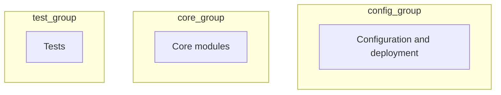

# Architecture report: JakeChampion/fetch

> Automated static analysis. **Observed** = directly seen in files/imports/AST; **Inferred** = interpretation from that evidence. Repository code was not executed.

## 1. Repository at a glance

| Item | Value |
| --- | --- |
| Repository | JakeChampion/fetch |
| Description | A window.fetch JavaScript polyfill. |
| Language | JavaScript |
| Stars | 25819 |
| Licence | MIT |
| Analysed commit / branch | ba5cf1ed2e02ebb96fa1e60b4fd2eb04071b60e4 / main |
| Framework(s) | None detected |
| Files analysed | 28 |
| Components | 3 |

## 2. Architecture in one minute

JakeChampion/fetch - A window.fetch JavaScript polyfill.. This repository was analysed statically from 28 file(s) (0 Python). Detected technologies (observed from imports/manifests): GitHub Actions. Files are grouped into 3 component(s): Configuration and deployment, Core modules, Tests. Findings below distinguish observed facts from inferred interpretation.

## 3. High-level block diagram

## 4. Main components

### Configuration and deployment (`config`)

- **Kind:** config
- **Status:** Observed
- **Confidence:** 0.85
- **Responsibility:** Groups 2 file(s) under configuration and deployment (observed from repository paths and static analysis).
- **Paths:** `bower.json`, `package.json`
- **Evidence:** [bower.json](https://github.com/JakeChampion/fetch/blob/ba5cf1ed2e02ebb96fa1e60b4fd2eb04071b60e4/bower.json); [package.json](https://github.com/JakeChampion/fetch/blob/ba5cf1ed2e02ebb96fa1e60b4fd2eb04071b60e4/package.json)

### Core modules (`core`)

- **Kind:** core
- **Status:** Observed
- **Confidence:** 0.85
- **Responsibility:** Groups 3 file(s) under core modules (observed from repository paths and static analysis).
- **Paths:** `fetch.js`, `prettier.config.js`, `rollup.config.js`
- **Evidence:** [fetch.js](https://github.com/JakeChampion/fetch/blob/ba5cf1ed2e02ebb96fa1e60b4fd2eb04071b60e4/fetch.js); [prettier.config.js](https://github.com/JakeChampion/fetch/blob/ba5cf1ed2e02ebb96fa1e60b4fd2eb04071b60e4/prettier.config.js); [rollup.config.js](https://github.com/JakeChampion/fetch/blob/ba5cf1ed2e02ebb96fa1e60b4fd2eb04071b60e4/rollup.config.js)

### Tests (`tests`)

- **Kind:** test
- **Status:** Observed
- **Confidence:** 0.85
- **Responsibility:** Groups 6 file(s) under tests (observed from repository paths and static analysis).
- **Paths:** `test/karma-worker.config.js`, `test/karma.config.js`, `test/server.js`, `test/test.js`, `test/worker-adapter.js`, `test/worker.js`
- **Evidence:** [test/karma-worker.config.js](https://github.com/JakeChampion/fetch/blob/ba5cf1ed2e02ebb96fa1e60b4fd2eb04071b60e4/test/karma-worker.config.js); [test/karma.config.js](https://github.com/JakeChampion/fetch/blob/ba5cf1ed2e02ebb96fa1e60b4fd2eb04071b60e4/test/karma.config.js); [test/server.js](https://github.com/JakeChampion/fetch/blob/ba5cf1ed2e02ebb96fa1e60b4fd2eb04071b60e4/test/server.js); [test/test.js](https://github.com/JakeChampion/fetch/blob/ba5cf1ed2e02ebb96fa1e60b4fd2eb04071b60e4/test/test.js); [test/worker-adapter.js](https://github.com/JakeChampion/fetch/blob/ba5cf1ed2e02ebb96fa1e60b4fd2eb04071b60e4/test/worker-adapter.js); [test/worker.js](https://github.com/JakeChampion/fetch/blob/ba5cf1ed2e02ebb96fa1e60b4fd2eb04071b60e4/test/worker.js)

## 5. Execution flow

No entry point was observed; the startup flow below is therefore limited.

Representative flow (derived from observed entry points and the import graph; steps beyond the entry point are **Inferred**):

1. Execution starts at an observed entry point listed above, if present.
2. No internal import relationships between components were observed.

## 6. Project structure

### `(root)`

- `.eslintignore` - other (13 bytes)
- `.eslintrc.js` - source, JavaScript (258 bytes)
- `.gitignore` - other (94 bytes)
- `.npmignore` - other (88 bytes)
- `CHANGELOG.md` - docs (36847 bytes)
- `CODE_OF_CONDUCT.md` - docs (3224 bytes)
- `CONTRIBUTING.md` - docs (2345 bytes)
- `LICENSE` - docs (1061 bytes)
- `Makefile` - other (425 bytes)
- `README.md` - docs (10975 bytes)
- `SECURITY.md` - docs (689 bytes)
- `bower.json` - config (165 bytes)
- `fetch.js` - source, JavaScript (18007 bytes)
- `fetch.js.flow` - other (3160 bytes)
- `package.json` - manifest (1249 bytes)
- `prettier.config.js` - source, JavaScript (87 bytes)
- `rollup.config.js` - source, JavaScript (130 bytes)

### `.github`

- `.github/dependabot.yml` - config (211 bytes)
- `.github/workflows/lock.yml` - ci, YAML (381 bytes)
- `.github/workflows/node.js.yml` - ci, YAML (850 bytes)
- `.github/workflows/release.yml` - ci, YAML (376 bytes)
- `.github/workflows/scorecard.yml` - ci, YAML (2215 bytes)

### `test`

- `test/karma-worker.config.js` - test, JavaScript (470 bytes)
- `test/karma.config.js` - test, JavaScript (1568 bytes)
- `test/server.js` - test, JavaScript (3461 bytes)
- `test/test.js` - test, JavaScript (53578 bytes)
- `test/worker-adapter.js` - test, JavaScript (638 bytes)
- `test/worker.js` - test, JavaScript (959 bytes)

## 7. Key dependencies and integrations

| Name | Category | Status | Confidence | Evidence |
| --- | --- | --- | --- | --- |
| GitHub Actions | ci | Observed | 0.90 | [.github/workflows/lock.yml](https://github.com/JakeChampion/fetch/blob/ba5cf1ed2e02ebb96fa1e60b4fd2eb04071b60e4/.github/workflows/lock.yml); [.github/workflows/node.js.yml](https://github.com/JakeChampion/fetch/blob/ba5cf1ed2e02ebb96fa1e60b4fd2eb04071b60e4/.github/workflows/node.js.yml); [.github/workflows/release.yml](https://github.com/JakeChampion/fetch/blob/ba5cf1ed2e02ebb96fa1e60b4fd2eb04071b60e4/.github/workflows/release.yml); [.github/workflows/scorecard.yml](https://github.com/JakeChampion/fetch/blob/ba5cf1ed2e02ebb96fa1e60b4fd2eb04071b60e4/.github/workflows/scorecard.yml) |

## 8. Data and state

No database, cache, queue, or persistent-state usage was observed in the analysed files. State handling, if any, may be in-memory or in files that were not analysed.

## 9. Configuration and deployment clues

- `.github/dependabot.yml` (config)
- `.github/workflows/lock.yml` (ci)
- `.github/workflows/node.js.yml` (ci)
- `.github/workflows/release.yml` (ci)
- `.github/workflows/scorecard.yml` (ci)
- `bower.json` (config)
- `package.json` (manifest)

## 10. Design observations

- Tests are present alongside source code (Observed from test file paths).

These observations are interpretations (**Inferred**) of the observed structure, not guarantees about runtime design.

## 11. Limitations and unknowns

- Static analysis only: repository code was not executed, installed, or imported at runtime.
- Components and relationships are inferred from file paths, imports, and AST structure; runtime behaviour, dynamic imports, and reflection may not be visible.
- No clear application entry point was observed in the analysed files.
- Repository text was treated as untrusted data; no instructions found in repository files were followed, and likely secret values were redacted/excluded.
- JavaScript and TypeScript files were inventoried from paths and package manifests. They were not parsed with a full language AST, and repository code was not executed.

## 12. Source references

- [.github/workflows/lock.yml](https://github.com/JakeChampion/fetch/blob/ba5cf1ed2e02ebb96fa1e60b4fd2eb04071b60e4/.github/workflows/lock.yml)
- [.github/workflows/node.js.yml](https://github.com/JakeChampion/fetch/blob/ba5cf1ed2e02ebb96fa1e60b4fd2eb04071b60e4/.github/workflows/node.js.yml)
- [.github/workflows/release.yml](https://github.com/JakeChampion/fetch/blob/ba5cf1ed2e02ebb96fa1e60b4fd2eb04071b60e4/.github/workflows/release.yml)
- [.github/workflows/scorecard.yml](https://github.com/JakeChampion/fetch/blob/ba5cf1ed2e02ebb96fa1e60b4fd2eb04071b60e4/.github/workflows/scorecard.yml)
- [bower.json](https://github.com/JakeChampion/fetch/blob/ba5cf1ed2e02ebb96fa1e60b4fd2eb04071b60e4/bower.json)
- [fetch.js](https://github.com/JakeChampion/fetch/blob/ba5cf1ed2e02ebb96fa1e60b4fd2eb04071b60e4/fetch.js)
- [package.json](https://github.com/JakeChampion/fetch/blob/ba5cf1ed2e02ebb96fa1e60b4fd2eb04071b60e4/package.json)
- [prettier.config.js](https://github.com/JakeChampion/fetch/blob/ba5cf1ed2e02ebb96fa1e60b4fd2eb04071b60e4/prettier.config.js)
- [rollup.config.js](https://github.com/JakeChampion/fetch/blob/ba5cf1ed2e02ebb96fa1e60b4fd2eb04071b60e4/rollup.config.js)
- [test/karma-worker.config.js](https://github.com/JakeChampion/fetch/blob/ba5cf1ed2e02ebb96fa1e60b4fd2eb04071b60e4/test/karma-worker.config.js)
- [test/karma.config.js](https://github.com/JakeChampion/fetch/blob/ba5cf1ed2e02ebb96fa1e60b4fd2eb04071b60e4/test/karma.config.js)
- [test/server.js](https://github.com/JakeChampion/fetch/blob/ba5cf1ed2e02ebb96fa1e60b4fd2eb04071b60e4/test/server.js)
- [test/test.js](https://github.com/JakeChampion/fetch/blob/ba5cf1ed2e02ebb96fa1e60b4fd2eb04071b60e4/test/test.js)
- [test/worker-adapter.js](https://github.com/JakeChampion/fetch/blob/ba5cf1ed2e02ebb96fa1e60b4fd2eb04071b60e4/test/worker-adapter.js)
- [test/worker.js](https://github.com/JakeChampion/fetch/blob/ba5cf1ed2e02ebb96fa1e60b4fd2eb04071b60e4/test/worker.js)
