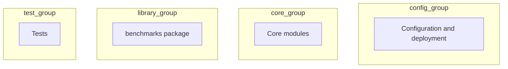

# Architecture report: JedWatson/classnames

> Automated static analysis. **Observed** = directly seen in files/imports/AST; **Inferred** = interpretation from that evidence. Repository code was not executed.

## 1. Repository at a glance

| Item | Value |
| --- | --- |
| Repository | JedWatson/classnames |
| Description | A simple javascript utility for conditionally joining classNames together |
| Language | JavaScript |
| Stars | 17773 |
| Licence | MIT |
| Analysed commit / branch | abd6314010de053a09df5acc53e474ff65cea470 / main |
| Framework(s) | None detected |
| Files analysed | 27 |
| Components | 4 |

## 2. Architecture in one minute

JedWatson/classnames - A simple javascript utility for conditionally joining classNames together. This repository was analysed statically from 27 file(s) (0 Python). Detected technologies (observed from imports/manifests): GitHub Actions. Files are grouped into 4 component(s): benchmarks package, Configuration and deployment, Core modules, Tests. Findings below distinguish observed facts from inferred interpretation.

## 3. High-level block diagram

## 4. Main components

### benchmarks package (`benchmarks`)

- **Kind:** library
- **Status:** Observed
- **Confidence:** 0.85
- **Responsibility:** Groups 3 file(s) under benchmarks package (observed from repository paths and static analysis).
- **Paths:** `benchmarks/benchmarks.js`, `benchmarks/run.js`, `benchmarks/runInBrowser.js`
- **Evidence:** [benchmarks/benchmarks.js](https://github.com/JedWatson/classnames/blob/abd6314010de053a09df5acc53e474ff65cea470/benchmarks/benchmarks.js); [benchmarks/run.js](https://github.com/JedWatson/classnames/blob/abd6314010de053a09df5acc53e474ff65cea470/benchmarks/run.js); [benchmarks/runInBrowser.js](https://github.com/JedWatson/classnames/blob/abd6314010de053a09df5acc53e474ff65cea470/benchmarks/runInBrowser.js)

### Configuration and deployment (`config`)

- **Kind:** config
- **Status:** Observed
- **Confidence:** 0.85
- **Responsibility:** Groups 1 file(s) under configuration and deployment (observed from repository paths and static analysis).
- **Paths:** `package.json`
- **Evidence:** [package.json](https://github.com/JedWatson/classnames/blob/abd6314010de053a09df5acc53e474ff65cea470/package.json)

### Core modules (`core`)

- **Kind:** core
- **Status:** Observed
- **Confidence:** 0.85
- **Responsibility:** Groups 6 file(s) under core modules (observed from repository paths and static analysis).
- **Paths:** `bind.d.ts`, `bind.js`, `dedupe.d.ts`, `dedupe.js`, `index.d.ts`, `index.js`
- **Evidence:** [bind.d.ts](https://github.com/JedWatson/classnames/blob/abd6314010de053a09df5acc53e474ff65cea470/bind.d.ts); [bind.js](https://github.com/JedWatson/classnames/blob/abd6314010de053a09df5acc53e474ff65cea470/bind.js); [dedupe.d.ts](https://github.com/JedWatson/classnames/blob/abd6314010de053a09df5acc53e474ff65cea470/dedupe.d.ts); [dedupe.js](https://github.com/JedWatson/classnames/blob/abd6314010de053a09df5acc53e474ff65cea470/dedupe.js); [index.d.ts](https://github.com/JedWatson/classnames/blob/abd6314010de053a09df5acc53e474ff65cea470/index.d.ts); [index.js](https://github.com/JedWatson/classnames/blob/abd6314010de053a09df5acc53e474ff65cea470/index.js)

### Tests (`tests`)

- **Kind:** test
- **Status:** Observed
- **Confidence:** 0.85
- **Responsibility:** Groups 6 file(s) under tests (observed from repository paths and static analysis).
- **Paths:** `tests/bind.js`, `tests/bind.test-d.ts`, `tests/dedupe.js`, `tests/dedupe.test-d.ts`, `tests/index.js`, `tests/index.test-d.ts`
- **Evidence:** [tests/bind.js](https://github.com/JedWatson/classnames/blob/abd6314010de053a09df5acc53e474ff65cea470/tests/bind.js); [tests/bind.test-d.ts](https://github.com/JedWatson/classnames/blob/abd6314010de053a09df5acc53e474ff65cea470/tests/bind.test-d.ts); [tests/dedupe.js](https://github.com/JedWatson/classnames/blob/abd6314010de053a09df5acc53e474ff65cea470/tests/dedupe.js); [tests/dedupe.test-d.ts](https://github.com/JedWatson/classnames/blob/abd6314010de053a09df5acc53e474ff65cea470/tests/dedupe.test-d.ts); [tests/index.js](https://github.com/JedWatson/classnames/blob/abd6314010de053a09df5acc53e474ff65cea470/tests/index.js); [tests/index.test-d.ts](https://github.com/JedWatson/classnames/blob/abd6314010de053a09df5acc53e474ff65cea470/tests/index.test-d.ts)

## 5. Execution flow

**Observed** entry point(s):

- [index.js](https://github.com/JedWatson/classnames/blob/abd6314010de053a09df5acc53e474ff65cea470/index.js)

Representative flow (derived from observed entry points and the import graph; steps beyond the entry point are **Inferred**):

1. Execution starts at an observed entry point listed above, if present.
2. No internal import relationships between components were observed.

## 6. Project structure

### `(root)`

- `.editorconfig` - config (318 bytes)
- `.gitignore` - other (382 bytes)
- `.npmignore` - other (59 bytes)
- `CONTRIBUTING.md` - docs (1223 bytes)
- `HISTORY.md` - docs (4245 bytes)
- `LICENSE` - docs (1077 bytes)
- `README.md` - docs (9286 bytes)
- `bind.d.ts` - source, TypeScript (185 bytes)
- `bind.js` - source, JavaScript (936 bytes)
- `dedupe.d.ts` - source, TypeScript (64 bytes)
- `dedupe.js` - source, JavaScript (1590 bytes)
- `index.d.ts` - source, TypeScript (819 bytes)
- `index.js` - source, JavaScript (883 bytes)
- `package.json` - manifest (1867 bytes)

### `.github`

- `.github/dependabot.yml` - config (255 bytes)
- `.github/workflows/node.js.yml` - ci, YAML (1479 bytes)
- `.github/workflows/release.yml` - ci, YAML (669 bytes)

### `benchmarks`

- `benchmarks/benchmarks.js` - source, JavaScript (2244 bytes)
- `benchmarks/index.html` - other (254 bytes)
- `benchmarks/run.js` - source, JavaScript (73 bytes)
- `benchmarks/runInBrowser.js` - source, JavaScript (246 bytes)

### `tests`

- `tests/bind.js` - test, JavaScript (4421 bytes)
- `tests/bind.test-d.ts` - test, TypeScript (899 bytes)
- `tests/dedupe.js` - test, JavaScript (2709 bytes)
- `tests/dedupe.test-d.ts` - test, TypeScript (829 bytes)
- `tests/index.js` - test, JavaScript (3178 bytes)
- `tests/index.test-d.ts` - test, TypeScript (1612 bytes)

## 7. Key dependencies and integrations

| Name | Category | Status | Confidence | Evidence |
| --- | --- | --- | --- | --- |
| GitHub Actions | ci | Observed | 0.90 | [.github/workflows/node.js.yml](https://github.com/JedWatson/classnames/blob/abd6314010de053a09df5acc53e474ff65cea470/.github/workflows/node.js.yml); [.github/workflows/release.yml](https://github.com/JedWatson/classnames/blob/abd6314010de053a09df5acc53e474ff65cea470/.github/workflows/release.yml) |

## 8. Data and state

No database, cache, queue, or persistent-state usage was observed in the analysed files. State handling, if any, may be in-memory or in files that were not analysed.

## 9. Configuration and deployment clues

- `.editorconfig` (config)
- `.github/dependabot.yml` (config)
- `.github/workflows/node.js.yml` (ci)
- `.github/workflows/release.yml` (ci)
- `package.json` (manifest)

## 10. Design observations

- Tests are present alongside source code (Observed from test file paths).

These observations are interpretations (**Inferred**) of the observed structure, not guarantees about runtime design.

## 11. Limitations and unknowns

- Static analysis only: repository code was not executed, installed, or imported at runtime.
- Components and relationships are inferred from file paths, imports, and AST structure; runtime behaviour, dynamic imports, and reflection may not be visible.
- 1 file(s) were skipped during inventory (1 x lockfile excluded).
- No clear application entry point was observed in the analysed files.
- Repository text was treated as untrusted data; no instructions found in repository files were followed, and likely secret values were redacted/excluded.
- JavaScript and TypeScript files were inventoried from paths and package manifests. They were not parsed with a full language AST, and repository code was not executed.

## 12. Source references

- [.github/workflows/node.js.yml](https://github.com/JedWatson/classnames/blob/abd6314010de053a09df5acc53e474ff65cea470/.github/workflows/node.js.yml)
- [.github/workflows/release.yml](https://github.com/JedWatson/classnames/blob/abd6314010de053a09df5acc53e474ff65cea470/.github/workflows/release.yml)
- [benchmarks/benchmarks.js](https://github.com/JedWatson/classnames/blob/abd6314010de053a09df5acc53e474ff65cea470/benchmarks/benchmarks.js)
- [benchmarks/run.js](https://github.com/JedWatson/classnames/blob/abd6314010de053a09df5acc53e474ff65cea470/benchmarks/run.js)
- [benchmarks/runInBrowser.js](https://github.com/JedWatson/classnames/blob/abd6314010de053a09df5acc53e474ff65cea470/benchmarks/runInBrowser.js)
- [bind.d.ts](https://github.com/JedWatson/classnames/blob/abd6314010de053a09df5acc53e474ff65cea470/bind.d.ts)
- [bind.js](https://github.com/JedWatson/classnames/blob/abd6314010de053a09df5acc53e474ff65cea470/bind.js)
- [dedupe.d.ts](https://github.com/JedWatson/classnames/blob/abd6314010de053a09df5acc53e474ff65cea470/dedupe.d.ts)
- [dedupe.js](https://github.com/JedWatson/classnames/blob/abd6314010de053a09df5acc53e474ff65cea470/dedupe.js)
- [index.d.ts](https://github.com/JedWatson/classnames/blob/abd6314010de053a09df5acc53e474ff65cea470/index.d.ts)
- [index.js](https://github.com/JedWatson/classnames/blob/abd6314010de053a09df5acc53e474ff65cea470/index.js)
- [package.json](https://github.com/JedWatson/classnames/blob/abd6314010de053a09df5acc53e474ff65cea470/package.json)
- [tests/bind.js](https://github.com/JedWatson/classnames/blob/abd6314010de053a09df5acc53e474ff65cea470/tests/bind.js)
- [tests/bind.test-d.ts](https://github.com/JedWatson/classnames/blob/abd6314010de053a09df5acc53e474ff65cea470/tests/bind.test-d.ts)
- [tests/dedupe.js](https://github.com/JedWatson/classnames/blob/abd6314010de053a09df5acc53e474ff65cea470/tests/dedupe.js)
- [tests/dedupe.test-d.ts](https://github.com/JedWatson/classnames/blob/abd6314010de053a09df5acc53e474ff65cea470/tests/dedupe.test-d.ts)
- [tests/index.js](https://github.com/JedWatson/classnames/blob/abd6314010de053a09df5acc53e474ff65cea470/tests/index.js)
- [tests/index.test-d.ts](https://github.com/JedWatson/classnames/blob/abd6314010de053a09df5acc53e474ff65cea470/tests/index.test-d.ts)
