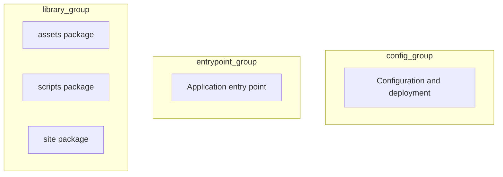

# Architecture report: Jeffallan/claude-skills

> Automated static analysis. **Observed** = directly seen in files/imports/AST; **Inferred** = interpretation from that evidence. Repository code was not executed.

## 1. Repository at a glance

| Item | Value |
| --- | --- |
| Repository | Jeffallan/claude-skills |
| Description | 67 Specialized Skills for Full-Stack Developers. Transform Claude Code into your expert pair programmer. |
| Language | JavaScript |
| Stars | 12361 |
| Licence | MIT |
| Analysed commit / branch | 078a25cc5bfd8011459be7b91d004e900c1d02d3 / main |
| Framework(s) | None detected |
| Files analysed | 590 |
| Components | 5 |

## 2. Architecture in one minute

Jeffallan/claude-skills - 67 Specialized Skills for Full-Stack Developers. Transform Claude Code into your expert pair programmer.. This repository was analysed statically from 590 file(s) (1 Python). Detected technologies (observed from imports/manifests): GitHub Actions, Poetry. Files are grouped into 5 component(s): assets package, Configuration and deployment, Application entry point, scripts package, site package. Observed entry point(s): scripts/migrate-frontmatter.py. Findings below distinguish observed facts from inferred interpretation.

## 3. High-level block diagram

## 4. Main components

### assets package (`assets`)

- **Kind:** library
- **Status:** Observed
- **Confidence:** 0.85
- **Responsibility:** Groups 1 file(s) under assets package (observed from repository paths and static analysis).
- **Paths:** `assets/capture-screenshot.js`
- **Evidence:** [assets/capture-screenshot.js](https://github.com/Jeffallan/claude-skills/blob/078a25cc5bfd8011459be7b91d004e900c1d02d3/assets/capture-screenshot.js)

### Configuration and deployment (`config`)

- **Kind:** config
- **Status:** Observed
- **Confidence:** 0.85
- **Responsibility:** Groups 21 file(s) under configuration and deployment (observed from repository paths and static analysis).
- **Paths:** `commands/common-ground.yaml`, `commands/intake/capture-behavior.yaml`, `commands/intake/create-system-description.yaml`, `commands/intake/document-codebase.yaml`, `commands/project/discovery/approve.yaml`, `commands/project/discovery/create.yaml`, `commands/project/discovery/synthesize.yaml`, `commands/project/execution/complete-ticket.yaml`, `commands/project/execution/execute-ticket.yaml`, `commands/project/planning/epic-plan.yaml`, `commands/project/planning/impl-plan.yaml`, `commands/project/retrospectives/complete-epic.yaml`, `commands/workflow-manifest.yaml`, `pyproject.toml`, `pyrightconfig.json`, `ruff.toml`, `site/package.json`, `site/src/components/site-footer/profile.json`, `site/src/components/site-nav/sites.json`, `site/tsconfig.json`, `version.json`
- **Evidence:** [commands/common-ground.yaml](https://github.com/Jeffallan/claude-skills/blob/078a25cc5bfd8011459be7b91d004e900c1d02d3/commands/common-ground.yaml); [commands/intake/capture-behavior.yaml](https://github.com/Jeffallan/claude-skills/blob/078a25cc5bfd8011459be7b91d004e900c1d02d3/commands/intake/capture-behavior.yaml); [commands/intake/create-system-description.yaml](https://github.com/Jeffallan/claude-skills/blob/078a25cc5bfd8011459be7b91d004e900c1d02d3/commands/intake/create-system-description.yaml); [commands/intake/document-codebase.yaml](https://github.com/Jeffallan/claude-skills/blob/078a25cc5bfd8011459be7b91d004e900c1d02d3/commands/intake/document-codebase.yaml); [commands/project/discovery/approve.yaml](https://github.com/Jeffallan/claude-skills/blob/078a25cc5bfd8011459be7b91d004e900c1d02d3/commands/project/discovery/approve.yaml); [commands/project/discovery/create.yaml](https://github.com/Jeffallan/claude-skills/blob/078a25cc5bfd8011459be7b91d004e900c1d02d3/commands/project/discovery/create.yaml); [commands/project/discovery/synthesize.yaml](https://github.com/Jeffallan/claude-skills/blob/078a25cc5bfd8011459be7b91d004e900c1d02d3/commands/project/discovery/synthesize.yaml); [commands/project/execution/complete-ticket.yaml](https://github.com/Jeffallan/claude-skills/blob/078a25cc5bfd8011459be7b91d004e900c1d02d3/commands/project/execution/complete-ticket.yaml)

### Application entry point (`entrypoint`)

- **Kind:** entrypoint
- **Status:** Observed
- **Confidence:** 0.85
- **Responsibility:** Groups 1 file(s) under application entry point (observed from repository paths and static analysis). Observed top-level functions: add_related_skills_to_frontmatter, build_new_frontmatter, extract_related_skills, main, migrate_related_skills, migrate_skill.
- **Paths:** `scripts/migrate-frontmatter.py`
- **Evidence:** [scripts/migrate-frontmatter.py:113](https://github.com/Jeffallan/claude-skills/blob/078a25cc5bfd8011459be7b91d004e900c1d02d3/scripts/migrate-frontmatter.py#L113)

### scripts package (`scripts`)

- **Kind:** library
- **Status:** Observed
- **Confidence:** 0.85
- **Responsibility:** Groups 3 file(s) under scripts package (observed from repository paths and static analysis).
- **Paths:** `scripts/build-plugin-dist.sh`, `scripts/test-build-plugin-dist.sh`, `scripts/test-makefile.sh`
- **Evidence:** [scripts/build-plugin-dist.sh](https://github.com/Jeffallan/claude-skills/blob/078a25cc5bfd8011459be7b91d004e900c1d02d3/scripts/build-plugin-dist.sh); [scripts/test-build-plugin-dist.sh](https://github.com/Jeffallan/claude-skills/blob/078a25cc5bfd8011459be7b91d004e900c1d02d3/scripts/test-build-plugin-dist.sh); [scripts/test-makefile.sh](https://github.com/Jeffallan/claude-skills/blob/078a25cc5bfd8011459be7b91d004e900c1d02d3/scripts/test-makefile.sh)

### site package (`site`)

- **Kind:** library
- **Status:** Observed
- **Confidence:** 0.85
- **Responsibility:** Groups 16 file(s) under site package (observed from repository paths and static analysis).
- **Paths:** `site/astro.config.mjs`, `site/scripts/sync-content.mjs`, `site/src/components/cta-text.ts`, `site/src/components/site-contact/cta-html.mjs`, `site/src/components/site-seo/card.mjs`, `site/src/components/site-seo/graph.mjs`, `site/src/components/site-seo/indexnow.mjs`, `site/src/components/site-seo/og.mjs`, `site/src/components/site-seo/starlight.mjs`, `site/src/components/site-sync/llms.mjs`, `site/src/components/site-sync/markdown.mjs`, `site/src/components/site-sync/sync.mjs`, `site/src/content.config.ts`, `site/src/middleware.ts`, `site/src/pages/og/[...route].ts`, `site/src/routeData.ts`
- **Evidence:** [site/astro.config.mjs](https://github.com/Jeffallan/claude-skills/blob/078a25cc5bfd8011459be7b91d004e900c1d02d3/site/astro.config.mjs); [site/scripts/sync-content.mjs](https://github.com/Jeffallan/claude-skills/blob/078a25cc5bfd8011459be7b91d004e900c1d02d3/site/scripts/sync-content.mjs); [site/src/components/cta-text.ts](https://github.com/Jeffallan/claude-skills/blob/078a25cc5bfd8011459be7b91d004e900c1d02d3/site/src/components/cta-text.ts); [site/src/components/site-contact/cta-html.mjs](https://github.com/Jeffallan/claude-skills/blob/078a25cc5bfd8011459be7b91d004e900c1d02d3/site/src/components/site-contact/cta-html.mjs); [site/src/components/site-seo/card.mjs](https://github.com/Jeffallan/claude-skills/blob/078a25cc5bfd8011459be7b91d004e900c1d02d3/site/src/components/site-seo/card.mjs); [site/src/components/site-seo/graph.mjs](https://github.com/Jeffallan/claude-skills/blob/078a25cc5bfd8011459be7b91d004e900c1d02d3/site/src/components/site-seo/graph.mjs); [site/src/components/site-seo/indexnow.mjs](https://github.com/Jeffallan/claude-skills/blob/078a25cc5bfd8011459be7b91d004e900c1d02d3/site/src/components/site-seo/indexnow.mjs); [site/src/components/site-seo/og.mjs](https://github.com/Jeffallan/claude-skills/blob/078a25cc5bfd8011459be7b91d004e900c1d02d3/site/src/components/site-seo/og.mjs)

## 5. Execution flow

**Observed** entry point(s):

- [scripts/migrate-frontmatter.py:481](https://github.com/Jeffallan/claude-skills/blob/078a25cc5bfd8011459be7b91d004e900c1d02d3/scripts/migrate-frontmatter.py#L481)

Representative flow (derived from observed entry points and the import graph; steps beyond the entry point are **Inferred**):

1. Execution starts at an observed entry point listed above, if present.
2. No internal import relationships between components were observed.

## 6. Project structure

### `(root)`

- `.copier-answers.yml` - config (298 bytes)
- `.editorconfig` - config (296 bytes)
- `.git-blame-ignore-revs` - other (54 bytes)
- `.gitignore` - other (817 bytes)
- `.pre-commit-config.yaml` - config (878 bytes)
- `.prettierignore` - other (79 bytes)
- `.prettierrc` - other (79 bytes)
- `CHANGELOG.md` - docs (52802 bytes)
- `CLAUDE.md` - docs (14453 bytes)
- `CONTRIBUTING.md` - docs (12539 bytes)
- `LICENSE` - docs (1056 bytes)
- `MODELCLAUDE.md` - docs (8459 bytes)
- `Makefile` - other (2172 bytes)
- `QUICKSTART.md` - docs (4835 bytes)
- `README.md` - docs (6384 bytes)
- `ROADMAP.md` - docs (9996 bytes)
- `SKILLS_GUIDE.md` - docs (19820 bytes)
- `pyproject.toml` - manifest (4362 bytes)
- `pyrightconfig.json` - config (219 bytes)
- `ruff.toml` - config (471 bytes)
- `version.json` - config (97 bytes)

### `.astro`

- `.astro/content-assets.mjs` - source, JavaScript (25 bytes)
- `.astro/content-modules.mjs` - source, JavaScript (25 bytes)
- `.astro/content.d.ts` - source, TypeScript (6942 bytes)
- `.astro/types.d.ts` - source, TypeScript (76 bytes)

### `.claude`

- `.claude/old-commands/legacy/complete-epic.md` - docs (12261 bytes)
- `.claude/old-commands/legacy/complete-sprint.md` - docs (22676 bytes)
- `.claude/old-commands/legacy/create-epic-plan.md` - docs (9176 bytes)
- `.claude/old-commands/legacy/create-implementation-plan.md` - docs (11493 bytes)
- `.claude/old-commands/legacy/execute-ticket.md` - docs (8597 bytes)

### `.claude-plugin`

- `.claude-plugin/marketplace.json` - config (2344 bytes)
- `.claude-plugin/plugin.json` - config (2923 bytes)

### `.github`

- `.github/ISSUE_TEMPLATE/claude-issue.yml` - config (1243 bytes)
- `.github/ISSUE_TEMPLATE/new-skill.yml` - config (3256 bytes)
- `.github/dependabot.yml` - config (358 bytes)
- `.github/workflows/ci.yml` - ci, YAML (171 bytes)
- `.github/workflows/docs-deploy.yml` - ci, YAML (1708 bytes)
- `.github/workflows/docs-site.yml` - ci, YAML (1012 bytes)
- `.github/workflows/handbook-update.yml` - ci, YAML (2762 bytes)
- `.github/workflows/publish-plugin.yml` - ci, YAML (2089 bytes)
- `.github/workflows/release.yml` - ci, YAML (1685 bytes)
- `.github/workflows/validate.yml` - ci, YAML (1728 bytes)

### `assets`

- `assets/capture-screenshot.js` - source, JavaScript (724 bytes)
- `assets/social-preview.html` - other (9943 bytes)

### `commands`

- `commands/common-ground.md` - docs (9007 bytes)
- `commands/common-ground.yaml` - config (922 bytes)
- `commands/intake/capture-behavior.yaml` - config (613 bytes)
- `commands/intake/create-system-description.yaml` - config (596 bytes)
- `commands/intake/document-codebase.yaml` - config (498 bytes)
- `commands/project/discovery/approve-synthesis.md` - docs (11524 bytes)
- `commands/project/discovery/approve.yaml` - config (715 bytes)
- `commands/project/discovery/create-epic-discovery.md` - docs (8334 bytes)
- `commands/project/discovery/create.yaml` - config (587 bytes)
- `commands/project/discovery/synthesize-discovery.md` - docs (12116 bytes)
- `commands/project/discovery/synthesize.yaml` - config (869 bytes)
- `commands/project/execution/complete-ticket.md` - docs (4092 bytes)
- `commands/project/execution/complete-ticket.yaml` - config (712 bytes)
- `commands/project/execution/execute-ticket.md` - docs (9470 bytes)
- `commands/project/execution/execute-ticket.yaml` - config (551 bytes)
- `commands/project/planning/create-epic-plan.md` - docs (12205 bytes)
- `commands/project/planning/create-implementation-plan.md` - docs (6686 bytes)
- `commands/project/planning/epic-plan.yaml` - config (616 bytes)
- `commands/project/planning/impl-plan.yaml` - config (770 bytes)
- `commands/project/retrospectives/complete-epic.md` - docs (12279 bytes)
- `commands/project/retrospectives/complete-epic.yaml` - config (905 bytes)
- `commands/project/retrospectives/complete-sprint.md` - docs (22696 bytes)
- `commands/workflow-manifest.yaml` - config (2087 bytes)

### `docs`

- `docs/ATLASSIAN_MCP_SETUP.md` - docs (11981 bytes)
- `docs/COMMON_GROUND.md` - docs (14570 bytes)
- `docs/SUPPORTED_AGENTS.md` - docs (2812 bytes)
- `docs/WORKFLOW_COMMANDS.md` - docs (26237 bytes)
- `docs/ideas/audit-primary-docs.md` - docs (22808 bytes)
- `docs/ideas/audit-skill-consistency.md` - docs (21059 bytes)
- `docs/ideas/audit-workflow-docs.md` - docs (25755 bytes)
- `docs/ideas/documentation-site.md` - docs (18155 bytes)
- `docs/local_skill_development.md` - docs (4628 bytes)
- `docs/prompts/discovery-for-feature-forge.md` - docs (4989 bytes)
- `docs/skill-ideas/tarot.md` - docs (8889 bytes)
- `docs/skill-ideas/the-fool.md` - docs (10653 bytes)
- `docs/v0.5.0-narrative.md` - docs (18846 bytes)
- `docs/v0.5.0-plan.md` - docs (40146 bytes)
- `docs/workflow/common-ground.md` - docs (1729 bytes)
- `docs/workflow/discovery-approve.md` - docs (1431 bytes)
- `docs/workflow/discovery-create.md` - docs (1335 bytes)
- `docs/workflow/discovery-phase.md` - docs (1778 bytes)
- `docs/workflow/discovery-synthesize.md` - docs (1554 bytes)
- `docs/workflow/execution-complete-ticket.md` - docs (1560 bytes)
- `docs/workflow/execution-execute-ticket.md` - docs (1854 bytes)
- `docs/workflow/execution-phase.md` - docs (1772 bytes)
- `docs/workflow/intake-capture-behavior.md` - docs (1239 bytes)
- `docs/workflow/intake-create-system-description.md` - docs (1530 bytes)
- `docs/workflow/intake-document-codebase.md` - docs (1185 bytes)
- `docs/workflow/intake-phase.md` - docs (1404 bytes)
- `docs/workflow/planning-epic-plan.md` - docs (1493 bytes)
- `docs/workflow/planning-impl-plan.md` - docs (1790 bytes)
- `docs/workflow/planning-phase.md` - docs (1498 bytes)
- `docs/workflow/retrospective-complete-epic.md` - docs (1973 bytes)
- `docs/workflow/retrospective-phase.md` - docs (1433 bytes)
- `docs/workflow/workflow-definition-schema.md` - docs (8438 bytes)

### `references`

- `references/common-ground/assumption-classification.md` - docs (5860 bytes)
- `references/common-ground/file-management.md` - docs (6208 bytes)
- `references/common-ground/reasoning-graph.md` - docs (8167 bytes)

### `research`

- `research/GITHUB_ISSUE_TREE.md` - docs (46781 bytes)
- `research/SKILL_TRIGGER_LOGS.md` - docs (6354 bytes)
- `research/superpowers.md` - docs (37831 bytes)
- `research/superpowers_research_findings.md` - docs (11438 bytes)

### `scripts`

- `scripts/build-plugin-dist.sh` - source, Shell (979 bytes)
- `scripts/migrate-frontmatter.py` - source, Python (15077 bytes)
- `scripts/test-build-plugin-dist.sh` - source, Shell (3064 bytes)
- `scripts/test-makefile.sh` - source, Shell (5045 bytes)

### `site`

- `site/.prettierrc` - other (47 bytes)
- `site/astro.config.mjs` - source, JavaScript (9897 bytes)
- `site/package.json` - manifest (1020 bytes)
- `site/public/.gitignore` - other (187 bytes)
- `site/public/robots.txt` - docs (93 bytes)
- `site/scripts/sync-content.mjs` - source, JavaScript (4411 bytes)
- `site/src/components/Footer.astro` - other (678 bytes)
- `site/src/components/Header.astro` - other (4013 bytes)
- `site/src/components/Hero.astro` - other (261 bytes)
- `site/src/components/SocialIcons.astro` - other (2194 bytes)
- `site/src/components/cta-text.ts` - source, TypeScript (1306 bytes)
- `site/src/components/site-contact/ContactCTA.astro` - other (723 bytes)
- `site/src/components/site-contact/ContactDialog.astro` - other (3947 bytes)
- `site/src/components/site-contact/ContactForm.astro` - other (5751 bytes)
- `site/src/components/site-contact/cta-html.mjs` - source, JavaScript (1605 bytes)
- `site/src/components/site-footer/SiteFooter.astro` - other (4070 bytes)
- `site/src/components/site-footer/profile.json` - config (2793 bytes)
- `site/src/components/site-nav/SitesMenu.astro` - other (3906 bytes)
- `site/src/components/site-nav/sites.json` - config (415 bytes)
- `site/src/components/site-seo/card.mjs` - source, JavaScript (3500 bytes)
- `site/src/components/site-seo/graph.mjs` - source, JavaScript (4862 bytes)
- `site/src/components/site-seo/indexnow.mjs` - source, JavaScript (968 bytes)
- `site/src/components/site-seo/og.mjs` - source, JavaScript (3261 bytes)
- `site/src/components/site-seo/starlight.mjs` - source, JavaScript (1944 bytes)
- `site/src/components/site-style/Monogram.astro` - other (1380 bytes)
- `site/src/components/site-style/ThemeScript.astro` - other (617 bytes)
- `site/src/components/site-style/ThemeSelect.astro` - other (2081 bytes)
- `site/src/components/site-style/starlight.css` - other (1221 bytes)
- `site/src/components/site-style/tokens.css` - other (2213 bytes)
- `site/src/components/site-sync/llms.mjs` - source, JavaScript (1941 bytes)
- `site/src/components/site-sync/markdown.mjs` - source, JavaScript (2527 bytes)
- `site/src/components/site-sync/sync.mjs` - source, JavaScript (14328 bytes)
- `site/src/content.config.ts` - source, TypeScript (270 bytes)
- `site/src/content/docs/index.mdx` - docs (1561 bytes)
- `site/src/content/docs/privacy.md` - docs (6568 bytes)
- `site/src/middleware.ts` - source, TypeScript (688 bytes)
- `site/src/pages/og/[...route].ts` - source, TypeScript (335 bytes)
- `site/src/routeData.ts` - source, TypeScript (363 bytes)
- `site/src/styles/custom.css` - other (343 bytes)
- `site/tsconfig.json` - config (42 bytes)

### `skills`

- `skills/angular-architect/SKILL.md` - docs (6169 bytes)
- `skills/angular-architect/references/components.md` - docs (6498 bytes)
- `skills/angular-architect/references/ngrx.md` - docs (9585 bytes)
- `skills/angular-architect/references/routing.md` - docs (8752 bytes)
- `skills/angular-architect/references/rxjs.md` - docs (8357 bytes)
- `skills/angular-architect/references/testing.md` - docs (11197 bytes)
- `skills/api-designer/SKILL.md` - docs (8008 bytes)
- `skills/api-designer/references/error-handling.md` - docs (11592 bytes)
- `skills/api-designer/references/openapi.md` - docs (16380 bytes)
- `skills/api-designer/references/pagination.md` - docs (9632 bytes)
- `skills/api-designer/references/rest-patterns.md` - docs (7516 bytes)
- `skills/api-designer/references/versioning.md` - docs (7945 bytes)
- `skills/architecture-designer/SKILL.md` - docs (4926 bytes)
- `skills/architecture-designer/references/adr-template.md` - docs (2752 bytes)
- `skills/architecture-designer/references/architecture-patterns.md` - docs (4605 bytes)
- `skills/architecture-designer/references/database-selection.md` - docs (2569 bytes)
- `skills/architecture-designer/references/nfr-checklist.md` - docs (3046 bytes)
- `skills/architecture-designer/references/system-design.md` - docs (3009 bytes)
- `skills/atlassian-mcp/SKILL.md` - docs (5568 bytes)
- `skills/atlassian-mcp/references/authentication-patterns.md` - docs (13426 bytes)
- `skills/atlassian-mcp/references/common-workflows.md` - docs (18860 bytes)
- `skills/atlassian-mcp/references/confluence-operations.md` - docs (12714 bytes)
- `skills/atlassian-mcp/references/jira-queries.md` - docs (12577 bytes)
- `skills/atlassian-mcp/references/mcp-server-setup.md` - docs (12736 bytes)
- `skills/chaos-engineer/SKILL.md` - docs (7066 bytes)
- `skills/chaos-engineer/references/chaos-tools.md` - docs (14245 bytes)
- `skills/chaos-engineer/references/experiment-design.md` - docs (7031 bytes)
- `skills/chaos-engineer/references/game-days.md` - docs (12355 bytes)
- `skills/chaos-engineer/references/infrastructure-chaos.md` - docs (10035 bytes)
- `skills/chaos-engineer/references/kubernetes-chaos.md` - docs (10785 bytes)
- `skills/cli-developer/SKILL.md` - docs (4790 bytes)
- `skills/cli-developer/references/design-patterns.md` - docs (5249 bytes)
- `skills/cli-developer/references/go-cli.md` - docs (10971 bytes)
- `skills/cli-developer/references/node-cli.md` - docs (8443 bytes)
- `skills/cli-developer/references/python-cli.md` - docs (10437 bytes)
- `skills/cli-developer/references/ux-patterns.md` - docs (10115 bytes)
- `skills/cloud-architect/SKILL.md` - docs (7539 bytes)
- `skills/cloud-architect/references/aws.md` - docs (11309 bytes)
- `skills/cloud-architect/references/azure.md` - docs (14468 bytes)
- `skills/cloud-architect/references/cost.md` - docs (14289 bytes)
- `skills/cloud-architect/references/gcp.md` - docs (17222 bytes)
- `skills/cloud-architect/references/multi-cloud.md` - docs (11331 bytes)
- `skills/code-documenter/SKILL.md` - docs (5808 bytes)
- `skills/code-documenter/references/api-docs-fastapi-django.md` - docs (4148 bytes)
- `skills/code-documenter/references/api-docs-nestjs-express.md` - docs (4950 bytes)
- `skills/code-documenter/references/coverage-reports.md` - docs (3032 bytes)
- `skills/code-documenter/references/documentation-systems.md` - docs (6109 bytes)
- `skills/code-documenter/references/interactive-api-docs.md` - docs (10194 bytes)
- `skills/code-documenter/references/python-docstrings.md` - docs (2964 bytes)
- `skills/code-documenter/references/typescript-jsdoc.md` - docs (3110 bytes)
- `skills/code-documenter/references/user-guides-tutorials.md` - docs (11002 bytes)
- `skills/code-reviewer/SKILL.md` - docs (5353 bytes)
- `skills/code-reviewer/references/common-issues.md` - docs (2999 bytes)
- `skills/code-reviewer/references/feedback-examples.md` - docs (3458 bytes)
- `skills/code-reviewer/references/receiving-feedback.md` - docs (6680 bytes)
- `skills/code-reviewer/references/report-template.md` - docs (3075 bytes)
- `skills/code-reviewer/references/review-checklist.md` - docs (2485 bytes)
- `skills/code-reviewer/references/spec-compliance-review.md` - docs (9009 bytes)
- `skills/cpp-pro/SKILL.md` - docs (4672 bytes)
- `skills/cpp-pro/references/build-tooling.md` - docs (9761 bytes)
- `skills/cpp-pro/references/concurrency.md` - docs (10918 bytes)
- `skills/cpp-pro/references/memory-performance.md` - docs (9104 bytes)
- `skills/cpp-pro/references/modern-cpp.md` - docs (6565 bytes)
- `skills/cpp-pro/references/templates.md` - docs (7908 bytes)
- `skills/csharp-developer/SKILL.md` - docs (5255 bytes)
- `skills/csharp-developer/references/aspnet-core.md` - docs (10744 bytes)
- `skills/csharp-developer/references/blazor.md` - docs (12940 bytes)
- `skills/csharp-developer/references/entity-framework.md` - docs (11717 bytes)
- `skills/csharp-developer/references/modern-csharp.md` - docs (6219 bytes)
- `skills/csharp-developer/references/performance.md` - docs (12454 bytes)
- `skills/database-optimizer/SKILL.md` - docs (6232 bytes)
- `skills/database-optimizer/references/index-strategies.md` - docs (8131 bytes)
- `skills/database-optimizer/references/monitoring-analysis.md` - docs (14596 bytes)
- `skills/database-optimizer/references/mysql-tuning.md` - docs (11021 bytes)
- `skills/database-optimizer/references/postgresql-tuning.md` - docs (10284 bytes)
- `skills/database-optimizer/references/query-optimization.md` - docs (5793 bytes)
- `skills/debugging-wizard/SKILL.md` - docs (3917 bytes)
- `skills/debugging-wizard/references/common-patterns.md` - docs (3103 bytes)
- `skills/debugging-wizard/references/debugging-tools.md` - docs (2833 bytes)
- `skills/debugging-wizard/references/quick-fixes.md` - docs (3529 bytes)
- `skills/debugging-wizard/references/strategies.md` - docs (2958 bytes)
- `skills/debugging-wizard/references/systematic-debugging.md` - docs (13818 bytes)
- `skills/devops-engineer/SKILL.md` - docs (6680 bytes)
- `skills/devops-engineer/references/deployment-strategies.md` - docs (4910 bytes)
- `skills/devops-engineer/references/docker-patterns.md` - docs (2733 bytes)
- `skills/devops-engineer/references/github-actions.md` - docs (3157 bytes)
- `skills/devops-engineer/references/gitlab-ci.md` - docs (8524 bytes)
- `skills/devops-engineer/references/incident-response.md` - docs (8632 bytes)
- `skills/devops-engineer/references/kubernetes.md` - docs (3039 bytes)
- `skills/devops-engineer/references/platform-engineering.md` - docs (8914 bytes)
- `skills/devops-engineer/references/release-automation.md` - docs (11309 bytes)
- `skills/devops-engineer/references/terraform-iac.md` - docs (3169 bytes)
- `skills/django-expert/SKILL.md` - docs (6210 bytes)
- `skills/django-expert/references/authentication.md` - docs (3962 bytes)
- `skills/django-expert/references/drf-serializers.md` - docs (4132 bytes)
- `skills/django-expert/references/models-orm.md` - docs (3886 bytes)
- `skills/django-expert/references/testing-django.md` - docs (5553 bytes)
- `skills/django-expert/references/viewsets-views.md` - docs (4305 bytes)
- `skills/django-storages-s3/SKILL.md` - docs (7468 bytes)
- `skills/django-storages-s3/references/configuration.md` - docs (6477 bytes)
- `skills/django-storages-s3/references/custom-backends.md` - docs (5260 bytes)
- `skills/django-storages-s3/references/presigned-urls.md` - docs (3859 bytes)
- `skills/django-storages-s3/references/testing-storages.md` - docs (4043 bytes)
- `skills/dotnet-core-expert/SKILL.md` - docs (5255 bytes)
- `skills/dotnet-core-expert/references/authentication.md` - docs (14968 bytes)
- `skills/dotnet-core-expert/references/clean-architecture.md` - docs (11931 bytes)
- `skills/dotnet-core-expert/references/cloud-native.md` - docs (13998 bytes)
- `skills/dotnet-core-expert/references/entity-framework.md` - docs (12344 bytes)
- `skills/dotnet-core-expert/references/minimal-apis.md` - docs (8348 bytes)
- `skills/embedded-systems/SKILL.md` - docs (6295 bytes)
- `skills/embedded-systems/references/communication-protocols.md` - docs (11767 bytes)
- `skills/embedded-systems/references/memory-optimization.md` - docs (10910 bytes)
- `skills/embedded-systems/references/microcontroller-programming.md` - docs (9647 bytes)
- `skills/embedded-systems/references/power-optimization.md` - docs (10862 bytes)
- `skills/embedded-systems/references/rtos-patterns.md` - docs (8117 bytes)
- `skills/fastapi-expert/SKILL.md` - docs (7073 bytes)
- `skills/fastapi-expert/references/async-sqlalchemy.md` - docs (4081 bytes)
- `skills/fastapi-expert/references/authentication.md` - docs (4404 bytes)
- `skills/fastapi-expert/references/endpoints-routing.md` - docs (4097 bytes)
- `skills/fastapi-expert/references/migration-from-django.md` - docs (27647 bytes)
- `skills/fastapi-expert/references/pydantic-v2.md` - docs (3351 bytes)
- `skills/fastapi-expert/references/testing-async.md` - docs (4627 bytes)
- `skills/feature-forge/SKILL.md` - docs (4465 bytes)
- `skills/feature-forge/references/acceptance-criteria.md` - docs (2984 bytes)
- `skills/feature-forge/references/ears-syntax.md` - docs (2699 bytes)
- `skills/feature-forge/references/interview-questions.md` - docs (5492 bytes)
- `skills/feature-forge/references/pre-discovery-subagents.md` - docs (2084 bytes)
- `skills/feature-forge/references/specification-template.md` - docs (2592 bytes)
- `skills/fine-tuning-expert/SKILL.md` - docs (6805 bytes)
- `skills/fine-tuning-expert/references/dataset-preparation.md` - docs (16450 bytes)
- `skills/fine-tuning-expert/references/deployment-optimization.md` - docs (17135 bytes)
- `skills/fine-tuning-expert/references/evaluation-metrics.md` - docs (18041 bytes)
- `skills/fine-tuning-expert/references/hyperparameter-tuning.md` - docs (16582 bytes)
- `skills/fine-tuning-expert/references/lora-peft.md` - docs (11030 bytes)
- `skills/flutter-expert/SKILL.md` - docs (5824 bytes)
- `skills/flutter-expert/references/bloc-state.md` - docs (4836 bytes)
- `skills/flutter-expert/references/gorouter-navigation.md` - docs (2615 bytes)
- `skills/flutter-expert/references/performance.md` - docs (2043 bytes)
- `skills/flutter-expert/references/project-structure.md` - docs (2775 bytes)
- `skills/flutter-expert/references/riverpod-state.md` - docs (3102 bytes)
- `skills/flutter-expert/references/widget-patterns.md` - docs (2570 bytes)
- `skills/fullstack-guardian/SKILL.md` - docs (5998 bytes)
- `skills/fullstack-guardian/references/api-design-standards.md` - docs (7804 bytes)
- `skills/fullstack-guardian/references/architecture-decisions.md` - docs (11854 bytes)
- `skills/fullstack-guardian/references/backend-patterns.md` - docs (6057 bytes)
- `skills/fullstack-guardian/references/common-patterns.md` - docs (3212 bytes)
- `skills/fullstack-guardian/references/deliverables-checklist.md` - docs (8812 bytes)
- `skills/fullstack-guardian/references/design-template.md` - docs (2132 bytes)
- `skills/fullstack-guardian/references/error-handling.md` - docs (3397 bytes)
- `skills/fullstack-guardian/references/frontend-patterns.md` - docs (8805 bytes)
- `skills/fullstack-guardian/references/integration-patterns.md` - docs (8254 bytes)
- `skills/fullstack-guardian/references/security-checklist.md` - docs (2533 bytes)
- `skills/game-developer/SKILL.md` - docs (5900 bytes)
- `skills/game-developer/references/ecs-patterns.md` - docs (10329 bytes)
- `skills/game-developer/references/multiplayer-networking.md` - docs (12678 bytes)
- `skills/game-developer/references/performance-optimization.md` - docs (10285 bytes)
- `skills/game-developer/references/unity-patterns.md` - docs (6489 bytes)
- `skills/game-developer/references/unreal-cpp.md` - docs (8779 bytes)
- `skills/golang-pro/SKILL.md` - docs (5208 bytes)
- `skills/golang-pro/references/concurrency.md` - docs (7438 bytes)
- `skills/golang-pro/references/generics.md` - docs (8741 bytes)
- `skills/golang-pro/references/interfaces.md` - docs (8361 bytes)
- `skills/golang-pro/references/project-structure.md` - docs (10430 bytes)
- `skills/golang-pro/references/testing.md` - docs (9461 bytes)
- `skills/graphql-architect/SKILL.md` - docs (5271 bytes)
- `skills/graphql-architect/references/federation.md` - docs (9233 bytes)
- `skills/graphql-architect/references/migration-from-rest.md` - docs (25024 bytes)
- `skills/graphql-architect/references/resolvers.md` - docs (10239 bytes)
- `skills/graphql-architect/references/schema-design.md` - docs (6531 bytes)
- `skills/graphql-architect/references/security.md` - docs (13199 bytes)
- `skills/graphql-architect/references/subscriptions.md` - docs (12154 bytes)
- `skills/java-architect/SKILL.md` - docs (5885 bytes)
- `skills/java-architect/references/jpa-optimization.md` - docs (10853 bytes)
- `skills/java-architect/references/reactive-webflux.md` - docs (9410 bytes)
- `skills/java-architect/references/spring-boot-setup.md` - docs (7798 bytes)
- `skills/java-architect/references/spring-security.md` - docs (15177 bytes)
- `skills/java-architect/references/testing-patterns.md` - docs (14838 bytes)
- `skills/javascript-pro/SKILL.md` - docs (4998 bytes)
- `skills/javascript-pro/references/async-patterns.md` - docs (8012 bytes)
- `skills/javascript-pro/references/browser-apis.md` - docs (9507 bytes)
- `skills/javascript-pro/references/modern-syntax.md` - docs (6078 bytes)
- `skills/javascript-pro/references/modules.md` - docs (7679 bytes)
- `skills/javascript-pro/references/node-essentials.md` - docs (11230 bytes)
- `skills/kotlin-specialist/SKILL.md` - docs (6111 bytes)
- `skills/kotlin-specialist/references/android-compose.md` - docs (9758 bytes)
- `skills/kotlin-specialist/references/coroutines-flow.md` - docs (6695 bytes)
- `skills/kotlin-specialist/references/dsl-idioms.md` - docs (9764 bytes)
- `skills/kotlin-specialist/references/ktor-server.md` - docs (11491 bytes)
- `skills/kotlin-specialist/references/multiplatform-kmp.md` - docs (8674 bytes)
- `skills/kubernetes-specialist/SKILL.md` - docs (8343 bytes)
- `skills/kubernetes-specialist/references/configuration.md` - docs (8814 bytes)
- `skills/kubernetes-specialist/references/cost-optimization.md` - docs (9874 bytes)
- `skills/kubernetes-specialist/references/custom-operators.md` - docs (15917 bytes)
- `skills/kubernetes-specialist/references/gitops.md` - docs (11081 bytes)
- `skills/kubernetes-specialist/references/helm-charts.md` - docs (20445 bytes)
- `skills/kubernetes-specialist/references/multi-cluster.md` - docs (11364 bytes)
- `skills/kubernetes-specialist/references/networking.md` - docs (8049 bytes)
- `skills/kubernetes-specialist/references/service-mesh.md` - docs (9546 bytes)
- `skills/kubernetes-specialist/references/storage.md` - docs (9723 bytes)
- `skills/kubernetes-specialist/references/troubleshooting.md` - docs (11616 bytes)
- `skills/kubernetes-specialist/references/workloads.md` - docs (8716 bytes)
- `skills/laravel-specialist/SKILL.md` - docs (8524 bytes)
- `skills/laravel-specialist/references/eloquent.md` - docs (7513 bytes)
- `skills/laravel-specialist/references/livewire.md` - docs (11177 bytes)
- `skills/laravel-specialist/references/queues.md` - docs (9395 bytes)
- `skills/laravel-specialist/references/routing.md` - docs (8635 bytes)
- `skills/laravel-specialist/references/testing.md` - docs (12336 bytes)
- `skills/legacy-modernizer/SKILL.md` - docs (6289 bytes)
- `skills/legacy-modernizer/references/legacy-testing.md` - docs (11490 bytes)
- `skills/legacy-modernizer/references/migration-strategies.md` - docs (11802 bytes)
- `skills/legacy-modernizer/references/refactoring-patterns.md` - docs (12202 bytes)
- `skills/legacy-modernizer/references/strangler-fig-pattern.md` - docs (8433 bytes)
- `skills/legacy-modernizer/references/system-assessment.md` - docs (15140 bytes)
- `skills/mcp-developer/SKILL.md` - docs (5900 bytes)
- `skills/mcp-developer/references/protocol.md` - docs (5055 bytes)
- `skills/mcp-developer/references/python-sdk.md` - docs (9832 bytes)
- `skills/mcp-developer/references/resources.md` - docs (12214 bytes)
- `skills/mcp-developer/references/tools.md` - docs (10417 bytes)
- `skills/mcp-developer/references/typescript-sdk.md` - docs (8009 bytes)
- `skills/microservices-architect/SKILL.md` - docs (7074 bytes)
- `skills/microservices-architect/references/communication.md` - docs (10101 bytes)
- `skills/microservices-architect/references/data.md` - docs (15710 bytes)
- `skills/microservices-architect/references/decomposition.md` - docs (8273 bytes)
- `skills/microservices-architect/references/observability.md` - docs (17589 bytes)
- `skills/microservices-architect/references/patterns.md` - docs (14143 bytes)
- `skills/ml-pipeline/SKILL.md` - docs (7423 bytes)
- `skills/ml-pipeline/references/experiment-tracking.md` - docs (21891 bytes)
- `skills/ml-pipeline/references/feature-engineering.md` - docs (17771 bytes)
- `skills/ml-pipeline/references/model-validation.md` - docs (30485 bytes)
- `skills/ml-pipeline/references/pipeline-orchestration.md` - docs (23555 bytes)
- `skills/ml-pipeline/references/training-pipelines.md` - docs (22504 bytes)
- `skills/monitoring-expert/SKILL.md` - docs (6352 bytes)
- `skills/monitoring-expert/references/alerting-rules.md` - docs (3459 bytes)
- `skills/monitoring-expert/references/application-profiling.md` - docs (6376 bytes)
- `skills/monitoring-expert/references/capacity-planning.md` - docs (8269 bytes)
- `skills/monitoring-expert/references/dashboards.md` - docs (3812 bytes)
- `skills/monitoring-expert/references/opentelemetry.md` - docs (3345 bytes)
- `skills/monitoring-expert/references/performance-testing.md` - docs (5911 bytes)
- `skills/monitoring-expert/references/prometheus-metrics.md` - docs (3108 bytes)
- `skills/monitoring-expert/references/structured-logging.md` - docs (2852 bytes)
- `skills/nestjs-expert/SKILL.md` - docs (7856 bytes)
- `skills/nestjs-expert/references/authentication.md` - docs (4021 bytes)
- `skills/nestjs-expert/references/controllers-routing.md` - docs (3094 bytes)
- `skills/nestjs-expert/references/dtos-validation.md` - docs (3628 bytes)
- `skills/nestjs-expert/references/migration-from-express.md` - docs (31048 bytes)
- `skills/nestjs-expert/references/services-di.md` - docs (3382 bytes)
- `skills/nestjs-expert/references/testing-patterns.md` - docs (4717 bytes)
- `skills/nextjs-developer/SKILL.md` - docs (5687 bytes)
- `skills/nextjs-developer/references/app-router.md` - docs (6862 bytes)
- `skills/nextjs-developer/references/data-fetching.md` - docs (10389 bytes)
- `skills/nextjs-developer/references/deployment.md` - docs (10683 bytes)
- `skills/nextjs-developer/references/server-actions.md` - docs (9658 bytes)
- `skills/nextjs-developer/references/server-components.md` - docs (8273 bytes)
- `skills/pandas-pro/SKILL.md` - docs (6177 bytes)
- `skills/pandas-pro/references/aggregation-groupby.md` - docs (13206 bytes)
- `skills/pandas-pro/references/data-cleaning.md` - docs (12969 bytes)
- `skills/pandas-pro/references/dataframe-operations.md` - docs (9667 bytes)
- `skills/pandas-pro/references/merging-joining.md` - docs (13517 bytes)
- `skills/pandas-pro/references/performance-optimization.md` - docs (15068 bytes)
- `skills/php-pro/SKILL.md` - docs (6259 bytes)
- `skills/php-pro/references/async-patterns.md` - docs (9057 bytes)
- `skills/php-pro/references/laravel-patterns.md` - docs (8919 bytes)
- `skills/php-pro/references/modern-php-features.md` - docs (6403 bytes)
- `skills/php-pro/references/symfony-patterns.md` - docs (11358 bytes)
- `skills/php-pro/references/testing-quality.md` - docs (11491 bytes)
- `skills/playwright-expert/SKILL.md` - docs (5759 bytes)
- `skills/playwright-expert/references/api-mocking.md` - docs (3145 bytes)
- `skills/playwright-expert/references/configuration.md` - docs (3286 bytes)
- `skills/playwright-expert/references/debugging-flaky.md` - docs (3207 bytes)
- `skills/playwright-expert/references/page-object-model.md` - docs (3695 bytes)
- `skills/playwright-expert/references/selectors-locators.md` - docs (2798 bytes)
- `skills/postgres-pro/SKILL.md` - docs (5997 bytes)
- `skills/postgres-pro/references/extensions.md` - docs (9590 bytes)
- `skills/postgres-pro/references/jsonb.md` - docs (8152 bytes)
- `skills/postgres-pro/references/maintenance.md` - docs (12114 bytes)
- `skills/postgres-pro/references/performance.md` - docs (7085 bytes)
- `skills/postgres-pro/references/replication.md` - docs (10035 bytes)
- `skills/prompt-engineer/SKILL.md` - docs (6046 bytes)
- `skills/prompt-engineer/references/context-management.md` - docs (7570 bytes)
- `skills/prompt-engineer/references/evaluation-frameworks.md` - docs (23737 bytes)
- `skills/prompt-engineer/references/prompt-optimization.md` - docs (17619 bytes)
- `skills/prompt-engineer/references/prompt-patterns.md` - docs (16180 bytes)
- `skills/prompt-engineer/references/structured-outputs.md` - docs (19093 bytes)
- `skills/prompt-engineer/references/system-prompts.md` - docs (18970 bytes)
- `skills/python-pro/SKILL.md` - docs (6270 bytes)
- `skills/python-pro/references/async-patterns.md` - docs (9333 bytes)
- `skills/python-pro/references/packaging.md` - docs (9652 bytes)
- `skills/python-pro/references/standard-library.md` - docs (9063 bytes)
- `skills/python-pro/references/testing.md` - docs (9920 bytes)
- `skills/python-pro/references/type-system.md` - docs (6638 bytes)
- `skills/rag-architect/SKILL.md` - docs (8049 bytes)
- `skills/rag-architect/references/chunking-strategies.md` - docs (25083 bytes)
- `skills/rag-architect/references/embedding-models.md` - docs (15342 bytes)
- `skills/rag-architect/references/rag-evaluation.md` - docs (24288 bytes)
- `skills/rag-architect/references/retrieval-optimization.md` - docs (21926 bytes)
- `skills/rag-architect/references/vector-databases.md` - docs (14274 bytes)
- `skills/rails-expert/SKILL.md` - docs (5685 bytes)
- `skills/rails-expert/references/active-record.md` - docs (5512 bytes)
- `skills/rails-expert/references/api-development.md` - docs (8952 bytes)
- `skills/rails-expert/references/background-jobs.md` - docs (5442 bytes)
- `skills/rails-expert/references/hotwire-turbo.md` - docs (5155 bytes)
- `skills/rails-expert/references/rspec-testing.md` - docs (8564 bytes)
- `skills/react-expert/SKILL.md` - docs (5436 bytes)
- `skills/react-expert/references/hooks-patterns.md` - docs (3724 bytes)
- `skills/react-expert/references/migration-class-to-modern.md` - docs (24024 bytes)
- `skills/react-expert/references/performance.md` - docs (4041 bytes)
- `skills/react-expert/references/react-19-features.md` - docs (3851 bytes)
- `skills/react-expert/references/server-components.md` - docs (3149 bytes)
- `skills/react-expert/references/state-management.md` - docs (4134 bytes)
- `skills/react-expert/references/testing-react.md` - docs (4036 bytes)
- `skills/react-native-expert/SKILL.md` - docs (6688 bytes)
- `skills/react-native-expert/references/expo-router.md` - docs (4078 bytes)
- `skills/react-native-expert/references/list-optimization.md` - docs (4434 bytes)
- `skills/react-native-expert/references/platform-handling.md` - docs (3881 bytes)
- `skills/react-native-expert/references/project-structure.md` - docs (4116 bytes)
- `skills/react-native-expert/references/storage-hooks.md` - docs (4370 bytes)
- `skills/rust-engineer/SKILL.md` - docs (6187 bytes)
- `skills/rust-engineer/references/async.md` - docs (10697 bytes)
- `skills/rust-engineer/references/error-handling.md` - docs (8135 bytes)
- `skills/rust-engineer/references/ownership.md` - docs (6080 bytes)
- `skills/rust-engineer/references/testing.md` - docs (9800 bytes)
- `skills/rust-engineer/references/traits.md` - docs (7821 bytes)
- `skills/salesforce-developer/SKILL.md` - docs (7691 bytes)
- `skills/salesforce-developer/references/apex-development.md` - docs (23559 bytes)
- `skills/salesforce-developer/references/deployment-devops.md` - docs (21318 bytes)
- `skills/salesforce-developer/references/integration-patterns.md` - docs (27872 bytes)
- `skills/salesforce-developer/references/lightning-web-components.md` - docs (24090 bytes)
- `skills/salesforce-developer/references/soql-sosl.md` - docs (17018 bytes)
- `skills/secure-code-guardian/SKILL.md` - docs (7220 bytes)
- `skills/secure-code-guardian/references/authentication.md` - docs (3349 bytes)
- `skills/secure-code-guardian/references/input-validation.md` - docs (3372 bytes)
- `skills/secure-code-guardian/references/owasp-prevention.md` - docs (3335 bytes)
- `skills/secure-code-guardian/references/security-headers.md` - docs (3020 bytes)
- `skills/secure-code-guardian/references/xss-csrf.md` - docs (3213 bytes)
- `skills/security-reviewer/SKILL.md` - docs (5046 bytes)
- `skills/security-reviewer/references/infrastructure-security.md` - docs (5910 bytes)
- `skills/security-reviewer/references/penetration-testing.md` - docs (5980 bytes)
- `skills/security-reviewer/references/report-template.md` - docs (3752 bytes)
- `skills/security-reviewer/references/sast-tools.md` - docs (2412 bytes)
- `skills/security-reviewer/references/secret-scanning.md` - docs (2994 bytes)
- `skills/security-reviewer/references/vulnerability-patterns.md` - docs (3917 bytes)
- `skills/shopify-expert/SKILL.md` - docs (7298 bytes)
- `skills/shopify-expert/references/app-development.md` - docs (20299 bytes)
- `skills/shopify-expert/references/checkout-customization.md` - docs (22026 bytes)
- `skills/shopify-expert/references/liquid-templating.md` - docs (19454 bytes)
- `skills/shopify-expert/references/performance-optimization.md` - docs (18399 bytes)
- `skills/shopify-expert/references/storefront-api.md` - docs (19166 bytes)
- `skills/spark-engineer/SKILL.md` - docs (6714 bytes)
- `skills/spark-engineer/references/partitioning-caching.md` - docs (14840 bytes)
- `skills/spark-engineer/references/performance-tuning.md` - docs (15875 bytes)
- `skills/spark-engineer/references/rdd-operations.md` - docs (16382 bytes)
- `skills/spark-engineer/references/spark-sql-dataframes.md` - docs (13842 bytes)
- `skills/spark-engineer/references/streaming-patterns.md` - docs (20501 bytes)
- `skills/spec-miner/SKILL.md` - docs (4763 bytes)
- `skills/spec-miner/references/analysis-checklist.md` - docs (2040 bytes)
- `skills/spec-miner/references/analysis-process.md` - docs (1280 bytes)
- `skills/spec-miner/references/ears-format.md` - docs (1835 bytes)
- `skills/spec-miner/references/specification-template.md` - docs (2475 bytes)
- `skills/spring-boot-engineer/SKILL.md` - docs (7523 bytes)
- `skills/spring-boot-engineer/references/cloud.md` - docs (12339 bytes)
- `skills/spring-boot-engineer/references/data.md` - docs (11023 bytes)
- `skills/spring-boot-engineer/references/security.md` - docs (15275 bytes)
- `skills/spring-boot-engineer/references/testing.md` - docs (14985 bytes)
- `skills/spring-boot-engineer/references/web.md` - docs (8990 bytes)
- `skills/sql-pro/SKILL.md` - docs (5400 bytes)
- `skills/sql-pro/references/database-design.md` - docs (12540 bytes)
- `skills/sql-pro/references/dialect-differences.md` - docs (11951 bytes)
- `skills/sql-pro/references/optimization.md` - docs (10820 bytes)
- `skills/sql-pro/references/query-patterns.md` - docs (7439 bytes)
- `skills/sql-pro/references/window-functions.md` - docs (8860 bytes)
- `skills/sre-engineer/SKILL.md` - docs (6933 bytes)
- `skills/sre-engineer/references/automation-toil.md` - docs (14820 bytes)
- `skills/sre-engineer/references/error-budget-policy.md` - docs (9852 bytes)
- `skills/sre-engineer/references/incident-chaos.md` - docs (16791 bytes)
- `skills/sre-engineer/references/monitoring-alerting.md` - docs (11553 bytes)
- `skills/sre-engineer/references/slo-sli-management.md` - docs (6774 bytes)
- `skills/swift-expert/SKILL.md` - docs (6022 bytes)
- `skills/swift-expert/references/async-concurrency.md` - docs (8467 bytes)
- `skills/swift-expert/references/memory-performance.md` - docs (8256 bytes)
- `skills/swift-expert/references/protocol-oriented.md` - docs (7360 bytes)
- `skills/swift-expert/references/swiftui-patterns.md` - docs (6806 bytes)
- `skills/swift-expert/references/testing-patterns.md` - docs (9060 bytes)
- `skills/terraform-engineer/SKILL.md` - docs (5779 bytes)
- `skills/terraform-engineer/references/best-practices.md` - docs (12558 bytes)
- `skills/terraform-engineer/references/module-patterns.md` - docs (5900 bytes)
- `skills/terraform-engineer/references/providers.md` - docs (9121 bytes)
- `skills/terraform-engineer/references/state-management.md` - docs (7913 bytes)
- `skills/terraform-engineer/references/testing.md` - docs (9816 bytes)
- `skills/test-master/SKILL.md` - docs (5210 bytes)
- `skills/test-master/references/automation-frameworks.md` - docs (7414 bytes)
- `skills/test-master/references/e2e-testing.md` - docs (3391 bytes)
- `skills/test-master/references/integration-testing.md` - docs (2748 bytes)
- `skills/test-master/references/performance-testing.md` - docs (2627 bytes)
- `skills/test-master/references/qa-methodology.md` - docs (6375 bytes)
- `skills/test-master/references/security-testing.md` - docs (3368 bytes)
- `skills/test-master/references/tdd-iron-laws.md` - docs (4366 bytes)
- `skills/test-master/references/test-reports.md` - docs (2399 bytes)
- `skills/test-master/references/testing-anti-patterns.md` - docs (6516 bytes)
- `skills/test-master/references/unit-testing.md` - docs (2721 bytes)
- `skills/the-fool/SKILL.md` - docs (6381 bytes)
- `skills/the-fool/references/dialectic-synthesis.md` - docs (6456 bytes)
- `skills/the-fool/references/evidence-audit.md` - docs (8453 bytes)
- `skills/the-fool/references/mode-selection-guide.md` - docs (4604 bytes)
- `skills/the-fool/references/pre-mortem-analysis.md` - docs (8064 bytes)
- `skills/the-fool/references/red-team-adversarial.md` - docs (7169 bytes)
- `skills/the-fool/references/socratic-questioning.md` - docs (5289 bytes)
- `skills/typescript-pro/SKILL.md` - docs (5627 bytes)
- `skills/typescript-pro/references/advanced-types.md` - docs (6449 bytes)
- `skills/typescript-pro/references/configuration.md` - docs (8965 bytes)
- `skills/typescript-pro/references/patterns.md` - docs (11213 bytes)
- `skills/typescript-pro/references/type-guards.md` - docs (7929 bytes)
- `skills/typescript-pro/references/utility-types.md` - docs (8602 bytes)
- `skills/vue-expert-js/SKILL.md` - docs (6258 bytes)
- `skills/vue-expert-js/references/component-architecture.md` - docs (4724 bytes)
- `skills/vue-expert-js/references/composables-patterns.md` - docs (4268 bytes)
- `skills/vue-expert-js/references/jsdoc-typing.md` - docs (11062 bytes)
- `skills/vue-expert-js/references/state-management.md` - docs (5543 bytes)
- `skills/vue-expert-js/references/testing-patterns.md` - docs (5777 bytes)
- `skills/vue-expert/SKILL.md` - docs (4459 bytes)
- `skills/vue-expert/references/build-tooling.md` - docs (9632 bytes)
- `skills/vue-expert/references/components.md` - docs (9039 bytes)
- `skills/vue-expert/references/composition-api.md` - docs (5942 bytes)
- `skills/vue-expert/references/mobile-hybrid.md` - docs (13867 bytes)
- `skills/vue-expert/references/nuxt.md` - docs (14406 bytes)
- `skills/vue-expert/references/state-management.md` - docs (9850 bytes)
- `skills/vue-expert/references/typescript.md` - docs (10944 bytes)
- `skills/websocket-engineer/SKILL.md` - docs (6586 bytes)
- `skills/websocket-engineer/references/alternatives.md` - docs (8505 bytes)
- `skills/websocket-engineer/references/patterns.md` - docs (9654 bytes)
- `skills/websocket-engineer/references/protocol.md` - docs (4896 bytes)
- `skills/websocket-engineer/references/scaling.md` - docs (7548 bytes)
- `skills/websocket-engineer/references/security.md` - docs (10336 bytes)
- `skills/wordpress-pro/SKILL.md` - docs (6454 bytes)
- `skills/wordpress-pro/references/gutenberg-blocks.md` - docs (26735 bytes)
- `skills/wordpress-pro/references/hooks-filters.md` - docs (22161 bytes)
- `skills/wordpress-pro/references/performance-security.md` - docs (26063 bytes)
- `skills/wordpress-pro/references/plugin-architecture.md` - docs (32773 bytes)
- `skills/wordpress-pro/references/theme-development.md` - docs (26017 bytes)

### `specs`

- `specs/sidecar-mods.spec.md` - docs (17109 bytes)
- `specs/v050-roadmap-consolidation.spec.md` - docs (19682 bytes)

## 7. Key dependencies and integrations

| Name | Category | Status | Confidence | Evidence |
| --- | --- | --- | --- | --- |
| GitHub Actions | ci | Observed | 0.90 | [.github/workflows/ci.yml](https://github.com/Jeffallan/claude-skills/blob/078a25cc5bfd8011459be7b91d004e900c1d02d3/.github/workflows/ci.yml); [.github/workflows/docs-deploy.yml](https://github.com/Jeffallan/claude-skills/blob/078a25cc5bfd8011459be7b91d004e900c1d02d3/.github/workflows/docs-deploy.yml); [.github/workflows/docs-site.yml](https://github.com/Jeffallan/claude-skills/blob/078a25cc5bfd8011459be7b91d004e900c1d02d3/.github/workflows/docs-site.yml); [.github/workflows/handbook-update.yml](https://github.com/Jeffallan/claude-skills/blob/078a25cc5bfd8011459be7b91d004e900c1d02d3/.github/workflows/handbook-update.yml) |
| Poetry | packaging | Observed | 0.85 | [pyproject.toml](https://github.com/Jeffallan/claude-skills/blob/078a25cc5bfd8011459be7b91d004e900c1d02d3/pyproject.toml) |

## 8. Data and state

No database, cache, queue, or persistent-state usage was observed in the analysed files. State handling, if any, may be in-memory or in files that were not analysed.

## 9. Configuration and deployment clues

- `.claude-plugin/marketplace.json` (config)
- `.claude-plugin/plugin.json` (config)
- `.copier-answers.yml` (config)
- `.editorconfig` (config)
- `.github/ISSUE_TEMPLATE/claude-issue.yml` (config)
- `.github/ISSUE_TEMPLATE/new-skill.yml` (config)
- `.github/dependabot.yml` (config)
- `.github/workflows/ci.yml` (ci)
- `.github/workflows/docs-deploy.yml` (ci)
- `.github/workflows/docs-site.yml` (ci)
- `.github/workflows/handbook-update.yml` (ci)
- `.github/workflows/publish-plugin.yml` (ci)
- `.github/workflows/release.yml` (ci)
- `.github/workflows/validate.yml` (ci)
- `.pre-commit-config.yaml` (config)
- `commands/common-ground.yaml` (config)
- `commands/intake/capture-behavior.yaml` (config)
- `commands/intake/create-system-description.yaml` (config)
- `commands/intake/document-codebase.yaml` (config)
- `commands/project/discovery/approve.yaml` (config)
- `commands/project/discovery/create.yaml` (config)
- `commands/project/discovery/synthesize.yaml` (config)
- `commands/project/execution/complete-ticket.yaml` (config)
- `commands/project/execution/execute-ticket.yaml` (config)
- `commands/project/planning/epic-plan.yaml` (config)
- `commands/project/planning/impl-plan.yaml` (config)
- `commands/project/retrospectives/complete-epic.yaml` (config)
- `commands/workflow-manifest.yaml` (config)
- `pyproject.toml` (manifest)
- `pyrightconfig.json` (config)
- `ruff.toml` (config)
- `site/package.json` (manifest)
- `site/src/components/site-footer/profile.json` (config)
- `site/src/components/site-nav/sites.json` (config)
- `site/tsconfig.json` (config)
- `version.json` (config)

## 10. Design observations

- An entry/API layer is separated from other code (Inferred from paths and decorators).

These observations are interpretations (**Inferred**) of the observed structure, not guarantees about runtime design.

## 11. Limitations and unknowns

- Static analysis only: repository code was not executed, installed, or imported at runtime.
- Components and relationships are inferred from file paths, imports, and AST structure; runtime behaviour, dynamic imports, and reflection may not be visible.
- 1 file(s) were skipped during inventory (1 x lockfile excluded).
- Repository text was treated as untrusted data; no instructions found in repository files were followed, and likely secret values were redacted/excluded.

## 12. Source references

- [.github/workflows/ci.yml](https://github.com/Jeffallan/claude-skills/blob/078a25cc5bfd8011459be7b91d004e900c1d02d3/.github/workflows/ci.yml)
- [.github/workflows/docs-deploy.yml](https://github.com/Jeffallan/claude-skills/blob/078a25cc5bfd8011459be7b91d004e900c1d02d3/.github/workflows/docs-deploy.yml)
- [.github/workflows/docs-site.yml](https://github.com/Jeffallan/claude-skills/blob/078a25cc5bfd8011459be7b91d004e900c1d02d3/.github/workflows/docs-site.yml)
- [.github/workflows/handbook-update.yml](https://github.com/Jeffallan/claude-skills/blob/078a25cc5bfd8011459be7b91d004e900c1d02d3/.github/workflows/handbook-update.yml)
- [.github/workflows/publish-plugin.yml](https://github.com/Jeffallan/claude-skills/blob/078a25cc5bfd8011459be7b91d004e900c1d02d3/.github/workflows/publish-plugin.yml)
- [.github/workflows/release.yml](https://github.com/Jeffallan/claude-skills/blob/078a25cc5bfd8011459be7b91d004e900c1d02d3/.github/workflows/release.yml)
- [.github/workflows/validate.yml](https://github.com/Jeffallan/claude-skills/blob/078a25cc5bfd8011459be7b91d004e900c1d02d3/.github/workflows/validate.yml)
- [assets/capture-screenshot.js](https://github.com/Jeffallan/claude-skills/blob/078a25cc5bfd8011459be7b91d004e900c1d02d3/assets/capture-screenshot.js)
- [commands/common-ground.yaml](https://github.com/Jeffallan/claude-skills/blob/078a25cc5bfd8011459be7b91d004e900c1d02d3/commands/common-ground.yaml)
- [commands/intake/capture-behavior.yaml](https://github.com/Jeffallan/claude-skills/blob/078a25cc5bfd8011459be7b91d004e900c1d02d3/commands/intake/capture-behavior.yaml)
- [commands/intake/create-system-description.yaml](https://github.com/Jeffallan/claude-skills/blob/078a25cc5bfd8011459be7b91d004e900c1d02d3/commands/intake/create-system-description.yaml)
- [commands/intake/document-codebase.yaml](https://github.com/Jeffallan/claude-skills/blob/078a25cc5bfd8011459be7b91d004e900c1d02d3/commands/intake/document-codebase.yaml)
- [commands/project/discovery/approve.yaml](https://github.com/Jeffallan/claude-skills/blob/078a25cc5bfd8011459be7b91d004e900c1d02d3/commands/project/discovery/approve.yaml)
- [commands/project/discovery/create.yaml](https://github.com/Jeffallan/claude-skills/blob/078a25cc5bfd8011459be7b91d004e900c1d02d3/commands/project/discovery/create.yaml)
- [commands/project/discovery/synthesize.yaml](https://github.com/Jeffallan/claude-skills/blob/078a25cc5bfd8011459be7b91d004e900c1d02d3/commands/project/discovery/synthesize.yaml)
- [commands/project/execution/complete-ticket.yaml](https://github.com/Jeffallan/claude-skills/blob/078a25cc5bfd8011459be7b91d004e900c1d02d3/commands/project/execution/complete-ticket.yaml)
- [pyproject.toml](https://github.com/Jeffallan/claude-skills/blob/078a25cc5bfd8011459be7b91d004e900c1d02d3/pyproject.toml)
- [scripts/build-plugin-dist.sh](https://github.com/Jeffallan/claude-skills/blob/078a25cc5bfd8011459be7b91d004e900c1d02d3/scripts/build-plugin-dist.sh)
- [scripts/migrate-frontmatter.py:113](https://github.com/Jeffallan/claude-skills/blob/078a25cc5bfd8011459be7b91d004e900c1d02d3/scripts/migrate-frontmatter.py#L113)
- [scripts/migrate-frontmatter.py:481](https://github.com/Jeffallan/claude-skills/blob/078a25cc5bfd8011459be7b91d004e900c1d02d3/scripts/migrate-frontmatter.py#L481)
- [scripts/test-build-plugin-dist.sh](https://github.com/Jeffallan/claude-skills/blob/078a25cc5bfd8011459be7b91d004e900c1d02d3/scripts/test-build-plugin-dist.sh)
- [scripts/test-makefile.sh](https://github.com/Jeffallan/claude-skills/blob/078a25cc5bfd8011459be7b91d004e900c1d02d3/scripts/test-makefile.sh)
- [site/astro.config.mjs](https://github.com/Jeffallan/claude-skills/blob/078a25cc5bfd8011459be7b91d004e900c1d02d3/site/astro.config.mjs)
- [site/scripts/sync-content.mjs](https://github.com/Jeffallan/claude-skills/blob/078a25cc5bfd8011459be7b91d004e900c1d02d3/site/scripts/sync-content.mjs)
- [site/src/components/cta-text.ts](https://github.com/Jeffallan/claude-skills/blob/078a25cc5bfd8011459be7b91d004e900c1d02d3/site/src/components/cta-text.ts)
- [site/src/components/site-contact/cta-html.mjs](https://github.com/Jeffallan/claude-skills/blob/078a25cc5bfd8011459be7b91d004e900c1d02d3/site/src/components/site-contact/cta-html.mjs)
- [site/src/components/site-seo/card.mjs](https://github.com/Jeffallan/claude-skills/blob/078a25cc5bfd8011459be7b91d004e900c1d02d3/site/src/components/site-seo/card.mjs)
- [site/src/components/site-seo/graph.mjs](https://github.com/Jeffallan/claude-skills/blob/078a25cc5bfd8011459be7b91d004e900c1d02d3/site/src/components/site-seo/graph.mjs)
- [site/src/components/site-seo/indexnow.mjs](https://github.com/Jeffallan/claude-skills/blob/078a25cc5bfd8011459be7b91d004e900c1d02d3/site/src/components/site-seo/indexnow.mjs)
- [site/src/components/site-seo/og.mjs](https://github.com/Jeffallan/claude-skills/blob/078a25cc5bfd8011459be7b91d004e900c1d02d3/site/src/components/site-seo/og.mjs)
