# Architecture report: JoeanAmier/TikTokDownloader

> Automated static analysis. **Observed** = directly seen in files/imports/AST; **Inferred** = interpretation from that evidence. Repository code was not executed.

## 1. Repository at a glance

| Item | Value |
| --- | --- |
| Repository | JoeanAmier/TikTokDownloader |
| Description | 抖音 / TikTok 平台作品下载/数据采集工具 |
| Language | JavaScript |
| Stars | 17492 |
| Licence | GPL-3.0 |
| Analysed commit / branch | f766a6eff25b76fe4d737f10c27258e4da65df7d / master |
| Framework(s) | FastAPI |
| Files analysed | 157 |
| Components | 24 |

## 2. Architecture in one minute

JoeanAmier/TikTokDownloader - 抖音 / TikTok 平台作品下载/数据采集工具. This repository was analysed statically from 157 file(s) (129 Python). Detected technologies (observed from imports/manifests): GitHub Actions, SQLite, FastAPI, Pydantic, Uvicorn, Poetry. Files are grouped into 24 component(s): application package, cli_edition package, Configuration and deployment, Core modules, custom package, Data layer, downloader package, encrypt package. Observed entry point(s): src/cli_edition/write.py, src/custom/function.py, src/custom/internal.py. Findings below distinguish observed facts from inferred interpretation.

## 3. High-level block diagram

```mermaid
flowchart TD
    subgraph config_group
        config["Configuration and deployment"]
    end
    subgraph core_group
        core["Core modules"]
    end
    subgraph data_group
        data_layer["Data layer"]
    end
    subgraph entrypoint_group
        entrypoint["Application entry point"]
    end
    subgraph external_group
        external_integrations["External integrations"]
    end
    subgraph library_group
        application["application package"]
        cli_edition["cli_edition package"]
        custom["custom package"]
        downloader["downloader package"]
        encrypt["encrypt package"]
        extract["extract package"]
        gui_edition["gui_edition package"]
        interface["interface package"]
        link["link package"]
        locale["locale package"]
        manager["manager package"]
        module["module package"]
        record["record package"]
        static["static package"]
        testers["testers package"]
        tools["tools package"]
        translation["translation package"]
        tui_edition["tui_edition package"]
    end
    subgraph test_group
        tests["Tests"]
    end
    application -->|imports| config
    application -->|imports| custom
    application -->|imports| data_layer
    application -->|imports| downloader
    application -->|imports| extract
    application -->|imports| interface
    application -->|imports| link
    application -->|imports| manager
    application -->|imports| module
    application -->|imports| tools
    application -->|imports| translation
    config -->|imports| custom
    config -->|imports| data_layer
    config -->|imports| encrypt
    config -->|imports| extract
    config -->|imports| interface
    config -->|imports| manager
    config -->|imports| module
    config -->|imports| record
    config -->|imports| tools
    config -->|imports| translation
    data_layer -->|imports| config
    data_layer -->|imports| custom
    data_layer -->|imports| manager
    data_layer -->|imports| tools
    data_layer -->|imports| translation
    downloader -->|imports| config
    downloader -->|imports| custom
    downloader -->|imports| manager
    downloader -->|imports| module
    downloader -->|imports| record
    downloader -->|imports| tools
    downloader -->|imports| translation
    encrypt -->|imports| custom
    entrypoint -->|imports| config
    entrypoint -->|imports| external_integrations
    entrypoint -->|imports| translation
    extract -->|imports| config
    extract -->|imports| custom
    extract -->|imports| data_layer
    extract -->|imports| record
    extract -->|imports| tools
    extract -->|imports| translation
    interface -->|imports| config
    interface -->|imports| custom
    interface -->|imports| encrypt
    interface -->|imports| entrypoint
    interface -->|imports| testers
    interface -->|imports| tools
    interface -->|imports| translation
    link -->|imports| config
    link -->|imports| custom
    link -->|imports| tools
    manager -->|imports| config
    manager -->|imports| custom
    manager -->|imports| data_layer
    manager -->|imports| tools
    manager -->|imports| translation
    module -->|imports| config
    module -->|imports| tools
    module -->|imports| translation
    record -->|imports| custom
    record -->|imports| tools
    tools -->|imports| config
    tools -->|imports| custom
    tools -->|imports| module
    tools -->|imports| record
    tools -->|imports| testers
    tools -->|imports| translation
```

## 4. Main components

### application package (`application`)

- **Kind:** library
- **Status:** Observed
- **Confidence:** 0.85
- **Responsibility:** Groups 5 file(s) under application package (observed from repository paths and static analysis). Observed top-level classes: APIServer, ClipboardMonitor, PostMonitor, TikTok, TikTokDownloader. Observed top-level functions: check_cookie_state, check_storage_format, token_dependency.
- **Paths:** `src/application/TikTokDownloader.py`, `src/application/__init__.py`, `src/application/main_monitor.py`, `src/application/main_server.py`, `src/application/main_terminal.py`
- **Evidence:** [src/application/TikTokDownloader.py:50](https://github.com/JoeanAmier/TikTokDownloader/blob/f766a6eff25b76fe4d737f10c27258e4da65df7d/src/application/TikTokDownloader.py#L50); [src/application/__init__.py](https://github.com/JoeanAmier/TikTokDownloader/blob/f766a6eff25b76fe4d737f10c27258e4da65df7d/src/application/__init__.py); [src/application/main_monitor.py:15](https://github.com/JoeanAmier/TikTokDownloader/blob/f766a6eff25b76fe4d737f10c27258e4da65df7d/src/application/main_monitor.py#L15); [src/application/main_server.py:46](https://github.com/JoeanAmier/TikTokDownloader/blob/f766a6eff25b76fe4d737f10c27258e4da65df7d/src/application/main_server.py#L46); [src/application/main_terminal.py:65](https://github.com/JoeanAmier/TikTokDownloader/blob/f766a6eff25b76fe4d737f10c27258e4da65df7d/src/application/main_terminal.py#L65)

### cli_edition package (`cli_edition`)

- **Kind:** library
- **Status:** Observed
- **Confidence:** 0.85
- **Responsibility:** Groups 2 file(s) under cli_edition package (observed from repository paths and static analysis). Observed top-level classes: Cli. Observed top-level functions: cli.
- **Paths:** `src/cli_edition/__init__.py`, `src/cli_edition/main_cli.py`
- **Evidence:** [src/cli_edition/__init__.py](https://github.com/JoeanAmier/TikTokDownloader/blob/f766a6eff25b76fe4d737f10c27258e4da65df7d/src/cli_edition/__init__.py); [src/cli_edition/main_cli.py:4](https://github.com/JoeanAmier/TikTokDownloader/blob/f766a6eff25b76fe4d737f10c27258e4da65df7d/src/cli_edition/main_cli.py#L4)

### Configuration and deployment (`config`)

- **Kind:** config
- **Status:** Observed
- **Confidence:** 0.85
- **Responsibility:** Groups 7 file(s) under configuration and deployment (observed from repository paths and static analysis). Observed top-level classes: Parameter, Settings.
- **Paths:** `Dockerfile`, `pyproject.toml`, `requirements.txt`, `setup.py`, `src/config/__init__.py`, `src/config/parameter.py`, `src/config/settings.py`
- **Evidence:** [Dockerfile](https://github.com/JoeanAmier/TikTokDownloader/blob/f766a6eff25b76fe4d737f10c27258e4da65df7d/Dockerfile); [pyproject.toml](https://github.com/JoeanAmier/TikTokDownloader/blob/f766a6eff25b76fe4d737f10c27258e4da65df7d/pyproject.toml); [requirements.txt](https://github.com/JoeanAmier/TikTokDownloader/blob/f766a6eff25b76fe4d737f10c27258e4da65df7d/requirements.txt); [setup.py](https://github.com/JoeanAmier/TikTokDownloader/blob/f766a6eff25b76fe4d737f10c27258e4da65df7d/setup.py); [src/config/__init__.py](https://github.com/JoeanAmier/TikTokDownloader/blob/f766a6eff25b76fe4d737f10c27258e4da65df7d/src/config/__init__.py); [src/config/parameter.py:56](https://github.com/JoeanAmier/TikTokDownloader/blob/f766a6eff25b76fe4d737f10c27258e4da65df7d/src/config/parameter.py#L56); [src/config/settings.py:19](https://github.com/JoeanAmier/TikTokDownloader/blob/f766a6eff25b76fe4d737f10c27258e4da65df7d/src/config/settings.py#L19)

### Core modules (`core`)

- **Kind:** core
- **Status:** Observed
- **Confidence:** 0.85
- **Responsibility:** Groups 1 file(s) under core modules (observed from repository paths and static analysis). Observed top-level classes: DouYinParams, Params, TikTokParams.
- **Paths:** `encipher_example.py`
- **Evidence:** [encipher_example.py:15](https://github.com/JoeanAmier/TikTokDownloader/blob/f766a6eff25b76fe4d737f10c27258e4da65df7d/encipher_example.py#L15)

### custom package (`custom`)

- **Kind:** library
- **Status:** Observed
- **Confidence:** 0.85
- **Responsibility:** Groups 2 file(s) under custom package (observed from repository paths and static analysis).
- **Paths:** `src/custom/__init__.py`, `src/custom/static.py`
- **Evidence:** [src/custom/__init__.py](https://github.com/JoeanAmier/TikTokDownloader/blob/f766a6eff25b76fe4d737f10c27258e4da65df7d/src/custom/__init__.py); [src/custom/static.py](https://github.com/JoeanAmier/TikTokDownloader/blob/f766a6eff25b76fe4d737f10c27258e4da65df7d/src/custom/static.py)

### Data layer (`data_layer`)

- **Kind:** data
- **Status:** Observed
- **Confidence:** 0.85
- **Responsibility:** Groups 21 file(s) under data layer (observed from repository paths and static analysis). Observed top-level classes: APIModel, Account, AccountTiktok, AccountUrl, BaseSQLLogger, BaseSearch. Observed top-level functions: convert_to_string.
- **Paths:** `src/manager/database.py`, `src/models/__init__.py`, `src/models/account.py`, `src/models/base.py`, `src/models/comment.py`, `src/models/detail.py`, `src/models/live.py`, `src/models/mix.py`, `src/models/reply.py`, `src/models/response.py`, `src/models/search.py`, `src/models/settings.py`, `src/models/share.py`, `src/storage/__init__.py`, `src/storage/csv.py`, `src/storage/manager.py`, `src/storage/mysql.py`, `src/storage/sql.py`, `src/storage/sqlite.py`, `src/storage/text.py`, `src/storage/xlsx.py`
- **Evidence:** [src/manager/database.py:12](https://github.com/JoeanAmier/TikTokDownloader/blob/f766a6eff25b76fe4d737f10c27258e4da65df7d/src/manager/database.py#L12); [src/models/__init__.py](https://github.com/JoeanAmier/TikTokDownloader/blob/f766a6eff25b76fe4d737f10c27258e4da65df7d/src/models/__init__.py); [src/models/account.py:6](https://github.com/JoeanAmier/TikTokDownloader/blob/f766a6eff25b76fe4d737f10c27258e4da65df7d/src/models/account.py#L6); [src/models/base.py:4](https://github.com/JoeanAmier/TikTokDownloader/blob/f766a6eff25b76fe4d737f10c27258e4da65df7d/src/models/base.py#L4); [src/models/comment.py:6](https://github.com/JoeanAmier/TikTokDownloader/blob/f766a6eff25b76fe4d737f10c27258e4da65df7d/src/models/comment.py#L6); [src/models/detail.py:4](https://github.com/JoeanAmier/TikTokDownloader/blob/f766a6eff25b76fe4d737f10c27258e4da65df7d/src/models/detail.py#L4); [src/models/live.py:4](https://github.com/JoeanAmier/TikTokDownloader/blob/f766a6eff25b76fe4d737f10c27258e4da65df7d/src/models/live.py#L4); [src/models/mix.py:6](https://github.com/JoeanAmier/TikTokDownloader/blob/f766a6eff25b76fe4d737f10c27258e4da65df7d/src/models/mix.py#L6)

### downloader package (`downloader`)

- **Kind:** library
- **Status:** Observed
- **Confidence:** 0.85
- **Responsibility:** Groups 2 file(s) under downloader package (observed from repository paths and static analysis). Observed top-level classes: Downloader.
- **Paths:** `src/downloader/__init__.py`, `src/downloader/download.py`
- **Evidence:** [src/downloader/__init__.py](https://github.com/JoeanAmier/TikTokDownloader/blob/f766a6eff25b76fe4d737f10c27258e4da65df7d/src/downloader/__init__.py); [src/downloader/download.py:49](https://github.com/JoeanAmier/TikTokDownloader/blob/f766a6eff25b76fe4d737f10c27258e4da65df7d/src/downloader/download.py#L49)

### encrypt package (`encrypt`)

- **Kind:** library
- **Status:** Observed
- **Confidence:** 0.85
- **Responsibility:** Groups 10 file(s) under encrypt package (observed from repository paths and static analysis). Observed top-level classes: ABogus, DigestChain, DouYinParams, Params, TikTokParams, XBogus. Observed top-level functions: _be, _clock_nonce, _compress, _crypt, _data_to_bytes, _data_to_string.
- **Paths:** `src/encrypt/__init__.py`, `src/encrypt/aBogus.py`, `src/encrypt/douyin_params.py`, `src/encrypt/params.py`, `src/encrypt/sm3.py`, `src/encrypt/tiktok_params.py`, `src/encrypt/tiktok_sign.py`, `src/encrypt/websign.py`, `src/encrypt/xBogus.py`, `src/encrypt/xGnarly.py`
- **Evidence:** [src/encrypt/__init__.py](https://github.com/JoeanAmier/TikTokDownloader/blob/f766a6eff25b76fe4d737f10c27258e4da65df7d/src/encrypt/__init__.py); [src/encrypt/aBogus.py:71](https://github.com/JoeanAmier/TikTokDownloader/blob/f766a6eff25b76fe4d737f10c27258e4da65df7d/src/encrypt/aBogus.py#L71); [src/encrypt/douyin_params.py:68](https://github.com/JoeanAmier/TikTokDownloader/blob/f766a6eff25b76fe4d737f10c27258e4da65df7d/src/encrypt/douyin_params.py#L68); [src/encrypt/params.py:4](https://github.com/JoeanAmier/TikTokDownloader/blob/f766a6eff25b76fe4d737f10c27258e4da65df7d/src/encrypt/params.py#L4); [src/encrypt/sm3.py:39](https://github.com/JoeanAmier/TikTokDownloader/blob/f766a6eff25b76fe4d737f10c27258e4da65df7d/src/encrypt/sm3.py#L39); [src/encrypt/tiktok_params.py:24](https://github.com/JoeanAmier/TikTokDownloader/blob/f766a6eff25b76fe4d737f10c27258e4da65df7d/src/encrypt/tiktok_params.py#L24); [src/encrypt/tiktok_sign.py:107](https://github.com/JoeanAmier/TikTokDownloader/blob/f766a6eff25b76fe4d737f10c27258e4da65df7d/src/encrypt/tiktok_sign.py#L107); [src/encrypt/websign.py:38](https://github.com/JoeanAmier/TikTokDownloader/blob/f766a6eff25b76fe4d737f10c27258e4da65df7d/src/encrypt/websign.py#L38)

### Application entry point (`entrypoint`)

- **Kind:** entrypoint
- **Status:** Observed
- **Confidence:** 0.85
- **Responsibility:** Groups 39 file(s) under application entry point (observed from repository paths and static analysis). Observed top-level classes: Account, AccountTikTok, App, Cleaner, Collection, Collects. Observed top-level functions: condition_filter, cookie_dict_to_str, cookie_jar_to_dict, cookie_str_to_dict, cookie_str_to_str, failure_handling.
- **Paths:** `locale/po_to_mo.py`, `main.py`, `src/cli_edition/write.py`, `src/custom/function.py`, `src/custom/internal.py`, `src/encrypt/device_id.py`, `src/encrypt/msToken.py`, `src/encrypt/ttWid.py`, `src/encrypt/verifyFp.py`, `src/encrypt/webID.py`, `src/interface/account.py`, `src/interface/account_tiktok.py`, `src/interface/collection.py`, `src/interface/collects.py`, `src/interface/comment.py`, `src/interface/comment_tiktok.py`, `src/interface/detail.py`, `src/interface/detail_tiktok.py`, `src/interface/hashtag.py`, `src/interface/hot.py`, `src/interface/info.py`, `src/interface/info_tiktok.py`, `src/interface/live.py`, `src/interface/live_tiktok.py`, `src/interface/mix.py`, `src/interface/mix_tiktok.py`, `src/interface/search.py`, `src/interface/slides.py`, `src/interface/user.py`, `src/module/tiktok_unofficial.py`, `src/testers/params.py`, `src/testers/translate.py`, `src/tools/check_node.py`, `src/tools/cleaner.py`, `src/tools/dynamic_import.py`, `src/tools/format.py`, `src/tools/get_ua.py`, `src/tools/temporary.py`, `src/tui_edition/app.py`
- **Evidence:** [locale/po_to_mo.py:7](https://github.com/JoeanAmier/TikTokDownloader/blob/f766a6eff25b76fe4d737f10c27258e4da65df7d/locale/po_to_mo.py#L7); [main.py:7](https://github.com/JoeanAmier/TikTokDownloader/blob/f766a6eff25b76fe4d737f10c27258e4da65df7d/main.py#L7); [src/cli_edition/write.py:9](https://github.com/JoeanAmier/TikTokDownloader/blob/f766a6eff25b76fe4d737f10c27258e4da65df7d/src/cli_edition/write.py#L9); [src/custom/function.py:12](https://github.com/JoeanAmier/TikTokDownloader/blob/f766a6eff25b76fe4d737f10c27258e4da65df7d/src/custom/function.py#L12); [src/custom/internal.py](https://github.com/JoeanAmier/TikTokDownloader/blob/f766a6eff25b76fe4d737f10c27258e4da65df7d/src/custom/internal.py); [src/encrypt/device_id.py:13](https://github.com/JoeanAmier/TikTokDownloader/blob/f766a6eff25b76fe4d737f10c27258e4da65df7d/src/encrypt/device_id.py#L13); [src/encrypt/msToken.py:22](https://github.com/JoeanAmier/TikTokDownloader/blob/f766a6eff25b76fe4d737f10c27258e4da65df7d/src/encrypt/msToken.py#L22); [src/encrypt/ttWid.py:17](https://github.com/JoeanAmier/TikTokDownloader/blob/f766a6eff25b76fe4d737f10c27258e4da65df7d/src/encrypt/ttWid.py#L17)

### External integrations (`external_integrations`)

- **Kind:** external
- **Status:** Inferred
- **Confidence:** 0.70
- **Responsibility:** Groups 0 file(s) under external integrations (observed from repository paths and static analysis).
- **Evidence:** [src/manager/database.py:5](https://github.com/JoeanAmier/TikTokDownloader/blob/f766a6eff25b76fe4d737f10c27258e4da65df7d/src/manager/database.py#L5); [src/storage/sqlite.py:4](https://github.com/JoeanAmier/TikTokDownloader/blob/f766a6eff25b76fe4d737f10c27258e4da65df7d/src/storage/sqlite.py#L4); [src/storage/sqlite.py:5](https://github.com/JoeanAmier/TikTokDownloader/blob/f766a6eff25b76fe4d737f10c27258e4da65df7d/src/storage/sqlite.py#L5); [src/tools/get_ua.py:2](https://github.com/JoeanAmier/TikTokDownloader/blob/f766a6eff25b76fe4d737f10c27258e4da65df7d/src/tools/get_ua.py#L2)

### extract package (`extract`)

- **Kind:** library
- **Status:** Observed
- **Confidence:** 0.85
- **Responsibility:** Groups 2 file(s) under extract package (observed from repository paths and static analysis). Observed top-level classes: Extractor.
- **Paths:** `src/extract/__init__.py`, `src/extract/extractor.py`
- **Evidence:** [src/extract/__init__.py](https://github.com/JoeanAmier/TikTokDownloader/blob/f766a6eff25b76fe4d737f10c27258e4da65df7d/src/extract/__init__.py); [src/extract/extractor.py:45](https://github.com/JoeanAmier/TikTokDownloader/blob/f766a6eff25b76fe4d737f10c27258e4da65df7d/src/extract/extractor.py#L45)

### gui_edition package (`gui_edition`)

- **Kind:** library
- **Status:** Observed
- **Confidence:** 0.85
- **Responsibility:** Groups 1 file(s) under gui_edition package (observed from repository paths and static analysis).
- **Paths:** `src/gui_edition/__init__.py`
- **Evidence:** [src/gui_edition/__init__.py](https://github.com/JoeanAmier/TikTokDownloader/blob/f766a6eff25b76fe4d737f10c27258e4da65df7d/src/gui_edition/__init__.py)

### interface package (`interface`)

- **Kind:** library
- **Status:** Observed
- **Confidence:** 0.85
- **Responsibility:** Groups 2 file(s) under interface package (observed from repository paths and static analysis). Observed top-level classes: API, APITikTok.
- **Paths:** `src/interface/__init__.py`, `src/interface/template.py`
- **Evidence:** [src/interface/__init__.py](https://github.com/JoeanAmier/TikTokDownloader/blob/f766a6eff25b76fe4d737f10c27258e4da65df7d/src/interface/__init__.py); [src/interface/template.py:33](https://github.com/JoeanAmier/TikTokDownloader/blob/f766a6eff25b76fe4d737f10c27258e4da65df7d/src/interface/template.py#L33)

### link package (`link`)

- **Kind:** library
- **Status:** Observed
- **Confidence:** 0.85
- **Responsibility:** Groups 3 file(s) under link package (observed from repository paths and static analysis). Observed top-level classes: Extractor, ExtractorTikTok, Requester.
- **Paths:** `src/link/__init__.py`, `src/link/extractor.py`, `src/link/requester.py`
- **Evidence:** [src/link/__init__.py](https://github.com/JoeanAmier/TikTokDownloader/blob/f766a6eff25b76fe4d737f10c27258e4da65df7d/src/link/__init__.py); [src/link/extractor.py:13](https://github.com/JoeanAmier/TikTokDownloader/blob/f766a6eff25b76fe4d737f10c27258e4da65df7d/src/link/extractor.py#L13); [src/link/requester.py:15](https://github.com/JoeanAmier/TikTokDownloader/blob/f766a6eff25b76fe4d737f10c27258e4da65df7d/src/link/requester.py#L15)

### locale package (`locale`)

- **Kind:** library
- **Status:** Observed
- **Confidence:** 0.85
- **Responsibility:** Groups 1 file(s) under locale package (observed from repository paths and static analysis). Observed top-level functions: find_python_files.
- **Paths:** `locale/generate_path.py`
- **Evidence:** [locale/generate_path.py:6](https://github.com/JoeanAmier/TikTokDownloader/blob/f766a6eff25b76fe4d737f10c27258e4da65df7d/locale/generate_path.py#L6)

### manager package (`manager`)

- **Kind:** library
- **Status:** Observed
- **Confidence:** 0.85
- **Responsibility:** Groups 3 file(s) under manager package (observed from repository paths and static analysis). Observed top-level classes: Cache, DownloadRecorder, __DownloadRecorder.
- **Paths:** `src/manager/__init__.py`, `src/manager/cache.py`, `src/manager/recorder.py`
- **Evidence:** [src/manager/__init__.py](https://github.com/JoeanAmier/TikTokDownloader/blob/f766a6eff25b76fe4d737f10c27258e4da65df7d/src/manager/__init__.py); [src/manager/cache.py:14](https://github.com/JoeanAmier/TikTokDownloader/blob/f766a6eff25b76fe4d737f10c27258e4da65df7d/src/manager/cache.py#L14); [src/manager/recorder.py:21](https://github.com/JoeanAmier/TikTokDownloader/blob/f766a6eff25b76fe4d737f10c27258e4da65df7d/src/manager/recorder.py#L21)

### module package (`module`)

- **Kind:** library
- **Status:** Observed
- **Confidence:** 0.85
- **Responsibility:** Groups 4 file(s) under module package (observed from repository paths and static analysis). Observed top-level classes: Cookie, FFMPEG, MigrateFolder.
- **Paths:** `src/module/__init__.py`, `src/module/cookie.py`, `src/module/ffmpeg.py`, `src/module/migrate_folder.py`
- **Evidence:** [src/module/__init__.py](https://github.com/JoeanAmier/TikTokDownloader/blob/f766a6eff25b76fe4d737f10c27258e4da65df7d/src/module/__init__.py); [src/module/cookie.py:16](https://github.com/JoeanAmier/TikTokDownloader/blob/f766a6eff25b76fe4d737f10c27258e4da65df7d/src/module/cookie.py#L16); [src/module/ffmpeg.py:10](https://github.com/JoeanAmier/TikTokDownloader/blob/f766a6eff25b76fe4d737f10c27258e4da65df7d/src/module/ffmpeg.py#L10); [src/module/migrate_folder.py:8](https://github.com/JoeanAmier/TikTokDownloader/blob/f766a6eff25b76fe4d737f10c27258e4da65df7d/src/module/migrate_folder.py#L8)

### record package (`record`)

- **Kind:** library
- **Status:** Observed
- **Confidence:** 0.85
- **Responsibility:** Groups 3 file(s) under record package (observed from repository paths and static analysis). Observed top-level classes: BaseLogger, LoggerManager.
- **Paths:** `src/record/__init__.py`, `src/record/base.py`, `src/record/logger.py`
- **Evidence:** [src/record/__init__.py](https://github.com/JoeanAmier/TikTokDownloader/blob/f766a6eff25b76fe4d737f10c27258e4da65df7d/src/record/__init__.py); [src/record/base.py:19](https://github.com/JoeanAmier/TikTokDownloader/blob/f766a6eff25b76fe4d737f10c27258e4da65df7d/src/record/base.py#L19); [src/record/logger.py:21](https://github.com/JoeanAmier/TikTokDownloader/blob/f766a6eff25b76fe4d737f10c27258e4da65df7d/src/record/logger.py#L21)

### static package (`static`)

- **Kind:** library
- **Status:** Observed
- **Confidence:** 0.85
- **Responsibility:** Groups 4 file(s) under static package (observed from repository paths and static analysis).
- **Paths:** `static/js/X-Bogus.js`, `static/js/a_bogus.js`, `static/js/environment.js`, `static/js/tiktok-web-params.js`
- **Evidence:** [static/js/X-Bogus.js](https://github.com/JoeanAmier/TikTokDownloader/blob/f766a6eff25b76fe4d737f10c27258e4da65df7d/static/js/X-Bogus.js); [static/js/a_bogus.js](https://github.com/JoeanAmier/TikTokDownloader/blob/f766a6eff25b76fe4d737f10c27258e4da65df7d/static/js/a_bogus.js); [static/js/environment.js](https://github.com/JoeanAmier/TikTokDownloader/blob/f766a6eff25b76fe4d737f10c27258e4da65df7d/static/js/environment.js); [static/js/tiktok-web-params.js](https://github.com/JoeanAmier/TikTokDownloader/blob/f766a6eff25b76fe4d737f10c27258e4da65df7d/static/js/tiktok-web-params.js)

### testers package (`testers`)

- **Kind:** library
- **Status:** Observed
- **Confidence:** 0.85
- **Responsibility:** Groups 2 file(s) under testers package (observed from repository paths and static analysis). Observed top-level classes: Logger.
- **Paths:** `src/testers/__init__.py`, `src/testers/logger.py`
- **Evidence:** [src/testers/__init__.py](https://github.com/JoeanAmier/TikTokDownloader/blob/f766a6eff25b76fe4d737f10c27258e4da65df7d/src/testers/__init__.py); [src/testers/logger.py:1](https://github.com/JoeanAmier/TikTokDownloader/blob/f766a6eff25b76fe4d737f10c27258e4da65df7d/src/testers/logger.py#L1)

### Tests (`tests`)

- **Kind:** test
- **Status:** Observed
- **Confidence:** 0.85
- **Responsibility:** Groups 3 file(s) under tests (observed from repository paths and static analysis). Observed top-level functions: create_test_cookie_jar, test_cookie_dict_to_str, test_cookie_jar_to_dict, test_cookie_str_to_dict, test_cookie_str_to_str, test_douyin_normalizes_raw_query_string.
- **Paths:** `src/testers/test_douyin_params.py`, `src/testers/test_format.py`, `src/testers/test_tiktok_params.py`
- **Evidence:** [src/testers/test_douyin_params.py:6](https://github.com/JoeanAmier/TikTokDownloader/blob/f766a6eff25b76fe4d737f10c27258e4da65df7d/src/testers/test_douyin_params.py#L6); [src/testers/test_format.py:23](https://github.com/JoeanAmier/TikTokDownloader/blob/f766a6eff25b76fe4d737f10c27258e4da65df7d/src/testers/test_format.py#L23); [src/testers/test_tiktok_params.py:5](https://github.com/JoeanAmier/TikTokDownloader/blob/f766a6eff25b76fe4d737f10c27258e4da65df7d/src/testers/test_tiktok_params.py#L5)

### tools package (`tools`)

- **Kind:** library
- **Status:** Observed
- **Confidence:** 0.85
- **Responsibility:** Groups 14 file(s) under tools package (observed from repository paths and static analysis). Observed top-level classes: Browser, CacheError, ColorfulConsole, DownloaderError, FakeProgress, RenameCompatible. Observed top-level functions: beautify_string, capture_error_params, capture_error_request, choose, create_client, file_switch.
- **Paths:** `src/tools/__init__.py`, `src/tools/browser.py`, `src/tools/capture.py`, `src/tools/choose.py`, `src/tools/console.py`, `src/tools/error.py`, `src/tools/file_folder.py`, `src/tools/list_pop.py`, `src/tools/progress.py`, `src/tools/rename_compatible.py`, `src/tools/retry.py`, `src/tools/session.py`, `src/tools/timer.py`, `src/tools/truncate.py`
- **Evidence:** [src/tools/__init__.py](https://github.com/JoeanAmier/TikTokDownloader/blob/f766a6eff25b76fe4d737f10c27258e4da65df7d/src/tools/__init__.py); [src/tools/browser.py:28](https://github.com/JoeanAmier/TikTokDownloader/blob/f766a6eff25b76fe4d737f10c27258e4da65df7d/src/tools/browser.py#L28); [src/tools/capture.py:18](https://github.com/JoeanAmier/TikTokDownloader/blob/f766a6eff25b76fe4d737f10c27258e4da65df7d/src/tools/capture.py#L18); [src/tools/choose.py:11](https://github.com/JoeanAmier/TikTokDownloader/blob/f766a6eff25b76fe4d737f10c27258e4da65df7d/src/tools/choose.py#L11); [src/tools/console.py:16](https://github.com/JoeanAmier/TikTokDownloader/blob/f766a6eff25b76fe4d737f10c27258e4da65df7d/src/tools/console.py#L16); [src/tools/error.py:4](https://github.com/JoeanAmier/TikTokDownloader/blob/f766a6eff25b76fe4d737f10c27258e4da65df7d/src/tools/error.py#L4); [src/tools/file_folder.py:5](https://github.com/JoeanAmier/TikTokDownloader/blob/f766a6eff25b76fe4d737f10c27258e4da65df7d/src/tools/file_folder.py#L5); [src/tools/list_pop.py:4](https://github.com/JoeanAmier/TikTokDownloader/blob/f766a6eff25b76fe4d737f10c27258e4da65df7d/src/tools/list_pop.py#L4)

### translation package (`translation`)

- **Kind:** library
- **Status:** Observed
- **Confidence:** 0.85
- **Responsibility:** Groups 3 file(s) under translation package (observed from repository paths and static analysis). Observed top-level classes: TranslationManager. Observed top-level functions: _translate, switch_language.
- **Paths:** `src/translation/__init__.py`, `src/translation/static.py`, `src/translation/translate.py`
- **Evidence:** [src/translation/__init__.py](https://github.com/JoeanAmier/TikTokDownloader/blob/f766a6eff25b76fe4d737f10c27258e4da65df7d/src/translation/__init__.py); [src/translation/static.py](https://github.com/JoeanAmier/TikTokDownloader/blob/f766a6eff25b76fe4d737f10c27258e4da65df7d/src/translation/static.py); [src/translation/translate.py:13](https://github.com/JoeanAmier/TikTokDownloader/blob/f766a6eff25b76fe4d737f10c27258e4da65df7d/src/translation/translate.py#L13)

### tui_edition package (`tui_edition`)

- **Kind:** library
- **Status:** Observed
- **Confidence:** 0.85
- **Responsibility:** Groups 2 file(s) under tui_edition package (observed from repository paths and static analysis). Observed top-level classes: Setting.
- **Paths:** `src/tui_edition/__init__.py`, `src/tui_edition/setting.py`
- **Evidence:** [src/tui_edition/__init__.py](https://github.com/JoeanAmier/TikTokDownloader/blob/f766a6eff25b76fe4d737f10c27258e4da65df7d/src/tui_edition/__init__.py); [src/tui_edition/setting.py:4](https://github.com/JoeanAmier/TikTokDownloader/blob/f766a6eff25b76fe4d737f10c27258e4da65df7d/src/tui_edition/setting.py#L4)

## 5. Execution flow

**Observed** entry point(s):

- [src/cli_edition/write.py:53](https://github.com/JoeanAmier/TikTokDownloader/blob/f766a6eff25b76fe4d737f10c27258e4da65df7d/src/cli_edition/write.py#L53)
- [src/custom/function.py:84](https://github.com/JoeanAmier/TikTokDownloader/blob/f766a6eff25b76fe4d737f10c27258e4da65df7d/src/custom/function.py#L84)
- [src/custom/internal.py:114](https://github.com/JoeanAmier/TikTokDownloader/blob/f766a6eff25b76fe4d737f10c27258e4da65df7d/src/custom/internal.py#L114)
- [src/encrypt/device_id.py:76](https://github.com/JoeanAmier/TikTokDownloader/blob/f766a6eff25b76fe4d737f10c27258e4da65df7d/src/encrypt/device_id.py#L76)
- [src/encrypt/msToken.py:260](https://github.com/JoeanAmier/TikTokDownloader/blob/f766a6eff25b76fe4d737f10c27258e4da65df7d/src/encrypt/msToken.py#L260)
- [src/encrypt/ttWid.py:111](https://github.com/JoeanAmier/TikTokDownloader/blob/f766a6eff25b76fe4d737f10c27258e4da65df7d/src/encrypt/ttWid.py#L111)
- [src/encrypt/verifyFp.py:64](https://github.com/JoeanAmier/TikTokDownloader/blob/f766a6eff25b76fe4d737f10c27258e4da65df7d/src/encrypt/verifyFp.py#L64)
- [src/encrypt/webID.py:53](https://github.com/JoeanAmier/TikTokDownloader/blob/f766a6eff25b76fe4d737f10c27258e4da65df7d/src/encrypt/webID.py#L53)
- [src/interface/account.py:282](https://github.com/JoeanAmier/TikTokDownloader/blob/f766a6eff25b76fe4d737f10c27258e4da65df7d/src/interface/account.py#L282)
- [src/interface/account_tiktok.py:151](https://github.com/JoeanAmier/TikTokDownloader/blob/f766a6eff25b76fe4d737f10c27258e4da65df7d/src/interface/account_tiktok.py#L151)
- [src/interface/collection.py:113](https://github.com/JoeanAmier/TikTokDownloader/blob/f766a6eff25b76fe4d737f10c27258e4da65df7d/src/interface/collection.py#L113)
- [src/interface/collects.py:327](https://github.com/JoeanAmier/TikTokDownloader/blob/f766a6eff25b76fe4d737f10c27258e4da65df7d/src/interface/collects.py#L327)

Representative flow (derived from observed entry points and the import graph; steps beyond the entry point are **Inferred**):

1. Execution starts at an observed entry point listed above, if present.
2. `application` imports `config` (application package -> Configuration and deployment).
3. `application` imports `custom` (application package -> custom package).
4. `application` imports `data_layer` (application package -> Data layer).
5. `application` imports `downloader` (application package -> downloader package).
6. `application` imports `extract` (application package -> extract package).
7. `application` imports `interface` (application package -> interface package).
8. `application` imports `link` (application package -> link package).
9. `application` imports `manager` (application package -> manager package).

## 6. Project structure

### `(root)`

- `.gitignore` - other (76 bytes)
- `.python-version` - other (5 bytes)
- `Dockerfile` - container (1522 bytes)
- `README.md` - docs (27590 bytes)
- `README_EN.md` - docs (31270 bytes)
- `encipher_example.py` - source, Python (1176 bytes)
- `license` - docs (35149 bytes)
- `main.py` - source, Python (381 bytes)
- `pyproject.toml` - manifest (2598 bytes)
- `requirements.txt` - manifest (858 bytes)
- `setup.py` - manifest, Python (509 bytes)

### `.github`

- `.github/ISSUE_TEMPLATE/bug_report.yml` - config (1880 bytes)
- `.github/ISSUE_TEMPLATE/feature_request.yml` - config (1741 bytes)
- `.github/dependabot.yml` - config (326 bytes)
- `.github/workflows/Close_Stale_Issues_and_PRs.yaml` - ci, YAML (1944 bytes)
- `.github/workflows/Delete_untagged_images.yml` - ci, YAML (577 bytes)
- `.github/workflows/Manually_build_executable_programs.yml` - ci, YAML (3419 bytes)
- `.github/workflows/Manually_docker_image.yml` - ci, YAML (2784 bytes)
- `.github/workflows/Release_build_executable_program.yml` - ci, YAML (4138 bytes)
- `.github/workflows/Release_docker_image.yml` - ci, YAML (1589 bytes)

### `docs`

- `docs/Cookie获取教程.md` - docs (1662 bytes)
- `docs/DouK-Downloader文档.md` - docs (72576 bytes)
- `docs/Release_Notes.md` - docs (1371 bytes)

### `locale`

- `locale/README.md` - docs (1443 bytes)
- `locale/en_US/LC_MESSAGES/tk.po` - other (106039 bytes)
- `locale/generate_path.py` - source, Python (543 bytes)
- `locale/po_to_mo.py` - source, Python (566 bytes)
- `locale/tk.pot` - other (75320 bytes)
- `locale/zh_CN/LC_MESSAGES/tk.po` - other (75422 bytes)

### `src`

- `src/application/TikTokDownloader.py` - source, Python (15782 bytes)
- `src/application/__init__.py` - source, Python (79 bytes)
- `src/application/main_monitor.py` - source, Python (4261 bytes)
- `src/application/main_server.py` - source, Python (26958 bytes)
- `src/application/main_terminal.py` - source, Python (70315 bytes)
- `src/cli_edition/__init__.py` - source, Python (45 bytes)
- `src/cli_edition/main_cli.py` - source, Python (62 bytes)
- `src/cli_edition/write.py` - source, Python (1656 bytes)
- `src/config/__init__.py` - source, Python (101 bytes)
- `src/config/parameter.py` - source, Python (41643 bytes)
- `src/config/settings.py` - source, Python (7311 bytes)
- `src/custom/__init__.py` - source, Python (1408 bytes)
- `src/custom/function.py` - source, Python (2745 bytes)
- `src/custom/internal.py` - source, Python (5878 bytes)
- `src/custom/static.py` - source, Python (1859 bytes)
- `src/downloader/__init__.py` - source, Python (59 bytes)
- `src/downloader/download.py` - source, Python (30688 bytes)
- `src/encrypt/__init__.py` - source, Python (250 bytes)
- `src/encrypt/aBogus.py` - source, Python (16052 bytes)
- `src/encrypt/device_id.py` - source, Python (1874 bytes)
- `src/encrypt/douyin_params.py` - source, Python (7532 bytes)
- `src/encrypt/msToken.py` - source, Python (14370 bytes)
- `src/encrypt/params.py` - source, Python (651 bytes)
- `src/encrypt/sm3.py` - source, Python (3343 bytes)
- `src/encrypt/tiktok_params.py` - source, Python (4588 bytes)
- `src/encrypt/tiktok_sign.py` - source, Python (18531 bytes)
- `src/encrypt/ttWid.py` - source, Python (3084 bytes)
- `src/encrypt/verifyFp.py` - source, Python (1956 bytes)
- `src/encrypt/webID.py` - source, Python (1454 bytes)
- `src/encrypt/websign.py` - source, Python (3207 bytes)
- `src/encrypt/xBogus.py` - source, Python (9290 bytes)
- `src/encrypt/xGnarly.py` - source, Python (10421 bytes)
- `src/extract/__init__.py` - source, Python (58 bytes)
- `src/extract/extractor.py` - source, Python (53988 bytes)
- `src/gui_edition/__init__.py` - source, Python (0 bytes)
- `src/interface/__init__.py` - source, Python (980 bytes)
- `src/interface/account.py` - source, Python (8746 bytes)
- `src/interface/account_tiktok.py` - source, Python (3997 bytes)
- `src/interface/collection.py` - source, Python (2664 bytes)
- `src/interface/collects.py` - source, Python (8232 bytes)
- `src/interface/comment.py` - source, Python (9510 bytes)
- `src/interface/comment_tiktok.py` - source, Python (2630 bytes)
- `src/interface/detail.py` - source, Python (2261 bytes)
- `src/interface/detail_tiktok.py` - source, Python (2252 bytes)
- `src/interface/hashtag.py` - source, Python (770 bytes)
- `src/interface/hot.py` - source, Python (3481 bytes)
- `src/interface/info.py` - source, Python (2152 bytes)
- `src/interface/info_tiktok.py` - source, Python (2165 bytes)
- `src/interface/live.py` - source, Python (2735 bytes)
- `src/interface/live_tiktok.py` - source, Python (1763 bytes)
- `src/interface/mix.py` - source, Python (2543 bytes)
- `src/interface/mix_tiktok.py` - source, Python (3713 bytes)
- `src/interface/search.py` - source, Python (12682 bytes)
- `src/interface/slides.py` - source, Python (975 bytes)
- `src/interface/template.py` - source, Python (17079 bytes)
- `src/interface/user.py` - source, Python (2368 bytes)
- `src/link/__init__.py` - source, Python (105 bytes)
- `src/link/extractor.py` - source, Python (7960 bytes)
- `src/link/requester.py` - source, Python (3964 bytes)
- `src/manager/__init__.py` - source, Python (163 bytes)
- `src/manager/cache.py` - source, Python (6357 bytes)
- `src/manager/database.py` - source, Python (4660 bytes)
- `src/manager/recorder.py` - source, Python (4888 bytes)
- `src/models/__init__.py` - source, Python (723 bytes)
- `src/models/account.py` - source, Python (361 bytes)
- `src/models/base.py` - source, Python (126 bytes)
- `src/models/comment.py` - source, Python (317 bytes)
- `src/models/detail.py` - source, Python (111 bytes)
- `src/models/live.py` - source, Python (213 bytes)
- `src/models/mix.py` - source, Python (352 bytes)
- `src/models/reply.py` - source, Python (249 bytes)
- `src/models/response.py` - source, Python (628 bytes)
- `src/models/search.py` - source, Python (2473 bytes)
- `src/models/settings.py` - source, Python (3002 bytes)
- `src/models/share.py` - source, Python (94 bytes)
- `src/module/__init__.py` - source, Python (352 bytes)
- `src/module/cookie.py` - source, Python (2639 bytes)
- `src/module/ffmpeg.py` - source, Python (4407 bytes)
- `src/module/migrate_folder.py` - source, Python (1079 bytes)
- `src/module/tiktok_unofficial.py` - source, Python (4623 bytes)
- `src/record/__init__.py` - source, Python (106 bytes)
- `src/record/base.py` - source, Python (2644 bytes)
- `src/record/logger.py` - source, Python (2301 bytes)
- `src/storage/__init__.py` - source, Python (64 bytes)
- `src/storage/csv.py` - source, Python (1572 bytes)
- `src/storage/manager.py` - source, Python (13290 bytes)
- `src/storage/mysql.py` - source, Python (103 bytes)
- `src/storage/sql.py` - source, Python (361 bytes)
- `src/storage/sqlite.py` - source, Python (3653 bytes)
- `src/storage/text.py` - source, Python (1866 bytes)
- `src/storage/xlsx.py` - source, Python (2066 bytes)
- `src/testers/__init__.py` - source, Python (54 bytes)
- `src/testers/logger.py` - source, Python (414 bytes)
- `src/testers/params.py` - source, Python (3670 bytes)
- `src/testers/test_douyin_params.py` - test, Python (4390 bytes)
- `src/testers/test_format.py` - test, Python (2077 bytes)
- `src/testers/test_tiktok_params.py` - test, Python (2749 bytes)
- `src/testers/translate.py` - source, Python (338 bytes)
- `src/tools/__init__.py` - source, Python (1585 bytes)
- `src/tools/browser.py` - source, Python (4708 bytes)
- `src/tools/capture.py` - source, Python (1817 bytes)
- `src/tools/check_node.py` - source, Python (588 bytes)
- `src/tools/choose.py` - source, Python (516 bytes)
- `src/tools/cleaner.py` - source, Python (3103 bytes)
- `src/tools/console.py` - source, Python (1268 bytes)
- `src/tools/dynamic_import.py` - source, Python (1982 bytes)
- `src/tools/error.py` - source, Python (487 bytes)
- `src/tools/file_folder.py` - source, Python (564 bytes)
- `src/tools/format.py` - source, Python (1301 bytes)
- `src/tools/get_ua.py` - source, Python (1793 bytes)
- `src/tools/list_pop.py` - source, Python (91 bytes)
- `src/tools/progress.py` - source, Python (600 bytes)
- `src/tools/rename_compatible.py` - source, Python (397 bytes)
- `src/tools/retry.py` - source, Python (2169 bytes)
- `src/tools/session.py` - source, Python (2452 bytes)
- `src/tools/temporary.py` - source, Python (421 bytes)
- `src/tools/timer.py` - source, Python (291 bytes)
- `src/tools/truncate.py` - source, Python (845 bytes)
- `src/translation/__init__.py` - source, Python (42 bytes)
- `src/translation/static.py` - source, Python (427 bytes)
- `src/translation/translate.py` - source, Python (2552 bytes)
- `src/tui_edition/__init__.py` - source, Python (40 bytes)
- `src/tui_edition/app.py` - source, Python (40 bytes)
- `src/tui_edition/setting.py` - source, Python (48 bytes)

### `static`

- `static/js/X-Bogus.js` - source, JavaScript (50780 bytes)
- `static/js/a_bogus.js` - source, JavaScript (15884 bytes)
- `static/js/environment.js` - source, JavaScript (12229 bytes)
- `static/js/tiktok-web-params.js` - source, JavaScript (29392 bytes)

## 7. Key dependencies and integrations

| Name | Category | Status | Confidence | Evidence |
| --- | --- | --- | --- | --- |
| GitHub Actions | ci | Observed | 0.90 | [.github/workflows/Close_Stale_Issues_and_PRs.yaml](https://github.com/JoeanAmier/TikTokDownloader/blob/f766a6eff25b76fe4d737f10c27258e4da65df7d/.github/workflows/Close_Stale_Issues_and_PRs.yaml); [.github/workflows/Delete_untagged_images.yml](https://github.com/JoeanAmier/TikTokDownloader/blob/f766a6eff25b76fe4d737f10c27258e4da65df7d/.github/workflows/Delete_untagged_images.yml); [.github/workflows/Manually_build_executable_programs.yml](https://github.com/JoeanAmier/TikTokDownloader/blob/f766a6eff25b76fe4d737f10c27258e4da65df7d/.github/workflows/Manually_build_executable_programs.yml); [.github/workflows/Manually_docker_image.yml](https://github.com/JoeanAmier/TikTokDownloader/blob/f766a6eff25b76fe4d737f10c27258e4da65df7d/.github/workflows/Manually_docker_image.yml) |
| SQLite | database | Observed | 0.95 | [pyproject.toml:13](https://github.com/JoeanAmier/TikTokDownloader/blob/f766a6eff25b76fe4d737f10c27258e4da65df7d/pyproject.toml#L13); [requirements.txt:5](https://github.com/JoeanAmier/TikTokDownloader/blob/f766a6eff25b76fe4d737f10c27258e4da65df7d/requirements.txt#L5); [src/manager/database.py:5](https://github.com/JoeanAmier/TikTokDownloader/blob/f766a6eff25b76fe4d737f10c27258e4da65df7d/src/manager/database.py#L5); [src/storage/sqlite.py:4](https://github.com/JoeanAmier/TikTokDownloader/blob/f766a6eff25b76fe4d737f10c27258e4da65df7d/src/storage/sqlite.py#L4) |
| FastAPI | framework | Observed | 0.95 | [pyproject.toml:16](https://github.com/JoeanAmier/TikTokDownloader/blob/f766a6eff25b76fe4d737f10c27258e4da65df7d/pyproject.toml#L16); [requirements.txt:11](https://github.com/JoeanAmier/TikTokDownloader/blob/f766a6eff25b76fe4d737f10c27258e4da65df7d/requirements.txt#L11); [src/application/main_server.py:4](https://github.com/JoeanAmier/TikTokDownloader/blob/f766a6eff25b76fe4d737f10c27258e4da65df7d/src/application/main_server.py#L4); [src/application/main_server.py:5](https://github.com/JoeanAmier/TikTokDownloader/blob/f766a6eff25b76fe4d737f10c27258e4da65df7d/src/application/main_server.py#L5) |
| Pydantic | library | Observed | 0.95 | [pyproject.toml:20](https://github.com/JoeanAmier/TikTokDownloader/blob/f766a6eff25b76fe4d737f10c27258e4da65df7d/pyproject.toml#L20); [requirements.txt:19](https://github.com/JoeanAmier/TikTokDownloader/blob/f766a6eff25b76fe4d737f10c27258e4da65df7d/requirements.txt#L19); [src/application/main_terminal.py:8](https://github.com/JoeanAmier/TikTokDownloader/blob/f766a6eff25b76fe4d737f10c27258e4da65df7d/src/application/main_terminal.py#L8); [src/application/main_terminal.py:55](https://github.com/JoeanAmier/TikTokDownloader/blob/f766a6eff25b76fe4d737f10c27258e4da65df7d/src/application/main_terminal.py#L55) |
| Uvicorn | library | Observed | 0.90 | [pyproject.toml:23](https://github.com/JoeanAmier/TikTokDownloader/blob/f766a6eff25b76fe4d737f10c27258e4da65df7d/pyproject.toml#L23); [requirements.txt:25](https://github.com/JoeanAmier/TikTokDownloader/blob/f766a6eff25b76fe4d737f10c27258e4da65df7d/requirements.txt#L25); [setup.py:6](https://github.com/JoeanAmier/TikTokDownloader/blob/f766a6eff25b76fe4d737f10c27258e4da65df7d/setup.py#L6); [src/application/main_server.py:6](https://github.com/JoeanAmier/TikTokDownloader/blob/f766a6eff25b76fe4d737f10c27258e4da65df7d/src/application/main_server.py#L6) |
| Poetry | packaging | Observed | 0.85 | [pyproject.toml](https://github.com/JoeanAmier/TikTokDownloader/blob/f766a6eff25b76fe4d737f10c27258e4da65df7d/pyproject.toml) |
| Docker | tooling | Observed | 0.90 | [.github/workflows/Manually_docker_image.yml:1](https://github.com/JoeanAmier/TikTokDownloader/blob/f766a6eff25b76fe4d737f10c27258e4da65df7d/.github/workflows/Manually_docker_image.yml#L1); [.github/workflows/Release_docker_image.yml:1](https://github.com/JoeanAmier/TikTokDownloader/blob/f766a6eff25b76fe4d737f10c27258e4da65df7d/.github/workflows/Release_docker_image.yml#L1); [Dockerfile](https://github.com/JoeanAmier/TikTokDownloader/blob/f766a6eff25b76fe4d737f10c27258e4da65df7d/Dockerfile) |
| pytest | tooling | Observed | 0.90 | [src/testers/test_format.py:3](https://github.com/JoeanAmier/TikTokDownloader/blob/f766a6eff25b76fe4d737f10c27258e4da65df7d/src/testers/test_format.py#L3) |

## 8. Data and state

- **SQLite** (Observed, confidence 0.95) - evidence: [pyproject.toml:13](https://github.com/JoeanAmier/TikTokDownloader/blob/f766a6eff25b76fe4d737f10c27258e4da65df7d/pyproject.toml#L13); [requirements.txt:5](https://github.com/JoeanAmier/TikTokDownloader/blob/f766a6eff25b76fe4d737f10c27258e4da65df7d/requirements.txt#L5); [src/manager/database.py:5](https://github.com/JoeanAmier/TikTokDownloader/blob/f766a6eff25b76fe4d737f10c27258e4da65df7d/src/manager/database.py#L5); [src/storage/sqlite.py:4](https://github.com/JoeanAmier/TikTokDownloader/blob/f766a6eff25b76fe4d737f10c27258e4da65df7d/src/storage/sqlite.py#L4)
- Data component `data_layer` (Observed): Groups 21 file(s) under data layer (observed from repository paths and static analysis). Observed top-level classes: APIModel, Account, AccountTiktok, AccountUrl, BaseSQLLogger, BaseSearch. Observed top-level functions: convert_to_string.

## 9. Configuration and deployment clues

- `.github/ISSUE_TEMPLATE/bug_report.yml` (config)
- `.github/ISSUE_TEMPLATE/feature_request.yml` (config)
- `.github/dependabot.yml` (config)
- `.github/workflows/Close_Stale_Issues_and_PRs.yaml` (ci)
- `.github/workflows/Delete_untagged_images.yml` (ci)
- `.github/workflows/Manually_build_executable_programs.yml` (ci)
- `.github/workflows/Manually_docker_image.yml` (ci)
- `.github/workflows/Release_build_executable_program.yml` (ci)
- `.github/workflows/Release_docker_image.yml` (ci)
- `Dockerfile` (container)
- `pyproject.toml` (manifest)
- `requirements.txt` (manifest)
- `setup.py` (manifest)

## 10. Design observations

- An entry/API layer is separated from other code (Inferred from paths and decorators).
- Data-related code is grouped separately, suggesting a data-layer boundary (Inferred).
- Tests are present alongside source code (Observed from test file paths).
- External integrations appear isolated behind a boundary component (Inferred from imports/paths).

These observations are interpretations (**Inferred**) of the observed structure, not guarantees about runtime design.

## 11. Limitations and unknowns

- Static analysis only: repository code was not executed, installed, or imported at runtime.
- Components and relationships are inferred from file paths, imports, and AST structure; runtime behaviour, dynamic imports, and reflection may not be visible.
- 1 file(s) were skipped during inventory (1 x lockfile excluded).
- Repository text was treated as untrusted data; no instructions found in repository files were followed, and likely secret values were redacted/excluded.

## 12. Source references

- [.github/workflows/Close_Stale_Issues_and_PRs.yaml](https://github.com/JoeanAmier/TikTokDownloader/blob/f766a6eff25b76fe4d737f10c27258e4da65df7d/.github/workflows/Close_Stale_Issues_and_PRs.yaml)
- [.github/workflows/Delete_untagged_images.yml](https://github.com/JoeanAmier/TikTokDownloader/blob/f766a6eff25b76fe4d737f10c27258e4da65df7d/.github/workflows/Delete_untagged_images.yml)
- [.github/workflows/Manually_build_executable_programs.yml](https://github.com/JoeanAmier/TikTokDownloader/blob/f766a6eff25b76fe4d737f10c27258e4da65df7d/.github/workflows/Manually_build_executable_programs.yml)
- [.github/workflows/Manually_docker_image.yml](https://github.com/JoeanAmier/TikTokDownloader/blob/f766a6eff25b76fe4d737f10c27258e4da65df7d/.github/workflows/Manually_docker_image.yml)
- [.github/workflows/Manually_docker_image.yml:1](https://github.com/JoeanAmier/TikTokDownloader/blob/f766a6eff25b76fe4d737f10c27258e4da65df7d/.github/workflows/Manually_docker_image.yml#L1)
- [.github/workflows/Release_build_executable_program.yml](https://github.com/JoeanAmier/TikTokDownloader/blob/f766a6eff25b76fe4d737f10c27258e4da65df7d/.github/workflows/Release_build_executable_program.yml)
- [.github/workflows/Release_docker_image.yml](https://github.com/JoeanAmier/TikTokDownloader/blob/f766a6eff25b76fe4d737f10c27258e4da65df7d/.github/workflows/Release_docker_image.yml)
- [.github/workflows/Release_docker_image.yml:1](https://github.com/JoeanAmier/TikTokDownloader/blob/f766a6eff25b76fe4d737f10c27258e4da65df7d/.github/workflows/Release_docker_image.yml#L1)
- [Dockerfile](https://github.com/JoeanAmier/TikTokDownloader/blob/f766a6eff25b76fe4d737f10c27258e4da65df7d/Dockerfile)
- [encipher_example.py:15](https://github.com/JoeanAmier/TikTokDownloader/blob/f766a6eff25b76fe4d737f10c27258e4da65df7d/encipher_example.py#L15)
- [locale/generate_path.py:6](https://github.com/JoeanAmier/TikTokDownloader/blob/f766a6eff25b76fe4d737f10c27258e4da65df7d/locale/generate_path.py#L6)
- [locale/po_to_mo.py:7](https://github.com/JoeanAmier/TikTokDownloader/blob/f766a6eff25b76fe4d737f10c27258e4da65df7d/locale/po_to_mo.py#L7)
- [main.py:7](https://github.com/JoeanAmier/TikTokDownloader/blob/f766a6eff25b76fe4d737f10c27258e4da65df7d/main.py#L7)
- [pyproject.toml](https://github.com/JoeanAmier/TikTokDownloader/blob/f766a6eff25b76fe4d737f10c27258e4da65df7d/pyproject.toml)
- [pyproject.toml:13](https://github.com/JoeanAmier/TikTokDownloader/blob/f766a6eff25b76fe4d737f10c27258e4da65df7d/pyproject.toml#L13)
- [pyproject.toml:16](https://github.com/JoeanAmier/TikTokDownloader/blob/f766a6eff25b76fe4d737f10c27258e4da65df7d/pyproject.toml#L16)
- [pyproject.toml:20](https://github.com/JoeanAmier/TikTokDownloader/blob/f766a6eff25b76fe4d737f10c27258e4da65df7d/pyproject.toml#L20)
- [pyproject.toml:23](https://github.com/JoeanAmier/TikTokDownloader/blob/f766a6eff25b76fe4d737f10c27258e4da65df7d/pyproject.toml#L23)
- [requirements.txt](https://github.com/JoeanAmier/TikTokDownloader/blob/f766a6eff25b76fe4d737f10c27258e4da65df7d/requirements.txt)
- [requirements.txt:5](https://github.com/JoeanAmier/TikTokDownloader/blob/f766a6eff25b76fe4d737f10c27258e4da65df7d/requirements.txt#L5)
- [requirements.txt:11](https://github.com/JoeanAmier/TikTokDownloader/blob/f766a6eff25b76fe4d737f10c27258e4da65df7d/requirements.txt#L11)
- [requirements.txt:19](https://github.com/JoeanAmier/TikTokDownloader/blob/f766a6eff25b76fe4d737f10c27258e4da65df7d/requirements.txt#L19)
- [requirements.txt:25](https://github.com/JoeanAmier/TikTokDownloader/blob/f766a6eff25b76fe4d737f10c27258e4da65df7d/requirements.txt#L25)
- [setup.py](https://github.com/JoeanAmier/TikTokDownloader/blob/f766a6eff25b76fe4d737f10c27258e4da65df7d/setup.py)
- [setup.py:6](https://github.com/JoeanAmier/TikTokDownloader/blob/f766a6eff25b76fe4d737f10c27258e4da65df7d/setup.py#L6)
- [src/application/TikTokDownloader.py:50](https://github.com/JoeanAmier/TikTokDownloader/blob/f766a6eff25b76fe4d737f10c27258e4da65df7d/src/application/TikTokDownloader.py#L50)
- [src/application/__init__.py](https://github.com/JoeanAmier/TikTokDownloader/blob/f766a6eff25b76fe4d737f10c27258e4da65df7d/src/application/__init__.py)
- [src/application/main_monitor.py:15](https://github.com/JoeanAmier/TikTokDownloader/blob/f766a6eff25b76fe4d737f10c27258e4da65df7d/src/application/main_monitor.py#L15)
- [src/application/main_server.py:4](https://github.com/JoeanAmier/TikTokDownloader/blob/f766a6eff25b76fe4d737f10c27258e4da65df7d/src/application/main_server.py#L4)
- [src/application/main_server.py:5](https://github.com/JoeanAmier/TikTokDownloader/blob/f766a6eff25b76fe4d737f10c27258e4da65df7d/src/application/main_server.py#L5)
- [src/application/main_server.py:6](https://github.com/JoeanAmier/TikTokDownloader/blob/f766a6eff25b76fe4d737f10c27258e4da65df7d/src/application/main_server.py#L6)
- [src/application/main_server.py:46](https://github.com/JoeanAmier/TikTokDownloader/blob/f766a6eff25b76fe4d737f10c27258e4da65df7d/src/application/main_server.py#L46)
- [src/application/main_terminal.py:8](https://github.com/JoeanAmier/TikTokDownloader/blob/f766a6eff25b76fe4d737f10c27258e4da65df7d/src/application/main_terminal.py#L8)
- [src/application/main_terminal.py:55](https://github.com/JoeanAmier/TikTokDownloader/blob/f766a6eff25b76fe4d737f10c27258e4da65df7d/src/application/main_terminal.py#L55)
- [src/application/main_terminal.py:65](https://github.com/JoeanAmier/TikTokDownloader/blob/f766a6eff25b76fe4d737f10c27258e4da65df7d/src/application/main_terminal.py#L65)
- [src/cli_edition/__init__.py](https://github.com/JoeanAmier/TikTokDownloader/blob/f766a6eff25b76fe4d737f10c27258e4da65df7d/src/cli_edition/__init__.py)
- [src/cli_edition/main_cli.py:4](https://github.com/JoeanAmier/TikTokDownloader/blob/f766a6eff25b76fe4d737f10c27258e4da65df7d/src/cli_edition/main_cli.py#L4)
- [src/cli_edition/write.py:9](https://github.com/JoeanAmier/TikTokDownloader/blob/f766a6eff25b76fe4d737f10c27258e4da65df7d/src/cli_edition/write.py#L9)
- [src/cli_edition/write.py:53](https://github.com/JoeanAmier/TikTokDownloader/blob/f766a6eff25b76fe4d737f10c27258e4da65df7d/src/cli_edition/write.py#L53)
- [src/config/__init__.py](https://github.com/JoeanAmier/TikTokDownloader/blob/f766a6eff25b76fe4d737f10c27258e4da65df7d/src/config/__init__.py)
- [src/config/parameter.py:56](https://github.com/JoeanAmier/TikTokDownloader/blob/f766a6eff25b76fe4d737f10c27258e4da65df7d/src/config/parameter.py#L56)
- [src/config/settings.py:19](https://github.com/JoeanAmier/TikTokDownloader/blob/f766a6eff25b76fe4d737f10c27258e4da65df7d/src/config/settings.py#L19)
- [src/custom/__init__.py](https://github.com/JoeanAmier/TikTokDownloader/blob/f766a6eff25b76fe4d737f10c27258e4da65df7d/src/custom/__init__.py)
- [src/custom/function.py:12](https://github.com/JoeanAmier/TikTokDownloader/blob/f766a6eff25b76fe4d737f10c27258e4da65df7d/src/custom/function.py#L12)
- [src/custom/function.py:84](https://github.com/JoeanAmier/TikTokDownloader/blob/f766a6eff25b76fe4d737f10c27258e4da65df7d/src/custom/function.py#L84)
- [src/custom/internal.py](https://github.com/JoeanAmier/TikTokDownloader/blob/f766a6eff25b76fe4d737f10c27258e4da65df7d/src/custom/internal.py)
- [src/custom/internal.py:114](https://github.com/JoeanAmier/TikTokDownloader/blob/f766a6eff25b76fe4d737f10c27258e4da65df7d/src/custom/internal.py#L114)
- [src/custom/static.py](https://github.com/JoeanAmier/TikTokDownloader/blob/f766a6eff25b76fe4d737f10c27258e4da65df7d/src/custom/static.py)
- [src/downloader/__init__.py](https://github.com/JoeanAmier/TikTokDownloader/blob/f766a6eff25b76fe4d737f10c27258e4da65df7d/src/downloader/__init__.py)
- [src/downloader/download.py:49](https://github.com/JoeanAmier/TikTokDownloader/blob/f766a6eff25b76fe4d737f10c27258e4da65df7d/src/downloader/download.py#L49)
- [src/encrypt/__init__.py](https://github.com/JoeanAmier/TikTokDownloader/blob/f766a6eff25b76fe4d737f10c27258e4da65df7d/src/encrypt/__init__.py)
- [src/encrypt/aBogus.py:71](https://github.com/JoeanAmier/TikTokDownloader/blob/f766a6eff25b76fe4d737f10c27258e4da65df7d/src/encrypt/aBogus.py#L71)
- [src/encrypt/device_id.py:13](https://github.com/JoeanAmier/TikTokDownloader/blob/f766a6eff25b76fe4d737f10c27258e4da65df7d/src/encrypt/device_id.py#L13)
- [src/encrypt/device_id.py:76](https://github.com/JoeanAmier/TikTokDownloader/blob/f766a6eff25b76fe4d737f10c27258e4da65df7d/src/encrypt/device_id.py#L76)
- [src/encrypt/douyin_params.py:68](https://github.com/JoeanAmier/TikTokDownloader/blob/f766a6eff25b76fe4d737f10c27258e4da65df7d/src/encrypt/douyin_params.py#L68)
- [src/encrypt/msToken.py:22](https://github.com/JoeanAmier/TikTokDownloader/blob/f766a6eff25b76fe4d737f10c27258e4da65df7d/src/encrypt/msToken.py#L22)
- [src/encrypt/msToken.py:260](https://github.com/JoeanAmier/TikTokDownloader/blob/f766a6eff25b76fe4d737f10c27258e4da65df7d/src/encrypt/msToken.py#L260)
- [src/encrypt/params.py:4](https://github.com/JoeanAmier/TikTokDownloader/blob/f766a6eff25b76fe4d737f10c27258e4da65df7d/src/encrypt/params.py#L4)
- [src/encrypt/sm3.py:39](https://github.com/JoeanAmier/TikTokDownloader/blob/f766a6eff25b76fe4d737f10c27258e4da65df7d/src/encrypt/sm3.py#L39)
- [src/encrypt/tiktok_params.py:24](https://github.com/JoeanAmier/TikTokDownloader/blob/f766a6eff25b76fe4d737f10c27258e4da65df7d/src/encrypt/tiktok_params.py#L24)
- [src/encrypt/tiktok_sign.py:107](https://github.com/JoeanAmier/TikTokDownloader/blob/f766a6eff25b76fe4d737f10c27258e4da65df7d/src/encrypt/tiktok_sign.py#L107)
- [src/encrypt/ttWid.py:17](https://github.com/JoeanAmier/TikTokDownloader/blob/f766a6eff25b76fe4d737f10c27258e4da65df7d/src/encrypt/ttWid.py#L17)
- [src/encrypt/ttWid.py:111](https://github.com/JoeanAmier/TikTokDownloader/blob/f766a6eff25b76fe4d737f10c27258e4da65df7d/src/encrypt/ttWid.py#L111)
- [src/encrypt/verifyFp.py:64](https://github.com/JoeanAmier/TikTokDownloader/blob/f766a6eff25b76fe4d737f10c27258e4da65df7d/src/encrypt/verifyFp.py#L64)
- [src/encrypt/webID.py:53](https://github.com/JoeanAmier/TikTokDownloader/blob/f766a6eff25b76fe4d737f10c27258e4da65df7d/src/encrypt/webID.py#L53)
- [src/encrypt/websign.py:38](https://github.com/JoeanAmier/TikTokDownloader/blob/f766a6eff25b76fe4d737f10c27258e4da65df7d/src/encrypt/websign.py#L38)
- [src/extract/__init__.py](https://github.com/JoeanAmier/TikTokDownloader/blob/f766a6eff25b76fe4d737f10c27258e4da65df7d/src/extract/__init__.py)
- [src/extract/extractor.py:45](https://github.com/JoeanAmier/TikTokDownloader/blob/f766a6eff25b76fe4d737f10c27258e4da65df7d/src/extract/extractor.py#L45)
- [src/gui_edition/__init__.py](https://github.com/JoeanAmier/TikTokDownloader/blob/f766a6eff25b76fe4d737f10c27258e4da65df7d/src/gui_edition/__init__.py)
- [src/interface/__init__.py](https://github.com/JoeanAmier/TikTokDownloader/blob/f766a6eff25b76fe4d737f10c27258e4da65df7d/src/interface/__init__.py)
- [src/interface/account.py:282](https://github.com/JoeanAmier/TikTokDownloader/blob/f766a6eff25b76fe4d737f10c27258e4da65df7d/src/interface/account.py#L282)
- [src/interface/account_tiktok.py:151](https://github.com/JoeanAmier/TikTokDownloader/blob/f766a6eff25b76fe4d737f10c27258e4da65df7d/src/interface/account_tiktok.py#L151)
- [src/interface/collection.py:113](https://github.com/JoeanAmier/TikTokDownloader/blob/f766a6eff25b76fe4d737f10c27258e4da65df7d/src/interface/collection.py#L113)
- [src/interface/collects.py:327](https://github.com/JoeanAmier/TikTokDownloader/blob/f766a6eff25b76fe4d737f10c27258e4da65df7d/src/interface/collects.py#L327)
- [src/interface/template.py:33](https://github.com/JoeanAmier/TikTokDownloader/blob/f766a6eff25b76fe4d737f10c27258e4da65df7d/src/interface/template.py#L33)
- [src/link/__init__.py](https://github.com/JoeanAmier/TikTokDownloader/blob/f766a6eff25b76fe4d737f10c27258e4da65df7d/src/link/__init__.py)
- [src/link/extractor.py:13](https://github.com/JoeanAmier/TikTokDownloader/blob/f766a6eff25b76fe4d737f10c27258e4da65df7d/src/link/extractor.py#L13)
- [src/link/requester.py:15](https://github.com/JoeanAmier/TikTokDownloader/blob/f766a6eff25b76fe4d737f10c27258e4da65df7d/src/link/requester.py#L15)
- [src/manager/__init__.py](https://github.com/JoeanAmier/TikTokDownloader/blob/f766a6eff25b76fe4d737f10c27258e4da65df7d/src/manager/__init__.py)
- [src/manager/cache.py:14](https://github.com/JoeanAmier/TikTokDownloader/blob/f766a6eff25b76fe4d737f10c27258e4da65df7d/src/manager/cache.py#L14)
- [src/manager/database.py:5](https://github.com/JoeanAmier/TikTokDownloader/blob/f766a6eff25b76fe4d737f10c27258e4da65df7d/src/manager/database.py#L5)
- [src/manager/database.py:12](https://github.com/JoeanAmier/TikTokDownloader/blob/f766a6eff25b76fe4d737f10c27258e4da65df7d/src/manager/database.py#L12)
- [src/manager/recorder.py:21](https://github.com/JoeanAmier/TikTokDownloader/blob/f766a6eff25b76fe4d737f10c27258e4da65df7d/src/manager/recorder.py#L21)
- [src/models/__init__.py](https://github.com/JoeanAmier/TikTokDownloader/blob/f766a6eff25b76fe4d737f10c27258e4da65df7d/src/models/__init__.py)
- [src/models/account.py:1](https://github.com/JoeanAmier/TikTokDownloader/blob/f766a6eff25b76fe4d737f10c27258e4da65df7d/src/models/account.py#L1)
- [src/models/account.py:6](https://github.com/JoeanAmier/TikTokDownloader/blob/f766a6eff25b76fe4d737f10c27258e4da65df7d/src/models/account.py#L6)
- [src/models/base.py:1](https://github.com/JoeanAmier/TikTokDownloader/blob/f766a6eff25b76fe4d737f10c27258e4da65df7d/src/models/base.py#L1)
- [src/models/base.py:4](https://github.com/JoeanAmier/TikTokDownloader/blob/f766a6eff25b76fe4d737f10c27258e4da65df7d/src/models/base.py#L4)
- [src/models/comment.py:1](https://github.com/JoeanAmier/TikTokDownloader/blob/f766a6eff25b76fe4d737f10c27258e4da65df7d/src/models/comment.py#L1)
- [src/models/comment.py:6](https://github.com/JoeanAmier/TikTokDownloader/blob/f766a6eff25b76fe4d737f10c27258e4da65df7d/src/models/comment.py#L6)
- [src/models/detail.py:4](https://github.com/JoeanAmier/TikTokDownloader/blob/f766a6eff25b76fe4d737f10c27258e4da65df7d/src/models/detail.py#L4)
- [src/models/live.py:4](https://github.com/JoeanAmier/TikTokDownloader/blob/f766a6eff25b76fe4d737f10c27258e4da65df7d/src/models/live.py#L4)
- [src/models/mix.py:1](https://github.com/JoeanAmier/TikTokDownloader/blob/f766a6eff25b76fe4d737f10c27258e4da65df7d/src/models/mix.py#L1)
- [src/models/mix.py:6](https://github.com/JoeanAmier/TikTokDownloader/blob/f766a6eff25b76fe4d737f10c27258e4da65df7d/src/models/mix.py#L6)
- [src/module/__init__.py](https://github.com/JoeanAmier/TikTokDownloader/blob/f766a6eff25b76fe4d737f10c27258e4da65df7d/src/module/__init__.py)
- [src/module/cookie.py:16](https://github.com/JoeanAmier/TikTokDownloader/blob/f766a6eff25b76fe4d737f10c27258e4da65df7d/src/module/cookie.py#L16)
- [src/module/ffmpeg.py:10](https://github.com/JoeanAmier/TikTokDownloader/blob/f766a6eff25b76fe4d737f10c27258e4da65df7d/src/module/ffmpeg.py#L10)
- [src/module/migrate_folder.py:8](https://github.com/JoeanAmier/TikTokDownloader/blob/f766a6eff25b76fe4d737f10c27258e4da65df7d/src/module/migrate_folder.py#L8)
- [src/record/__init__.py](https://github.com/JoeanAmier/TikTokDownloader/blob/f766a6eff25b76fe4d737f10c27258e4da65df7d/src/record/__init__.py)
- [src/record/base.py:19](https://github.com/JoeanAmier/TikTokDownloader/blob/f766a6eff25b76fe4d737f10c27258e4da65df7d/src/record/base.py#L19)
- [src/record/logger.py:21](https://github.com/JoeanAmier/TikTokDownloader/blob/f766a6eff25b76fe4d737f10c27258e4da65df7d/src/record/logger.py#L21)
- [src/storage/sqlite.py:4](https://github.com/JoeanAmier/TikTokDownloader/blob/f766a6eff25b76fe4d737f10c27258e4da65df7d/src/storage/sqlite.py#L4)
- [src/storage/sqlite.py:5](https://github.com/JoeanAmier/TikTokDownloader/blob/f766a6eff25b76fe4d737f10c27258e4da65df7d/src/storage/sqlite.py#L5)
- [src/testers/__init__.py](https://github.com/JoeanAmier/TikTokDownloader/blob/f766a6eff25b76fe4d737f10c27258e4da65df7d/src/testers/__init__.py)
- [src/testers/logger.py:1](https://github.com/JoeanAmier/TikTokDownloader/blob/f766a6eff25b76fe4d737f10c27258e4da65df7d/src/testers/logger.py#L1)
- [src/testers/test_douyin_params.py:6](https://github.com/JoeanAmier/TikTokDownloader/blob/f766a6eff25b76fe4d737f10c27258e4da65df7d/src/testers/test_douyin_params.py#L6)
- [src/testers/test_format.py:3](https://github.com/JoeanAmier/TikTokDownloader/blob/f766a6eff25b76fe4d737f10c27258e4da65df7d/src/testers/test_format.py#L3)
- [src/testers/test_format.py:23](https://github.com/JoeanAmier/TikTokDownloader/blob/f766a6eff25b76fe4d737f10c27258e4da65df7d/src/testers/test_format.py#L23)
- [src/testers/test_tiktok_params.py:5](https://github.com/JoeanAmier/TikTokDownloader/blob/f766a6eff25b76fe4d737f10c27258e4da65df7d/src/testers/test_tiktok_params.py#L5)
- [src/tools/__init__.py](https://github.com/JoeanAmier/TikTokDownloader/blob/f766a6eff25b76fe4d737f10c27258e4da65df7d/src/tools/__init__.py)
- [src/tools/browser.py:28](https://github.com/JoeanAmier/TikTokDownloader/blob/f766a6eff25b76fe4d737f10c27258e4da65df7d/src/tools/browser.py#L28)
- [src/tools/capture.py:18](https://github.com/JoeanAmier/TikTokDownloader/blob/f766a6eff25b76fe4d737f10c27258e4da65df7d/src/tools/capture.py#L18)
- [src/tools/choose.py:11](https://github.com/JoeanAmier/TikTokDownloader/blob/f766a6eff25b76fe4d737f10c27258e4da65df7d/src/tools/choose.py#L11)
- [src/tools/console.py:16](https://github.com/JoeanAmier/TikTokDownloader/blob/f766a6eff25b76fe4d737f10c27258e4da65df7d/src/tools/console.py#L16)
- [src/tools/error.py:4](https://github.com/JoeanAmier/TikTokDownloader/blob/f766a6eff25b76fe4d737f10c27258e4da65df7d/src/tools/error.py#L4)
- [src/tools/file_folder.py:5](https://github.com/JoeanAmier/TikTokDownloader/blob/f766a6eff25b76fe4d737f10c27258e4da65df7d/src/tools/file_folder.py#L5)
- [src/tools/get_ua.py:2](https://github.com/JoeanAmier/TikTokDownloader/blob/f766a6eff25b76fe4d737f10c27258e4da65df7d/src/tools/get_ua.py#L2)
- [src/tools/list_pop.py:4](https://github.com/JoeanAmier/TikTokDownloader/blob/f766a6eff25b76fe4d737f10c27258e4da65df7d/src/tools/list_pop.py#L4)
- [src/translation/__init__.py](https://github.com/JoeanAmier/TikTokDownloader/blob/f766a6eff25b76fe4d737f10c27258e4da65df7d/src/translation/__init__.py)
- [src/translation/static.py](https://github.com/JoeanAmier/TikTokDownloader/blob/f766a6eff25b76fe4d737f10c27258e4da65df7d/src/translation/static.py)
- [src/translation/translate.py:13](https://github.com/JoeanAmier/TikTokDownloader/blob/f766a6eff25b76fe4d737f10c27258e4da65df7d/src/translation/translate.py#L13)
- [src/tui_edition/__init__.py](https://github.com/JoeanAmier/TikTokDownloader/blob/f766a6eff25b76fe4d737f10c27258e4da65df7d/src/tui_edition/__init__.py)
- [src/tui_edition/setting.py:4](https://github.com/JoeanAmier/TikTokDownloader/blob/f766a6eff25b76fe4d737f10c27258e4da65df7d/src/tui_edition/setting.py#L4)
- [static/js/X-Bogus.js](https://github.com/JoeanAmier/TikTokDownloader/blob/f766a6eff25b76fe4d737f10c27258e4da65df7d/static/js/X-Bogus.js)
- [static/js/a_bogus.js](https://github.com/JoeanAmier/TikTokDownloader/blob/f766a6eff25b76fe4d737f10c27258e4da65df7d/static/js/a_bogus.js)
- [static/js/environment.js](https://github.com/JoeanAmier/TikTokDownloader/blob/f766a6eff25b76fe4d737f10c27258e4da65df7d/static/js/environment.js)
- [static/js/tiktok-web-params.js](https://github.com/JoeanAmier/TikTokDownloader/blob/f766a6eff25b76fe4d737f10c27258e4da65df7d/static/js/tiktok-web-params.js)
