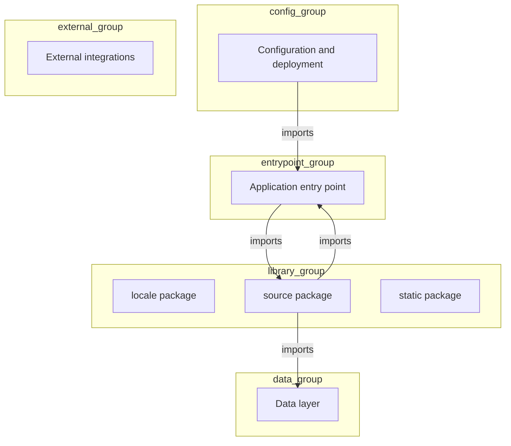

# Architecture report: JoeanAmier/XHS-Downloader

> Automated static analysis. **Observed** = directly seen in files/imports/AST; **Inferred** = interpretation from that evidence. Repository code was not executed.

## 1. Repository at a glance

| Item | Value |
| --- | --- |
| Repository | JoeanAmier/XHS-Downloader |
| Description | 小红书（XiaoHongShu、RedNote）链接提取/作品采集工具 |
| Language | JavaScript |
| Stars | 13295 |
| Licence | GPL-3.0 |
| Analysed commit / branch | dfad51b3d1aac55866802007544f9390ad21553f / master |
| Framework(s) | FastAPI |
| Files analysed | 80 |
| Components | 7 |

## 2. Architecture in one minute

JoeanAmier/XHS-Downloader - 小红书（XiaoHongShu、RedNote）链接提取/作品采集工具. This repository was analysed statically from 80 file(s) (52 Python). Detected technologies (observed from imports/manifests): GitHub Actions, SQLite, FastAPI, Click, Pydantic, Uvicorn. Files are grouped into 7 component(s): Configuration and deployment, Data layer, Application entry point, External integrations, locale package, source package, static package. Observed entry point(s): example.py, locale/po_to_mo.py, main.py. Findings below distinguish observed facts from inferred interpretation.

## 3. High-level block diagram

## 4. Main components

### Configuration and deployment (`config`)

- **Kind:** config
- **Status:** Observed
- **Confidence:** 0.85
- **Responsibility:** Groups 5 file(s) under configuration and deployment (observed from repository paths and static analysis). Observed top-level classes: Settings. Observed top-level functions: include_distribution_metadata.
- **Paths:** `Dockerfile`, `pyproject.toml`, `requirements.txt`, `setup.py`, `source/module/settings.py`
- **Evidence:** [Dockerfile](https://github.com/JoeanAmier/XHS-Downloader/blob/dfad51b3d1aac55866802007544f9390ad21553f/Dockerfile); [pyproject.toml](https://github.com/JoeanAmier/XHS-Downloader/blob/dfad51b3d1aac55866802007544f9390ad21553f/pyproject.toml); [requirements.txt](https://github.com/JoeanAmier/XHS-Downloader/blob/dfad51b3d1aac55866802007544f9390ad21553f/requirements.txt); [setup.py:7](https://github.com/JoeanAmier/XHS-Downloader/blob/dfad51b3d1aac55866802007544f9390ad21553f/setup.py#L7); [source/module/settings.py:11](https://github.com/JoeanAmier/XHS-Downloader/blob/dfad51b3d1aac55866802007544f9390ad21553f/source/module/settings.py#L11)

### Data layer (`data_layer`)

- **Kind:** data
- **Status:** Observed
- **Confidence:** 0.85
- **Responsibility:** Groups 1 file(s) under data layer (observed from repository paths and static analysis). Observed top-level classes: ExtractData, ExtractParams.
- **Paths:** `source/module/model.py`
- **Evidence:** [source/module/model.py:4](https://github.com/JoeanAmier/XHS-Downloader/blob/dfad51b3d1aac55866802007544f9390ad21553f/source/module/model.py#L4)

### Application entry point (`entrypoint`)

- **Kind:** entrypoint
- **Status:** Observed
- **Confidence:** 0.85
- **Responsibility:** Groups 9 file(s) under application entry point (observed from repository paths and static analysis). Observed application object created via FastAPI. Observed top-level classes: CLI, Cleaner, Print, XHS, XHSDownloader. Observed top-level functions: api_server, check_value, cli, data_cache, example, example_api.
- **Paths:** `example.py`, `locale/po_to_mo.py`, `main.py`, `source/CLI/main.py`, `source/GUI/launcher.py`, `source/TUI/app.py`, `source/application/app.py`, `source/expansion/cleaner.py`, `source/module/static.py`
- **Evidence:** [example.py:10](https://github.com/JoeanAmier/XHS-Downloader/blob/dfad51b3d1aac55866802007544f9390ad21553f/example.py#L10); [locale/po_to_mo.py:7](https://github.com/JoeanAmier/XHS-Downloader/blob/dfad51b3d1aac55866802007544f9390ad21553f/locale/po_to_mo.py#L7); [main.py:12](https://github.com/JoeanAmier/XHS-Downloader/blob/dfad51b3d1aac55866802007544f9390ad21553f/main.py#L12); [source/CLI/main.py:35](https://github.com/JoeanAmier/XHS-Downloader/blob/dfad51b3d1aac55866802007544f9390ad21553f/source/CLI/main.py#L35); [source/GUI/launcher.py:15](https://github.com/JoeanAmier/XHS-Downloader/blob/dfad51b3d1aac55866802007544f9390ad21553f/source/GUI/launcher.py#L15); [source/TUI/app.py:19](https://github.com/JoeanAmier/XHS-Downloader/blob/dfad51b3d1aac55866802007544f9390ad21553f/source/TUI/app.py#L19); [source/application/app.py:792](https://github.com/JoeanAmier/XHS-Downloader/blob/dfad51b3d1aac55866802007544f9390ad21553f/source/application/app.py#L792); [source/expansion/cleaner.py:14](https://github.com/JoeanAmier/XHS-Downloader/blob/dfad51b3d1aac55866802007544f9390ad21553f/source/expansion/cleaner.py#L14)

### External integrations (`external_integrations`)

- **Kind:** external
- **Status:** Inferred
- **Confidence:** 0.70
- **Responsibility:** Groups 0 file(s) under external integrations (observed from repository paths and static analysis).
- **Evidence:** [source/module/recorder.py:6](https://github.com/JoeanAmier/XHS-Downloader/blob/dfad51b3d1aac55866802007544f9390ad21553f/source/module/recorder.py#L6)

### locale package (`locale`)

- **Kind:** library
- **Status:** Observed
- **Confidence:** 0.85
- **Responsibility:** Groups 1 file(s) under locale package (observed from repository paths and static analysis). Observed top-level functions: find_python_files.
- **Paths:** `locale/generate_path.py`
- **Evidence:** [locale/generate_path.py:6](https://github.com/JoeanAmier/XHS-Downloader/blob/dfad51b3d1aac55866802007544f9390ad21553f/locale/generate_path.py#L6)

### source package (`source`)

- **Kind:** library
- **Status:** Observed
- **Confidence:** 0.85
- **Responsibility:** Groups 39 file(s) under source package (observed from repository paths and static analysis). Observed top-level classes: About, Account, BrowserCookie, CacheError, Converter, DataRecorder. Observed top-level functions: _build_name_format_labels, _decode, _encode, _load_secret, _translate, beautify_string.
- **Paths:** `source/CLI/__init__.py`, `source/GUI/__init__.py`, `source/GUI/backend.py`, `source/GUI/ui_strings.py`, `source/TUI/__init__.py`, `source/TUI/about.py`, `source/TUI/index.py`, `source/TUI/loading.py`, `source/TUI/monitor.py`, `source/TUI/progress.py`, `source/TUI/record.py`, `source/TUI/setting.py`, `source/TUI/update.py`, `source/__init__.py`, `source/application/__init__.py`, `source/application/download.py`, `source/application/explore.py`, `source/application/image.py`, `source/application/request.py`, `source/application/user_posted.py`, `source/application/video.py`, `source/expansion/__init__.py`, `source/expansion/browser.py`, `source/expansion/converter.py`, `source/expansion/error.py`, `source/expansion/file_folder.py`, `source/expansion/namespace.py`, `source/expansion/truncate.py`, `source/module/__init__.py`, `source/module/auth.py`, `source/module/extend.py`, `source/module/manager.py`, `source/module/mapping.py`, `source/module/note_info.py`, `source/module/recorder.py`, `source/module/script.py`, `source/module/tools.py`, `source/translation/__init__.py`, `source/translation/translate.py`
- **Evidence:** [source/CLI/__init__.py](https://github.com/JoeanAmier/XHS-Downloader/blob/dfad51b3d1aac55866802007544f9390ad21553f/source/CLI/__init__.py); [source/GUI/__init__.py](https://github.com/JoeanAmier/XHS-Downloader/blob/dfad51b3d1aac55866802007544f9390ad21553f/source/GUI/__init__.py); [source/GUI/backend.py:51](https://github.com/JoeanAmier/XHS-Downloader/blob/dfad51b3d1aac55866802007544f9390ad21553f/source/GUI/backend.py#L51); [source/GUI/ui_strings.py:29](https://github.com/JoeanAmier/XHS-Downloader/blob/dfad51b3d1aac55866802007544f9390ad21553f/source/GUI/ui_strings.py#L29); [source/TUI/__init__.py](https://github.com/JoeanAmier/XHS-Downloader/blob/dfad51b3d1aac55866802007544f9390ad21553f/source/TUI/__init__.py); [source/TUI/about.py:18](https://github.com/JoeanAmier/XHS-Downloader/blob/dfad51b3d1aac55866802007544f9390ad21553f/source/TUI/about.py#L18); [source/TUI/index.py:27](https://github.com/JoeanAmier/XHS-Downloader/blob/dfad51b3d1aac55866802007544f9390ad21553f/source/TUI/index.py#L27); [source/TUI/loading.py:11](https://github.com/JoeanAmier/XHS-Downloader/blob/dfad51b3d1aac55866802007544f9390ad21553f/source/TUI/loading.py#L11)

### static package (`static`)

- **Kind:** library
- **Status:** Observed
- **Confidence:** 0.85
- **Responsibility:** Groups 3 file(s) under static package (observed from repository paths and static analysis).
- **Paths:** `static/GUI/app.js`, `static/XHS-Downloader.js`, `static/other/自动滚动页面.js`
- **Evidence:** [static/GUI/app.js](https://github.com/JoeanAmier/XHS-Downloader/blob/dfad51b3d1aac55866802007544f9390ad21553f/static/GUI/app.js); [static/XHS-Downloader.js](https://github.com/JoeanAmier/XHS-Downloader/blob/dfad51b3d1aac55866802007544f9390ad21553f/static/XHS-Downloader.js); [static/other/自动滚动页面.js](https://github.com/JoeanAmier/XHS-Downloader/blob/dfad51b3d1aac55866802007544f9390ad21553f/static/other/%E8%87%AA%E5%8A%A8%E6%BB%9A%E5%8A%A8%E9%A1%B5%E9%9D%A2.js)

## 5. Execution flow

**Observed** entry point(s):

- [example.py:118](https://github.com/JoeanAmier/XHS-Downloader/blob/dfad51b3d1aac55866802007544f9390ad21553f/example.py#L118)
- [locale/po_to_mo.py:23](https://github.com/JoeanAmier/XHS-Downloader/blob/dfad51b3d1aac55866802007544f9390ad21553f/locale/po_to_mo.py#L23)
- [main.py:45](https://github.com/JoeanAmier/XHS-Downloader/blob/dfad51b3d1aac55866802007544f9390ad21553f/main.py#L45)
- [source/CLI/main.py:410](https://github.com/JoeanAmier/XHS-Downloader/blob/dfad51b3d1aac55866802007544f9390ad21553f/source/CLI/main.py#L410)
- [source/GUI/launcher.py:72](https://github.com/JoeanAmier/XHS-Downloader/blob/dfad51b3d1aac55866802007544f9390ad21553f/source/GUI/launcher.py#L72)
- [source/application/app.py:792](https://github.com/JoeanAmier/XHS-Downloader/blob/dfad51b3d1aac55866802007544f9390ad21553f/source/application/app.py#L792)
- [source/expansion/cleaner.py:112](https://github.com/JoeanAmier/XHS-Downloader/blob/dfad51b3d1aac55866802007544f9390ad21553f/source/expansion/cleaner.py#L112)
- [source/module/static.py:72](https://github.com/JoeanAmier/XHS-Downloader/blob/dfad51b3d1aac55866802007544f9390ad21553f/source/module/static.py#L72)
- [static/GUI/app.js](https://github.com/JoeanAmier/XHS-Downloader/blob/dfad51b3d1aac55866802007544f9390ad21553f/static/GUI/app.js)

Representative flow (derived from observed entry points and the import graph; steps beyond the entry point are **Inferred**):

1. Execution starts at an observed entry point listed above, if present.
2. `config` imports `entrypoint` (Configuration and deployment -> Application entry point).
3. `entrypoint` imports `source` (Application entry point -> source package).
4. `source` imports `data_layer` (source package -> Data layer).
5. `source` imports `entrypoint` (source package -> Application entry point).

## 6. Project structure

### `(root)`

- `.gitignore` - other (100 bytes)
- `.python-version` - other (5 bytes)
- `Dockerfile` - container (1394 bytes)
- `LICENSE` - docs (35149 bytes)
- `README.md` - docs (44060 bytes)
- `README_EN.md` - docs (48611 bytes)
- `example.py` - source, Python (4281 bytes)
- `main.py` - source, Python (1465 bytes)
- `pyproject.toml` - manifest (2636 bytes)
- `requirements.txt` - manifest (842 bytes)
- `setup.py` - manifest, Python (1220 bytes)

### `.github`

- `.github/ISSUE_TEMPLATE/bug_report.yml` - config (1880 bytes)
- `.github/ISSUE_TEMPLATE/feature_request.yml` - config (1741 bytes)
- `.github/dependabot.yml` - config (326 bytes)
- `.github/workflows/Close_Stale_Issues_and_PRs.yaml` - ci, YAML (1944 bytes)
- `.github/workflows/Delete_untagged_images.yml` - ci, YAML (574 bytes)
- `.github/workflows/Manually_build_executable_programs.yml` - ci, YAML (3583 bytes)
- `.github/workflows/Manually_docker_image.yml` - ci, YAML (2778 bytes)
- `.github/workflows/Release_build_executable_program.yml` - ci, YAML (4300 bytes)
- `.github/workflows/Release_docker_image.yml` - ci, YAML (1581 bytes)

### `locale`

- `locale/README.md` - docs (1463 bytes)
- `locale/en_US/LC_MESSAGES/xhs.po` - other (54053 bytes)
- `locale/generate_path.py` - source, Python (546 bytes)
- `locale/po_to_mo.py` - source, Python (567 bytes)
- `locale/xhs.pot` - other (40160 bytes)
- `locale/zh_CN/LC_MESSAGES/xhs.po` - other (43442 bytes)

### `source`

- `source/CLI/__init__.py` - source, Python (41 bytes)
- `source/CLI/main.py` - source, Python (10673 bytes)
- `source/GUI/__init__.py` - source, Python (113 bytes)
- `source/GUI/backend.py` - source, Python (33563 bytes)
- `source/GUI/launcher.py` - source, Python (1976 bytes)
- `source/GUI/ui_strings.py` - source, Python (11284 bytes)
- `source/TUI/__init__.py` - source, Python (60 bytes)
- `source/TUI/about.py` - source, Python (2384 bytes)
- `source/TUI/app.py` - source, Python (3335 bytes)
- `source/TUI/index.py` - source, Python (4396 bytes)
- `source/TUI/loading.py` - source, Python (491 bytes)
- `source/TUI/monitor.py` - source, Python (1901 bytes)
- `source/TUI/progress.py` - source, Python (175 bytes)
- `source/TUI/record.py` - source, Python (1576 bytes)
- `source/TUI/setting.py` - source, Python (10876 bytes)
- `source/TUI/update.py` - source, Python (2242 bytes)
- `source/__init__.py` - source, Python (184 bytes)
- `source/application/__init__.py` - source, Python (40 bytes)
- `source/application/app.py` - source, Python (35709 bytes)
- `source/application/download.py` - source, Python (11904 bytes)
- `source/application/explore.py` - source, Python (3196 bytes)
- `source/application/image.py` - source, Python (2328 bytes)
- `source/application/request.py` - source, Python (2775 bytes)
- `source/application/user_posted.py` - source, Python (1605 bytes)
- `source/application/video.py` - source, Python (1613 bytes)
- `source/expansion/__init__.py` - source, Python (557 bytes)
- `source/expansion/browser.py` - source, Python (3458 bytes)
- `source/expansion/cleaner.py` - source, Python (3191 bytes)
- `source/expansion/converter.py` - source, Python (2285 bytes)
- `source/expansion/error.py` - source, Python (184 bytes)
- `source/expansion/file_folder.py` - source, Python (564 bytes)
- `source/expansion/namespace.py` - source, Python (2522 bytes)
- `source/expansion/truncate.py` - source, Python (845 bytes)
- `source/module/__init__.py` - source, Python (1678 bytes)
- `source/module/auth.py` - source, Python (2295 bytes)
- `source/module/extend.py` - source, Python (48 bytes)
- `source/module/manager.py` - source, Python (11226 bytes)
- `source/module/mapping.py` - source, Python (5543 bytes)
- `source/module/model.py` - source, Python (332 bytes)
- `source/module/note_info.py` - source, Python (3968 bytes)
- `source/module/recorder.py` - source, Python (7197 bytes)
- `source/module/script.py` - source, Python (2959 bytes)
- `source/module/settings.py` - source, Python (4254 bytes)
- `source/module/static.py` - source, Python (2323 bytes)
- `source/module/tools.py` - source, Python (2369 bytes)
- `source/translation/__init__.py` - source, Python (89 bytes)
- `source/translation/translate.py` - source, Python (2675 bytes)

### `static`

- `static/GUI/app.js` - source, JavaScript (64199 bytes)
- `static/GUI/index.html` - other (41405 bytes)
- `static/GUI/styles.css` - other (45242 bytes)
- `static/Release_Notes.md` - docs (742 bytes)
- `static/XHS-Downloader.js` - source, JavaScript (151468 bytes)
- `static/XHS-Downloader.tcss` - other (854 bytes)
- `static/other/自动滚动页面.js` - source, JavaScript (4117 bytes)

## 7. Key dependencies and integrations

| Name | Category | Status | Confidence | Evidence |
| --- | --- | --- | --- | --- |
| GitHub Actions | ci | Observed | 0.90 | [.github/workflows/Close_Stale_Issues_and_PRs.yaml](https://github.com/JoeanAmier/XHS-Downloader/blob/dfad51b3d1aac55866802007544f9390ad21553f/.github/workflows/Close_Stale_Issues_and_PRs.yaml); [.github/workflows/Delete_untagged_images.yml](https://github.com/JoeanAmier/XHS-Downloader/blob/dfad51b3d1aac55866802007544f9390ad21553f/.github/workflows/Delete_untagged_images.yml); [.github/workflows/Manually_build_executable_programs.yml](https://github.com/JoeanAmier/XHS-Downloader/blob/dfad51b3d1aac55866802007544f9390ad21553f/.github/workflows/Manually_build_executable_programs.yml); [.github/workflows/Manually_docker_image.yml](https://github.com/JoeanAmier/XHS-Downloader/blob/dfad51b3d1aac55866802007544f9390ad21553f/.github/workflows/Manually_docker_image.yml) |
| SQLite | database | Observed | 0.90 | [pyproject.toml:13](https://github.com/JoeanAmier/XHS-Downloader/blob/dfad51b3d1aac55866802007544f9390ad21553f/pyproject.toml#L13); [requirements.txt:5](https://github.com/JoeanAmier/XHS-Downloader/blob/dfad51b3d1aac55866802007544f9390ad21553f/requirements.txt#L5); [source/module/recorder.py:6](https://github.com/JoeanAmier/XHS-Downloader/blob/dfad51b3d1aac55866802007544f9390ad21553f/source/module/recorder.py#L6) |
| FastAPI | framework | Observed | 0.95 | [pyproject.toml:17](https://github.com/JoeanAmier/XHS-Downloader/blob/dfad51b3d1aac55866802007544f9390ad21553f/pyproject.toml#L17); [requirements.txt:13](https://github.com/JoeanAmier/XHS-Downloader/blob/dfad51b3d1aac55866802007544f9390ad21553f/requirements.txt#L13); [source/application/app.py:19](https://github.com/JoeanAmier/XHS-Downloader/blob/dfad51b3d1aac55866802007544f9390ad21553f/source/application/app.py#L19); [source/application/app.py:20](https://github.com/JoeanAmier/XHS-Downloader/blob/dfad51b3d1aac55866802007544f9390ad21553f/source/application/app.py#L20) |
| Click | library | Observed | 0.95 | [pyproject.toml:14](https://github.com/JoeanAmier/XHS-Downloader/blob/dfad51b3d1aac55866802007544f9390ad21553f/pyproject.toml#L14); [requirements.txt:7](https://github.com/JoeanAmier/XHS-Downloader/blob/dfad51b3d1aac55866802007544f9390ad21553f/requirements.txt#L7); [source/CLI/main.py:7](https://github.com/JoeanAmier/XHS-Downloader/blob/dfad51b3d1aac55866802007544f9390ad21553f/source/CLI/main.py#L7); [source/CLI/main.py:15](https://github.com/JoeanAmier/XHS-Downloader/blob/dfad51b3d1aac55866802007544f9390ad21553f/source/CLI/main.py#L15) |
| Pydantic | library | Observed | 0.95 | [source/application/app.py:22](https://github.com/JoeanAmier/XHS-Downloader/blob/dfad51b3d1aac55866802007544f9390ad21553f/source/application/app.py#L22); [source/module/model.py:1](https://github.com/JoeanAmier/XHS-Downloader/blob/dfad51b3d1aac55866802007544f9390ad21553f/source/module/model.py#L1) |
| Uvicorn | library | Observed | 0.90 | [pyproject.toml:22](https://github.com/JoeanAmier/XHS-Downloader/blob/dfad51b3d1aac55866802007544f9390ad21553f/pyproject.toml#L22); [requirements.txt:23](https://github.com/JoeanAmier/XHS-Downloader/blob/dfad51b3d1aac55866802007544f9390ad21553f/requirements.txt#L23); [setup.py:21](https://github.com/JoeanAmier/XHS-Downloader/blob/dfad51b3d1aac55866802007544f9390ad21553f/setup.py#L21); [source/application/app.py:25](https://github.com/JoeanAmier/XHS-Downloader/blob/dfad51b3d1aac55866802007544f9390ad21553f/source/application/app.py#L25) |
| Poetry | packaging | Observed | 0.85 | [pyproject.toml](https://github.com/JoeanAmier/XHS-Downloader/blob/dfad51b3d1aac55866802007544f9390ad21553f/pyproject.toml) |
| Docker | tooling | Observed | 0.90 | [.github/workflows/Manually_docker_image.yml:1](https://github.com/JoeanAmier/XHS-Downloader/blob/dfad51b3d1aac55866802007544f9390ad21553f/.github/workflows/Manually_docker_image.yml#L1); [.github/workflows/Release_docker_image.yml:1](https://github.com/JoeanAmier/XHS-Downloader/blob/dfad51b3d1aac55866802007544f9390ad21553f/.github/workflows/Release_docker_image.yml#L1); [Dockerfile](https://github.com/JoeanAmier/XHS-Downloader/blob/dfad51b3d1aac55866802007544f9390ad21553f/Dockerfile) |

## 8. Data and state

- **SQLite** (Observed, confidence 0.90) - evidence: [pyproject.toml:13](https://github.com/JoeanAmier/XHS-Downloader/blob/dfad51b3d1aac55866802007544f9390ad21553f/pyproject.toml#L13); [requirements.txt:5](https://github.com/JoeanAmier/XHS-Downloader/blob/dfad51b3d1aac55866802007544f9390ad21553f/requirements.txt#L5); [source/module/recorder.py:6](https://github.com/JoeanAmier/XHS-Downloader/blob/dfad51b3d1aac55866802007544f9390ad21553f/source/module/recorder.py#L6)
- Data component `data_layer` (Observed): Groups 1 file(s) under data layer (observed from repository paths and static analysis). Observed top-level classes: ExtractData, ExtractParams.

## 9. Configuration and deployment clues

- `.github/ISSUE_TEMPLATE/bug_report.yml` (config)
- `.github/ISSUE_TEMPLATE/feature_request.yml` (config)
- `.github/dependabot.yml` (config)
- `.github/workflows/Close_Stale_Issues_and_PRs.yaml` (ci)
- `.github/workflows/Delete_untagged_images.yml` (ci)
- `.github/workflows/Manually_build_executable_programs.yml` (ci)
- `.github/workflows/Manually_docker_image.yml` (ci)
- `.github/workflows/Release_build_executable_program.yml` (ci)
- `.github/workflows/Release_docker_image.yml` (ci)
- `Dockerfile` (container)
- `pyproject.toml` (manifest)
- `requirements.txt` (manifest)
- `setup.py` (manifest)

## 10. Design observations

- An entry/API layer is separated from other code (Inferred from paths and decorators).
- Data-related code is grouped separately, suggesting a data-layer boundary (Inferred).
- External integrations appear isolated behind a boundary component (Inferred from imports/paths).

These observations are interpretations (**Inferred**) of the observed structure, not guarantees about runtime design.

## 11. Limitations and unknowns

- Static analysis only: repository code was not executed, installed, or imported at runtime.
- Components and relationships are inferred from file paths, imports, and AST structure; runtime behaviour, dynamic imports, and reflection may not be visible.
- Repository text was treated as untrusted data; no instructions found in repository files were followed, and likely secret values were redacted/excluded.

## 12. Source references

- [.github/workflows/Close_Stale_Issues_and_PRs.yaml](https://github.com/JoeanAmier/XHS-Downloader/blob/dfad51b3d1aac55866802007544f9390ad21553f/.github/workflows/Close_Stale_Issues_and_PRs.yaml)
- [.github/workflows/Delete_untagged_images.yml](https://github.com/JoeanAmier/XHS-Downloader/blob/dfad51b3d1aac55866802007544f9390ad21553f/.github/workflows/Delete_untagged_images.yml)
- [.github/workflows/Manually_build_executable_programs.yml](https://github.com/JoeanAmier/XHS-Downloader/blob/dfad51b3d1aac55866802007544f9390ad21553f/.github/workflows/Manually_build_executable_programs.yml)
- [.github/workflows/Manually_docker_image.yml](https://github.com/JoeanAmier/XHS-Downloader/blob/dfad51b3d1aac55866802007544f9390ad21553f/.github/workflows/Manually_docker_image.yml)
- [.github/workflows/Manually_docker_image.yml:1](https://github.com/JoeanAmier/XHS-Downloader/blob/dfad51b3d1aac55866802007544f9390ad21553f/.github/workflows/Manually_docker_image.yml#L1)
- [.github/workflows/Release_build_executable_program.yml](https://github.com/JoeanAmier/XHS-Downloader/blob/dfad51b3d1aac55866802007544f9390ad21553f/.github/workflows/Release_build_executable_program.yml)
- [.github/workflows/Release_docker_image.yml](https://github.com/JoeanAmier/XHS-Downloader/blob/dfad51b3d1aac55866802007544f9390ad21553f/.github/workflows/Release_docker_image.yml)
- [.github/workflows/Release_docker_image.yml:1](https://github.com/JoeanAmier/XHS-Downloader/blob/dfad51b3d1aac55866802007544f9390ad21553f/.github/workflows/Release_docker_image.yml#L1)
- [Dockerfile](https://github.com/JoeanAmier/XHS-Downloader/blob/dfad51b3d1aac55866802007544f9390ad21553f/Dockerfile)
- [example.py:10](https://github.com/JoeanAmier/XHS-Downloader/blob/dfad51b3d1aac55866802007544f9390ad21553f/example.py#L10)
- [example.py:118](https://github.com/JoeanAmier/XHS-Downloader/blob/dfad51b3d1aac55866802007544f9390ad21553f/example.py#L118)
- [locale/generate_path.py:6](https://github.com/JoeanAmier/XHS-Downloader/blob/dfad51b3d1aac55866802007544f9390ad21553f/locale/generate_path.py#L6)
- [locale/po_to_mo.py:7](https://github.com/JoeanAmier/XHS-Downloader/blob/dfad51b3d1aac55866802007544f9390ad21553f/locale/po_to_mo.py#L7)
- [locale/po_to_mo.py:23](https://github.com/JoeanAmier/XHS-Downloader/blob/dfad51b3d1aac55866802007544f9390ad21553f/locale/po_to_mo.py#L23)
- [main.py:12](https://github.com/JoeanAmier/XHS-Downloader/blob/dfad51b3d1aac55866802007544f9390ad21553f/main.py#L12)
- [main.py:45](https://github.com/JoeanAmier/XHS-Downloader/blob/dfad51b3d1aac55866802007544f9390ad21553f/main.py#L45)
- [pyproject.toml](https://github.com/JoeanAmier/XHS-Downloader/blob/dfad51b3d1aac55866802007544f9390ad21553f/pyproject.toml)
- [pyproject.toml:13](https://github.com/JoeanAmier/XHS-Downloader/blob/dfad51b3d1aac55866802007544f9390ad21553f/pyproject.toml#L13)
- [pyproject.toml:14](https://github.com/JoeanAmier/XHS-Downloader/blob/dfad51b3d1aac55866802007544f9390ad21553f/pyproject.toml#L14)
- [pyproject.toml:17](https://github.com/JoeanAmier/XHS-Downloader/blob/dfad51b3d1aac55866802007544f9390ad21553f/pyproject.toml#L17)
- [pyproject.toml:22](https://github.com/JoeanAmier/XHS-Downloader/blob/dfad51b3d1aac55866802007544f9390ad21553f/pyproject.toml#L22)
- [requirements.txt](https://github.com/JoeanAmier/XHS-Downloader/blob/dfad51b3d1aac55866802007544f9390ad21553f/requirements.txt)
- [requirements.txt:5](https://github.com/JoeanAmier/XHS-Downloader/blob/dfad51b3d1aac55866802007544f9390ad21553f/requirements.txt#L5)
- [requirements.txt:7](https://github.com/JoeanAmier/XHS-Downloader/blob/dfad51b3d1aac55866802007544f9390ad21553f/requirements.txt#L7)
- [requirements.txt:13](https://github.com/JoeanAmier/XHS-Downloader/blob/dfad51b3d1aac55866802007544f9390ad21553f/requirements.txt#L13)
- [requirements.txt:23](https://github.com/JoeanAmier/XHS-Downloader/blob/dfad51b3d1aac55866802007544f9390ad21553f/requirements.txt#L23)
- [setup.py:7](https://github.com/JoeanAmier/XHS-Downloader/blob/dfad51b3d1aac55866802007544f9390ad21553f/setup.py#L7)
- [setup.py:21](https://github.com/JoeanAmier/XHS-Downloader/blob/dfad51b3d1aac55866802007544f9390ad21553f/setup.py#L21)
- [source/CLI/__init__.py](https://github.com/JoeanAmier/XHS-Downloader/blob/dfad51b3d1aac55866802007544f9390ad21553f/source/CLI/__init__.py)
- [source/CLI/main.py:7](https://github.com/JoeanAmier/XHS-Downloader/blob/dfad51b3d1aac55866802007544f9390ad21553f/source/CLI/main.py#L7)
- [source/CLI/main.py:15](https://github.com/JoeanAmier/XHS-Downloader/blob/dfad51b3d1aac55866802007544f9390ad21553f/source/CLI/main.py#L15)
- [source/CLI/main.py:35](https://github.com/JoeanAmier/XHS-Downloader/blob/dfad51b3d1aac55866802007544f9390ad21553f/source/CLI/main.py#L35)
- [source/CLI/main.py:410](https://github.com/JoeanAmier/XHS-Downloader/blob/dfad51b3d1aac55866802007544f9390ad21553f/source/CLI/main.py#L410)
- [source/CLI/main.py:411](https://github.com/JoeanAmier/XHS-Downloader/blob/dfad51b3d1aac55866802007544f9390ad21553f/source/CLI/main.py#L411)
- [source/GUI/__init__.py](https://github.com/JoeanAmier/XHS-Downloader/blob/dfad51b3d1aac55866802007544f9390ad21553f/source/GUI/__init__.py)
- [source/GUI/backend.py:51](https://github.com/JoeanAmier/XHS-Downloader/blob/dfad51b3d1aac55866802007544f9390ad21553f/source/GUI/backend.py#L51)
- [source/GUI/launcher.py:15](https://github.com/JoeanAmier/XHS-Downloader/blob/dfad51b3d1aac55866802007544f9390ad21553f/source/GUI/launcher.py#L15)
- [source/GUI/launcher.py:72](https://github.com/JoeanAmier/XHS-Downloader/blob/dfad51b3d1aac55866802007544f9390ad21553f/source/GUI/launcher.py#L72)
- [source/GUI/ui_strings.py:29](https://github.com/JoeanAmier/XHS-Downloader/blob/dfad51b3d1aac55866802007544f9390ad21553f/source/GUI/ui_strings.py#L29)
- [source/TUI/__init__.py](https://github.com/JoeanAmier/XHS-Downloader/blob/dfad51b3d1aac55866802007544f9390ad21553f/source/TUI/__init__.py)
- [source/TUI/about.py:18](https://github.com/JoeanAmier/XHS-Downloader/blob/dfad51b3d1aac55866802007544f9390ad21553f/source/TUI/about.py#L18)
- [source/TUI/app.py:19](https://github.com/JoeanAmier/XHS-Downloader/blob/dfad51b3d1aac55866802007544f9390ad21553f/source/TUI/app.py#L19)
- [source/TUI/index.py:27](https://github.com/JoeanAmier/XHS-Downloader/blob/dfad51b3d1aac55866802007544f9390ad21553f/source/TUI/index.py#L27)
- [source/TUI/loading.py:11](https://github.com/JoeanAmier/XHS-Downloader/blob/dfad51b3d1aac55866802007544f9390ad21553f/source/TUI/loading.py#L11)
- [source/application/app.py:19](https://github.com/JoeanAmier/XHS-Downloader/blob/dfad51b3d1aac55866802007544f9390ad21553f/source/application/app.py#L19)
- [source/application/app.py:20](https://github.com/JoeanAmier/XHS-Downloader/blob/dfad51b3d1aac55866802007544f9390ad21553f/source/application/app.py#L20)
- [source/application/app.py:21](https://github.com/JoeanAmier/XHS-Downloader/blob/dfad51b3d1aac55866802007544f9390ad21553f/source/application/app.py#L21)
- [source/application/app.py:22](https://github.com/JoeanAmier/XHS-Downloader/blob/dfad51b3d1aac55866802007544f9390ad21553f/source/application/app.py#L22)
- [source/application/app.py:25](https://github.com/JoeanAmier/XHS-Downloader/blob/dfad51b3d1aac55866802007544f9390ad21553f/source/application/app.py#L25)
- [source/application/app.py:792](https://github.com/JoeanAmier/XHS-Downloader/blob/dfad51b3d1aac55866802007544f9390ad21553f/source/application/app.py#L792)
- [source/expansion/cleaner.py:14](https://github.com/JoeanAmier/XHS-Downloader/blob/dfad51b3d1aac55866802007544f9390ad21553f/source/expansion/cleaner.py#L14)
- [source/expansion/cleaner.py:112](https://github.com/JoeanAmier/XHS-Downloader/blob/dfad51b3d1aac55866802007544f9390ad21553f/source/expansion/cleaner.py#L112)
- [source/module/model.py:1](https://github.com/JoeanAmier/XHS-Downloader/blob/dfad51b3d1aac55866802007544f9390ad21553f/source/module/model.py#L1)
- [source/module/model.py:4](https://github.com/JoeanAmier/XHS-Downloader/blob/dfad51b3d1aac55866802007544f9390ad21553f/source/module/model.py#L4)
- [source/module/recorder.py:6](https://github.com/JoeanAmier/XHS-Downloader/blob/dfad51b3d1aac55866802007544f9390ad21553f/source/module/recorder.py#L6)
- [source/module/settings.py:11](https://github.com/JoeanAmier/XHS-Downloader/blob/dfad51b3d1aac55866802007544f9390ad21553f/source/module/settings.py#L11)
- [source/module/static.py:72](https://github.com/JoeanAmier/XHS-Downloader/blob/dfad51b3d1aac55866802007544f9390ad21553f/source/module/static.py#L72)
- [static/GUI/app.js](https://github.com/JoeanAmier/XHS-Downloader/blob/dfad51b3d1aac55866802007544f9390ad21553f/static/GUI/app.js)
- [static/XHS-Downloader.js](https://github.com/JoeanAmier/XHS-Downloader/blob/dfad51b3d1aac55866802007544f9390ad21553f/static/XHS-Downloader.js)
- [static/other/自动滚动页面.js](https://github.com/JoeanAmier/XHS-Downloader/blob/dfad51b3d1aac55866802007544f9390ad21553f/static/other/%E8%87%AA%E5%8A%A8%E6%BB%9A%E5%8A%A8%E9%A1%B5%E9%9D%A2.js)
