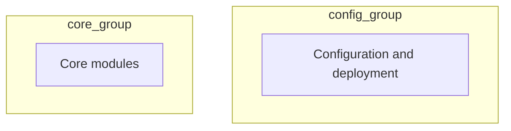

# Architecture report: Kristories/awesome-guidelines

> Automated static analysis. **Observed** = directly seen in files/imports/AST; **Inferred** = interpretation from that evidence. Repository code was not executed.

## 1. Repository at a glance

| Item | Value |
| --- | --- |
| Repository | Kristories/awesome-guidelines |
| Description | Programming style, best practices, and coding conventions. |
| Language | JavaScript |
| Stars | 11263 |
| Licence | CC0-1.0 |
| Analysed commit / branch | a27b09da1f53cbfff7a82b87c4043a4509dd40e1 / main |
| Framework(s) | None detected |
| Files analysed | 14 |
| Components | 2 |

## 2. Architecture in one minute

Kristories/awesome-guidelines - Programming style, best practices, and coding conventions.. This repository was analysed statically from 14 file(s) (0 Python). Detected technologies (observed from imports/manifests): GitHub Actions. Files are grouped into 2 component(s): Configuration and deployment, Core modules. Findings below distinguish observed facts from inferred interpretation.

## 3. High-level block diagram

## 4. Main components

### Configuration and deployment (`config`)

- **Kind:** config
- **Status:** Observed
- **Confidence:** 0.85
- **Responsibility:** Groups 2 file(s) under configuration and deployment (observed from repository paths and static analysis).
- **Paths:** `package.json`, `travis.yml`
- **Evidence:** [package.json](https://github.com/Kristories/awesome-guidelines/blob/a27b09da1f53cbfff7a82b87c4043a4509dd40e1/package.json); [travis.yml](https://github.com/Kristories/awesome-guidelines/blob/a27b09da1f53cbfff7a82b87c4043a4509dd40e1/travis.yml)

### Core modules (`core`)

- **Kind:** core
- **Status:** Observed
- **Confidence:** 0.85
- **Responsibility:** Groups 1 file(s) under core modules (observed from repository paths and static analysis).
- **Paths:** `test.js`
- **Evidence:** [test.js](https://github.com/Kristories/awesome-guidelines/blob/a27b09da1f53cbfff7a82b87c4043a4509dd40e1/test.js)

## 5. Execution flow

No entry point was observed; the startup flow below is therefore limited.

Representative flow (derived from observed entry points and the import graph; steps beyond the entry point are **Inferred**):

1. Execution starts at an observed entry point listed above, if present.
2. No internal import relationships between components were observed.

## 6. Project structure

### `(root)`

- `.editorconfig` - config (264 bytes)
- `.gitattributes` - other (245 bytes)
- `.gitignore` - other (14 bytes)
- `LICENSE` - docs (6555 bytes)
- `README.md` - docs (22380 bytes)
- `code-of-conduct.md` - docs (1665 bytes)
- `contributing.md` - docs (1901 bytes)
- `package.json` - manifest (106 bytes)
- `test.js` - source, JavaScript (68 bytes)
- `travis.yml` - config (62 bytes)

### `.github`

- `.github/dependabot.yml` - config (178 bytes)
- `.github/pull_request_template.md` - docs (352 bytes)
- `.github/workflows/lint.yml` - ci, YAML (214 bytes)
- `.github/workflows/stale.yml` - ci, YAML (612 bytes)

## 7. Key dependencies and integrations

| Name | Category | Status | Confidence | Evidence |
| --- | --- | --- | --- | --- |
| GitHub Actions | ci | Observed | 0.90 | [.github/workflows/lint.yml](https://github.com/Kristories/awesome-guidelines/blob/a27b09da1f53cbfff7a82b87c4043a4509dd40e1/.github/workflows/lint.yml); [.github/workflows/stale.yml](https://github.com/Kristories/awesome-guidelines/blob/a27b09da1f53cbfff7a82b87c4043a4509dd40e1/.github/workflows/stale.yml) |

## 8. Data and state

No database, cache, queue, or persistent-state usage was observed in the analysed files. State handling, if any, may be in-memory or in files that were not analysed.

## 9. Configuration and deployment clues

- `.editorconfig` (config)
- `.github/dependabot.yml` (config)
- `.github/workflows/lint.yml` (ci)
- `.github/workflows/stale.yml` (ci)
- `package.json` (manifest)
- `travis.yml` (config)

## 10. Design observations

- No strong design patterns could be established from the available evidence.

These observations are interpretations (**Inferred**) of the observed structure, not guarantees about runtime design.

## 11. Limitations and unknowns

- Static analysis only: repository code was not executed, installed, or imported at runtime.
- Components and relationships are inferred from file paths, imports, and AST structure; runtime behaviour, dynamic imports, and reflection may not be visible.
- No clear application entry point was observed in the analysed files.
- Repository text was treated as untrusted data; no instructions found in repository files were followed, and likely secret values were redacted/excluded.
- JavaScript and TypeScript files were inventoried from paths and package manifests. They were not parsed with a full language AST, and repository code was not executed.

## 12. Source references

- [.github/workflows/lint.yml](https://github.com/Kristories/awesome-guidelines/blob/a27b09da1f53cbfff7a82b87c4043a4509dd40e1/.github/workflows/lint.yml)
- [.github/workflows/stale.yml](https://github.com/Kristories/awesome-guidelines/blob/a27b09da1f53cbfff7a82b87c4043a4509dd40e1/.github/workflows/stale.yml)
- [package.json](https://github.com/Kristories/awesome-guidelines/blob/a27b09da1f53cbfff7a82b87c4043a4509dd40e1/package.json)
- [test.js](https://github.com/Kristories/awesome-guidelines/blob/a27b09da1f53cbfff7a82b87c4043a4509dd40e1/test.js)
- [travis.yml](https://github.com/Kristories/awesome-guidelines/blob/a27b09da1f53cbfff7a82b87c4043a4509dd40e1/travis.yml)
