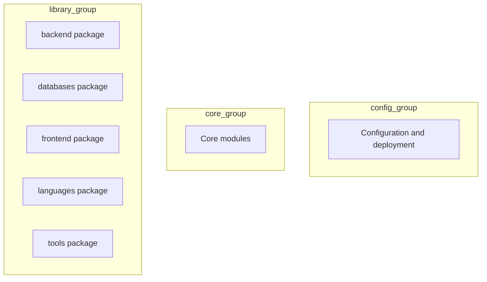

# Architecture report: LeCoupa/awesome-cheatsheets

> Automated static analysis. **Observed** = directly seen in files/imports/AST; **Inferred** = interpretation from that evidence. Repository code was not executed.

## 1. Repository at a glance

| Item | Value |
| --- | --- |
| Repository | LeCoupa/awesome-cheatsheets |
| Description | 👩‍💻👨‍💻 Awesome cheatsheets for popular programming languages, frameworks and development tools. They include everything you should know in one single file. |
| Language | JavaScript |
| Stars | 46674 |
| Licence | MIT |
| Analysed commit / branch | 774445f64658289826909165d4ef446f4cf59f13 / master |
| Framework(s) | None detected |
| Files analysed | 60 |
| Components | 7 |

## 2. Architecture in one minute

LeCoupa/awesome-cheatsheets - 👩‍💻👨‍💻 Awesome cheatsheets for popular programming languages, frameworks and development tools. They include everything you should know in one single file.. This repository was analysed statically from 60 file(s) (1 Python). Detected technologies (observed from imports/manifests): no known frameworks/libraries. Files are grouped into 7 component(s): backend package, Configuration and deployment, Core modules, databases package, frontend package, languages package, tools package. Findings below distinguish observed facts from inferred interpretation.

## 3. High-level block diagram

## 4. Main components

### backend package (`backend`)

- **Kind:** library
- **Status:** Observed
- **Confidence:** 0.85
- **Responsibility:** Groups 8 file(s) under backend package (observed from repository paths and static analysis).
- **Paths:** `backend/adonis.js`, `backend/django.py`, `backend/express.js`, `backend/feathers.js`, `backend/laravel.php`, `backend/moleculer.js`, `backend/node.js`, `backend/sails.js`
- **Evidence:** [backend/adonis.js](https://github.com/LeCoupa/awesome-cheatsheets/blob/774445f64658289826909165d4ef446f4cf59f13/backend/adonis.js); [backend/django.py](https://github.com/LeCoupa/awesome-cheatsheets/blob/774445f64658289826909165d4ef446f4cf59f13/backend/django.py); [backend/express.js](https://github.com/LeCoupa/awesome-cheatsheets/blob/774445f64658289826909165d4ef446f4cf59f13/backend/express.js); [backend/feathers.js](https://github.com/LeCoupa/awesome-cheatsheets/blob/774445f64658289826909165d4ef446f4cf59f13/backend/feathers.js); [backend/laravel.php](https://github.com/LeCoupa/awesome-cheatsheets/blob/774445f64658289826909165d4ef446f4cf59f13/backend/laravel.php); [backend/moleculer.js](https://github.com/LeCoupa/awesome-cheatsheets/blob/774445f64658289826909165d4ef446f4cf59f13/backend/moleculer.js); [backend/node.js](https://github.com/LeCoupa/awesome-cheatsheets/blob/774445f64658289826909165d4ef446f4cf59f13/backend/node.js); [backend/sails.js](https://github.com/LeCoupa/awesome-cheatsheets/blob/774445f64658289826909165d4ef446f4cf59f13/backend/sails.js)

### Configuration and deployment (`config`)

- **Kind:** config
- **Status:** Observed
- **Confidence:** 0.85
- **Responsibility:** Groups 1 file(s) under configuration and deployment (observed from repository paths and static analysis).
- **Paths:** `tools/nanobox_boxfile.yml`
- **Evidence:** [tools/nanobox_boxfile.yml](https://github.com/LeCoupa/awesome-cheatsheets/blob/774445f64658289826909165d4ef446f4cf59f13/tools/nanobox_boxfile.yml)

### Core modules (`core`)

- **Kind:** core
- **Status:** Observed
- **Confidence:** 0.85
- **Responsibility:** Groups 1 file(s) under core modules (observed from repository paths and static analysis).
- **Paths:** `commitlint.config.js`
- **Evidence:** [commitlint.config.js](https://github.com/LeCoupa/awesome-cheatsheets/blob/774445f64658289826909165d4ef446f4cf59f13/commitlint.config.js)

### databases package (`databases`)

- **Kind:** library
- **Status:** Observed
- **Confidence:** 0.85
- **Responsibility:** Groups 3 file(s) under databases package (observed from repository paths and static analysis).
- **Paths:** `databases/mongodb.sh`, `databases/mysql.sh`, `databases/redis.sh`
- **Evidence:** [databases/mongodb.sh](https://github.com/LeCoupa/awesome-cheatsheets/blob/774445f64658289826909165d4ef446f4cf59f13/databases/mongodb.sh); [databases/mysql.sh](https://github.com/LeCoupa/awesome-cheatsheets/blob/774445f64658289826909165d4ef446f4cf59f13/databases/mysql.sh); [databases/redis.sh](https://github.com/LeCoupa/awesome-cheatsheets/blob/774445f64658289826909165d4ef446f4cf59f13/databases/redis.sh)

### frontend package (`frontend`)

- **Kind:** library
- **Status:** Observed
- **Confidence:** 0.85
- **Responsibility:** Groups 6 file(s) under frontend package (observed from repository paths and static analysis).
- **Paths:** `frontend/angular.js`, `frontend/angularjs.js`, `frontend/ember.js`, `frontend/react.js`, `frontend/typescript.ts`, `frontend/vue.js`
- **Evidence:** [frontend/angular.js](https://github.com/LeCoupa/awesome-cheatsheets/blob/774445f64658289826909165d4ef446f4cf59f13/frontend/angular.js); [frontend/angularjs.js](https://github.com/LeCoupa/awesome-cheatsheets/blob/774445f64658289826909165d4ef446f4cf59f13/frontend/angularjs.js); [frontend/ember.js](https://github.com/LeCoupa/awesome-cheatsheets/blob/774445f64658289826909165d4ef446f4cf59f13/frontend/ember.js); [frontend/react.js](https://github.com/LeCoupa/awesome-cheatsheets/blob/774445f64658289826909165d4ef446f4cf59f13/frontend/react.js); [frontend/typescript.ts](https://github.com/LeCoupa/awesome-cheatsheets/blob/774445f64658289826909165d4ef446f4cf59f13/frontend/typescript.ts); [frontend/vue.js](https://github.com/LeCoupa/awesome-cheatsheets/blob/774445f64658289826909165d4ef446f4cf59f13/frontend/vue.js)

### languages package (`languages`)

- **Kind:** library
- **Status:** Observed
- **Confidence:** 0.85
- **Responsibility:** Groups 3 file(s) under languages package (observed from repository paths and static analysis).
- **Paths:** `languages/bash.sh`, `languages/javascript.js`, `languages/php.php`
- **Evidence:** [languages/bash.sh](https://github.com/LeCoupa/awesome-cheatsheets/blob/774445f64658289826909165d4ef446f4cf59f13/languages/bash.sh); [languages/javascript.js](https://github.com/LeCoupa/awesome-cheatsheets/blob/774445f64658289826909165d4ef446f4cf59f13/languages/javascript.js); [languages/php.php](https://github.com/LeCoupa/awesome-cheatsheets/blob/774445f64658289826909165d4ef446f4cf59f13/languages/php.php)

### tools package (`tools`)

- **Kind:** library
- **Status:** Observed
- **Confidence:** 0.85
- **Responsibility:** Groups 15 file(s) under tools package (observed from repository paths and static analysis).
- **Paths:** `tools/aws.sh`, `tools/curl.sh`, `tools/docker.sh`, `tools/drush.sh`, `tools/elasticsearch.js`, `tools/ffmpeg.sh`, `tools/git.sh`, `tools/heroku.sh`, `tools/jq.sh`, `tools/macos.sh`, `tools/nanobox_cli.sh`, `tools/nginx.sh`, `tools/pm2.sh`, `tools/puppeteer.js`, `tools/ubuntu.sh`
- **Evidence:** [tools/aws.sh](https://github.com/LeCoupa/awesome-cheatsheets/blob/774445f64658289826909165d4ef446f4cf59f13/tools/aws.sh); [tools/curl.sh](https://github.com/LeCoupa/awesome-cheatsheets/blob/774445f64658289826909165d4ef446f4cf59f13/tools/curl.sh); [tools/docker.sh](https://github.com/LeCoupa/awesome-cheatsheets/blob/774445f64658289826909165d4ef446f4cf59f13/tools/docker.sh); [tools/drush.sh](https://github.com/LeCoupa/awesome-cheatsheets/blob/774445f64658289826909165d4ef446f4cf59f13/tools/drush.sh); [tools/elasticsearch.js](https://github.com/LeCoupa/awesome-cheatsheets/blob/774445f64658289826909165d4ef446f4cf59f13/tools/elasticsearch.js); [tools/ffmpeg.sh](https://github.com/LeCoupa/awesome-cheatsheets/blob/774445f64658289826909165d4ef446f4cf59f13/tools/ffmpeg.sh); [tools/git.sh](https://github.com/LeCoupa/awesome-cheatsheets/blob/774445f64658289826909165d4ef446f4cf59f13/tools/git.sh); [tools/heroku.sh](https://github.com/LeCoupa/awesome-cheatsheets/blob/774445f64658289826909165d4ef446f4cf59f13/tools/heroku.sh)

## 5. Execution flow

No entry point was observed; the startup flow below is therefore limited.

Representative flow (derived from observed entry points and the import graph; steps beyond the entry point are **Inferred**):

1. Execution starts at an observed entry point listed above, if present.
2. No internal import relationships between components were observed.

## 6. Project structure

### `(root)`

- `.gitignore` - other (60 bytes)
- `LICENSE` - docs (1075 bytes)
- `README.md` - docs (4296 bytes)
- `commitlint.config.js` - source, JavaScript (64 bytes)

### `.husky`

- `.husky/commit-msg` - other (75 bytes)

### `backend`

- `backend/adonis.js` - source, JavaScript (30950 bytes)
- `backend/django.py` - source, Python (7482 bytes)
- `backend/express.js` - source, JavaScript (7626 bytes)
- `backend/feathers.js` - source, JavaScript (28345 bytes)
- `backend/laravel.php` - source, PHP (35677 bytes)
- `backend/moleculer.js` - source, JavaScript (22385 bytes)
- `backend/node.js` - source, JavaScript (46166 bytes)
- `backend/sails.js` - source, JavaScript (28164 bytes)

### `databases`

- `databases/mongodb.sh` - source, Shell (3595 bytes)
- `databases/mysql.sh` - source, Shell (6583 bytes)
- `databases/redis.sh` - source, Shell (8918 bytes)

### `frontend`

- `frontend/angular.js` - source, JavaScript (16681 bytes)
- `frontend/angularjs.js` - source, JavaScript (17189 bytes)
- `frontend/css3.css` - other (15890 bytes)
- `frontend/ember.js` - source, JavaScript (24477 bytes)
- `frontend/html5.html` - other (14012 bytes)
- `frontend/react.js` - source, JavaScript (16107 bytes)
- `frontend/tailwind.css` - other (93723 bytes)
- `frontend/typescript.ts` - source, TypeScript (15297 bytes)
- `frontend/vue.js` - source, JavaScript (35058 bytes)

### `languages`

- `languages/C#.txt` - docs (16575 bytes)
- `languages/C.txt` - docs (8760 bytes)
- `languages/XML.md` - docs (2254 bytes)
- `languages/bash.sh` - source, Shell (27205 bytes)
- `languages/golang.md` - docs (16619 bytes)
- `languages/java.md` - docs (17853 bytes)
- `languages/javascript.js` - source, JavaScript (11153 bytes)
- `languages/php.php` - source, PHP (15638 bytes)
- `languages/python.md` - docs (12978 bytes)
- `languages/typescript.md` - docs (21375 bytes)

### `tools`

- `tools/aws.sh` - source, Shell (2596 bytes)
- `tools/code_review.md` - docs (3135 bytes)
- `tools/curl.sh` - source, Shell (6341 bytes)
- `tools/docker.sh` - source, Shell (6393 bytes)
- `tools/drush.sh` - source, Shell (2769 bytes)
- `tools/elasticsearch.js` - source, JavaScript (787 bytes)
- `tools/emmet.md` - docs (4979 bytes)
- `tools/ffmpeg.sh` - source, Shell (4547 bytes)
- `tools/firebase_cli.md` - docs (6328 bytes)
- `tools/gcp.md` - docs (5495 bytes)
- `tools/git.sh` - source, Shell (9622 bytes)
- `tools/heroku.sh` - source, Shell (4956 bytes)
- `tools/jq.sh` - source, Shell (4378 bytes)
- `tools/kubernetes.md` - docs (3267 bytes)
- `tools/macos.sh` - source, Shell (78 bytes)
- `tools/nanobox_boxfile.yml` - config (5985 bytes)
- `tools/nanobox_cli.sh` - source, Shell (5493 bytes)
- `tools/nginx.sh` - source, Shell (5147 bytes)
- `tools/pm2.sh` - source, Shell (1289 bytes)
- `tools/puppeteer.js` - source, JavaScript (38942 bytes)
- `tools/sublime_text.md` - docs (2999 bytes)
- `tools/ubuntu.sh` - source, Shell (1139 bytes)
- `tools/vim.txt` - docs (27865 bytes)
- `tools/vscode.md` - docs (11059 bytes)
- `tools/xcode.txt` - docs (3652 bytes)

## 7. Key dependencies and integrations

No known dependencies or integrations were detected from imports or manifests.

## 8. Data and state

No database, cache, queue, or persistent-state usage was observed in the analysed files. State handling, if any, may be in-memory or in files that were not analysed.

## 9. Configuration and deployment clues

- `tools/nanobox_boxfile.yml` (config)

## 10. Design observations

- No strong design patterns could be established from the available evidence.

These observations are interpretations (**Inferred**) of the observed structure, not guarantees about runtime design.

## 11. Limitations and unknowns

- Static analysis only: repository code was not executed, installed, or imported at runtime.
- Components and relationships are inferred from file paths, imports, and AST structure; runtime behaviour, dynamic imports, and reflection may not be visible.
- File backend/django.py could not be parsed as Python (possible SyntaxError) and was skipped for AST analysis.
- No clear application entry point was observed in the analysed files.
- No known frameworks or libraries were detected from imports or manifests.
- Repository text was treated as untrusted data; no instructions found in repository files were followed, and likely secret values were redacted/excluded.

## 12. Source references

- [backend/adonis.js](https://github.com/LeCoupa/awesome-cheatsheets/blob/774445f64658289826909165d4ef446f4cf59f13/backend/adonis.js)
- [backend/django.py](https://github.com/LeCoupa/awesome-cheatsheets/blob/774445f64658289826909165d4ef446f4cf59f13/backend/django.py)
- [backend/express.js](https://github.com/LeCoupa/awesome-cheatsheets/blob/774445f64658289826909165d4ef446f4cf59f13/backend/express.js)
- [backend/feathers.js](https://github.com/LeCoupa/awesome-cheatsheets/blob/774445f64658289826909165d4ef446f4cf59f13/backend/feathers.js)
- [backend/laravel.php](https://github.com/LeCoupa/awesome-cheatsheets/blob/774445f64658289826909165d4ef446f4cf59f13/backend/laravel.php)
- [backend/moleculer.js](https://github.com/LeCoupa/awesome-cheatsheets/blob/774445f64658289826909165d4ef446f4cf59f13/backend/moleculer.js)
- [backend/node.js](https://github.com/LeCoupa/awesome-cheatsheets/blob/774445f64658289826909165d4ef446f4cf59f13/backend/node.js)
- [backend/sails.js](https://github.com/LeCoupa/awesome-cheatsheets/blob/774445f64658289826909165d4ef446f4cf59f13/backend/sails.js)
- [commitlint.config.js](https://github.com/LeCoupa/awesome-cheatsheets/blob/774445f64658289826909165d4ef446f4cf59f13/commitlint.config.js)
- [databases/mongodb.sh](https://github.com/LeCoupa/awesome-cheatsheets/blob/774445f64658289826909165d4ef446f4cf59f13/databases/mongodb.sh)
- [databases/mysql.sh](https://github.com/LeCoupa/awesome-cheatsheets/blob/774445f64658289826909165d4ef446f4cf59f13/databases/mysql.sh)
- [databases/redis.sh](https://github.com/LeCoupa/awesome-cheatsheets/blob/774445f64658289826909165d4ef446f4cf59f13/databases/redis.sh)
- [frontend/angular.js](https://github.com/LeCoupa/awesome-cheatsheets/blob/774445f64658289826909165d4ef446f4cf59f13/frontend/angular.js)
- [frontend/angularjs.js](https://github.com/LeCoupa/awesome-cheatsheets/blob/774445f64658289826909165d4ef446f4cf59f13/frontend/angularjs.js)
- [frontend/ember.js](https://github.com/LeCoupa/awesome-cheatsheets/blob/774445f64658289826909165d4ef446f4cf59f13/frontend/ember.js)
- [frontend/react.js](https://github.com/LeCoupa/awesome-cheatsheets/blob/774445f64658289826909165d4ef446f4cf59f13/frontend/react.js)
- [frontend/typescript.ts](https://github.com/LeCoupa/awesome-cheatsheets/blob/774445f64658289826909165d4ef446f4cf59f13/frontend/typescript.ts)
- [frontend/vue.js](https://github.com/LeCoupa/awesome-cheatsheets/blob/774445f64658289826909165d4ef446f4cf59f13/frontend/vue.js)
- [languages/bash.sh](https://github.com/LeCoupa/awesome-cheatsheets/blob/774445f64658289826909165d4ef446f4cf59f13/languages/bash.sh)
- [languages/javascript.js](https://github.com/LeCoupa/awesome-cheatsheets/blob/774445f64658289826909165d4ef446f4cf59f13/languages/javascript.js)
- [languages/php.php](https://github.com/LeCoupa/awesome-cheatsheets/blob/774445f64658289826909165d4ef446f4cf59f13/languages/php.php)
- [tools/aws.sh](https://github.com/LeCoupa/awesome-cheatsheets/blob/774445f64658289826909165d4ef446f4cf59f13/tools/aws.sh)
- [tools/curl.sh](https://github.com/LeCoupa/awesome-cheatsheets/blob/774445f64658289826909165d4ef446f4cf59f13/tools/curl.sh)
- [tools/docker.sh](https://github.com/LeCoupa/awesome-cheatsheets/blob/774445f64658289826909165d4ef446f4cf59f13/tools/docker.sh)
- [tools/drush.sh](https://github.com/LeCoupa/awesome-cheatsheets/blob/774445f64658289826909165d4ef446f4cf59f13/tools/drush.sh)
- [tools/elasticsearch.js](https://github.com/LeCoupa/awesome-cheatsheets/blob/774445f64658289826909165d4ef446f4cf59f13/tools/elasticsearch.js)
- [tools/ffmpeg.sh](https://github.com/LeCoupa/awesome-cheatsheets/blob/774445f64658289826909165d4ef446f4cf59f13/tools/ffmpeg.sh)
- [tools/git.sh](https://github.com/LeCoupa/awesome-cheatsheets/blob/774445f64658289826909165d4ef446f4cf59f13/tools/git.sh)
- [tools/heroku.sh](https://github.com/LeCoupa/awesome-cheatsheets/blob/774445f64658289826909165d4ef446f4cf59f13/tools/heroku.sh)
- [tools/nanobox_boxfile.yml](https://github.com/LeCoupa/awesome-cheatsheets/blob/774445f64658289826909165d4ef446f4cf59f13/tools/nanobox_boxfile.yml)
