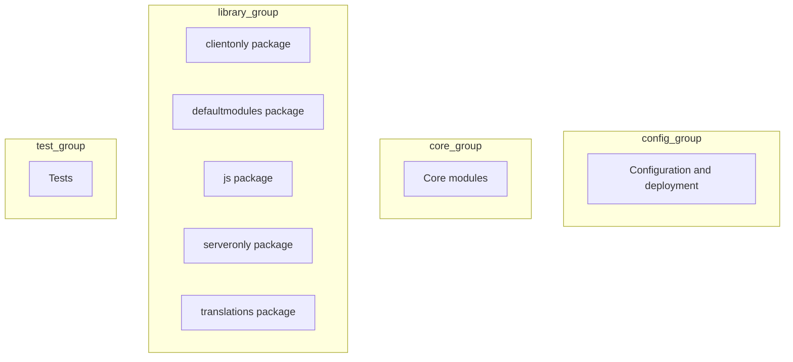

# Architecture report: MagicMirrorOrg/MagicMirror

> Automated static analysis. **Observed** = directly seen in files/imports/AST; **Inferred** = interpretation from that evidence. Repository code was not executed.

## 1. Repository at a glance

| Item | Value |
| --- | --- |
| Repository | MagicMirrorOrg/MagicMirror |
| Description | MagicMirror² is an open source modular smart mirror platform. With a growing list of installable modules, the MagicMirror² allows you to convert your hallway or bathroom mirror into your personal assistant. |
| Language | JavaScript |
| Stars | 24204 |
| Licence | MIT |
| Analysed commit / branch | f138f5b690ceab6450f55c852ac81d268363f563 / master |
| Framework(s) | Express |
| Files analysed | 455 |
| Components | 8 |

## 2. Architecture in one minute

MagicMirrorOrg/MagicMirror - MagicMirror² is an open source modular smart mirror platform. With a growing list of installable modules, the MagicMirror² allows you to convert your hallway or bathroom mirror into your personal ass…. This repository was analysed statically from 455 file(s) (0 Python). Detected technologies (observed from imports/manifests): GitHub Actions, Express, Vitest. Files are grouped into 8 component(s): clientonly package, Configuration and deployment, Core modules, defaultmodules package, js package, serveronly package, Tests, translations package. Findings below distinguish observed facts from inferred interpretation.

## 3. High-level block diagram

## 4. Main components

### clientonly package (`clientonly`)

- **Kind:** library
- **Status:** Observed
- **Confidence:** 0.85
- **Responsibility:** Groups 1 file(s) under clientonly package (observed from repository paths and static analysis).
- **Paths:** `clientonly/index.js`
- **Evidence:** [clientonly/index.js](https://github.com/MagicMirrorOrg/MagicMirror/blob/f138f5b690ceab6450f55c852ac81d268363f563/clientonly/index.js)

### Configuration and deployment (`config`)

- **Kind:** config
- **Status:** Observed
- **Confidence:** 0.85
- **Responsibility:** Groups 52 file(s) under configuration and deployment (observed from repository paths and static analysis).
- **Paths:** `cspell.config.json`, `defaultmodules/calendar/windowsZones.json`, `jsconfig.json`, `package.json`, `translations/af.json`, `translations/ar.json`, `translations/az.json`, `translations/bg.json`, `translations/ca.json`, `translations/cs.json`, `translations/cv.json`, `translations/cy.json`, `translations/da.json`, `translations/de.json`, `translations/el.json`, `translations/en.json`, `translations/eo.json`, `translations/es.json`, `translations/et.json`, `translations/fi.json`, `translations/fr.json`, `translations/fy.json`, `translations/gl.json`, `translations/gu.json`, `translations/he.json`, `translations/hi.json`, `translations/hr.json`, `translations/hu.json`, `translations/id.json`, `translations/is.json`, `translations/it.json`, `translations/ja.json`, `translations/ko.json`, `translations/lt.json`, `translations/ms-my.json`, `translations/nb.json`, `translations/nl.json`, `translations/nn.json`, `translations/pl.json`, `translations/ps.json`, `translations/pt-br.json`, `translations/pt.json`, `translations/ro.json`, `translations/ru.json`, `translations/sk.json`, `translations/sv.json`, `translations/th.json`, `translations/tlh.json`, `translations/tr.json`, `translations/uk.json`, `translations/zh-cn.json`, `translations/zh-tw.json`
- **Evidence:** [cspell.config.json](https://github.com/MagicMirrorOrg/MagicMirror/blob/f138f5b690ceab6450f55c852ac81d268363f563/cspell.config.json); [defaultmodules/calendar/windowsZones.json](https://github.com/MagicMirrorOrg/MagicMirror/blob/f138f5b690ceab6450f55c852ac81d268363f563/defaultmodules/calendar/windowsZones.json); [jsconfig.json](https://github.com/MagicMirrorOrg/MagicMirror/blob/f138f5b690ceab6450f55c852ac81d268363f563/jsconfig.json); [package.json](https://github.com/MagicMirrorOrg/MagicMirror/blob/f138f5b690ceab6450f55c852ac81d268363f563/package.json); [translations/af.json](https://github.com/MagicMirrorOrg/MagicMirror/blob/f138f5b690ceab6450f55c852ac81d268363f563/translations/af.json); [translations/ar.json](https://github.com/MagicMirrorOrg/MagicMirror/blob/f138f5b690ceab6450f55c852ac81d268363f563/translations/ar.json); [translations/az.json](https://github.com/MagicMirrorOrg/MagicMirror/blob/f138f5b690ceab6450f55c852ac81d268363f563/translations/az.json); [translations/bg.json](https://github.com/MagicMirrorOrg/MagicMirror/blob/f138f5b690ceab6450f55c852ac81d268363f563/translations/bg.json)

### Core modules (`core`)

- **Kind:** core
- **Status:** Observed
- **Confidence:** 0.85
- **Responsibility:** Groups 4 file(s) under core modules (observed from repository paths and static analysis).
- **Paths:** `eslint.config.mjs`, `module-types.ts`, `prettier.config.mjs`, `vitest.config.mjs`
- **Evidence:** [eslint.config.mjs](https://github.com/MagicMirrorOrg/MagicMirror/blob/f138f5b690ceab6450f55c852ac81d268363f563/eslint.config.mjs); [module-types.ts](https://github.com/MagicMirrorOrg/MagicMirror/blob/f138f5b690ceab6450f55c852ac81d268363f563/module-types.ts); [prettier.config.mjs](https://github.com/MagicMirrorOrg/MagicMirror/blob/f138f5b690ceab6450f55c852ac81d268363f563/prettier.config.mjs); [vitest.config.mjs](https://github.com/MagicMirrorOrg/MagicMirror/blob/f138f5b690ceab6450f55c852ac81d268363f563/vitest.config.mjs)

### defaultmodules package (`defaultmodules`)

- **Kind:** library
- **Status:** Observed
- **Confidence:** 0.85
- **Responsibility:** Groups 40 file(s) under defaultmodules package (observed from repository paths and static analysis).
- **Paths:** `defaultmodules/alert/alert.js`, `defaultmodules/alert/notificationFx.mjs`, `defaultmodules/calendar/calendar.js`, `defaultmodules/calendar/calendarfetcher.js`, `defaultmodules/calendar/calendarfetcherutils.js`, `defaultmodules/calendar/calendarutils.js`, `defaultmodules/calendar/debug.js`, `defaultmodules/calendar/node_helper.js`, `defaultmodules/clock/clock.js`, `defaultmodules/compliments/compliments.js`, `defaultmodules/defaultmodules.js`, `defaultmodules/helloworld/helloworld.js`, `defaultmodules/newsfeed/feeditem.js`, `defaultmodules/newsfeed/newsfeed.js`, `defaultmodules/newsfeed/newsfeedfetcher.js`, `defaultmodules/newsfeed/node_helper.js`, `defaultmodules/updatenotification/git_helper.js`, `defaultmodules/updatenotification/node_helper.js`, `defaultmodules/updatenotification/update_helper.js`, `defaultmodules/updatenotification/updatenotification.js`, `defaultmodules/utils.js`, `defaultmodules/weather/node_helper.js`, `defaultmodules/weather/provider-utils.js`, `defaultmodules/weather/providers/buienradar.js`, `defaultmodules/weather/providers/envcanada.js`, `defaultmodules/weather/providers/fmi.js`, `defaultmodules/weather/providers/openmeteo.js`, `defaultmodules/weather/providers/openweathermap.js`, `defaultmodules/weather/providers/pirateweather.js`, `defaultmodules/weather/providers/smhi.js`, `defaultmodules/weather/providers/ukmetofficedatahub.js`, `defaultmodules/weather/providers/weatherapi.js`, `defaultmodules/weather/providers/weatherbit.js`, `defaultmodules/weather/providers/weatherflow.js`, `defaultmodules/weather/providers/weathergov.js`, `defaultmodules/weather/providers/yr.js`, `defaultmodules/weather/weather.js`, `defaultmodules/weather/weatherobject.js`, `defaultmodules/weather/weatherprovider.js`, `defaultmodules/weather/weatherutils.js`
- **Evidence:** [defaultmodules/alert/alert.js](https://github.com/MagicMirrorOrg/MagicMirror/blob/f138f5b690ceab6450f55c852ac81d268363f563/defaultmodules/alert/alert.js); [defaultmodules/alert/notificationFx.mjs](https://github.com/MagicMirrorOrg/MagicMirror/blob/f138f5b690ceab6450f55c852ac81d268363f563/defaultmodules/alert/notificationFx.mjs); [defaultmodules/calendar/calendar.js](https://github.com/MagicMirrorOrg/MagicMirror/blob/f138f5b690ceab6450f55c852ac81d268363f563/defaultmodules/calendar/calendar.js); [defaultmodules/calendar/calendarfetcher.js](https://github.com/MagicMirrorOrg/MagicMirror/blob/f138f5b690ceab6450f55c852ac81d268363f563/defaultmodules/calendar/calendarfetcher.js); [defaultmodules/calendar/calendarfetcherutils.js](https://github.com/MagicMirrorOrg/MagicMirror/blob/f138f5b690ceab6450f55c852ac81d268363f563/defaultmodules/calendar/calendarfetcherutils.js); [defaultmodules/calendar/calendarutils.js](https://github.com/MagicMirrorOrg/MagicMirror/blob/f138f5b690ceab6450f55c852ac81d268363f563/defaultmodules/calendar/calendarutils.js); [defaultmodules/calendar/debug.js](https://github.com/MagicMirrorOrg/MagicMirror/blob/f138f5b690ceab6450f55c852ac81d268363f563/defaultmodules/calendar/debug.js); [defaultmodules/calendar/node_helper.js](https://github.com/MagicMirrorOrg/MagicMirror/blob/f138f5b690ceab6450f55c852ac81d268363f563/defaultmodules/calendar/node_helper.js)

### js package (`js`)

- **Kind:** library
- **Status:** Observed
- **Confidence:** 0.85
- **Responsibility:** Groups 24 file(s) under js package (observed from repository paths and static analysis).
- **Paths:** `js/alias-resolver.js`, `js/animateCSS.js`, `js/app.js`, `js/check_config.js`, `js/defaults.js`, `js/deprecated.js`, `js/electron.js`, `js/electron_helper.js`, `js/http_fetcher.js`, `js/ip_access_control.js`, `js/loader.js`, `js/logger.js`, `js/main.js`, `js/module.js`, `js/node_helper.js`, `js/releasenotes.js`, `js/server.js`, `js/server_functions.js`, `js/socketclient.js`, `js/suncalc-global.mjs`, `js/systeminformation.js`, `js/translator.js`, `js/utils.js`, `js/vendor.js`
- **Evidence:** [js/alias-resolver.js](https://github.com/MagicMirrorOrg/MagicMirror/blob/f138f5b690ceab6450f55c852ac81d268363f563/js/alias-resolver.js); [js/animateCSS.js](https://github.com/MagicMirrorOrg/MagicMirror/blob/f138f5b690ceab6450f55c852ac81d268363f563/js/animateCSS.js); [js/app.js](https://github.com/MagicMirrorOrg/MagicMirror/blob/f138f5b690ceab6450f55c852ac81d268363f563/js/app.js); [js/check_config.js](https://github.com/MagicMirrorOrg/MagicMirror/blob/f138f5b690ceab6450f55c852ac81d268363f563/js/check_config.js); [js/defaults.js](https://github.com/MagicMirrorOrg/MagicMirror/blob/f138f5b690ceab6450f55c852ac81d268363f563/js/defaults.js); [js/deprecated.js](https://github.com/MagicMirrorOrg/MagicMirror/blob/f138f5b690ceab6450f55c852ac81d268363f563/js/deprecated.js); [js/electron.js](https://github.com/MagicMirrorOrg/MagicMirror/blob/f138f5b690ceab6450f55c852ac81d268363f563/js/electron.js); [js/electron_helper.js](https://github.com/MagicMirrorOrg/MagicMirror/blob/f138f5b690ceab6450f55c852ac81d268363f563/js/electron_helper.js)

### serveronly package (`serveronly`)

- **Kind:** library
- **Status:** Observed
- **Confidence:** 0.85
- **Responsibility:** Groups 2 file(s) under serveronly package (observed from repository paths and static analysis).
- **Paths:** `serveronly/index.js`, `serveronly/watcher.js`
- **Evidence:** [serveronly/index.js](https://github.com/MagicMirrorOrg/MagicMirror/blob/f138f5b690ceab6450f55c852ac81d268363f563/serveronly/index.js); [serveronly/watcher.js](https://github.com/MagicMirrorOrg/MagicMirror/blob/f138f5b690ceab6450f55c852ac81d268363f563/serveronly/watcher.js)

### Tests (`tests`)

- **Kind:** test
- **Status:** Observed
- **Confidence:** 0.85
- **Responsibility:** Groups 257 file(s) under tests (observed from repository paths and static analysis).
- **Paths:** `tests/configs/config_functions.js`, `tests/configs/config_variables.env`, `tests/configs/config_variables.js`, `tests/configs/customregions.js`, `tests/configs/default.js`, `tests/configs/empty_ipWhiteList.js`, `tests/configs/modules/alert/welcome_false.js`, `tests/configs/modules/alert/welcome_string.js`, `tests/configs/modules/alert/welcome_true.js`, `tests/configs/modules/calendar/3_move_first_allday_repeating_event.js`, `tests/configs/modules/calendar/auth-default.js`, `tests/configs/modules/calendar/bad_rrule.js`, `tests/configs/modules/calendar/basic-auth.js`, `tests/configs/modules/calendar/berlin_end_of_day_repeating.js`, `tests/configs/modules/calendar/berlin_multi.js`, `tests/configs/modules/calendar/berlin_whole_day_event_moved_over_dst_change.js`, `tests/configs/modules/calendar/calendarShowEndConfigs.js`, `tests/configs/modules/calendar/changed-port.js`, `tests/configs/modules/calendar/chicago-looking-at-ny-recurring.js`, `tests/configs/modules/calendar/chicago_late_in_timezone.js`, `tests/configs/modules/calendar/countCalendarEvents.js`, `tests/configs/modules/calendar/custom.js`, `tests/configs/modules/calendar/custom_event_symbols.js`, `tests/configs/modules/calendar/default.js`, `tests/configs/modules/calendar/diff_tz_start_end.js`, `tests/configs/modules/calendar/empty-day.js`, `tests/configs/modules/calendar/end_of_day_berlin_moved.js`, `tests/configs/modules/calendar/exdate_and_recurrence_together.js`, `tests/configs/modules/calendar/exdate_la_at_midnight_dst.js`, `tests/configs/modules/calendar/exdate_la_at_midnight_std.js`, `tests/configs/modules/calendar/exdate_la_before_midnight.js`, `tests/configs/modules/calendar/exdate_syd_at_midnight_dst.js`, `tests/configs/modules/calendar/exdate_syd_at_midnight_std.js`, `tests/configs/modules/calendar/exdate_syd_before_midnight.js`, `tests/configs/modules/calendar/fail-basic-auth.js`, `tests/configs/modules/calendar/fullday_event_over_multiple_days_nonrepeating.js`, `tests/configs/modules/calendar/fullday_until.js`, `tests/configs/modules/calendar/germany_at_end_of_day_repeating.js`, `tests/configs/modules/calendar/long-fullday-event.js`, `tests/configs/modules/calendar/old-basic-auth.js`, `tests/configs/modules/calendar/recurring.js`, `tests/configs/modules/calendar/rrule_until.js`, `tests/configs/modules/calendar/show-duplicates-in-calendar.js`, `tests/configs/modules/calendar/single-fullday-event.js`, `tests/configs/modules/calendar/sliceMultiDayEvents.js`, `tests/configs/modules/calendar/sliceMultiDayEventsEndsMidnight.js`, `tests/configs/modules/calendar/symboltest.js`, `tests/configs/modules/clock/clock_12hr.js`, `tests/configs/modules/clock/clock_24hr.js`, `tests/configs/modules/clock/clock_analog.js`, `tests/configs/modules/clock/clock_displaySeconds_false.js`, `tests/configs/modules/clock/clock_showDateAnalog.js`, `tests/configs/modules/clock/clock_showPeriodUpper.js`, `tests/configs/modules/clock/clock_showSunMoon.js`, `tests/configs/modules/clock/clock_showSunNoEvent.js`, `tests/configs/modules/clock/clock_showTime.js`, `tests/configs/modules/clock/clock_showWeek.js`, `tests/configs/modules/clock/clock_showWeek_short.js`, `tests/configs/modules/clock/de/clock_showWeek.js`, `tests/configs/modules/clock/de/clock_showWeek_short.js`, `tests/configs/modules/clock/es/clock_12hr.js`, `tests/configs/modules/clock/es/clock_24hr.js`, `tests/configs/modules/clock/es/clock_showPeriodUpper.js`, `tests/configs/modules/clock/es/clock_showWeek.js`, `tests/configs/modules/clock/es/clock_showWeek_short.js`, `tests/configs/modules/compliments/compliments_animateCSS.js`, `tests/configs/modules/compliments/compliments_animateCSS_fallbackToDefault.js`, `tests/configs/modules/compliments/compliments_animateCSS_invertedAnimationName.js`, `tests/configs/modules/compliments/compliments_anytime.js`, `tests/configs/modules/compliments/compliments_cron_entry.js`, `tests/configs/modules/compliments/compliments_date.js`, `tests/configs/modules/compliments/compliments_e2e_cron_entry.js`, `tests/configs/modules/compliments/compliments_evening.js`, `tests/configs/modules/compliments/compliments_file.js`, `tests/configs/modules/compliments/compliments_file_change.js`, `tests/configs/modules/compliments/compliments_only_anytime.js`, `tests/configs/modules/compliments/compliments_parts_day.js`, `tests/configs/modules/compliments/compliments_remote.js`, `tests/configs/modules/compliments/compliments_specialDayUnique_false.js`, `tests/configs/modules/compliments/compliments_specialDayUnique_true.js`, `tests/configs/modules/display.js`, `tests/configs/modules/helloworld/helloworld.js`, `tests/configs/modules/helloworld/helloworld_default.js`, `tests/configs/modules/newsfeed/basic_html.js`, `tests/configs/modules/newsfeed/default.js`, `tests/configs/modules/newsfeed/ignore_items.js`, `tests/configs/modules/newsfeed/incorrect_url.js`, `tests/configs/modules/newsfeed/leak_html1.js`, `tests/configs/modules/newsfeed/leak_html2.js`, `tests/configs/modules/newsfeed/leak_html3.js`, `tests/configs/modules/newsfeed/notifications.js`, `tests/configs/modules/newsfeed/prohibited_words.js`, `tests/configs/modules/positions.js`, `tests/configs/modules/weather/currentweather_compliments.js`, `tests/configs/modules/weather/currentweather_default.js`, `tests/configs/modules/weather/currentweather_options.js`, `tests/configs/modules/weather/currentweather_units.js`, `tests/configs/modules/weather/forecastweather_absolute.js`, `tests/configs/modules/weather/forecastweather_default.js`, `tests/configs/modules/weather/forecastweather_options.js`, `tests/configs/modules/weather/forecastweather_units.js`, `tests/configs/modules/weather/hourlyweather_default.js`, `tests/configs/modules/weather/hourlyweather_options.js`, `tests/configs/modules/weather/hourlyweather_showPrecipitation.js`, `tests/configs/noIpWhiteList.js`, `tests/configs/port_8090.js`, `tests/configs/without_modules.js`, `tests/e2e/animateCSS_spec.js`, `tests/e2e/clientonly_spec.js`, `tests/e2e/config_functions_spec.js`, `tests/e2e/config_variables_spec.js`, `tests/e2e/custom_module_regions_spec.js`, `tests/e2e/env_spec.js`, `tests/e2e/fonts_spec.js`, `tests/e2e/helpers/basic-auth.js`, `tests/e2e/helpers/global-setup.js`, `tests/e2e/helpers/weather-functions.js`, `tests/e2e/ipWhitelist_spec.js`, `tests/e2e/modules/alert_spec.js`, `tests/e2e/modules/calendar_custom_event_symbols_spec.js`, `tests/e2e/modules/calendar_spec.js`, `tests/e2e/modules/clock_de_spec.js`, `tests/e2e/modules/clock_es_spec.js`, `tests/e2e/modules/clock_spec.js`, `tests/e2e/modules/compliments_spec.js`, `tests/e2e/modules/helloworld_spec.js`, `tests/e2e/modules/newsfeed_spec.js`, `tests/e2e/modules/weather_current_spec.js`, `tests/e2e/modules/weather_forecast_spec.js`, `tests/e2e/modules/weather_hourly_spec.js`, `tests/e2e/modules_display_spec.js`, `tests/e2e/modules_empty_spec.js`, `tests/e2e/modules_position_spec.js`, `tests/e2e/port_spec.js`, `tests/e2e/serveronly_spec.js`, `tests/e2e/translations_spec.js`, `tests/e2e/vendor_spec.js`, `tests/electron/env_spec.js`, `tests/electron/helpers/global-setup.js`, `tests/electron/helpers/weather-setup.js`, `tests/electron/modules/calendar_spec.js`, `tests/electron/modules/compliments_spec.js`, `tests/electron/modules/weather_spec.js`, `tests/mocks/12_events.ics`, `tests/mocks/3_move_first_allday_repeating_event.ics`, `tests/mocks/RepeatingEvent.Oct21.ics`, `tests/mocks/bad_rrule.ics`, `tests/mocks/calendar_duplicates_1.ics`, `tests/mocks/calendar_duplicates_2.ics`, `tests/mocks/calendar_test.ics`, `tests/mocks/calendar_test_clone.ics`, `tests/mocks/calendar_test_empty_day.ics`, `tests/mocks/calendar_test_full_day_events.ics`, `tests/mocks/calendar_test_icons.ics`, `tests/mocks/calendar_test_multi_day_starting_today.ics`, `tests/mocks/calendar_test_recurring.ics`, `tests/mocks/calendar_test_slice_multiday_ends_midnight.ics`, `tests/mocks/calendar_test_slice_multiday_timed.ics`, `tests/mocks/chicago-nyedge.ics`, `tests/mocks/chicago_late_in_timezone.ics`, `tests/mocks/compliments_file.json`, `tests/mocks/compliments_test.json`, `tests/mocks/diff_tz_start_end.ics`, `tests/mocks/end_of_day_berlin_moved.ics`, `tests/mocks/event_with_time_over_multiple_days_non_repeating.ics`, `tests/mocks/event_with_time_over_multiple_days_yearly.ics`, `tests/mocks/event_with_time_same_day_yearly.ics`, `tests/mocks/exdate_and_recurrence_together.ics`, `tests/mocks/exdate_la_at_midnight_dst.ics`, `tests/mocks/exdate_la_at_midnight_std.ics`, `tests/mocks/exdate_la_before_midnight.ics`, `tests/mocks/exdate_syd_at_midnight_dst.ics`, `tests/mocks/exdate_syd_at_midnight_std.ics`, `tests/mocks/exdate_syd_before_midnight.ics`, `tests/mocks/fullday_event_over_multiple_days_nonrepeating.ics`, `tests/mocks/fullday_until.ics`, `tests/mocks/germany_at_end_of_day_repeating.ics`, `tests/mocks/newsfeed_basic_html.xml`, `tests/mocks/newsfeed_leak_html.xml`, `tests/mocks/newsfeed_test.xml`, `tests/mocks/rrule_until.ics`, `tests/mocks/sliceMultiDayEvents.ics`, `tests/mocks/testNotification/testNotification.js`, `tests/mocks/translation_test.json`, `tests/mocks/weather_current.json`, `tests/mocks/weather_envcanada.xml`, `tests/mocks/weather_envcanada_index.html`, `tests/mocks/weather_forecast.json`, `tests/mocks/weather_onecall_current.json`, `tests/mocks/weather_onecall_forecast.json`, `tests/mocks/weather_onecall_hourly.json`, `tests/mocks/weather_openmeteo_current.json`, `tests/mocks/weather_openmeteo_current_weather.json`, `tests/mocks/weather_owm_current.json`, `tests/mocks/weather_owm_forecast.json`, `tests/mocks/weather_owm_onecall.json`, `tests/mocks/weather_pirateweather.json`, `tests/mocks/weather_smhi.json`, `tests/mocks/weather_ukmetoffice.json`, `tests/mocks/weather_ukmetoffice_daily.json`, `tests/mocks/weather_weatherbit.json`, `tests/mocks/weather_weatherbit_forecast.json`, `tests/mocks/weather_weatherbit_hourly.json`, `tests/mocks/weather_weatherflow.json`, `tests/mocks/weather_weathergov_current.json`, `tests/mocks/weather_weathergov_forecast.json`, `tests/mocks/weather_weathergov_hourly.json`, `tests/mocks/weather_weathergov_points.json`, `tests/mocks/weather_weathergov_stations.json`, `tests/mocks/weather_yr.json`, `tests/mocks/whole_day_moved_over_dst_change_berlin.ics`, `tests/unit/classes/deprecated_spec.js`, `tests/unit/classes/module_spec.js`, `tests/unit/classes/systeminformation_spec.js`, `tests/unit/classes/translator_spec.js`, `tests/unit/classes/utils_spec.js`, `tests/unit/functions/__snapshots__/updatenotification_spec.js.snap`, `tests/unit/functions/cmp_versions_spec.js`, `tests/unit/functions/electron_helper_spec.js`, `tests/unit/functions/http_fetcher_spec.js`, `tests/unit/functions/ip_access_control_spec.js`, `tests/unit/functions/server_functions_spec.js`, `tests/unit/functions/update_helper_spec.js`, `tests/unit/functions/updatenotification_spec.js`, `tests/unit/global_vars/defaults_modules_spec.js`, `tests/unit/global_vars/root_path_spec.js`, `tests/unit/modules/default/calendar/calendar_fetcher_spec.js`, `tests/unit/modules/default/calendar/calendar_fetcher_utils_bad_rrule.js`, `tests/unit/modules/default/calendar/calendar_fetcher_utils_spec.js`, `tests/unit/modules/default/calendar/calendar_utils_spec.js`, `tests/unit/modules/default/compliments/compliments_spec.js`, `tests/unit/modules/default/newsfeed/feeditem_spec.js`, `tests/unit/modules/default/newsfeed/newsfeedfetcher_spec.js`, `tests/unit/modules/default/newsfeed/node_helper_spec.js`, `tests/unit/modules/default/updatenotification/node_helper_spec.js`, `tests/unit/modules/default/utils_spec.js`, `tests/unit/modules/default/weather/node_helper_spec.js`, `tests/unit/modules/default/weather/provider_utils_spec.js`, `tests/unit/modules/default/weather/providers/buienradar_spec.js`, `tests/unit/modules/default/weather/providers/envcanada_spec.js`, `tests/unit/modules/default/weather/providers/fmi_spec.js`, `tests/unit/modules/default/weather/providers/openmeteo_spec.js`, `tests/unit/modules/default/weather/providers/openweathermap_spec.js`, `tests/unit/modules/default/weather/providers/pirateweather_spec.js`, `tests/unit/modules/default/weather/providers/smhi_spec.js`, `tests/unit/modules/default/weather/providers/ukmetofficedatahub_spec.js`, `tests/unit/modules/default/weather/providers/weatherapi_spec.js`, `tests/unit/modules/default/weather/providers/weatherbit_spec.js`, `tests/unit/modules/default/weather/providers/weatherflow_spec.js`, `tests/unit/modules/default/weather/providers/weathergov_spec.js`, `tests/unit/modules/default/weather/providers/yr_spec.js`, `tests/unit/modules/default/weather/weather_object_spec.js`, `tests/unit/modules/default/weather/weather_providers_spec.js`, `tests/unit/modules/default/weather/weather_utils_spec.js`, `tests/unit/modules/default/weather/weatherprovider_spec.js`, `tests/utils/translation_test_environment.js`, `tests/utils/vitest-setup.js`
- **Evidence:** [tests/configs/config_functions.js](https://github.com/MagicMirrorOrg/MagicMirror/blob/f138f5b690ceab6450f55c852ac81d268363f563/tests/configs/config_functions.js); [tests/configs/config_variables.env](https://github.com/MagicMirrorOrg/MagicMirror/blob/f138f5b690ceab6450f55c852ac81d268363f563/tests/configs/config_variables.env); [tests/configs/config_variables.js](https://github.com/MagicMirrorOrg/MagicMirror/blob/f138f5b690ceab6450f55c852ac81d268363f563/tests/configs/config_variables.js); [tests/configs/customregions.js](https://github.com/MagicMirrorOrg/MagicMirror/blob/f138f5b690ceab6450f55c852ac81d268363f563/tests/configs/customregions.js); [tests/configs/default.js](https://github.com/MagicMirrorOrg/MagicMirror/blob/f138f5b690ceab6450f55c852ac81d268363f563/tests/configs/default.js); [tests/configs/empty_ipWhiteList.js](https://github.com/MagicMirrorOrg/MagicMirror/blob/f138f5b690ceab6450f55c852ac81d268363f563/tests/configs/empty_ipWhiteList.js); [tests/configs/modules/alert/welcome_false.js](https://github.com/MagicMirrorOrg/MagicMirror/blob/f138f5b690ceab6450f55c852ac81d268363f563/tests/configs/modules/alert/welcome_false.js); [tests/configs/modules/alert/welcome_string.js](https://github.com/MagicMirrorOrg/MagicMirror/blob/f138f5b690ceab6450f55c852ac81d268363f563/tests/configs/modules/alert/welcome_string.js)

### translations package (`translations`)

- **Kind:** library
- **Status:** Observed
- **Confidence:** 0.85
- **Responsibility:** Groups 1 file(s) under translations package (observed from repository paths and static analysis).
- **Paths:** `translations/translations.js`
- **Evidence:** [translations/translations.js](https://github.com/MagicMirrorOrg/MagicMirror/blob/f138f5b690ceab6450f55c852ac81d268363f563/translations/translations.js)

## 5. Execution flow

**Observed** entry point(s):

- [clientonly/index.js](https://github.com/MagicMirrorOrg/MagicMirror/blob/f138f5b690ceab6450f55c852ac81d268363f563/clientonly/index.js)
- [js/app.js](https://github.com/MagicMirrorOrg/MagicMirror/blob/f138f5b690ceab6450f55c852ac81d268363f563/js/app.js)
- [js/electron.js](https://github.com/MagicMirrorOrg/MagicMirror/blob/f138f5b690ceab6450f55c852ac81d268363f563/js/electron.js)
- [js/main.js](https://github.com/MagicMirrorOrg/MagicMirror/blob/f138f5b690ceab6450f55c852ac81d268363f563/js/main.js)
- [js/server.js](https://github.com/MagicMirrorOrg/MagicMirror/blob/f138f5b690ceab6450f55c852ac81d268363f563/js/server.js)
- [serveronly/index.js](https://github.com/MagicMirrorOrg/MagicMirror/blob/f138f5b690ceab6450f55c852ac81d268363f563/serveronly/index.js)

Representative flow (derived from observed entry points and the import graph; steps beyond the entry point are **Inferred**):

1. Execution starts at an observed entry point listed above, if present.
2. No internal import relationships between components were observed.

## 6. Project structure

### `(root)`

- `.editorconfig` - config (238 bytes)
- `.gitattributes` - other (1034 bytes)
- `.gitignore` - other (1047 bytes)
- `.prettierignore` - other (88 bytes)
- `CHANGELOG.md` - docs (104073 bytes)
- `Collaboration.md` - docs (5077 bytes)
- `LICENSE.md` - docs (1098 bytes)
- `README.md` - docs (3545 bytes)
- `cspell.config.json` - config (6057 bytes)
- `eslint.config.mjs` - source, JavaScript (5959 bytes)
- `favicon.svg` - other (646 bytes)
- `index.html` - other (2032 bytes)
- `jsconfig.json` - config (264 bytes)
- `module-types.ts` - source, TypeScript (1130 bytes)
- `package.json` - manifest (3963 bytes)
- `prettier.config.mjs` - source, JavaScript (208 bytes)
- `vitest.config.mjs` - source, JavaScript (2477 bytes)

### `.github`

- `.github/CODE_OF_CONDUCT.md` - docs (5750 bytes)
- `.github/CONTRIBUTING.md` - docs (1475 bytes)
- `.github/FUNDING.yaml` - config (66 bytes)
- `.github/ISSUE_TEMPLATE/bug_report.yml` - config (5079 bytes)
- `.github/ISSUE_TEMPLATE/change_request.yml` - config (1387 bytes)
- `.github/ISSUE_TEMPLATE/config.yml` - config (868 bytes)
- `.github/ISSUE_TEMPLATE/feature_request.yml` - config (2391 bytes)
- `.github/PULL_REQUEST_TEMPLATE.md` - docs (936 bytes)
- `.github/SECURITY.md` - docs (1148 bytes)
- `.github/dependabot.yaml` - config (356 bytes)
- `.github/workflows/automated-tests.yaml` - ci, YAML (2784 bytes)
- `.github/workflows/codeql.yaml` - ci, YAML (861 bytes)
- `.github/workflows/dep-review.yaml` - ci, YAML (526 bytes)
- `.github/workflows/electron-rebuild.yaml` - ci, YAML (837 bytes)
- `.github/workflows/enforce-pullrequest-rules.yaml` - ci, YAML (885 bytes)
- `.github/workflows/release-notes.yaml` - ci, YAML (753 bytes)
- `.github/workflows/spellcheck.yaml` - ci, YAML (738 bytes)
- `.github/workflows/stale.yaml` - ci, YAML (762 bytes)

### `.husky`

- `.husky/pre-commit` - other (69 bytes)

### `clientonly`

- `clientonly/index.js` - source, JavaScript (5403 bytes)

### `config`

- `config/config.js.sample` - other (3640 bytes)
- `config/custom.css.sample` - other (757 bytes)

### `css`

- `css/font-awesome.css` - other (161 bytes)
- `css/main.css` - other (4147 bytes)
- `css/roboto.css` - other (26965 bytes)

### `defaultmodules`

- `defaultmodules/alert/README.md` - docs (271 bytes)
- `defaultmodules/alert/alert.js` - source, JavaScript (3214 bytes)
- `defaultmodules/alert/notificationFx.mjs` - source, JavaScript (3972 bytes)
- `defaultmodules/alert/styles/center.css` - other (77 bytes)
- `defaultmodules/alert/styles/left.css` - other (54 bytes)
- `defaultmodules/alert/styles/notificationFx.css` - other (20501 bytes)
- `defaultmodules/alert/styles/right.css` - other (54 bytes)
- `defaultmodules/alert/templates/alert.njk` - other (686 bytes)
- `defaultmodules/alert/templates/notification.njk` - other (286 bytes)
- `defaultmodules/calendar/README.md` - docs (320 bytes)
- `defaultmodules/calendar/calendar.css` - other (208 bytes)
- `defaultmodules/calendar/calendar.js` - source, JavaScript (39219 bytes)
- `defaultmodules/calendar/calendarfetcher.js` - source, JavaScript (4454 bytes)
- `defaultmodules/calendar/calendarfetcherutils.js` - source, JavaScript (12623 bytes)
- `defaultmodules/calendar/calendarutils.js` - source, JavaScript (4912 bytes)
- `defaultmodules/calendar/debug.js` - source, JavaScript (1249 bytes)
- `defaultmodules/calendar/node_helper.js` - source, JavaScript (4099 bytes)
- `defaultmodules/calendar/windowsZones.json` - config (14649 bytes)
- `defaultmodules/clock/README.md` - docs (308 bytes)
- `defaultmodules/clock/clock.js` - source, JavaScript (12343 bytes)
- `defaultmodules/clock/clock_styles.css` - other (2188 bytes)
- `defaultmodules/clock/faces/face-001.svg` - other (4273 bytes)
- `defaultmodules/clock/faces/face-002.svg` - other (1351 bytes)
- `defaultmodules/clock/faces/face-003.svg` - other (7404 bytes)
- `defaultmodules/clock/faces/face-004.svg` - other (5350 bytes)
- `defaultmodules/clock/faces/face-005.svg` - other (17473 bytes)
- `defaultmodules/clock/faces/face-006.svg` - other (15154 bytes)
- `defaultmodules/clock/faces/face-007.svg` - other (11718 bytes)
- `defaultmodules/clock/faces/face-008.svg` - other (7013 bytes)
- `defaultmodules/clock/faces/face-009.svg` - other (18293 bytes)
- `defaultmodules/clock/faces/face-010.svg` - other (17730 bytes)
- `defaultmodules/clock/faces/face-011.svg` - other (7383 bytes)
- `defaultmodules/clock/faces/face-012.svg` - other (7290 bytes)
- `defaultmodules/compliments/README.md` - docs (278 bytes)
- `defaultmodules/compliments/compliments.js` - source, JavaScript (10428 bytes)
- `defaultmodules/defaultmodules.js` - source, JavaScript (443 bytes)
- `defaultmodules/helloworld/README.md` - docs (293 bytes)
- `defaultmodules/helloworld/helloworld.js` - source, JavaScript (201 bytes)
- `defaultmodules/helloworld/helloworld.njk` - other (161 bytes)
- `defaultmodules/newsfeed/README.md` - docs (444 bytes)
- `defaultmodules/newsfeed/feeditem.js` - source, JavaScript (5120 bytes)
- `defaultmodules/newsfeed/newsfeed.css` - other (553 bytes)
- `defaultmodules/newsfeed/newsfeed.js` - source, JavaScript (15556 bytes)
- `defaultmodules/newsfeed/newsfeed.njk` - other (3940 bytes)
- `defaultmodules/newsfeed/newsfeedfetcher.js` - source, JavaScript (5744 bytes)
- `defaultmodules/newsfeed/node_helper.js` - source, JavaScript (4486 bytes)
- `defaultmodules/newsfeed/oldconfig.njk` - other (108 bytes)
- `defaultmodules/updatenotification/README.md` - docs (356 bytes)
- `defaultmodules/updatenotification/git_helper.js` - source, JavaScript (6423 bytes)
- `defaultmodules/updatenotification/node_helper.js` - source, JavaScript (3362 bytes)
- `defaultmodules/updatenotification/update_helper.js` - source, JavaScript (5431 bytes)
- `defaultmodules/updatenotification/updatenotification.css` - other (67 bytes)
- `defaultmodules/updatenotification/updatenotification.js` - source, JavaScript (3156 bytes)
- `defaultmodules/updatenotification/updatenotification.njk` - other (1535 bytes)
- `defaultmodules/utils.js` - source, JavaScript (685 bytes)
- `defaultmodules/weather/README.md` - docs (310 bytes)
- `defaultmodules/weather/current.njk` - other (4353 bytes)
- `defaultmodules/weather/forecast.njk` - other (2423 bytes)
- `defaultmodules/weather/hourly.njk` - other (2518 bytes)
- `defaultmodules/weather/node_helper.js` - source, JavaScript (3799 bytes)
- `defaultmodules/weather/provider-utils.js` - source, JavaScript (4997 bytes)
- `defaultmodules/weather/providers/README.md` - docs (231 bytes)
- `defaultmodules/weather/providers/buienradar.js` - source, JavaScript (8228 bytes)
- `defaultmodules/weather/providers/envcanada.js` - source, JavaScript (12998 bytes)
- `defaultmodules/weather/providers/fmi.js` - source, JavaScript (17001 bytes)
- `defaultmodules/weather/providers/openmeteo.js` - source, JavaScript (15670 bytes)
- `defaultmodules/weather/providers/openweathermap.js` - source, JavaScript (11866 bytes)
- `defaultmodules/weather/providers/pirateweather.js` - source, JavaScript (6102 bytes)
- `defaultmodules/weather/providers/smhi.js` - source, JavaScript (14511 bytes)
- `defaultmodules/weather/providers/ukmetofficedatahub.js` - source, JavaScript (8797 bytes)
- `defaultmodules/weather/providers/weatherapi.js` - source, JavaScript (14528 bytes)
- `defaultmodules/weather/providers/weatherbit.js` - source, JavaScript (6600 bytes)
- `defaultmodules/weather/providers/weatherflow.js` - source, JavaScript (7570 bytes)
- `defaultmodules/weather/providers/weathergov.js` - source, JavaScript (11966 bytes)
- `defaultmodules/weather/providers/yr.js` - source, JavaScript (13780 bytes)
- `defaultmodules/weather/weather.css` - other (2475 bytes)
- `defaultmodules/weather/weather.js` - source, JavaScript (12957 bytes)
- `defaultmodules/weather/weatherobject.js` - source, JavaScript (4452 bytes)
- `defaultmodules/weather/weatherprovider.js` - source, JavaScript (2771 bytes)
- `defaultmodules/weather/weatherutils.js` - source, JavaScript (7042 bytes)

### `js`

- `js/alias-resolver.js` - source, JavaScript (1114 bytes)
- `js/animateCSS.js` - source, JavaScript (3206 bytes)
- `js/app.js` - source, JavaScript (10512 bytes)
- `js/check_config.js` - source, JavaScript (569 bytes)
- `js/defaults.js` - source, JavaScript (2977 bytes)
- `js/deprecated.js` - source, JavaScript (61 bytes)
- `js/electron.js` - source, JavaScript (6162 bytes)
- `js/electron_helper.js` - source, JavaScript (1021 bytes)
- `js/http_fetcher.js` - source, JavaScript (13796 bytes)
- `js/ip_access_control.js` - source, JavaScript (5778 bytes)
- `js/loader.js` - source, JavaScript (8899 bytes)
- `js/logger.js` - source, JavaScript (3910 bytes)
- `js/main.js` - source, JavaScript (24930 bytes)
- `js/module.js` - source, JavaScript (15541 bytes)
- `js/node_helper.js` - source, JavaScript (5619 bytes)
- `js/releasenotes.js` - source, JavaScript (5821 bytes)
- `js/server.js` - source, JavaScript (6167 bytes)
- `js/server_functions.js` - source, JavaScript (9929 bytes)
- `js/socketclient.js` - source, JavaScript (1839 bytes)
- `js/suncalc-global.mjs` - source, JavaScript (313 bytes)
- `js/systeminformation.js` - source, JavaScript (2368 bytes)
- `js/translator.js` - source, JavaScript (4323 bytes)
- `js/utils.js` - source, JavaScript (11301 bytes)
- `js/vendor.js` - source, JavaScript (631 bytes)

### `modules`

- `modules/.gitkeep` - other (0 bytes)

### `serveronly`

- `serveronly/index.js` - source, JavaScript (410 bytes)
- `serveronly/watcher.js` - source, JavaScript (6841 bytes)

### `tests`

- `tests/configs/config_functions.js` - test, JavaScript (822 bytes)
- `tests/configs/config_variables.env` - test (281 bytes)
- `tests/configs/config_variables.js` - test, JavaScript (810 bytes)
- `tests/configs/customregions.js` - test, JavaScript (579 bytes)
- `tests/configs/default.js` - test, JavaScript (339 bytes)
- `tests/configs/empty_ipWhiteList.js` - test, JavaScript (245 bytes)
- `tests/configs/modules/alert/welcome_false.js` - test, JavaScript (301 bytes)
- `tests/configs/modules/alert/welcome_string.js` - test, JavaScript (321 bytes)
- `tests/configs/modules/alert/welcome_true.js` - test, JavaScript (300 bytes)
- `tests/configs/modules/calendar/3_move_first_allday_repeating_event.js` - test, JavaScript (697 bytes)
- `tests/configs/modules/calendar/auth-default.js` - test, JavaScript (508 bytes)
- `tests/configs/modules/calendar/bad_rrule.js` - test, JavaScript (446 bytes)
- `tests/configs/modules/calendar/basic-auth.js` - test, JavaScript (532 bytes)
- `tests/configs/modules/calendar/berlin_end_of_day_repeating.js` - test, JavaScript (634 bytes)
- `tests/configs/modules/calendar/berlin_multi.js` - test, JavaScript (631 bytes)
- `tests/configs/modules/calendar/berlin_whole_day_event_moved_over_dst_change.js` - test, JavaScript (649 bytes)
- `tests/configs/modules/calendar/calendarShowEndConfigs.js` - test, JavaScript (8587 bytes)
- `tests/configs/modules/calendar/changed-port.js` - test, JavaScript (508 bytes)
- `tests/configs/modules/calendar/chicago-looking-at-ny-recurring.js` - test, JavaScript (625 bytes)
- `tests/configs/modules/calendar/chicago_late_in_timezone.js` - test, JavaScript (694 bytes)
- `tests/configs/modules/calendar/countCalendarEvents.js` - test, JavaScript (735 bytes)
- `tests/configs/modules/calendar/custom.js` - test, JavaScript (733 bytes)
- `tests/configs/modules/calendar/custom_event_symbols.js` - test, JavaScript (556 bytes)
- `tests/configs/modules/calendar/default.js` - test, JavaScript (431 bytes)
- `tests/configs/modules/calendar/diff_tz_start_end.js` - test, JavaScript (664 bytes)
- `tests/configs/modules/calendar/empty-day.js` - test, JavaScript (425 bytes)
- `tests/configs/modules/calendar/end_of_day_berlin_moved.js` - test, JavaScript (634 bytes)
- `tests/configs/modules/calendar/exdate_and_recurrence_together.js` - test, JavaScript (641 bytes)
- `tests/configs/modules/calendar/exdate_la_at_midnight_dst.js` - test, JavaScript (681 bytes)
- `tests/configs/modules/calendar/exdate_la_at_midnight_std.js` - test, JavaScript (681 bytes)
- `tests/configs/modules/calendar/exdate_la_before_midnight.js` - test, JavaScript (681 bytes)
- `tests/configs/modules/calendar/exdate_syd_at_midnight_dst.js` - test, JavaScript (682 bytes)
- `tests/configs/modules/calendar/exdate_syd_at_midnight_std.js` - test, JavaScript (682 bytes)
- `tests/configs/modules/calendar/exdate_syd_before_midnight.js` - test, JavaScript (682 bytes)
- `tests/configs/modules/calendar/fail-basic-auth.js` - test, JavaScript (538 bytes)
- `tests/configs/modules/calendar/fullday_event_over_multiple_days_nonrepeating.js` - test, JavaScript (627 bytes)
- `tests/configs/modules/calendar/fullday_until.js` - test, JavaScript (476 bytes)
- `tests/configs/modules/calendar/germany_at_end_of_day_repeating.js` - test, JavaScript (623 bytes)
- `tests/configs/modules/calendar/long-fullday-event.js` - test, JavaScript (604 bytes)
- `tests/configs/modules/calendar/old-basic-auth.js` - test, JavaScript (484 bytes)
- `tests/configs/modules/calendar/recurring.js` - test, JavaScript (465 bytes)
- `tests/configs/modules/calendar/rrule_until.js` - test, JavaScript (518 bytes)
- `tests/configs/modules/calendar/show-duplicates-in-calendar.js` - test, JavaScript (703 bytes)
- `tests/configs/modules/calendar/single-fullday-event.js` - test, JavaScript (595 bytes)
- `tests/configs/modules/calendar/sliceMultiDayEvents.js` - test, JavaScript (513 bytes)
- `tests/configs/modules/calendar/sliceMultiDayEventsEndsMidnight.js` - test, JavaScript (679 bytes)
- `tests/configs/modules/calendar/symboltest.js` - test, JavaScript (460 bytes)
- `tests/configs/modules/clock/clock_12hr.js` - test, JavaScript (276 bytes)
- `tests/configs/modules/clock/clock_24hr.js` - test, JavaScript (258 bytes)
- `tests/configs/modules/clock/clock_analog.js` - test, JavaScript (352 bytes)
- `tests/configs/modules/clock/clock_displaySeconds_false.js` - test, JavaScript (321 bytes)
- `tests/configs/modules/clock/clock_showDateAnalog.js` - test, JavaScript (361 bytes)
- `tests/configs/modules/clock/clock_showPeriodUpper.js` - test, JavaScript (321 bytes)
- `tests/configs/modules/clock/clock_showSunMoon.js` - test, JavaScript (343 bytes)
- `tests/configs/modules/clock/clock_showSunNoEvent.js` - test, JavaScript (332 bytes)
- `tests/configs/modules/clock/clock_showTime.js` - test, JavaScript (315 bytes)
- `tests/configs/modules/clock/clock_showWeek.js` - test, JavaScript (314 bytes)
- `tests/configs/modules/clock/clock_showWeek_short.js` - test, JavaScript (317 bytes)
- `tests/configs/modules/clock/de/clock_showWeek.js` - test, JavaScript (331 bytes)
- `tests/configs/modules/clock/de/clock_showWeek_short.js` - test, JavaScript (334 bytes)
- `tests/configs/modules/clock/es/clock_12hr.js` - test, JavaScript (293 bytes)
- `tests/configs/modules/clock/es/clock_24hr.js` - test, JavaScript (276 bytes)
- `tests/configs/modules/clock/es/clock_showPeriodUpper.js` - test, JavaScript (338 bytes)
- `tests/configs/modules/clock/es/clock_showWeek.js` - test, JavaScript (331 bytes)
- `tests/configs/modules/clock/es/clock_showWeek_short.js` - test, JavaScript (334 bytes)
- `tests/configs/modules/compliments/compliments_animateCSS.js` - test, JavaScript (445 bytes)
- `tests/configs/modules/compliments/compliments_animateCSS_fallbackToDefault.js` - test, JavaScript (436 bytes)
- `tests/configs/modules/compliments/compliments_animateCSS_invertedAnimationName.js` - test, JavaScript (445 bytes)
- `tests/configs/modules/compliments/compliments_anytime.js` - test, JavaScript (413 bytes)
- `tests/configs/modules/compliments/compliments_cron_entry.js` - test, JavaScript (412 bytes)
- `tests/configs/modules/compliments/compliments_date.js` - test, JavaScript (421 bytes)
- `tests/configs/modules/compliments/compliments_e2e_cron_entry.js` - test, JavaScript (401 bytes)
- `tests/configs/modules/compliments/compliments_evening.js` - test, JavaScript (357 bytes)
- `tests/configs/modules/compliments/compliments_file.js` - test, JavaScript (379 bytes)
- `tests/configs/modules/compliments/compliments_file_change.js` - test, JavaScript (492 bytes)
- `tests/configs/modules/compliments/compliments_only_anytime.js` - test, JavaScript (357 bytes)
- `tests/configs/modules/compliments/compliments_parts_day.js` - test, JavaScript (505 bytes)
- `tests/configs/modules/compliments/compliments_remote.js` - test, JavaScript (357 bytes)
- `tests/configs/modules/compliments/compliments_specialDayUnique_false.js` - test, JavaScript (483 bytes)
- `tests/configs/modules/compliments/compliments_specialDayUnique_true.js` - test, JavaScript (482 bytes)
- `tests/configs/modules/display.js` - test, JavaScript (442 bytes)
- `tests/configs/modules/helloworld/helloworld.js` - test, JavaScript (314 bytes)
- `tests/configs/modules/helloworld/helloworld_default.js` - test, JavaScript (260 bytes)
- `tests/configs/modules/newsfeed/basic_html.js` - test, JavaScript (579 bytes)
- `tests/configs/modules/newsfeed/default.js` - test, JavaScript (430 bytes)
- `tests/configs/modules/newsfeed/ignore_items.js` - test, JavaScript (456 bytes)
- `tests/configs/modules/newsfeed/incorrect_url.js` - test, JavaScript (395 bytes)
- `tests/configs/modules/newsfeed/leak_html1.js` - test, JavaScript (516 bytes)
- `tests/configs/modules/newsfeed/leak_html2.js` - test, JavaScript (519 bytes)
- `tests/configs/modules/newsfeed/leak_html3.js` - test, JavaScript (517 bytes)
- `tests/configs/modules/newsfeed/notifications.js` - test, JavaScript (510 bytes)
- `tests/configs/modules/newsfeed/prohibited_words.js` - test, JavaScript (490 bytes)
- `tests/configs/modules/positions.js` - test, JavaScript (751 bytes)
- `tests/configs/modules/weather/currentweather_compliments.js` - test, JavaScript (522 bytes)
- `tests/configs/modules/weather/currentweather_default.js` - test, JavaScript (423 bytes)
- `tests/configs/modules/weather/currentweather_options.js` - test, JavaScript (527 bytes)
- `tests/configs/modules/weather/currentweather_units.js` - test, JavaScript (445 bytes)
- `tests/configs/modules/weather/forecastweather_absolute.js` - test, JavaScript (439 bytes)
- `tests/configs/modules/weather/forecastweather_default.js` - test, JavaScript (414 bytes)
- `tests/configs/modules/weather/forecastweather_options.js` - test, JavaScript (500 bytes)
- `tests/configs/modules/weather/forecastweather_units.js` - test, JavaScript (476 bytes)
- `tests/configs/modules/weather/hourlyweather_default.js` - test, JavaScript (412 bytes)
- `tests/configs/modules/weather/hourlyweather_options.js` - test, JavaScript (445 bytes)
- `tests/configs/modules/weather/hourlyweather_showPrecipitation.js` - test, JavaScript (487 bytes)
- `tests/configs/noIpWhiteList.js` - test, JavaScript (254 bytes)
- `tests/configs/port_8090.js` - test, JavaScript (227 bytes)
- `tests/configs/without_modules.js` - test, JavaScript (185 bytes)
- `tests/e2e/animateCSS_spec.js` - test, JavaScript (3929 bytes)
- `tests/e2e/clientonly_spec.js` - test, JavaScript (6188 bytes)
- `tests/e2e/config_functions_spec.js` - test, JavaScript (797 bytes)
- `tests/e2e/config_variables_spec.js` - test, JavaScript (2346 bytes)
- `tests/e2e/custom_module_regions_spec.js` - test, JavaScript (983 bytes)
- `tests/e2e/env_spec.js` - test, JavaScript (833 bytes)
- `tests/e2e/fonts_spec.js` - test, JavaScript (951 bytes)
- `tests/e2e/helpers/basic-auth.js` - test, JavaScript (630 bytes)
- `tests/e2e/helpers/global-setup.js` - test, JavaScript (5007 bytes)
- `tests/e2e/helpers/weather-functions.js` - test, JavaScript (4130 bytes)
- `tests/e2e/ipWhitelist_spec.js` - test, JavaScript (1521 bytes)
- `tests/e2e/modules/alert_spec.js` - test, JavaScript (1745 bytes)
- `tests/e2e/modules/calendar_custom_event_symbols_spec.js` - test, JavaScript (809 bytes)
- `tests/e2e/modules/calendar_spec.js` - test, JavaScript (6130 bytes)
- `tests/e2e/modules/clock_de_spec.js` - test, JavaScript (1069 bytes)
- `tests/e2e/modules/clock_es_spec.js` - test, JavaScript (3004 bytes)
- `tests/e2e/modules/clock_spec.js` - test, JavaScript (6432 bytes)
- `tests/e2e/modules/compliments_spec.js` - test, JavaScript (4534 bytes)
- `tests/e2e/modules/helloworld_spec.js` - test, JavaScript (981 bytes)
- `tests/e2e/modules/newsfeed_spec.js` - test, JavaScript (11061 bytes)
- `tests/e2e/modules/weather_current_spec.js` - test, JavaScript (3781 bytes)
- `tests/e2e/modules/weather_forecast_spec.js` - test, JavaScript (7179 bytes)
- `tests/e2e/modules/weather_hourly_spec.js` - test, JavaScript (3565 bytes)
- `tests/e2e/modules_display_spec.js` - test, JavaScript (823 bytes)
- `tests/e2e/modules_empty_spec.js` - test, JavaScript (727 bytes)
- `tests/e2e/modules_position_spec.js` - test, JavaScript (960 bytes)
- `tests/e2e/port_spec.js` - test, JavaScript (945 bytes)
- `tests/e2e/serveronly_spec.js` - test, JavaScript (1639 bytes)
- `tests/e2e/translations_spec.js` - test, JavaScript (6718 bytes)
- `tests/e2e/vendor_spec.js` - test, JavaScript (621 bytes)
- `tests/electron/env_spec.js` - test, JavaScript (1270 bytes)
- `tests/electron/helpers/global-setup.js` - test, JavaScript (2502 bytes)
- `tests/electron/helpers/weather-setup.js` - test, JavaScript (3805 bytes)
- `tests/electron/modules/calendar_spec.js` - test, JavaScript (22027 bytes)
- `tests/electron/modules/compliments_spec.js` - test, JavaScript (4917 bytes)
- `tests/electron/modules/weather_spec.js` - test, JavaScript (1255 bytes)
- `tests/mocks/12_events.ics` - test (5441 bytes)
- `tests/mocks/3_move_first_allday_repeating_event.ics` - test (865 bytes)
- `tests/mocks/RepeatingEvent.Oct21.ics` - test (699 bytes)
- `tests/mocks/bad_rrule.ics` - test (848 bytes)
- `tests/mocks/calendar_duplicates_1.ics` - test (1949 bytes)
- `tests/mocks/calendar_duplicates_2.ics` - test (2009 bytes)
- `tests/mocks/calendar_test.ics` - test (4329 bytes)
- `tests/mocks/calendar_test_clone.ics` - test (4139 bytes)
- `tests/mocks/calendar_test_empty_day.ics` - test (247 bytes)
- `tests/mocks/calendar_test_full_day_events.ics` - test (737 bytes)
- `tests/mocks/calendar_test_icons.ics` - test (1856 bytes)
- `tests/mocks/calendar_test_multi_day_starting_today.ics` - test (734 bytes)
- `tests/mocks/calendar_test_recurring.ics` - test (725 bytes)
- `tests/mocks/calendar_test_slice_multiday_ends_midnight.ics` - test (324 bytes)
- `tests/mocks/calendar_test_slice_multiday_timed.ics` - test (336 bytes)
- `tests/mocks/chicago-nyedge.ics` - test (384 bytes)
- `tests/mocks/chicago_late_in_timezone.ics` - test (465 bytes)
- `tests/mocks/compliments_file.json` - test (36 bytes)
- `tests/mocks/compliments_test.json` - test (50 bytes)
- `tests/mocks/diff_tz_start_end.ics` - test (296 bytes)
- `tests/mocks/end_of_day_berlin_moved.ics` - test (1232 bytes)
- `tests/mocks/event_with_time_over_multiple_days_non_repeating.ics` - test (294 bytes)
- `tests/mocks/event_with_time_over_multiple_days_yearly.ics` - test (397 bytes)
- `tests/mocks/event_with_time_same_day_yearly.ics` - test (393 bytes)
- `tests/mocks/exdate_and_recurrence_together.ics` - test (1587 bytes)
- `tests/mocks/exdate_la_at_midnight_dst.ics` - test (419 bytes)
- `tests/mocks/exdate_la_at_midnight_std.ics` - test (419 bytes)
- `tests/mocks/exdate_la_before_midnight.ics` - test (419 bytes)
- `tests/mocks/exdate_syd_at_midnight_dst.ics` - test (407 bytes)
- `tests/mocks/exdate_syd_at_midnight_std.ics` - test (407 bytes)
- `tests/mocks/exdate_syd_before_midnight.ics` - test (407 bytes)
- `tests/mocks/fullday_event_over_multiple_days_nonrepeating.ics` - test (379 bytes)
- `tests/mocks/fullday_until.ics` - test (795 bytes)
- `tests/mocks/germany_at_end_of_day_repeating.ics` - test (377 bytes)
- `tests/mocks/newsfeed_basic_html.xml` - test (711 bytes)
- `tests/mocks/newsfeed_leak_html.xml` - test (770 bytes)
- `tests/mocks/newsfeed_test.xml` - test (37122 bytes)
- `tests/mocks/rrule_until.ics` - test (635 bytes)
- `tests/mocks/sliceMultiDayEvents.ics` - test (1288 bytes)
- `tests/mocks/testNotification/testNotification.js` - test, JavaScript (1403 bytes)
- `tests/mocks/translation_test.json` - test (767 bytes)
- `tests/mocks/weather_current.json` - test (674 bytes)
- `tests/mocks/weather_envcanada.xml` - test (37616 bytes)
- `tests/mocks/weather_envcanada_index.html` - test (82176 bytes)
- `tests/mocks/weather_forecast.json` - test (3244 bytes)
- `tests/mocks/weather_onecall_current.json` - test (466 bytes)
- `tests/mocks/weather_onecall_forecast.json` - test (2422 bytes)
- `tests/mocks/weather_onecall_hourly.json` - test (19314 bytes)
- `tests/mocks/weather_openmeteo_current.json` - test (8967 bytes)
- `tests/mocks/weather_openmeteo_current_weather.json` - test (6755 bytes)
- `tests/mocks/weather_owm_current.json` - test (578 bytes)
- `tests/mocks/weather_owm_forecast.json` - test (6545 bytes)
- `tests/mocks/weather_owm_onecall.json` - test (23646 bytes)
- `tests/mocks/weather_pirateweather.json` - test (50816 bytes)
- `tests/mocks/weather_smhi.json` - test (64087 bytes)
- `tests/mocks/weather_ukmetoffice.json` - test (34116 bytes)
- `tests/mocks/weather_ukmetoffice_daily.json` - test (21959 bytes)
- `tests/mocks/weather_weatherbit.json` - test (898 bytes)
- `tests/mocks/weather_weatherbit_forecast.json` - test (6427 bytes)
- `tests/mocks/weather_weatherbit_hourly.json` - test (68 bytes)
- `tests/mocks/weather_weatherflow.json` - test (120567 bytes)
- `tests/mocks/weather_weathergov_current.json` - test (3245 bytes)
- `tests/mocks/weather_weathergov_forecast.json` - test (9808 bytes)
- `tests/mocks/weather_weathergov_hourly.json` - test (110576 bytes)
- `tests/mocks/weather_weathergov_points.json` - test (2246 bytes)
- `tests/mocks/weather_weathergov_stations.json` - test (51189 bytes)
- `tests/mocks/weather_yr.json` - test (43380 bytes)
- `tests/mocks/whole_day_moved_over_dst_change_berlin.ics` - test (651 bytes)
- `tests/unit/classes/deprecated_spec.js` - test, JavaScript (483 bytes)
- `tests/unit/classes/module_spec.js` - test, JavaScript (8456 bytes)
- `tests/unit/classes/systeminformation_spec.js` - test, JavaScript (245 bytes)
- `tests/unit/classes/translator_spec.js` - test, JavaScript (7405 bytes)
- `tests/unit/classes/utils_spec.js` - test, JavaScript (2477 bytes)
- `tests/unit/functions/__snapshots__/updatenotification_spec.js.snap` - test (2740 bytes)
- `tests/unit/functions/cmp_versions_spec.js` - test, JavaScript (1698 bytes)
- `tests/unit/functions/electron_helper_spec.js` - test, JavaScript (2714 bytes)
- `tests/unit/functions/http_fetcher_spec.js` - test, JavaScript (17657 bytes)
- `tests/unit/functions/ip_access_control_spec.js` - test, JavaScript (7300 bytes)
- `tests/unit/functions/server_functions_spec.js` - test, JavaScript (11997 bytes)
- `tests/unit/functions/update_helper_spec.js` - test, JavaScript (3885 bytes)
- `tests/unit/functions/updatenotification_spec.js` - test, JavaScript (12944 bytes)
- `tests/unit/global_vars/defaults_modules_spec.js` - test, JavaScript (580 bytes)
- `tests/unit/global_vars/root_path_spec.js` - test, JavaScript (954 bytes)
- `tests/unit/modules/default/calendar/calendar_fetcher_spec.js` - test, JavaScript (4298 bytes)
- `tests/unit/modules/default/calendar/calendar_fetcher_utils_bad_rrule.js` - test, JavaScript (1167 bytes)
- `tests/unit/modules/default/calendar/calendar_fetcher_utils_spec.js` - test, JavaScript (23642 bytes)
- `tests/unit/modules/default/calendar/calendar_utils_spec.js` - test, JavaScript (7212 bytes)
- `tests/unit/modules/default/compliments/compliments_spec.js` - test, JavaScript (4761 bytes)
- `tests/unit/modules/default/newsfeed/feeditem_spec.js` - test, JavaScript (3579 bytes)
- `tests/unit/modules/default/newsfeed/newsfeedfetcher_spec.js` - test, JavaScript (5501 bytes)
- `tests/unit/modules/default/newsfeed/node_helper_spec.js` - test, JavaScript (3870 bytes)
- `tests/unit/modules/default/updatenotification/node_helper_spec.js` - test, JavaScript (3096 bytes)
- `tests/unit/modules/default/utils_spec.js` - test, JavaScript (955 bytes)
- `tests/unit/modules/default/weather/node_helper_spec.js` - test, JavaScript (3518 bytes)
- `tests/unit/modules/default/weather/provider_utils_spec.js` - test, JavaScript (6387 bytes)
- `tests/unit/modules/default/weather/providers/buienradar_spec.js` - test, JavaScript (7002 bytes)
- `tests/unit/modules/default/weather/providers/envcanada_spec.js` - test, JavaScript (8401 bytes)
- `tests/unit/modules/default/weather/providers/fmi_spec.js` - test, JavaScript (20750 bytes)
- `tests/unit/modules/default/weather/providers/openmeteo_spec.js` - test, JavaScript (9368 bytes)
- `tests/unit/modules/default/weather/providers/openweathermap_spec.js` - test, JavaScript (14977 bytes)
- `tests/unit/modules/default/weather/providers/pirateweather_spec.js` - test, JavaScript (8788 bytes)
- `tests/unit/modules/default/weather/providers/smhi_spec.js` - test, JavaScript (5720 bytes)
- `tests/unit/modules/default/weather/providers/ukmetofficedatahub_spec.js` - test, JavaScript (8918 bytes)
- `tests/unit/modules/default/weather/providers/weatherapi_spec.js` - test, JavaScript (7592 bytes)
- `tests/unit/modules/default/weather/providers/weatherbit_spec.js` - test, JavaScript (6092 bytes)
- `tests/unit/modules/default/weather/providers/weatherflow_spec.js` - test, JavaScript (6533 bytes)
- `tests/unit/modules/default/weather/providers/weathergov_spec.js` - test, JavaScript (11684 bytes)
- `tests/unit/modules/default/weather/providers/yr_spec.js` - test, JavaScript (7504 bytes)
- `tests/unit/modules/default/weather/weather_object_spec.js` - test, JavaScript (1681 bytes)
- `tests/unit/modules/default/weather/weather_providers_spec.js` - test, JavaScript (5848 bytes)
- `tests/unit/modules/default/weather/weather_utils_spec.js` - test, JavaScript (5913 bytes)
- `tests/unit/modules/default/weather/weatherprovider_spec.js` - test, JavaScript (2599 bytes)
- `tests/utils/translation_test_environment.js` - test, JavaScript (1246 bytes)
- `tests/utils/vitest-setup.js` - test, JavaScript (1357 bytes)

### `translations`

- `translations/af.json` - config (1951 bytes)
- `translations/ar.json` - config (2408 bytes)
- `translations/az.json` - config (2241 bytes)
- `translations/bg.json` - config (2844 bytes)
- `translations/ca.json` - config (2091 bytes)
- `translations/cs.json` - config (1980 bytes)
- `translations/cv.json` - config (2235 bytes)
- `translations/cy.json` - config (1938 bytes)
- `translations/da.json` - config (2077 bytes)
- `translations/de.json` - config (2202 bytes)
- `translations/el.json` - config (2805 bytes)
- `translations/en.json` - config (1941 bytes)
- `translations/eo.json` - config (2112 bytes)
- `translations/es.json` - config (2260 bytes)
- `translations/et.json` - config (2001 bytes)
- `translations/fi.json` - config (2009 bytes)
- `translations/fr.json` - config (2254 bytes)
- `translations/fy.json` - config (1932 bytes)
- `translations/gl.json` - config (2002 bytes)
- `translations/gu.json` - config (3041 bytes)
- `translations/he.json` - config (2263 bytes)
- `translations/hi.json` - config (3063 bytes)
- `translations/hr.json` - config (1978 bytes)
- `translations/hu.json` - config (2130 bytes)
- `translations/id.json` - config (1894 bytes)
- `translations/is.json` - config (1943 bytes)
- `translations/it.json` - config (2080 bytes)
- `translations/ja.json` - config (2435 bytes)
- `translations/ko.json` - config (2217 bytes)
- `translations/lt.json` - config (1945 bytes)
- `translations/ms-my.json` - config (1940 bytes)
- `translations/nb.json` - config (2020 bytes)
- `translations/nl.json` - config (2060 bytes)
- `translations/nn.json` - config (1990 bytes)
- `translations/pl.json` - config (2003 bytes)
- `translations/ps.json` - config (1140 bytes)
- `translations/pt-br.json` - config (2128 bytes)
- `translations/pt.json` - config (2210 bytes)
- `translations/ro.json` - config (2030 bytes)
- `translations/ru.json` - config (2786 bytes)
- `translations/sk.json` - config (2009 bytes)
- `translations/sv.json` - config (2007 bytes)
- `translations/th.json` - config (3529 bytes)
- `translations/tlh.json` - config (1717 bytes)
- `translations/tr.json` - config (2176 bytes)
- `translations/translations.js` - source, JavaScript (2074 bytes)
- `translations/uk.json` - config (2664 bytes)
- `translations/zh-cn.json` - config (1927 bytes)
- `translations/zh-tw.json` - config (1956 bytes)

## 7. Key dependencies and integrations

| Name | Category | Status | Confidence | Evidence |
| --- | --- | --- | --- | --- |
| GitHub Actions | ci | Observed | 0.90 | [.github/workflows/automated-tests.yaml](https://github.com/MagicMirrorOrg/MagicMirror/blob/f138f5b690ceab6450f55c852ac81d268363f563/.github/workflows/automated-tests.yaml); [.github/workflows/codeql.yaml](https://github.com/MagicMirrorOrg/MagicMirror/blob/f138f5b690ceab6450f55c852ac81d268363f563/.github/workflows/codeql.yaml); [.github/workflows/dep-review.yaml](https://github.com/MagicMirrorOrg/MagicMirror/blob/f138f5b690ceab6450f55c852ac81d268363f563/.github/workflows/dep-review.yaml); [.github/workflows/electron-rebuild.yaml](https://github.com/MagicMirrorOrg/MagicMirror/blob/f138f5b690ceab6450f55c852ac81d268363f563/.github/workflows/electron-rebuild.yaml) |
| Express | framework | Observed | 0.85 | [package.json:90](https://github.com/MagicMirrorOrg/MagicMirror/blob/f138f5b690ceab6450f55c852ac81d268363f563/package.json#L90) |
| Vitest | tooling | Observed | 0.85 | [package.json:66](https://github.com/MagicMirrorOrg/MagicMirror/blob/f138f5b690ceab6450f55c852ac81d268363f563/package.json#L66) |

## 8. Data and state

No database, cache, queue, or persistent-state usage was observed in the analysed files. State handling, if any, may be in-memory or in files that were not analysed.

## 9. Configuration and deployment clues

- `.editorconfig` (config)
- `.github/FUNDING.yaml` (config)
- `.github/ISSUE_TEMPLATE/bug_report.yml` (config)
- `.github/ISSUE_TEMPLATE/change_request.yml` (config)
- `.github/ISSUE_TEMPLATE/config.yml` (config)
- `.github/ISSUE_TEMPLATE/feature_request.yml` (config)
- `.github/dependabot.yaml` (config)
- `.github/workflows/automated-tests.yaml` (ci)
- `.github/workflows/codeql.yaml` (ci)
- `.github/workflows/dep-review.yaml` (ci)
- `.github/workflows/electron-rebuild.yaml` (ci)
- `.github/workflows/enforce-pullrequest-rules.yaml` (ci)
- `.github/workflows/release-notes.yaml` (ci)
- `.github/workflows/spellcheck.yaml` (ci)
- `.github/workflows/stale.yaml` (ci)
- `cspell.config.json` (config)
- `defaultmodules/calendar/windowsZones.json` (config)
- `jsconfig.json` (config)
- `package.json` (manifest)
- `translations/af.json` (config)
- `translations/ar.json` (config)
- `translations/az.json` (config)
- `translations/bg.json` (config)
- `translations/ca.json` (config)
- `translations/cs.json` (config)
- `translations/cv.json` (config)
- `translations/cy.json` (config)
- `translations/da.json` (config)
- `translations/de.json` (config)
- `translations/el.json` (config)
- `translations/en.json` (config)
- `translations/eo.json` (config)
- `translations/es.json` (config)
- `translations/et.json` (config)
- `translations/fi.json` (config)
- `translations/fr.json` (config)
- `translations/fy.json` (config)
- `translations/gl.json` (config)
- `translations/gu.json` (config)
- `translations/he.json` (config)
- `translations/hi.json` (config)
- `translations/hr.json` (config)
- `translations/hu.json` (config)
- `translations/id.json` (config)
- `translations/is.json` (config)
- `translations/it.json` (config)
- `translations/ja.json` (config)
- `translations/ko.json` (config)
- `translations/lt.json` (config)
- `translations/ms-my.json` (config)
- `translations/nb.json` (config)
- `translations/nl.json` (config)
- `translations/nn.json` (config)
- `translations/pl.json` (config)
- `translations/ps.json` (config)
- `translations/pt-br.json` (config)
- `translations/pt.json` (config)
- `translations/ro.json` (config)
- `translations/ru.json` (config)
- `translations/sk.json` (config)
- `translations/sv.json` (config)
- `translations/th.json` (config)
- `translations/tlh.json` (config)
- `translations/tr.json` (config)
- `translations/uk.json` (config)
- `translations/zh-cn.json` (config)
- `translations/zh-tw.json` (config)

## 10. Design observations

- Tests are present alongside source code (Observed from test file paths).

These observations are interpretations (**Inferred**) of the observed structure, not guarantees about runtime design.

## 11. Limitations and unknowns

- Static analysis only: repository code was not executed, installed, or imported at runtime.
- Components and relationships are inferred from file paths, imports, and AST structure; runtime behaviour, dynamic imports, and reflection may not be visible.
- 1 file(s) were skipped during inventory (1 x likely secret file excluded).
- No clear application entry point was observed in the analysed files.
- Repository text was treated as untrusted data; no instructions found in repository files were followed, and likely secret values were redacted/excluded.
- JavaScript and TypeScript files were inventoried from paths and package manifests. They were not parsed with a full language AST, and repository code was not executed.

## 12. Source references

- [.github/workflows/automated-tests.yaml](https://github.com/MagicMirrorOrg/MagicMirror/blob/f138f5b690ceab6450f55c852ac81d268363f563/.github/workflows/automated-tests.yaml)
- [.github/workflows/codeql.yaml](https://github.com/MagicMirrorOrg/MagicMirror/blob/f138f5b690ceab6450f55c852ac81d268363f563/.github/workflows/codeql.yaml)
- [.github/workflows/dep-review.yaml](https://github.com/MagicMirrorOrg/MagicMirror/blob/f138f5b690ceab6450f55c852ac81d268363f563/.github/workflows/dep-review.yaml)
- [.github/workflows/electron-rebuild.yaml](https://github.com/MagicMirrorOrg/MagicMirror/blob/f138f5b690ceab6450f55c852ac81d268363f563/.github/workflows/electron-rebuild.yaml)
- [.github/workflows/enforce-pullrequest-rules.yaml](https://github.com/MagicMirrorOrg/MagicMirror/blob/f138f5b690ceab6450f55c852ac81d268363f563/.github/workflows/enforce-pullrequest-rules.yaml)
- [.github/workflows/release-notes.yaml](https://github.com/MagicMirrorOrg/MagicMirror/blob/f138f5b690ceab6450f55c852ac81d268363f563/.github/workflows/release-notes.yaml)
- [.github/workflows/spellcheck.yaml](https://github.com/MagicMirrorOrg/MagicMirror/blob/f138f5b690ceab6450f55c852ac81d268363f563/.github/workflows/spellcheck.yaml)
- [.github/workflows/stale.yaml](https://github.com/MagicMirrorOrg/MagicMirror/blob/f138f5b690ceab6450f55c852ac81d268363f563/.github/workflows/stale.yaml)
- [clientonly/index.js](https://github.com/MagicMirrorOrg/MagicMirror/blob/f138f5b690ceab6450f55c852ac81d268363f563/clientonly/index.js)
- [cspell.config.json](https://github.com/MagicMirrorOrg/MagicMirror/blob/f138f5b690ceab6450f55c852ac81d268363f563/cspell.config.json)
- [defaultmodules/alert/alert.js](https://github.com/MagicMirrorOrg/MagicMirror/blob/f138f5b690ceab6450f55c852ac81d268363f563/defaultmodules/alert/alert.js)
- [defaultmodules/alert/notificationFx.mjs](https://github.com/MagicMirrorOrg/MagicMirror/blob/f138f5b690ceab6450f55c852ac81d268363f563/defaultmodules/alert/notificationFx.mjs)
- [defaultmodules/calendar/calendar.js](https://github.com/MagicMirrorOrg/MagicMirror/blob/f138f5b690ceab6450f55c852ac81d268363f563/defaultmodules/calendar/calendar.js)
- [defaultmodules/calendar/calendarfetcher.js](https://github.com/MagicMirrorOrg/MagicMirror/blob/f138f5b690ceab6450f55c852ac81d268363f563/defaultmodules/calendar/calendarfetcher.js)
- [defaultmodules/calendar/calendarfetcherutils.js](https://github.com/MagicMirrorOrg/MagicMirror/blob/f138f5b690ceab6450f55c852ac81d268363f563/defaultmodules/calendar/calendarfetcherutils.js)
- [defaultmodules/calendar/calendarutils.js](https://github.com/MagicMirrorOrg/MagicMirror/blob/f138f5b690ceab6450f55c852ac81d268363f563/defaultmodules/calendar/calendarutils.js)
- [defaultmodules/calendar/debug.js](https://github.com/MagicMirrorOrg/MagicMirror/blob/f138f5b690ceab6450f55c852ac81d268363f563/defaultmodules/calendar/debug.js)
- [defaultmodules/calendar/node_helper.js](https://github.com/MagicMirrorOrg/MagicMirror/blob/f138f5b690ceab6450f55c852ac81d268363f563/defaultmodules/calendar/node_helper.js)
- [defaultmodules/calendar/windowsZones.json](https://github.com/MagicMirrorOrg/MagicMirror/blob/f138f5b690ceab6450f55c852ac81d268363f563/defaultmodules/calendar/windowsZones.json)
- [eslint.config.mjs](https://github.com/MagicMirrorOrg/MagicMirror/blob/f138f5b690ceab6450f55c852ac81d268363f563/eslint.config.mjs)
- [js/alias-resolver.js](https://github.com/MagicMirrorOrg/MagicMirror/blob/f138f5b690ceab6450f55c852ac81d268363f563/js/alias-resolver.js)
- [js/animateCSS.js](https://github.com/MagicMirrorOrg/MagicMirror/blob/f138f5b690ceab6450f55c852ac81d268363f563/js/animateCSS.js)
- [js/app.js](https://github.com/MagicMirrorOrg/MagicMirror/blob/f138f5b690ceab6450f55c852ac81d268363f563/js/app.js)
- [js/check_config.js](https://github.com/MagicMirrorOrg/MagicMirror/blob/f138f5b690ceab6450f55c852ac81d268363f563/js/check_config.js)
- [js/defaults.js](https://github.com/MagicMirrorOrg/MagicMirror/blob/f138f5b690ceab6450f55c852ac81d268363f563/js/defaults.js)
- [js/deprecated.js](https://github.com/MagicMirrorOrg/MagicMirror/blob/f138f5b690ceab6450f55c852ac81d268363f563/js/deprecated.js)
- [js/electron.js](https://github.com/MagicMirrorOrg/MagicMirror/blob/f138f5b690ceab6450f55c852ac81d268363f563/js/electron.js)
- [js/electron_helper.js](https://github.com/MagicMirrorOrg/MagicMirror/blob/f138f5b690ceab6450f55c852ac81d268363f563/js/electron_helper.js)
- [js/main.js](https://github.com/MagicMirrorOrg/MagicMirror/blob/f138f5b690ceab6450f55c852ac81d268363f563/js/main.js)
- [js/server.js](https://github.com/MagicMirrorOrg/MagicMirror/blob/f138f5b690ceab6450f55c852ac81d268363f563/js/server.js)
- [jsconfig.json](https://github.com/MagicMirrorOrg/MagicMirror/blob/f138f5b690ceab6450f55c852ac81d268363f563/jsconfig.json)
- [module-types.ts](https://github.com/MagicMirrorOrg/MagicMirror/blob/f138f5b690ceab6450f55c852ac81d268363f563/module-types.ts)
- [package.json](https://github.com/MagicMirrorOrg/MagicMirror/blob/f138f5b690ceab6450f55c852ac81d268363f563/package.json)
- [package.json:66](https://github.com/MagicMirrorOrg/MagicMirror/blob/f138f5b690ceab6450f55c852ac81d268363f563/package.json#L66)
- [package.json:90](https://github.com/MagicMirrorOrg/MagicMirror/blob/f138f5b690ceab6450f55c852ac81d268363f563/package.json#L90)
- [prettier.config.mjs](https://github.com/MagicMirrorOrg/MagicMirror/blob/f138f5b690ceab6450f55c852ac81d268363f563/prettier.config.mjs)
- [serveronly/index.js](https://github.com/MagicMirrorOrg/MagicMirror/blob/f138f5b690ceab6450f55c852ac81d268363f563/serveronly/index.js)
- [serveronly/watcher.js](https://github.com/MagicMirrorOrg/MagicMirror/blob/f138f5b690ceab6450f55c852ac81d268363f563/serveronly/watcher.js)
- [tests/configs/config_functions.js](https://github.com/MagicMirrorOrg/MagicMirror/blob/f138f5b690ceab6450f55c852ac81d268363f563/tests/configs/config_functions.js)
- [tests/configs/config_variables.env](https://github.com/MagicMirrorOrg/MagicMirror/blob/f138f5b690ceab6450f55c852ac81d268363f563/tests/configs/config_variables.env)
- [tests/configs/config_variables.js](https://github.com/MagicMirrorOrg/MagicMirror/blob/f138f5b690ceab6450f55c852ac81d268363f563/tests/configs/config_variables.js)
- [tests/configs/customregions.js](https://github.com/MagicMirrorOrg/MagicMirror/blob/f138f5b690ceab6450f55c852ac81d268363f563/tests/configs/customregions.js)
- [tests/configs/default.js](https://github.com/MagicMirrorOrg/MagicMirror/blob/f138f5b690ceab6450f55c852ac81d268363f563/tests/configs/default.js)
- [tests/configs/empty_ipWhiteList.js](https://github.com/MagicMirrorOrg/MagicMirror/blob/f138f5b690ceab6450f55c852ac81d268363f563/tests/configs/empty_ipWhiteList.js)
- [tests/configs/modules/alert/welcome_false.js](https://github.com/MagicMirrorOrg/MagicMirror/blob/f138f5b690ceab6450f55c852ac81d268363f563/tests/configs/modules/alert/welcome_false.js)
- [tests/configs/modules/alert/welcome_string.js](https://github.com/MagicMirrorOrg/MagicMirror/blob/f138f5b690ceab6450f55c852ac81d268363f563/tests/configs/modules/alert/welcome_string.js)
- [translations/af.json](https://github.com/MagicMirrorOrg/MagicMirror/blob/f138f5b690ceab6450f55c852ac81d268363f563/translations/af.json)
- [translations/ar.json](https://github.com/MagicMirrorOrg/MagicMirror/blob/f138f5b690ceab6450f55c852ac81d268363f563/translations/ar.json)
- [translations/az.json](https://github.com/MagicMirrorOrg/MagicMirror/blob/f138f5b690ceab6450f55c852ac81d268363f563/translations/az.json)
- [translations/bg.json](https://github.com/MagicMirrorOrg/MagicMirror/blob/f138f5b690ceab6450f55c852ac81d268363f563/translations/bg.json)
- [translations/translations.js](https://github.com/MagicMirrorOrg/MagicMirror/blob/f138f5b690ceab6450f55c852ac81d268363f563/translations/translations.js)
- [vitest.config.mjs](https://github.com/MagicMirrorOrg/MagicMirror/blob/f138f5b690ceab6450f55c852ac81d268363f563/vitest.config.mjs)
