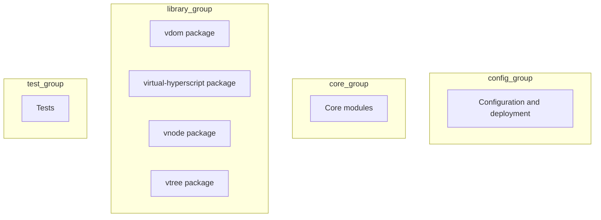

# Architecture report: Matt-Esch/virtual-dom

> Automated static analysis. **Observed** = directly seen in files/imports/AST; **Inferred** = interpretation from that evidence. Repository code was not executed.

## 1. Repository at a glance

| Item | Value |
| --- | --- |
| Repository | Matt-Esch/virtual-dom |
| Description | A Virtual DOM and diffing algorithm |
| Language | JavaScript |
| Stars | 11820 |
| Licence | MIT |
| Analysed commit / branch | 947ecf92b67d25bb693a0f625fa8e90c099887d5 / master |
| Framework(s) | None detected |
| Files analysed | 80 |
| Components | 7 |

## 2. Architecture in one minute

Matt-Esch/virtual-dom - A Virtual DOM and diffing algorithm. This repository was analysed statically from 80 file(s) (0 Python). Detected technologies (observed from imports/manifests): no known frameworks/libraries. Files are grouped into 7 component(s): Configuration and deployment, Core modules, Tests, vdom package, virtual-hyperscript package, vnode package, vtree package. Findings below distinguish observed facts from inferred interpretation.

## 3. High-level block diagram

## 4. Main components

### Configuration and deployment (`config`)

- **Kind:** config
- **Status:** Observed
- **Confidence:** 0.85
- **Responsibility:** Groups 1 file(s) under configuration and deployment (observed from repository paths and static analysis).
- **Paths:** `package.json`
- **Evidence:** [package.json](https://github.com/Matt-Esch/virtual-dom/blob/947ecf92b67d25bb693a0f625fa8e90c099887d5/package.json)

### Core modules (`core`)

- **Kind:** core
- **Status:** Observed
- **Confidence:** 0.85
- **Responsibility:** Groups 5 file(s) under core modules (observed from repository paths and static analysis).
- **Paths:** `create-element.js`, `diff.js`, `h.js`, `index.js`, `patch.js`
- **Evidence:** [create-element.js](https://github.com/Matt-Esch/virtual-dom/blob/947ecf92b67d25bb693a0f625fa8e90c099887d5/create-element.js); [diff.js](https://github.com/Matt-Esch/virtual-dom/blob/947ecf92b67d25bb693a0f625fa8e90c099887d5/diff.js); [h.js](https://github.com/Matt-Esch/virtual-dom/blob/947ecf92b67d25bb693a0f625fa8e90c099887d5/h.js); [index.js](https://github.com/Matt-Esch/virtual-dom/blob/947ecf92b67d25bb693a0f625fa8e90c099887d5/index.js); [patch.js](https://github.com/Matt-Esch/virtual-dom/blob/947ecf92b67d25bb693a0f625fa8e90c099887d5/patch.js)

### Tests (`tests`)

- **Kind:** test
- **Status:** Observed
- **Confidence:** 0.85
- **Responsibility:** Groups 28 file(s) under tests (observed from repository paths and static analysis).
- **Paths:** `test/attributes.js`, `test/hook.js`, `test/index.js`, `test/keys.js`, `test/lib/assert-childNodes-from-array.js`, `test/lib/assert-equal-dom.js`, `test/lib/nodes-from-array.js`, `test/lib/patch-count.js`, `test/main.js`, `test/nested-properties.js`, `test/non-string.js`, `test/sort.js`, `test/style.js`, `test/thunk.js`, `test/undefined-properties.js`, `vdom/test/dom-index.js`, `vdom/test/index.js`, `vdom/test/patch-index.js`, `vdom/test/patch-op-index.js`, `virtual-hyperscript/test/attribute-hook.js`, `virtual-hyperscript/test/ev-hook.js`, `virtual-hyperscript/test/h.js`, `virtual-hyperscript/test/index.js`, `virtual-hyperscript/test/svg.js`, `vnode/test/handle-thunk.js`, `vnode/test/index.js`, `vtree/test/diff-props.js`, `vtree/test/index.js`
- **Evidence:** [test/attributes.js](https://github.com/Matt-Esch/virtual-dom/blob/947ecf92b67d25bb693a0f625fa8e90c099887d5/test/attributes.js); [test/hook.js](https://github.com/Matt-Esch/virtual-dom/blob/947ecf92b67d25bb693a0f625fa8e90c099887d5/test/hook.js); [test/index.js](https://github.com/Matt-Esch/virtual-dom/blob/947ecf92b67d25bb693a0f625fa8e90c099887d5/test/index.js); [test/keys.js](https://github.com/Matt-Esch/virtual-dom/blob/947ecf92b67d25bb693a0f625fa8e90c099887d5/test/keys.js); [test/lib/assert-childNodes-from-array.js](https://github.com/Matt-Esch/virtual-dom/blob/947ecf92b67d25bb693a0f625fa8e90c099887d5/test/lib/assert-childNodes-from-array.js); [test/lib/assert-equal-dom.js](https://github.com/Matt-Esch/virtual-dom/blob/947ecf92b67d25bb693a0f625fa8e90c099887d5/test/lib/assert-equal-dom.js); [test/lib/nodes-from-array.js](https://github.com/Matt-Esch/virtual-dom/blob/947ecf92b67d25bb693a0f625fa8e90c099887d5/test/lib/nodes-from-array.js); [test/lib/patch-count.js](https://github.com/Matt-Esch/virtual-dom/blob/947ecf92b67d25bb693a0f625fa8e90c099887d5/test/lib/patch-count.js)

### vdom package (`vdom`)

- **Kind:** library
- **Status:** Observed
- **Confidence:** 0.85
- **Responsibility:** Groups 6 file(s) under vdom package (observed from repository paths and static analysis).
- **Paths:** `vdom/apply-properties.js`, `vdom/create-element.js`, `vdom/dom-index.js`, `vdom/patch-op.js`, `vdom/patch.js`, `vdom/update-widget.js`
- **Evidence:** [vdom/apply-properties.js](https://github.com/Matt-Esch/virtual-dom/blob/947ecf92b67d25bb693a0f625fa8e90c099887d5/vdom/apply-properties.js); [vdom/create-element.js](https://github.com/Matt-Esch/virtual-dom/blob/947ecf92b67d25bb693a0f625fa8e90c099887d5/vdom/create-element.js); [vdom/dom-index.js](https://github.com/Matt-Esch/virtual-dom/blob/947ecf92b67d25bb693a0f625fa8e90c099887d5/vdom/dom-index.js); [vdom/patch-op.js](https://github.com/Matt-Esch/virtual-dom/blob/947ecf92b67d25bb693a0f625fa8e90c099887d5/vdom/patch-op.js); [vdom/patch.js](https://github.com/Matt-Esch/virtual-dom/blob/947ecf92b67d25bb693a0f625fa8e90c099887d5/vdom/patch.js); [vdom/update-widget.js](https://github.com/Matt-Esch/virtual-dom/blob/947ecf92b67d25bb693a0f625fa8e90c099887d5/vdom/update-widget.js)

### virtual-hyperscript package (`virtual_hyperscript`)

- **Kind:** library
- **Status:** Observed
- **Confidence:** 0.85
- **Responsibility:** Groups 8 file(s) under virtual-hyperscript package (observed from repository paths and static analysis).
- **Paths:** `virtual-hyperscript/hooks/attribute-hook.js`, `virtual-hyperscript/hooks/ev-hook.js`, `virtual-hyperscript/hooks/focus-hook.js`, `virtual-hyperscript/hooks/soft-set-hook.js`, `virtual-hyperscript/index.js`, `virtual-hyperscript/parse-tag.js`, `virtual-hyperscript/svg-attribute-namespace.js`, `virtual-hyperscript/svg.js`
- **Evidence:** [virtual-hyperscript/hooks/attribute-hook.js](https://github.com/Matt-Esch/virtual-dom/blob/947ecf92b67d25bb693a0f625fa8e90c099887d5/virtual-hyperscript/hooks/attribute-hook.js); [virtual-hyperscript/hooks/ev-hook.js](https://github.com/Matt-Esch/virtual-dom/blob/947ecf92b67d25bb693a0f625fa8e90c099887d5/virtual-hyperscript/hooks/ev-hook.js); [virtual-hyperscript/hooks/focus-hook.js](https://github.com/Matt-Esch/virtual-dom/blob/947ecf92b67d25bb693a0f625fa8e90c099887d5/virtual-hyperscript/hooks/focus-hook.js); [virtual-hyperscript/hooks/soft-set-hook.js](https://github.com/Matt-Esch/virtual-dom/blob/947ecf92b67d25bb693a0f625fa8e90c099887d5/virtual-hyperscript/hooks/soft-set-hook.js); [virtual-hyperscript/index.js](https://github.com/Matt-Esch/virtual-dom/blob/947ecf92b67d25bb693a0f625fa8e90c099887d5/virtual-hyperscript/index.js); [virtual-hyperscript/parse-tag.js](https://github.com/Matt-Esch/virtual-dom/blob/947ecf92b67d25bb693a0f625fa8e90c099887d5/virtual-hyperscript/parse-tag.js); [virtual-hyperscript/svg-attribute-namespace.js](https://github.com/Matt-Esch/virtual-dom/blob/947ecf92b67d25bb693a0f625fa8e90c099887d5/virtual-hyperscript/svg-attribute-namespace.js); [virtual-hyperscript/svg.js](https://github.com/Matt-Esch/virtual-dom/blob/947ecf92b67d25bb693a0f625fa8e90c099887d5/virtual-hyperscript/svg.js)

### vnode package (`vnode`)

- **Kind:** library
- **Status:** Observed
- **Confidence:** 0.85
- **Responsibility:** Groups 10 file(s) under vnode package (observed from repository paths and static analysis).
- **Paths:** `vnode/handle-thunk.js`, `vnode/is-thunk.js`, `vnode/is-vhook.js`, `vnode/is-vnode.js`, `vnode/is-vtext.js`, `vnode/is-widget.js`, `vnode/version.js`, `vnode/vnode.js`, `vnode/vpatch.js`, `vnode/vtext.js`
- **Evidence:** [vnode/handle-thunk.js](https://github.com/Matt-Esch/virtual-dom/blob/947ecf92b67d25bb693a0f625fa8e90c099887d5/vnode/handle-thunk.js); [vnode/is-thunk.js](https://github.com/Matt-Esch/virtual-dom/blob/947ecf92b67d25bb693a0f625fa8e90c099887d5/vnode/is-thunk.js); [vnode/is-vhook.js](https://github.com/Matt-Esch/virtual-dom/blob/947ecf92b67d25bb693a0f625fa8e90c099887d5/vnode/is-vhook.js); [vnode/is-vnode.js](https://github.com/Matt-Esch/virtual-dom/blob/947ecf92b67d25bb693a0f625fa8e90c099887d5/vnode/is-vnode.js); [vnode/is-vtext.js](https://github.com/Matt-Esch/virtual-dom/blob/947ecf92b67d25bb693a0f625fa8e90c099887d5/vnode/is-vtext.js); [vnode/is-widget.js](https://github.com/Matt-Esch/virtual-dom/blob/947ecf92b67d25bb693a0f625fa8e90c099887d5/vnode/is-widget.js); [vnode/version.js](https://github.com/Matt-Esch/virtual-dom/blob/947ecf92b67d25bb693a0f625fa8e90c099887d5/vnode/version.js); [vnode/vnode.js](https://github.com/Matt-Esch/virtual-dom/blob/947ecf92b67d25bb693a0f625fa8e90c099887d5/vnode/vnode.js)

### vtree package (`vtree`)

- **Kind:** library
- **Status:** Observed
- **Confidence:** 0.85
- **Responsibility:** Groups 2 file(s) under vtree package (observed from repository paths and static analysis).
- **Paths:** `vtree/diff-props.js`, `vtree/diff.js`
- **Evidence:** [vtree/diff-props.js](https://github.com/Matt-Esch/virtual-dom/blob/947ecf92b67d25bb693a0f625fa8e90c099887d5/vtree/diff-props.js); [vtree/diff.js](https://github.com/Matt-Esch/virtual-dom/blob/947ecf92b67d25bb693a0f625fa8e90c099887d5/vtree/diff.js)

## 5. Execution flow

**Observed** entry point(s):

- [index.js](https://github.com/Matt-Esch/virtual-dom/blob/947ecf92b67d25bb693a0f625fa8e90c099887d5/index.js)
- [virtual-hyperscript/index.js](https://github.com/Matt-Esch/virtual-dom/blob/947ecf92b67d25bb693a0f625fa8e90c099887d5/virtual-hyperscript/index.js)

Representative flow (derived from observed entry points and the import graph; steps beyond the entry point are **Inferred**):

1. Execution starts at an observed entry point listed above, if present.
2. No internal import relationships between components were observed.

## 6. Project structure

### `(root)`

- `.editorconfig` - config (207 bytes)
- `.gitignore` - other (164 bytes)
- `.jshintrc` - other (866 bytes)
- `.travis.yml` - ci, YAML (557 bytes)
- `.zuul.yml` - config (399 bytes)
- `CHANGELOG.md` - docs (1942 bytes)
- `LICENSE` - docs (1054 bytes)
- `README.md` - docs (7722 bytes)
- `create-element.js` - source, JavaScript (88 bytes)
- `diff.js` - source, JavaScript (61 bytes)
- `docs.jsig` - other (4636 bytes)
- `h.js` - source, JavaScript (70 bytes)
- `index.js` - source, JavaScript (352 bytes)
- `package.json` - manifest (2444 bytes)
- `patch.js` - source, JavaScript (63 bytes)

### `docs`

- `docs/README.md` - docs (1863 bytes)
- `docs/css-animations.md` - docs (2904 bytes)
- `docs/faq.md` - docs (3515 bytes)
- `docs/hooks.md` - docs (1955 bytes)
- `docs/thunk.md` - docs (5778 bytes)
- `docs/vnode.md` - docs (6265 bytes)
- `docs/vtext.md` - docs (1494 bytes)
- `docs/widget.md` - docs (2903 bytes)

### `test`

- `test/attributes.js` - test, JavaScript (1884 bytes)
- `test/hook.js` - test, JavaScript (13535 bytes)
- `test/index.js` - test, JavaScript (347 bytes)
- `test/keys.js` - test, JavaScript (22212 bytes)
- `test/lib/assert-childNodes-from-array.js` - test, JavaScript (393 bytes)
- `test/lib/assert-equal-dom.js` - test, JavaScript (1922 bytes)
- `test/lib/nodes-from-array.js` - test, JavaScript (558 bytes)
- `test/lib/patch-count.js` - test, JavaScript (218 bytes)
- `test/main.js` - test, JavaScript (28680 bytes)
- `test/nested-properties.js` - test, JavaScript (3938 bytes)
- `test/non-string.js` - test, JavaScript (611 bytes)
- `test/sort.js` - test, JavaScript (5647 bytes)
- `test/style.js` - test, JavaScript (1103 bytes)
- `test/thunk.js` - test, JavaScript (1798 bytes)
- `test/undefined-properties.js` - test, JavaScript (3995 bytes)

### `vdom`

- `vdom/README.md` - docs (880 bytes)
- `vdom/apply-properties.js` - source, JavaScript (2836 bytes)
- `vdom/create-element.js` - source, JavaScript (1237 bytes)
- `vdom/dom-index.js` - source, JavaScript (2253 bytes)
- `vdom/patch-op.js` - source, JavaScript (3972 bytes)
- `vdom/patch.js` - source, JavaScript (1954 bytes)
- `vdom/test/dom-index.js` - test, JavaScript (2027 bytes)
- `vdom/test/index.js` - test, JavaScript (76 bytes)
- `vdom/test/patch-index.js` - test, JavaScript (923 bytes)
- `vdom/test/patch-op-index.js` - test, JavaScript (2029 bytes)
- `vdom/update-widget.js` - source, JavaScript (313 bytes)

### `virtual-hyperscript`

- `virtual-hyperscript/README.md` - docs (2051 bytes)
- `virtual-hyperscript/hooks/attribute-hook.js` - source, JavaScript (941 bytes)
- `virtual-hyperscript/hooks/ev-hook.js` - source, JavaScript (532 bytes)
- `virtual-hyperscript/hooks/focus-hook.js` - source, JavaScript (430 bytes)
- `virtual-hyperscript/hooks/soft-set-hook.js` - source, JavaScript (347 bytes)
- `virtual-hyperscript/index.js` - source, JavaScript (4419 bytes)
- `virtual-hyperscript/parse-tag.js` - source, JavaScript (1143 bytes)
- `virtual-hyperscript/svg-attribute-namespace.js` - source, JavaScript (11244 bytes)
- `virtual-hyperscript/svg.js` - source, JavaScript (1441 bytes)
- `virtual-hyperscript/test/attribute-hook.js` - test, JavaScript (4599 bytes)
- `virtual-hyperscript/test/ev-hook.js` - test, JavaScript (699 bytes)
- `virtual-hyperscript/test/h.js` - test, JavaScript (3891 bytes)
- `virtual-hyperscript/test/index.js` - test, JavaScript (93 bytes)
- `virtual-hyperscript/test/svg.js` - test, JavaScript (2137 bytes)

### `vnode`

- `vnode/handle-thunk.js` - source, JavaScript (834 bytes)
- `vnode/is-thunk.js` - source, JavaScript (90 bytes)
- `vnode/is-vhook.js` - source, JavaScript (220 bytes)
- `vnode/is-vnode.js` - source, JavaScript (164 bytes)
- `vnode/is-vtext.js` - source, JavaScript (164 bytes)
- `vnode/is-widget.js` - source, JavaScript (88 bytes)
- `vnode/test/handle-thunk.js` - test, JavaScript (3708 bytes)
- `vnode/test/index.js` - test, JavaScript (29 bytes)
- `vnode/version.js` - source, JavaScript (21 bytes)
- `vnode/vnode.js` - source, JavaScript (2073 bytes)
- `vnode/vpatch.js` - source, JavaScript (485 bytes)
- `vnode/vtext.js` - source, JavaScript (210 bytes)

### `vtree`

- `vtree/README.md` - docs (647 bytes)
- `vtree/diff-props.js` - source, JavaScript (1415 bytes)
- `vtree/diff.js` - source, JavaScript (11939 bytes)
- `vtree/test/diff-props.js` - test, JavaScript (489 bytes)
- `vtree/test/index.js` - test, JavaScript (24 bytes)

## 7. Key dependencies and integrations

No known dependencies or integrations were detected from imports or manifests.

## 8. Data and state

No database, cache, queue, or persistent-state usage was observed in the analysed files. State handling, if any, may be in-memory or in files that were not analysed.

## 9. Configuration and deployment clues

- `.editorconfig` (config)
- `.travis.yml` (ci)
- `.zuul.yml` (config)
- `package.json` (manifest)

## 10. Design observations

- Tests are present alongside source code (Observed from test file paths).

These observations are interpretations (**Inferred**) of the observed structure, not guarantees about runtime design.

## 11. Limitations and unknowns

- Static analysis only: repository code was not executed, installed, or imported at runtime.
- Components and relationships are inferred from file paths, imports, and AST structure; runtime behaviour, dynamic imports, and reflection may not be visible.
- 1 file(s) were skipped during inventory (1 x vendored/generated directory excluded).
- No clear application entry point was observed in the analysed files.
- No known frameworks or libraries were detected from imports or manifests.
- Repository text was treated as untrusted data; no instructions found in repository files were followed, and likely secret values were redacted/excluded.
- JavaScript and TypeScript files were inventoried from paths and package manifests. They were not parsed with a full language AST, and repository code was not executed.

## 12. Source references

- [create-element.js](https://github.com/Matt-Esch/virtual-dom/blob/947ecf92b67d25bb693a0f625fa8e90c099887d5/create-element.js)
- [diff.js](https://github.com/Matt-Esch/virtual-dom/blob/947ecf92b67d25bb693a0f625fa8e90c099887d5/diff.js)
- [h.js](https://github.com/Matt-Esch/virtual-dom/blob/947ecf92b67d25bb693a0f625fa8e90c099887d5/h.js)
- [index.js](https://github.com/Matt-Esch/virtual-dom/blob/947ecf92b67d25bb693a0f625fa8e90c099887d5/index.js)
- [package.json](https://github.com/Matt-Esch/virtual-dom/blob/947ecf92b67d25bb693a0f625fa8e90c099887d5/package.json)
- [patch.js](https://github.com/Matt-Esch/virtual-dom/blob/947ecf92b67d25bb693a0f625fa8e90c099887d5/patch.js)
- [test/attributes.js](https://github.com/Matt-Esch/virtual-dom/blob/947ecf92b67d25bb693a0f625fa8e90c099887d5/test/attributes.js)
- [test/hook.js](https://github.com/Matt-Esch/virtual-dom/blob/947ecf92b67d25bb693a0f625fa8e90c099887d5/test/hook.js)
- [test/index.js](https://github.com/Matt-Esch/virtual-dom/blob/947ecf92b67d25bb693a0f625fa8e90c099887d5/test/index.js)
- [test/keys.js](https://github.com/Matt-Esch/virtual-dom/blob/947ecf92b67d25bb693a0f625fa8e90c099887d5/test/keys.js)
- [test/lib/assert-childNodes-from-array.js](https://github.com/Matt-Esch/virtual-dom/blob/947ecf92b67d25bb693a0f625fa8e90c099887d5/test/lib/assert-childNodes-from-array.js)
- [test/lib/assert-equal-dom.js](https://github.com/Matt-Esch/virtual-dom/blob/947ecf92b67d25bb693a0f625fa8e90c099887d5/test/lib/assert-equal-dom.js)
- [test/lib/nodes-from-array.js](https://github.com/Matt-Esch/virtual-dom/blob/947ecf92b67d25bb693a0f625fa8e90c099887d5/test/lib/nodes-from-array.js)
- [test/lib/patch-count.js](https://github.com/Matt-Esch/virtual-dom/blob/947ecf92b67d25bb693a0f625fa8e90c099887d5/test/lib/patch-count.js)
- [vdom/apply-properties.js](https://github.com/Matt-Esch/virtual-dom/blob/947ecf92b67d25bb693a0f625fa8e90c099887d5/vdom/apply-properties.js)
- [vdom/create-element.js](https://github.com/Matt-Esch/virtual-dom/blob/947ecf92b67d25bb693a0f625fa8e90c099887d5/vdom/create-element.js)
- [vdom/dom-index.js](https://github.com/Matt-Esch/virtual-dom/blob/947ecf92b67d25bb693a0f625fa8e90c099887d5/vdom/dom-index.js)
- [vdom/patch-op.js](https://github.com/Matt-Esch/virtual-dom/blob/947ecf92b67d25bb693a0f625fa8e90c099887d5/vdom/patch-op.js)
- [vdom/patch.js](https://github.com/Matt-Esch/virtual-dom/blob/947ecf92b67d25bb693a0f625fa8e90c099887d5/vdom/patch.js)
- [vdom/update-widget.js](https://github.com/Matt-Esch/virtual-dom/blob/947ecf92b67d25bb693a0f625fa8e90c099887d5/vdom/update-widget.js)
- [virtual-hyperscript/hooks/attribute-hook.js](https://github.com/Matt-Esch/virtual-dom/blob/947ecf92b67d25bb693a0f625fa8e90c099887d5/virtual-hyperscript/hooks/attribute-hook.js)
- [virtual-hyperscript/hooks/ev-hook.js](https://github.com/Matt-Esch/virtual-dom/blob/947ecf92b67d25bb693a0f625fa8e90c099887d5/virtual-hyperscript/hooks/ev-hook.js)
- [virtual-hyperscript/hooks/focus-hook.js](https://github.com/Matt-Esch/virtual-dom/blob/947ecf92b67d25bb693a0f625fa8e90c099887d5/virtual-hyperscript/hooks/focus-hook.js)
- [virtual-hyperscript/hooks/soft-set-hook.js](https://github.com/Matt-Esch/virtual-dom/blob/947ecf92b67d25bb693a0f625fa8e90c099887d5/virtual-hyperscript/hooks/soft-set-hook.js)
- [virtual-hyperscript/index.js](https://github.com/Matt-Esch/virtual-dom/blob/947ecf92b67d25bb693a0f625fa8e90c099887d5/virtual-hyperscript/index.js)
- [virtual-hyperscript/parse-tag.js](https://github.com/Matt-Esch/virtual-dom/blob/947ecf92b67d25bb693a0f625fa8e90c099887d5/virtual-hyperscript/parse-tag.js)
- [virtual-hyperscript/svg-attribute-namespace.js](https://github.com/Matt-Esch/virtual-dom/blob/947ecf92b67d25bb693a0f625fa8e90c099887d5/virtual-hyperscript/svg-attribute-namespace.js)
- [virtual-hyperscript/svg.js](https://github.com/Matt-Esch/virtual-dom/blob/947ecf92b67d25bb693a0f625fa8e90c099887d5/virtual-hyperscript/svg.js)
- [vnode/handle-thunk.js](https://github.com/Matt-Esch/virtual-dom/blob/947ecf92b67d25bb693a0f625fa8e90c099887d5/vnode/handle-thunk.js)
- [vnode/is-thunk.js](https://github.com/Matt-Esch/virtual-dom/blob/947ecf92b67d25bb693a0f625fa8e90c099887d5/vnode/is-thunk.js)
- [vnode/is-vhook.js](https://github.com/Matt-Esch/virtual-dom/blob/947ecf92b67d25bb693a0f625fa8e90c099887d5/vnode/is-vhook.js)
- [vnode/is-vnode.js](https://github.com/Matt-Esch/virtual-dom/blob/947ecf92b67d25bb693a0f625fa8e90c099887d5/vnode/is-vnode.js)
- [vnode/is-vtext.js](https://github.com/Matt-Esch/virtual-dom/blob/947ecf92b67d25bb693a0f625fa8e90c099887d5/vnode/is-vtext.js)
- [vnode/is-widget.js](https://github.com/Matt-Esch/virtual-dom/blob/947ecf92b67d25bb693a0f625fa8e90c099887d5/vnode/is-widget.js)
- [vnode/version.js](https://github.com/Matt-Esch/virtual-dom/blob/947ecf92b67d25bb693a0f625fa8e90c099887d5/vnode/version.js)
- [vnode/vnode.js](https://github.com/Matt-Esch/virtual-dom/blob/947ecf92b67d25bb693a0f625fa8e90c099887d5/vnode/vnode.js)
- [vtree/diff-props.js](https://github.com/Matt-Esch/virtual-dom/blob/947ecf92b67d25bb693a0f625fa8e90c099887d5/vtree/diff-props.js)
- [vtree/diff.js](https://github.com/Matt-Esch/virtual-dom/blob/947ecf92b67d25bb693a0f625fa8e90c099887d5/vtree/diff.js)
