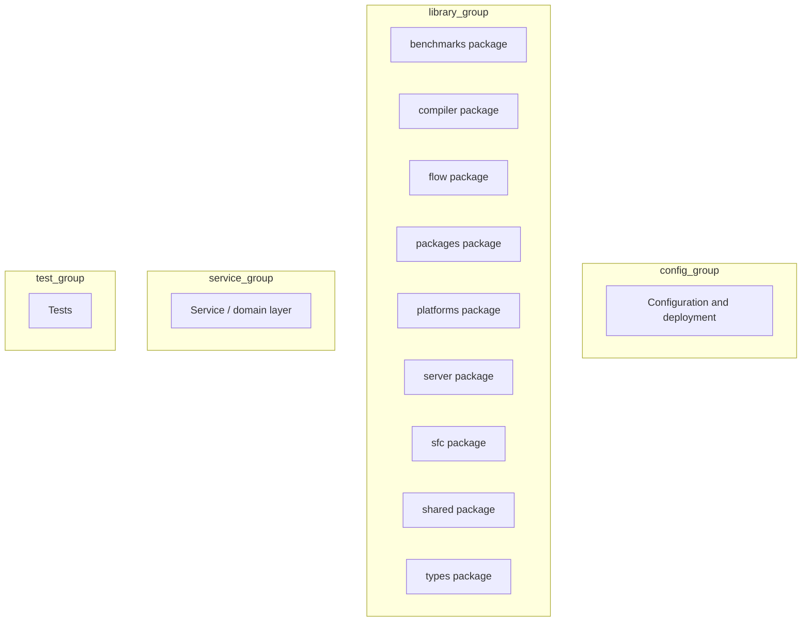

# Architecture report: Meituan-Dianping/mpvue

> Automated static analysis. **Observed** = directly seen in files/imports/AST; **Inferred** = interpretation from that evidence. Repository code was not executed.

## 1. Repository at a glance

| Item | Value |
| --- | --- |
| Repository | Meituan-Dianping/mpvue |
| Description | 基于 Vue.js 的小程序开发框架，从底层支持 Vue.js 语法和构建工具体系。 |
| Language | JavaScript |
| Stars | 20209 |
| Licence | MIT |
| Analysed commit / branch | 6c5d78ee04f58c6d782c456dfcf0fe63c0b7f89b / master |
| Framework(s) | Vue |
| Files analysed | 491 |
| Components | 12 |

## 2. Architecture in one minute

Meituan-Dianping/mpvue - 基于 Vue.js 的小程序开发框架，从底层支持 Vue.js 语法和构建工具体系。. This repository was analysed statically from 491 file(s) (0 Python). Detected technologies (observed from imports/manifests): Vue, TypeScript, webpack. Files are grouped into 12 component(s): benchmarks package, compiler package, Configuration and deployment, flow package, packages package, platforms package, server package, Service / domain layer. Findings below distinguish observed facts from inferred interpretation.

## 3. High-level block diagram

## 4. Main components

### benchmarks package (`benchmarks`)

- **Kind:** library
- **Status:** Observed
- **Confidence:** 0.85
- **Responsibility:** Groups 7 file(s) under benchmarks package (observed from repository paths and static analysis).
- **Paths:** `benchmarks/dbmon/ENV.js`, `benchmarks/dbmon/app.js`, `benchmarks/dbmon/lib/memory-stats.js`, `benchmarks/dbmon/lib/monitor.js`, `benchmarks/ssr/common.js`, `benchmarks/ssr/renderToStream.js`, `benchmarks/ssr/renderToString.js`
- **Evidence:** [benchmarks/dbmon/ENV.js](https://github.com/Meituan-Dianping/mpvue/blob/6c5d78ee04f58c6d782c456dfcf0fe63c0b7f89b/benchmarks/dbmon/ENV.js); [benchmarks/dbmon/app.js](https://github.com/Meituan-Dianping/mpvue/blob/6c5d78ee04f58c6d782c456dfcf0fe63c0b7f89b/benchmarks/dbmon/app.js); [benchmarks/dbmon/lib/memory-stats.js](https://github.com/Meituan-Dianping/mpvue/blob/6c5d78ee04f58c6d782c456dfcf0fe63c0b7f89b/benchmarks/dbmon/lib/memory-stats.js); [benchmarks/dbmon/lib/monitor.js](https://github.com/Meituan-Dianping/mpvue/blob/6c5d78ee04f58c6d782c456dfcf0fe63c0b7f89b/benchmarks/dbmon/lib/monitor.js); [benchmarks/ssr/common.js](https://github.com/Meituan-Dianping/mpvue/blob/6c5d78ee04f58c6d782c456dfcf0fe63c0b7f89b/benchmarks/ssr/common.js); [benchmarks/ssr/renderToStream.js](https://github.com/Meituan-Dianping/mpvue/blob/6c5d78ee04f58c6d782c456dfcf0fe63c0b7f89b/benchmarks/ssr/renderToStream.js); [benchmarks/ssr/renderToString.js](https://github.com/Meituan-Dianping/mpvue/blob/6c5d78ee04f58c6d782c456dfcf0fe63c0b7f89b/benchmarks/ssr/renderToString.js)

### compiler package (`compiler`)

- **Kind:** library
- **Status:** Observed
- **Confidence:** 0.85
- **Responsibility:** Groups 17 file(s) under compiler package (observed from repository paths and static analysis).
- **Paths:** `src/compiler/codegen/events.js`, `src/compiler/codegen/index.js`, `src/compiler/create-compiler.js`, `src/compiler/directives/bind.js`, `src/compiler/directives/index.js`, `src/compiler/directives/model.js`, `src/compiler/directives/on.js`, `src/compiler/error-detector.js`, `src/compiler/helpers.js`, `src/compiler/index.js`, `src/compiler/optimizer.js`, `src/compiler/parser/entity-decoder.js`, `src/compiler/parser/filter-parser.js`, `src/compiler/parser/html-parser.js`, `src/compiler/parser/index.js`, `src/compiler/parser/text-parser.js`, `src/compiler/to-function.js`
- **Evidence:** [src/compiler/codegen/events.js](https://github.com/Meituan-Dianping/mpvue/blob/6c5d78ee04f58c6d782c456dfcf0fe63c0b7f89b/src/compiler/codegen/events.js); [src/compiler/codegen/index.js](https://github.com/Meituan-Dianping/mpvue/blob/6c5d78ee04f58c6d782c456dfcf0fe63c0b7f89b/src/compiler/codegen/index.js); [src/compiler/create-compiler.js](https://github.com/Meituan-Dianping/mpvue/blob/6c5d78ee04f58c6d782c456dfcf0fe63c0b7f89b/src/compiler/create-compiler.js); [src/compiler/directives/bind.js](https://github.com/Meituan-Dianping/mpvue/blob/6c5d78ee04f58c6d782c456dfcf0fe63c0b7f89b/src/compiler/directives/bind.js); [src/compiler/directives/index.js](https://github.com/Meituan-Dianping/mpvue/blob/6c5d78ee04f58c6d782c456dfcf0fe63c0b7f89b/src/compiler/directives/index.js); [src/compiler/directives/model.js](https://github.com/Meituan-Dianping/mpvue/blob/6c5d78ee04f58c6d782c456dfcf0fe63c0b7f89b/src/compiler/directives/model.js); [src/compiler/directives/on.js](https://github.com/Meituan-Dianping/mpvue/blob/6c5d78ee04f58c6d782c456dfcf0fe63c0b7f89b/src/compiler/directives/on.js); [src/compiler/error-detector.js](https://github.com/Meituan-Dianping/mpvue/blob/6c5d78ee04f58c6d782c456dfcf0fe63c0b7f89b/src/compiler/error-detector.js)

### Configuration and deployment (`config`)

- **Kind:** config
- **Status:** Observed
- **Confidence:** 0.85
- **Responsibility:** Groups 18 file(s) under configuration and deployment (observed from repository paths and static analysis).
- **Paths:** `circle.yml`, `package.json`, `packages/mpvue-template-compiler/package.json`, `packages/mpvue/package.json`, `packages/vue-server-renderer/package.json`, `packages/vue-server-renderer/types/tsconfig.json`, `packages/vue-template-compiler/package.json`, `packages/weex-template-compiler/package.json`, `packages/weex-vue-framework/package.json`, `src/platforms/mp/compiler/my/config/astMap.js`, `src/platforms/mp/compiler/my/config/directiveMap.js`, `src/platforms/mp/compiler/swan/config/astMap.js`, `src/platforms/mp/compiler/swan/config/directiveMap.js`, `src/platforms/mp/compiler/tt/config/astMap.js`, `src/platforms/mp/compiler/tt/config/directiveMap.js`, `src/platforms/mp/compiler/wx/config/astMap.js`, `src/platforms/mp/compiler/wx/config/directiveMap.js`, `types/typings.json`
- **Evidence:** [circle.yml](https://github.com/Meituan-Dianping/mpvue/blob/6c5d78ee04f58c6d782c456dfcf0fe63c0b7f89b/circle.yml); [package.json](https://github.com/Meituan-Dianping/mpvue/blob/6c5d78ee04f58c6d782c456dfcf0fe63c0b7f89b/package.json); [packages/mpvue-template-compiler/package.json](https://github.com/Meituan-Dianping/mpvue/blob/6c5d78ee04f58c6d782c456dfcf0fe63c0b7f89b/packages/mpvue-template-compiler/package.json); [packages/mpvue/package.json](https://github.com/Meituan-Dianping/mpvue/blob/6c5d78ee04f58c6d782c456dfcf0fe63c0b7f89b/packages/mpvue/package.json); [packages/vue-server-renderer/package.json](https://github.com/Meituan-Dianping/mpvue/blob/6c5d78ee04f58c6d782c456dfcf0fe63c0b7f89b/packages/vue-server-renderer/package.json); [packages/vue-server-renderer/types/tsconfig.json](https://github.com/Meituan-Dianping/mpvue/blob/6c5d78ee04f58c6d782c456dfcf0fe63c0b7f89b/packages/vue-server-renderer/types/tsconfig.json); [packages/vue-template-compiler/package.json](https://github.com/Meituan-Dianping/mpvue/blob/6c5d78ee04f58c6d782c456dfcf0fe63c0b7f89b/packages/vue-template-compiler/package.json); [packages/weex-template-compiler/package.json](https://github.com/Meituan-Dianping/mpvue/blob/6c5d78ee04f58c6d782c456dfcf0fe63c0b7f89b/packages/weex-template-compiler/package.json)

### flow package (`flow`)

- **Kind:** library
- **Status:** Observed
- **Confidence:** 0.85
- **Responsibility:** Groups 7 file(s) under flow package (observed from repository paths and static analysis).
- **Paths:** `flow/compiler.js`, `flow/component.js`, `flow/global-api.js`, `flow/modules.js`, `flow/options.js`, `flow/ssr.js`, `flow/vnode.js`
- **Evidence:** [flow/compiler.js](https://github.com/Meituan-Dianping/mpvue/blob/6c5d78ee04f58c6d782c456dfcf0fe63c0b7f89b/flow/compiler.js); [flow/component.js](https://github.com/Meituan-Dianping/mpvue/blob/6c5d78ee04f58c6d782c456dfcf0fe63c0b7f89b/flow/component.js); [flow/global-api.js](https://github.com/Meituan-Dianping/mpvue/blob/6c5d78ee04f58c6d782c456dfcf0fe63c0b7f89b/flow/global-api.js); [flow/modules.js](https://github.com/Meituan-Dianping/mpvue/blob/6c5d78ee04f58c6d782c456dfcf0fe63c0b7f89b/flow/modules.js); [flow/options.js](https://github.com/Meituan-Dianping/mpvue/blob/6c5d78ee04f58c6d782c456dfcf0fe63c0b7f89b/flow/options.js); [flow/ssr.js](https://github.com/Meituan-Dianping/mpvue/blob/6c5d78ee04f58c6d782c456dfcf0fe63c0b7f89b/flow/ssr.js); [flow/vnode.js](https://github.com/Meituan-Dianping/mpvue/blob/6c5d78ee04f58c6d782c456dfcf0fe63c0b7f89b/flow/vnode.js)

### packages package (`packages`)

- **Kind:** library
- **Status:** Observed
- **Confidence:** 0.85
- **Responsibility:** Groups 14 file(s) under packages package (observed from repository paths and static analysis).
- **Paths:** `packages/mpvue-template-compiler/build.js`, `packages/mpvue-template-compiler/index.js`, `packages/mpvue/index.js`, `packages/vue-server-renderer/client-plugin.js`, `packages/vue-server-renderer/index.js`, `packages/vue-server-renderer/server-plugin.js`, `packages/vue-server-renderer/types/index.d.ts`, `packages/vue-server-renderer/types/test.ts`, `packages/vue-template-compiler/build.js`, `packages/vue-template-compiler/index.js`, `packages/weex-template-compiler/build.js`, `packages/weex-template-compiler/index.js`, `packages/weex-vue-framework/factory.js`, `packages/weex-vue-framework/index.js`
- **Evidence:** [packages/mpvue-template-compiler/build.js](https://github.com/Meituan-Dianping/mpvue/blob/6c5d78ee04f58c6d782c456dfcf0fe63c0b7f89b/packages/mpvue-template-compiler/build.js); [packages/mpvue-template-compiler/index.js](https://github.com/Meituan-Dianping/mpvue/blob/6c5d78ee04f58c6d782c456dfcf0fe63c0b7f89b/packages/mpvue-template-compiler/index.js); [packages/mpvue/index.js](https://github.com/Meituan-Dianping/mpvue/blob/6c5d78ee04f58c6d782c456dfcf0fe63c0b7f89b/packages/mpvue/index.js); [packages/vue-server-renderer/client-plugin.js](https://github.com/Meituan-Dianping/mpvue/blob/6c5d78ee04f58c6d782c456dfcf0fe63c0b7f89b/packages/vue-server-renderer/client-plugin.js); [packages/vue-server-renderer/index.js](https://github.com/Meituan-Dianping/mpvue/blob/6c5d78ee04f58c6d782c456dfcf0fe63c0b7f89b/packages/vue-server-renderer/index.js); [packages/vue-server-renderer/server-plugin.js](https://github.com/Meituan-Dianping/mpvue/blob/6c5d78ee04f58c6d782c456dfcf0fe63c0b7f89b/packages/vue-server-renderer/server-plugin.js); [packages/vue-server-renderer/types/index.d.ts](https://github.com/Meituan-Dianping/mpvue/blob/6c5d78ee04f58c6d782c456dfcf0fe63c0b7f89b/packages/vue-server-renderer/types/index.d.ts); [packages/vue-server-renderer/types/test.ts](https://github.com/Meituan-Dianping/mpvue/blob/6c5d78ee04f58c6d782c456dfcf0fe63c0b7f89b/packages/vue-server-renderer/types/test.ts)

### platforms package (`platforms`)

- **Kind:** library
- **Status:** Observed
- **Confidence:** 0.85
- **Responsibility:** Groups 125 file(s) under platforms package (observed from repository paths and static analysis).
- **Paths:** `src/platforms/mp/compiler/common/babel-plugins.js`, `src/platforms/mp/compiler/common/config.js`, `src/platforms/mp/compiler/common/convert/index.js`, `src/platforms/mp/compiler/common/convert/tag.js`, `src/platforms/mp/compiler/common/generate.js`, `src/platforms/mp/compiler/common/tagMap.js`, `src/platforms/mp/compiler/common/utils.js`, `src/platforms/mp/compiler/create-compiler.js`, `src/platforms/mp/compiler/directives/html.js`, `src/platforms/mp/compiler/directives/index.js`, `src/platforms/mp/compiler/directives/model.js`, `src/platforms/mp/compiler/directives/text.js`, `src/platforms/mp/compiler/index.js`, `src/platforms/mp/compiler/mark-component.js`, `src/platforms/mp/compiler/modules/class.js`, `src/platforms/mp/compiler/modules/index.js`, `src/platforms/mp/compiler/modules/style.js`, `src/platforms/mp/compiler/my/convert/attrs.js`, `src/platforms/mp/compiler/my/convert/component.js`, `src/platforms/mp/compiler/my/convert/for.js`, `src/platforms/mp/compiler/my/convert/index.js`, `src/platforms/mp/compiler/my/index.js`, `src/platforms/mp/compiler/options.js`, `src/platforms/mp/compiler/swan/convert/attrs.js`, `src/platforms/mp/compiler/swan/convert/component.js`, `src/platforms/mp/compiler/swan/convert/for.js`, `src/platforms/mp/compiler/swan/convert/index.js`, `src/platforms/mp/compiler/swan/index.js`, `src/platforms/mp/compiler/tt/convert/attrs.js`, `src/platforms/mp/compiler/tt/convert/component.js`, `src/platforms/mp/compiler/tt/convert/for.js`, `src/platforms/mp/compiler/tt/convert/index.js`, `src/platforms/mp/compiler/tt/index.js`, `src/platforms/mp/compiler/util.js`, `src/platforms/mp/compiler/wx/convert/attrs.js`, `src/platforms/mp/compiler/wx/convert/component.js`, `src/platforms/mp/compiler/wx/convert/for.js`, `src/platforms/mp/compiler/wx/convert/index.js`, `src/platforms/mp/compiler/wx/index.js`, `src/platforms/mp/entry-compiler.js`, `src/platforms/mp/entry-runtime.js`, `src/platforms/mp/join-code-in-build.js`, `src/platforms/mp/runtime/diff-data.js`, `src/platforms/mp/runtime/events.js`, `src/platforms/mp/runtime/index.js`, `src/platforms/mp/runtime/lifecycle.js`, `src/platforms/mp/runtime/node-ops.js`, `src/platforms/mp/runtime/patch.js`, `src/platforms/mp/runtime/render.js`, `src/platforms/mp/runtime/runtime-trace.js`, `src/platforms/mp/util/index.js`, `src/platforms/web/compiler/directives/html.js`, `src/platforms/web/compiler/directives/index.js`, `src/platforms/web/compiler/directives/model.js`, `src/platforms/web/compiler/directives/text.js`, `src/platforms/web/compiler/index.js`, `src/platforms/web/compiler/modules/class.js`, `src/platforms/web/compiler/modules/index.js`, `src/platforms/web/compiler/modules/style.js`, `src/platforms/web/compiler/options.js`, `src/platforms/web/compiler/util.js`, `src/platforms/web/entry-compiler.js`, `src/platforms/web/entry-runtime-with-compiler.js`, `src/platforms/web/entry-runtime.js`, `src/platforms/web/entry-server-basic-renderer.js`, `src/platforms/web/entry-server-renderer.js`, `src/platforms/web/runtime/class-util.js`, `src/platforms/web/runtime/components/index.js`, `src/platforms/web/runtime/components/transition-group.js`, `src/platforms/web/runtime/components/transition.js`, `src/platforms/web/runtime/directives/index.js`, `src/platforms/web/runtime/directives/model.js`, `src/platforms/web/runtime/directives/show.js`, `src/platforms/web/runtime/index.js`, `src/platforms/web/runtime/modules/attrs.js`, `src/platforms/web/runtime/modules/class.js`, `src/platforms/web/runtime/modules/dom-props.js`, `src/platforms/web/runtime/modules/events.js`, `src/platforms/web/runtime/modules/index.js`, `src/platforms/web/runtime/modules/style.js`, `src/platforms/web/runtime/modules/transition.js`, `src/platforms/web/runtime/node-ops.js`, `src/platforms/web/runtime/patch.js`, `src/platforms/web/runtime/transition-util.js`, `src/platforms/web/server/compiler.js`, `src/platforms/web/server/directives/index.js`, `src/platforms/web/server/directives/show.js`, `src/platforms/web/server/modules/attrs.js`, `src/platforms/web/server/modules/class.js`, `src/platforms/web/server/modules/dom-props.js`, `src/platforms/web/server/modules/index.js`, `src/platforms/web/server/modules/style.js`, `src/platforms/web/server/util.js`, `src/platforms/web/util/attrs.js`, `src/platforms/web/util/class.js`, `src/platforms/web/util/compat.js`, `src/platforms/web/util/element.js`, `src/platforms/web/util/index.js`, `src/platforms/web/util/style.js`, `src/platforms/weex/compiler/directives/index.js`, `src/platforms/weex/compiler/directives/model.js`, `src/platforms/weex/compiler/index.js`, `src/platforms/weex/compiler/modules/append.js`, `src/platforms/weex/compiler/modules/class.js`, `src/platforms/weex/compiler/modules/index.js`, `src/platforms/weex/compiler/modules/props.js`, `src/platforms/weex/compiler/modules/style.js`, `src/platforms/weex/entry-compiler.js`, `src/platforms/weex/entry-framework.js`, `src/platforms/weex/entry-runtime-factory.js`, `src/platforms/weex/runtime/components/index.js`, `src/platforms/weex/runtime/components/transition-group.js`, `src/platforms/weex/runtime/components/transition.js`, `src/platforms/weex/runtime/directives/index.js`, `src/platforms/weex/runtime/index.js`, `src/platforms/weex/runtime/modules/attrs.js`, `src/platforms/weex/runtime/modules/class.js`, `src/platforms/weex/runtime/modules/events.js`, `src/platforms/weex/runtime/modules/index.js`, `src/platforms/weex/runtime/modules/style.js`, `src/platforms/weex/runtime/modules/transition.js`, `src/platforms/weex/runtime/node-ops.js`, `src/platforms/weex/runtime/patch.js`, `src/platforms/weex/runtime/text-node.js`, `src/platforms/weex/util/index.js`
- **Evidence:** [src/platforms/mp/compiler/common/babel-plugins.js](https://github.com/Meituan-Dianping/mpvue/blob/6c5d78ee04f58c6d782c456dfcf0fe63c0b7f89b/src/platforms/mp/compiler/common/babel-plugins.js); [src/platforms/mp/compiler/common/config.js](https://github.com/Meituan-Dianping/mpvue/blob/6c5d78ee04f58c6d782c456dfcf0fe63c0b7f89b/src/platforms/mp/compiler/common/config.js); [src/platforms/mp/compiler/common/convert/index.js](https://github.com/Meituan-Dianping/mpvue/blob/6c5d78ee04f58c6d782c456dfcf0fe63c0b7f89b/src/platforms/mp/compiler/common/convert/index.js); [src/platforms/mp/compiler/common/convert/tag.js](https://github.com/Meituan-Dianping/mpvue/blob/6c5d78ee04f58c6d782c456dfcf0fe63c0b7f89b/src/platforms/mp/compiler/common/convert/tag.js); [src/platforms/mp/compiler/common/generate.js](https://github.com/Meituan-Dianping/mpvue/blob/6c5d78ee04f58c6d782c456dfcf0fe63c0b7f89b/src/platforms/mp/compiler/common/generate.js); [src/platforms/mp/compiler/common/tagMap.js](https://github.com/Meituan-Dianping/mpvue/blob/6c5d78ee04f58c6d782c456dfcf0fe63c0b7f89b/src/platforms/mp/compiler/common/tagMap.js); [src/platforms/mp/compiler/common/utils.js](https://github.com/Meituan-Dianping/mpvue/blob/6c5d78ee04f58c6d782c456dfcf0fe63c0b7f89b/src/platforms/mp/compiler/common/utils.js); [src/platforms/mp/compiler/create-compiler.js](https://github.com/Meituan-Dianping/mpvue/blob/6c5d78ee04f58c6d782c456dfcf0fe63c0b7f89b/src/platforms/mp/compiler/create-compiler.js)

### server package (`server`)

- **Kind:** library
- **Status:** Observed
- **Confidence:** 0.85
- **Responsibility:** Groups 22 file(s) under server package (observed from repository paths and static analysis).
- **Paths:** `src/server/bundle-renderer/create-bundle-renderer.js`, `src/server/bundle-renderer/create-bundle-runner.js`, `src/server/bundle-renderer/source-map-support.js`, `src/server/create-basic-renderer.js`, `src/server/create-renderer.js`, `src/server/optimizing-compiler/codegen.js`, `src/server/optimizing-compiler/index.js`, `src/server/optimizing-compiler/modules.js`, `src/server/optimizing-compiler/optimizer.js`, `src/server/optimizing-compiler/runtime-helpers.js`, `src/server/render-context.js`, `src/server/render-stream.js`, `src/server/render.js`, `src/server/template-renderer/create-async-file-mapper.js`, `src/server/template-renderer/index.js`, `src/server/template-renderer/parse-template.js`, `src/server/template-renderer/template-stream.js`, `src/server/util.js`, `src/server/webpack-plugin/client.js`, `src/server/webpack-plugin/server.js`, `src/server/webpack-plugin/util.js`, `src/server/write.js`
- **Evidence:** [src/server/bundle-renderer/create-bundle-renderer.js](https://github.com/Meituan-Dianping/mpvue/blob/6c5d78ee04f58c6d782c456dfcf0fe63c0b7f89b/src/server/bundle-renderer/create-bundle-renderer.js); [src/server/bundle-renderer/create-bundle-runner.js](https://github.com/Meituan-Dianping/mpvue/blob/6c5d78ee04f58c6d782c456dfcf0fe63c0b7f89b/src/server/bundle-renderer/create-bundle-runner.js); [src/server/bundle-renderer/source-map-support.js](https://github.com/Meituan-Dianping/mpvue/blob/6c5d78ee04f58c6d782c456dfcf0fe63c0b7f89b/src/server/bundle-renderer/source-map-support.js); [src/server/create-basic-renderer.js](https://github.com/Meituan-Dianping/mpvue/blob/6c5d78ee04f58c6d782c456dfcf0fe63c0b7f89b/src/server/create-basic-renderer.js); [src/server/create-renderer.js](https://github.com/Meituan-Dianping/mpvue/blob/6c5d78ee04f58c6d782c456dfcf0fe63c0b7f89b/src/server/create-renderer.js); [src/server/optimizing-compiler/codegen.js](https://github.com/Meituan-Dianping/mpvue/blob/6c5d78ee04f58c6d782c456dfcf0fe63c0b7f89b/src/server/optimizing-compiler/codegen.js); [src/server/optimizing-compiler/index.js](https://github.com/Meituan-Dianping/mpvue/blob/6c5d78ee04f58c6d782c456dfcf0fe63c0b7f89b/src/server/optimizing-compiler/index.js); [src/server/optimizing-compiler/modules.js](https://github.com/Meituan-Dianping/mpvue/blob/6c5d78ee04f58c6d782c456dfcf0fe63c0b7f89b/src/server/optimizing-compiler/modules.js)

### Service / domain layer (`service_layer`)

- **Kind:** service
- **Status:** Observed
- **Confidence:** 0.85
- **Responsibility:** Groups 53 file(s) under service / domain layer (observed from repository paths and static analysis).
- **Paths:** `src/core/components/index.js`, `src/core/components/keep-alive.js`, `src/core/config.js`, `src/core/global-api/assets.js`, `src/core/global-api/extend.js`, `src/core/global-api/index.js`, `src/core/global-api/mixin.js`, `src/core/global-api/use.js`, `src/core/index.js`, `src/core/instance/events.js`, `src/core/instance/index.js`, `src/core/instance/init.js`, `src/core/instance/inject.js`, `src/core/instance/lifecycle.js`, `src/core/instance/proxy.js`, `src/core/instance/render-helpers/bind-object-listeners.js`, `src/core/instance/render-helpers/bind-object-props.js`, `src/core/instance/render-helpers/check-keycodes.js`, `src/core/instance/render-helpers/render-list.js`, `src/core/instance/render-helpers/render-slot.js`, `src/core/instance/render-helpers/render-static.js`, `src/core/instance/render-helpers/resolve-filter.js`, `src/core/instance/render-helpers/resolve-slots.js`, `src/core/instance/render.js`, `src/core/instance/state.js`, `src/core/observer/array.js`, `src/core/observer/dep.js`, `src/core/observer/index.js`, `src/core/observer/scheduler.js`, `src/core/observer/watcher.js`, `src/core/util/debug.js`, `src/core/util/env.js`, `src/core/util/error.js`, `src/core/util/index.js`, `src/core/util/lang.js`, `src/core/util/options.js`, `src/core/util/perf.js`, `src/core/util/props.js`, `src/core/vdom/create-component.js`, `src/core/vdom/create-element.js`, `src/core/vdom/create-functional-component.js`, `src/core/vdom/helpers/extract-props.js`, `src/core/vdom/helpers/get-first-component-child.js`, `src/core/vdom/helpers/index.js`, `src/core/vdom/helpers/merge-hook.js`, `src/core/vdom/helpers/normalize-children.js`, `src/core/vdom/helpers/resolve-async-component.js`, `src/core/vdom/helpers/update-listeners.js`, `src/core/vdom/modules/directives.js`, `src/core/vdom/modules/index.js`, `src/core/vdom/modules/ref.js`, `src/core/vdom/patch.js`, `src/core/vdom/vnode.js`
- **Evidence:** [src/core/components/index.js](https://github.com/Meituan-Dianping/mpvue/blob/6c5d78ee04f58c6d782c456dfcf0fe63c0b7f89b/src/core/components/index.js); [src/core/components/keep-alive.js](https://github.com/Meituan-Dianping/mpvue/blob/6c5d78ee04f58c6d782c456dfcf0fe63c0b7f89b/src/core/components/keep-alive.js); [src/core/config.js](https://github.com/Meituan-Dianping/mpvue/blob/6c5d78ee04f58c6d782c456dfcf0fe63c0b7f89b/src/core/config.js); [src/core/global-api/assets.js](https://github.com/Meituan-Dianping/mpvue/blob/6c5d78ee04f58c6d782c456dfcf0fe63c0b7f89b/src/core/global-api/assets.js); [src/core/global-api/extend.js](https://github.com/Meituan-Dianping/mpvue/blob/6c5d78ee04f58c6d782c456dfcf0fe63c0b7f89b/src/core/global-api/extend.js); [src/core/global-api/index.js](https://github.com/Meituan-Dianping/mpvue/blob/6c5d78ee04f58c6d782c456dfcf0fe63c0b7f89b/src/core/global-api/index.js); [src/core/global-api/mixin.js](https://github.com/Meituan-Dianping/mpvue/blob/6c5d78ee04f58c6d782c456dfcf0fe63c0b7f89b/src/core/global-api/mixin.js); [src/core/global-api/use.js](https://github.com/Meituan-Dianping/mpvue/blob/6c5d78ee04f58c6d782c456dfcf0fe63c0b7f89b/src/core/global-api/use.js)

### sfc package (`sfc`)

- **Kind:** library
- **Status:** Observed
- **Confidence:** 0.85
- **Responsibility:** Groups 1 file(s) under sfc package (observed from repository paths and static analysis).
- **Paths:** `src/sfc/parser.js`
- **Evidence:** [src/sfc/parser.js](https://github.com/Meituan-Dianping/mpvue/blob/6c5d78ee04f58c6d782c456dfcf0fe63c0b7f89b/src/sfc/parser.js)

### shared package (`shared`)

- **Kind:** library
- **Status:** Observed
- **Confidence:** 0.85
- **Responsibility:** Groups 2 file(s) under shared package (observed from repository paths and static analysis).
- **Paths:** `src/shared/constants.js`, `src/shared/util.js`
- **Evidence:** [src/shared/constants.js](https://github.com/Meituan-Dianping/mpvue/blob/6c5d78ee04f58c6d782c456dfcf0fe63c0b7f89b/src/shared/constants.js); [src/shared/util.js](https://github.com/Meituan-Dianping/mpvue/blob/6c5d78ee04f58c6d782c456dfcf0fe63c0b7f89b/src/shared/util.js)

### Tests (`tests`)

- **Kind:** test
- **Status:** Observed
- **Confidence:** 0.85
- **Responsibility:** Groups 164 file(s) under tests (observed from repository paths and static analysis).
- **Paths:** `test/e2e/.eslintrc`, `test/e2e/nightwatch.config.js`, `test/e2e/runner.js`, `test/e2e/specs/commits.js`, `test/e2e/specs/grid.js`, `test/e2e/specs/markdown.js`, `test/e2e/specs/modal.js`, `test/e2e/specs/select2.js`, `test/e2e/specs/svg.js`, `test/e2e/specs/todomvc.js`, `test/e2e/specs/tree.js`, `test/helpers/.eslintrc`, `test/helpers/classlist.js`, `test/helpers/test-object-option.js`, `test/helpers/to-equal.js`, `test/helpers/to-have-been-warned.js`, `test/helpers/trigger-event.js`, `test/helpers/vdom.js`, `test/helpers/wait-for-update.js`, `test/mp/.eslintrc`, `test/mp/compiler/index.spec.js`, `test/mp/helpers/index.js`, `test/mp/helpers/mp.runtime.js`, `test/mp/jasmine.json`, `test/mp/runtime/events.spec.js`, `test/mp/runtime/instance.spec.js`, `test/mp/runtime/lifecycle.spec.js`, `test/ssr/.eslintrc`, `test/ssr/async-loader.js`, `test/ssr/compile-with-webpack.js`, `test/ssr/fixtures/app.js`, `test/ssr/fixtures/async-bar.js`, `test/ssr/fixtures/async-foo.js`, `test/ssr/fixtures/cache.js`, `test/ssr/fixtures/error.js`, `test/ssr/fixtures/nested-cache.js`, `test/ssr/fixtures/split.js`, `test/ssr/fixtures/test.css`, `test/ssr/jasmine.json`, `test/ssr/ssr-basic-renderer.spec.js`, `test/ssr/ssr-bundle-render.spec.js`, `test/ssr/ssr-stream.spec.js`, `test/ssr/ssr-string.spec.js`, `test/ssr/ssr-template.spec.js`, `test/unit/.eslintrc`, `test/unit/features/component/component-async.spec.js`, `test/unit/features/component/component-keep-alive.spec.js`, `test/unit/features/component/component-scoped-slot.spec.js`, `test/unit/features/component/component-slot.spec.js`, `test/unit/features/component/component.spec.js`, `test/unit/features/debug.spec.js`, `test/unit/features/directives/bind.spec.js`, `test/unit/features/directives/class.spec.js`, `test/unit/features/directives/cloak.spec.js`, `test/unit/features/directives/for.spec.js`, `test/unit/features/directives/html.spec.js`, `test/unit/features/directives/if.spec.js`, `test/unit/features/directives/model-checkbox.spec.js`, `test/unit/features/directives/model-component.spec.js`, `test/unit/features/directives/model-dynamic.spec.js`, `test/unit/features/directives/model-file.spec.js`, `test/unit/features/directives/model-parse.spec.js`, `test/unit/features/directives/model-radio.spec.js`, `test/unit/features/directives/model-select.spec.js`, `test/unit/features/directives/model-text.spec.js`, `test/unit/features/directives/on.spec.js`, `test/unit/features/directives/once.spec.js`, `test/unit/features/directives/pre.spec.js`, `test/unit/features/directives/show.spec.js`, `test/unit/features/directives/static-style-parser.spec.js`, `test/unit/features/directives/style.spec.js`, `test/unit/features/directives/text.spec.js`, `test/unit/features/error-handling.spec.js`, `test/unit/features/filter/filter.spec.js`, `test/unit/features/global-api/assets.spec.js`, `test/unit/features/global-api/compile.spec.js`, `test/unit/features/global-api/config.spec.js`, `test/unit/features/global-api/extend.spec.js`, `test/unit/features/global-api/mixin.spec.js`, `test/unit/features/global-api/set-delete.spec.js`, `test/unit/features/global-api/use.spec.js`, `test/unit/features/instance/init.spec.js`, `test/unit/features/instance/methods-data.spec.js`, `test/unit/features/instance/methods-events.spec.js`, `test/unit/features/instance/methods-lifecycle.spec.js`, `test/unit/features/instance/properties.spec.js`, `test/unit/features/instance/render-proxy.spec.js`, `test/unit/features/options/_scopeId.spec.js`, `test/unit/features/options/comments.spec.js`, `test/unit/features/options/components.spec.js`, `test/unit/features/options/computed.spec.js`, `test/unit/features/options/data.spec.js`, `test/unit/features/options/delimiters.spec.js`, `test/unit/features/options/directives.spec.js`, `test/unit/features/options/el.spec.js`, `test/unit/features/options/extends.spec.js`, `test/unit/features/options/functional.spec.js`, `test/unit/features/options/inheritAttrs.spec.js`, `test/unit/features/options/inject.spec.js`, `test/unit/features/options/lifecycle.spec.js`, `test/unit/features/options/methods.spec.js`, `test/unit/features/options/mixins.spec.js`, `test/unit/features/options/name.spec.js`, `test/unit/features/options/parent.spec.js`, `test/unit/features/options/props.spec.js`, `test/unit/features/options/propsData.spec.js`, `test/unit/features/options/render.spec.js`, `test/unit/features/options/renderError.spec.js`, `test/unit/features/options/template.spec.js`, `test/unit/features/options/watch.spec.js`, `test/unit/features/ref.spec.js`, `test/unit/features/transition/inject-styles.js`, `test/unit/features/transition/transition-group.spec.js`, `test/unit/features/transition/transition-mode.spec.js`, `test/unit/features/transition/transition.spec.js`, `test/unit/index.js`, `test/unit/karma.base.config.js`, `test/unit/karma.cover.config.js`, `test/unit/karma.dev.config.js`, `test/unit/karma.sauce.config.js`, `test/unit/karma.unit.config.js`, `test/unit/modules/compiler/codegen.spec.js`, `test/unit/modules/compiler/compiler-options.spec.js`, `test/unit/modules/compiler/optimizer.spec.js`, `test/unit/modules/compiler/parser.spec.js`, `test/unit/modules/observer/observer.spec.js`, `test/unit/modules/observer/scheduler.spec.js`, `test/unit/modules/observer/watcher.spec.js`, `test/unit/modules/server-compiler/optimizer.spec.js`, `test/unit/modules/sfc/sfc-parser.spec.js`, `test/unit/modules/util/next-tick.spec.js`, `test/unit/modules/vdom/create-component.spec.js`, `test/unit/modules/vdom/create-element.spec.js`, `test/unit/modules/vdom/modules/attrs.spec.js`, `test/unit/modules/vdom/modules/class.spec.js`, `test/unit/modules/vdom/modules/directive.spec.js`, `test/unit/modules/vdom/modules/dom-props.spec.js`, `test/unit/modules/vdom/modules/events.spec.js`, `test/unit/modules/vdom/modules/style.spec.js`, `test/unit/modules/vdom/patch/children.spec.js`, `test/unit/modules/vdom/patch/edge-cases.spec.js`, `test/unit/modules/vdom/patch/element.spec.js`, `test/unit/modules/vdom/patch/hooks.spec.js`, `test/unit/modules/vdom/patch/hydration.spec.js`, `test/weex/.eslintrc`, `test/weex/compiler/append.spec.js`, `test/weex/compiler/class.spec.js`, `test/weex/compiler/compile.spec.js`, `test/weex/compiler/props.spec.js`, `test/weex/compiler/style.spec.js`, `test/weex/compiler/v-model.spec.js`, `test/weex/helpers/index.js`, `test/weex/jasmine.json`, `test/weex/runtime/attrs.spec.js`, `test/weex/runtime/class.spec.js`, `test/weex/runtime/events.spec.js`, `test/weex/runtime/framework.spec.js`, `test/weex/runtime/node.spec.js`, `test/weex/runtime/style.spec.js`, `types/test/augmentation-test.ts`, `types/test/options-test.ts`, `types/test/plugin-test.ts`, `types/test/tsconfig.json`, `types/test/vue-test.ts`
- **Evidence:** [test/e2e/.eslintrc](https://github.com/Meituan-Dianping/mpvue/blob/6c5d78ee04f58c6d782c456dfcf0fe63c0b7f89b/test/e2e/.eslintrc); [test/e2e/nightwatch.config.js](https://github.com/Meituan-Dianping/mpvue/blob/6c5d78ee04f58c6d782c456dfcf0fe63c0b7f89b/test/e2e/nightwatch.config.js); [test/e2e/runner.js](https://github.com/Meituan-Dianping/mpvue/blob/6c5d78ee04f58c6d782c456dfcf0fe63c0b7f89b/test/e2e/runner.js); [test/e2e/specs/commits.js](https://github.com/Meituan-Dianping/mpvue/blob/6c5d78ee04f58c6d782c456dfcf0fe63c0b7f89b/test/e2e/specs/commits.js); [test/e2e/specs/grid.js](https://github.com/Meituan-Dianping/mpvue/blob/6c5d78ee04f58c6d782c456dfcf0fe63c0b7f89b/test/e2e/specs/grid.js); [test/e2e/specs/markdown.js](https://github.com/Meituan-Dianping/mpvue/blob/6c5d78ee04f58c6d782c456dfcf0fe63c0b7f89b/test/e2e/specs/markdown.js); [test/e2e/specs/modal.js](https://github.com/Meituan-Dianping/mpvue/blob/6c5d78ee04f58c6d782c456dfcf0fe63c0b7f89b/test/e2e/specs/modal.js); [test/e2e/specs/select2.js](https://github.com/Meituan-Dianping/mpvue/blob/6c5d78ee04f58c6d782c456dfcf0fe63c0b7f89b/test/e2e/specs/select2.js)

### types package (`types`)

- **Kind:** library
- **Status:** Observed
- **Confidence:** 0.85
- **Responsibility:** Groups 5 file(s) under types package (observed from repository paths and static analysis).
- **Paths:** `types/index.d.ts`, `types/options.d.ts`, `types/plugin.d.ts`, `types/vnode.d.ts`, `types/vue.d.ts`
- **Evidence:** [types/index.d.ts](https://github.com/Meituan-Dianping/mpvue/blob/6c5d78ee04f58c6d782c456dfcf0fe63c0b7f89b/types/index.d.ts); [types/options.d.ts](https://github.com/Meituan-Dianping/mpvue/blob/6c5d78ee04f58c6d782c456dfcf0fe63c0b7f89b/types/options.d.ts); [types/plugin.d.ts](https://github.com/Meituan-Dianping/mpvue/blob/6c5d78ee04f58c6d782c456dfcf0fe63c0b7f89b/types/plugin.d.ts); [types/vnode.d.ts](https://github.com/Meituan-Dianping/mpvue/blob/6c5d78ee04f58c6d782c456dfcf0fe63c0b7f89b/types/vnode.d.ts); [types/vue.d.ts](https://github.com/Meituan-Dianping/mpvue/blob/6c5d78ee04f58c6d782c456dfcf0fe63c0b7f89b/types/vue.d.ts)

## 5. Execution flow

**Observed** entry point(s):

- [benchmarks/dbmon/app.js](https://github.com/Meituan-Dianping/mpvue/blob/6c5d78ee04f58c6d782c456dfcf0fe63c0b7f89b/benchmarks/dbmon/app.js)
- [packages/mpvue-template-compiler/index.js](https://github.com/Meituan-Dianping/mpvue/blob/6c5d78ee04f58c6d782c456dfcf0fe63c0b7f89b/packages/mpvue-template-compiler/index.js)
- [packages/mpvue/index.js](https://github.com/Meituan-Dianping/mpvue/blob/6c5d78ee04f58c6d782c456dfcf0fe63c0b7f89b/packages/mpvue/index.js)
- [packages/vue-server-renderer/index.js](https://github.com/Meituan-Dianping/mpvue/blob/6c5d78ee04f58c6d782c456dfcf0fe63c0b7f89b/packages/vue-server-renderer/index.js)
- [packages/vue-template-compiler/index.js](https://github.com/Meituan-Dianping/mpvue/blob/6c5d78ee04f58c6d782c456dfcf0fe63c0b7f89b/packages/vue-template-compiler/index.js)
- [packages/weex-template-compiler/index.js](https://github.com/Meituan-Dianping/mpvue/blob/6c5d78ee04f58c6d782c456dfcf0fe63c0b7f89b/packages/weex-template-compiler/index.js)
- [packages/weex-vue-framework/index.js](https://github.com/Meituan-Dianping/mpvue/blob/6c5d78ee04f58c6d782c456dfcf0fe63c0b7f89b/packages/weex-vue-framework/index.js)
- [src/compiler/codegen/index.js](https://github.com/Meituan-Dianping/mpvue/blob/6c5d78ee04f58c6d782c456dfcf0fe63c0b7f89b/src/compiler/codegen/index.js)
- [src/compiler/directives/index.js](https://github.com/Meituan-Dianping/mpvue/blob/6c5d78ee04f58c6d782c456dfcf0fe63c0b7f89b/src/compiler/directives/index.js)
- [src/compiler/index.js](https://github.com/Meituan-Dianping/mpvue/blob/6c5d78ee04f58c6d782c456dfcf0fe63c0b7f89b/src/compiler/index.js)
- [src/compiler/parser/index.js](https://github.com/Meituan-Dianping/mpvue/blob/6c5d78ee04f58c6d782c456dfcf0fe63c0b7f89b/src/compiler/parser/index.js)
- [src/core/components/index.js](https://github.com/Meituan-Dianping/mpvue/blob/6c5d78ee04f58c6d782c456dfcf0fe63c0b7f89b/src/core/components/index.js)

Representative flow (derived from observed entry points and the import graph; steps beyond the entry point are **Inferred**):

1. Execution starts at an observed entry point listed above, if present.
2. No internal import relationships between components were observed.

## 6. Project structure

### `(root)`

- `.babelrc` - other (160 bytes)
- `.editorconfig` - config (244 bytes)
- `.eslintignore` - other (19 bytes)
- `.eslintrc` - other (184 bytes)
- `.flowconfig` - other (783 bytes)
- `.gitignore` - other (404 bytes)
- `BACKERS.md` - docs (6138 bytes)
- `LICENSE` - docs (1087 bytes)
- `README.md` - docs (14891 bytes)
- `circle.yml` - config (74 bytes)
- `package.json` - manifest (5512 bytes)

### `.github`

- `.github/CODE_OF_CONDUCT.md` - docs (1423 bytes)
- `.github/COMMIT_CONVENTION.md` - docs (2757 bytes)
- `.github/CONTRIBUTING.md` - docs (2249 bytes)
- `.github/ISSUE_TEMPLATE/Bug_report.md` - docs (648 bytes)
- `.github/ISSUE_TEMPLATE/Feature_request.md` - docs (443 bytes)
- `.github/PULL_REQUEST_TEMPLATE.md` - docs (1035 bytes)
- `.github/issue_template.yml` - config (1168 bytes)
- `.github/stale.yml` - config (175 bytes)

### `benchmarks`

- `benchmarks/big-table/demo.css` - other (187 bytes)
- `benchmarks/big-table/index.html` - other (4818 bytes)
- `benchmarks/big-table/style.css` - other (9233 bytes)
- `benchmarks/dbmon/ENV.js` - source, JavaScript (5807 bytes)
- `benchmarks/dbmon/app.js` - source, JavaScript (247 bytes)
- `benchmarks/dbmon/index.html` - other (1188 bytes)
- `benchmarks/dbmon/lib/memory-stats.js` - source, JavaScript (3080 bytes)
- `benchmarks/dbmon/lib/monitor.js` - source, JavaScript (1856 bytes)
- `benchmarks/dbmon/lib/styles.css` - other (1881 bytes)
- `benchmarks/reorder-list/index.html` - other (2772 bytes)
- `benchmarks/ssr/README.md` - docs (862 bytes)
- `benchmarks/ssr/common.js` - source, JavaScript (1543 bytes)
- `benchmarks/ssr/renderToStream.js` - source, JavaScript (825 bytes)
- `benchmarks/ssr/renderToString.js` - source, JavaScript (598 bytes)
- `benchmarks/svg/index.html` - other (2107 bytes)
- `benchmarks/uptime/index.html` - other (5240 bytes)

### `examples`

- `examples/commits/app.js` - source, JavaScript (873 bytes)
- `examples/commits/index.html` - other (1401 bytes)
- `examples/elastic-header/index.html` - other (3598 bytes)
- `examples/elastic-header/style.css` - other (846 bytes)
- `examples/firebase/app.js` - source, JavaScript (1379 bytes)
- `examples/firebase/index.html` - other (1220 bytes)
- `examples/firebase/style.css` - other (431 bytes)
- `examples/grid/grid.js` - source, JavaScript (1629 bytes)
- `examples/grid/index.html` - other (1363 bytes)
- `examples/grid/style.css` - other (902 bytes)
- `examples/markdown/index.html` - other (975 bytes)
- `examples/markdown/style.css` - other (564 bytes)
- `examples/modal/index.html` - other (1903 bytes)
- `examples/modal/style.css` - other (1051 bytes)
- `examples/move-animations/index.html` - other (2404 bytes)
- `examples/select2/index.html` - other (2174 bytes)
- `examples/svg/index.html` - other (1735 bytes)
- `examples/svg/style.css` - other (403 bytes)
- `examples/svg/svg.js` - source, JavaScript (1879 bytes)
- `examples/todomvc/app.js` - source, JavaScript (3364 bytes)
- `examples/todomvc/index.html` - other (2725 bytes)
- `examples/todomvc/readme.md` - docs (912 bytes)
- `examples/tree/index.html` - other (1420 bytes)
- `examples/tree/tree.js` - source, JavaScript (1304 bytes)

### `flow`

- `flow/compiler.js` - source, JavaScript (5025 bytes)
- `flow/component.js` - source, JavaScript (4691 bytes)
- `flow/global-api.js` - source, JavaScript (805 bytes)
- `flow/modules.js` - source, JavaScript (984 bytes)
- `flow/options.js` - source, JavaScript (2178 bytes)
- `flow/ssr.js` - source, JavaScript (450 bytes)
- `flow/vnode.js` - source, JavaScript (1881 bytes)

### `packages`

- `packages/mpvue-template-compiler/README.md` - docs (218 bytes)
- `packages/mpvue-template-compiler/build.js` - source, JavaScript (164401 bytes)
- `packages/mpvue-template-compiler/index.js` - source, JavaScript (637 bytes)
- `packages/mpvue-template-compiler/package.json` - manifest (578 bytes)
- `packages/mpvue/README.md` - docs (198 bytes)
- `packages/mpvue/index.js` - source, JavaScript (153986 bytes)
- `packages/mpvue/package.json` - manifest (486 bytes)
- `packages/vue-server-renderer/README.md` - docs (380 bytes)
- `packages/vue-server-renderer/client-plugin.js` - source, JavaScript (2850 bytes)
- `packages/vue-server-renderer/index.js` - source, JavaScript (515 bytes)
- `packages/vue-server-renderer/package.json` - manifest (916 bytes)
- `packages/vue-server-renderer/server-plugin.js` - source, JavaScript (2755 bytes)
- `packages/vue-server-renderer/types/index.d.ts` - source, TypeScript (1338 bytes)
- `packages/vue-server-renderer/types/test.ts` - source, TypeScript (1851 bytes)
- `packages/vue-server-renderer/types/tsconfig.json` - config (209 bytes)
- `packages/vue-template-compiler/README.md` - docs (4836 bytes)
- `packages/vue-template-compiler/build.js` - source, JavaScript (116778 bytes)
- `packages/vue-template-compiler/index.js` - source, JavaScript (732 bytes)
- `packages/vue-template-compiler/package.json` - manifest (545 bytes)
- `packages/weex-template-compiler/README.md` - docs (188 bytes)
- `packages/weex-template-compiler/build.js` - source, JavaScript (95507 bytes)
- `packages/weex-template-compiler/index.js` - source, JavaScript (640 bytes)
- `packages/weex-template-compiler/package.json` - manifest (532 bytes)
- `packages/weex-vue-framework/README.md` - docs (189 bytes)
- `packages/weex-vue-framework/factory.js` - source, JavaScript (170214 bytes)
- `packages/weex-vue-framework/index.js` - source, JavaScript (14632 bytes)
- `packages/weex-vue-framework/package.json` - manifest (472 bytes)

### `src`

- `src/compiler/codegen/events.js` - source, JavaScript (3567 bytes)
- `src/compiler/codegen/index.js` - source, JavaScript (13484 bytes)
- `src/compiler/create-compiler.js` - source, JavaScript (1569 bytes)
- `src/compiler/directives/bind.js` - source, JavaScript (307 bytes)
- `src/compiler/directives/index.js` - source, JavaScript (144 bytes)
- `src/compiler/directives/model.js` - source, JavaScript (2725 bytes)
- `src/compiler/directives/on.js` - source, JavaScript (316 bytes)
- `src/compiler/error-detector.js` - source, JavaScript (3343 bytes)
- `src/compiler/helpers.js` - source, JavaScript (3040 bytes)
- `src/compiler/index.js` - source, JavaScript (741 bytes)
- `src/compiler/optimizer.js` - source, JavaScript (3617 bytes)
- `src/compiler/parser/entity-decoder.js` - source, JavaScript (198 bytes)
- `src/compiler/parser/filter-parser.js` - source, JavaScript (2674 bytes)
- `src/compiler/parser/html-parser.js` - source, JavaScript (9154 bytes)
- `src/compiler/parser/index.js` - source, JavaScript (16286 bytes)
- `src/compiler/parser/text-parser.js` - source, JavaScript (1138 bytes)
- `src/compiler/to-function.js` - source, JavaScript (2799 bytes)
- `src/core/components/index.js` - source, JavaScript (69 bytes)
- `src/core/components/keep-alive.js` - source, JavaScript (2750 bytes)
- `src/core/config.js` - source, JavaScript (2505 bytes)
- `src/core/global-api/assets.js` - source, JavaScript (1220 bytes)
- `src/core/global-api/extend.js` - source, JavaScript (2843 bytes)
- `src/core/global-api/index.js` - source, JavaScript (1496 bytes)
- `src/core/global-api/mixin.js` - source, JavaScript (220 bytes)
- `src/core/global-api/use.js` - source, JavaScript (629 bytes)
- `src/core/index.js` - source, JavaScript (478 bytes)
- `src/core/instance/events.js` - source, JavaScript (3514 bytes)
- `src/core/instance/index.js` - source, JavaScript (549 bytes)
- `src/core/instance/init.js` - source, JavaScript (4590 bytes)
- `src/core/instance/inject.js` - source, JavaScript (1906 bytes)
- `src/core/instance/lifecycle.js` - source, JavaScript (8753 bytes)
- `src/core/instance/proxy.js` - source, JavaScript (2118 bytes)
- `src/core/instance/render-helpers/bind-object-listeners.js` - source, JavaScript (597 bytes)
- `src/core/instance/render-helpers/bind-object-props.js` - source, JavaScript (1335 bytes)
- `src/core/instance/render-helpers/check-keycodes.js` - source, JavaScript (430 bytes)
- `src/core/instance/render-helpers/render-list.js` - source, JavaScript (895 bytes)
- `src/core/instance/render-helpers/render-slot.js` - source, JavaScript (881 bytes)
- `src/core/instance/render-helpers/render-static.js` - source, JavaScript (1429 bytes)
- `src/core/instance/render-helpers/resolve-filter.js` - source, JavaScript (246 bytes)
- `src/core/instance/render-helpers/resolve-slots.js` - source, JavaScript (1423 bytes)
- `src/core/instance/render.js` - source, JavaScript (4986 bytes)
- `src/core/instance/state.js` - source, JavaScript (9342 bytes)
- `src/core/observer/array.js` - source, JavaScript (917 bytes)
- `src/core/observer/dep.js` - source, JavaScript (1096 bytes)
- `src/core/observer/index.js` - source, JavaScript (7830 bytes)
- `src/core/observer/scheduler.js` - source, JavaScript (3945 bytes)
- `src/core/observer/watcher.js` - source, JavaScript (5969 bytes)
- `src/core/util/debug.js` - source, JavaScript (2681 bytes)
- `src/core/util/env.js` - source, JavaScript (5426 bytes)
- `src/core/util/error.js` - source, JavaScript (529 bytes)
- `src/core/util/index.js` - source, JavaScript (235 bytes)
- `src/core/util/lang.js` - source, JavaScript (810 bytes)
- `src/core/util/options.js` - source, JavaScript (8915 bytes)
- `src/core/util/perf.js` - source, JavaScript (523 bytes)
- `src/core/util/props.js` - source, JavaScript (4635 bytes)
- `src/core/vdom/create-component.js` - source, JavaScript (7170 bytes)
- `src/core/vdom/create-element.js` - source, JavaScript (3680 bytes)
- `src/core/vdom/create-functional-component.js` - source, JavaScript (1612 bytes)
- `src/core/vdom/helpers/extract-props.js` - source, JavaScript (1852 bytes)
- `src/core/vdom/helpers/get-first-component-child.js` - source, JavaScript (322 bytes)
- `src/core/vdom/helpers/index.js` - source, JavaScript (232 bytes)
- `src/core/vdom/helpers/merge-hook.js` - source, JavaScript (901 bytes)
- `src/core/vdom/helpers/normalize-children.js` - source, JavaScript (2995 bytes)
- `src/core/vdom/helpers/resolve-async-component.js` - source, JavaScript (3342 bytes)
- `src/core/vdom/helpers/update-listeners.js` - source, JavaScript (1841 bytes)
- `src/core/vdom/modules/directives.js` - source, JavaScript (3103 bytes)
- `src/core/vdom/modules/index.js` - source, JavaScript (102 bytes)
- `src/core/vdom/modules/ref.js` - source, JavaScript (1032 bytes)
- `src/core/vdom/patch.js` - source, JavaScript (22724 bytes)
- `src/core/vdom/vnode.js` - source, JavaScript (3067 bytes)
- `src/platforms/mp/compiler/common/babel-plugins.js` - source, JavaScript (1466 bytes)
- `src/platforms/mp/compiler/common/config.js` - source, JavaScript (63 bytes)
- `src/platforms/mp/compiler/common/convert/index.js` - source, JavaScript (3781 bytes)
- `src/platforms/mp/compiler/common/convert/tag.js` - source, JavaScript (2937 bytes)
- `src/platforms/mp/compiler/common/generate.js` - source, JavaScript (2122 bytes)
- `src/platforms/mp/compiler/common/tagMap.js` - source, JavaScript (2609 bytes)
- `src/platforms/mp/compiler/common/utils.js` - source, JavaScript (415 bytes)
- `src/platforms/mp/compiler/create-compiler.js` - source, JavaScript (883 bytes)
- `src/platforms/mp/compiler/directives/html.js` - source, JavaScript (198 bytes)
- `src/platforms/mp/compiler/directives/index.js` - source, JavaScript (124 bytes)
- `src/platforms/mp/compiler/directives/model.js` - source, JavaScript (5237 bytes)
- `src/platforms/mp/compiler/directives/text.js` - source, JavaScript (200 bytes)
- `src/platforms/mp/compiler/index.js` - source, JavaScript (816 bytes)
- `src/platforms/mp/compiler/mark-component.js` - source, JavaScript (2884 bytes)
- `src/platforms/mp/compiler/modules/class.js` - source, JavaScript (1241 bytes)
- `src/platforms/mp/compiler/modules/index.js` - source, JavaScript (93 bytes)
- `src/platforms/mp/compiler/modules/style.js` - source, JavaScript (1344 bytes)
- `src/platforms/mp/compiler/my/config/astMap.js` - source, JavaScript (127 bytes)
- `src/platforms/mp/compiler/my/config/directiveMap.js` - source, JavaScript (1468 bytes)
- `src/platforms/mp/compiler/my/convert/attrs.js` - source, JavaScript (6269 bytes)
- `src/platforms/mp/compiler/my/convert/component.js` - source, JavaScript (1469 bytes)
- `src/platforms/mp/compiler/my/convert/for.js` - source, JavaScript (447 bytes)
- `src/platforms/mp/compiler/my/convert/index.js` - source, JavaScript (330 bytes)
- `src/platforms/mp/compiler/my/index.js` - source, JavaScript (223 bytes)
- `src/platforms/mp/compiler/options.js` - source, JavaScript (516 bytes)
- `src/platforms/mp/compiler/swan/config/astMap.js` - source, JavaScript (127 bytes)
- `src/platforms/mp/compiler/swan/config/directiveMap.js` - source, JavaScript (1463 bytes)
- `src/platforms/mp/compiler/swan/convert/attrs.js` - source, JavaScript (6624 bytes)
- `src/platforms/mp/compiler/swan/convert/component.js` - source, JavaScript (1401 bytes)
- `src/platforms/mp/compiler/swan/convert/for.js` - source, JavaScript (659 bytes)
- `src/platforms/mp/compiler/swan/convert/index.js` - source, JavaScript (330 bytes)
- `src/platforms/mp/compiler/swan/index.js` - source, JavaScript (222 bytes)
- `src/platforms/mp/compiler/tt/config/astMap.js` - source, JavaScript (132 bytes)
- `src/platforms/mp/compiler/tt/config/directiveMap.js` - source, JavaScript (1466 bytes)
- `src/platforms/mp/compiler/tt/convert/attrs.js` - source, JavaScript (6192 bytes)
- `src/platforms/mp/compiler/tt/convert/component.js` - source, JavaScript (1465 bytes)
- `src/platforms/mp/compiler/tt/convert/for.js` - source, JavaScript (446 bytes)
- `src/platforms/mp/compiler/tt/convert/index.js` - source, JavaScript (330 bytes)
- `src/platforms/mp/compiler/tt/index.js` - source, JavaScript (222 bytes)
- `src/platforms/mp/compiler/util.js` - source, JavaScript (904 bytes)
- `src/platforms/mp/compiler/wx/config/astMap.js` - source, JavaScript (132 bytes)
- `src/platforms/mp/compiler/wx/config/directiveMap.js` - source, JavaScript (1466 bytes)
- `src/platforms/mp/compiler/wx/convert/attrs.js` - source, JavaScript (6192 bytes)
- `src/platforms/mp/compiler/wx/convert/component.js` - source, JavaScript (1465 bytes)
- `src/platforms/mp/compiler/wx/convert/for.js` - source, JavaScript (447 bytes)
- `src/platforms/mp/compiler/wx/convert/index.js` - source, JavaScript (330 bytes)
- `src/platforms/mp/compiler/wx/index.js` - source, JavaScript (222 bytes)
- `src/platforms/mp/entry-compiler.js` - source, JavaScript (135 bytes)
- `src/platforms/mp/entry-runtime.js` - source, JavaScript (132 bytes)
- `src/platforms/mp/join-code-in-build.js` - source, JavaScript (1077 bytes)
- `src/platforms/mp/runtime/diff-data.js` - source, JavaScript (7082 bytes)
- `src/platforms/mp/runtime/events.js` - source, JavaScript (3488 bytes)
- `src/platforms/mp/runtime/index.js` - source, JavaScript (1475 bytes)
- `src/platforms/mp/runtime/lifecycle.js` - source, JavaScript (10985 bytes)
- `src/platforms/mp/runtime/node-ops.js` - source, JavaScript (925 bytes)
- `src/platforms/mp/runtime/patch.js` - source, JavaScript (630 bytes)
- `src/platforms/mp/runtime/render.js` - source, JavaScript (4659 bytes)
- `src/platforms/mp/runtime/runtime-trace.js` - source, JavaScript (719 bytes)
- `src/platforms/mp/util/index.js` - source, JavaScript (3569 bytes)
- `src/platforms/web/compiler/directives/html.js` - source, JavaScript (198 bytes)
- `src/platforms/web/compiler/directives/index.js` - source, JavaScript (124 bytes)
- `src/platforms/web/compiler/directives/model.js` - source, JavaScript (5237 bytes)
- `src/platforms/web/compiler/directives/text.js` - source, JavaScript (200 bytes)
- `src/platforms/web/compiler/index.js` - source, JavaScript (210 bytes)
- `src/platforms/web/compiler/modules/class.js` - source, JavaScript (1241 bytes)
- `src/platforms/web/compiler/modules/index.js` - source, JavaScript (93 bytes)
- `src/platforms/web/compiler/modules/style.js` - source, JavaScript (1344 bytes)
- `src/platforms/web/compiler/options.js` - source, JavaScript (516 bytes)
- `src/platforms/web/compiler/util.js` - source, JavaScript (904 bytes)
- `src/platforms/web/entry-compiler.js` - source, JavaScript (190 bytes)
- `src/platforms/web/entry-runtime-with-compiler.js` - source, JavaScript (2752 bytes)
- `src/platforms/web/entry-runtime.js` - source, JavaScript (67 bytes)
- `src/platforms/web/entry-server-basic-renderer.js` - source, JavaScript (338 bytes)
- `src/platforms/web/entry-server-renderer.js` - source, JavaScript (863 bytes)
- `src/platforms/web/runtime/class-util.js` - source, JavaScript (1438 bytes)
- `src/platforms/web/runtime/components/index.js` - source, JavaScript (139 bytes)
- `src/platforms/web/runtime/components/transition-group.js` - source, JavaScript (5566 bytes)
- `src/platforms/web/runtime/components/transition.js` - source, JavaScript (5611 bytes)
- `src/platforms/web/runtime/directives/index.js` - source, JavaScript (90 bytes)
- `src/platforms/web/runtime/directives/model.js` - source, JavaScript (3842 bytes)
- `src/platforms/web/runtime/directives/show.js` - source, JavaScript (1703 bytes)
- `src/platforms/web/runtime/index.js` - source, JavaScript (2045 bytes)
- `src/platforms/web/runtime/modules/attrs.js` - source, JavaScript (2151 bytes)
- `src/platforms/web/runtime/modules/class.js` - source, JavaScript (889 bytes)
- `src/platforms/web/runtime/modules/dom-props.js` - source, JavaScript (2448 bytes)
- `src/platforms/web/runtime/modules/events.js` - source, JavaScript (2389 bytes)
- `src/platforms/web/runtime/modules/index.js` - source, JavaScript (269 bytes)
- `src/platforms/web/runtime/modules/style.js` - source, JavaScript (2702 bytes)
- `src/platforms/web/runtime/modules/transition.js` - source, JavaScript (8133 bytes)
- `src/platforms/web/runtime/node-ops.js` - source, JavaScript (1522 bytes)
- `src/platforms/web/runtime/patch.js` - source, JavaScript (445 bytes)
- `src/platforms/web/runtime/transition-util.js` - source, JavaScript (5042 bytes)
- `src/platforms/web/server/compiler.js` - source, JavaScript (281 bytes)
- `src/platforms/web/server/directives/index.js` - source, JavaScript (53 bytes)
- `src/platforms/web/server/directives/show.js` - source, JavaScript (205 bytes)
- `src/platforms/web/server/modules/attrs.js` - source, JavaScript (1313 bytes)
- `src/platforms/web/server/modules/class.js` - source, JavaScript (296 bytes)
- `src/platforms/web/server/modules/dom-props.js` - source, JavaScript (1212 bytes)
- `src/platforms/web/server/modules/index.js` - source, JavaScript (177 bytes)
- `src/platforms/web/server/modules/style.js` - source, JavaScript (768 bytes)
- `src/platforms/web/server/util.js` - source, JavaScript (1663 bytes)
- `src/platforms/web/util/attrs.js` - source, JavaScript (1564 bytes)
- `src/platforms/web/util/class.js` - source, JavaScript (1957 bytes)
- `src/platforms/web/util/compat.js` - source, JavaScript (498 bytes)
- `src/platforms/web/util/element.js` - source, JavaScript (2455 bytes)
- `src/platforms/web/util/index.js` - source, JavaScript (552 bytes)
- `src/platforms/web/util/style.js` - source, JavaScript (1895 bytes)
- `src/platforms/weex/compiler/directives/index.js` - source, JavaScript (56 bytes)
- `src/platforms/weex/compiler/directives/model.js` - source, JavaScript (902 bytes)
- `src/platforms/weex/compiler/index.js` - source, JavaScript (638 bytes)
- `src/platforms/weex/compiler/modules/append.js` - source, JavaScript (512 bytes)
- `src/platforms/weex/compiler/modules/class.js` - source, JavaScript (1923 bytes)
- `src/platforms/weex/compiler/modules/index.js` - source, JavaScript (170 bytes)
- `src/platforms/weex/compiler/modules/props.js` - source, JavaScript (792 bytes)
- `src/platforms/weex/compiler/modules/style.js` - source, JavaScript (2249 bytes)
- `src/platforms/weex/entry-compiler.js` - source, JavaScript (46 bytes)
- `src/platforms/weex/entry-framework.js` - source, JavaScript (12926 bytes)
- `src/platforms/weex/entry-runtime-factory.js` - source, JavaScript (178 bytes)
- `src/platforms/weex/runtime/components/index.js` - source, JavaScript (139 bytes)
- `src/platforms/weex/runtime/components/transition-group.js` - source, JavaScript (3965 bytes)
- `src/platforms/weex/runtime/components/transition.js` - source, JavaScript (232 bytes)
- `src/platforms/weex/runtime/directives/index.js` - source, JavaScript (19 bytes)
- `src/platforms/weex/runtime/index.js` - source, JavaScript (945 bytes)
- `src/platforms/weex/runtime/modules/attrs.js` - source, JavaScript (744 bytes)
- `src/platforms/weex/runtime/modules/class.js` - source, JavaScript (1692 bytes)
- `src/platforms/weex/runtime/modules/events.js` - source, JavaScript (1299 bytes)
- `src/platforms/weex/runtime/modules/index.js` - source, JavaScript (222 bytes)
- `src/platforms/weex/runtime/modules/style.js` - source, JavaScript (1483 bytes)
- `src/platforms/weex/runtime/modules/transition.js` - source, JavaScript (7393 bytes)
- `src/platforms/weex/runtime/node-ops.js` - source, JavaScript (1691 bytes)
- `src/platforms/weex/runtime/patch.js` - source, JavaScript (478 bytes)
- `src/platforms/weex/runtime/text-node.js` - source, JavaScript (184 bytes)
- `src/platforms/weex/util/index.js` - source, JavaScript (1339 bytes)
- `src/server/bundle-renderer/create-bundle-renderer.js` - source, JavaScript (4042 bytes)
- `src/server/bundle-renderer/create-bundle-runner.js` - source, JavaScript (4228 bytes)
- `src/server/bundle-renderer/source-map-support.js` - source, JavaScript (1238 bytes)
- `src/server/create-basic-renderer.js` - source, JavaScript (830 bytes)
- `src/server/create-renderer.js` - source, JavaScript (2631 bytes)
- `src/server/optimizing-compiler/codegen.js` - source, JavaScript (6918 bytes)
- `src/server/optimizing-compiler/index.js` - source, JavaScript (546 bytes)
- `src/server/optimizing-compiler/modules.js` - source, JavaScript (2920 bytes)
- `src/server/optimizing-compiler/optimizer.js` - source, JavaScript (3798 bytes)
- `src/server/optimizing-compiler/runtime-helpers.js` - source, JavaScript (3236 bytes)
- `src/server/render-context.js` - source, JavaScript (3329 bytes)
- `src/server/render-stream.js` - source, JavaScript (2132 bytes)
- `src/server/render.js` - source, JavaScript (9868 bytes)
- `src/server/template-renderer/create-async-file-mapper.js` - source, JavaScript (1469 bytes)
- `src/server/template-renderer/index.js` - source, JavaScript (7546 bytes)
- `src/server/template-renderer/parse-template.js` - source, JavaScript (951 bytes)
- `src/server/template-renderer/template-stream.js` - source, JavaScript (1929 bytes)
- `src/server/util.js` - source, JavaScript (168 bytes)
- `src/server/webpack-plugin/client.js` - source, JavaScript (2215 bytes)
- `src/server/webpack-plugin/server.js` - source, JavaScript (1775 bytes)
- `src/server/webpack-plugin/util.js` - source, JavaScript (769 bytes)
- `src/server/write.js` - source, JavaScript (789 bytes)
- `src/sfc/parser.js` - source, JavaScript (2880 bytes)
- `src/shared/constants.js` - source, JavaScript (313 bytes)
- `src/shared/util.js` - source, JavaScript (6468 bytes)

### `test`

- `test/e2e/.eslintrc` - test (37 bytes)
- `test/e2e/nightwatch.config.js` - test, JavaScript (1395 bytes)
- `test/e2e/runner.js` - test, JavaScript (774 bytes)
- `test/e2e/specs/commits.js` - test, JavaScript (755 bytes)
- `test/e2e/specs/grid.js` - test, JavaScript (3353 bytes)
- `test/e2e/specs/markdown.js` - test, JavaScript (672 bytes)
- `test/e2e/specs/modal.js` - test, JavaScript (1017 bytes)
- `test/e2e/specs/select2.js` - test, JavaScript (1859 bytes)
- `test/e2e/specs/svg.js` - test, JavaScript (1707 bytes)
- `test/e2e/specs/todomvc.js` - test, JavaScript (5305 bytes)
- `test/e2e/specs/tree.js` - test, JavaScript (3082 bytes)
- `test/helpers/.eslintrc` - test (85 bytes)
- `test/helpers/classlist.js` - test, JavaScript (487 bytes)
- `test/helpers/test-object-option.js` - test, JavaScript (486 bytes)
- `test/helpers/to-equal.js` - test, JavaScript (415 bytes)
- `test/helpers/to-have-been-warned.js` - test, JavaScript (1535 bytes)
- `test/helpers/trigger-event.js` - test, JavaScript (203 bytes)
- `test/helpers/vdom.js` - test, JavaScript (140 bytes)
- `test/helpers/wait-for-update.js` - test, JavaScript (1461 bytes)
- `test/mp/.eslintrc` - test (429 bytes)
- `test/mp/compiler/index.spec.js` - test, JavaScript (26225 bytes)
- `test/mp/helpers/index.js` - test, JavaScript (483 bytes)
- `test/mp/helpers/mp.runtime.js` - test, JavaScript (2249 bytes)
- `test/mp/jasmine.json` - test (174 bytes)
- `test/mp/runtime/events.spec.js` - test, JavaScript (9088 bytes)
- `test/mp/runtime/instance.spec.js` - test, JavaScript (8744 bytes)
- `test/mp/runtime/lifecycle.spec.js` - test, JavaScript (10583 bytes)
- `test/ssr/.eslintrc` - test (117 bytes)
- `test/ssr/async-loader.js` - test, JavaScript (191 bytes)
- `test/ssr/compile-with-webpack.js` - test, JavaScript (855 bytes)
- `test/ssr/fixtures/app.js` - test, JavaScript (244 bytes)
- `test/ssr/fixtures/async-bar.js` - test, JavaScript (168 bytes)
- `test/ssr/fixtures/async-foo.js` - test, JavaScript (290 bytes)
- `test/ssr/fixtures/cache.js` - test, JavaScript (300 bytes)
- `test/ssr/fixtures/error.js` - test, JavaScript (23 bytes)
- `test/ssr/fixtures/nested-cache.js` - test, JavaScript (963 bytes)
- `test/ssr/fixtures/split.js` - test, JavaScript (575 bytes)
- `test/ssr/fixtures/test.css` - test (0 bytes)
- `test/ssr/jasmine.json` - test (140 bytes)
- `test/ssr/ssr-basic-renderer.spec.js` - test, JavaScript (1855 bytes)
- `test/ssr/ssr-bundle-render.spec.js` - test, JavaScript (8133 bytes)
- `test/ssr/ssr-stream.spec.js` - test, JavaScript (2816 bytes)
- `test/ssr/ssr-string.spec.js` - test, JavaScript (23341 bytes)
- `test/ssr/ssr-template.spec.js` - test, JavaScript (11818 bytes)
- `test/unit/.eslintrc` - test (218 bytes)
- `test/unit/features/component/component-async.spec.js` - test, JavaScript (9164 bytes)
- `test/unit/features/component/component-keep-alive.spec.js` - test, JavaScript (26686 bytes)
- `test/unit/features/component/component-scoped-slot.spec.js` - test, JavaScript (10091 bytes)
- `test/unit/features/component/component-slot.spec.js` - test, JavaScript (18881 bytes)
- `test/unit/features/component/component.spec.js` - test, JavaScript (10684 bytes)
- `test/unit/features/debug.spec.js` - test, JavaScript (2739 bytes)
- `test/unit/features/directives/bind.spec.js` - test, JavaScript (11586 bytes)
- `test/unit/features/directives/class.spec.js` - test, JavaScript (4768 bytes)
- `test/unit/features/directives/cloak.spec.js` - test, JavaScript (283 bytes)
- `test/unit/features/directives/for.spec.js` - test, JavaScript (13401 bytes)
- `test/unit/features/directives/html.spec.js` - test, JavaScript (1819 bytes)
- `test/unit/features/directives/if.spec.js` - test, JavaScript (8149 bytes)
- `test/unit/features/directives/model-checkbox.spec.js` - test, JavaScript (8697 bytes)
- `test/unit/features/directives/model-component.spec.js` - test, JavaScript (4269 bytes)
- `test/unit/features/directives/model-dynamic.spec.js` - test, JavaScript (348 bytes)
- `test/unit/features/directives/model-file.spec.js` - test, JavaScript (309 bytes)
- `test/unit/features/directives/model-parse.spec.js` - test, JavaScript (903 bytes)
- `test/unit/features/directives/model-radio.spec.js` - test, JavaScript (7961 bytes)
- `test/unit/features/directives/model-select.spec.js` - test, JavaScript (13945 bytes)
- `test/unit/features/directives/model-text.spec.js` - test, JavaScript (7701 bytes)
- `test/unit/features/directives/on.spec.js` - test, JavaScript (19801 bytes)
- `test/unit/features/directives/once.spec.js` - test, JavaScript (9120 bytes)
- `test/unit/features/directives/pre.spec.js` - test, JavaScript (832 bytes)
- `test/unit/features/directives/show.spec.js` - test, JavaScript (2638 bytes)
- `test/unit/features/directives/static-style-parser.spec.js` - test, JavaScript (1579 bytes)
- `test/unit/features/directives/style.spec.js` - test, JavaScript (11440 bytes)
- `test/unit/features/directives/text.spec.js` - test, JavaScript (1352 bytes)
- `test/unit/features/error-handling.spec.js` - test, JavaScript (7212 bytes)
- `test/unit/features/filter/filter.spec.js` - test, JavaScript (4924 bytes)
- `test/unit/features/global-api/assets.spec.js` - test, JavaScript (2069 bytes)
- `test/unit/features/global-api/compile.spec.js` - test, JavaScript (399 bytes)
- `test/unit/features/global-api/config.spec.js` - test, JavaScript (1378 bytes)
- `test/unit/features/global-api/extend.spec.js` - test, JavaScript (3074 bytes)
- `test/unit/features/global-api/mixin.spec.js` - test, JavaScript (3834 bytes)
- `test/unit/features/global-api/set-delete.spec.js` - test, JavaScript (4561 bytes)
- `test/unit/features/global-api/use.spec.js` - test, JavaScript (1647 bytes)
- `test/unit/features/instance/init.spec.js` - test, JavaScript (302 bytes)
- `test/unit/features/instance/methods-data.spec.js` - test, JavaScript (2739 bytes)
- `test/unit/features/instance/methods-events.spec.js` - test, JavaScript (2093 bytes)
- `test/unit/features/instance/methods-lifecycle.spec.js` - test, JavaScript (3416 bytes)
- `test/unit/features/instance/properties.spec.js` - test, JavaScript (4655 bytes)
- `test/unit/features/instance/render-proxy.spec.js` - test, JavaScript (899 bytes)
- `test/unit/features/options/_scopeId.spec.js` - test, JavaScript (2125 bytes)
- `test/unit/features/options/comments.spec.js` - test, JavaScript (407 bytes)
- `test/unit/features/options/components.spec.js` - test, JavaScript (2244 bytes)
- `test/unit/features/options/computed.spec.js` - test, JavaScript (4298 bytes)
- `test/unit/features/options/data.spec.js` - test, JavaScript (2273 bytes)
- `test/unit/features/options/delimiters.spec.js` - test, JavaScript (2572 bytes)
- `test/unit/features/options/directives.spec.js` - test, JavaScript (7160 bytes)
- `test/unit/features/options/el.spec.js` - test, JavaScript (3132 bytes)
- `test/unit/features/options/extends.spec.js` - test, JavaScript (1663 bytes)
- `test/unit/features/options/functional.spec.js` - test, JavaScript (5095 bytes)
- `test/unit/features/options/inheritAttrs.spec.js` - test, JavaScript (904 bytes)
- `test/unit/features/options/inject.spec.js` - test, JavaScript (9710 bytes)
- `test/unit/features/options/lifecycle.spec.js` - test, JavaScript (6350 bytes)
- `test/unit/features/options/methods.spec.js` - test, JavaScript (866 bytes)
- `test/unit/features/options/mixins.spec.js` - test, JavaScript (2286 bytes)
- `test/unit/features/options/name.spec.js` - test, JavaScript (1206 bytes)
- `test/unit/features/options/parent.spec.js` - test, JavaScript (791 bytes)
- `test/unit/features/options/props.spec.js` - test, JavaScript (12801 bytes)
- `test/unit/features/options/propsData.spec.js` - test, JavaScript (656 bytes)
- `test/unit/features/options/render.spec.js` - test, JavaScript (1164 bytes)
- `test/unit/features/options/renderError.spec.js` - test, JavaScript (652 bytes)
- `test/unit/features/options/template.spec.js` - test, JavaScript (2790 bytes)
- `test/unit/features/options/watch.spec.js` - test, JavaScript (2879 bytes)
- `test/unit/features/ref.spec.js` - test, JavaScript (5264 bytes)
- `test/unit/features/transition/inject-styles.js` - test, JavaScript (1745 bytes)
- `test/unit/features/transition/transition-group.spec.js` - test, JavaScript (11191 bytes)
- `test/unit/features/transition/transition-mode.spec.js` - test, JavaScript (19763 bytes)
- `test/unit/features/transition/transition.spec.js` - test, JavaScript (41030 bytes)
- `test/unit/index.js` - test, JavaScript (285 bytes)
- `test/unit/karma.base.config.js` - test, JavaScript (885 bytes)
- `test/unit/karma.cover.config.js` - test, JavaScript (826 bytes)
- `test/unit/karma.dev.config.js` - test, JavaScript (253 bytes)
- `test/unit/karma.sauce.config.js` - test, JavaScript (2375 bytes)
- `test/unit/karma.unit.config.js` - test, JavaScript (358 bytes)
- `test/unit/modules/compiler/codegen.spec.js` - test, JavaScript (17419 bytes)
- `test/unit/modules/compiler/compiler-options.spec.js` - test, JavaScript (4008 bytes)
- `test/unit/modules/compiler/optimizer.spec.js` - test, JavaScript (9514 bytes)
- `test/unit/modules/compiler/parser.spec.js` - test, JavaScript (22116 bytes)
- `test/unit/modules/observer/observer.spec.js` - test, JavaScript (9949 bytes)
- `test/unit/modules/observer/scheduler.spec.js` - test, JavaScript (3727 bytes)
- `test/unit/modules/observer/watcher.spec.js` - test, JavaScript (4863 bytes)
- `test/unit/modules/server-compiler/optimizer.spec.js` - test, JavaScript (0 bytes)
- `test/unit/modules/sfc/sfc-parser.spec.js` - test, JavaScript (5557 bytes)
- `test/unit/modules/util/next-tick.spec.js` - test, JavaScript (857 bytes)
- `test/unit/modules/vdom/create-component.spec.js` - test, JavaScript (3559 bytes)
- `test/unit/modules/vdom/create-element.spec.js` - test, JavaScript (6258 bytes)
- `test/unit/modules/vdom/modules/attrs.spec.js` - test, JavaScript (3359 bytes)
- `test/unit/modules/vdom/modules/class.spec.js` - test, JavaScript (3593 bytes)
- `test/unit/modules/vdom/modules/directive.spec.js` - test, JavaScript (1180 bytes)
- `test/unit/modules/vdom/modules/dom-props.spec.js` - test, JavaScript (2799 bytes)
- `test/unit/modules/vdom/modules/events.spec.js` - test, JavaScript (4271 bytes)
- `test/unit/modules/vdom/modules/style.spec.js` - test, JavaScript (1270 bytes)
- `test/unit/modules/vdom/patch/children.spec.js` - test, JavaScript (17902 bytes)
- `test/unit/modules/vdom/patch/edge-cases.spec.js` - test, JavaScript (3959 bytes)
- `test/unit/modules/vdom/patch/element.spec.js` - test, JavaScript (2098 bytes)
- `test/unit/modules/vdom/patch/hooks.spec.js` - test, JavaScript (10477 bytes)
- `test/unit/modules/vdom/patch/hydration.spec.js` - test, JavaScript (9364 bytes)
- `test/weex/.eslintrc` - test (117 bytes)
- `test/weex/compiler/append.spec.js` - test, JavaScript (582 bytes)
- `test/weex/compiler/class.spec.js` - test, JavaScript (2296 bytes)
- `test/weex/compiler/compile.spec.js` - test, JavaScript (3471 bytes)
- `test/weex/compiler/props.spec.js` - test, JavaScript (878 bytes)
- `test/weex/compiler/style.spec.js` - test, JavaScript (3466 bytes)
- `test/weex/compiler/v-model.spec.js` - test, JavaScript (2090 bytes)
- `test/weex/helpers/index.js` - test, JavaScript (1855 bytes)
- `test/weex/jasmine.json` - test (146 bytes)
- `test/weex/runtime/attrs.spec.js` - test, JavaScript (2784 bytes)
- `test/weex/runtime/class.spec.js` - test, JavaScript (5302 bytes)
- `test/weex/runtime/events.spec.js` - test, JavaScript (3259 bytes)
- `test/weex/runtime/framework.spec.js` - test, JavaScript (20769 bytes)
- `test/weex/runtime/node.spec.js` - test, JavaScript (14572 bytes)
- `test/weex/runtime/style.spec.js` - test, JavaScript (3993 bytes)

### `types`

- `types/index.d.ts` - source, TypeScript (1565 bytes)
- `types/options.d.ts` - source, TypeScript (3108 bytes)
- `types/plugin.d.ts` - source, TypeScript (201 bytes)
- `types/test/augmentation-test.ts` - test, TypeScript (592 bytes)
- `types/test/options-test.ts` - test, TypeScript (4456 bytes)
- `types/test/plugin-test.ts` - test, TypeScript (432 bytes)
- `types/test/tsconfig.json` - test (485 bytes)
- `types/test/vue-test.ts` - test, TypeScript (2217 bytes)
- `types/typings.json` - config (44 bytes)
- `types/vnode.d.ts` - source, TypeScript (1684 bytes)
- `types/vue.d.ts` - source, TypeScript (3562 bytes)

## 7. Key dependencies and integrations

| Name | Category | Status | Confidence | Evidence |
| --- | --- | --- | --- | --- |
| Vue | framework | Observed | 0.85 | [packages/vue-server-renderer/package.json:2](https://github.com/Meituan-Dianping/mpvue/blob/6c5d78ee04f58c6d782c456dfcf0fe63c0b7f89b/packages/vue-server-renderer/package.json#L2) |
| TypeScript | tooling | Observed | 0.90 | [package.json:133](https://github.com/Meituan-Dianping/mpvue/blob/6c5d78ee04f58c6d782c456dfcf0fe63c0b7f89b/package.json#L133); [packages/vue-server-renderer/package.json:36](https://github.com/Meituan-Dianping/mpvue/blob/6c5d78ee04f58c6d782c456dfcf0fe63c0b7f89b/packages/vue-server-renderer/package.json#L36) |
| webpack | tooling | Observed | 0.85 | [package.json:111](https://github.com/Meituan-Dianping/mpvue/blob/6c5d78ee04f58c6d782c456dfcf0fe63c0b7f89b/package.json#L111) |

## 8. Data and state

No database, cache, queue, or persistent-state usage was observed in the analysed files. State handling, if any, may be in-memory or in files that were not analysed.

## 9. Configuration and deployment clues

- `.editorconfig` (config)
- `.github/issue_template.yml` (config)
- `.github/stale.yml` (config)
- `circle.yml` (config)
- `package.json` (manifest)
- `packages/mpvue-template-compiler/package.json` (manifest)
- `packages/mpvue/package.json` (manifest)
- `packages/vue-server-renderer/package.json` (manifest)
- `packages/vue-server-renderer/types/tsconfig.json` (config)
- `packages/vue-template-compiler/package.json` (manifest)
- `packages/weex-template-compiler/package.json` (manifest)
- `packages/weex-vue-framework/package.json` (manifest)
- `types/typings.json` (config)

## 10. Design observations

- Service/domain code is distinct from entry and data code, suggesting layered separation (Inferred).
- Tests are present alongside source code (Observed from test file paths).

These observations are interpretations (**Inferred**) of the observed structure, not guarantees about runtime design.

## 11. Limitations and unknowns

- Static analysis only: repository code was not executed, installed, or imported at runtime.
- Components and relationships are inferred from file paths, imports, and AST structure; runtime behaviour, dynamic imports, and reflection may not be visible.
- 16 file(s) were skipped during inventory (1 x lockfile excluded; 15 x vendored/generated directory excluded).
- No clear application entry point was observed in the analysed files.
- Repository text was treated as untrusted data; no instructions found in repository files were followed, and likely secret values were redacted/excluded.
- JavaScript and TypeScript files were inventoried from paths and package manifests. They were not parsed with a full language AST, and repository code was not executed.

## 12. Source references

- [benchmarks/dbmon/ENV.js](https://github.com/Meituan-Dianping/mpvue/blob/6c5d78ee04f58c6d782c456dfcf0fe63c0b7f89b/benchmarks/dbmon/ENV.js)
- [benchmarks/dbmon/app.js](https://github.com/Meituan-Dianping/mpvue/blob/6c5d78ee04f58c6d782c456dfcf0fe63c0b7f89b/benchmarks/dbmon/app.js)
- [benchmarks/dbmon/lib/memory-stats.js](https://github.com/Meituan-Dianping/mpvue/blob/6c5d78ee04f58c6d782c456dfcf0fe63c0b7f89b/benchmarks/dbmon/lib/memory-stats.js)
- [benchmarks/dbmon/lib/monitor.js](https://github.com/Meituan-Dianping/mpvue/blob/6c5d78ee04f58c6d782c456dfcf0fe63c0b7f89b/benchmarks/dbmon/lib/monitor.js)
- [benchmarks/ssr/common.js](https://github.com/Meituan-Dianping/mpvue/blob/6c5d78ee04f58c6d782c456dfcf0fe63c0b7f89b/benchmarks/ssr/common.js)
- [benchmarks/ssr/renderToStream.js](https://github.com/Meituan-Dianping/mpvue/blob/6c5d78ee04f58c6d782c456dfcf0fe63c0b7f89b/benchmarks/ssr/renderToStream.js)
- [benchmarks/ssr/renderToString.js](https://github.com/Meituan-Dianping/mpvue/blob/6c5d78ee04f58c6d782c456dfcf0fe63c0b7f89b/benchmarks/ssr/renderToString.js)
- [circle.yml](https://github.com/Meituan-Dianping/mpvue/blob/6c5d78ee04f58c6d782c456dfcf0fe63c0b7f89b/circle.yml)
- [flow/compiler.js](https://github.com/Meituan-Dianping/mpvue/blob/6c5d78ee04f58c6d782c456dfcf0fe63c0b7f89b/flow/compiler.js)
- [flow/component.js](https://github.com/Meituan-Dianping/mpvue/blob/6c5d78ee04f58c6d782c456dfcf0fe63c0b7f89b/flow/component.js)
- [flow/global-api.js](https://github.com/Meituan-Dianping/mpvue/blob/6c5d78ee04f58c6d782c456dfcf0fe63c0b7f89b/flow/global-api.js)
- [flow/modules.js](https://github.com/Meituan-Dianping/mpvue/blob/6c5d78ee04f58c6d782c456dfcf0fe63c0b7f89b/flow/modules.js)
- [flow/options.js](https://github.com/Meituan-Dianping/mpvue/blob/6c5d78ee04f58c6d782c456dfcf0fe63c0b7f89b/flow/options.js)
- [flow/ssr.js](https://github.com/Meituan-Dianping/mpvue/blob/6c5d78ee04f58c6d782c456dfcf0fe63c0b7f89b/flow/ssr.js)
- [flow/vnode.js](https://github.com/Meituan-Dianping/mpvue/blob/6c5d78ee04f58c6d782c456dfcf0fe63c0b7f89b/flow/vnode.js)
- [package.json](https://github.com/Meituan-Dianping/mpvue/blob/6c5d78ee04f58c6d782c456dfcf0fe63c0b7f89b/package.json)
- [package.json:111](https://github.com/Meituan-Dianping/mpvue/blob/6c5d78ee04f58c6d782c456dfcf0fe63c0b7f89b/package.json#L111)
- [package.json:133](https://github.com/Meituan-Dianping/mpvue/blob/6c5d78ee04f58c6d782c456dfcf0fe63c0b7f89b/package.json#L133)
- [packages/mpvue-template-compiler/build.js](https://github.com/Meituan-Dianping/mpvue/blob/6c5d78ee04f58c6d782c456dfcf0fe63c0b7f89b/packages/mpvue-template-compiler/build.js)
- [packages/mpvue-template-compiler/index.js](https://github.com/Meituan-Dianping/mpvue/blob/6c5d78ee04f58c6d782c456dfcf0fe63c0b7f89b/packages/mpvue-template-compiler/index.js)
- [packages/mpvue-template-compiler/package.json](https://github.com/Meituan-Dianping/mpvue/blob/6c5d78ee04f58c6d782c456dfcf0fe63c0b7f89b/packages/mpvue-template-compiler/package.json)
- [packages/mpvue/index.js](https://github.com/Meituan-Dianping/mpvue/blob/6c5d78ee04f58c6d782c456dfcf0fe63c0b7f89b/packages/mpvue/index.js)
- [packages/mpvue/package.json](https://github.com/Meituan-Dianping/mpvue/blob/6c5d78ee04f58c6d782c456dfcf0fe63c0b7f89b/packages/mpvue/package.json)
- [packages/vue-server-renderer/client-plugin.js](https://github.com/Meituan-Dianping/mpvue/blob/6c5d78ee04f58c6d782c456dfcf0fe63c0b7f89b/packages/vue-server-renderer/client-plugin.js)
- [packages/vue-server-renderer/index.js](https://github.com/Meituan-Dianping/mpvue/blob/6c5d78ee04f58c6d782c456dfcf0fe63c0b7f89b/packages/vue-server-renderer/index.js)
- [packages/vue-server-renderer/package.json](https://github.com/Meituan-Dianping/mpvue/blob/6c5d78ee04f58c6d782c456dfcf0fe63c0b7f89b/packages/vue-server-renderer/package.json)
- [packages/vue-server-renderer/package.json:2](https://github.com/Meituan-Dianping/mpvue/blob/6c5d78ee04f58c6d782c456dfcf0fe63c0b7f89b/packages/vue-server-renderer/package.json#L2)
- [packages/vue-server-renderer/package.json:36](https://github.com/Meituan-Dianping/mpvue/blob/6c5d78ee04f58c6d782c456dfcf0fe63c0b7f89b/packages/vue-server-renderer/package.json#L36)
- [packages/vue-server-renderer/server-plugin.js](https://github.com/Meituan-Dianping/mpvue/blob/6c5d78ee04f58c6d782c456dfcf0fe63c0b7f89b/packages/vue-server-renderer/server-plugin.js)
- [packages/vue-server-renderer/types/index.d.ts](https://github.com/Meituan-Dianping/mpvue/blob/6c5d78ee04f58c6d782c456dfcf0fe63c0b7f89b/packages/vue-server-renderer/types/index.d.ts)
- [packages/vue-server-renderer/types/test.ts](https://github.com/Meituan-Dianping/mpvue/blob/6c5d78ee04f58c6d782c456dfcf0fe63c0b7f89b/packages/vue-server-renderer/types/test.ts)
- [packages/vue-server-renderer/types/tsconfig.json](https://github.com/Meituan-Dianping/mpvue/blob/6c5d78ee04f58c6d782c456dfcf0fe63c0b7f89b/packages/vue-server-renderer/types/tsconfig.json)
- [packages/vue-template-compiler/index.js](https://github.com/Meituan-Dianping/mpvue/blob/6c5d78ee04f58c6d782c456dfcf0fe63c0b7f89b/packages/vue-template-compiler/index.js)
- [packages/vue-template-compiler/package.json](https://github.com/Meituan-Dianping/mpvue/blob/6c5d78ee04f58c6d782c456dfcf0fe63c0b7f89b/packages/vue-template-compiler/package.json)
- [packages/weex-template-compiler/index.js](https://github.com/Meituan-Dianping/mpvue/blob/6c5d78ee04f58c6d782c456dfcf0fe63c0b7f89b/packages/weex-template-compiler/index.js)
- [packages/weex-template-compiler/package.json](https://github.com/Meituan-Dianping/mpvue/blob/6c5d78ee04f58c6d782c456dfcf0fe63c0b7f89b/packages/weex-template-compiler/package.json)
- [packages/weex-vue-framework/index.js](https://github.com/Meituan-Dianping/mpvue/blob/6c5d78ee04f58c6d782c456dfcf0fe63c0b7f89b/packages/weex-vue-framework/index.js)
- [src/compiler/codegen/events.js](https://github.com/Meituan-Dianping/mpvue/blob/6c5d78ee04f58c6d782c456dfcf0fe63c0b7f89b/src/compiler/codegen/events.js)
- [src/compiler/codegen/index.js](https://github.com/Meituan-Dianping/mpvue/blob/6c5d78ee04f58c6d782c456dfcf0fe63c0b7f89b/src/compiler/codegen/index.js)
- [src/compiler/create-compiler.js](https://github.com/Meituan-Dianping/mpvue/blob/6c5d78ee04f58c6d782c456dfcf0fe63c0b7f89b/src/compiler/create-compiler.js)
- [src/compiler/directives/bind.js](https://github.com/Meituan-Dianping/mpvue/blob/6c5d78ee04f58c6d782c456dfcf0fe63c0b7f89b/src/compiler/directives/bind.js)
- [src/compiler/directives/index.js](https://github.com/Meituan-Dianping/mpvue/blob/6c5d78ee04f58c6d782c456dfcf0fe63c0b7f89b/src/compiler/directives/index.js)
- [src/compiler/directives/model.js](https://github.com/Meituan-Dianping/mpvue/blob/6c5d78ee04f58c6d782c456dfcf0fe63c0b7f89b/src/compiler/directives/model.js)
- [src/compiler/directives/on.js](https://github.com/Meituan-Dianping/mpvue/blob/6c5d78ee04f58c6d782c456dfcf0fe63c0b7f89b/src/compiler/directives/on.js)
- [src/compiler/error-detector.js](https://github.com/Meituan-Dianping/mpvue/blob/6c5d78ee04f58c6d782c456dfcf0fe63c0b7f89b/src/compiler/error-detector.js)
- [src/compiler/index.js](https://github.com/Meituan-Dianping/mpvue/blob/6c5d78ee04f58c6d782c456dfcf0fe63c0b7f89b/src/compiler/index.js)
- [src/compiler/parser/index.js](https://github.com/Meituan-Dianping/mpvue/blob/6c5d78ee04f58c6d782c456dfcf0fe63c0b7f89b/src/compiler/parser/index.js)
- [src/core/components/index.js](https://github.com/Meituan-Dianping/mpvue/blob/6c5d78ee04f58c6d782c456dfcf0fe63c0b7f89b/src/core/components/index.js)
- [src/core/components/keep-alive.js](https://github.com/Meituan-Dianping/mpvue/blob/6c5d78ee04f58c6d782c456dfcf0fe63c0b7f89b/src/core/components/keep-alive.js)
- [src/core/config.js](https://github.com/Meituan-Dianping/mpvue/blob/6c5d78ee04f58c6d782c456dfcf0fe63c0b7f89b/src/core/config.js)
- [src/core/global-api/assets.js](https://github.com/Meituan-Dianping/mpvue/blob/6c5d78ee04f58c6d782c456dfcf0fe63c0b7f89b/src/core/global-api/assets.js)
- [src/core/global-api/extend.js](https://github.com/Meituan-Dianping/mpvue/blob/6c5d78ee04f58c6d782c456dfcf0fe63c0b7f89b/src/core/global-api/extend.js)
- [src/core/global-api/index.js](https://github.com/Meituan-Dianping/mpvue/blob/6c5d78ee04f58c6d782c456dfcf0fe63c0b7f89b/src/core/global-api/index.js)
- [src/core/global-api/mixin.js](https://github.com/Meituan-Dianping/mpvue/blob/6c5d78ee04f58c6d782c456dfcf0fe63c0b7f89b/src/core/global-api/mixin.js)
- [src/core/global-api/use.js](https://github.com/Meituan-Dianping/mpvue/blob/6c5d78ee04f58c6d782c456dfcf0fe63c0b7f89b/src/core/global-api/use.js)
- [src/platforms/mp/compiler/common/babel-plugins.js](https://github.com/Meituan-Dianping/mpvue/blob/6c5d78ee04f58c6d782c456dfcf0fe63c0b7f89b/src/platforms/mp/compiler/common/babel-plugins.js)
- [src/platforms/mp/compiler/common/config.js](https://github.com/Meituan-Dianping/mpvue/blob/6c5d78ee04f58c6d782c456dfcf0fe63c0b7f89b/src/platforms/mp/compiler/common/config.js)
- [src/platforms/mp/compiler/common/convert/index.js](https://github.com/Meituan-Dianping/mpvue/blob/6c5d78ee04f58c6d782c456dfcf0fe63c0b7f89b/src/platforms/mp/compiler/common/convert/index.js)
- [src/platforms/mp/compiler/common/convert/tag.js](https://github.com/Meituan-Dianping/mpvue/blob/6c5d78ee04f58c6d782c456dfcf0fe63c0b7f89b/src/platforms/mp/compiler/common/convert/tag.js)
- [src/platforms/mp/compiler/common/generate.js](https://github.com/Meituan-Dianping/mpvue/blob/6c5d78ee04f58c6d782c456dfcf0fe63c0b7f89b/src/platforms/mp/compiler/common/generate.js)
- [src/platforms/mp/compiler/common/tagMap.js](https://github.com/Meituan-Dianping/mpvue/blob/6c5d78ee04f58c6d782c456dfcf0fe63c0b7f89b/src/platforms/mp/compiler/common/tagMap.js)
- [src/platforms/mp/compiler/common/utils.js](https://github.com/Meituan-Dianping/mpvue/blob/6c5d78ee04f58c6d782c456dfcf0fe63c0b7f89b/src/platforms/mp/compiler/common/utils.js)
- [src/platforms/mp/compiler/create-compiler.js](https://github.com/Meituan-Dianping/mpvue/blob/6c5d78ee04f58c6d782c456dfcf0fe63c0b7f89b/src/platforms/mp/compiler/create-compiler.js)
- [src/server/bundle-renderer/create-bundle-renderer.js](https://github.com/Meituan-Dianping/mpvue/blob/6c5d78ee04f58c6d782c456dfcf0fe63c0b7f89b/src/server/bundle-renderer/create-bundle-renderer.js)
- [src/server/bundle-renderer/create-bundle-runner.js](https://github.com/Meituan-Dianping/mpvue/blob/6c5d78ee04f58c6d782c456dfcf0fe63c0b7f89b/src/server/bundle-renderer/create-bundle-runner.js)
- [src/server/bundle-renderer/source-map-support.js](https://github.com/Meituan-Dianping/mpvue/blob/6c5d78ee04f58c6d782c456dfcf0fe63c0b7f89b/src/server/bundle-renderer/source-map-support.js)
- [src/server/create-basic-renderer.js](https://github.com/Meituan-Dianping/mpvue/blob/6c5d78ee04f58c6d782c456dfcf0fe63c0b7f89b/src/server/create-basic-renderer.js)
- [src/server/create-renderer.js](https://github.com/Meituan-Dianping/mpvue/blob/6c5d78ee04f58c6d782c456dfcf0fe63c0b7f89b/src/server/create-renderer.js)
- [src/server/optimizing-compiler/codegen.js](https://github.com/Meituan-Dianping/mpvue/blob/6c5d78ee04f58c6d782c456dfcf0fe63c0b7f89b/src/server/optimizing-compiler/codegen.js)
- [src/server/optimizing-compiler/index.js](https://github.com/Meituan-Dianping/mpvue/blob/6c5d78ee04f58c6d782c456dfcf0fe63c0b7f89b/src/server/optimizing-compiler/index.js)
- [src/server/optimizing-compiler/modules.js](https://github.com/Meituan-Dianping/mpvue/blob/6c5d78ee04f58c6d782c456dfcf0fe63c0b7f89b/src/server/optimizing-compiler/modules.js)
- [src/sfc/parser.js](https://github.com/Meituan-Dianping/mpvue/blob/6c5d78ee04f58c6d782c456dfcf0fe63c0b7f89b/src/sfc/parser.js)
- [src/shared/constants.js](https://github.com/Meituan-Dianping/mpvue/blob/6c5d78ee04f58c6d782c456dfcf0fe63c0b7f89b/src/shared/constants.js)
- [src/shared/util.js](https://github.com/Meituan-Dianping/mpvue/blob/6c5d78ee04f58c6d782c456dfcf0fe63c0b7f89b/src/shared/util.js)
- [test/e2e/.eslintrc](https://github.com/Meituan-Dianping/mpvue/blob/6c5d78ee04f58c6d782c456dfcf0fe63c0b7f89b/test/e2e/.eslintrc)
- [test/e2e/nightwatch.config.js](https://github.com/Meituan-Dianping/mpvue/blob/6c5d78ee04f58c6d782c456dfcf0fe63c0b7f89b/test/e2e/nightwatch.config.js)
- [test/e2e/runner.js](https://github.com/Meituan-Dianping/mpvue/blob/6c5d78ee04f58c6d782c456dfcf0fe63c0b7f89b/test/e2e/runner.js)
- [test/e2e/specs/commits.js](https://github.com/Meituan-Dianping/mpvue/blob/6c5d78ee04f58c6d782c456dfcf0fe63c0b7f89b/test/e2e/specs/commits.js)
- [test/e2e/specs/grid.js](https://github.com/Meituan-Dianping/mpvue/blob/6c5d78ee04f58c6d782c456dfcf0fe63c0b7f89b/test/e2e/specs/grid.js)
- [test/e2e/specs/markdown.js](https://github.com/Meituan-Dianping/mpvue/blob/6c5d78ee04f58c6d782c456dfcf0fe63c0b7f89b/test/e2e/specs/markdown.js)
- [test/e2e/specs/modal.js](https://github.com/Meituan-Dianping/mpvue/blob/6c5d78ee04f58c6d782c456dfcf0fe63c0b7f89b/test/e2e/specs/modal.js)
- [test/e2e/specs/select2.js](https://github.com/Meituan-Dianping/mpvue/blob/6c5d78ee04f58c6d782c456dfcf0fe63c0b7f89b/test/e2e/specs/select2.js)
- [types/index.d.ts](https://github.com/Meituan-Dianping/mpvue/blob/6c5d78ee04f58c6d782c456dfcf0fe63c0b7f89b/types/index.d.ts)
- [types/options.d.ts](https://github.com/Meituan-Dianping/mpvue/blob/6c5d78ee04f58c6d782c456dfcf0fe63c0b7f89b/types/options.d.ts)
- [types/plugin.d.ts](https://github.com/Meituan-Dianping/mpvue/blob/6c5d78ee04f58c6d782c456dfcf0fe63c0b7f89b/types/plugin.d.ts)
- [types/vnode.d.ts](https://github.com/Meituan-Dianping/mpvue/blob/6c5d78ee04f58c6d782c456dfcf0fe63c0b7f89b/types/vnode.d.ts)
- [types/vue.d.ts](https://github.com/Meituan-Dianping/mpvue/blob/6c5d78ee04f58c6d782c456dfcf0fe63c0b7f89b/types/vue.d.ts)
