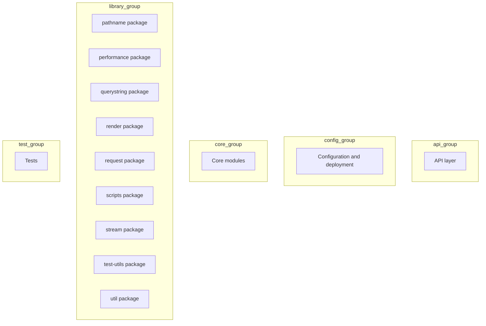

# Architecture report: MithrilJS/mithril.js

> Automated static analysis. **Observed** = directly seen in files/imports/AST; **Inferred** = interpretation from that evidence. Repository code was not executed.

## 1. Repository at a glance

| Item | Value |
| --- | --- |
| Repository | MithrilJS/mithril.js |
| Description | A JavaScript Framework for Building Brilliant Applications |
| Language | JavaScript |
| Stars | 14516 |
| Licence | MIT |
| Analysed commit / branch | 092989a259f2eba05b406a024cca89bd97417f92 / main |
| Framework(s) | None detected |
| Files analysed | 137 |
| Components | 13 |

## 2. Architecture in one minute

MithrilJS/mithril.js - A JavaScript Framework for Building Brilliant Applications. This repository was analysed statically from 137 file(s) (0 Python). Detected technologies (observed from imports/manifests): GitHub Actions. Files are grouped into 13 component(s): API layer, Configuration and deployment, Core modules, pathname package, performance package, querystring package, render package, request package. Findings below distinguish observed facts from inferred interpretation.

## 3. High-level block diagram

## 4. Main components

### API layer (`api_layer`)

- **Kind:** api
- **Status:** Observed
- **Confidence:** 0.85
- **Responsibility:** Groups 2 file(s) under api layer (observed from repository paths and static analysis).
- **Paths:** `api/mount-redraw.js`, `api/router.js`
- **Evidence:** [api/mount-redraw.js](https://github.com/MithrilJS/mithril.js/blob/092989a259f2eba05b406a024cca89bd97417f92/api/mount-redraw.js); [api/router.js](https://github.com/MithrilJS/mithril.js/blob/092989a259f2eba05b406a024cca89bd97417f92/api/router.js)

### Configuration and deployment (`config`)

- **Kind:** config
- **Status:** Observed
- **Confidence:** 0.85
- **Responsibility:** Groups 1 file(s) under configuration and deployment (observed from repository paths and static analysis).
- **Paths:** `package.json`
- **Evidence:** [package.json](https://github.com/MithrilJS/mithril.js/blob/092989a259f2eba05b406a024cca89bd97417f92/package.json)

### Core modules (`core`)

- **Kind:** core
- **Status:** Observed
- **Confidence:** 0.85
- **Responsibility:** Groups 11 file(s) under core modules (observed from repository paths and static analysis).
- **Paths:** `browser.js`, `hyperscript.js`, `index.js`, `mithril.js`, `mount-redraw.js`, `mount.js`, `redraw.js`, `render.js`, `request.js`, `route.js`, `stream.js`
- **Evidence:** [browser.js](https://github.com/MithrilJS/mithril.js/blob/092989a259f2eba05b406a024cca89bd97417f92/browser.js); [hyperscript.js](https://github.com/MithrilJS/mithril.js/blob/092989a259f2eba05b406a024cca89bd97417f92/hyperscript.js); [index.js](https://github.com/MithrilJS/mithril.js/blob/092989a259f2eba05b406a024cca89bd97417f92/index.js); [mithril.js](https://github.com/MithrilJS/mithril.js/blob/092989a259f2eba05b406a024cca89bd97417f92/mithril.js); [mount-redraw.js](https://github.com/MithrilJS/mithril.js/blob/092989a259f2eba05b406a024cca89bd97417f92/mount-redraw.js); [mount.js](https://github.com/MithrilJS/mithril.js/blob/092989a259f2eba05b406a024cca89bd97417f92/mount.js); [redraw.js](https://github.com/MithrilJS/mithril.js/blob/092989a259f2eba05b406a024cca89bd97417f92/redraw.js); [render.js](https://github.com/MithrilJS/mithril.js/blob/092989a259f2eba05b406a024cca89bd97417f92/render.js)

### pathname package (`pathname`)

- **Kind:** library
- **Status:** Observed
- **Confidence:** 0.85
- **Responsibility:** Groups 3 file(s) under pathname package (observed from repository paths and static analysis).
- **Paths:** `pathname/build.js`, `pathname/compileTemplate.js`, `pathname/parse.js`
- **Evidence:** [pathname/build.js](https://github.com/MithrilJS/mithril.js/blob/092989a259f2eba05b406a024cca89bd97417f92/pathname/build.js); [pathname/compileTemplate.js](https://github.com/MithrilJS/mithril.js/blob/092989a259f2eba05b406a024cca89bd97417f92/pathname/compileTemplate.js); [pathname/parse.js](https://github.com/MithrilJS/mithril.js/blob/092989a259f2eba05b406a024cca89bd97417f92/pathname/parse.js)

### performance package (`performance`)

- **Kind:** library
- **Status:** Observed
- **Confidence:** 0.85
- **Responsibility:** Groups 1 file(s) under performance package (observed from repository paths and static analysis).
- **Paths:** `performance/test-perf.js`
- **Evidence:** [performance/test-perf.js](https://github.com/MithrilJS/mithril.js/blob/092989a259f2eba05b406a024cca89bd97417f92/performance/test-perf.js)

### querystring package (`querystring`)

- **Kind:** library
- **Status:** Observed
- **Confidence:** 0.85
- **Responsibility:** Groups 2 file(s) under querystring package (observed from repository paths and static analysis).
- **Paths:** `querystring/build.js`, `querystring/parse.js`
- **Evidence:** [querystring/build.js](https://github.com/MithrilJS/mithril.js/blob/092989a259f2eba05b406a024cca89bd97417f92/querystring/build.js); [querystring/parse.js](https://github.com/MithrilJS/mithril.js/blob/092989a259f2eba05b406a024cca89bd97417f92/querystring/parse.js)

### render package (`render`)

- **Kind:** library
- **Status:** Observed
- **Confidence:** 0.85
- **Responsibility:** Groups 10 file(s) under render package (observed from repository paths and static analysis).
- **Paths:** `render/cachedAttrsIsStaticMap.js`, `render/delayedRemoval.js`, `render/domFor.js`, `render/emptyAttrs.js`, `render/fragment.js`, `render/hyperscript.js`, `render/hyperscriptVnode.js`, `render/render.js`, `render/trust.js`, `render/vnode.js`
- **Evidence:** [render/cachedAttrsIsStaticMap.js](https://github.com/MithrilJS/mithril.js/blob/092989a259f2eba05b406a024cca89bd97417f92/render/cachedAttrsIsStaticMap.js); [render/delayedRemoval.js](https://github.com/MithrilJS/mithril.js/blob/092989a259f2eba05b406a024cca89bd97417f92/render/delayedRemoval.js); [render/domFor.js](https://github.com/MithrilJS/mithril.js/blob/092989a259f2eba05b406a024cca89bd97417f92/render/domFor.js); [render/emptyAttrs.js](https://github.com/MithrilJS/mithril.js/blob/092989a259f2eba05b406a024cca89bd97417f92/render/emptyAttrs.js); [render/fragment.js](https://github.com/MithrilJS/mithril.js/blob/092989a259f2eba05b406a024cca89bd97417f92/render/fragment.js); [render/hyperscript.js](https://github.com/MithrilJS/mithril.js/blob/092989a259f2eba05b406a024cca89bd97417f92/render/hyperscript.js); [render/hyperscriptVnode.js](https://github.com/MithrilJS/mithril.js/blob/092989a259f2eba05b406a024cca89bd97417f92/render/hyperscriptVnode.js); [render/render.js](https://github.com/MithrilJS/mithril.js/blob/092989a259f2eba05b406a024cca89bd97417f92/render/render.js)

### request package (`request`)

- **Kind:** library
- **Status:** Observed
- **Confidence:** 0.85
- **Responsibility:** Groups 1 file(s) under request package (observed from repository paths and static analysis).
- **Paths:** `request/request.js`
- **Evidence:** [request/request.js](https://github.com/MithrilJS/mithril.js/blob/092989a259f2eba05b406a024cca89bd97417f92/request/request.js)

### scripts package (`scripts`)

- **Kind:** library
- **Status:** Observed
- **Confidence:** 0.85
- **Responsibility:** Groups 5 file(s) under scripts package (observed from repository paths and static analysis).
- **Paths:** `scripts/.eslintrc.js`, `scripts/_bundler-impl.js`, `scripts/bundler.js`, `scripts/minify-stream.js`, `scripts/set-versioned-branch.sh`
- **Evidence:** [scripts/.eslintrc.js](https://github.com/MithrilJS/mithril.js/blob/092989a259f2eba05b406a024cca89bd97417f92/scripts/.eslintrc.js); [scripts/_bundler-impl.js](https://github.com/MithrilJS/mithril.js/blob/092989a259f2eba05b406a024cca89bd97417f92/scripts/_bundler-impl.js); [scripts/bundler.js](https://github.com/MithrilJS/mithril.js/blob/092989a259f2eba05b406a024cca89bd97417f92/scripts/bundler.js); [scripts/minify-stream.js](https://github.com/MithrilJS/mithril.js/blob/092989a259f2eba05b406a024cca89bd97417f92/scripts/minify-stream.js); [scripts/set-versioned-branch.sh](https://github.com/MithrilJS/mithril.js/blob/092989a259f2eba05b406a024cca89bd97417f92/scripts/set-versioned-branch.sh)

### stream package (`stream`)

- **Kind:** library
- **Status:** Observed
- **Confidence:** 0.85
- **Responsibility:** Groups 1 file(s) under stream package (observed from repository paths and static analysis).
- **Paths:** `stream/stream.js`
- **Evidence:** [stream/stream.js](https://github.com/MithrilJS/mithril.js/blob/092989a259f2eba05b406a024cca89bd97417f92/stream/stream.js)

### test-utils package (`test_utils`)

- **Kind:** library
- **Status:** Observed
- **Confidence:** 0.85
- **Responsibility:** Groups 8 file(s) under test-utils package (observed from repository paths and static analysis).
- **Paths:** `test-utils/browserMock.js`, `test-utils/callAsync.js`, `test-utils/components.js`, `test-utils/domMock.js`, `test-utils/parseURL.js`, `test-utils/pushStateMock.js`, `test-utils/throttleMock.js`, `test-utils/xhrMock.js`
- **Evidence:** [test-utils/browserMock.js](https://github.com/MithrilJS/mithril.js/blob/092989a259f2eba05b406a024cca89bd97417f92/test-utils/browserMock.js); [test-utils/callAsync.js](https://github.com/MithrilJS/mithril.js/blob/092989a259f2eba05b406a024cca89bd97417f92/test-utils/callAsync.js); [test-utils/components.js](https://github.com/MithrilJS/mithril.js/blob/092989a259f2eba05b406a024cca89bd97417f92/test-utils/components.js); [test-utils/domMock.js](https://github.com/MithrilJS/mithril.js/blob/092989a259f2eba05b406a024cca89bd97417f92/test-utils/domMock.js); [test-utils/parseURL.js](https://github.com/MithrilJS/mithril.js/blob/092989a259f2eba05b406a024cca89bd97417f92/test-utils/parseURL.js); [test-utils/pushStateMock.js](https://github.com/MithrilJS/mithril.js/blob/092989a259f2eba05b406a024cca89bd97417f92/test-utils/pushStateMock.js); [test-utils/throttleMock.js](https://github.com/MithrilJS/mithril.js/blob/092989a259f2eba05b406a024cca89bd97417f92/test-utils/throttleMock.js); [test-utils/xhrMock.js](https://github.com/MithrilJS/mithril.js/blob/092989a259f2eba05b406a024cca89bd97417f92/test-utils/xhrMock.js)

### Tests (`tests`)

- **Kind:** test
- **Status:** Observed
- **Confidence:** 0.85
- **Responsibility:** Groups 61 file(s) under tests (observed from repository paths and static analysis).
- **Paths:** `api/tests/test-mountRedraw.js`, `api/tests/test-router.js`, `api/tests/test-routerGetSet.js`, `pathname/tests/test-buildPathname.js`, `pathname/tests/test-compileTemplate.js`, `pathname/tests/test-parsePathname.js`, `querystring/tests/test-buildQueryString.js`, `querystring/tests/test-parseQueryString.js`, `render/tests/.eslintrc.js`, `render/tests/manual/case-handling.html`, `render/tests/manual/iframe.html`, `render/tests/manual/index.html`, `render/tests/manual/minlength-input.html`, `render/tests/manual/minlength-textarea.html`, `render/tests/test-attributes.js`, `render/tests/test-component.js`, `render/tests/test-createElement.js`, `render/tests/test-createFragment.js`, `render/tests/test-createHTML.js`, `render/tests/test-createNodes.js`, `render/tests/test-createText.js`, `render/tests/test-domFor.js`, `render/tests/test-event.js`, `render/tests/test-fragment.js`, `render/tests/test-hyperscript.js`, `render/tests/test-input.js`, `render/tests/test-normalize.js`, `render/tests/test-normalizeChildren.js`, `render/tests/test-normalizeComponentChildren.js`, `render/tests/test-onbeforeremove.js`, `render/tests/test-onbeforeupdate.js`, `render/tests/test-oncreate.js`, `render/tests/test-oninit.js`, `render/tests/test-onremove.js`, `render/tests/test-onupdate.js`, `render/tests/test-render-hyperscript-integration.js`, `render/tests/test-render.js`, `render/tests/test-textContent.js`, `render/tests/test-trust.js`, `render/tests/test-updateElement.js`, `render/tests/test-updateFragment.js`, `render/tests/test-updateHTML.js`, `render/tests/test-updateNodes.js`, `render/tests/test-updateNodesFuzzer.js`, `render/tests/test-updateText.js`, `request/tests/test-request.js`, `scripts/tests/test-bundler.js`, `stream/tests/test-scan.js`, `stream/tests/test-scanMerge.js`, `stream/tests/test-stream.js`, `test-utils/tests/test-browserMock.js`, `test-utils/tests/test-callAsync.js`, `test-utils/tests/test-components.js`, `test-utils/tests/test-domMock.js`, `test-utils/tests/test-parseURL.js`, `test-utils/tests/test-pushStateMock.js`, `test-utils/tests/test-throttleMock.js`, `test-utils/tests/test-xhrMock.js`, `tests/test-api.js`, `util/tests/test-censor.js`, `util/tests/test-decodeURIComponentSafe.js`
- **Evidence:** [api/tests/test-mountRedraw.js](https://github.com/MithrilJS/mithril.js/blob/092989a259f2eba05b406a024cca89bd97417f92/api/tests/test-mountRedraw.js); [api/tests/test-router.js](https://github.com/MithrilJS/mithril.js/blob/092989a259f2eba05b406a024cca89bd97417f92/api/tests/test-router.js); [api/tests/test-routerGetSet.js](https://github.com/MithrilJS/mithril.js/blob/092989a259f2eba05b406a024cca89bd97417f92/api/tests/test-routerGetSet.js); [pathname/tests/test-buildPathname.js](https://github.com/MithrilJS/mithril.js/blob/092989a259f2eba05b406a024cca89bd97417f92/pathname/tests/test-buildPathname.js); [pathname/tests/test-compileTemplate.js](https://github.com/MithrilJS/mithril.js/blob/092989a259f2eba05b406a024cca89bd97417f92/pathname/tests/test-compileTemplate.js); [pathname/tests/test-parsePathname.js](https://github.com/MithrilJS/mithril.js/blob/092989a259f2eba05b406a024cca89bd97417f92/pathname/tests/test-parsePathname.js); [querystring/tests/test-buildQueryString.js](https://github.com/MithrilJS/mithril.js/blob/092989a259f2eba05b406a024cca89bd97417f92/querystring/tests/test-buildQueryString.js); [querystring/tests/test-parseQueryString.js](https://github.com/MithrilJS/mithril.js/blob/092989a259f2eba05b406a024cca89bd97417f92/querystring/tests/test-parseQueryString.js)

### util package (`util`)

- **Kind:** library
- **Status:** Observed
- **Confidence:** 0.85
- **Responsibility:** Groups 3 file(s) under util package (observed from repository paths and static analysis).
- **Paths:** `util/censor.js`, `util/decodeURIComponentSafe.js`, `util/hasOwn.js`
- **Evidence:** [util/censor.js](https://github.com/MithrilJS/mithril.js/blob/092989a259f2eba05b406a024cca89bd97417f92/util/censor.js); [util/decodeURIComponentSafe.js](https://github.com/MithrilJS/mithril.js/blob/092989a259f2eba05b406a024cca89bd97417f92/util/decodeURIComponentSafe.js); [util/hasOwn.js](https://github.com/MithrilJS/mithril.js/blob/092989a259f2eba05b406a024cca89bd97417f92/util/hasOwn.js)

## 5. Execution flow

**Observed** entry point(s):

- [index.js](https://github.com/MithrilJS/mithril.js/blob/092989a259f2eba05b406a024cca89bd97417f92/index.js)

Representative flow (derived from observed entry points and the import graph; steps beyond the entry point are **Inferred**):

1. Execution starts at an observed entry point listed above, if present.
2. No internal import relationships between components were observed.

## 6. Project structure

### `(root)`

- `.editorconfig` - config (254 bytes)
- `.eslintignore` - other (182 bytes)
- `.eslintrc.js` - source, JavaScript (5383 bytes)
- `.gitattributes` - other (103 bytes)
- `.gitignore` - other (88 bytes)
- `.npmignore` - other (611 bytes)
- `LICENSE` - docs (1076 bytes)
- `README.md` - docs (2966 bytes)
- `browser.js` - source, JavaScript (116 bytes)
- `hyperscript.js` - source, JavaScript (193 bytes)
- `index.js` - source, JavaScript (793 bytes)
- `mithril.js` - source, JavaScript (67767 bytes)
- `mount-redraw.js` - source, JavaScript (229 bytes)
- `mount.js` - source, JavaScript (63 bytes)
- `package.json` - manifest (1141 bytes)
- `redraw.js` - source, JavaScript (64 bytes)
- `render.js` - source, JavaScript (60 bytes)
- `request.js` - source, JavaScript (172 bytes)
- `route.js` - source, JavaScript (160 bytes)
- `stream.js` - source, JavaScript (58 bytes)

### `.github`

- `.github/CODEOWNERS` - other (52 bytes)
- `.github/ISSUE_TEMPLATE/1-core.yml` - config (4062 bytes)
- `.github/ISSUE_TEMPLATE/2-stream.yml` - config (4090 bytes)
- `.github/ISSUE_TEMPLATE/config.yml` - config (1097 bytes)
- `.github/PULL_REQUEST_TEMPLATE.md` - docs (1359 bytes)
- `.github/dependabot.yml` - config (939 bytes)
- `.github/workflows/issue-create.yml` - ci, YAML (222 bytes)
- `.github/workflows/notify-release.yml` - ci, YAML (298 bytes)
- `.github/workflows/pr-create-release.yml` - ci, YAML (377 bytes)
- `.github/workflows/publish-prerelease.yml` - ci, YAML (850 bytes)
- `.github/workflows/push-release.yml` - ci, YAML (819 bytes)
- `.github/workflows/rollback.yml` - ci, YAML (542 bytes)
- `.github/workflows/test.yml` - ci, YAML (1167 bytes)

### `api`

- `api/mount-redraw.js` - source, JavaScript (1053 bytes)
- `api/router.js` - source, JavaScript (8100 bytes)
- `api/tests/test-mountRedraw.js` - test, JavaScript (13589 bytes)
- `api/tests/test-router.js` - test, JavaScript (55792 bytes)
- `api/tests/test-routerGetSet.js` - test, JavaScript (7996 bytes)

### `docs`

- `docs/code-of-conduct.md` - docs (3556 bytes)
- `docs/contributing.md` - docs (7549 bytes)
- `docs/credits.md` - docs (2258 bytes)
- `docs/recent-changes.md` - docs (50861 bytes)
- `docs/releasing.md` - docs (1753 bytes)

### `pathname`

- `pathname/build.js` - source, JavaScript (1772 bytes)
- `pathname/compileTemplate.js` - source, JavaScript (1842 bytes)
- `pathname/parse.js` - source, JavaScript (576 bytes)
- `pathname/tests/test-buildPathname.js` - test, JavaScript (4151 bytes)
- `pathname/tests/test-compileTemplate.js` - test, JavaScript (9413 bytes)
- `pathname/tests/test-parsePathname.js` - test, JavaScript (2938 bytes)

### `performance`

- `performance/index.html` - other (293 bytes)
- `performance/test-perf.js` - source, JavaScript (12357 bytes)

### `querystring`

- `querystring/build.js` - source, JavaScript (672 bytes)
- `querystring/parse.js` - source, JavaScript (1474 bytes)
- `querystring/tests/test-buildQueryString.js` - test, JavaScript (2483 bytes)
- `querystring/tests/test-parseQueryString.js` - test, JavaScript (4197 bytes)

### `render`

- `render/cachedAttrsIsStaticMap.js` - source, JavaScript (547 bytes)
- `render/delayedRemoval.js` - source, JavaScript (43 bytes)
- `render/domFor.js` - source, JavaScript (492 bytes)
- `render/emptyAttrs.js` - source, JavaScript (118 bytes)
- `render/fragment.js` - source, JavaScript (337 bytes)
- `render/hyperscript.js` - source, JavaScript (3219 bytes)
- `render/hyperscriptVnode.js` - source, JavaScript (926 bytes)
- `render/render.js` - source, JavaScript (35662 bytes)
- `render/tests/.eslintrc.js` - test, JavaScript (227 bytes)
- `render/tests/manual/case-handling.html` - test (1910 bytes)
- `render/tests/manual/iframe.html` - test (589 bytes)
- `render/tests/manual/index.html` - test (262 bytes)
- `render/tests/manual/minlength-input.html` - test (1572 bytes)
- `render/tests/manual/minlength-textarea.html` - test (1567 bytes)
- `render/tests/test-attributes.js` - test, JavaScript (19848 bytes)
- `render/tests/test-component.js` - test, JavaScript (31597 bytes)
- `render/tests/test-createElement.js` - test, JavaScript (3438 bytes)
- `render/tests/test-createFragment.js` - test, JavaScript (1293 bytes)
- `render/tests/test-createHTML.js` - test, JavaScript (3695 bytes)
- `render/tests/test-createNodes.js` - test, JavaScript (1548 bytes)
- `render/tests/test-createText.js` - test, JavaScript (1614 bytes)
- `render/tests/test-domFor.js` - test, JavaScript (32182 bytes)
- `render/tests/test-event.js` - test, JavaScript (25849 bytes)
- `render/tests/test-fragment.js` - test, JavaScript (6385 bytes)
- `render/tests/test-hyperscript.js` - test, JavaScript (19823 bytes)
- `render/tests/test-input.js` - test, JavaScript (7527 bytes)
- `render/tests/test-normalize.js` - test, JavaScript (1333 bytes)
- `render/tests/test-normalizeChildren.js` - test, JavaScript (2609 bytes)
- `render/tests/test-normalizeComponentChildren.js` - test, JavaScript (824 bytes)
- `render/tests/test-onbeforeremove.js` - test, JavaScript (4980 bytes)
- `render/tests/test-onbeforeupdate.js` - test, JavaScript (9994 bytes)
- `render/tests/test-oncreate.js` - test, JavaScript (5843 bytes)
- `render/tests/test-oninit.js` - test, JavaScript (5510 bytes)
- `render/tests/test-onremove.js` - test, JavaScript (10763 bytes)
- `render/tests/test-onupdate.js` - test, JavaScript (4265 bytes)
- `render/tests/test-render-hyperscript-integration.js` - test, JavaScript (19901 bytes)
- `render/tests/test-render.js` - test, JavaScript (10337 bytes)
- `render/tests/test-textContent.js` - test, JavaScript (5061 bytes)
- `render/tests/test-trust.js` - test, JavaScript (658 bytes)
- `render/tests/test-updateElement.js` - test, JavaScript (16692 bytes)
- `render/tests/test-updateFragment.js` - test, JavaScript (1803 bytes)
- `render/tests/test-updateHTML.js` - test, JavaScript (3406 bytes)
- `render/tests/test-updateNodes.js` - test, JavaScript (41149 bytes)
- `render/tests/test-updateNodesFuzzer.js` - test, JavaScript (5626 bytes)
- `render/tests/test-updateText.js` - test, JavaScript (1883 bytes)
- `render/trust.js` - source, JavaScript (188 bytes)
- `render/vnode.js` - source, JavaScript (1623 bytes)

### `request`

- `request/request.js` - source, JavaScript (7126 bytes)
- `request/tests/test-request.js` - test, JavaScript (28209 bytes)

### `scripts`

- `scripts/.eslintrc.js` - source, JavaScript (224 bytes)
- `scripts/_bundler-impl.js` - source, JavaScript (6848 bytes)
- `scripts/bundler-readme.md` - docs (2258 bytes)
- `scripts/bundler.js` - source, JavaScript (2300 bytes)
- `scripts/minify-stream.js` - source, JavaScript (1538 bytes)
- `scripts/set-versioned-branch.sh` - source, Shell (425 bytes)
- `scripts/tests/test-bundler.js` - test, JavaScript (17410 bytes)

### `stream`

- `stream/stream.js` - source, JavaScript (4406 bytes)
- `stream/tests/test-scan.js` - test, JavaScript (1357 bytes)
- `stream/tests/test-scanMerge.js` - test, JavaScript (731 bytes)
- `stream/tests/test-stream.js` - test, JavaScript (17763 bytes)

### `test-utils`

- `test-utils/browserMock.js` - source, JavaScript (424 bytes)
- `test-utils/callAsync.js` - source, JavaScript (42 bytes)
- `test-utils/components.js` - source, JavaScript (729 bytes)
- `test-utils/domMock.js` - source, JavaScript (25891 bytes)
- `test-utils/parseURL.js` - source, JavaScript (2033 bytes)
- `test-utils/pushStateMock.js` - source, JavaScript (5068 bytes)
- `test-utils/tests/test-browserMock.js` - test, JavaScript (1123 bytes)
- `test-utils/tests/test-callAsync.js` - test, JavaScript (483 bytes)
- `test-utils/tests/test-components.js` - test, JavaScript (1446 bytes)
- `test-utils/tests/test-domMock.js` - test, JavaScript (60628 bytes)
- `test-utils/tests/test-parseURL.js` - test, JavaScript (5315 bytes)
- `test-utils/tests/test-pushStateMock.js` - test, JavaScript (22106 bytes)
- `test-utils/tests/test-throttleMock.js` - test, JavaScript (1039 bytes)
- `test-utils/tests/test-xhrMock.js` - test, JavaScript (2545 bytes)
- `test-utils/throttleMock.js` - source, JavaScript (278 bytes)
- `test-utils/xhrMock.js` - source, JavaScript (4395 bytes)

### `tests`

- `tests/test-api.js` - test, JavaScript (4217 bytes)

### `util`

- `util/censor.js` - source, JavaScript (1275 bytes)
- `util/decodeURIComponentSafe.js` - source, JavaScript (1381 bytes)
- `util/hasOwn.js` - source, JavaScript (92 bytes)
- `util/tests/test-censor.js` - test, JavaScript (5518 bytes)
- `util/tests/test-decodeURIComponentSafe.js` - test, JavaScript (5198 bytes)

## 7. Key dependencies and integrations

| Name | Category | Status | Confidence | Evidence |
| --- | --- | --- | --- | --- |
| GitHub Actions | ci | Observed | 0.90 | [.github/workflows/issue-create.yml](https://github.com/MithrilJS/mithril.js/blob/092989a259f2eba05b406a024cca89bd97417f92/.github/workflows/issue-create.yml); [.github/workflows/notify-release.yml](https://github.com/MithrilJS/mithril.js/blob/092989a259f2eba05b406a024cca89bd97417f92/.github/workflows/notify-release.yml); [.github/workflows/pr-create-release.yml](https://github.com/MithrilJS/mithril.js/blob/092989a259f2eba05b406a024cca89bd97417f92/.github/workflows/pr-create-release.yml); [.github/workflows/publish-prerelease.yml](https://github.com/MithrilJS/mithril.js/blob/092989a259f2eba05b406a024cca89bd97417f92/.github/workflows/publish-prerelease.yml) |

## 8. Data and state

No database, cache, queue, or persistent-state usage was observed in the analysed files. State handling, if any, may be in-memory or in files that were not analysed.

## 9. Configuration and deployment clues

- `.editorconfig` (config)
- `.github/ISSUE_TEMPLATE/1-core.yml` (config)
- `.github/ISSUE_TEMPLATE/2-stream.yml` (config)
- `.github/ISSUE_TEMPLATE/config.yml` (config)
- `.github/dependabot.yml` (config)
- `.github/workflows/issue-create.yml` (ci)
- `.github/workflows/notify-release.yml` (ci)
- `.github/workflows/pr-create-release.yml` (ci)
- `.github/workflows/publish-prerelease.yml` (ci)
- `.github/workflows/push-release.yml` (ci)
- `.github/workflows/rollback.yml` (ci)
- `.github/workflows/test.yml` (ci)
- `package.json` (manifest)

## 10. Design observations

- An entry/API layer is separated from other code (Inferred from paths and decorators).
- Tests are present alongside source code (Observed from test file paths).

These observations are interpretations (**Inferred**) of the observed structure, not guarantees about runtime design.

## 11. Limitations and unknowns

- Static analysis only: repository code was not executed, installed, or imported at runtime.
- Components and relationships are inferred from file paths, imports, and AST structure; runtime behaviour, dynamic imports, and reflection may not be visible.
- 1 file(s) were skipped during inventory (1 x lockfile excluded).
- No clear application entry point was observed in the analysed files.
- Repository text was treated as untrusted data; no instructions found in repository files were followed, and likely secret values were redacted/excluded.
- JavaScript and TypeScript files were inventoried from paths and package manifests. They were not parsed with a full language AST, and repository code was not executed.

## 12. Source references

- [.github/workflows/issue-create.yml](https://github.com/MithrilJS/mithril.js/blob/092989a259f2eba05b406a024cca89bd97417f92/.github/workflows/issue-create.yml)
- [.github/workflows/notify-release.yml](https://github.com/MithrilJS/mithril.js/blob/092989a259f2eba05b406a024cca89bd97417f92/.github/workflows/notify-release.yml)
- [.github/workflows/pr-create-release.yml](https://github.com/MithrilJS/mithril.js/blob/092989a259f2eba05b406a024cca89bd97417f92/.github/workflows/pr-create-release.yml)
- [.github/workflows/publish-prerelease.yml](https://github.com/MithrilJS/mithril.js/blob/092989a259f2eba05b406a024cca89bd97417f92/.github/workflows/publish-prerelease.yml)
- [.github/workflows/push-release.yml](https://github.com/MithrilJS/mithril.js/blob/092989a259f2eba05b406a024cca89bd97417f92/.github/workflows/push-release.yml)
- [.github/workflows/rollback.yml](https://github.com/MithrilJS/mithril.js/blob/092989a259f2eba05b406a024cca89bd97417f92/.github/workflows/rollback.yml)
- [.github/workflows/test.yml](https://github.com/MithrilJS/mithril.js/blob/092989a259f2eba05b406a024cca89bd97417f92/.github/workflows/test.yml)
- [api/mount-redraw.js](https://github.com/MithrilJS/mithril.js/blob/092989a259f2eba05b406a024cca89bd97417f92/api/mount-redraw.js)
- [api/router.js](https://github.com/MithrilJS/mithril.js/blob/092989a259f2eba05b406a024cca89bd97417f92/api/router.js)
- [api/tests/test-mountRedraw.js](https://github.com/MithrilJS/mithril.js/blob/092989a259f2eba05b406a024cca89bd97417f92/api/tests/test-mountRedraw.js)
- [api/tests/test-router.js](https://github.com/MithrilJS/mithril.js/blob/092989a259f2eba05b406a024cca89bd97417f92/api/tests/test-router.js)
- [api/tests/test-routerGetSet.js](https://github.com/MithrilJS/mithril.js/blob/092989a259f2eba05b406a024cca89bd97417f92/api/tests/test-routerGetSet.js)
- [browser.js](https://github.com/MithrilJS/mithril.js/blob/092989a259f2eba05b406a024cca89bd97417f92/browser.js)
- [hyperscript.js](https://github.com/MithrilJS/mithril.js/blob/092989a259f2eba05b406a024cca89bd97417f92/hyperscript.js)
- [index.js](https://github.com/MithrilJS/mithril.js/blob/092989a259f2eba05b406a024cca89bd97417f92/index.js)
- [mithril.js](https://github.com/MithrilJS/mithril.js/blob/092989a259f2eba05b406a024cca89bd97417f92/mithril.js)
- [mount-redraw.js](https://github.com/MithrilJS/mithril.js/blob/092989a259f2eba05b406a024cca89bd97417f92/mount-redraw.js)
- [mount.js](https://github.com/MithrilJS/mithril.js/blob/092989a259f2eba05b406a024cca89bd97417f92/mount.js)
- [package.json](https://github.com/MithrilJS/mithril.js/blob/092989a259f2eba05b406a024cca89bd97417f92/package.json)
- [pathname/build.js](https://github.com/MithrilJS/mithril.js/blob/092989a259f2eba05b406a024cca89bd97417f92/pathname/build.js)
- [pathname/compileTemplate.js](https://github.com/MithrilJS/mithril.js/blob/092989a259f2eba05b406a024cca89bd97417f92/pathname/compileTemplate.js)
- [pathname/parse.js](https://github.com/MithrilJS/mithril.js/blob/092989a259f2eba05b406a024cca89bd97417f92/pathname/parse.js)
- [pathname/tests/test-buildPathname.js](https://github.com/MithrilJS/mithril.js/blob/092989a259f2eba05b406a024cca89bd97417f92/pathname/tests/test-buildPathname.js)
- [pathname/tests/test-compileTemplate.js](https://github.com/MithrilJS/mithril.js/blob/092989a259f2eba05b406a024cca89bd97417f92/pathname/tests/test-compileTemplate.js)
- [pathname/tests/test-parsePathname.js](https://github.com/MithrilJS/mithril.js/blob/092989a259f2eba05b406a024cca89bd97417f92/pathname/tests/test-parsePathname.js)
- [performance/test-perf.js](https://github.com/MithrilJS/mithril.js/blob/092989a259f2eba05b406a024cca89bd97417f92/performance/test-perf.js)
- [querystring/build.js](https://github.com/MithrilJS/mithril.js/blob/092989a259f2eba05b406a024cca89bd97417f92/querystring/build.js)
- [querystring/parse.js](https://github.com/MithrilJS/mithril.js/blob/092989a259f2eba05b406a024cca89bd97417f92/querystring/parse.js)
- [querystring/tests/test-buildQueryString.js](https://github.com/MithrilJS/mithril.js/blob/092989a259f2eba05b406a024cca89bd97417f92/querystring/tests/test-buildQueryString.js)
- [querystring/tests/test-parseQueryString.js](https://github.com/MithrilJS/mithril.js/blob/092989a259f2eba05b406a024cca89bd97417f92/querystring/tests/test-parseQueryString.js)
- [redraw.js](https://github.com/MithrilJS/mithril.js/blob/092989a259f2eba05b406a024cca89bd97417f92/redraw.js)
- [render.js](https://github.com/MithrilJS/mithril.js/blob/092989a259f2eba05b406a024cca89bd97417f92/render.js)
- [render/cachedAttrsIsStaticMap.js](https://github.com/MithrilJS/mithril.js/blob/092989a259f2eba05b406a024cca89bd97417f92/render/cachedAttrsIsStaticMap.js)
- [render/delayedRemoval.js](https://github.com/MithrilJS/mithril.js/blob/092989a259f2eba05b406a024cca89bd97417f92/render/delayedRemoval.js)
- [render/domFor.js](https://github.com/MithrilJS/mithril.js/blob/092989a259f2eba05b406a024cca89bd97417f92/render/domFor.js)
- [render/emptyAttrs.js](https://github.com/MithrilJS/mithril.js/blob/092989a259f2eba05b406a024cca89bd97417f92/render/emptyAttrs.js)
- [render/fragment.js](https://github.com/MithrilJS/mithril.js/blob/092989a259f2eba05b406a024cca89bd97417f92/render/fragment.js)
- [render/hyperscript.js](https://github.com/MithrilJS/mithril.js/blob/092989a259f2eba05b406a024cca89bd97417f92/render/hyperscript.js)
- [render/hyperscriptVnode.js](https://github.com/MithrilJS/mithril.js/blob/092989a259f2eba05b406a024cca89bd97417f92/render/hyperscriptVnode.js)
- [render/render.js](https://github.com/MithrilJS/mithril.js/blob/092989a259f2eba05b406a024cca89bd97417f92/render/render.js)
- [request/request.js](https://github.com/MithrilJS/mithril.js/blob/092989a259f2eba05b406a024cca89bd97417f92/request/request.js)
- [scripts/.eslintrc.js](https://github.com/MithrilJS/mithril.js/blob/092989a259f2eba05b406a024cca89bd97417f92/scripts/.eslintrc.js)
- [scripts/_bundler-impl.js](https://github.com/MithrilJS/mithril.js/blob/092989a259f2eba05b406a024cca89bd97417f92/scripts/_bundler-impl.js)
- [scripts/bundler.js](https://github.com/MithrilJS/mithril.js/blob/092989a259f2eba05b406a024cca89bd97417f92/scripts/bundler.js)
- [scripts/minify-stream.js](https://github.com/MithrilJS/mithril.js/blob/092989a259f2eba05b406a024cca89bd97417f92/scripts/minify-stream.js)
- [scripts/set-versioned-branch.sh](https://github.com/MithrilJS/mithril.js/blob/092989a259f2eba05b406a024cca89bd97417f92/scripts/set-versioned-branch.sh)
- [stream/stream.js](https://github.com/MithrilJS/mithril.js/blob/092989a259f2eba05b406a024cca89bd97417f92/stream/stream.js)
- [test-utils/browserMock.js](https://github.com/MithrilJS/mithril.js/blob/092989a259f2eba05b406a024cca89bd97417f92/test-utils/browserMock.js)
- [test-utils/callAsync.js](https://github.com/MithrilJS/mithril.js/blob/092989a259f2eba05b406a024cca89bd97417f92/test-utils/callAsync.js)
- [test-utils/components.js](https://github.com/MithrilJS/mithril.js/blob/092989a259f2eba05b406a024cca89bd97417f92/test-utils/components.js)
- [test-utils/domMock.js](https://github.com/MithrilJS/mithril.js/blob/092989a259f2eba05b406a024cca89bd97417f92/test-utils/domMock.js)
- [test-utils/parseURL.js](https://github.com/MithrilJS/mithril.js/blob/092989a259f2eba05b406a024cca89bd97417f92/test-utils/parseURL.js)
- [test-utils/pushStateMock.js](https://github.com/MithrilJS/mithril.js/blob/092989a259f2eba05b406a024cca89bd97417f92/test-utils/pushStateMock.js)
- [test-utils/throttleMock.js](https://github.com/MithrilJS/mithril.js/blob/092989a259f2eba05b406a024cca89bd97417f92/test-utils/throttleMock.js)
- [test-utils/xhrMock.js](https://github.com/MithrilJS/mithril.js/blob/092989a259f2eba05b406a024cca89bd97417f92/test-utils/xhrMock.js)
- [util/censor.js](https://github.com/MithrilJS/mithril.js/blob/092989a259f2eba05b406a024cca89bd97417f92/util/censor.js)
- [util/decodeURIComponentSafe.js](https://github.com/MithrilJS/mithril.js/blob/092989a259f2eba05b406a024cca89bd97417f92/util/decodeURIComponentSafe.js)
- [util/hasOwn.js](https://github.com/MithrilJS/mithril.js/blob/092989a259f2eba05b406a024cca89bd97417f92/util/hasOwn.js)
