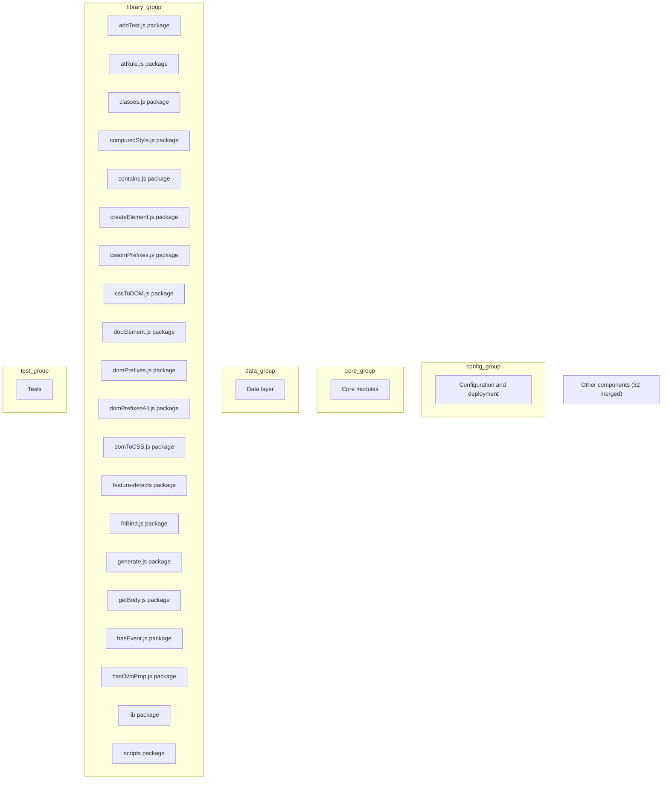

# Architecture report: Modernizr/Modernizr

> Automated static analysis. **Observed** = directly seen in files/imports/AST; **Inferred** = interpretation from that evidence. Repository code was not executed.

## 1. Repository at a glance

| Item | Value |
| --- | --- |
| Repository | Modernizr/Modernizr |
| Description | Modernizr is a JavaScript library that detects HTML5 and CSS3 features in the user’s browser. |
| Language | JavaScript |
| Stars | 25676 |
| Licence | MIT |
| Analysed commit / branch | 612ec65ccdba311e8b1153b1076d18f0251943f6 / master |
| Framework(s) | None detected |
| Files analysed | 475 |
| Components | 56 |

## 2. Architecture in one minute

Modernizr/Modernizr - Modernizr is a JavaScript library that detects HTML5 and CSS3 features in the user’s browser.. This repository was analysed statically from 475 file(s) (0 Python). Detected technologies (observed from imports/manifests): GitHub Actions. Files are grouped into 56 component(s): addTest.js package, atRule.js package, classes.js package, computedStyle.js package, Configuration and deployment, contains.js package, Core modules, createElement.js package. Findings below distinguish observed facts from inferred interpretation.

## 3. High-level block diagram

## 4. Main components

### addTest.js package (`addtest_js`)

- **Kind:** library
- **Status:** Observed
- **Confidence:** 0.85
- **Responsibility:** Groups 1 file(s) under addtest.js package (observed from repository paths and static analysis).
- **Paths:** `src/addTest.js`
- **Evidence:** [src/addTest.js](https://github.com/Modernizr/Modernizr/blob/612ec65ccdba311e8b1153b1076d18f0251943f6/src/addTest.js)

### atRule.js package (`atrule_js`)

- **Kind:** library
- **Status:** Observed
- **Confidence:** 0.85
- **Responsibility:** Groups 1 file(s) under atrule.js package (observed from repository paths and static analysis).
- **Paths:** `src/atRule.js`
- **Evidence:** [src/atRule.js](https://github.com/Modernizr/Modernizr/blob/612ec65ccdba311e8b1153b1076d18f0251943f6/src/atRule.js)

### classes.js package (`classes_js`)

- **Kind:** library
- **Status:** Observed
- **Confidence:** 0.85
- **Responsibility:** Groups 1 file(s) under classes.js package (observed from repository paths and static analysis).
- **Paths:** `src/classes.js`
- **Evidence:** [src/classes.js](https://github.com/Modernizr/Modernizr/blob/612ec65ccdba311e8b1153b1076d18f0251943f6/src/classes.js)

### computedStyle.js package (`computedstyle_js`)

- **Kind:** library
- **Status:** Observed
- **Confidence:** 0.85
- **Responsibility:** Groups 1 file(s) under computedstyle.js package (observed from repository paths and static analysis).
- **Paths:** `src/computedStyle.js`
- **Evidence:** [src/computedStyle.js](https://github.com/Modernizr/Modernizr/blob/612ec65ccdba311e8b1153b1076d18f0251943f6/src/computedStyle.js)

### Configuration and deployment (`config`)

- **Kind:** config
- **Status:** Observed
- **Confidence:** 0.85
- **Responsibility:** Groups 5 file(s) under configuration and deployment (observed from repository paths and static analysis).
- **Paths:** `inch.json`, `legacy/.coveralls.yml`, `lib/config-all.json`, `lib/polyfills.json`, `package.json`
- **Evidence:** [inch.json](https://github.com/Modernizr/Modernizr/blob/612ec65ccdba311e8b1153b1076d18f0251943f6/inch.json); [legacy/.coveralls.yml](https://github.com/Modernizr/Modernizr/blob/612ec65ccdba311e8b1153b1076d18f0251943f6/legacy/.coveralls.yml); [lib/config-all.json](https://github.com/Modernizr/Modernizr/blob/612ec65ccdba311e8b1153b1076d18f0251943f6/lib/config-all.json); [lib/polyfills.json](https://github.com/Modernizr/Modernizr/blob/612ec65ccdba311e8b1153b1076d18f0251943f6/lib/polyfills.json); [package.json](https://github.com/Modernizr/Modernizr/blob/612ec65ccdba311e8b1153b1076d18f0251943f6/package.json)

### contains.js package (`contains_js`)

- **Kind:** library
- **Status:** Observed
- **Confidence:** 0.85
- **Responsibility:** Groups 1 file(s) under contains.js package (observed from repository paths and static analysis).
- **Paths:** `src/contains.js`
- **Evidence:** [src/contains.js](https://github.com/Modernizr/Modernizr/blob/612ec65ccdba311e8b1153b1076d18f0251943f6/src/contains.js)

### Core modules (`core`)

- **Kind:** core
- **Status:** Observed
- **Confidence:** 0.85
- **Responsibility:** Groups 1 file(s) under core modules (observed from repository paths and static analysis).
- **Paths:** `gulpfile.babel.js`
- **Evidence:** [gulpfile.babel.js](https://github.com/Modernizr/Modernizr/blob/612ec65ccdba311e8b1153b1076d18f0251943f6/gulpfile.babel.js)

### createElement.js package (`createelement_js`)

- **Kind:** library
- **Status:** Observed
- **Confidence:** 0.85
- **Responsibility:** Groups 1 file(s) under createelement.js package (observed from repository paths and static analysis).
- **Paths:** `src/createElement.js`
- **Evidence:** [src/createElement.js](https://github.com/Modernizr/Modernizr/blob/612ec65ccdba311e8b1153b1076d18f0251943f6/src/createElement.js)

### cssomPrefixes.js package (`cssomprefixes_js`)

- **Kind:** library
- **Status:** Observed
- **Confidence:** 0.85
- **Responsibility:** Groups 1 file(s) under cssomprefixes.js package (observed from repository paths and static analysis).
- **Paths:** `src/cssomPrefixes.js`
- **Evidence:** [src/cssomPrefixes.js](https://github.com/Modernizr/Modernizr/blob/612ec65ccdba311e8b1153b1076d18f0251943f6/src/cssomPrefixes.js)

### cssToDOM.js package (`csstodom_js`)

- **Kind:** library
- **Status:** Observed
- **Confidence:** 0.85
- **Responsibility:** Groups 1 file(s) under csstodom.js package (observed from repository paths and static analysis).
- **Paths:** `src/cssToDOM.js`
- **Evidence:** [src/cssToDOM.js](https://github.com/Modernizr/Modernizr/blob/612ec65ccdba311e8b1153b1076d18f0251943f6/src/cssToDOM.js)

### Data layer (`data_layer`)

- **Kind:** data
- **Status:** Observed
- **Confidence:** 0.85
- **Responsibility:** Groups 9 file(s) under data layer (observed from repository paths and static analysis).
- **Paths:** `feature-detects/storage/cookies.js`, `feature-detects/storage/indexeddb.js`, `feature-detects/storage/indexeddb2.js`, `feature-detects/storage/indexeddbblob.js`, `feature-detects/storage/localstorage.js`, `feature-detects/storage/quota-management-api.js`, `feature-detects/storage/sessionstorage.js`, `feature-detects/storage/userdata.js`, `feature-detects/storage/websqldatabase.js`
- **Evidence:** [feature-detects/storage/cookies.js](https://github.com/Modernizr/Modernizr/blob/612ec65ccdba311e8b1153b1076d18f0251943f6/feature-detects/storage/cookies.js); [feature-detects/storage/indexeddb.js](https://github.com/Modernizr/Modernizr/blob/612ec65ccdba311e8b1153b1076d18f0251943f6/feature-detects/storage/indexeddb.js); [feature-detects/storage/indexeddb2.js](https://github.com/Modernizr/Modernizr/blob/612ec65ccdba311e8b1153b1076d18f0251943f6/feature-detects/storage/indexeddb2.js); [feature-detects/storage/indexeddbblob.js](https://github.com/Modernizr/Modernizr/blob/612ec65ccdba311e8b1153b1076d18f0251943f6/feature-detects/storage/indexeddbblob.js); [feature-detects/storage/localstorage.js](https://github.com/Modernizr/Modernizr/blob/612ec65ccdba311e8b1153b1076d18f0251943f6/feature-detects/storage/localstorage.js); [feature-detects/storage/quota-management-api.js](https://github.com/Modernizr/Modernizr/blob/612ec65ccdba311e8b1153b1076d18f0251943f6/feature-detects/storage/quota-management-api.js); [feature-detects/storage/sessionstorage.js](https://github.com/Modernizr/Modernizr/blob/612ec65ccdba311e8b1153b1076d18f0251943f6/feature-detects/storage/sessionstorage.js); [feature-detects/storage/userdata.js](https://github.com/Modernizr/Modernizr/blob/612ec65ccdba311e8b1153b1076d18f0251943f6/feature-detects/storage/userdata.js)

### docElement.js package (`docelement_js`)

- **Kind:** library
- **Status:** Observed
- **Confidence:** 0.85
- **Responsibility:** Groups 1 file(s) under docelement.js package (observed from repository paths and static analysis).
- **Paths:** `src/docElement.js`
- **Evidence:** [src/docElement.js](https://github.com/Modernizr/Modernizr/blob/612ec65ccdba311e8b1153b1076d18f0251943f6/src/docElement.js)

### domPrefixes.js package (`domprefixes_js`)

- **Kind:** library
- **Status:** Observed
- **Confidence:** 0.85
- **Responsibility:** Groups 1 file(s) under domprefixes.js package (observed from repository paths and static analysis).
- **Paths:** `src/domPrefixes.js`
- **Evidence:** [src/domPrefixes.js](https://github.com/Modernizr/Modernizr/blob/612ec65ccdba311e8b1153b1076d18f0251943f6/src/domPrefixes.js)

### domPrefixesAll.js package (`domprefixesall_js`)

- **Kind:** library
- **Status:** Observed
- **Confidence:** 0.85
- **Responsibility:** Groups 1 file(s) under domprefixesall.js package (observed from repository paths and static analysis).
- **Paths:** `src/domPrefixesAll.js`
- **Evidence:** [src/domPrefixesAll.js](https://github.com/Modernizr/Modernizr/blob/612ec65ccdba311e8b1153b1076d18f0251943f6/src/domPrefixesAll.js)

### domToCSS.js package (`domtocss_js`)

- **Kind:** library
- **Status:** Observed
- **Confidence:** 0.85
- **Responsibility:** Groups 1 file(s) under domtocss.js package (observed from repository paths and static analysis).
- **Paths:** `src/domToCSS.js`
- **Evidence:** [src/domToCSS.js](https://github.com/Modernizr/Modernizr/blob/612ec65ccdba311e8b1153b1076d18f0251943f6/src/domToCSS.js)

### feature-detects package (`feature_detects`)

- **Kind:** library
- **Status:** Observed
- **Confidence:** 0.85
- **Responsibility:** Groups 296 file(s) under feature-detects package (observed from repository paths and static analysis).
- **Paths:** `feature-detects/a/aping.js`, `feature-detects/a/areaping.js`, `feature-detects/a/download.js`, `feature-detects/ambientlight.js`, `feature-detects/applicationcache.js`, `feature-detects/audio/audio.js`, `feature-detects/audio/autoplay.js`, `feature-detects/audio/loop.js`, `feature-detects/audio/preload.js`, `feature-detects/audio/webaudio.js`, `feature-detects/battery/battery.js`, `feature-detects/battery/lowbattery.js`, `feature-detects/blob.js`, `feature-detects/broadcastchannel.js`, `feature-detects/canvas/blending.js`, `feature-detects/canvas/canvas.js`, `feature-detects/canvas/text.js`, `feature-detects/canvas/todataurl.js`, `feature-detects/canvas/winding.js`, `feature-detects/clipboard.js`, `feature-detects/contenteditable.js`, `feature-detects/contextmenu.js`, `feature-detects/cors.js`, `feature-detects/crypto.js`, `feature-detects/crypto/getrandomvalues.js`, `feature-detects/css/all.js`, `feature-detects/css/animations.js`, `feature-detects/css/appearance.js`, `feature-detects/css/aspectratio.js`, `feature-detects/css/backdropfilter.js`, `feature-detects/css/backgroundblendmode.js`, `feature-detects/css/backgroundcliptext.js`, `feature-detects/css/backgroundposition-shorthand.js`, `feature-detects/css/backgroundposition-xy.js`, `feature-detects/css/backgroundrepeat.js`, `feature-detects/css/backgroundsize.js`, `feature-detects/css/backgroundsizecover.js`, `feature-detects/css/borderimage.js`, `feature-detects/css/borderradius.js`, `feature-detects/css/boxdecorationbreak.js`, `feature-detects/css/boxshadow.js`, `feature-detects/css/boxsizing.js`, `feature-detects/css/calc.js`, `feature-detects/css/checked.js`, `feature-detects/css/chunit.js`, `feature-detects/css/columns.js`, `feature-detects/css/cssgrid.js`, `feature-detects/css/cubicbezierrange.js`, `feature-detects/css/customproperties.js`, `feature-detects/css/displayrunin.js`, `feature-detects/css/displaytable.js`, `feature-detects/css/ellipsis.js`, `feature-detects/css/escape.js`, `feature-detects/css/exunit.js`, `feature-detects/css/filters.js`, `feature-detects/css/flexbox.js`, `feature-detects/css/flexboxlegacy.js`, `feature-detects/css/flexboxtweener.js`, `feature-detects/css/flexgap.js`, `feature-detects/css/flexwrap.js`, `feature-detects/css/focusvisible.js`, `feature-detects/css/focuswithin.js`, `feature-detects/css/fontdisplay.js`, `feature-detects/css/fontface.js`, `feature-detects/css/generatedcontent.js`, `feature-detects/css/gradients.js`, `feature-detects/css/hairline.js`, `feature-detects/css/hsla.js`, `feature-detects/css/hyphens.js`, `feature-detects/css/invalid.js`, `feature-detects/css/lastchild.js`, `feature-detects/css/mask.js`, `feature-detects/css/mediaqueries.js`, `feature-detects/css/multiplebgs.js`, `feature-detects/css/nthchild.js`, `feature-detects/css/objectfit.js`, `feature-detects/css/opacity.js`, `feature-detects/css/overflow-scrolling.js`, `feature-detects/css/pointerevents.js`, `feature-detects/css/positionsticky.js`, `feature-detects/css/pseudoanimations.js`, `feature-detects/css/pseudotransitions.js`, `feature-detects/css/reflections.js`, `feature-detects/css/regions.js`, `feature-detects/css/remunit.js`, `feature-detects/css/resize.js`, `feature-detects/css/rgba.js`, `feature-detects/css/scrollbars.js`, `feature-detects/css/scrollsnappoints.js`, `feature-detects/css/shapes.js`, `feature-detects/css/siblinggeneral.js`, `feature-detects/css/subpixelfont.js`, `feature-detects/css/supports.js`, `feature-detects/css/target.js`, `feature-detects/css/textalignlast.js`, `feature-detects/css/textdecoration.js`, `feature-detects/css/textshadow.js`, `feature-detects/css/transforms.js`, `feature-detects/css/transforms3d.js`, `feature-detects/css/transformslevel2.js`, `feature-detects/css/transformstylepreserve3d.js`, `feature-detects/css/transitions.js`, `feature-detects/css/userselect.js`, `feature-detects/css/valid.js`, `feature-detects/css/variablefonts.js`, `feature-detects/css/vhunit.js`, `feature-detects/css/vmaxunit.js`, `feature-detects/css/vminunit.js`, `feature-detects/css/vwunit.js`, `feature-detects/css/will-change.js`, `feature-detects/css/wrapflow.js`, `feature-detects/custom-elements.js`, `feature-detects/custom-protocol-handler.js`, `feature-detects/dart.js`, `feature-detects/dataview-api.js`, `feature-detects/dom/classlist.js`, `feature-detects/dom/createElement-attrs.js`, `feature-detects/dom/dataset.js`, `feature-detects/dom/documentfragment.js`, `feature-detects/dom/hidden.js`, `feature-detects/dom/intersection-observer.js`, `feature-detects/dom/microdata.js`, `feature-detects/dom/mutationObserver.js`, `feature-detects/dom/passiveeventlisteners.js`, `feature-detects/dom/shadowroot.js`, `feature-detects/dom/shadowrootlegacy.js`, `feature-detects/elem/bdi.js`, `feature-detects/elem/details.js`, `feature-detects/elem/output.js`, `feature-detects/elem/picture.js`, `feature-detects/elem/progress-meter.js`, `feature-detects/elem/ruby.js`, `feature-detects/elem/template.js`, `feature-detects/elem/time.js`, `feature-detects/elem/track.js`, `feature-detects/elem/unknown.js`, `feature-detects/emoji.js`, `feature-detects/es5/array.js`, `feature-detects/es5/date.js`, `feature-detects/es5/function.js`, `feature-detects/es5/object.js`, `feature-detects/es5/specification.js`, `feature-detects/es5/strictmode.js`, `feature-detects/es5/string.js`, `feature-detects/es5/syntax.js`, `feature-detects/es5/undefined.js`, `feature-detects/es6/array.js`, `feature-detects/es6/arrow.js`, `feature-detects/es6/class.js`, `feature-detects/es6/collections.js`, `feature-detects/es6/generators.js`, `feature-detects/es6/math.js`, `feature-detects/es6/number.js`, `feature-detects/es6/object.js`, `feature-detects/es6/promises.js`, `feature-detects/es6/rest-parameters.js`, `feature-detects/es6/spread-array.js`, `feature-detects/es6/string-template.js`, `feature-detects/es6/string.js`, `feature-detects/es6/symbol.js`, `feature-detects/es7/array.js`, `feature-detects/es7/rest-destructuring.js`, `feature-detects/es7/spread-object.js`, `feature-detects/es8/object.js`, `feature-detects/event/customevent.js`, `feature-detects/event/deviceorientation-motion.js`, `feature-detects/event/eventlistener.js`, `feature-detects/event/forcetouch.js`, `feature-detects/event/hashchange.js`, `feature-detects/event/oninput.js`, `feature-detects/event/pointerevents.js`, `feature-detects/event/proximity.js`, `feature-detects/file/api.js`, `feature-detects/file/filesystem.js`, `feature-detects/flash.js`, `feature-detects/fullscreen-api.js`, `feature-detects/gamepad.js`, `feature-detects/geolocation.js`, `feature-detects/hiddenscroll.js`, `feature-detects/history.js`, `feature-detects/htmlimports.js`, `feature-detects/ie8compat.js`, `feature-detects/iframe/sandbox.js`, `feature-detects/iframe/seamless.js`, `feature-detects/iframe/srcdoc.js`, `feature-detects/img/apng.js`, `feature-detects/img/avif.js`, `feature-detects/img/crossorigin.js`, `feature-detects/img/exif-orientation.js`, `feature-detects/img/jpeg2000.js`, `feature-detects/img/jpegxr.js`, `feature-detects/img/lazyloading.js`, `feature-detects/img/sizes.js`, `feature-detects/img/srcset.js`, `feature-detects/img/webp-alpha.js`, `feature-detects/img/webp-animation.js`, `feature-detects/img/webp-lossless.js`, `feature-detects/img/webp.js`, `feature-detects/input/capture.js`, `feature-detects/input/fileinput.js`, `feature-detects/input/fileinputdirectory.js`, `feature-detects/input/formaction.js`, `feature-detects/input/formattribute.js`, `feature-detects/input/formenctype.js`, `feature-detects/input/formmethod.js`, `feature-detects/input/formnovalidate.js`, `feature-detects/input/formtarget.js`, `feature-detects/input/input.js`, `feature-detects/input/inputnumber-l10n.js`, `feature-detects/input/inputsearchevent.js`, `feature-detects/input/inputtypes.js`, `feature-detects/input/placeholder.js`, `feature-detects/input/requestautocomplete.js`, `feature-detects/input/validation.js`, `feature-detects/intl.js`, `feature-detects/json.js`, `feature-detects/ligatures.js`, `feature-detects/link/prefetch.js`, `feature-detects/lists-reversed.js`, `feature-detects/mathml.js`, `feature-detects/media-source-extension-api.js`, `feature-detects/mediaquery/hovermq.js`, `feature-detects/mediaquery/pointermq.js`, `feature-detects/messagechannel.js`, `feature-detects/network/beacon.js`, `feature-detects/network/connection-effectivetype.js`, `feature-detects/network/connection.js`, `feature-detects/network/eventsource.js`, `feature-detects/network/fetch.js`, `feature-detects/network/xhr-responsetype-arraybuffer.js`, `feature-detects/network/xhr-responsetype-blob.js`, `feature-detects/network/xhr-responsetype-document.js`, `feature-detects/network/xhr-responsetype-json.js`, `feature-detects/network/xhr-responsetype-text.js`, `feature-detects/network/xhr-responsetype.js`, `feature-detects/network/xhr2.js`, `feature-detects/notification.js`, `feature-detects/pagevisibility-api.js`, `feature-detects/performance.js`, `feature-detects/pointerlock-api.js`, `feature-detects/postmessage.js`, `feature-detects/proxy.js`, `feature-detects/queryselector.js`, `feature-detects/requestanimationframe.js`, `feature-detects/script/async.js`, `feature-detects/script/defer.js`, `feature-detects/scrolltooptions.js`, `feature-detects/serviceworker.js`, `feature-detects/speech/speech-recognition.js`, `feature-detects/speech/speech-synthesis.js`, `feature-detects/style/scoped.js`, `feature-detects/svg/asimg.js`, `feature-detects/svg/clippaths.js`, `feature-detects/svg/filters.js`, `feature-detects/svg/foreignobject.js`, `feature-detects/svg/inline.js`, `feature-detects/svg/smil.js`, `feature-detects/svg/svg.js`, `feature-detects/textarea/maxlength.js`, `feature-detects/textencoding.js`, `feature-detects/typed-arrays.js`, `feature-detects/unicode-range.js`, `feature-detects/url/bloburls.js`, `feature-detects/url/data-uri.js`, `feature-detects/url/parser.js`, `feature-detects/url/urlsearchparams.js`, `feature-detects/vibration.js`, `feature-detects/video/autoplay.js`, `feature-detects/video/crossorigin.js`, `feature-detects/video/loop.js`, `feature-detects/video/preload.js`, `feature-detects/video/video.js`, `feature-detects/vml.js`, `feature-detects/web-intents.js`, `feature-detects/webanimations.js`, `feature-detects/webauthn/publickeycredential.js`, `feature-detects/webgl/extensions.js`, `feature-detects/webgl/webgl.js`, `feature-detects/webrtc/datachannel.js`, `feature-detects/webrtc/getusermedia.js`, `feature-detects/webrtc/mediastream.js`, `feature-detects/webrtc/peerconnection.js`, `feature-detects/websockets.js`, `feature-detects/websockets/binary.js`, `feature-detects/window/atob-btoa.js`, `feature-detects/window/framed.js`, `feature-detects/window/matchmedia.js`, `feature-detects/window/pushmanager.js`, `feature-detects/window/resizeobserver.js`, `feature-detects/workers/blobworkers.js`, `feature-detects/workers/dataworkers.js`, `feature-detects/workers/sharedworkers.js`, `feature-detects/workers/transferables.js`, `feature-detects/workers/webworkers.js`, `feature-detects/workers/workertypeoption.js`, `feature-detects/xdomainrequest.js`
- **Evidence:** [feature-detects/a/aping.js](https://github.com/Modernizr/Modernizr/blob/612ec65ccdba311e8b1153b1076d18f0251943f6/feature-detects/a/aping.js); [feature-detects/a/areaping.js](https://github.com/Modernizr/Modernizr/blob/612ec65ccdba311e8b1153b1076d18f0251943f6/feature-detects/a/areaping.js); [feature-detects/a/download.js](https://github.com/Modernizr/Modernizr/blob/612ec65ccdba311e8b1153b1076d18f0251943f6/feature-detects/a/download.js); [feature-detects/ambientlight.js](https://github.com/Modernizr/Modernizr/blob/612ec65ccdba311e8b1153b1076d18f0251943f6/feature-detects/ambientlight.js); [feature-detects/applicationcache.js](https://github.com/Modernizr/Modernizr/blob/612ec65ccdba311e8b1153b1076d18f0251943f6/feature-detects/applicationcache.js); [feature-detects/audio/audio.js](https://github.com/Modernizr/Modernizr/blob/612ec65ccdba311e8b1153b1076d18f0251943f6/feature-detects/audio/audio.js); [feature-detects/audio/autoplay.js](https://github.com/Modernizr/Modernizr/blob/612ec65ccdba311e8b1153b1076d18f0251943f6/feature-detects/audio/autoplay.js); [feature-detects/audio/loop.js](https://github.com/Modernizr/Modernizr/blob/612ec65ccdba311e8b1153b1076d18f0251943f6/feature-detects/audio/loop.js)

### fnBind.js package (`fnbind_js`)

- **Kind:** library
- **Status:** Observed
- **Confidence:** 0.85
- **Responsibility:** Groups 1 file(s) under fnbind.js package (observed from repository paths and static analysis).
- **Paths:** `src/fnBind.js`
- **Evidence:** [src/fnBind.js](https://github.com/Modernizr/Modernizr/blob/612ec65ccdba311e8b1153b1076d18f0251943f6/src/fnBind.js)

### generate.js package (`generate_js`)

- **Kind:** library
- **Status:** Observed
- **Confidence:** 0.85
- **Responsibility:** Groups 1 file(s) under generate.js package (observed from repository paths and static analysis).
- **Paths:** `src/generate.js`
- **Evidence:** [src/generate.js](https://github.com/Modernizr/Modernizr/blob/612ec65ccdba311e8b1153b1076d18f0251943f6/src/generate.js)

### getBody.js package (`getbody_js`)

- **Kind:** library
- **Status:** Observed
- **Confidence:** 0.85
- **Responsibility:** Groups 1 file(s) under getbody.js package (observed from repository paths and static analysis).
- **Paths:** `src/getBody.js`
- **Evidence:** [src/getBody.js](https://github.com/Modernizr/Modernizr/blob/612ec65ccdba311e8b1153b1076d18f0251943f6/src/getBody.js)

### hasEvent.js package (`hasevent_js`)

- **Kind:** library
- **Status:** Observed
- **Confidence:** 0.85
- **Responsibility:** Groups 1 file(s) under hasevent.js package (observed from repository paths and static analysis).
- **Paths:** `src/hasEvent.js`
- **Evidence:** [src/hasEvent.js](https://github.com/Modernizr/Modernizr/blob/612ec65ccdba311e8b1153b1076d18f0251943f6/src/hasEvent.js)

### hasOwnProp.js package (`hasownprop_js`)

- **Kind:** library
- **Status:** Observed
- **Confidence:** 0.85
- **Responsibility:** Groups 1 file(s) under hasownprop.js package (observed from repository paths and static analysis).
- **Paths:** `src/hasOwnProp.js`
- **Evidence:** [src/hasOwnProp.js](https://github.com/Modernizr/Modernizr/blob/612ec65ccdba311e8b1153b1076d18f0251943f6/src/hasOwnProp.js)

### html5printshiv.js package (`html5printshiv_js`)

- **Kind:** library
- **Status:** Observed
- **Confidence:** 0.85
- **Responsibility:** Groups 1 file(s) under html5printshiv.js package (observed from repository paths and static analysis).
- **Paths:** `src/html5printshiv.js`
- **Evidence:** [src/html5printshiv.js](https://github.com/Modernizr/Modernizr/blob/612ec65ccdba311e8b1153b1076d18f0251943f6/src/html5printshiv.js)

### html5shiv.js package (`html5shiv_js`)

- **Kind:** library
- **Status:** Observed
- **Confidence:** 0.85
- **Responsibility:** Groups 1 file(s) under html5shiv.js package (observed from repository paths and static analysis).
- **Paths:** `src/html5shiv.js`
- **Evidence:** [src/html5shiv.js](https://github.com/Modernizr/Modernizr/blob/612ec65ccdba311e8b1153b1076d18f0251943f6/src/html5shiv.js)

### injectElementWithStyles.js package (`injectelementwithstyles_js`)

- **Kind:** library
- **Status:** Observed
- **Confidence:** 0.85
- **Responsibility:** Groups 1 file(s) under injectelementwithstyles.js package (observed from repository paths and static analysis).
- **Paths:** `src/injectElementWithStyles.js`
- **Evidence:** [src/injectElementWithStyles.js](https://github.com/Modernizr/Modernizr/blob/612ec65ccdba311e8b1153b1076d18f0251943f6/src/injectElementWithStyles.js)

### inputElem.js package (`inputelem_js`)

- **Kind:** library
- **Status:** Observed
- **Confidence:** 0.85
- **Responsibility:** Groups 1 file(s) under inputelem.js package (observed from repository paths and static analysis).
- **Paths:** `src/inputElem.js`
- **Evidence:** [src/inputElem.js](https://github.com/Modernizr/Modernizr/blob/612ec65ccdba311e8b1153b1076d18f0251943f6/src/inputElem.js)

### is.js package (`is_js`)

- **Kind:** library
- **Status:** Observed
- **Confidence:** 0.85
- **Responsibility:** Groups 1 file(s) under is.js package (observed from repository paths and static analysis).
- **Paths:** `src/is.js`
- **Evidence:** [src/is.js](https://github.com/Modernizr/Modernizr/blob/612ec65ccdba311e8b1153b1076d18f0251943f6/src/is.js)

### isSVG.js package (`issvg_js`)

- **Kind:** library
- **Status:** Observed
- **Confidence:** 0.85
- **Responsibility:** Groups 1 file(s) under issvg.js package (observed from repository paths and static analysis).
- **Paths:** `src/isSVG.js`
- **Evidence:** [src/isSVG.js](https://github.com/Modernizr/Modernizr/blob/612ec65ccdba311e8b1153b1076d18f0251943f6/src/isSVG.js)

### legacy package (`legacy`)

- **Kind:** library
- **Status:** Observed
- **Confidence:** 0.85
- **Responsibility:** Groups 1 file(s) under legacy package (observed from repository paths and static analysis).
- **Paths:** `legacy/Gruntfile.js`
- **Evidence:** [legacy/Gruntfile.js](https://github.com/Modernizr/Modernizr/blob/612ec65ccdba311e8b1153b1076d18f0251943f6/legacy/Gruntfile.js)

### lib package (`lib`)

- **Kind:** library
- **Status:** Observed
- **Confidence:** 0.85
- **Responsibility:** Groups 6 file(s) under lib package (observed from repository paths and static analysis).
- **Paths:** `lib/build-query.js`, `lib/build.js`, `lib/cli.js`, `lib/generate-banner.js`, `lib/metadata.js`, `lib/options.js`
- **Evidence:** [lib/build-query.js](https://github.com/Modernizr/Modernizr/blob/612ec65ccdba311e8b1153b1076d18f0251943f6/lib/build-query.js); [lib/build.js](https://github.com/Modernizr/Modernizr/blob/612ec65ccdba311e8b1153b1076d18f0251943f6/lib/build.js); [lib/cli.js](https://github.com/Modernizr/Modernizr/blob/612ec65ccdba311e8b1153b1076d18f0251943f6/lib/cli.js); [lib/generate-banner.js](https://github.com/Modernizr/Modernizr/blob/612ec65ccdba311e8b1153b1076d18f0251943f6/lib/generate-banner.js); [lib/metadata.js](https://github.com/Modernizr/Modernizr/blob/612ec65ccdba311e8b1153b1076d18f0251943f6/lib/metadata.js); [lib/options.js](https://github.com/Modernizr/Modernizr/blob/612ec65ccdba311e8b1153b1076d18f0251943f6/lib/options.js)

### load.js package (`load_js`)

- **Kind:** library
- **Status:** Observed
- **Confidence:** 0.85
- **Responsibility:** Groups 1 file(s) under load.js package (observed from repository paths and static analysis).
- **Paths:** `src/load.js`
- **Evidence:** [src/load.js](https://github.com/Modernizr/Modernizr/blob/612ec65ccdba311e8b1153b1076d18f0251943f6/src/load.js)

### modElem.js package (`modelem_js`)

- **Kind:** library
- **Status:** Observed
- **Confidence:** 0.85
- **Responsibility:** Groups 1 file(s) under modelem.js package (observed from repository paths and static analysis).
- **Paths:** `src/modElem.js`
- **Evidence:** [src/modElem.js](https://github.com/Modernizr/Modernizr/blob/612ec65ccdba311e8b1153b1076d18f0251943f6/src/modElem.js)

### Modernizr.js package (`modernizr_js`)

- **Kind:** library
- **Status:** Observed
- **Confidence:** 0.85
- **Responsibility:** Groups 1 file(s) under modernizr.js package (observed from repository paths and static analysis).
- **Paths:** `src/Modernizr.js`
- **Evidence:** [src/Modernizr.js](https://github.com/Modernizr/Modernizr/blob/612ec65ccdba311e8b1153b1076d18f0251943f6/src/Modernizr.js)

### ModernizrProto.js package (`modernizrproto_js`)

- **Kind:** library
- **Status:** Observed
- **Confidence:** 0.85
- **Responsibility:** Groups 1 file(s) under modernizrproto.js package (observed from repository paths and static analysis).
- **Paths:** `src/ModernizrProto.js`
- **Evidence:** [src/ModernizrProto.js](https://github.com/Modernizr/Modernizr/blob/612ec65ccdba311e8b1153b1076d18f0251943f6/src/ModernizrProto.js)

### mq.js package (`mq_js`)

- **Kind:** library
- **Status:** Observed
- **Confidence:** 0.85
- **Responsibility:** Groups 1 file(s) under mq.js package (observed from repository paths and static analysis).
- **Paths:** `src/mq.js`
- **Evidence:** [src/mq.js](https://github.com/Modernizr/Modernizr/blob/612ec65ccdba311e8b1153b1076d18f0251943f6/src/mq.js)

### mStyle.js package (`mstyle_js`)

- **Kind:** library
- **Status:** Observed
- **Confidence:** 0.85
- **Responsibility:** Groups 1 file(s) under mstyle.js package (observed from repository paths and static analysis).
- **Paths:** `src/mStyle.js`
- **Evidence:** [src/mStyle.js](https://github.com/Modernizr/Modernizr/blob/612ec65ccdba311e8b1153b1076d18f0251943f6/src/mStyle.js)

### nativeTestProps.js package (`nativetestprops_js`)

- **Kind:** library
- **Status:** Observed
- **Confidence:** 0.85
- **Responsibility:** Groups 1 file(s) under nativetestprops.js package (observed from repository paths and static analysis).
- **Paths:** `src/nativeTestProps.js`
- **Evidence:** [src/nativeTestProps.js](https://github.com/Modernizr/Modernizr/blob/612ec65ccdba311e8b1153b1076d18f0251943f6/src/nativeTestProps.js)

### omPrefixes.js package (`omprefixes_js`)

- **Kind:** library
- **Status:** Observed
- **Confidence:** 0.85
- **Responsibility:** Groups 1 file(s) under omprefixes.js package (observed from repository paths and static analysis).
- **Paths:** `src/omPrefixes.js`
- **Evidence:** [src/omPrefixes.js](https://github.com/Modernizr/Modernizr/blob/612ec65ccdba311e8b1153b1076d18f0251943f6/src/omPrefixes.js)

### prefixed.js package (`prefixed_js`)

- **Kind:** library
- **Status:** Observed
- **Confidence:** 0.85
- **Responsibility:** Groups 1 file(s) under prefixed.js package (observed from repository paths and static analysis).
- **Paths:** `src/prefixed.js`
- **Evidence:** [src/prefixed.js](https://github.com/Modernizr/Modernizr/blob/612ec65ccdba311e8b1153b1076d18f0251943f6/src/prefixed.js)

### prefixedCSS.js package (`prefixedcss_js`)

- **Kind:** library
- **Status:** Observed
- **Confidence:** 0.85
- **Responsibility:** Groups 1 file(s) under prefixedcss.js package (observed from repository paths and static analysis).
- **Paths:** `src/prefixedCSS.js`
- **Evidence:** [src/prefixedCSS.js](https://github.com/Modernizr/Modernizr/blob/612ec65ccdba311e8b1153b1076d18f0251943f6/src/prefixedCSS.js)

### prefixedCSSValue.js package (`prefixedcssvalue_js`)

- **Kind:** library
- **Status:** Observed
- **Confidence:** 0.85
- **Responsibility:** Groups 1 file(s) under prefixedcssvalue.js package (observed from repository paths and static analysis).
- **Paths:** `src/prefixedCSSValue.js`
- **Evidence:** [src/prefixedCSSValue.js](https://github.com/Modernizr/Modernizr/blob/612ec65ccdba311e8b1153b1076d18f0251943f6/src/prefixedCSSValue.js)

### prefixes.js package (`prefixes_js`)

- **Kind:** library
- **Status:** Observed
- **Confidence:** 0.85
- **Responsibility:** Groups 1 file(s) under prefixes.js package (observed from repository paths and static analysis).
- **Paths:** `src/prefixes.js`
- **Evidence:** [src/prefixes.js](https://github.com/Modernizr/Modernizr/blob/612ec65ccdba311e8b1153b1076d18f0251943f6/src/prefixes.js)

### roundedEquals.js package (`roundedequals_js`)

- **Kind:** library
- **Status:** Observed
- **Confidence:** 0.85
- **Responsibility:** Groups 1 file(s) under roundedequals.js package (observed from repository paths and static analysis).
- **Paths:** `src/roundedEquals.js`
- **Evidence:** [src/roundedEquals.js](https://github.com/Modernizr/Modernizr/blob/612ec65ccdba311e8b1153b1076d18f0251943f6/src/roundedEquals.js)

### scripts package (`scripts`)

- **Kind:** library
- **Status:** Observed
- **Confidence:** 0.85
- **Responsibility:** Groups 2 file(s) under scripts package (observed from repository paths and static analysis).
- **Paths:** `scripts/generate-gh-pages.sh`, `scripts/generate-license.js`
- **Evidence:** [scripts/generate-gh-pages.sh](https://github.com/Modernizr/Modernizr/blob/612ec65ccdba311e8b1153b1076d18f0251943f6/scripts/generate-gh-pages.sh); [scripts/generate-license.js](https://github.com/Modernizr/Modernizr/blob/612ec65ccdba311e8b1153b1076d18f0251943f6/scripts/generate-license.js)

### setClasses.js package (`setclasses_js`)

- **Kind:** library
- **Status:** Observed
- **Confidence:** 0.85
- **Responsibility:** Groups 1 file(s) under setclasses.js package (observed from repository paths and static analysis).
- **Paths:** `src/setClasses.js`
- **Evidence:** [src/setClasses.js](https://github.com/Modernizr/Modernizr/blob/612ec65ccdba311e8b1153b1076d18f0251943f6/src/setClasses.js)

### slice.js package (`slice_js`)

- **Kind:** library
- **Status:** Observed
- **Confidence:** 0.85
- **Responsibility:** Groups 1 file(s) under slice.js package (observed from repository paths and static analysis).
- **Paths:** `src/slice.js`
- **Evidence:** [src/slice.js](https://github.com/Modernizr/Modernizr/blob/612ec65ccdba311e8b1153b1076d18f0251943f6/src/slice.js)

### testAllProps.js package (`testallprops_js`)

- **Kind:** library
- **Status:** Observed
- **Confidence:** 0.85
- **Responsibility:** Groups 1 file(s) under testallprops.js package (observed from repository paths and static analysis).
- **Paths:** `src/testAllProps.js`
- **Evidence:** [src/testAllProps.js](https://github.com/Modernizr/Modernizr/blob/612ec65ccdba311e8b1153b1076d18f0251943f6/src/testAllProps.js)

### testDOMProps.js package (`testdomprops_js`)

- **Kind:** library
- **Status:** Observed
- **Confidence:** 0.85
- **Responsibility:** Groups 1 file(s) under testdomprops.js package (observed from repository paths and static analysis).
- **Paths:** `src/testDOMProps.js`
- **Evidence:** [src/testDOMProps.js](https://github.com/Modernizr/Modernizr/blob/612ec65ccdba311e8b1153b1076d18f0251943f6/src/testDOMProps.js)

### testProp.js package (`testprop_js`)

- **Kind:** library
- **Status:** Observed
- **Confidence:** 0.85
- **Responsibility:** Groups 1 file(s) under testprop.js package (observed from repository paths and static analysis).
- **Paths:** `src/testProp.js`
- **Evidence:** [src/testProp.js](https://github.com/Modernizr/Modernizr/blob/612ec65ccdba311e8b1153b1076d18f0251943f6/src/testProp.js)

### testProps.js package (`testprops_js`)

- **Kind:** library
- **Status:** Observed
- **Confidence:** 0.85
- **Responsibility:** Groups 1 file(s) under testprops.js package (observed from repository paths and static analysis).
- **Paths:** `src/testProps.js`
- **Evidence:** [src/testProps.js](https://github.com/Modernizr/Modernizr/blob/612ec65ccdba311e8b1153b1076d18f0251943f6/src/testProps.js)

### testPropsAll.js package (`testpropsall_js`)

- **Kind:** library
- **Status:** Observed
- **Confidence:** 0.85
- **Responsibility:** Groups 1 file(s) under testpropsall.js package (observed from repository paths and static analysis).
- **Paths:** `src/testPropsAll.js`
- **Evidence:** [src/testPropsAll.js](https://github.com/Modernizr/Modernizr/blob/612ec65ccdba311e8b1153b1076d18f0251943f6/src/testPropsAll.js)

### testRunner.js package (`testrunner_js`)

- **Kind:** library
- **Status:** Observed
- **Confidence:** 0.85
- **Responsibility:** Groups 1 file(s) under testrunner.js package (observed from repository paths and static analysis).
- **Paths:** `src/testRunner.js`
- **Evidence:** [src/testRunner.js](https://github.com/Modernizr/Modernizr/blob/612ec65ccdba311e8b1153b1076d18f0251943f6/src/testRunner.js)

### Tests (`tests`)

- **Kind:** test
- **Status:** Observed
- **Confidence:** 0.85
- **Responsibility:** Groups 73 file(s) under tests (observed from repository paths and static analysis).
- **Paths:** `test/browser/iframe.pug`, `test/browser/integration.css`, `test/browser/integration.pug`, `test/browser/integration/bools.js`, `test/browser/integration/caniuse.js`, `test/browser/integration/classes.js`, `test/browser/integration/global.js`, `test/browser/integration/iframe.js`, `test/browser/integration/prefixed-atRule.js`, `test/browser/integration/prefixed-autobind.js`, `test/browser/integration/prefixed.js`, `test/browser/integration/prefixedCSS.js`, `test/browser/integration/svg.js`, `test/browser/sauce-browsers.json`, `test/browser/setup.js`, `test/browser/src/Modernizr.js`, `test/browser/src/ModernizrProto.js`, `test/browser/src/addTest.js`, `test/browser/src/atRule.js`, `test/browser/src/classes.js`, `test/browser/src/contains.js`, `test/browser/src/createElement.js`, `test/browser/src/cssToDOM.js`, `test/browser/src/cssomPrefixes.js`, `test/browser/src/docElement.js`, `test/browser/src/domPrefixes.js`, `test/browser/src/domToCSS.js`, `test/browser/src/fnBind.js`, `test/browser/src/generate.js`, `test/browser/src/getBody.js`, `test/browser/src/hasEvent.js`, `test/browser/src/hasOwnProp.js`, `test/browser/src/html5printshiv.js`, `test/browser/src/html5shiv.js`, `test/browser/src/injectElementWithStyles.js`, `test/browser/src/inputElem.js`, `test/browser/src/is.js`, `test/browser/src/load.js`, `test/browser/src/mStyle.js`, `test/browser/src/modElem.js`, `test/browser/src/mq.js`, `test/browser/src/nativeTestProps.js`, `test/browser/src/omPrefixes.js`, `test/browser/src/prefixed.js`, `test/browser/src/prefixedCSS.js`, `test/browser/src/prefixedCSSValue.js`, `test/browser/src/prefixes.js`, `test/browser/src/roundedEquals.js`, `test/browser/src/setClasses.js`, `test/browser/src/slice.js`, `test/browser/src/testAllProps.js`, `test/browser/src/testDOMProps.js`, `test/browser/src/testProp.js`, `test/browser/src/testProps.js`, `test/browser/src/testPropsAll.js`, `test/browser/src/testRunner.js`, `test/browser/src/testStyles.js`, `test/browser/src/testXhrType.js`, `test/browser/src/tests.js`, `test/browser/src/toStringFn.js`, `test/browser/svgUnit.js`, `test/browser/unit.pug`, `test/cleanup.js`, `test/img/integration.svg`, `test/img/unit.svg`, `test/mocks/lib/build-query.js`, `test/mocks/lib/metadata.js`, `test/node/lib/build.js`, `test/node/lib/cli.js`, `test/node/lib/metadata.js`, `test/node/lib/options.js`, `test/universal/lib/build-query.js`, `test/universal/lib/generate-banner.js`
- **Evidence:** [test/browser/iframe.pug](https://github.com/Modernizr/Modernizr/blob/612ec65ccdba311e8b1153b1076d18f0251943f6/test/browser/iframe.pug); [test/browser/integration.css](https://github.com/Modernizr/Modernizr/blob/612ec65ccdba311e8b1153b1076d18f0251943f6/test/browser/integration.css); [test/browser/integration.pug](https://github.com/Modernizr/Modernizr/blob/612ec65ccdba311e8b1153b1076d18f0251943f6/test/browser/integration.pug); [test/browser/integration/bools.js](https://github.com/Modernizr/Modernizr/blob/612ec65ccdba311e8b1153b1076d18f0251943f6/test/browser/integration/bools.js); [test/browser/integration/caniuse.js](https://github.com/Modernizr/Modernizr/blob/612ec65ccdba311e8b1153b1076d18f0251943f6/test/browser/integration/caniuse.js); [test/browser/integration/classes.js](https://github.com/Modernizr/Modernizr/blob/612ec65ccdba311e8b1153b1076d18f0251943f6/test/browser/integration/classes.js); [test/browser/integration/global.js](https://github.com/Modernizr/Modernizr/blob/612ec65ccdba311e8b1153b1076d18f0251943f6/test/browser/integration/global.js); [test/browser/integration/iframe.js](https://github.com/Modernizr/Modernizr/blob/612ec65ccdba311e8b1153b1076d18f0251943f6/test/browser/integration/iframe.js)

### tests.js package (`tests_js`)

- **Kind:** library
- **Status:** Observed
- **Confidence:** 0.85
- **Responsibility:** Groups 1 file(s) under tests.js package (observed from repository paths and static analysis).
- **Paths:** `src/tests.js`
- **Evidence:** [src/tests.js](https://github.com/Modernizr/Modernizr/blob/612ec65ccdba311e8b1153b1076d18f0251943f6/src/tests.js)

### testStyles.js package (`teststyles_js`)

- **Kind:** library
- **Status:** Observed
- **Confidence:** 0.85
- **Responsibility:** Groups 1 file(s) under teststyles.js package (observed from repository paths and static analysis).
- **Paths:** `src/testStyles.js`
- **Evidence:** [src/testStyles.js](https://github.com/Modernizr/Modernizr/blob/612ec65ccdba311e8b1153b1076d18f0251943f6/src/testStyles.js)

### testXhrType.js package (`testxhrtype_js`)

- **Kind:** library
- **Status:** Observed
- **Confidence:** 0.85
- **Responsibility:** Groups 1 file(s) under testxhrtype.js package (observed from repository paths and static analysis).
- **Paths:** `src/testXhrType.js`
- **Evidence:** [src/testXhrType.js](https://github.com/Modernizr/Modernizr/blob/612ec65ccdba311e8b1153b1076d18f0251943f6/src/testXhrType.js)

### toStringFn.js package (`tostringfn_js`)

- **Kind:** library
- **Status:** Observed
- **Confidence:** 0.85
- **Responsibility:** Groups 1 file(s) under tostringfn.js package (observed from repository paths and static analysis).
- **Paths:** `src/toStringFn.js`
- **Evidence:** [src/toStringFn.js](https://github.com/Modernizr/Modernizr/blob/612ec65ccdba311e8b1153b1076d18f0251943f6/src/toStringFn.js)

## 5. Execution flow

**Observed** entry point(s):

- [bin/modernizr](https://github.com/Modernizr/Modernizr/blob/612ec65ccdba311e8b1153b1076d18f0251943f6/bin/modernizr)
- [lib/cli.js](https://github.com/Modernizr/Modernizr/blob/612ec65ccdba311e8b1153b1076d18f0251943f6/lib/cli.js)

Representative flow (derived from observed entry points and the import graph; steps beyond the entry point are **Inferred**):

1. Execution starts at an observed entry point listed above, if present.
2. No internal import relationships between components were observed.

## 6. Project structure

### `(root)`

- `.babelrc` - other (55 bytes)
- `.editorconfig` - config (207 bytes)
- `.eslintrc` - other (914 bytes)
- `.gitattributes` - other (93 bytes)
- `.gitignore` - other (143 bytes)
- `HOW_TO_WRITE_FEATURE_DETECTS.md` - docs (9364 bytes)
- `LICENSE` - docs (1109 bytes)
- `README.hi.md` - docs (10722 bytes)
- `README.id.md` - docs (5800 bytes)
- `README.ka.md` - docs (11313 bytes)
- `README.md` - docs (8754 bytes)
- `README.pt_br.md` - docs (3948 bytes)
- `README.sp.md` - docs (5679 bytes)
- `README.sv.md` - docs (5807 bytes)
- `README.ta.md` - docs (13214 bytes)
- `README.tr.md` - docs (6260 bytes)
- `gulpfile.babel.js` - source, JavaScript (3711 bytes)
- `inch.json` - config (179 bytes)
- `package.json` - manifest (3065 bytes)

### `.github`

- `.github/CODE_OF_CONDUCT.md` - docs (3229 bytes)
- `.github/ISSUE_TEMPLATE/---bug-report.md` - docs (559 bytes)
- `.github/ISSUE_TEMPLATE/---test-request.md` - docs (595 bytes)
- `.github/ISSUE_TEMPLATE/good-first-issue.md` - docs (1323 bytes)
- `.github/ISSUE_TEMPLATE/question.md` - docs (320 bytes)
- `.github/codecov.yml` - config (33 bytes)
- `.github/dependabot.yaml` - config (376 bytes)
- `.github/workflows/coverage.yml` - ci, YAML (1125 bytes)
- `.github/workflows/deploy.yml` - ci, YAML (1479 bytes)
- `.github/workflows/testing.yml` - ci, YAML (1129 bytes)

### `bin`

- `bin/modernizr` - other (4908 bytes)
- `bin/modernizr.bat` - other (34 bytes)

### `feature-detects`

- `feature-detects/a/aping.js` - source, JavaScript (622 bytes)
- `feature-detects/a/areaping.js` - source, JavaScript (637 bytes)
- `feature-detects/a/download.js` - source, JavaScript (619 bytes)
- `feature-detects/ambientlight.js` - source, JavaScript (503 bytes)
- `feature-detects/applicationcache.js` - source, JavaScript (684 bytes)
- `feature-detects/audio/audio.js` - source, JavaScript (2083 bytes)
- `feature-detects/audio/autoplay.js` - source, JavaScript (2669 bytes)
- `feature-detects/audio/loop.js` - source, JavaScript (336 bytes)
- `feature-detects/audio/preload.js` - source, JavaScript (17329 bytes)
- `feature-detects/audio/webaudio.js` - source, JavaScript (686 bytes)
- `feature-detects/battery/battery.js` - source, JavaScript (673 bytes)
- `feature-detects/battery/lowbattery.js` - source, JavaScript (660 bytes)
- `feature-detects/blob.js` - source, JavaScript (646 bytes)
- `feature-detects/broadcastchannel.js` - source, JavaScript (611 bytes)
- `feature-detects/canvas/blending.js` - source, JavaScript (964 bytes)
- `feature-detects/canvas/canvas.js` - source, JavaScript (635 bytes)
- `feature-detects/canvas/text.js` - source, JavaScript (529 bytes)
- `feature-detects/canvas/todataurl.js` - source, JavaScript (1483 bytes)
- `feature-detects/canvas/winding.js` - source, JavaScript (764 bytes)
- `feature-detects/clipboard.js` - source, JavaScript (1549 bytes)
- `feature-detects/contenteditable.js` - source, JavaScript (943 bytes)
- `feature-detects/contextmenu.js` - source, JavaScript (593 bytes)
- `feature-detects/cors.js` - source, JavaScript (564 bytes)
- `feature-detects/crypto.js` - source, JavaScript (532 bytes)
- `feature-detects/crypto/getrandomvalues.js` - source, JavaScript (1181 bytes)
- `feature-detects/css/all.js` - source, JavaScript (457 bytes)
- `feature-detects/css/animations.js` - source, JavaScript (705 bytes)
- `feature-detects/css/appearance.js` - source, JavaScript (745 bytes)
- `feature-detects/css/aspectratio.js` - source, JavaScript (1059 bytes)
- `feature-detects/css/backdropfilter.js` - source, JavaScript (750 bytes)
- `feature-detects/css/backgroundblendmode.js` - source, JavaScript (732 bytes)
- `feature-detects/css/backgroundcliptext.js` - source, JavaScript (766 bytes)
- `feature-detects/css/backgroundposition-shorthand.js` - source, JavaScript (1034 bytes)
- `feature-detects/css/backgroundposition-xy.js` - source, JavaScript (731 bytes)
- `feature-detects/css/backgroundrepeat.js` - source, JavaScript (822 bytes)
- `feature-detects/css/backgroundsize.js` - source, JavaScript (478 bytes)
- `feature-detects/css/backgroundsizecover.js` - source, JavaScript (476 bytes)
- `feature-detects/css/borderimage.js` - source, JavaScript (377 bytes)
- `feature-detects/css/borderradius.js` - source, JavaScript (447 bytes)
- `feature-detects/css/boxdecorationbreak.js` - source, JavaScript (635 bytes)
- `feature-detects/css/boxshadow.js` - source, JavaScript (378 bytes)
- `feature-detects/css/boxsizing.js` - source, JavaScript (674 bytes)
- `feature-detects/css/calc.js` - source, JavaScript (618 bytes)
- `feature-detects/css/checked.js` - source, JavaScript (756 bytes)
- `feature-detects/css/chunit.js` - source, JavaScript (619 bytes)
- `feature-detects/css/columns.js` - source, JavaScript (1064 bytes)
- `feature-detects/css/cssgrid.js` - source, JavaScript (752 bytes)
- `feature-detects/css/cubicbezierrange.js` - source, JavaScript (789 bytes)
- `feature-detects/css/customproperties.js` - source, JavaScript (620 bytes)
- `feature-detects/css/displayrunin.js` - source, JavaScript (602 bytes)
- `feature-detects/css/displaytable.js` - source, JavaScript (947 bytes)
- `feature-detects/css/ellipsis.js` - source, JavaScript (279 bytes)
- `feature-detects/css/escape.js` - source, JavaScript (321 bytes)
- `feature-detects/css/exunit.js` - source, JavaScript (635 bytes)
- `feature-detects/css/filters.js` - source, JavaScript (944 bytes)
- `feature-detects/css/flexbox.js` - source, JavaScript (654 bytes)
- `feature-detects/css/flexboxlegacy.js` - source, JavaScript (401 bytes)
- `feature-detects/css/flexboxtweener.js` - source, JavaScript (485 bytes)
- `feature-detects/css/flexgap.js` - source, JavaScript (1195 bytes)
- `feature-detects/css/flexwrap.js` - source, JavaScript (1085 bytes)
- `feature-detects/css/focusvisible.js` - source, JavaScript (403 bytes)
- `feature-detects/css/focuswithin.js` - source, JavaScript (363 bytes)
- `feature-detects/css/fontdisplay.js` - source, JavaScript (631 bytes)
- `feature-detects/css/fontface.js` - source, JavaScript (1935 bytes)
- `feature-detects/css/generatedcontent.js` - source, JavaScript (860 bytes)
- `feature-detects/css/gradients.js` - source, JavaScript (1429 bytes)
- `feature-detects/css/hairline.js` - source, JavaScript (740 bytes)
- `feature-detects/css/hsla.js` - source, JavaScript (457 bytes)
- `feature-detects/css/hyphens.js` - source, JavaScript (10761 bytes)
- `feature-detects/css/invalid.js` - source, JavaScript (710 bytes)
- `feature-detects/css/lastchild.js` - source, JavaScript (573 bytes)
- `feature-detects/css/mask.js` - source, JavaScript (844 bytes)
- `feature-detects/css/mediaqueries.js` - source, JavaScript (277 bytes)
- `feature-detects/css/multiplebgs.js` - source, JavaScript (841 bytes)
- `feature-detects/css/nthchild.js` - source, JavaScript (1469 bytes)
- `feature-detects/css/objectfit.js` - source, JavaScript (448 bytes)
- `feature-detects/css/opacity.js` - source, JavaScript (766 bytes)
- `feature-detects/css/overflow-scrolling.js` - source, JavaScript (604 bytes)
- `feature-detects/css/pointerevents.js` - source, JavaScript (944 bytes)
- `feature-detects/css/positionsticky.js` - source, JavaScript (934 bytes)
- `feature-detects/css/pseudoanimations.js` - source, JavaScript (834 bytes)
- `feature-detects/css/pseudotransitions.js` - source, JavaScript (905 bytes)
- `feature-detects/css/reflections.js` - source, JavaScript (283 bytes)
- `feature-detects/css/regions.js` - source, JavaScript (3618 bytes)
- `feature-detects/css/remunit.js` - source, JavaScript (859 bytes)
- `feature-detects/css/resize.js` - source, JavaScript (528 bytes)
- `feature-detects/css/rgba.js` - source, JavaScript (508 bytes)
- `feature-detects/css/scrollbars.js` - source, JavaScript (557 bytes)
- `feature-detects/css/scrollsnappoints.js` - source, JavaScript (669 bytes)
- `feature-detects/css/shapes.js` - source, JavaScript (573 bytes)
- `feature-detects/css/siblinggeneral.js` - source, JavaScript (590 bytes)
- `feature-detects/css/subpixelfont.js` - source, JavaScript (897 bytes)
- `feature-detects/css/supports.js` - source, JavaScript (757 bytes)
- `feature-detects/css/target.js` - source, JavaScript (741 bytes)
- `feature-detects/css/textalignlast.js` - source, JavaScript (570 bytes)
- `feature-detects/css/textdecoration.js` - source, JavaScript (908 bytes)
- `feature-detects/css/textshadow.js` - source, JavaScript (316 bytes)
- `feature-detects/css/transforms.js` - source, JavaScript (485 bytes)
- `feature-detects/css/transforms3d.js` - source, JavaScript (531 bytes)
- `feature-detects/css/transformslevel2.js` - source, JavaScript (427 bytes)
- `feature-detects/css/transformstylepreserve3d.js` - source, JavaScript (1454 bytes)
- `feature-detects/css/transitions.js` - source, JavaScript (281 bytes)
- `feature-detects/css/userselect.js` - source, JavaScript (522 bytes)
- `feature-detects/css/valid.js` - source, JavaScript (669 bytes)
- `feature-detects/css/variablefonts.js` - source, JavaScript (562 bytes)
- `feature-detects/css/vhunit.js` - source, JavaScript (677 bytes)
- `feature-detects/css/vmaxunit.js` - source, JavaScript (1294 bytes)
- `feature-detects/css/vminunit.js` - source, JavaScript (1305 bytes)
- `feature-detects/css/vwunit.js` - source, JavaScript (758 bytes)
- `feature-detects/css/will-change.js` - source, JavaScript (470 bytes)
- `feature-detects/css/wrapflow.js` - source, JavaScript (2092 bytes)
- `feature-detects/custom-elements.js` - source, JavaScript (497 bytes)
- `feature-detects/custom-protocol-handler.js` - source, JavaScript (1159 bytes)
- `feature-detects/dart.js` - source, JavaScript (383 bytes)
- `feature-detects/dataview-api.js` - source, JavaScript (558 bytes)
- `feature-detects/dom/classlist.js` - source, JavaScript (392 bytes)
- `feature-detects/dom/createElement-attrs.js` - source, JavaScript (660 bytes)
- `feature-detects/dom/dataset.js` - source, JavaScript (461 bytes)
- `feature-detects/dom/documentfragment.js` - source, JavaScript (861 bytes)
- `feature-detects/dom/hidden.js` - source, JavaScript (645 bytes)
- `feature-detects/dom/intersection-observer.js` - source, JavaScript (684 bytes)
- `feature-detects/dom/microdata.js` - source, JavaScript (316 bytes)
- `feature-detects/dom/mutationObserver.js` - source, JavaScript (562 bytes)
- `feature-detects/dom/passiveeventlisteners.js` - source, JavaScript (1043 bytes)
- `feature-detects/dom/shadowroot.js` - source, JavaScript (517 bytes)
- `feature-detects/dom/shadowrootlegacy.js` - source, JavaScript (563 bytes)
- `feature-detects/elem/bdi.js` - source, JavaScript (777 bytes)
- `feature-detects/elem/details.js` - source, JavaScript (904 bytes)
- `feature-detects/elem/output.js` - source, JavaScript (413 bytes)
- `feature-detects/elem/picture.js` - source, JavaScript (500 bytes)
- `feature-detects/elem/progress-meter.js` - source, JavaScript (628 bytes)
- `feature-detects/elem/ruby.js` - source, JavaScript (1528 bytes)
- `feature-detects/elem/template.js` - source, JavaScript (525 bytes)
- `feature-detects/elem/time.js` - source, JavaScript (406 bytes)
- `feature-detects/elem/track.js` - source, JavaScript (1038 bytes)
- `feature-detects/elem/unknown.js` - source, JavaScript (767 bytes)
- `feature-detects/emoji.js` - source, JavaScript (868 bytes)
- `feature-detects/es5/array.js` - source, JavaScript (810 bytes)
- `feature-detects/es5/date.js` - source, JavaScript (789 bytes)
- `feature-detects/es5/function.js` - source, JavaScript (535 bytes)
- `feature-detects/es5/object.js` - source, JavaScript (856 bytes)
- `feature-detects/es5/specification.js` - source, JavaScript (928 bytes)
- `feature-detects/es5/strictmode.js` - source, JavaScript (517 bytes)
- `feature-detects/es5/string.js` - source, JavaScript (523 bytes)
- `feature-detects/es5/syntax.js` - source, JavaScript (1377 bytes)
- `feature-detects/es5/undefined.js` - source, JavaScript (868 bytes)
- `feature-detects/es6/array.js` - source, JavaScript (830 bytes)
- `feature-detects/es6/arrow.js` - source, JavaScript (428 bytes)
- `feature-detects/es6/class.js` - source, JavaScript (606 bytes)
- `feature-detects/es6/collections.js` - source, JavaScript (671 bytes)
- `feature-detects/es6/generators.js` - source, JavaScript (423 bytes)
- `feature-detects/es6/math.js` - source, JavaScript (869 bytes)
- `feature-detects/es6/number.js` - source, JavaScript (845 bytes)
- `feature-detects/es6/object.js` - source, JavaScript (632 bytes)
- `feature-detects/es6/promises.js` - source, JavaScript (1253 bytes)
- `feature-detects/es6/rest-parameters.js` - source, JavaScript (636 bytes)
- `feature-detects/es6/spread-array.js` - source, JavaScript (844 bytes)
- `feature-detects/es6/string-template.js` - source, JavaScript (668 bytes)
- `feature-detects/es6/string.js` - source, JavaScript (779 bytes)
- `feature-detects/es6/symbol.js` - source, JavaScript (1019 bytes)
- `feature-detects/es7/array.js` - source, JavaScript (450 bytes)
- `feature-detects/es7/rest-destructuring.js` - source, JavaScript (911 bytes)
- `feature-detects/es7/spread-object.js` - source, JavaScript (578 bytes)
- `feature-detects/es8/object.js` - source, JavaScript (628 bytes)
- `feature-detects/event/customevent.js` - source, JavaScript (579 bytes)
- `feature-detects/event/deviceorientation-motion.js` - source, JavaScript (943 bytes)
- `feature-detects/event/eventlistener.js` - source, JavaScript (494 bytes)
- `feature-detects/event/forcetouch.js` - source, JavaScript (1281 bytes)
- `feature-detects/event/hashchange.js` - source, JavaScript (863 bytes)
- `feature-detects/event/oninput.js` - source, JavaScript (1962 bytes)
- `feature-detects/event/pointerevents.js` - source, JavaScript (1334 bytes)
- `feature-detects/event/proximity.js` - source, JavaScript (1760 bytes)
- `feature-detects/file/api.js` - source, JavaScript (728 bytes)
- `feature-detects/file/filesystem.js` - source, JavaScript (554 bytes)
- `feature-detects/flash.js` - source, JavaScript (3870 bytes)
- `feature-detects/fullscreen-api.js` - source, JavaScript (628 bytes)
- `feature-detects/gamepad.js` - source, JavaScript (668 bytes)
- `feature-detects/geolocation.js` - source, JavaScript (1051 bytes)
- `feature-detects/hiddenscroll.js` - source, JavaScript (891 bytes)
- `feature-detects/history.js` - source, JavaScript (1735 bytes)
- `feature-detects/htmlimports.js` - source, JavaScript (648 bytes)
- `feature-detects/ie8compat.js` - source, JavaScript (558 bytes)
- `feature-detects/iframe/sandbox.js` - source, JavaScript (565 bytes)
- `feature-detects/iframe/seamless.js` - source, JavaScript (487 bytes)
- `feature-detects/iframe/srcdoc.js` - source, JavaScript (503 bytes)
- `feature-detects/img/apng.js` - source, JavaScript (1181 bytes)
- `feature-detects/img/avif.js` - source, JavaScript (1079 bytes)
- `feature-detects/img/crossorigin.js` - source, JavaScript (558 bytes)
- `feature-detects/img/exif-orientation.js` - source, JavaScript (2257 bytes)
- `feature-detects/img/jpeg2000.js` - source, JavaScript (891 bytes)
- `feature-detects/img/jpegxr.js` - source, JavaScript (759 bytes)
- `feature-detects/img/lazyloading.js` - source, JavaScript (483 bytes)
- `feature-detects/img/sizes.js` - source, JavaScript (1320 bytes)
- `feature-detects/img/srcset.js` - source, JavaScript (646 bytes)
- `feature-detects/img/webp-alpha.js` - source, JavaScript (1123 bytes)
- `feature-detects/img/webp-animation.js` - source, JavaScript (1110 bytes)
- `feature-detects/img/webp-lossless.js` - source, JavaScript (958 bytes)
- `feature-detects/img/webp.js` - source, JavaScript (3148 bytes)
- `feature-detects/input/capture.js` - source, JavaScript (594 bytes)
- `feature-detects/input/fileinput.js` - source, JavaScript (823 bytes)
- `feature-detects/input/fileinputdirectory.js` - source, JavaScript (753 bytes)
- `feature-detects/input/formaction.js` - source, JavaScript (653 bytes)
- `feature-detects/input/formattribute.js` - source, JavaScript (1241 bytes)
- `feature-detects/input/formenctype.js` - source, JavaScript (711 bytes)
- `feature-detects/input/formmethod.js` - source, JavaScript (585 bytes)
- `feature-detects/input/formnovalidate.js` - source, JavaScript (741 bytes)
- `feature-detects/input/formtarget.js` - source, JavaScript (701 bytes)
- `feature-detects/input/input.js` - source, JavaScript (1840 bytes)
- `feature-detects/input/inputnumber-l10n.js` - source, JavaScript (2088 bytes)
- `feature-detects/input/inputsearchevent.js` - source, JavaScript (591 bytes)
- `feature-detects/input/inputtypes.js` - source, JavaScript (3510 bytes)
- `feature-detects/input/placeholder.js` - source, JavaScript (423 bytes)
- `feature-detects/input/requestautocomplete.js` - source, JavaScript (642 bytes)
- `feature-detects/input/validation.js` - source, JavaScript (2269 bytes)
- `feature-detects/intl.js` - source, JavaScript (625 bytes)
- `feature-detects/json.js` - source, JavaScript (534 bytes)
- `feature-detects/ligatures.js` - source, JavaScript (436 bytes)
- `feature-detects/link/prefetch.js` - source, JavaScript (878 bytes)
- `feature-detects/lists-reversed.js` - source, JavaScript (475 bytes)
- `feature-detects/mathml.js` - source, JavaScript (945 bytes)
- `feature-detects/media-source-extension-api.js` - source, JavaScript (571 bytes)
- `feature-detects/mediaquery/hovermq.js` - source, JavaScript (273 bytes)
- `feature-detects/mediaquery/pointermq.js` - source, JavaScript (322 bytes)
- `feature-detects/messagechannel.js` - source, JavaScript (710 bytes)
- `feature-detects/network/beacon.js` - source, JavaScript (582 bytes)
- `feature-detects/network/connection-effectivetype.js` - source, JavaScript (683 bytes)
- `feature-detects/network/connection.js` - source, JavaScript (1436 bytes)
- `feature-detects/network/eventsource.js` - source, JavaScript (448 bytes)
- `feature-detects/network/fetch.js` - source, JavaScript (403 bytes)
- `feature-detects/network/xhr-responsetype-arraybuffer.js` - source, JavaScript (461 bytes)
- `feature-detects/network/xhr-responsetype-blob.js` - source, JavaScript (426 bytes)
- `feature-detects/network/xhr-responsetype-document.js` - source, JavaScript (446 bytes)
- `feature-detects/network/xhr-responsetype-json.js` - source, JavaScript (554 bytes)
- `feature-detects/network/xhr-responsetype-text.js` - source, JavaScript (426 bytes)
- `feature-detects/network/xhr-responsetype.js` - source, JavaScript (550 bytes)
- `feature-detects/network/xhr2.js` - source, JavaScript (739 bytes)
- `feature-detects/notification.js` - source, JavaScript (1309 bytes)
- `feature-detects/pagevisibility-api.js` - source, JavaScript (845 bytes)
- `feature-detects/performance.js` - source, JavaScript (664 bytes)
- `feature-detects/pointerlock-api.js` - source, JavaScript (557 bytes)
- `feature-detects/postmessage.js` - source, JavaScript (998 bytes)
- `feature-detects/proxy.js` - source, JavaScript (488 bytes)
- `feature-detects/queryselector.js` - source, JavaScript (519 bytes)
- `feature-detects/requestanimationframe.js` - source, JavaScript (651 bytes)
- `feature-detects/script/async.js` - source, JavaScript (424 bytes)
- `feature-detects/script/defer.js` - source, JavaScript (626 bytes)
- `feature-detects/scrolltooptions.js` - source, JavaScript (1007 bytes)
- `feature-detects/serviceworker.js` - source, JavaScript (505 bytes)
- `feature-detects/speech/speech-recognition.js` - source, JavaScript (724 bytes)
- `feature-detects/speech/speech-synthesis.js` - source, JavaScript (506 bytes)
- `feature-detects/storage/cookies.js` - source, JavaScript (1160 bytes)
- `feature-detects/storage/indexeddb.js` - source, JavaScript (1913 bytes)
- `feature-detects/storage/indexeddb2.js` - source, JavaScript (562 bytes)
- `feature-detects/storage/indexeddbblob.js` - source, JavaScript (2036 bytes)
- `feature-detects/storage/localstorage.js` - source, JavaScript (1414 bytes)
- `feature-detects/storage/quota-management-api.js` - source, JavaScript (635 bytes)
- `feature-detects/storage/sessionstorage.js` - source, JavaScript (678 bytes)
- `feature-detects/storage/userdata.js` - source, JavaScript (514 bytes)
- `feature-detects/storage/websqldatabase.js` - source, JavaScript (340 bytes)
- `feature-detects/style/scoped.js` - source, JavaScript (578 bytes)
- `feature-detects/svg/asimg.js` - source, JavaScript (883 bytes)
- `feature-detects/svg/clippaths.js` - source, JavaScript (691 bytes)
- `feature-detects/svg/filters.js` - source, JavaScript (726 bytes)
- `feature-detects/svg/foreignobject.js` - source, JavaScript (544 bytes)
- `feature-detects/svg/inline.js` - source, JavaScript (803 bytes)
- `feature-detects/svg/smil.js` - source, JavaScript (489 bytes)
- `feature-detects/svg/svg.js` - source, JavaScript (490 bytes)
- `feature-detects/textarea/maxlength.js` - source, JavaScript (513 bytes)
- `feature-detects/textencoding.js` - source, JavaScript (642 bytes)
- `feature-detects/typed-arrays.js` - source, JavaScript (950 bytes)
- `feature-detects/unicode-range.js` - source, JavaScript (1410 bytes)
- `feature-detects/url/bloburls.js` - source, JavaScript (561 bytes)
- `feature-detects/url/data-uri.js` - source, JavaScript (2394 bytes)
- `feature-detects/url/parser.js` - source, JavaScript (663 bytes)
- `feature-detects/url/urlsearchparams.js` - source, JavaScript (632 bytes)
- `feature-detects/vibration.js` - source, JavaScript (564 bytes)
- `feature-detects/video/autoplay.js` - source, JavaScript (9092 bytes)
- `feature-detects/video/crossorigin.js` - source, JavaScript (496 bytes)
- `feature-detects/video/loop.js` - source, JavaScript (250 bytes)
- `feature-detects/video/preload.js` - source, JavaScript (262 bytes)
- `feature-detects/video/video.js` - source, JavaScript (2465 bytes)
- `feature-detects/vml.js` - source, JavaScript (909 bytes)
- `feature-detects/web-intents.js` - source, JavaScript (868 bytes)
- `feature-detects/webanimations.js` - source, JavaScript (556 bytes)
- `feature-detects/webauthn/publickeycredential.js` - source, JavaScript (779 bytes)
- `feature-detects/webgl/extensions.js` - source, JavaScript (1721 bytes)
- `feature-detects/webgl/webgl.js` - source, JavaScript (297 bytes)
- `feature-detects/webrtc/datachannel.js` - source, JavaScript (1043 bytes)
- `feature-detects/webrtc/getusermedia.js` - source, JavaScript (523 bytes)
- `feature-detects/webrtc/mediastream.js` - source, JavaScript (500 bytes)
- `feature-detects/webrtc/peerconnection.js` - source, JavaScript (401 bytes)
- `feature-detects/websockets.js` - source, JavaScript (825 bytes)
- `feature-detects/websockets/binary.js` - source, JavaScript (790 bytes)
- `feature-detects/window/atob-btoa.js` - source, JavaScript (722 bytes)
- `feature-detects/window/framed.js` - source, JavaScript (320 bytes)
- `feature-detects/window/matchmedia.js` - source, JavaScript (598 bytes)
- `feature-detects/window/pushmanager.js` - source, JavaScript (417 bytes)
- `feature-detects/window/resizeobserver.js` - source, JavaScript (750 bytes)
- `feature-detects/workers/blobworkers.js` - source, JavaScript (2125 bytes)
- `feature-detects/workers/dataworkers.js` - source, JavaScript (1211 bytes)
- `feature-detects/workers/sharedworkers.js` - source, JavaScript (466 bytes)
- `feature-detects/workers/transferables.js` - source, JavaScript (1939 bytes)
- `feature-detects/workers/webworkers.js` - source, JavaScript (776 bytes)
- `feature-detects/workers/workertypeoption.js` - source, JavaScript (1329 bytes)
- `feature-detects/xdomainrequest.js` - source, JavaScript (459 bytes)

### `legacy`

- `legacy/.coveralls.yml` - config (46 bytes)
- `legacy/Gruntfile.js` - source, JavaScript (6588 bytes)

### `lib`

- `lib/build-query.js` - source, JavaScript (1722 bytes)
- `lib/build.js` - source, JavaScript (5520 bytes)
- `lib/cli.js` - source, JavaScript (133 bytes)
- `lib/config-all.json` - config (7370 bytes)
- `lib/generate-banner.js` - source, JavaScript (1591 bytes)
- `lib/metadata.js` - source, JavaScript (4359 bytes)
- `lib/options.js` - source, JavaScript (2328 bytes)
- `lib/polyfills.json` - config (22012 bytes)

### `media`

- `media/.gitattributes` - other (66 bytes)
- `media/Modernizr 2 Logo vertical big.ai` - other (98906 bytes)
- `media/Modernizr 2 Logo vertical medium.ai` - other (89843 bytes)
- `media/Modernizr 2 Logo vertical small.ai` - other (84577 bytes)
- `media/Modernizr 2 Logo.ai` - other (67407 bytes)
- `media/Modernizr 2 Logo.svg` - other (2209 bytes)

### `scripts`

- `scripts/generate-gh-pages.sh` - source, Shell (486 bytes)
- `scripts/generate-license.js` - source, JavaScript (345 bytes)

### `src`

- `src/Modernizr.js` - source, JavaScript (407 bytes)
- `src/ModernizrProto.js` - source, JavaScript (1236 bytes)
- `src/addTest.js` - source, JavaScript (7243 bytes)
- `src/atRule.js` - source, JavaScript (1752 bytes)
- `src/classes.js` - source, JavaScript (62 bytes)
- `src/computedStyle.js` - source, JavaScript (1224 bytes)
- `src/contains.js` - source, JavaScript (507 bytes)
- `src/createElement.js` - source, JavaScript (991 bytes)
- `src/cssToDOM.js` - source, JavaScript (517 bytes)
- `src/cssomPrefixes.js` - source, JavaScript (246 bytes)
- `src/docElement.js` - source, JavaScript (282 bytes)
- `src/domPrefixes.js` - source, JavaScript (751 bytes)
- `src/domPrefixesAll.js` - source, JavaScript (749 bytes)
- `src/domToCSS.js` - source, JavaScript (512 bytes)
- `src/fnBind.js` - source, JavaScript (571 bytes)
- `src/generate.js` - source, JavaScript (2667 bytes)
- `src/getBody.js` - source, JavaScript (730 bytes)
- `src/hasEvent.js` - source, JavaScript (2555 bytes)
- `src/hasOwnProp.js` - source, JavaScript (1129 bytes)
- `src/html5printshiv.js` - source, JavaScript (18180 bytes)
- `src/html5shiv.js` - source, JavaScript (11605 bytes)
- `src/injectElementWithStyles.js` - source, JavaScript (2802 bytes)
- `src/inputElem.js` - source, JavaScript (376 bytes)
- `src/is.js` - source, JavaScript (449 bytes)
- `src/isSVG.js` - source, JavaScript (276 bytes)
- `src/load.js` - source, JavaScript (1539 bytes)
- `src/mStyle.js` - source, JavaScript (317 bytes)
- `src/modElem.js` - source, JavaScript (359 bytes)
- `src/mq.js` - source, JavaScript (1970 bytes)
- `src/nativeTestProps.js` - source, JavaScript (1736 bytes)
- `src/omPrefixes.js` - source, JavaScript (715 bytes)
- `src/prefixed.js` - source, JavaScript (3169 bytes)
- `src/prefixedCSS.js` - source, JavaScript (1293 bytes)
- `src/prefixedCSSValue.js` - source, JavaScript (1524 bytes)
- `src/prefixes.js` - source, JavaScript (1709 bytes)
- `src/roundedEquals.js` - source, JavaScript (463 bytes)
- `src/setClasses.js` - source, JavaScript (1230 bytes)
- `src/slice.js` - source, JavaScript (334 bytes)
- `src/testAllProps.js` - source, JavaScript (1609 bytes)
- `src/testDOMProps.js` - source, JavaScript (1204 bytes)
- `src/testProp.js` - source, JavaScript (1470 bytes)
- `src/testProps.js` - source, JavaScript (3373 bytes)
- `src/testPropsAll.js` - source, JavaScript (2020 bytes)
- `src/testRunner.js` - source, JavaScript (2810 bytes)
- `src/testStyles.js` - source, JavaScript (2817 bytes)
- `src/testXhrType.js` - source, JavaScript (690 bytes)
- `src/tests.js` - source, JavaScript (58 bytes)
- `src/toStringFn.js` - source, JavaScript (411 bytes)

### `test`

- `test/browser/iframe.pug` - test (438 bytes)
- `test/browser/integration.css` - test (1498 bytes)
- `test/browser/integration.pug` - test (3414 bytes)
- `test/browser/integration/bools.js` - test, JavaScript (737 bytes)
- `test/browser/integration/caniuse.js` - test, JavaScript (14807 bytes)
- `test/browser/integration/classes.js` - test, JavaScript (1480 bytes)
- `test/browser/integration/global.js` - test, JavaScript (149 bytes)
- `test/browser/integration/iframe.js` - test, JavaScript (1244 bytes)
- `test/browser/integration/prefixed-atRule.js` - test, JavaScript (301 bytes)
- `test/browser/integration/prefixed-autobind.js` - test, JavaScript (3440 bytes)
- `test/browser/integration/prefixed.js` - test, JavaScript (2195 bytes)
- `test/browser/integration/prefixedCSS.js` - test, JavaScript (1886 bytes)
- `test/browser/integration/svg.js` - test, JavaScript (887 bytes)
- `test/browser/sauce-browsers.json` - test (1690 bytes)
- `test/browser/setup.js` - test, JavaScript (1664 bytes)
- `test/browser/src/Modernizr.js` - test, JavaScript (624 bytes)
- `test/browser/src/ModernizrProto.js` - test, JavaScript (2072 bytes)
- `test/browser/src/addTest.js` - test, JavaScript (8255 bytes)
- `test/browser/src/atRule.js` - test, JavaScript (1478 bytes)
- `test/browser/src/classes.js` - test, JavaScript (519 bytes)
- `test/browser/src/contains.js` - test, JavaScript (555 bytes)
- `test/browser/src/createElement.js` - test, JavaScript (727 bytes)
- `test/browser/src/cssToDOM.js` - test, JavaScript (562 bytes)
- `test/browser/src/cssomPrefixes.js` - test, JavaScript (1644 bytes)
- `test/browser/src/docElement.js` - test, JavaScript (715 bytes)
- `test/browser/src/domPrefixes.js` - test, JavaScript (2031 bytes)
- `test/browser/src/domToCSS.js` - test, JavaScript (562 bytes)
- `test/browser/src/fnBind.js` - test, JavaScript (603 bytes)
- `test/browser/src/generate.js` - test, JavaScript (3229 bytes)
- `test/browser/src/getBody.js` - test, JavaScript (966 bytes)
- `test/browser/src/hasEvent.js` - test, JavaScript (2667 bytes)
- `test/browser/src/hasOwnProp.js` - test, JavaScript (673 bytes)
- `test/browser/src/html5printshiv.js` - test, JavaScript (1067 bytes)
- `test/browser/src/html5shiv.js` - test, JavaScript (1046 bytes)
- `test/browser/src/injectElementWithStyles.js` - test, JavaScript (3698 bytes)
- `test/browser/src/inputElem.js` - test, JavaScript (558 bytes)
- `test/browser/src/is.js` - test, JavaScript (930 bytes)
- `test/browser/src/load.js` - test, JavaScript (3469 bytes)
- `test/browser/src/mStyle.js` - test, JavaScript (1286 bytes)
- `test/browser/src/modElem.js` - test, JavaScript (1186 bytes)
- `test/browser/src/mq.js` - test, JavaScript (2707 bytes)
- `test/browser/src/nativeTestProps.js` - test, JavaScript (1238 bytes)
- `test/browser/src/omPrefixes.js` - test, JavaScript (595 bytes)
- `test/browser/src/prefixed.js` - test, JavaScript (2232 bytes)
- `test/browser/src/prefixedCSS.js` - test, JavaScript (1038 bytes)
- `test/browser/src/prefixedCSSValue.js` - test, JavaScript (905 bytes)
- `test/browser/src/prefixes.js` - test, JavaScript (1641 bytes)
- `test/browser/src/roundedEquals.js` - test, JavaScript (663 bytes)
- `test/browser/src/setClasses.js` - test, JavaScript (5084 bytes)
- `test/browser/src/slice.js` - test, JavaScript (528 bytes)
- `test/browser/src/testAllProps.js` - test, JavaScript (1378 bytes)
- `test/browser/src/testDOMProps.js` - test, JavaScript (1411 bytes)
- `test/browser/src/testProp.js` - test, JavaScript (1306 bytes)
- `test/browser/src/testProps.js` - test, JavaScript (4539 bytes)
- `test/browser/src/testPropsAll.js` - test, JavaScript (2240 bytes)
- `test/browser/src/testRunner.js` - test, JavaScript (2020 bytes)
- `test/browser/src/testStyles.js` - test, JavaScript (982 bytes)
- `test/browser/src/testXhrType.js` - test, JavaScript (895 bytes)
- `test/browser/src/tests.js` - test, JavaScript (505 bytes)
- `test/browser/src/toStringFn.js` - test, JavaScript (854 bytes)
- `test/browser/svgUnit.js` - test, JavaScript (3945 bytes)
- `test/browser/unit.pug` - test (769 bytes)
- `test/cleanup.js` - test, JavaScript (500 bytes)
- `test/img/integration.svg` - test (690 bytes)
- `test/img/unit.svg` - test (684 bytes)
- `test/mocks/lib/build-query.js` - test, JavaScript (80 bytes)
- `test/mocks/lib/metadata.js` - test, JavaScript (1383 bytes)
- `test/node/lib/build.js` - test, JavaScript (5130 bytes)
- `test/node/lib/cli.js` - test, JavaScript (783 bytes)
- `test/node/lib/metadata.js` - test, JavaScript (6294 bytes)
- `test/node/lib/options.js` - test, JavaScript (1008 bytes)
- `test/universal/lib/build-query.js` - test, JavaScript (2508 bytes)
- `test/universal/lib/generate-banner.js` - test, JavaScript (2388 bytes)

## 7. Key dependencies and integrations

| Name | Category | Status | Confidence | Evidence |
| --- | --- | --- | --- | --- |
| GitHub Actions | ci | Observed | 0.90 | [.github/workflows/coverage.yml](https://github.com/Modernizr/Modernizr/blob/612ec65ccdba311e8b1153b1076d18f0251943f6/.github/workflows/coverage.yml); [.github/workflows/deploy.yml](https://github.com/Modernizr/Modernizr/blob/612ec65ccdba311e8b1153b1076d18f0251943f6/.github/workflows/deploy.yml); [.github/workflows/testing.yml](https://github.com/Modernizr/Modernizr/blob/612ec65ccdba311e8b1153b1076d18f0251943f6/.github/workflows/testing.yml) |

## 8. Data and state

- Data component `data_layer` (Observed): Groups 9 file(s) under data layer (observed from repository paths and static analysis).

## 9. Configuration and deployment clues

- `.editorconfig` (config)
- `.github/codecov.yml` (config)
- `.github/dependabot.yaml` (config)
- `.github/workflows/coverage.yml` (ci)
- `.github/workflows/deploy.yml` (ci)
- `.github/workflows/testing.yml` (ci)
- `inch.json` (config)
- `legacy/.coveralls.yml` (config)
- `lib/config-all.json` (config)
- `lib/polyfills.json` (config)
- `package.json` (manifest)

## 10. Design observations

- Data-related code is grouped separately, suggesting a data-layer boundary (Inferred).
- Tests are present alongside source code (Observed from test file paths).

These observations are interpretations (**Inferred**) of the observed structure, not guarantees about runtime design.

## 11. Limitations and unknowns

- Static analysis only: repository code was not executed, installed, or imported at runtime.
- Components and relationships are inferred from file paths, imports, and AST structure; runtime behaviour, dynamic imports, and reflection may not be visible.
- No clear application entry point was observed in the analysed files.
- Repository text was treated as untrusted data; no instructions found in repository files were followed, and likely secret values were redacted/excluded.
- JavaScript and TypeScript files were inventoried from paths and package manifests. They were not parsed with a full language AST, and repository code was not executed.

## 12. Source references

- [.github/workflows/coverage.yml](https://github.com/Modernizr/Modernizr/blob/612ec65ccdba311e8b1153b1076d18f0251943f6/.github/workflows/coverage.yml)
- [.github/workflows/deploy.yml](https://github.com/Modernizr/Modernizr/blob/612ec65ccdba311e8b1153b1076d18f0251943f6/.github/workflows/deploy.yml)
- [.github/workflows/testing.yml](https://github.com/Modernizr/Modernizr/blob/612ec65ccdba311e8b1153b1076d18f0251943f6/.github/workflows/testing.yml)
- [bin/modernizr](https://github.com/Modernizr/Modernizr/blob/612ec65ccdba311e8b1153b1076d18f0251943f6/bin/modernizr)
- [feature-detects/a/aping.js](https://github.com/Modernizr/Modernizr/blob/612ec65ccdba311e8b1153b1076d18f0251943f6/feature-detects/a/aping.js)
- [feature-detects/a/areaping.js](https://github.com/Modernizr/Modernizr/blob/612ec65ccdba311e8b1153b1076d18f0251943f6/feature-detects/a/areaping.js)
- [feature-detects/a/download.js](https://github.com/Modernizr/Modernizr/blob/612ec65ccdba311e8b1153b1076d18f0251943f6/feature-detects/a/download.js)
- [feature-detects/ambientlight.js](https://github.com/Modernizr/Modernizr/blob/612ec65ccdba311e8b1153b1076d18f0251943f6/feature-detects/ambientlight.js)
- [feature-detects/applicationcache.js](https://github.com/Modernizr/Modernizr/blob/612ec65ccdba311e8b1153b1076d18f0251943f6/feature-detects/applicationcache.js)
- [feature-detects/audio/audio.js](https://github.com/Modernizr/Modernizr/blob/612ec65ccdba311e8b1153b1076d18f0251943f6/feature-detects/audio/audio.js)
- [feature-detects/audio/autoplay.js](https://github.com/Modernizr/Modernizr/blob/612ec65ccdba311e8b1153b1076d18f0251943f6/feature-detects/audio/autoplay.js)
- [feature-detects/audio/loop.js](https://github.com/Modernizr/Modernizr/blob/612ec65ccdba311e8b1153b1076d18f0251943f6/feature-detects/audio/loop.js)
- [feature-detects/storage/cookies.js](https://github.com/Modernizr/Modernizr/blob/612ec65ccdba311e8b1153b1076d18f0251943f6/feature-detects/storage/cookies.js)
- [feature-detects/storage/indexeddb.js](https://github.com/Modernizr/Modernizr/blob/612ec65ccdba311e8b1153b1076d18f0251943f6/feature-detects/storage/indexeddb.js)
- [feature-detects/storage/indexeddb2.js](https://github.com/Modernizr/Modernizr/blob/612ec65ccdba311e8b1153b1076d18f0251943f6/feature-detects/storage/indexeddb2.js)
- [feature-detects/storage/indexeddbblob.js](https://github.com/Modernizr/Modernizr/blob/612ec65ccdba311e8b1153b1076d18f0251943f6/feature-detects/storage/indexeddbblob.js)
- [feature-detects/storage/localstorage.js](https://github.com/Modernizr/Modernizr/blob/612ec65ccdba311e8b1153b1076d18f0251943f6/feature-detects/storage/localstorage.js)
- [feature-detects/storage/quota-management-api.js](https://github.com/Modernizr/Modernizr/blob/612ec65ccdba311e8b1153b1076d18f0251943f6/feature-detects/storage/quota-management-api.js)
- [feature-detects/storage/sessionstorage.js](https://github.com/Modernizr/Modernizr/blob/612ec65ccdba311e8b1153b1076d18f0251943f6/feature-detects/storage/sessionstorage.js)
- [feature-detects/storage/userdata.js](https://github.com/Modernizr/Modernizr/blob/612ec65ccdba311e8b1153b1076d18f0251943f6/feature-detects/storage/userdata.js)
- [gulpfile.babel.js](https://github.com/Modernizr/Modernizr/blob/612ec65ccdba311e8b1153b1076d18f0251943f6/gulpfile.babel.js)
- [inch.json](https://github.com/Modernizr/Modernizr/blob/612ec65ccdba311e8b1153b1076d18f0251943f6/inch.json)
- [legacy/.coveralls.yml](https://github.com/Modernizr/Modernizr/blob/612ec65ccdba311e8b1153b1076d18f0251943f6/legacy/.coveralls.yml)
- [legacy/Gruntfile.js](https://github.com/Modernizr/Modernizr/blob/612ec65ccdba311e8b1153b1076d18f0251943f6/legacy/Gruntfile.js)
- [lib/build-query.js](https://github.com/Modernizr/Modernizr/blob/612ec65ccdba311e8b1153b1076d18f0251943f6/lib/build-query.js)
- [lib/build.js](https://github.com/Modernizr/Modernizr/blob/612ec65ccdba311e8b1153b1076d18f0251943f6/lib/build.js)
- [lib/cli.js](https://github.com/Modernizr/Modernizr/blob/612ec65ccdba311e8b1153b1076d18f0251943f6/lib/cli.js)
- [lib/config-all.json](https://github.com/Modernizr/Modernizr/blob/612ec65ccdba311e8b1153b1076d18f0251943f6/lib/config-all.json)
- [lib/generate-banner.js](https://github.com/Modernizr/Modernizr/blob/612ec65ccdba311e8b1153b1076d18f0251943f6/lib/generate-banner.js)
- [lib/metadata.js](https://github.com/Modernizr/Modernizr/blob/612ec65ccdba311e8b1153b1076d18f0251943f6/lib/metadata.js)
- [lib/options.js](https://github.com/Modernizr/Modernizr/blob/612ec65ccdba311e8b1153b1076d18f0251943f6/lib/options.js)
- [lib/polyfills.json](https://github.com/Modernizr/Modernizr/blob/612ec65ccdba311e8b1153b1076d18f0251943f6/lib/polyfills.json)
- [package.json](https://github.com/Modernizr/Modernizr/blob/612ec65ccdba311e8b1153b1076d18f0251943f6/package.json)
- [scripts/generate-gh-pages.sh](https://github.com/Modernizr/Modernizr/blob/612ec65ccdba311e8b1153b1076d18f0251943f6/scripts/generate-gh-pages.sh)
- [scripts/generate-license.js](https://github.com/Modernizr/Modernizr/blob/612ec65ccdba311e8b1153b1076d18f0251943f6/scripts/generate-license.js)
- [src/Modernizr.js](https://github.com/Modernizr/Modernizr/blob/612ec65ccdba311e8b1153b1076d18f0251943f6/src/Modernizr.js)
- [src/ModernizrProto.js](https://github.com/Modernizr/Modernizr/blob/612ec65ccdba311e8b1153b1076d18f0251943f6/src/ModernizrProto.js)
- [src/addTest.js](https://github.com/Modernizr/Modernizr/blob/612ec65ccdba311e8b1153b1076d18f0251943f6/src/addTest.js)
- [src/atRule.js](https://github.com/Modernizr/Modernizr/blob/612ec65ccdba311e8b1153b1076d18f0251943f6/src/atRule.js)
- [src/classes.js](https://github.com/Modernizr/Modernizr/blob/612ec65ccdba311e8b1153b1076d18f0251943f6/src/classes.js)
- [src/computedStyle.js](https://github.com/Modernizr/Modernizr/blob/612ec65ccdba311e8b1153b1076d18f0251943f6/src/computedStyle.js)
- [src/contains.js](https://github.com/Modernizr/Modernizr/blob/612ec65ccdba311e8b1153b1076d18f0251943f6/src/contains.js)
- [src/createElement.js](https://github.com/Modernizr/Modernizr/blob/612ec65ccdba311e8b1153b1076d18f0251943f6/src/createElement.js)
- [src/cssToDOM.js](https://github.com/Modernizr/Modernizr/blob/612ec65ccdba311e8b1153b1076d18f0251943f6/src/cssToDOM.js)
- [src/cssomPrefixes.js](https://github.com/Modernizr/Modernizr/blob/612ec65ccdba311e8b1153b1076d18f0251943f6/src/cssomPrefixes.js)
- [src/docElement.js](https://github.com/Modernizr/Modernizr/blob/612ec65ccdba311e8b1153b1076d18f0251943f6/src/docElement.js)
- [src/domPrefixes.js](https://github.com/Modernizr/Modernizr/blob/612ec65ccdba311e8b1153b1076d18f0251943f6/src/domPrefixes.js)
- [src/domPrefixesAll.js](https://github.com/Modernizr/Modernizr/blob/612ec65ccdba311e8b1153b1076d18f0251943f6/src/domPrefixesAll.js)
- [src/domToCSS.js](https://github.com/Modernizr/Modernizr/blob/612ec65ccdba311e8b1153b1076d18f0251943f6/src/domToCSS.js)
- [src/fnBind.js](https://github.com/Modernizr/Modernizr/blob/612ec65ccdba311e8b1153b1076d18f0251943f6/src/fnBind.js)
- [src/generate.js](https://github.com/Modernizr/Modernizr/blob/612ec65ccdba311e8b1153b1076d18f0251943f6/src/generate.js)
- [src/getBody.js](https://github.com/Modernizr/Modernizr/blob/612ec65ccdba311e8b1153b1076d18f0251943f6/src/getBody.js)
- [src/hasEvent.js](https://github.com/Modernizr/Modernizr/blob/612ec65ccdba311e8b1153b1076d18f0251943f6/src/hasEvent.js)
- [src/hasOwnProp.js](https://github.com/Modernizr/Modernizr/blob/612ec65ccdba311e8b1153b1076d18f0251943f6/src/hasOwnProp.js)
- [src/html5printshiv.js](https://github.com/Modernizr/Modernizr/blob/612ec65ccdba311e8b1153b1076d18f0251943f6/src/html5printshiv.js)
- [src/html5shiv.js](https://github.com/Modernizr/Modernizr/blob/612ec65ccdba311e8b1153b1076d18f0251943f6/src/html5shiv.js)
- [src/injectElementWithStyles.js](https://github.com/Modernizr/Modernizr/blob/612ec65ccdba311e8b1153b1076d18f0251943f6/src/injectElementWithStyles.js)
- [src/inputElem.js](https://github.com/Modernizr/Modernizr/blob/612ec65ccdba311e8b1153b1076d18f0251943f6/src/inputElem.js)
- [src/is.js](https://github.com/Modernizr/Modernizr/blob/612ec65ccdba311e8b1153b1076d18f0251943f6/src/is.js)
- [src/isSVG.js](https://github.com/Modernizr/Modernizr/blob/612ec65ccdba311e8b1153b1076d18f0251943f6/src/isSVG.js)
- [src/load.js](https://github.com/Modernizr/Modernizr/blob/612ec65ccdba311e8b1153b1076d18f0251943f6/src/load.js)
- [src/mStyle.js](https://github.com/Modernizr/Modernizr/blob/612ec65ccdba311e8b1153b1076d18f0251943f6/src/mStyle.js)
- [src/modElem.js](https://github.com/Modernizr/Modernizr/blob/612ec65ccdba311e8b1153b1076d18f0251943f6/src/modElem.js)
- [src/mq.js](https://github.com/Modernizr/Modernizr/blob/612ec65ccdba311e8b1153b1076d18f0251943f6/src/mq.js)
- [src/nativeTestProps.js](https://github.com/Modernizr/Modernizr/blob/612ec65ccdba311e8b1153b1076d18f0251943f6/src/nativeTestProps.js)
- [src/omPrefixes.js](https://github.com/Modernizr/Modernizr/blob/612ec65ccdba311e8b1153b1076d18f0251943f6/src/omPrefixes.js)
- [src/prefixed.js](https://github.com/Modernizr/Modernizr/blob/612ec65ccdba311e8b1153b1076d18f0251943f6/src/prefixed.js)
- [src/prefixedCSS.js](https://github.com/Modernizr/Modernizr/blob/612ec65ccdba311e8b1153b1076d18f0251943f6/src/prefixedCSS.js)
- [src/prefixedCSSValue.js](https://github.com/Modernizr/Modernizr/blob/612ec65ccdba311e8b1153b1076d18f0251943f6/src/prefixedCSSValue.js)
- [src/prefixes.js](https://github.com/Modernizr/Modernizr/blob/612ec65ccdba311e8b1153b1076d18f0251943f6/src/prefixes.js)
- [src/roundedEquals.js](https://github.com/Modernizr/Modernizr/blob/612ec65ccdba311e8b1153b1076d18f0251943f6/src/roundedEquals.js)
- [src/setClasses.js](https://github.com/Modernizr/Modernizr/blob/612ec65ccdba311e8b1153b1076d18f0251943f6/src/setClasses.js)
- [src/slice.js](https://github.com/Modernizr/Modernizr/blob/612ec65ccdba311e8b1153b1076d18f0251943f6/src/slice.js)
- [src/testAllProps.js](https://github.com/Modernizr/Modernizr/blob/612ec65ccdba311e8b1153b1076d18f0251943f6/src/testAllProps.js)
- [src/testDOMProps.js](https://github.com/Modernizr/Modernizr/blob/612ec65ccdba311e8b1153b1076d18f0251943f6/src/testDOMProps.js)
- [src/testProp.js](https://github.com/Modernizr/Modernizr/blob/612ec65ccdba311e8b1153b1076d18f0251943f6/src/testProp.js)
- [src/testProps.js](https://github.com/Modernizr/Modernizr/blob/612ec65ccdba311e8b1153b1076d18f0251943f6/src/testProps.js)
- [src/testPropsAll.js](https://github.com/Modernizr/Modernizr/blob/612ec65ccdba311e8b1153b1076d18f0251943f6/src/testPropsAll.js)
- [src/testRunner.js](https://github.com/Modernizr/Modernizr/blob/612ec65ccdba311e8b1153b1076d18f0251943f6/src/testRunner.js)
- [src/testStyles.js](https://github.com/Modernizr/Modernizr/blob/612ec65ccdba311e8b1153b1076d18f0251943f6/src/testStyles.js)
- [src/testXhrType.js](https://github.com/Modernizr/Modernizr/blob/612ec65ccdba311e8b1153b1076d18f0251943f6/src/testXhrType.js)
- [src/tests.js](https://github.com/Modernizr/Modernizr/blob/612ec65ccdba311e8b1153b1076d18f0251943f6/src/tests.js)
- [src/toStringFn.js](https://github.com/Modernizr/Modernizr/blob/612ec65ccdba311e8b1153b1076d18f0251943f6/src/toStringFn.js)
- [test/browser/iframe.pug](https://github.com/Modernizr/Modernizr/blob/612ec65ccdba311e8b1153b1076d18f0251943f6/test/browser/iframe.pug)
- [test/browser/integration.css](https://github.com/Modernizr/Modernizr/blob/612ec65ccdba311e8b1153b1076d18f0251943f6/test/browser/integration.css)
- [test/browser/integration.pug](https://github.com/Modernizr/Modernizr/blob/612ec65ccdba311e8b1153b1076d18f0251943f6/test/browser/integration.pug)
- [test/browser/integration/bools.js](https://github.com/Modernizr/Modernizr/blob/612ec65ccdba311e8b1153b1076d18f0251943f6/test/browser/integration/bools.js)
- [test/browser/integration/caniuse.js](https://github.com/Modernizr/Modernizr/blob/612ec65ccdba311e8b1153b1076d18f0251943f6/test/browser/integration/caniuse.js)
- [test/browser/integration/classes.js](https://github.com/Modernizr/Modernizr/blob/612ec65ccdba311e8b1153b1076d18f0251943f6/test/browser/integration/classes.js)
- [test/browser/integration/global.js](https://github.com/Modernizr/Modernizr/blob/612ec65ccdba311e8b1153b1076d18f0251943f6/test/browser/integration/global.js)
- [test/browser/integration/iframe.js](https://github.com/Modernizr/Modernizr/blob/612ec65ccdba311e8b1153b1076d18f0251943f6/test/browser/integration/iframe.js)
