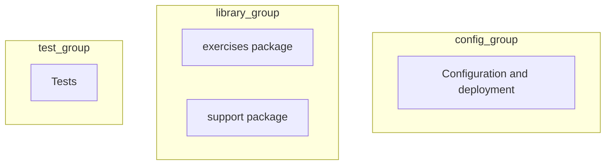

# Architecture report: MostlyAdequate/mostly-adequate-guide

> Automated static analysis. **Observed** = directly seen in files/imports/AST; **Inferred** = interpretation from that evidence. Repository code was not executed.

## 1. Repository at a glance

| Item | Value |
| --- | --- |
| Repository | MostlyAdequate/mostly-adequate-guide |
| Description | Mostly adequate guide to FP (in javascript) |
| Language | JavaScript |
| Stars | 23817 |
| Licence | Other |
| Analysed commit / branch | 239468e9bc4ce1f0143722f312eb2487cac846ea / master |
| Framework(s) | None detected |
| Files analysed | 124 |
| Components | 4 |

## 2. Architecture in one minute

MostlyAdequate/mostly-adequate-guide - Mostly adequate guide to FP (in javascript). This repository was analysed statically from 124 file(s) (0 Python). Detected technologies (observed from imports/manifests): GitHub Actions. Files are grouped into 4 component(s): Configuration and deployment, exercises package, support package, Tests. Findings below distinguish observed facts from inferred interpretation.

## 3. High-level block diagram

## 4. Main components

### Configuration and deployment (`config`)

- **Kind:** config
- **Status:** Observed
- **Confidence:** 0.85
- **Responsibility:** Groups 4 file(s) under configuration and deployment (observed from repository paths and static analysis).
- **Paths:** `book.json`, `exercises/package.json`, `package.json`, `support/package.json`
- **Evidence:** [book.json](https://github.com/MostlyAdequate/mostly-adequate-guide/blob/239468e9bc4ce1f0143722f312eb2487cac846ea/book.json); [exercises/package.json](https://github.com/MostlyAdequate/mostly-adequate-guide/blob/239468e9bc4ce1f0143722f312eb2487cac846ea/exercises/package.json); [package.json](https://github.com/MostlyAdequate/mostly-adequate-guide/blob/239468e9bc4ce1f0143722f312eb2487cac846ea/package.json); [support/package.json](https://github.com/MostlyAdequate/mostly-adequate-guide/blob/239468e9bc4ce1f0143722f312eb2487cac846ea/support/package.json)

### exercises package (`exercises`)

- **Kind:** library
- **Status:** Observed
- **Confidence:** 0.85
- **Responsibility:** Groups 70 file(s) under exercises package (observed from repository paths and static analysis).
- **Paths:** `exercises/.eslintrc.js`, `exercises/ch04/exercise_a.js`, `exercises/ch04/exercise_b.js`, `exercises/ch04/exercise_c.js`, `exercises/ch04/solution_a.js`, `exercises/ch04/solution_b.js`, `exercises/ch04/solution_c.js`, `exercises/ch04/validation_a.js`, `exercises/ch04/validation_b.js`, `exercises/ch04/validation_c.js`, `exercises/ch05/exercise_a.js`, `exercises/ch05/exercise_b.js`, `exercises/ch05/exercise_c.js`, `exercises/ch05/solution_a.js`, `exercises/ch05/solution_b.js`, `exercises/ch05/solution_c.js`, `exercises/ch05/validation_a.js`, `exercises/ch05/validation_b.js`, `exercises/ch05/validation_c.js`, `exercises/ch06/main.js`, `exercises/ch08/exercise_a.js`, `exercises/ch08/exercise_b.js`, `exercises/ch08/exercise_c.js`, `exercises/ch08/exercise_d.js`, `exercises/ch08/solution_a.js`, `exercises/ch08/solution_b.js`, `exercises/ch08/solution_c.js`, `exercises/ch08/solution_d.js`, `exercises/ch08/validation_a.js`, `exercises/ch08/validation_b.js`, `exercises/ch08/validation_c.js`, `exercises/ch08/validation_d.js`, `exercises/ch09/exercise_a.js`, `exercises/ch09/exercise_b.js`, `exercises/ch09/exercise_c.js`, `exercises/ch09/solution_a.js`, `exercises/ch09/solution_b.js`, `exercises/ch09/solution_c.js`, `exercises/ch09/validation_a.js`, `exercises/ch09/validation_b.js`, `exercises/ch09/validation_c.js`, `exercises/ch10/exercise_a.js`, `exercises/ch10/exercise_b.js`, `exercises/ch10/exercise_c.js`, `exercises/ch10/solution_a.js`, `exercises/ch10/solution_b.js`, `exercises/ch10/solution_c.js`, `exercises/ch10/validation_a.js`, `exercises/ch10/validation_b.js`, `exercises/ch10/validation_c.js`, `exercises/ch11/exercise_a.js`, `exercises/ch11/exercise_b.js`, `exercises/ch11/exercise_c.js`, `exercises/ch11/solution_a.js`, `exercises/ch11/solution_b.js`, `exercises/ch11/solution_c.js`, `exercises/ch11/validation_a.js`, `exercises/ch11/validation_b.js`, `exercises/ch11/validation_c.js`, `exercises/ch12/exercise_a.js`, `exercises/ch12/exercise_b.js`, `exercises/ch12/exercise_c.js`, `exercises/ch12/solution_a.js`, `exercises/ch12/solution_b.js`, `exercises/ch12/solution_c.js`, `exercises/ch12/validation_a.js`, `exercises/ch12/validation_b.js`, `exercises/ch12/validation_c.js`, `exercises/support.js`, `exercises/test-utils.js`
- **Evidence:** [exercises/.eslintrc.js](https://github.com/MostlyAdequate/mostly-adequate-guide/blob/239468e9bc4ce1f0143722f312eb2487cac846ea/exercises/.eslintrc.js); [exercises/ch04/exercise_a.js](https://github.com/MostlyAdequate/mostly-adequate-guide/blob/239468e9bc4ce1f0143722f312eb2487cac846ea/exercises/ch04/exercise_a.js); [exercises/ch04/exercise_b.js](https://github.com/MostlyAdequate/mostly-adequate-guide/blob/239468e9bc4ce1f0143722f312eb2487cac846ea/exercises/ch04/exercise_b.js); [exercises/ch04/exercise_c.js](https://github.com/MostlyAdequate/mostly-adequate-guide/blob/239468e9bc4ce1f0143722f312eb2487cac846ea/exercises/ch04/exercise_c.js); [exercises/ch04/solution_a.js](https://github.com/MostlyAdequate/mostly-adequate-guide/blob/239468e9bc4ce1f0143722f312eb2487cac846ea/exercises/ch04/solution_a.js); [exercises/ch04/solution_b.js](https://github.com/MostlyAdequate/mostly-adequate-guide/blob/239468e9bc4ce1f0143722f312eb2487cac846ea/exercises/ch04/solution_b.js); [exercises/ch04/solution_c.js](https://github.com/MostlyAdequate/mostly-adequate-guide/blob/239468e9bc4ce1f0143722f312eb2487cac846ea/exercises/ch04/solution_c.js); [exercises/ch04/validation_a.js](https://github.com/MostlyAdequate/mostly-adequate-guide/blob/239468e9bc4ce1f0143722f312eb2487cac846ea/exercises/ch04/validation_a.js)

### support package (`support`)

- **Kind:** library
- **Status:** Observed
- **Confidence:** 0.85
- **Responsibility:** Groups 2 file(s) under support package (observed from repository paths and static analysis).
- **Paths:** `support/.eslintrc.js`, `support/index.js`
- **Evidence:** [support/.eslintrc.js](https://github.com/MostlyAdequate/mostly-adequate-guide/blob/239468e9bc4ce1f0143722f312eb2487cac846ea/support/.eslintrc.js); [support/index.js](https://github.com/MostlyAdequate/mostly-adequate-guide/blob/239468e9bc4ce1f0143722f312eb2487cac846ea/support/index.js)

### Tests (`tests`)

- **Kind:** test
- **Status:** Observed
- **Confidence:** 0.85
- **Responsibility:** Groups 14 file(s) under tests (observed from repository paths and static analysis).
- **Paths:** `exercises/test/ch04.js`, `exercises/test/ch04.solutions.js`, `exercises/test/ch05.js`, `exercises/test/ch05.solutions.js`, `exercises/test/ch08.js`, `exercises/test/ch08.solutions.js`, `exercises/test/ch09.js`, `exercises/test/ch09.solutions.js`, `exercises/test/ch10.js`, `exercises/test/ch10.solutions.js`, `exercises/test/ch11.js`, `exercises/test/ch11.solutions.js`, `exercises/test/ch12.js`, `exercises/test/ch12.solutions.js`
- **Evidence:** [exercises/test/ch04.js](https://github.com/MostlyAdequate/mostly-adequate-guide/blob/239468e9bc4ce1f0143722f312eb2487cac846ea/exercises/test/ch04.js); [exercises/test/ch04.solutions.js](https://github.com/MostlyAdequate/mostly-adequate-guide/blob/239468e9bc4ce1f0143722f312eb2487cac846ea/exercises/test/ch04.solutions.js); [exercises/test/ch05.js](https://github.com/MostlyAdequate/mostly-adequate-guide/blob/239468e9bc4ce1f0143722f312eb2487cac846ea/exercises/test/ch05.js); [exercises/test/ch05.solutions.js](https://github.com/MostlyAdequate/mostly-adequate-guide/blob/239468e9bc4ce1f0143722f312eb2487cac846ea/exercises/test/ch05.solutions.js); [exercises/test/ch08.js](https://github.com/MostlyAdequate/mostly-adequate-guide/blob/239468e9bc4ce1f0143722f312eb2487cac846ea/exercises/test/ch08.js); [exercises/test/ch08.solutions.js](https://github.com/MostlyAdequate/mostly-adequate-guide/blob/239468e9bc4ce1f0143722f312eb2487cac846ea/exercises/test/ch08.solutions.js); [exercises/test/ch09.js](https://github.com/MostlyAdequate/mostly-adequate-guide/blob/239468e9bc4ce1f0143722f312eb2487cac846ea/exercises/test/ch09.js); [exercises/test/ch09.solutions.js](https://github.com/MostlyAdequate/mostly-adequate-guide/blob/239468e9bc4ce1f0143722f312eb2487cac846ea/exercises/test/ch09.solutions.js)

## 5. Execution flow

**Observed** entry point(s):

- [exercises/ch06/main.js](https://github.com/MostlyAdequate/mostly-adequate-guide/blob/239468e9bc4ce1f0143722f312eb2487cac846ea/exercises/ch06/main.js)
- [support/index.js](https://github.com/MostlyAdequate/mostly-adequate-guide/blob/239468e9bc4ce1f0143722f312eb2487cac846ea/support/index.js)

Representative flow (derived from observed entry points and the import graph; steps beyond the entry point are **Inferred**):

1. Execution starts at an observed entry point listed above, if present.
2. No internal import relationships between components were observed.

## 6. Project structure

### `(root)`

- `.editorconfig` - config (218 bytes)
- `.generate-summary.pl` - other (439 bytes)
- `.gitignore` - other (132 bytes)
- `.nvmrc` - other (9 bytes)
- `CONTRIBUTING.md` - docs (2030 bytes)
- `FAQ.md` - docs (5904 bytes)
- `LICENSE` - docs (302 bytes)
- `README.md` - docs (5848 bytes)
- `SUMMARY.md` - docs (6692 bytes)
- `TRANSLATIONS.md` - docs (1153 bytes)
- `appendix_a.md` - docs (2879 bytes)
- `appendix_b.md` - docs (7109 bytes)
- `appendix_c.md` - docs (4056 bytes)
- `book.json` - config (279 bytes)
- `ch01.md` - docs (7498 bytes)
- `ch02.md` - docs (5904 bytes)
- `ch03.md` - docs (14710 bytes)
- `ch04.md` - docs (8111 bytes)
- `ch05.md` - docs (15282 bytes)
- `ch06.md` - docs (10462 bytes)
- `ch07.md` - docs (12372 bytes)
- `ch08.md` - docs (40865 bytes)
- `ch09.md` - docs (21448 bytes)
- `ch10.md` - docs (16476 bytes)
- `ch11.md` - docs (12224 bytes)
- `ch12.md` - docs (16484 bytes)
- `ch13.md` - docs (16636 bytes)
- `package.json` - manifest (1075 bytes)

### `.github`

- `.github/workflows/build.yml` - ci, YAML (1689 bytes)

### `exercises`

- `exercises/.eslintrc.js` - source, JavaScript (449 bytes)
- `exercises/README.md` - docs (1690 bytes)
- `exercises/ch04/exercise_a.js` - source, JavaScript (142 bytes)
- `exercises/ch04/exercise_b.js` - source, JavaScript (165 bytes)
- `exercises/ch04/exercise_c.js` - source, JavaScript (293 bytes)
- `exercises/ch04/solution_a.js` - source, JavaScript (26 bytes)
- `exercises/ch04/solution_b.js` - source, JavaScript (38 bytes)
- `exercises/ch04/solution_c.js` - source, JavaScript (44 bytes)
- `exercises/ch04/validation_a.js` - source, JavaScript (255 bytes)
- `exercises/ch04/validation_b.js` - source, JavaScript (449 bytes)
- `exercises/ch04/validation_c.js` - source, JavaScript (400 bytes)
- `exercises/ch05/exercise_a.js` - source, JavaScript (376 bytes)
- `exercises/ch05/exercise_b.js` - source, JavaScript (360 bytes)
- `exercises/ch05/exercise_c.js` - source, JavaScript (287 bytes)
- `exercises/ch05/solution_a.js` - source, JavaScript (55 bytes)
- `exercises/ch05/solution_b.js` - source, JavaScript (72 bytes)
- `exercises/ch05/solution_c.js` - source, JavaScript (114 bytes)
- `exercises/ch05/validation_a.js` - source, JavaScript (654 bytes)
- `exercises/ch05/validation_b.js` - source, JavaScript (641 bytes)
- `exercises/ch05/validation_c.js` - source, JavaScript (610 bytes)
- `exercises/ch06/index.html` - other (557 bytes)
- `exercises/ch06/main.js` - source, JavaScript (1284 bytes)
- `exercises/ch08/exercise_a.js` - source, JavaScript (150 bytes)
- `exercises/ch08/exercise_b.js` - source, JavaScript (232 bytes)
- `exercises/ch08/exercise_c.js` - source, JavaScript (550 bytes)
- `exercises/ch08/exercise_d.js` - source, JavaScript (823 bytes)
- `exercises/ch08/solution_a.js` - source, JavaScript (27 bytes)
- `exercises/ch08/solution_b.js` - source, JavaScript (54 bytes)
- `exercises/ch08/solution_c.js` - source, JavaScript (62 bytes)
- `exercises/ch08/solution_d.js` - source, JavaScript (262 bytes)
- `exercises/ch08/validation_a.js` - source, JavaScript (279 bytes)
- `exercises/ch08/validation_b.js` - source, JavaScript (538 bytes)
- `exercises/ch08/validation_c.js` - source, JavaScript (746 bytes)
- `exercises/ch08/validation_d.js` - source, JavaScript (1708 bytes)
- `exercises/ch09/exercise_a.js` - source, JavaScript (390 bytes)
- `exercises/ch09/exercise_b.js` - source, JavaScript (486 bytes)
- `exercises/ch09/exercise_c.js` - source, JavaScript (473 bytes)
- `exercises/ch09/solution_a.js` - source, JavaScript (113 bytes)
- `exercises/ch09/solution_b.js` - source, JavaScript (114 bytes)
- `exercises/ch09/solution_c.js` - source, JavaScript (106 bytes)
- `exercises/ch09/validation_a.js` - source, JavaScript (932 bytes)
- `exercises/ch09/validation_b.js` - source, JavaScript (455 bytes)
- `exercises/ch09/validation_c.js` - source, JavaScript (681 bytes)
- `exercises/ch10/exercise_a.js` - source, JavaScript (176 bytes)
- `exercises/ch10/exercise_b.js` - source, JavaScript (157 bytes)
- `exercises/ch10/exercise_c.js` - source, JavaScript (540 bytes)
- `exercises/ch10/solution_a.js` - source, JavaScript (60 bytes)
- `exercises/ch10/solution_b.js` - source, JavaScript (29 bytes)
- `exercises/ch10/solution_c.js` - source, JavaScript (93 bytes)
- `exercises/ch10/validation_a.js` - source, JavaScript (828 bytes)
- `exercises/ch10/validation_b.js` - source, JavaScript (840 bytes)
- `exercises/ch10/validation_c.js` - source, JavaScript (308 bytes)
- `exercises/ch11/exercise_a.js` - source, JavaScript (150 bytes)
- `exercises/ch11/exercise_b.js` - source, JavaScript (317 bytes)
- `exercises/ch11/exercise_c.js` - source, JavaScript (360 bytes)
- `exercises/ch11/solution_a.js` - source, JavaScript (57 bytes)
- `exercises/ch11/solution_b.js` - source, JavaScript (84 bytes)
- `exercises/ch11/solution_c.js` - source, JavaScript (65 bytes)
- `exercises/ch11/validation_a.js` - source, JavaScript (489 bytes)
- `exercises/ch11/validation_b.js` - source, JavaScript (1288 bytes)
- `exercises/ch11/validation_c.js` - source, JavaScript (197 bytes)
- `exercises/ch12/exercise_a.js` - source, JavaScript (424 bytes)
- `exercises/ch12/exercise_b.js` - source, JavaScript (409 bytes)
- `exercises/ch12/exercise_c.js` - source, JavaScript (362 bytes)
- `exercises/ch12/solution_a.js` - source, JavaScript (107 bytes)
- `exercises/ch12/solution_b.js` - source, JavaScript (136 bytes)
- `exercises/ch12/solution_c.js` - source, JavaScript (157 bytes)
- `exercises/ch12/validation_a.js` - source, JavaScript (835 bytes)
- `exercises/ch12/validation_b.js` - source, JavaScript (861 bytes)
- `exercises/ch12/validation_c.js` - source, JavaScript (616 bytes)
- `exercises/package.json` - manifest (1171 bytes)
- `exercises/support.js` - source, JavaScript (23732 bytes)
- `exercises/test-utils.js` - source, JavaScript (4002 bytes)
- `exercises/test/ch04.js` - test, JavaScript (160 bytes)
- `exercises/test/ch04.solutions.js` - test, JavaScript (160 bytes)
- `exercises/test/ch05.js` - test, JavaScript (160 bytes)
- `exercises/test/ch05.solutions.js` - test, JavaScript (160 bytes)
- `exercises/test/ch08.js` - test, JavaScript (160 bytes)
- `exercises/test/ch08.solutions.js` - test, JavaScript (160 bytes)
- `exercises/test/ch09.js` - test, JavaScript (160 bytes)
- `exercises/test/ch09.solutions.js` - test, JavaScript (160 bytes)
- `exercises/test/ch10.js` - test, JavaScript (161 bytes)
- `exercises/test/ch10.solutions.js` - test, JavaScript (161 bytes)
- `exercises/test/ch11.js` - test, JavaScript (161 bytes)
- `exercises/test/ch11.solutions.js` - test, JavaScript (161 bytes)
- `exercises/test/ch12.js` - test, JavaScript (161 bytes)
- `exercises/test/ch12.solutions.js` - test, JavaScript (161 bytes)

### `styles`

- `styles/website.css` - other (98 bytes)

### `support`

- `support/.eslintrc.js` - source, JavaScript (449 bytes)
- `support/.npmignore` - other (77 bytes)
- `support/CHANGELOG.md` - docs (227 bytes)
- `support/README.md` - docs (1191 bytes)
- `support/build-appendixes` - other (1578 bytes)
- `support/index.js` - source, JavaScript (12390 bytes)
- `support/package.json` - manifest (903 bytes)

## 7. Key dependencies and integrations

| Name | Category | Status | Confidence | Evidence |
| --- | --- | --- | --- | --- |
| GitHub Actions | ci | Observed | 0.85 | [.github/workflows/build.yml](https://github.com/MostlyAdequate/mostly-adequate-guide/blob/239468e9bc4ce1f0143722f312eb2487cac846ea/.github/workflows/build.yml) |

## 8. Data and state

No database, cache, queue, or persistent-state usage was observed in the analysed files. State handling, if any, may be in-memory or in files that were not analysed.

## 9. Configuration and deployment clues

- `.editorconfig` (config)
- `.github/workflows/build.yml` (ci)
- `book.json` (config)
- `exercises/package.json` (manifest)
- `package.json` (manifest)
- `support/package.json` (manifest)

## 10. Design observations

- Tests are present alongside source code (Observed from test file paths).

These observations are interpretations (**Inferred**) of the observed structure, not guarantees about runtime design.

## 11. Limitations and unknowns

- Static analysis only: repository code was not executed, installed, or imported at runtime.
- Components and relationships are inferred from file paths, imports, and AST structure; runtime behaviour, dynamic imports, and reflection may not be visible.
- No clear application entry point was observed in the analysed files.
- Repository text was treated as untrusted data; no instructions found in repository files were followed, and likely secret values were redacted/excluded.
- JavaScript and TypeScript files were inventoried from paths and package manifests. They were not parsed with a full language AST, and repository code was not executed.

## 12. Source references

- [.github/workflows/build.yml](https://github.com/MostlyAdequate/mostly-adequate-guide/blob/239468e9bc4ce1f0143722f312eb2487cac846ea/.github/workflows/build.yml)
- [book.json](https://github.com/MostlyAdequate/mostly-adequate-guide/blob/239468e9bc4ce1f0143722f312eb2487cac846ea/book.json)
- [exercises/.eslintrc.js](https://github.com/MostlyAdequate/mostly-adequate-guide/blob/239468e9bc4ce1f0143722f312eb2487cac846ea/exercises/.eslintrc.js)
- [exercises/ch04/exercise_a.js](https://github.com/MostlyAdequate/mostly-adequate-guide/blob/239468e9bc4ce1f0143722f312eb2487cac846ea/exercises/ch04/exercise_a.js)
- [exercises/ch04/exercise_b.js](https://github.com/MostlyAdequate/mostly-adequate-guide/blob/239468e9bc4ce1f0143722f312eb2487cac846ea/exercises/ch04/exercise_b.js)
- [exercises/ch04/exercise_c.js](https://github.com/MostlyAdequate/mostly-adequate-guide/blob/239468e9bc4ce1f0143722f312eb2487cac846ea/exercises/ch04/exercise_c.js)
- [exercises/ch04/solution_a.js](https://github.com/MostlyAdequate/mostly-adequate-guide/blob/239468e9bc4ce1f0143722f312eb2487cac846ea/exercises/ch04/solution_a.js)
- [exercises/ch04/solution_b.js](https://github.com/MostlyAdequate/mostly-adequate-guide/blob/239468e9bc4ce1f0143722f312eb2487cac846ea/exercises/ch04/solution_b.js)
- [exercises/ch04/solution_c.js](https://github.com/MostlyAdequate/mostly-adequate-guide/blob/239468e9bc4ce1f0143722f312eb2487cac846ea/exercises/ch04/solution_c.js)
- [exercises/ch04/validation_a.js](https://github.com/MostlyAdequate/mostly-adequate-guide/blob/239468e9bc4ce1f0143722f312eb2487cac846ea/exercises/ch04/validation_a.js)
- [exercises/ch06/main.js](https://github.com/MostlyAdequate/mostly-adequate-guide/blob/239468e9bc4ce1f0143722f312eb2487cac846ea/exercises/ch06/main.js)
- [exercises/package.json](https://github.com/MostlyAdequate/mostly-adequate-guide/blob/239468e9bc4ce1f0143722f312eb2487cac846ea/exercises/package.json)
- [exercises/test/ch04.js](https://github.com/MostlyAdequate/mostly-adequate-guide/blob/239468e9bc4ce1f0143722f312eb2487cac846ea/exercises/test/ch04.js)
- [exercises/test/ch04.solutions.js](https://github.com/MostlyAdequate/mostly-adequate-guide/blob/239468e9bc4ce1f0143722f312eb2487cac846ea/exercises/test/ch04.solutions.js)
- [exercises/test/ch05.js](https://github.com/MostlyAdequate/mostly-adequate-guide/blob/239468e9bc4ce1f0143722f312eb2487cac846ea/exercises/test/ch05.js)
- [exercises/test/ch05.solutions.js](https://github.com/MostlyAdequate/mostly-adequate-guide/blob/239468e9bc4ce1f0143722f312eb2487cac846ea/exercises/test/ch05.solutions.js)
- [exercises/test/ch08.js](https://github.com/MostlyAdequate/mostly-adequate-guide/blob/239468e9bc4ce1f0143722f312eb2487cac846ea/exercises/test/ch08.js)
- [exercises/test/ch08.solutions.js](https://github.com/MostlyAdequate/mostly-adequate-guide/blob/239468e9bc4ce1f0143722f312eb2487cac846ea/exercises/test/ch08.solutions.js)
- [exercises/test/ch09.js](https://github.com/MostlyAdequate/mostly-adequate-guide/blob/239468e9bc4ce1f0143722f312eb2487cac846ea/exercises/test/ch09.js)
- [exercises/test/ch09.solutions.js](https://github.com/MostlyAdequate/mostly-adequate-guide/blob/239468e9bc4ce1f0143722f312eb2487cac846ea/exercises/test/ch09.solutions.js)
- [package.json](https://github.com/MostlyAdequate/mostly-adequate-guide/blob/239468e9bc4ce1f0143722f312eb2487cac846ea/package.json)
- [support/.eslintrc.js](https://github.com/MostlyAdequate/mostly-adequate-guide/blob/239468e9bc4ce1f0143722f312eb2487cac846ea/support/.eslintrc.js)
- [support/index.js](https://github.com/MostlyAdequate/mostly-adequate-guide/blob/239468e9bc4ce1f0143722f312eb2487cac846ea/support/index.js)
- [support/package.json](https://github.com/MostlyAdequate/mostly-adequate-guide/blob/239468e9bc4ce1f0143722f312eb2487cac846ea/support/package.json)
