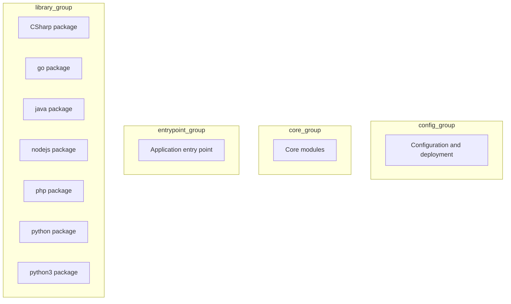

# Architecture report: NARKOZ/hacker-scripts

> Automated static analysis. **Observed** = directly seen in files/imports/AST; **Inferred** = interpretation from that evidence. Repository code was not executed.

## 1. Repository at a glance

| Item | Value |
| --- | --- |
| Repository | NARKOZ/hacker-scripts |
| Description | Based on a true story |
| Language | JavaScript |
| Stars | 49871 |
| Licence | Not detected |
| Analysed commit / branch | b14a0a89bdf743c63ca4cc9cbcd866e050d7b3b0 / master |
| Framework(s) | None detected |
| Files analysed | 59 |
| Components | 10 |

## 2. Architecture in one minute

NARKOZ/hacker-scripts - Based on a true story. This repository was analysed statically from 59 file(s) (9 Python). Detected technologies (observed from imports/manifests): no known frameworks/libraries. Files are grouped into 10 component(s): Configuration and deployment, Core modules, CSharp package, Application entry point, go package, java package, nodejs package, php package. Observed entry point(s): python3/fucking_coffee.py, python3/hangover.py, python3/kumar_asshole.py. Findings below distinguish observed facts from inferred interpretation.

## 3. High-level block diagram

## 4. Main components

### Configuration and deployment (`config`)

- **Kind:** config
- **Status:** Observed
- **Confidence:** 0.85
- **Responsibility:** Groups 2 file(s) under configuration and deployment (observed from repository paths and static analysis).
- **Paths:** `php/composer.json`, `python3/requirements.txt`
- **Evidence:** [php/composer.json](https://github.com/NARKOZ/hacker-scripts/blob/b14a0a89bdf743c63ca4cc9cbcd866e050d7b3b0/php/composer.json); [python3/requirements.txt](https://github.com/NARKOZ/hacker-scripts/blob/b14a0a89bdf743c63ca4cc9cbcd866e050d7b3b0/python3/requirements.txt)

### Core modules (`core`)

- **Kind:** core
- **Status:** Observed
- **Confidence:** 0.85
- **Responsibility:** Groups 8 file(s) under core modules (observed from repository paths and static analysis).
- **Paths:** `fucking-coffee.sh`, `fucking_coffee.rb`, `hangover.rb`, `hangover.sh`, `kumar-asshole.sh`, `kumar_asshole.rb`, `smack-my-bitch-up.sh`, `smack_my_bitch_up.rb`
- **Evidence:** [fucking-coffee.sh](https://github.com/NARKOZ/hacker-scripts/blob/b14a0a89bdf743c63ca4cc9cbcd866e050d7b3b0/fucking-coffee.sh); [fucking_coffee.rb](https://github.com/NARKOZ/hacker-scripts/blob/b14a0a89bdf743c63ca4cc9cbcd866e050d7b3b0/fucking_coffee.rb); [hangover.rb](https://github.com/NARKOZ/hacker-scripts/blob/b14a0a89bdf743c63ca4cc9cbcd866e050d7b3b0/hangover.rb); [hangover.sh](https://github.com/NARKOZ/hacker-scripts/blob/b14a0a89bdf743c63ca4cc9cbcd866e050d7b3b0/hangover.sh); [kumar-asshole.sh](https://github.com/NARKOZ/hacker-scripts/blob/b14a0a89bdf743c63ca4cc9cbcd866e050d7b3b0/kumar-asshole.sh); [kumar_asshole.rb](https://github.com/NARKOZ/hacker-scripts/blob/b14a0a89bdf743c63ca4cc9cbcd866e050d7b3b0/kumar_asshole.rb); [smack-my-bitch-up.sh](https://github.com/NARKOZ/hacker-scripts/blob/b14a0a89bdf743c63ca4cc9cbcd866e050d7b3b0/smack-my-bitch-up.sh); [smack_my_bitch_up.rb](https://github.com/NARKOZ/hacker-scripts/blob/b14a0a89bdf743c63ca4cc9cbcd866e050d7b3b0/smack_my_bitch_up.rb)

### CSharp package (`csharp`)

- **Kind:** library
- **Status:** Observed
- **Confidence:** 0.85
- **Responsibility:** Groups 2 file(s) under csharp package (observed from repository paths and static analysis).
- **Paths:** `CSharp/Hangover.cs`, `CSharp/SmackMyBitch.cs`
- **Evidence:** [CSharp/Hangover.cs](https://github.com/NARKOZ/hacker-scripts/blob/b14a0a89bdf743c63ca4cc9cbcd866e050d7b3b0/CSharp/Hangover.cs); [CSharp/SmackMyBitch.cs](https://github.com/NARKOZ/hacker-scripts/blob/b14a0a89bdf743c63ca4cc9cbcd866e050d7b3b0/CSharp/SmackMyBitch.cs)

### Application entry point (`entrypoint`)

- **Kind:** entrypoint
- **Status:** Observed
- **Confidence:** 0.85
- **Responsibility:** Groups 4 file(s) under application entry point (observed from repository paths and static analysis). Observed top-level functions: main, send_reply.
- **Paths:** `python3/fucking_coffee.py`, `python3/hangover.py`, `python3/kumar_asshole.py`, `python3/smack_my_bitch_up.py`
- **Evidence:** [python3/fucking_coffee.py:14](https://github.com/NARKOZ/hacker-scripts/blob/b14a0a89bdf743c63ca4cc9cbcd866e050d7b3b0/python3/fucking_coffee.py#L14); [python3/hangover.py:19](https://github.com/NARKOZ/hacker-scripts/blob/b14a0a89bdf743c63ca4cc9cbcd866e050d7b3b0/python3/hangover.py#L19); [python3/kumar_asshole.py:25](https://github.com/NARKOZ/hacker-scripts/blob/b14a0a89bdf743c63ca4cc9cbcd866e050d7b3b0/python3/kumar_asshole.py#L25); [python3/smack_my_bitch_up.py:19](https://github.com/NARKOZ/hacker-scripts/blob/b14a0a89bdf743c63ca4cc9cbcd866e050d7b3b0/python3/smack_my_bitch_up.py#L19)

### go package (`go`)

- **Kind:** library
- **Status:** Observed
- **Confidence:** 0.85
- **Responsibility:** Groups 3 file(s) under go package (observed from repository paths and static analysis).
- **Paths:** `go/fucking-coffee.go`, `go/hangover.go`, `go/smack_my_bitch_up.go`
- **Evidence:** [go/fucking-coffee.go](https://github.com/NARKOZ/hacker-scripts/blob/b14a0a89bdf743c63ca4cc9cbcd866e050d7b3b0/go/fucking-coffee.go); [go/hangover.go](https://github.com/NARKOZ/hacker-scripts/blob/b14a0a89bdf743c63ca4cc9cbcd866e050d7b3b0/go/hangover.go); [go/smack_my_bitch_up.go](https://github.com/NARKOZ/hacker-scripts/blob/b14a0a89bdf743c63ca4cc9cbcd866e050d7b3b0/go/smack_my_bitch_up.go)

### java package (`java`)

- **Kind:** library
- **Status:** Observed
- **Confidence:** 0.85
- **Responsibility:** Groups 4 file(s) under java package (observed from repository paths and static analysis).
- **Paths:** `java/FuckingCoffee.java`, `java/Hangover.java`, `java/KumarAsshole.java`, `java/SmackMyBitch.java`
- **Evidence:** [java/FuckingCoffee.java](https://github.com/NARKOZ/hacker-scripts/blob/b14a0a89bdf743c63ca4cc9cbcd866e050d7b3b0/java/FuckingCoffee.java); [java/Hangover.java](https://github.com/NARKOZ/hacker-scripts/blob/b14a0a89bdf743c63ca4cc9cbcd866e050d7b3b0/java/Hangover.java); [java/KumarAsshole.java](https://github.com/NARKOZ/hacker-scripts/blob/b14a0a89bdf743c63ca4cc9cbcd866e050d7b3b0/java/KumarAsshole.java); [java/SmackMyBitch.java](https://github.com/NARKOZ/hacker-scripts/blob/b14a0a89bdf743c63ca4cc9cbcd866e050d7b3b0/java/SmackMyBitch.java)

### nodejs package (`nodejs`)

- **Kind:** library
- **Status:** Observed
- **Confidence:** 0.85
- **Responsibility:** Groups 5 file(s) under nodejs package (observed from repository paths and static analysis).
- **Paths:** `nodejs/fucking_coffee.js`, `nodejs/fucking_coffee_yo_server.js`, `nodejs/hangover.js`, `nodejs/kumar_asshole.js`, `nodejs/smack_my_bitch_up.js`
- **Evidence:** [nodejs/fucking_coffee.js](https://github.com/NARKOZ/hacker-scripts/blob/b14a0a89bdf743c63ca4cc9cbcd866e050d7b3b0/nodejs/fucking_coffee.js); [nodejs/fucking_coffee_yo_server.js](https://github.com/NARKOZ/hacker-scripts/blob/b14a0a89bdf743c63ca4cc9cbcd866e050d7b3b0/nodejs/fucking_coffee_yo_server.js); [nodejs/hangover.js](https://github.com/NARKOZ/hacker-scripts/blob/b14a0a89bdf743c63ca4cc9cbcd866e050d7b3b0/nodejs/hangover.js); [nodejs/kumar_asshole.js](https://github.com/NARKOZ/hacker-scripts/blob/b14a0a89bdf743c63ca4cc9cbcd866e050d7b3b0/nodejs/kumar_asshole.js); [nodejs/smack_my_bitch_up.js](https://github.com/NARKOZ/hacker-scripts/blob/b14a0a89bdf743c63ca4cc9cbcd866e050d7b3b0/nodejs/smack_my_bitch_up.js)

### php package (`php`)

- **Kind:** library
- **Status:** Observed
- **Confidence:** 0.85
- **Responsibility:** Groups 3 file(s) under php package (observed from repository paths and static analysis).
- **Paths:** `php/fucking_coffee.php`, `php/hangover.php`, `php/smack_my_bitch_up.php`
- **Evidence:** [php/fucking_coffee.php](https://github.com/NARKOZ/hacker-scripts/blob/b14a0a89bdf743c63ca4cc9cbcd866e050d7b3b0/php/fucking_coffee.php); [php/hangover.php](https://github.com/NARKOZ/hacker-scripts/blob/b14a0a89bdf743c63ca4cc9cbcd866e050d7b3b0/php/hangover.php); [php/smack_my_bitch_up.php](https://github.com/NARKOZ/hacker-scripts/blob/b14a0a89bdf743c63ca4cc9cbcd866e050d7b3b0/php/smack_my_bitch_up.php)

### python package (`python`)

- **Kind:** library
- **Status:** Observed
- **Confidence:** 0.85
- **Responsibility:** Groups 4 file(s) under python package (observed from repository paths and static analysis).
- **Paths:** `python/fucking_coffee.py`, `python/hangover.py`, `python/kumar_asshole.py`, `python/smack_my_bitch_up.py`
- **Evidence:** [python/fucking_coffee.py](https://github.com/NARKOZ/hacker-scripts/blob/b14a0a89bdf743c63ca4cc9cbcd866e050d7b3b0/python/fucking_coffee.py); [python/hangover.py](https://github.com/NARKOZ/hacker-scripts/blob/b14a0a89bdf743c63ca4cc9cbcd866e050d7b3b0/python/hangover.py); [python/kumar_asshole.py](https://github.com/NARKOZ/hacker-scripts/blob/b14a0a89bdf743c63ca4cc9cbcd866e050d7b3b0/python/kumar_asshole.py); [python/smack_my_bitch_up.py](https://github.com/NARKOZ/hacker-scripts/blob/b14a0a89bdf743c63ca4cc9cbcd866e050d7b3b0/python/smack_my_bitch_up.py)

### python3 package (`python3`)

- **Kind:** library
- **Status:** Observed
- **Confidence:** 0.85
- **Responsibility:** Groups 1 file(s) under python3 package (observed from repository paths and static analysis). Observed top-level functions: get_dotenv, get_log_path, sh.
- **Paths:** `python3/hackerutils.py`
- **Evidence:** [python3/hackerutils.py:10](https://github.com/NARKOZ/hacker-scripts/blob/b14a0a89bdf743c63ca4cc9cbcd866e050d7b3b0/python3/hackerutils.py#L10)

## 5. Execution flow

**Observed** entry point(s):

- [python3/fucking_coffee.py:33](https://github.com/NARKOZ/hacker-scripts/blob/b14a0a89bdf743c63ca4cc9cbcd866e050d7b3b0/python3/fucking_coffee.py#L33)
- [python3/hangover.py:51](https://github.com/NARKOZ/hacker-scripts/blob/b14a0a89bdf743c63ca4cc9cbcd866e050d7b3b0/python3/hangover.py#L51)
- [python3/kumar_asshole.py:43](https://github.com/NARKOZ/hacker-scripts/blob/b14a0a89bdf743c63ca4cc9cbcd866e050d7b3b0/python3/kumar_asshole.py#L43)
- [python3/smack_my_bitch_up.py:50](https://github.com/NARKOZ/hacker-scripts/blob/b14a0a89bdf743c63ca4cc9cbcd866e050d7b3b0/python3/smack_my_bitch_up.py#L50)

Representative flow (derived from observed entry points and the import graph; steps beyond the entry point are **Inferred**):

1. Execution starts at an observed entry point listed above, if present.
2. No internal import relationships between components were observed.

## 6. Project structure

### `(root)`

- `.env.example` - config (274 bytes)
- `README.md` - docs (3445 bytes)
- `README.zh-CN.md` - docs (3972 bytes)
- `fucking-coffee.sh` - source, Shell (80 bytes)
- `fucking_coffee.rb` - source, Ruby (459 bytes)
- `hangover.rb` - source, Ruby (691 bytes)
- `hangover.sh` - source, Shell (684 bytes)
- `kumar-asshole.sh` - source, Shell (78 bytes)
- `kumar_asshole.rb` - source, Ruby (1050 bytes)
- `smack-my-bitch-up.sh` - source, Shell (681 bytes)
- `smack_my_bitch_up.rb` - source, Ruby (685 bytes)

### `CSharp`

- `CSharp/Hangover.cs` - source, C# (1044 bytes)
- `CSharp/SmackMyBitch.cs` - source, C# (1111 bytes)

### `R`

- `R/hangover.R` - other (889 bytes)
- `R/smack_my_bitch_up.R` - other (891 bytes)

### `clojure`

- `clojure/coffee.clj` - other (1227 bytes)
- `clojure/hangover.clj` - other (728 bytes)
- `clojure/kumar.clj` - other (2537 bytes)
- `clojure/smack.clj` - other (749 bytes)

### `coffee`

- `coffee/fucking.coffee` - other (516 bytes)

### `go`

- `go/fucking-coffee.go` - source, Go (1137 bytes)
- `go/hangover.go` - source, Go (1054 bytes)
- `go/smack_my_bitch_up.go` - source, Go (1117 bytes)

### `groovy`

- `groovy/fucking_coffee.groovy` - other (545 bytes)

### `java`

- `java/FuckingCoffee.java` - source, Java (1164 bytes)
- `java/Hangover.java` - source, Java (1611 bytes)
- `java/KumarAsshole.java` - source, Java (2370 bytes)
- `java/SmackMyBitch.java` - source, Java (1655 bytes)

### `kotlin`

- `kotlin/FuckingCoffee.kt` - other (999 bytes)
- `kotlin/Hangover.kt` - other (1182 bytes)
- `kotlin/KumarAsshole.kt` - other (2817 bytes)
- `kotlin/SmackMyBitch.kt` - other (1284 bytes)

### `nodejs`

- `nodejs/fucking_coffee.js` - source, JavaScript (986 bytes)
- `nodejs/fucking_coffee_yo_server.js` - source, JavaScript (2433 bytes)
- `nodejs/hangover.js` - source, JavaScript (1540 bytes)
- `nodejs/kumar_asshole.js` - source, JavaScript (3740 bytes)
- `nodejs/smack_my_bitch_up.js` - source, JavaScript (1537 bytes)

### `perl`

- `perl/fucking-coffee.pl` - other (849 bytes)
- `perl/hangover.pl` - other (1542 bytes)
- `perl/kumar-asshole.pl` - other (2518 bytes)
- `perl/smack-my-bitch-up.pl` - other (1542 bytes)

### `php`

- `php/composer.json` - config (130 bytes)
- `php/fucking_coffee.php` - source, PHP (320 bytes)
- `php/hangover.php` - source, PHP (603 bytes)
- `php/smack_my_bitch_up.php` - source, PHP (730 bytes)

### `powershell`

- `powershell/fucking_coffee.psm1` - other (1845 bytes)
- `powershell/hangover.psm1` - other (2104 bytes)
- `powershell/smack_my_bitch_up.ps1` - other (978 bytes)

### `python`

- `python/fucking_coffee.py` - source, Python (539 bytes)
- `python/hangover.py` - source, Python (832 bytes)
- `python/kumar_asshole.py` - source, Python (541 bytes)
- `python/smack_my_bitch_up.py` - source, Python (839 bytes)

### `python3`

- `python3/fucking_coffee.py` - source, Python (672 bytes)
- `python3/hackerutils.py` - source, Python (486 bytes)
- `python3/hangover.py` - source, Python (1216 bytes)
- `python3/kumar_asshole.py` - source, Python (996 bytes)
- `python3/requirements.txt` - manifest (63 bytes)
- `python3/smack_my_bitch_up.py` - source, Python (1217 bytes)

### `scala`

- `scala/fucking-coffee.scala` - other (1123 bytes)

## 7. Key dependencies and integrations

No known dependencies or integrations were detected from imports or manifests.

## 8. Data and state

No database, cache, queue, or persistent-state usage was observed in the analysed files. State handling, if any, may be in-memory or in files that were not analysed.

## 9. Configuration and deployment clues

- `.env.example` (config)
- `php/composer.json` (config)
- `python3/requirements.txt` (manifest)

Environment variable *names* seen in example env files (values never recorded):

- `.env.example`: `GMAIL_PASSWORD`, `GMAIL_USERNAME`, `TWILIO_ACCOUNT_SID`, `TWILIO_AUTH_TOKEN`

## 10. Design observations

- An entry/API layer is separated from other code (Inferred from paths and decorators).

These observations are interpretations (**Inferred**) of the observed structure, not guarantees about runtime design.

## 11. Limitations and unknowns

- Static analysis only: repository code was not executed, installed, or imported at runtime.
- Components and relationships are inferred from file paths, imports, and AST structure; runtime behaviour, dynamic imports, and reflection may not be visible.
- File python/hangover.py could not be parsed as Python (possible SyntaxError) and was skipped for AST analysis.
- File python/smack_my_bitch_up.py could not be parsed as Python (possible SyntaxError) and was skipped for AST analysis.
- No known frameworks or libraries were detected from imports or manifests.
- Repository text was treated as untrusted data; no instructions found in repository files were followed, and likely secret values were redacted/excluded.

## 12. Source references

- [CSharp/Hangover.cs](https://github.com/NARKOZ/hacker-scripts/blob/b14a0a89bdf743c63ca4cc9cbcd866e050d7b3b0/CSharp/Hangover.cs)
- [CSharp/SmackMyBitch.cs](https://github.com/NARKOZ/hacker-scripts/blob/b14a0a89bdf743c63ca4cc9cbcd866e050d7b3b0/CSharp/SmackMyBitch.cs)
- [fucking-coffee.sh](https://github.com/NARKOZ/hacker-scripts/blob/b14a0a89bdf743c63ca4cc9cbcd866e050d7b3b0/fucking-coffee.sh)
- [fucking_coffee.rb](https://github.com/NARKOZ/hacker-scripts/blob/b14a0a89bdf743c63ca4cc9cbcd866e050d7b3b0/fucking_coffee.rb)
- [go/fucking-coffee.go](https://github.com/NARKOZ/hacker-scripts/blob/b14a0a89bdf743c63ca4cc9cbcd866e050d7b3b0/go/fucking-coffee.go)
- [go/hangover.go](https://github.com/NARKOZ/hacker-scripts/blob/b14a0a89bdf743c63ca4cc9cbcd866e050d7b3b0/go/hangover.go)
- [go/smack_my_bitch_up.go](https://github.com/NARKOZ/hacker-scripts/blob/b14a0a89bdf743c63ca4cc9cbcd866e050d7b3b0/go/smack_my_bitch_up.go)
- [hangover.rb](https://github.com/NARKOZ/hacker-scripts/blob/b14a0a89bdf743c63ca4cc9cbcd866e050d7b3b0/hangover.rb)
- [hangover.sh](https://github.com/NARKOZ/hacker-scripts/blob/b14a0a89bdf743c63ca4cc9cbcd866e050d7b3b0/hangover.sh)
- [java/FuckingCoffee.java](https://github.com/NARKOZ/hacker-scripts/blob/b14a0a89bdf743c63ca4cc9cbcd866e050d7b3b0/java/FuckingCoffee.java)
- [java/Hangover.java](https://github.com/NARKOZ/hacker-scripts/blob/b14a0a89bdf743c63ca4cc9cbcd866e050d7b3b0/java/Hangover.java)
- [java/KumarAsshole.java](https://github.com/NARKOZ/hacker-scripts/blob/b14a0a89bdf743c63ca4cc9cbcd866e050d7b3b0/java/KumarAsshole.java)
- [java/SmackMyBitch.java](https://github.com/NARKOZ/hacker-scripts/blob/b14a0a89bdf743c63ca4cc9cbcd866e050d7b3b0/java/SmackMyBitch.java)
- [kumar-asshole.sh](https://github.com/NARKOZ/hacker-scripts/blob/b14a0a89bdf743c63ca4cc9cbcd866e050d7b3b0/kumar-asshole.sh)
- [kumar_asshole.rb](https://github.com/NARKOZ/hacker-scripts/blob/b14a0a89bdf743c63ca4cc9cbcd866e050d7b3b0/kumar_asshole.rb)
- [nodejs/fucking_coffee.js](https://github.com/NARKOZ/hacker-scripts/blob/b14a0a89bdf743c63ca4cc9cbcd866e050d7b3b0/nodejs/fucking_coffee.js)
- [nodejs/fucking_coffee_yo_server.js](https://github.com/NARKOZ/hacker-scripts/blob/b14a0a89bdf743c63ca4cc9cbcd866e050d7b3b0/nodejs/fucking_coffee_yo_server.js)
- [nodejs/hangover.js](https://github.com/NARKOZ/hacker-scripts/blob/b14a0a89bdf743c63ca4cc9cbcd866e050d7b3b0/nodejs/hangover.js)
- [nodejs/kumar_asshole.js](https://github.com/NARKOZ/hacker-scripts/blob/b14a0a89bdf743c63ca4cc9cbcd866e050d7b3b0/nodejs/kumar_asshole.js)
- [nodejs/smack_my_bitch_up.js](https://github.com/NARKOZ/hacker-scripts/blob/b14a0a89bdf743c63ca4cc9cbcd866e050d7b3b0/nodejs/smack_my_bitch_up.js)
- [php/composer.json](https://github.com/NARKOZ/hacker-scripts/blob/b14a0a89bdf743c63ca4cc9cbcd866e050d7b3b0/php/composer.json)
- [php/fucking_coffee.php](https://github.com/NARKOZ/hacker-scripts/blob/b14a0a89bdf743c63ca4cc9cbcd866e050d7b3b0/php/fucking_coffee.php)
- [php/hangover.php](https://github.com/NARKOZ/hacker-scripts/blob/b14a0a89bdf743c63ca4cc9cbcd866e050d7b3b0/php/hangover.php)
- [php/smack_my_bitch_up.php](https://github.com/NARKOZ/hacker-scripts/blob/b14a0a89bdf743c63ca4cc9cbcd866e050d7b3b0/php/smack_my_bitch_up.php)
- [python/fucking_coffee.py](https://github.com/NARKOZ/hacker-scripts/blob/b14a0a89bdf743c63ca4cc9cbcd866e050d7b3b0/python/fucking_coffee.py)
- [python/hangover.py](https://github.com/NARKOZ/hacker-scripts/blob/b14a0a89bdf743c63ca4cc9cbcd866e050d7b3b0/python/hangover.py)
- [python/kumar_asshole.py](https://github.com/NARKOZ/hacker-scripts/blob/b14a0a89bdf743c63ca4cc9cbcd866e050d7b3b0/python/kumar_asshole.py)
- [python/smack_my_bitch_up.py](https://github.com/NARKOZ/hacker-scripts/blob/b14a0a89bdf743c63ca4cc9cbcd866e050d7b3b0/python/smack_my_bitch_up.py)
- [python3/fucking_coffee.py:14](https://github.com/NARKOZ/hacker-scripts/blob/b14a0a89bdf743c63ca4cc9cbcd866e050d7b3b0/python3/fucking_coffee.py#L14)
- [python3/fucking_coffee.py:33](https://github.com/NARKOZ/hacker-scripts/blob/b14a0a89bdf743c63ca4cc9cbcd866e050d7b3b0/python3/fucking_coffee.py#L33)
- [python3/hackerutils.py:10](https://github.com/NARKOZ/hacker-scripts/blob/b14a0a89bdf743c63ca4cc9cbcd866e050d7b3b0/python3/hackerutils.py#L10)
- [python3/hangover.py:19](https://github.com/NARKOZ/hacker-scripts/blob/b14a0a89bdf743c63ca4cc9cbcd866e050d7b3b0/python3/hangover.py#L19)
- [python3/hangover.py:51](https://github.com/NARKOZ/hacker-scripts/blob/b14a0a89bdf743c63ca4cc9cbcd866e050d7b3b0/python3/hangover.py#L51)
- [python3/kumar_asshole.py:25](https://github.com/NARKOZ/hacker-scripts/blob/b14a0a89bdf743c63ca4cc9cbcd866e050d7b3b0/python3/kumar_asshole.py#L25)
- [python3/kumar_asshole.py:43](https://github.com/NARKOZ/hacker-scripts/blob/b14a0a89bdf743c63ca4cc9cbcd866e050d7b3b0/python3/kumar_asshole.py#L43)
- [python3/requirements.txt](https://github.com/NARKOZ/hacker-scripts/blob/b14a0a89bdf743c63ca4cc9cbcd866e050d7b3b0/python3/requirements.txt)
- [python3/smack_my_bitch_up.py:19](https://github.com/NARKOZ/hacker-scripts/blob/b14a0a89bdf743c63ca4cc9cbcd866e050d7b3b0/python3/smack_my_bitch_up.py#L19)
- [python3/smack_my_bitch_up.py:50](https://github.com/NARKOZ/hacker-scripts/blob/b14a0a89bdf743c63ca4cc9cbcd866e050d7b3b0/python3/smack_my_bitch_up.py#L50)
- [smack-my-bitch-up.sh](https://github.com/NARKOZ/hacker-scripts/blob/b14a0a89bdf743c63ca4cc9cbcd866e050d7b3b0/smack-my-bitch-up.sh)
- [smack_my_bitch_up.rb](https://github.com/NARKOZ/hacker-scripts/blob/b14a0a89bdf743c63ca4cc9cbcd866e050d7b3b0/smack_my_bitch_up.rb)
