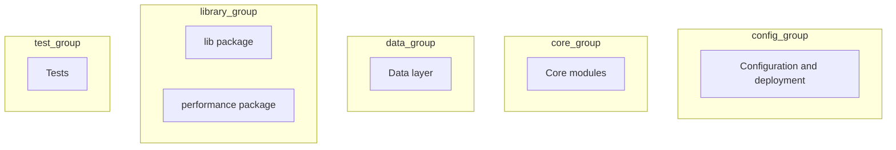

# Architecture report: Netflix/falcor

> Automated static analysis. **Observed** = directly seen in files/imports/AST; **Inferred** = interpretation from that evidence. Repository code was not executed.

## 1. Repository at a glance

| Item | Value |
| --- | --- |
| Repository | Netflix/falcor |
| Description | A JavaScript library for efficient data fetching |
| Language | JavaScript |
| Stars | 10565 |
| Licence | Apache-2.0 |
| Analysed commit / branch | 39d64776cf9d87781b2791615dcbae73b2bcd2e1 / master |
| Framework(s) | Express |
| Files analysed | 336 |
| Components | 6 |

## 2. Architecture in one minute

Netflix/falcor - A JavaScript library for efficient data fetching. This repository was analysed statically from 336 file(s) (0 Python). Detected technologies (observed from imports/manifests): GitHub Actions, Express, Jest. Files are grouped into 6 component(s): Configuration and deployment, Core modules, Data layer, lib package, performance package, Tests. Findings below distinguish observed facts from inferred interpretation.

## 3. High-level block diagram

## 4. Main components

### Configuration and deployment (`config`)

- **Kind:** config
- **Status:** Observed
- **Confidence:** 0.85
- **Responsibility:** Groups 3 file(s) under configuration and deployment (observed from repository paths and static analysis).
- **Paths:** `bower.json`, `conf.json`, `package.json`
- **Evidence:** [bower.json](https://github.com/Netflix/falcor/blob/39d64776cf9d87781b2791615dcbae73b2bcd2e1/bower.json); [conf.json](https://github.com/Netflix/falcor/blob/39d64776cf9d87781b2791615dcbae73b2bcd2e1/conf.json); [package.json](https://github.com/Netflix/falcor/blob/39d64776cf9d87781b2791615dcbae73b2bcd2e1/package.json)

### Core modules (`core`)

- **Kind:** core
- **Status:** Observed
- **Confidence:** 0.85
- **Responsibility:** Groups 5 file(s) under core modules (observed from repository paths and static analysis).
- **Paths:** `all.js`, `browser.js`, `gulpfile.js`, `server.js`, `webpack.config.js`
- **Evidence:** [all.js](https://github.com/Netflix/falcor/blob/39d64776cf9d87781b2791615dcbae73b2bcd2e1/all.js); [browser.js](https://github.com/Netflix/falcor/blob/39d64776cf9d87781b2791615dcbae73b2bcd2e1/browser.js); [gulpfile.js](https://github.com/Netflix/falcor/blob/39d64776cf9d87781b2791615dcbae73b2bcd2e1/gulpfile.js); [server.js](https://github.com/Netflix/falcor/blob/39d64776cf9d87781b2791615dcbae73b2bcd2e1/server.js); [webpack.config.js](https://github.com/Netflix/falcor/blob/39d64776cf9d87781b2791615dcbae73b2bcd2e1/webpack.config.js)

### Data layer (`data_layer`)

- **Kind:** data
- **Status:** Observed
- **Confidence:** 0.85
- **Responsibility:** Groups 3 file(s) under data layer (observed from repository paths and static analysis).
- **Paths:** `performance/models/index.js`, `performance/models/legacy/_Cache.js`, `performance/models/legacy/index.js`
- **Evidence:** [performance/models/index.js](https://github.com/Netflix/falcor/blob/39d64776cf9d87781b2791615dcbae73b2bcd2e1/performance/models/index.js); [performance/models/legacy/_Cache.js](https://github.com/Netflix/falcor/blob/39d64776cf9d87781b2791615dcbae73b2bcd2e1/performance/models/legacy/_Cache.js); [performance/models/legacy/index.js](https://github.com/Netflix/falcor/blob/39d64776cf9d87781b2791615dcbae73b2bcd2e1/performance/models/legacy/index.js)

### lib package (`lib`)

- **Kind:** library
- **Status:** Observed
- **Confidence:** 0.85
- **Responsibility:** Groups 143 file(s) under lib package (observed from repository paths and static analysis).
- **Paths:** `lib/Model.js`, `lib/ModelDataSourceAdapter.js`, `lib/ModelRoot.js`, `lib/deref/hasValidParentReference.js`, `lib/deref/index.js`, `lib/deref/sync.js`, `lib/errors/BoundJSONGraphModelError.js`, `lib/errors/InvalidDerefInputError.js`, `lib/errors/InvalidModelError.js`, `lib/errors/InvalidSourceError.js`, `lib/errors/MaxRetryExceededError.js`, `lib/errors/NullInPathError.js`, `lib/errors/applyErrorPrototype.js`, `lib/get/followReference.js`, `lib/get/get.js`, `lib/get/getBoundValue.js`, `lib/get/getCache.js`, `lib/get/getCachePosition.js`, `lib/get/getValue.js`, `lib/get/getValueSync.js`, `lib/get/getVersion.js`, `lib/get/index.js`, `lib/get/onError.js`, `lib/get/onMissing.js`, `lib/get/onValue.js`, `lib/get/onValueType.js`, `lib/get/sync.js`, `lib/get/util/clone.js`, `lib/get/util/isExpired.js`, `lib/get/util/isMaterialzed.js`, `lib/get/util/isPathValue.js`, `lib/get/walkPath.js`, `lib/index.js`, `lib/internal/absolutePath.js`, `lib/internal/context.js`, `lib/internal/head.js`, `lib/internal/index.js`, `lib/internal/invalidated.js`, `lib/internal/key.js`, `lib/internal/model-created.js`, `lib/internal/next.js`, `lib/internal/parent.js`, `lib/internal/path.js`, `lib/internal/prev.js`, `lib/internal/privatePrefix.js`, `lib/internal/ref-index.js`, `lib/internal/ref.js`, `lib/internal/refs-length.js`, `lib/internal/reservedPrefix.js`, `lib/internal/tail.js`, `lib/internal/version.js`, `lib/invalidate/invalidatePathMaps.js`, `lib/invalidate/invalidatePathSets.js`, `lib/lru/collect.js`, `lib/lru/promote.js`, `lib/lru/splice.js`, `lib/request/GetRequestV2.js`, `lib/request/RequestQueueV2.js`, `lib/request/RequestTypes.js`, `lib/request/complement.js`, `lib/request/flushGetRequest.js`, `lib/request/sendSetRequest.js`, `lib/response/AssignableDisposable.js`, `lib/response/CallResponse.js`, `lib/response/InvalidateResponse.js`, `lib/response/ModelResponse.js`, `lib/response/ModelResponseObserver.js`, `lib/response/get/GetResponse.js`, `lib/response/get/checkCacheAndReport.js`, `lib/response/get/getRequestCycle.js`, `lib/response/get/getWithPaths.js`, `lib/response/get/index.js`, `lib/response/get/validInput.js`, `lib/response/set/SetResponse.js`, `lib/response/set/index.js`, `lib/response/set/setGroupsIntoCache.js`, `lib/response/set/setRequestCycle.js`, `lib/response/set/setValidInput.js`, `lib/schedulers/ASAPScheduler.js`, `lib/schedulers/ImmediateScheduler.js`, `lib/schedulers/TimeoutScheduler.js`, `lib/set/index.js`, `lib/set/setJSONGraphs.js`, `lib/set/setPathMaps.js`, `lib/set/setPathValues.js`, `lib/set/setValue.js`, `lib/set/sync.js`, `lib/support/array-flat-map.js`, `lib/support/clone.js`, `lib/support/createHardlink.js`, `lib/support/currentCacheVersion.js`, `lib/support/expireNode.js`, `lib/support/getExpires.js`, `lib/support/getSize.js`, `lib/support/getTimestamp.js`, `lib/support/getType.js`, `lib/support/hasOwn.js`, `lib/support/identity.js`, `lib/support/incrementVersion.js`, `lib/support/insertNode.js`, `lib/support/isAlreadyExpired.js`, `lib/support/isExpired.js`, `lib/support/isFunction.js`, `lib/support/isInternalKey.js`, `lib/support/isJSONEnvelope.js`, `lib/support/isJSONGraphEnvelope.js`, `lib/support/isObject.js`, `lib/support/isPathInvalidation.js`, `lib/support/isPathValue.js`, `lib/support/isPrimitive.js`, `lib/support/mergeJSONGraphNode.js`, `lib/support/mergeValueOrInsertBranch.js`, `lib/support/noop.js`, `lib/support/now.js`, `lib/support/reconstructPath.js`, `lib/support/removeNode.js`, `lib/support/removeNodeAndDescendants.js`, `lib/support/replaceNode.js`, `lib/support/transferBackReferences.js`, `lib/support/unlinkBackReferences.js`, `lib/support/unlinkForwardReference.js`, `lib/support/updateBackReferenceVersions.js`, `lib/support/updateNodeAncestors.js`, `lib/support/validateInput.js`, `lib/support/wrapNode.js`, `lib/toEsObservable.js`, `lib/typedefs/Atom.js`, `lib/typedefs/DataSource.js`, `lib/typedefs/JSONEnvelope.js`, `lib/typedefs/JSONGraph.js`, `lib/typedefs/JSONGraphEnvelope.js`, `lib/typedefs/Key.js`, `lib/typedefs/KeySet.js`, `lib/typedefs/Observable.js`, `lib/typedefs/Path.js`, `lib/typedefs/PathSet.js`, `lib/typedefs/PathValue.js`, `lib/typedefs/Range.js`, `lib/types/atom.js`, `lib/types/error.js`, `lib/types/ref.js`, `lib/values/expires-never.js`, `lib/values/expires-now.js`
- **Evidence:** [lib/Model.js](https://github.com/Netflix/falcor/blob/39d64776cf9d87781b2791615dcbae73b2bcd2e1/lib/Model.js); [lib/ModelDataSourceAdapter.js](https://github.com/Netflix/falcor/blob/39d64776cf9d87781b2791615dcbae73b2bcd2e1/lib/ModelDataSourceAdapter.js); [lib/ModelRoot.js](https://github.com/Netflix/falcor/blob/39d64776cf9d87781b2791615dcbae73b2bcd2e1/lib/ModelRoot.js); [lib/deref/hasValidParentReference.js](https://github.com/Netflix/falcor/blob/39d64776cf9d87781b2791615dcbae73b2bcd2e1/lib/deref/hasValidParentReference.js); [lib/deref/index.js](https://github.com/Netflix/falcor/blob/39d64776cf9d87781b2791615dcbae73b2bcd2e1/lib/deref/index.js); [lib/deref/sync.js](https://github.com/Netflix/falcor/blob/39d64776cf9d87781b2791615dcbae73b2bcd2e1/lib/deref/sync.js); [lib/errors/BoundJSONGraphModelError.js](https://github.com/Netflix/falcor/blob/39d64776cf9d87781b2791615dcbae73b2bcd2e1/lib/errors/BoundJSONGraphModelError.js); [lib/errors/InvalidDerefInputError.js](https://github.com/Netflix/falcor/blob/39d64776cf9d87781b2791615dcbae73b2bcd2e1/lib/errors/InvalidDerefInputError.js)

### performance package (`performance`)

- **Kind:** library
- **Status:** Observed
- **Confidence:** 0.85
- **Responsibility:** Groups 12 file(s) under performance package (observed from repository paths and static analysis).
- **Paths:** `performance/TriggerDataSource.js`, `performance/browser.js`, `performance/device.js`, `performance/formatter/CSVFormatter.js`, `performance/formatter/CSVTransform.js`, `performance/karma.conf.js`, `performance/node.js`, `performance/reporters/browserTestReporter.js`, `performance/reporters/karmaBenchmarkCSVReporter.js`, `performance/reporters/nodeTestReporter.js`, `performance/scripts/transformCSV.js`, `performance/testRunner.js`
- **Evidence:** [performance/TriggerDataSource.js](https://github.com/Netflix/falcor/blob/39d64776cf9d87781b2791615dcbae73b2bcd2e1/performance/TriggerDataSource.js); [performance/browser.js](https://github.com/Netflix/falcor/blob/39d64776cf9d87781b2791615dcbae73b2bcd2e1/performance/browser.js); [performance/device.js](https://github.com/Netflix/falcor/blob/39d64776cf9d87781b2791615dcbae73b2bcd2e1/performance/device.js); [performance/formatter/CSVFormatter.js](https://github.com/Netflix/falcor/blob/39d64776cf9d87781b2791615dcbae73b2bcd2e1/performance/formatter/CSVFormatter.js); [performance/formatter/CSVTransform.js](https://github.com/Netflix/falcor/blob/39d64776cf9d87781b2791615dcbae73b2bcd2e1/performance/formatter/CSVTransform.js); [performance/karma.conf.js](https://github.com/Netflix/falcor/blob/39d64776cf9d87781b2791615dcbae73b2bcd2e1/performance/karma.conf.js); [performance/node.js](https://github.com/Netflix/falcor/blob/39d64776cf9d87781b2791615dcbae73b2bcd2e1/performance/node.js); [performance/reporters/browserTestReporter.js](https://github.com/Netflix/falcor/blob/39d64776cf9d87781b2791615dcbae73b2bcd2e1/performance/reporters/browserTestReporter.js)

### Tests (`tests`)

- **Kind:** test
- **Status:** Observed
- **Confidence:** 0.85
- **Responsibility:** Groups 111 file(s) under tests (observed from repository paths and static analysis).
- **Paths:** `performance/tests/clone/clone.perf.js`, `performance/tests/deref/index.js`, `performance/tests/get/get.core.perf.js`, `performance/tests/get/get.perf.js`, `performance/tests/get/onValue.perf.js`, `performance/tests/get/walk.perf.js`, `performance/tests/inMemoryCache.js`, `performance/tests/lru/index.js`, `performance/tests/request/request-queue.js`, `performance/tests/set/set.json-graph.perf.js`, `performance/tests/standard.js`, `performance/tests/testMerge.js`, `performance/tests/testSuite.js`, `test/.eslintrc.yaml`, `test/CacheGenerator.js`, `test/Model.spec.js`, `test/cleanData.js`, `test/data/Cache.js`, `test/data/ErrorDataSource.js`, `test/data/LocalDataSource.js`, `test/data/ReducedCache.js`, `test/data/asyncifyDataSource.js`, `test/data/expected/Bound.js`, `test/data/expected/Complex.js`, `test/data/expected/References.js`, `test/data/expected/Values.js`, `test/data/expected/index.js`, `test/falcor/call/call.spec.js`, `test/falcor/deref/deref.errors.spec.js`, `test/falcor/deref/deref.hasValidParentReference.spec.js`, `test/falcor/deref/deref.spec.js`, `test/falcor/error/error.spec.js`, `test/falcor/get/get.cache-only.spec.js`, `test/falcor/get/get.cacheAsDataSource.spec.js`, `test/falcor/get/get.clone.spec.js`, `test/falcor/get/get.dataSource-and-bind.spec.js`, `test/falcor/get/get.dataSource-and-cache.spec.js`, `test/falcor/get/get.dataSource-only.spec.js`, `test/falcor/get/get.gen.spec.js`, `test/falcor/get/get.model.adapter.spec.js`, `test/falcor/get/get.pathSyntax.spec.js`, `test/falcor/invalidate/invalidate.cache-only.spec.js`, `test/falcor/invalidate/invalidate.change-handler.spec.js`, `test/falcor/operations.spec.js`, `test/falcor/schedulers/schedulers.spec.js`, `test/falcor/set/set.cache-only.spec.js`, `test/falcor/set/set.cacheAsDataSource-and-cache.spec.js`, `test/falcor/set/set.change-handler.spec.js`, `test/falcor/set/set.dataSource-and-bind.spec.js`, `test/falcor/set/set.dataSource-and-cache.spec.js`, `test/falcor/set/set.dataSource-only.spec.js`, `test/falcor/set/set.pathSyntax.spec.js`, `test/falcor/set/set.setCache.spec.js`, `test/get-core/deref.spec.js`, `test/get-core/edges.spec.js`, `test/get-core/errors.spec.js`, `test/get-core/get.cache.spec.js`, `test/get-core/missing.spec.js`, `test/get-core/null.spec.js`, `test/get-core/references.spec.js`, `test/get-core/values.spec.js`, `test/getCoreRunner.js`, `test/getTestRunner.js`, `test/hardlink/hardlink.add.spec.js`, `test/hardlink/hardlink.remove.spec.js`, `test/integration/call.spec.js`, `test/integration/dedupe.spec.js`, `test/integration/express.spec.js`, `test/integration/get.spec.js`, `test/internal/ModelRoot.comparator.spec.js`, `test/internal/request/GetRequest.add.spec.js`, `test/internal/request/GetRequest.batch.spec.js`, `test/internal/request/GetRequest.spec.js`, `test/internal/request/RequestQueue.get.spec.js`, `test/internal/request/complement.spec.js`, `test/internal/sync/_setValueSync.spec.js`, `test/invalidate/invalidate.spec.js`, `test/invalidate/pathMaps.spec.js`, `test/invalidate/pathSets.spec.js`, `test/isAssertionError.js`, `test/lru/lru.promote.get.spec.js`, `test/lru/lru.promote.set.spec.js`, `test/lru/lru.splice.expired.spec.js`, `test/lru/lru.splice.overwrite.spec.js`, `test/outputGenerator.js`, `test/response/ModelResponseObserver.spec.js`, `test/set/edge-cases.spec.js`, `test/set/jsonGraphs/atom.spec.js`, `test/set/jsonGraphs/branch.spec.js`, `test/set/jsonGraphs/expired.spec.js`, `test/set/jsonGraphs/primitive.spec.js`, `test/set/jsonGraphs/reference.spec.js`, `test/set/pathMaps/atom.spec.js`, `test/set/pathMaps/branch.spec.js`, `test/set/pathMaps/expired.spec.js`, `test/set/pathMaps/primitive.spec.js`, `test/set/pathValues/atom.spec.js`, `test/set/pathValues/branch.spec.js`, `test/set/pathValues/expired.spec.js`, `test/set/pathValues/primitive.spec.js`, `test/set/support/getModel.js`, `test/set/support/jsonGraph.js`, `test/set/support/jsonGraphEnvelope.js`, `test/set/support/partial-cache.js`, `test/set/support/pathMap.js`, `test/set/support/pathMapEnvelope.js`, `test/set/support/strip.js`, `test/set/support/whole-cache.js`, `test/testRunner.js`, `test/toObs.js`, `test/zipSpy.js`
- **Evidence:** [performance/tests/clone/clone.perf.js](https://github.com/Netflix/falcor/blob/39d64776cf9d87781b2791615dcbae73b2bcd2e1/performance/tests/clone/clone.perf.js); [performance/tests/deref/index.js](https://github.com/Netflix/falcor/blob/39d64776cf9d87781b2791615dcbae73b2bcd2e1/performance/tests/deref/index.js); [performance/tests/get/get.core.perf.js](https://github.com/Netflix/falcor/blob/39d64776cf9d87781b2791615dcbae73b2bcd2e1/performance/tests/get/get.core.perf.js); [performance/tests/get/get.perf.js](https://github.com/Netflix/falcor/blob/39d64776cf9d87781b2791615dcbae73b2bcd2e1/performance/tests/get/get.perf.js); [performance/tests/get/onValue.perf.js](https://github.com/Netflix/falcor/blob/39d64776cf9d87781b2791615dcbae73b2bcd2e1/performance/tests/get/onValue.perf.js); [performance/tests/get/walk.perf.js](https://github.com/Netflix/falcor/blob/39d64776cf9d87781b2791615dcbae73b2bcd2e1/performance/tests/get/walk.perf.js); [performance/tests/inMemoryCache.js](https://github.com/Netflix/falcor/blob/39d64776cf9d87781b2791615dcbae73b2bcd2e1/performance/tests/inMemoryCache.js); [performance/tests/lru/index.js](https://github.com/Netflix/falcor/blob/39d64776cf9d87781b2791615dcbae73b2bcd2e1/performance/tests/lru/index.js)

## 5. Execution flow

**Observed** entry point(s):

- [lib/deref/index.js](https://github.com/Netflix/falcor/blob/39d64776cf9d87781b2791615dcbae73b2bcd2e1/lib/deref/index.js)
- [lib/get/index.js](https://github.com/Netflix/falcor/blob/39d64776cf9d87781b2791615dcbae73b2bcd2e1/lib/get/index.js)
- [lib/index.js](https://github.com/Netflix/falcor/blob/39d64776cf9d87781b2791615dcbae73b2bcd2e1/lib/index.js)
- [lib/internal/index.js](https://github.com/Netflix/falcor/blob/39d64776cf9d87781b2791615dcbae73b2bcd2e1/lib/internal/index.js)
- [lib/response/get/index.js](https://github.com/Netflix/falcor/blob/39d64776cf9d87781b2791615dcbae73b2bcd2e1/lib/response/get/index.js)
- [lib/response/set/index.js](https://github.com/Netflix/falcor/blob/39d64776cf9d87781b2791615dcbae73b2bcd2e1/lib/response/set/index.js)
- [lib/set/index.js](https://github.com/Netflix/falcor/blob/39d64776cf9d87781b2791615dcbae73b2bcd2e1/lib/set/index.js)
- [performance/models/index.js](https://github.com/Netflix/falcor/blob/39d64776cf9d87781b2791615dcbae73b2bcd2e1/performance/models/index.js)
- [performance/models/legacy/index.js](https://github.com/Netflix/falcor/blob/39d64776cf9d87781b2791615dcbae73b2bcd2e1/performance/models/legacy/index.js)
- [server.js](https://github.com/Netflix/falcor/blob/39d64776cf9d87781b2791615dcbae73b2bcd2e1/server.js)

Representative flow (derived from observed entry points and the import graph; steps beyond the entry point are **Inferred**):

1. Execution starts at an observed entry point listed above, if present.
2. No internal import relationships between components were observed.

## 6. Project structure

### `(root)`

- `.bithoundrc` - other (187 bytes)
- `.editorconfig` - config (244 bytes)
- `.eslintrc` - other (4633 bytes)
- `.gitignore` - other (157 bytes)
- `.npmignore` - other (151 bytes)
- `.travis.yml` - ci, YAML (678 bytes)
- `CHANGELOG.md` - docs (6201 bytes)
- `LICENSE.txt` - docs (11344 bytes)
- `MIGRATIONS.md` - docs (8335 bytes)
- `OSSMETADATA` - other (20 bytes)
- `README.md` - docs (6661 bytes)
- `all.js` - source, JavaScript (128 bytes)
- `authors.txt` - docs (106 bytes)
- `bower.json` - config (423 bytes)
- `browser.js` - source, JavaScript (274 bytes)
- `conf.json` - config (40 bytes)
- `gulpfile.js` - source, JavaScript (1091 bytes)
- `package.json` - manifest (2240 bytes)
- `server.js` - source, JavaScript (985 bytes)
- `webpack.config.js` - source, JavaScript (192 bytes)

### `.github`

- `.github/workflows/ci.yml` - ci, YAML (552 bytes)
- `.github/workflows/docs.yml` - ci, YAML (565 bytes)

### `doc`

- `doc/DataSource.html` - other (23728 bytes)
- `doc/FromEsObserverAdapter.html` - other (14197 bytes)
- `doc/Model.html` - other (64603 bytes)
- `doc/Model.js.html` - other (39861 bytes)
- `doc/ModelResponse.html` - other (27968 bytes)
- `doc/ModelResponseObserver.html` - other (14582 bytes)
- `doc/Observable.html` - other (29789 bytes)
- `doc/Subscription.html` - other (15392 bytes)
- `doc/ToEsSubscriptionAdapter.html` - other (14219 bytes)
- `doc/get_getCache.js.html` - other (14905 bytes)
- `doc/global.html` - other (53759 bytes)
- `doc/index.html` - other (12944 bytes)
- `doc/index.js.html` - other (13765 bytes)
- `doc/internal_index.js.html` - other (13454 bytes)
- `doc/invalidate_invalidatePathMaps.js.html` - other (17702 bytes)
- `doc/invalidate_invalidatePathSets.js.html` - other (18124 bytes)
- `doc/request_GetRequestV2.js.html` - other (24282 bytes)
- `doc/request_RequestQueueV2.js.html` - other (18530 bytes)
- `doc/request_complement.js.html` - other (21839 bytes)
- `doc/response_AssignableDisposable.js.html` - other (14050 bytes)
- `doc/response_ModelResponse.js.html` - other (17594 bytes)
- `doc/response_ModelResponseObserver.js.html` - other (15405 bytes)
- `doc/response_get_GetResponse.js.html` - other (15815 bytes)
- `doc/response_set_SetResponse.js.html` - other (16514 bytes)
- `doc/response_set_setGroupsIntoCache.js.html` - other (14827 bytes)
- `doc/response_set_setRequestCycle.js.html` - other (18133 bytes)
- `doc/set_setJSONGraphs.js.html` - other (20533 bytes)
- `doc/set_setPathMaps.js.html` - other (20417 bytes)
- `doc/set_setPathValues.js.html` - other (19793 bytes)
- `doc/support_reconstructPath.js.html` - other (13857 bytes)
- `doc/toEsObservable.js.html` - other (14374 bytes)
- `doc/typedefs_Atom.js.html` - other (14041 bytes)
- `doc/typedefs_DataSource.js.html` - other (14906 bytes)
- `doc/typedefs_JSONEnvelope.js.html` - other (13398 bytes)
- `doc/typedefs_JSONGraph.js.html` - other (14497 bytes)
- `doc/typedefs_JSONGraphEnvelope.js.html` - other (14167 bytes)
- `doc/typedefs_Key.js.html` - other (13282 bytes)
- `doc/typedefs_KeySet.js.html` - other (13234 bytes)
- `doc/typedefs_Observable.js.html` - other (16422 bytes)
- `doc/typedefs_Path.js.html` - other (13274 bytes)
- `doc/typedefs_PathSet.js.html` - other (13474 bytes)
- `doc/typedefs_PathValue.js.html` - other (13357 bytes)
- `doc/typedefs_Range.js.html` - other (13594 bytes)

### `examples`

- `examples/datasource/webWorkerSource.js` - source, JavaScript (5489 bytes)

### `lib`

- `lib/Model.js` - source, JavaScript (26699 bytes)
- `lib/ModelDataSourceAdapter.js` - source, JavaScript (654 bytes)
- `lib/ModelRoot.js` - source, JavaScript (1125 bytes)
- `lib/deref/hasValidParentReference.js` - source, JavaScript (919 bytes)
- `lib/deref/index.js` - source, JavaScript (2130 bytes)
- `lib/deref/sync.js` - source, JavaScript (906 bytes)
- `lib/errors/BoundJSONGraphModelError.js` - source, JavaScript (760 bytes)
- `lib/errors/InvalidDerefInputError.js` - source, JavaScript (718 bytes)
- `lib/errors/InvalidModelError.js` - source, JavaScript (887 bytes)
- `lib/errors/InvalidSourceError.js` - source, JavaScript (769 bytes)
- `lib/errors/MaxRetryExceededError.js` - source, JavaScript (920 bytes)
- `lib/errors/NullInPathError.js` - source, JavaScript (963 bytes)
- `lib/errors/applyErrorPrototype.js` - source, JavaScript (458 bytes)
- `lib/get/followReference.js` - source, JavaScript (2535 bytes)
- `lib/get/get.js` - source, JavaScript (3520 bytes)
- `lib/get/getBoundValue.js` - source, JavaScript (1150 bytes)
- `lib/get/getCache.js` - source, JavaScript (1822 bytes)
- `lib/get/getCachePosition.js` - source, JavaScript (715 bytes)
- `lib/get/getValue.js` - source, JavaScript (1100 bytes)
- `lib/get/getValueSync.js` - source, JavaScript (4125 bytes)
- `lib/get/getVersion.js` - source, JavaScript (392 bytes)
- `lib/get/index.js` - source, JavaScript (400 bytes)
- `lib/get/onError.js` - source, JavaScript (507 bytes)
- `lib/get/onMissing.js` - source, JavaScript (1919 bytes)
- `lib/get/onValue.js` - source, JavaScript (4049 bytes)
- `lib/get/onValueType.js` - source, JavaScript (2845 bytes)
- `lib/get/sync.js` - source, JavaScript (479 bytes)
- `lib/get/util/clone.js` - source, JavaScript (376 bytes)
- `lib/get/util/isExpired.js` - source, JavaScript (53 bytes)
- `lib/get/util/isMaterialzed.js` - source, JavaScript (103 bytes)
- `lib/get/util/isPathValue.js` - source, JavaScript (76 bytes)
- `lib/get/walkPath.js` - source, JavaScript (5444 bytes)
- `lib/index.js` - source, JavaScript (715 bytes)
- `lib/internal/absolutePath.js` - source, JavaScript (62 bytes)
- `lib/internal/context.js` - source, JavaScript (57 bytes)
- `lib/internal/head.js` - source, JavaScript (54 bytes)
- `lib/internal/index.js` - source, JavaScript (386 bytes)
- `lib/internal/invalidated.js` - source, JavaScript (61 bytes)
- `lib/internal/key.js` - source, JavaScript (53 bytes)
- `lib/internal/model-created.js` - source, JavaScript (62 bytes)
- `lib/internal/next.js` - source, JavaScript (54 bytes)
- `lib/internal/parent.js` - source, JavaScript (56 bytes)
- `lib/internal/path.js` - source, JavaScript (54 bytes)
- `lib/internal/prev.js` - source, JavaScript (54 bytes)
- `lib/internal/privatePrefix.js` - source, JavaScript (90 bytes)
- `lib/internal/ref-index.js` - source, JavaScript (58 bytes)
- `lib/internal/ref.js` - source, JavaScript (53 bytes)
- `lib/internal/refs-length.js` - source, JavaScript (60 bytes)
- `lib/internal/reservedPrefix.js` - source, JavaScript (22 bytes)
- `lib/internal/tail.js` - source, JavaScript (54 bytes)
- `lib/internal/version.js` - source, JavaScript (57 bytes)
- `lib/invalidate/invalidatePathMaps.js` - source, JavaScript (4560 bytes)
- `lib/invalidate/invalidatePathSets.js` - source, JavaScript (5003 bytes)
- `lib/lru/collect.js` - source, JavaScript (1731 bytes)
- `lib/lru/promote.js` - source, JavaScript (1573 bytes)
- `lib/lru/splice.js` - source, JavaScript (832 bytes)
- `lib/request/GetRequestV2.js` - source, JavaScript (11166 bytes)
- `lib/request/RequestQueueV2.js` - source, JavaScript (5432 bytes)
- `lib/request/RequestTypes.js` - source, JavaScript (44 bytes)
- `lib/request/complement.js` - source, JavaScript (8732 bytes)
- `lib/request/flushGetRequest.js` - source, JavaScript (3999 bytes)
- `lib/request/sendSetRequest.js` - source, JavaScript (2701 bytes)
- `lib/response/AssignableDisposable.js` - source, JavaScript (952 bytes)
- `lib/response/CallResponse.js` - source, JavaScript (2326 bytes)
- `lib/response/InvalidateResponse.js` - source, JavaScript (1997 bytes)
- `lib/response/ModelResponse.js` - source, JavaScript (4504 bytes)
- `lib/response/ModelResponseObserver.js` - source, JavaScript (2305 bytes)
- `lib/response/get/GetResponse.js` - source, JavaScript (2727 bytes)
- `lib/response/get/checkCacheAndReport.js` - source, JavaScript (3665 bytes)
- `lib/response/get/getRequestCycle.js` - source, JavaScript (4465 bytes)
- `lib/response/get/getWithPaths.js` - source, JavaScript (283 bytes)
- `lib/response/get/index.js` - source, JavaScript (818 bytes)
- `lib/response/get/validInput.js` - source, JavaScript (59 bytes)
- `lib/response/set/SetResponse.js` - source, JavaScript (3423 bytes)
- `lib/response/set/index.js` - source, JavaScript (624 bytes)
- `lib/response/set/setGroupsIntoCache.js` - source, JavaScript (1722 bytes)
- `lib/response/set/setRequestCycle.js` - source, JavaScript (5037 bytes)
- `lib/response/set/setValidInput.js` - source, JavaScript (102 bytes)
- `lib/schedulers/ASAPScheduler.js` - source, JavaScript (200 bytes)
- `lib/schedulers/ImmediateScheduler.js` - source, JavaScript (354 bytes)
- `lib/schedulers/TimeoutScheduler.js` - source, JavaScript (742 bytes)
- `lib/set/index.js` - source, JavaScript (158 bytes)
- `lib/set/setJSONGraphs.js` - source, JavaScript (7451 bytes)
- `lib/set/setPathMaps.js` - source, JavaScript (7321 bytes)
- `lib/set/setPathValues.js` - source, JavaScript (6714 bytes)
- `lib/set/setValue.js` - source, JavaScript (1196 bytes)
- `lib/set/sync.js` - source, JavaScript (1103 bytes)
- `lib/support/array-flat-map.js` - source, JavaScript (370 bytes)
- `lib/support/clone.js` - source, JavaScript (560 bytes)
- `lib/support/createHardlink.js` - source, JavaScript (498 bytes)
- `lib/support/currentCacheVersion.js` - source, JavaScript (183 bytes)
- `lib/support/expireNode.js` - source, JavaScript (336 bytes)
- `lib/support/getExpires.js` - source, JavaScript (140 bytes)
- `lib/support/getSize.js` - source, JavaScript (140 bytes)
- `lib/support/getTimestamp.js` - source, JavaScript (158 bytes)
- `lib/support/getType.js` - source, JavaScript (234 bytes)
- `lib/support/hasOwn.js` - source, JavaScript (177 bytes)
- `lib/support/identity.js` - source, JavaScript (57 bytes)
- `lib/support/incrementVersion.js` - source, JavaScript (178 bytes)
- `lib/support/insertNode.js` - source, JavaScript (649 bytes)
- `lib/support/isAlreadyExpired.js` - source, JavaScript (329 bytes)
- `lib/support/isExpired.js` - source, JavaScript (308 bytes)
- `lib/support/isFunction.js` - source, JavaScript (142 bytes)
- `lib/support/isInternalKey.js` - source, JavaScript (305 bytes)
- `lib/support/isJSONEnvelope.js` - source, JavaScript (161 bytes)
- `lib/support/isJSONGraphEnvelope.js` - source, JavaScript (390 bytes)
- `lib/support/isObject.js` - source, JavaScript (130 bytes)
- `lib/support/isPathInvalidation.js` - source, JavaScript (191 bytes)
- `lib/support/isPathValue.js` - source, JavaScript (265 bytes)
- `lib/support/isPrimitive.js` - source, JavaScript (132 bytes)
- `lib/support/mergeJSONGraphNode.js` - source, JavaScript (8755 bytes)
- `lib/support/mergeValueOrInsertBranch.js` - source, JavaScript (2966 bytes)
- `lib/support/noop.js` - source, JavaScript (37 bytes)
- `lib/support/now.js` - source, JavaScript (27 bytes)
- `lib/support/reconstructPath.js` - source, JavaScript (771 bytes)
- `lib/support/removeNode.js` - source, JavaScript (729 bytes)
- `lib/support/removeNodeAndDescendants.js` - source, JavaScript (748 bytes)
- `lib/support/replaceNode.js` - source, JavaScript (573 bytes)
- `lib/support/transferBackReferences.js` - source, JavaScript (861 bytes)
- `lib/support/unlinkBackReferences.js` - source, JavaScript (499 bytes)
- `lib/support/unlinkForwardReference.js` - source, JavaScript (751 bytes)
- `lib/support/updateBackReferenceVersions.js` - source, JavaScript (756 bytes)
- `lib/support/updateNodeAncestors.js` - source, JavaScript (630 bytes)
- `lib/support/validateInput.js` - source, JavaScript (2003 bytes)
- `lib/support/wrapNode.js` - source, JavaScript (1960 bytes)
- `lib/toEsObservable.js` - source, JavaScript (1306 bytes)
- `lib/typedefs/Atom.js` - source, JavaScript (975 bytes)
- `lib/typedefs/DataSource.js` - source, JavaScript (1807 bytes)
- `lib/typedefs/JSONEnvelope.js` - source, JavaScript (316 bytes)
- `lib/typedefs/JSONGraph.js` - source, JavaScript (1421 bytes)
- `lib/typedefs/JSONGraphEnvelope.js` - source, JavaScript (1069 bytes)
- `lib/typedefs/Key.js` - source, JavaScript (218 bytes)
- `lib/typedefs/KeySet.js` - source, JavaScript (161 bytes)
- `lib/typedefs/Observable.js` - source, JavaScript (3344 bytes)
- `lib/typedefs/Path.js` - source, JavaScript (205 bytes)
- `lib/typedefs/PathSet.js` - source, JavaScript (399 bytes)
- `lib/typedefs/PathValue.js` - source, JavaScript (281 bytes)
- `lib/typedefs/Range.js` - source, JavaScript (526 bytes)
- `lib/types/atom.js` - source, JavaScript (25 bytes)
- `lib/types/error.js` - source, JavaScript (26 bytes)
- `lib/types/ref.js` - source, JavaScript (24 bytes)
- `lib/values/expires-never.js` - source, JavaScript (20 bytes)
- `lib/values/expires-now.js` - source, JavaScript (20 bytes)

### `performance`

- `performance/README.md` - docs (909 bytes)
- `performance/TriggerDataSource.js` - source, JavaScript (949 bytes)
- `performance/browser.js` - source, JavaScript (833 bytes)
- `performance/device.js` - source, JavaScript (559 bytes)
- `performance/formatter/CSVFormatter.js` - source, JavaScript (747 bytes)
- `performance/formatter/CSVTransform.js` - source, JavaScript (3307 bytes)
- `performance/karma.conf.js` - source, JavaScript (2433 bytes)
- `performance/models/index.js` - source, JavaScript (1223 bytes)
- `performance/models/legacy/_Cache.js` - source, JavaScript (21014 bytes)
- `performance/models/legacy/index.js` - source, JavaScript (986 bytes)
- `performance/node.js` - source, JavaScript (835 bytes)
- `performance/reporters/browserTestReporter.js` - source, JavaScript (183 bytes)
- `performance/reporters/karmaBenchmarkCSVReporter.js` - source, JavaScript (1922 bytes)
- `performance/reporters/nodeTestReporter.js` - source, JavaScript (1142 bytes)
- `performance/scripts/transformCSV.js` - source, JavaScript (1580 bytes)
- `performance/testRunner.js` - source, JavaScript (2254 bytes)
- `performance/tests/clone/clone.perf.js` - test, JavaScript (366 bytes)
- `performance/tests/deref/index.js` - test, JavaScript (1121 bytes)
- `performance/tests/get/get.core.perf.js` - test, JavaScript (918 bytes)
- `performance/tests/get/get.perf.js` - test, JavaScript (2393 bytes)
- `performance/tests/get/onValue.perf.js` - test, JavaScript (723 bytes)
- `performance/tests/get/walk.perf.js` - test, JavaScript (3541 bytes)
- `performance/tests/inMemoryCache.js` - test, JavaScript (1530 bytes)
- `performance/tests/lru/index.js` - test, JavaScript (490 bytes)
- `performance/tests/request/request-queue.js` - test, JavaScript (2885 bytes)
- `performance/tests/set/set.json-graph.perf.js` - test, JavaScript (7353 bytes)
- `performance/tests/standard.js` - test, JavaScript (708 bytes)
- `performance/tests/testMerge.js` - test, JavaScript (113 bytes)
- `performance/tests/testSuite.js` - test, JavaScript (95 bytes)

### `test`

- `test/.eslintrc.yaml` - test (280 bytes)
- `test/CacheGenerator.js` - test, JavaScript (2601 bytes)
- `test/Model.spec.js` - test, JavaScript (18612 bytes)
- `test/cleanData.js` - test, JavaScript (3372 bytes)
- `test/data/Cache.js` - test, JavaScript (24908 bytes)
- `test/data/ErrorDataSource.js` - test, JavaScript (849 bytes)
- `test/data/LocalDataSource.js` - test, JavaScript (3294 bytes)
- `test/data/ReducedCache.js` - test, JavaScript (2209 bytes)
- `test/data/asyncifyDataSource.js` - test, JavaScript (402 bytes)
- `test/data/expected/Bound.js` - test, JavaScript (4681 bytes)
- `test/data/expected/Complex.js` - test, JavaScript (60591 bytes)
- `test/data/expected/References.js` - test, JavaScript (46266 bytes)
- `test/data/expected/Values.js` - test, JavaScript (25376 bytes)
- `test/data/expected/index.js` - test, JavaScript (161 bytes)
- `test/falcor/call/call.spec.js` - test, JavaScript (5792 bytes)
- `test/falcor/deref/deref.errors.spec.js` - test, JavaScript (2204 bytes)
- `test/falcor/deref/deref.hasValidParentReference.spec.js` - test, JavaScript (6190 bytes)
- `test/falcor/deref/deref.spec.js` - test, JavaScript (853 bytes)
- `test/falcor/error/error.spec.js` - test, JavaScript (13063 bytes)
- `test/falcor/get/get.cache-only.spec.js` - test, JavaScript (4267 bytes)
- `test/falcor/get/get.cacheAsDataSource.spec.js` - test, JavaScript (7127 bytes)
- `test/falcor/get/get.clone.spec.js` - test, JavaScript (1341 bytes)
- `test/falcor/get/get.dataSource-and-bind.spec.js` - test, JavaScript (2636 bytes)
- `test/falcor/get/get.dataSource-and-cache.spec.js` - test, JavaScript (33695 bytes)
- `test/falcor/get/get.dataSource-only.spec.js` - test, JavaScript (18364 bytes)
- `test/falcor/get/get.gen.spec.js` - test, JavaScript (833 bytes)
- `test/falcor/get/get.model.adapter.spec.js` - test, JavaScript (865 bytes)
- `test/falcor/get/get.pathSyntax.spec.js` - test, JavaScript (1657 bytes)
- `test/falcor/invalidate/invalidate.cache-only.spec.js` - test, JavaScript (6830 bytes)
- `test/falcor/invalidate/invalidate.change-handler.spec.js` - test, JavaScript (472 bytes)
- `test/falcor/operations.spec.js` - test, JavaScript (976 bytes)
- `test/falcor/schedulers/schedulers.spec.js` - test, JavaScript (1206 bytes)
- `test/falcor/set/set.cache-only.spec.js` - test, JavaScript (9882 bytes)
- `test/falcor/set/set.cacheAsDataSource-and-cache.spec.js` - test, JavaScript (6286 bytes)
- `test/falcor/set/set.change-handler.spec.js` - test, JavaScript (866 bytes)
- `test/falcor/set/set.dataSource-and-bind.spec.js` - test, JavaScript (2443 bytes)
- `test/falcor/set/set.dataSource-and-cache.spec.js` - test, JavaScript (11769 bytes)
- `test/falcor/set/set.dataSource-only.spec.js` - test, JavaScript (7955 bytes)
- `test/falcor/set/set.pathSyntax.spec.js` - test, JavaScript (1359 bytes)
- `test/falcor/set/set.setCache.spec.js` - test, JavaScript (4478 bytes)
- `test/get-core/deref.spec.js` - test, JavaScript (4817 bytes)
- `test/get-core/edges.spec.js` - test, JavaScript (3820 bytes)
- `test/get-core/errors.spec.js` - test, JavaScript (6174 bytes)
- `test/get-core/get.cache.spec.js` - test, JavaScript (1901 bytes)
- `test/get-core/missing.spec.js` - test, JavaScript (3727 bytes)
- `test/get-core/null.spec.js` - test, JavaScript (1736 bytes)
- `test/get-core/references.spec.js` - test, JavaScript (3900 bytes)
- `test/get-core/values.spec.js` - test, JavaScript (12673 bytes)
- `test/getCoreRunner.js` - test, JavaScript (3160 bytes)
- `test/getTestRunner.js` - test, JavaScript (4977 bytes)
- `test/hardlink/hardlink.add.spec.js` - test, JavaScript (3904 bytes)
- `test/hardlink/hardlink.remove.spec.js` - test, JavaScript (3350 bytes)
- `test/integration/call.spec.js` - test, JavaScript (4058 bytes)
- `test/integration/dedupe.spec.js` - test, JavaScript (9379 bytes)
- `test/integration/express.spec.js` - test, JavaScript (1974 bytes)
- `test/integration/get.spec.js` - test, JavaScript (8855 bytes)
- `test/internal/ModelRoot.comparator.spec.js` - test, JavaScript (1355 bytes)
- `test/internal/request/GetRequest.add.spec.js` - test, JavaScript (7215 bytes)
- `test/internal/request/GetRequest.batch.spec.js` - test, JavaScript (7711 bytes)
- `test/internal/request/GetRequest.spec.js` - test, JavaScript (6040 bytes)
- `test/internal/request/RequestQueue.get.spec.js` - test, JavaScript (16599 bytes)
- `test/internal/request/complement.spec.js` - test, JavaScript (4198 bytes)
- `test/internal/sync/_setValueSync.spec.js` - test, JavaScript (655 bytes)
- `test/invalidate/invalidate.spec.js` - test, JavaScript (1502 bytes)
- `test/invalidate/pathMaps.spec.js` - test, JavaScript (14085 bytes)
- `test/invalidate/pathSets.spec.js` - test, JavaScript (13938 bytes)
- `test/isAssertionError.js` - test, JavaScript (122 bytes)
- `test/lru/lru.promote.get.spec.js` - test, JavaScript (6409 bytes)
- `test/lru/lru.promote.set.spec.js` - test, JavaScript (6352 bytes)
- `test/lru/lru.splice.expired.spec.js` - test, JavaScript (1303 bytes)
- `test/lru/lru.splice.overwrite.spec.js` - test, JavaScript (1610 bytes)
- `test/outputGenerator.js` - test, JavaScript (1981 bytes)
- `test/response/ModelResponseObserver.spec.js` - test, JavaScript (6028 bytes)
- `test/set/edge-cases.spec.js` - test, JavaScript (3854 bytes)
- `test/set/jsonGraphs/atom.spec.js` - test, JavaScript (17646 bytes)
- `test/set/jsonGraphs/branch.spec.js` - test, JavaScript (5329 bytes)
- `test/set/jsonGraphs/expired.spec.js` - test, JavaScript (5000 bytes)
- `test/set/jsonGraphs/primitive.spec.js` - test, JavaScript (16655 bytes)
- `test/set/jsonGraphs/reference.spec.js` - test, JavaScript (2055 bytes)
- `test/set/pathMaps/atom.spec.js` - test, JavaScript (17187 bytes)
- `test/set/pathMaps/branch.spec.js` - test, JavaScript (3392 bytes)
- `test/set/pathMaps/expired.spec.js` - test, JavaScript (2651 bytes)
- `test/set/pathMaps/primitive.spec.js` - test, JavaScript (15157 bytes)
- `test/set/pathValues/atom.spec.js` - test, JavaScript (17514 bytes)
- `test/set/pathValues/branch.spec.js` - test, JavaScript (4317 bytes)
- `test/set/pathValues/expired.spec.js` - test, JavaScript (2604 bytes)
- `test/set/pathValues/primitive.spec.js` - test, JavaScript (15451 bytes)
- `test/set/support/getModel.js` - test, JavaScript (370 bytes)
- `test/set/support/jsonGraph.js` - test, JavaScript (349 bytes)
- `test/set/support/jsonGraphEnvelope.js` - test, JavaScript (225 bytes)
- `test/set/support/partial-cache.js` - test, JavaScript (903 bytes)
- `test/set/support/pathMap.js` - test, JavaScript (600 bytes)
- `test/set/support/pathMapEnvelope.js` - test, JavaScript (139 bytes)
- `test/set/support/strip.js` - test, JavaScript (860 bytes)
- `test/set/support/whole-cache.js` - test, JavaScript (3349 bytes)
- `test/testRunner.js` - test, JavaScript (3899 bytes)
- `test/toObs.js` - test, JavaScript (213 bytes)
- `test/zipSpy.js` - test, JavaScript (497 bytes)

## 7. Key dependencies and integrations

| Name | Category | Status | Confidence | Evidence |
| --- | --- | --- | --- | --- |
| GitHub Actions | ci | Observed | 0.90 | [.github/workflows/ci.yml](https://github.com/Netflix/falcor/blob/39d64776cf9d87781b2791615dcbae73b2bcd2e1/.github/workflows/ci.yml); [.github/workflows/docs.yml](https://github.com/Netflix/falcor/blob/39d64776cf9d87781b2791615dcbae73b2bcd2e1/.github/workflows/docs.yml) |
| Express | framework | Observed | 0.85 | [package.json:51](https://github.com/Netflix/falcor/blob/39d64776cf9d87781b2791615dcbae73b2bcd2e1/package.json#L51) |
| Jest | tooling | Observed | 0.85 | [package.json:20](https://github.com/Netflix/falcor/blob/39d64776cf9d87781b2791615dcbae73b2bcd2e1/package.json#L20) |

## 8. Data and state

- Data component `data_layer` (Observed): Groups 3 file(s) under data layer (observed from repository paths and static analysis).

## 9. Configuration and deployment clues

- `.editorconfig` (config)
- `.github/workflows/ci.yml` (ci)
- `.github/workflows/docs.yml` (ci)
- `.travis.yml` (ci)
- `bower.json` (config)
- `conf.json` (config)
- `package.json` (manifest)

## 10. Design observations

- Data-related code is grouped separately, suggesting a data-layer boundary (Inferred).
- Tests are present alongside source code (Observed from test file paths).

These observations are interpretations (**Inferred**) of the observed structure, not guarantees about runtime design.

## 11. Limitations and unknowns

- Static analysis only: repository code was not executed, installed, or imported at runtime.
- Components and relationships are inferred from file paths, imports, and AST structure; runtime behaviour, dynamic imports, and reflection may not be visible.
- 26 file(s) were skipped during inventory (1 x likely secret file excluded; 25 x vendored/generated directory excluded).
- No clear application entry point was observed in the analysed files.
- Repository text was treated as untrusted data; no instructions found in repository files were followed, and likely secret values were redacted/excluded.
- JavaScript and TypeScript files were inventoried from paths and package manifests. They were not parsed with a full language AST, and repository code was not executed.

## 12. Source references

- [.github/workflows/ci.yml](https://github.com/Netflix/falcor/blob/39d64776cf9d87781b2791615dcbae73b2bcd2e1/.github/workflows/ci.yml)
- [.github/workflows/docs.yml](https://github.com/Netflix/falcor/blob/39d64776cf9d87781b2791615dcbae73b2bcd2e1/.github/workflows/docs.yml)
- [all.js](https://github.com/Netflix/falcor/blob/39d64776cf9d87781b2791615dcbae73b2bcd2e1/all.js)
- [bower.json](https://github.com/Netflix/falcor/blob/39d64776cf9d87781b2791615dcbae73b2bcd2e1/bower.json)
- [browser.js](https://github.com/Netflix/falcor/blob/39d64776cf9d87781b2791615dcbae73b2bcd2e1/browser.js)
- [conf.json](https://github.com/Netflix/falcor/blob/39d64776cf9d87781b2791615dcbae73b2bcd2e1/conf.json)
- [gulpfile.js](https://github.com/Netflix/falcor/blob/39d64776cf9d87781b2791615dcbae73b2bcd2e1/gulpfile.js)
- [lib/Model.js](https://github.com/Netflix/falcor/blob/39d64776cf9d87781b2791615dcbae73b2bcd2e1/lib/Model.js)
- [lib/ModelDataSourceAdapter.js](https://github.com/Netflix/falcor/blob/39d64776cf9d87781b2791615dcbae73b2bcd2e1/lib/ModelDataSourceAdapter.js)
- [lib/ModelRoot.js](https://github.com/Netflix/falcor/blob/39d64776cf9d87781b2791615dcbae73b2bcd2e1/lib/ModelRoot.js)
- [lib/deref/hasValidParentReference.js](https://github.com/Netflix/falcor/blob/39d64776cf9d87781b2791615dcbae73b2bcd2e1/lib/deref/hasValidParentReference.js)
- [lib/deref/index.js](https://github.com/Netflix/falcor/blob/39d64776cf9d87781b2791615dcbae73b2bcd2e1/lib/deref/index.js)
- [lib/deref/sync.js](https://github.com/Netflix/falcor/blob/39d64776cf9d87781b2791615dcbae73b2bcd2e1/lib/deref/sync.js)
- [lib/errors/BoundJSONGraphModelError.js](https://github.com/Netflix/falcor/blob/39d64776cf9d87781b2791615dcbae73b2bcd2e1/lib/errors/BoundJSONGraphModelError.js)
- [lib/errors/InvalidDerefInputError.js](https://github.com/Netflix/falcor/blob/39d64776cf9d87781b2791615dcbae73b2bcd2e1/lib/errors/InvalidDerefInputError.js)
- [lib/get/index.js](https://github.com/Netflix/falcor/blob/39d64776cf9d87781b2791615dcbae73b2bcd2e1/lib/get/index.js)
- [lib/index.js](https://github.com/Netflix/falcor/blob/39d64776cf9d87781b2791615dcbae73b2bcd2e1/lib/index.js)
- [lib/internal/index.js](https://github.com/Netflix/falcor/blob/39d64776cf9d87781b2791615dcbae73b2bcd2e1/lib/internal/index.js)
- [lib/response/get/index.js](https://github.com/Netflix/falcor/blob/39d64776cf9d87781b2791615dcbae73b2bcd2e1/lib/response/get/index.js)
- [lib/response/set/index.js](https://github.com/Netflix/falcor/blob/39d64776cf9d87781b2791615dcbae73b2bcd2e1/lib/response/set/index.js)
- [lib/set/index.js](https://github.com/Netflix/falcor/blob/39d64776cf9d87781b2791615dcbae73b2bcd2e1/lib/set/index.js)
- [package.json](https://github.com/Netflix/falcor/blob/39d64776cf9d87781b2791615dcbae73b2bcd2e1/package.json)
- [package.json:20](https://github.com/Netflix/falcor/blob/39d64776cf9d87781b2791615dcbae73b2bcd2e1/package.json#L20)
- [package.json:51](https://github.com/Netflix/falcor/blob/39d64776cf9d87781b2791615dcbae73b2bcd2e1/package.json#L51)
- [performance/TriggerDataSource.js](https://github.com/Netflix/falcor/blob/39d64776cf9d87781b2791615dcbae73b2bcd2e1/performance/TriggerDataSource.js)
- [performance/browser.js](https://github.com/Netflix/falcor/blob/39d64776cf9d87781b2791615dcbae73b2bcd2e1/performance/browser.js)
- [performance/device.js](https://github.com/Netflix/falcor/blob/39d64776cf9d87781b2791615dcbae73b2bcd2e1/performance/device.js)
- [performance/formatter/CSVFormatter.js](https://github.com/Netflix/falcor/blob/39d64776cf9d87781b2791615dcbae73b2bcd2e1/performance/formatter/CSVFormatter.js)
- [performance/formatter/CSVTransform.js](https://github.com/Netflix/falcor/blob/39d64776cf9d87781b2791615dcbae73b2bcd2e1/performance/formatter/CSVTransform.js)
- [performance/karma.conf.js](https://github.com/Netflix/falcor/blob/39d64776cf9d87781b2791615dcbae73b2bcd2e1/performance/karma.conf.js)
- [performance/models/index.js](https://github.com/Netflix/falcor/blob/39d64776cf9d87781b2791615dcbae73b2bcd2e1/performance/models/index.js)
- [performance/models/legacy/_Cache.js](https://github.com/Netflix/falcor/blob/39d64776cf9d87781b2791615dcbae73b2bcd2e1/performance/models/legacy/_Cache.js)
- [performance/models/legacy/index.js](https://github.com/Netflix/falcor/blob/39d64776cf9d87781b2791615dcbae73b2bcd2e1/performance/models/legacy/index.js)
- [performance/node.js](https://github.com/Netflix/falcor/blob/39d64776cf9d87781b2791615dcbae73b2bcd2e1/performance/node.js)
- [performance/reporters/browserTestReporter.js](https://github.com/Netflix/falcor/blob/39d64776cf9d87781b2791615dcbae73b2bcd2e1/performance/reporters/browserTestReporter.js)
- [performance/tests/clone/clone.perf.js](https://github.com/Netflix/falcor/blob/39d64776cf9d87781b2791615dcbae73b2bcd2e1/performance/tests/clone/clone.perf.js)
- [performance/tests/deref/index.js](https://github.com/Netflix/falcor/blob/39d64776cf9d87781b2791615dcbae73b2bcd2e1/performance/tests/deref/index.js)
- [performance/tests/get/get.core.perf.js](https://github.com/Netflix/falcor/blob/39d64776cf9d87781b2791615dcbae73b2bcd2e1/performance/tests/get/get.core.perf.js)
- [performance/tests/get/get.perf.js](https://github.com/Netflix/falcor/blob/39d64776cf9d87781b2791615dcbae73b2bcd2e1/performance/tests/get/get.perf.js)
- [performance/tests/get/onValue.perf.js](https://github.com/Netflix/falcor/blob/39d64776cf9d87781b2791615dcbae73b2bcd2e1/performance/tests/get/onValue.perf.js)
- [performance/tests/get/walk.perf.js](https://github.com/Netflix/falcor/blob/39d64776cf9d87781b2791615dcbae73b2bcd2e1/performance/tests/get/walk.perf.js)
- [performance/tests/inMemoryCache.js](https://github.com/Netflix/falcor/blob/39d64776cf9d87781b2791615dcbae73b2bcd2e1/performance/tests/inMemoryCache.js)
- [performance/tests/lru/index.js](https://github.com/Netflix/falcor/blob/39d64776cf9d87781b2791615dcbae73b2bcd2e1/performance/tests/lru/index.js)
- [server.js](https://github.com/Netflix/falcor/blob/39d64776cf9d87781b2791615dcbae73b2bcd2e1/server.js)
- [webpack.config.js](https://github.com/Netflix/falcor/blob/39d64776cf9d87781b2791615dcbae73b2bcd2e1/webpack.config.js)
