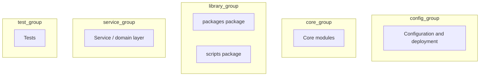

# Architecture report: Netflix/pollyjs

> Automated static analysis. **Observed** = directly seen in files/imports/AST; **Inferred** = interpretation from that evidence. Repository code was not executed.

## 1. Repository at a glance

| Item | Value |
| --- | --- |
| Repository | Netflix/pollyjs |
| Description | Record, Replay, and Stub HTTP Interactions. |
| Language | JavaScript |
| Stars | 10250 |
| Licence | Apache-2.0 |
| Analysed commit / branch | d031861625f58423169b396e5afc8a0110d1b232 / master |
| Framework(s) | Express, React |
| Files analysed | 392 |
| Components | 6 |

## 2. Architecture in one minute

Netflix/pollyjs - Record, Replay, and Stub HTTP Interactions.. This repository was analysed statically from 392 file(s) (0 Python). Detected technologies (observed from imports/manifests): Express, React, Jest, TypeScript, webpack. Files are grouped into 6 component(s): Configuration and deployment, Core modules, packages package, scripts package, Service / domain layer, Tests. Findings below distinguish observed facts from inferred interpretation.

## 3. High-level block diagram

## 4. Main components

### Configuration and deployment (`config`)

- **Kind:** config
- **Status:** Observed
- **Confidence:** 0.85
- **Responsibility:** Groups 22 file(s) under configuration and deployment (observed from repository paths and static analysis).
- **Paths:** `lerna.json`, `package.json`, `packages/@pollyjs/adapter-fetch/package.json`, `packages/@pollyjs/adapter-node-http/package.json`, `packages/@pollyjs/adapter-puppeteer/package.json`, `packages/@pollyjs/adapter-xhr/package.json`, `packages/@pollyjs/adapter/package.json`, `packages/@pollyjs/cli/package.json`, `packages/@pollyjs/core/package.json`, `packages/@pollyjs/ember/.editorconfig`, `packages/@pollyjs/ember/blueprints/@pollyjs/ember/files/config/polly.js`, `packages/@pollyjs/ember/config/ember-try.js`, `packages/@pollyjs/ember/config/environment.js`, `packages/@pollyjs/ember/config/polly.js`, `packages/@pollyjs/ember/package.json`, `packages/@pollyjs/node-server/package.json`, `packages/@pollyjs/persister-fs/package.json`, `packages/@pollyjs/persister-in-memory/package.json`, `packages/@pollyjs/persister-local-storage/package.json`, `packages/@pollyjs/persister-rest/package.json`, `packages/@pollyjs/persister/package.json`, `packages/@pollyjs/utils/package.json`
- **Evidence:** [lerna.json](https://github.com/Netflix/pollyjs/blob/d031861625f58423169b396e5afc8a0110d1b232/lerna.json); [package.json](https://github.com/Netflix/pollyjs/blob/d031861625f58423169b396e5afc8a0110d1b232/package.json); [packages/@pollyjs/adapter-fetch/package.json](https://github.com/Netflix/pollyjs/blob/d031861625f58423169b396e5afc8a0110d1b232/packages/%40pollyjs/adapter-fetch/package.json); [packages/@pollyjs/adapter-node-http/package.json](https://github.com/Netflix/pollyjs/blob/d031861625f58423169b396e5afc8a0110d1b232/packages/%40pollyjs/adapter-node-http/package.json); [packages/@pollyjs/adapter-puppeteer/package.json](https://github.com/Netflix/pollyjs/blob/d031861625f58423169b396e5afc8a0110d1b232/packages/%40pollyjs/adapter-puppeteer/package.json); [packages/@pollyjs/adapter-xhr/package.json](https://github.com/Netflix/pollyjs/blob/d031861625f58423169b396e5afc8a0110d1b232/packages/%40pollyjs/adapter-xhr/package.json); [packages/@pollyjs/adapter/package.json](https://github.com/Netflix/pollyjs/blob/d031861625f58423169b396e5afc8a0110d1b232/packages/%40pollyjs/adapter/package.json); [packages/@pollyjs/cli/package.json](https://github.com/Netflix/pollyjs/blob/d031861625f58423169b396e5afc8a0110d1b232/packages/%40pollyjs/cli/package.json)

### Core modules (`core`)

- **Kind:** core
- **Status:** Observed
- **Confidence:** 0.85
- **Responsibility:** Groups 2 file(s) under core modules (observed from repository paths and static analysis).
- **Paths:** `jest.config.js`, `testem.js`
- **Evidence:** [jest.config.js](https://github.com/Netflix/pollyjs/blob/d031861625f58423169b396e5afc8a0110d1b232/jest.config.js); [testem.js](https://github.com/Netflix/pollyjs/blob/d031861625f58423169b396e5afc8a0110d1b232/testem.js)

### packages package (`packages`)

- **Kind:** library
- **Status:** Observed
- **Confidence:** 0.85
- **Responsibility:** Groups 91 file(s) under packages package (observed from repository paths and static analysis).
- **Paths:** `packages/@pollyjs/adapter-fetch/rollup.config.test.js`, `packages/@pollyjs/adapter-fetch/src/index.js`, `packages/@pollyjs/adapter-fetch/src/utils/serializer-headers.js`, `packages/@pollyjs/adapter-fetch/types.d.ts`, `packages/@pollyjs/adapter-node-http/.eslintrc.js`, `packages/@pollyjs/adapter-node-http/rollup.config.js`, `packages/@pollyjs/adapter-node-http/rollup.config.shared.js`, `packages/@pollyjs/adapter-node-http/rollup.config.test.js`, `packages/@pollyjs/adapter-node-http/src/index.js`, `packages/@pollyjs/adapter-node-http/src/utils/get-url-from-options.js`, `packages/@pollyjs/adapter-node-http/src/utils/merge-chunks.js`, `packages/@pollyjs/adapter-node-http/src/utils/url-to-options.js`, `packages/@pollyjs/adapter-node-http/types.d.ts`, `packages/@pollyjs/adapter-puppeteer/rollup.config.js`, `packages/@pollyjs/adapter-puppeteer/rollup.config.test.js`, `packages/@pollyjs/adapter-puppeteer/src/index.js`, `packages/@pollyjs/adapter-puppeteer/types.d.ts`, `packages/@pollyjs/adapter-xhr/rollup.config.test.js`, `packages/@pollyjs/adapter-xhr/src/index.js`, `packages/@pollyjs/adapter-xhr/src/utils/resolve-xhr.js`, `packages/@pollyjs/adapter-xhr/src/utils/serialize-response-headers.js`, `packages/@pollyjs/adapter-xhr/types.d.ts`, `packages/@pollyjs/adapter/rollup.config.test.js`, `packages/@pollyjs/adapter/src/index.js`, `packages/@pollyjs/adapter/src/utils/dehumanize-time.js`, `packages/@pollyjs/adapter/src/utils/is-expired.js`, `packages/@pollyjs/adapter/src/utils/normalize-recorded-response.js`, `packages/@pollyjs/adapter/src/utils/stringify-request.js`, `packages/@pollyjs/adapter/types.d.ts`, `packages/@pollyjs/cli/.eslintrc.js`, `packages/@pollyjs/cli/bin/cli.js`, `packages/@pollyjs/ember/.eslintrc.js`, `packages/@pollyjs/ember/.prettierrc.js`, `packages/@pollyjs/ember/.template-lintrc.js`, `packages/@pollyjs/ember/addon/-private/preconfigure.js`, `packages/@pollyjs/ember/blueprints/@pollyjs/ember/index.js`, `packages/@pollyjs/ember/ember-cli-build.js`, `packages/@pollyjs/ember/index.js`, `packages/@pollyjs/ember/testem.js`, `packages/@pollyjs/node-server/rollup.config.js`, `packages/@pollyjs/node-server/src/api.js`, `packages/@pollyjs/node-server/src/config.js`, `packages/@pollyjs/node-server/src/express/register-api.js`, `packages/@pollyjs/node-server/src/index.js`, `packages/@pollyjs/node-server/src/server.js`, `packages/@pollyjs/node-server/types.d.ts`, `packages/@pollyjs/persister-fs/.eslintrc.js`, `packages/@pollyjs/persister-fs/rollup.config.js`, `packages/@pollyjs/persister-fs/rollup.config.test.js`, `packages/@pollyjs/persister-fs/src/index.js`, `packages/@pollyjs/persister-fs/types.d.ts`, `packages/@pollyjs/persister-in-memory/rollup.config.test.js`, `packages/@pollyjs/persister-in-memory/src/index.js`, `packages/@pollyjs/persister-in-memory/types.d.ts`, `packages/@pollyjs/persister-local-storage/rollup.config.test.js`, `packages/@pollyjs/persister-local-storage/src/index.js`, `packages/@pollyjs/persister-local-storage/types.d.ts`, `packages/@pollyjs/persister-rest/rollup.config.test.js`, `packages/@pollyjs/persister-rest/src/ajax.js`, `packages/@pollyjs/persister-rest/src/index.js`, `packages/@pollyjs/persister-rest/types.d.ts`, `packages/@pollyjs/persister/rollup.config.test.js`, `packages/@pollyjs/persister/src/har/entry.js`, `packages/@pollyjs/persister/src/har/index.js`, `packages/@pollyjs/persister/src/har/log.js`, `packages/@pollyjs/persister/src/har/request.js`, `packages/@pollyjs/persister/src/har/response.js`, `packages/@pollyjs/persister/src/har/utils/get-first-header.js`, `packages/@pollyjs/persister/src/har/utils/to-nv-pairs.js`, `packages/@pollyjs/persister/src/index.js`, `packages/@pollyjs/persister/types.d.ts`, `packages/@pollyjs/utils/rollup.config.test.js`, `packages/@pollyjs/utils/src/constants/actions.js`, `packages/@pollyjs/utils/src/constants/expiry-strategies.js`, `packages/@pollyjs/utils/src/constants/http-methods.js`, `packages/@pollyjs/utils/src/constants/http-status-codes.js`, `packages/@pollyjs/utils/src/constants/modes.js`, `packages/@pollyjs/utils/src/index.js`, `packages/@pollyjs/utils/src/utils/assert.js`, `packages/@pollyjs/utils/src/utils/build-url.js`, `packages/@pollyjs/utils/src/utils/clone-arraybuffer.js`, `packages/@pollyjs/utils/src/utils/is-buffer-utf8-representable.js`, `packages/@pollyjs/utils/src/utils/polly-error.js`, `packages/@pollyjs/utils/src/utils/serializers/blob.js`, `packages/@pollyjs/utils/src/utils/serializers/buffer.js`, `packages/@pollyjs/utils/src/utils/serializers/form-data.js`, `packages/@pollyjs/utils/src/utils/serializers/index.js`, `packages/@pollyjs/utils/src/utils/timeout.js`, `packages/@pollyjs/utils/src/utils/timestamp.js`, `packages/@pollyjs/utils/src/utils/url.js`, `packages/@pollyjs/utils/types.d.ts`
- **Evidence:** [packages/@pollyjs/adapter-fetch/rollup.config.test.js](https://github.com/Netflix/pollyjs/blob/d031861625f58423169b396e5afc8a0110d1b232/packages/%40pollyjs/adapter-fetch/rollup.config.test.js); [packages/@pollyjs/adapter-fetch/src/index.js](https://github.com/Netflix/pollyjs/blob/d031861625f58423169b396e5afc8a0110d1b232/packages/%40pollyjs/adapter-fetch/src/index.js); [packages/@pollyjs/adapter-fetch/src/utils/serializer-headers.js](https://github.com/Netflix/pollyjs/blob/d031861625f58423169b396e5afc8a0110d1b232/packages/%40pollyjs/adapter-fetch/src/utils/serializer-headers.js); [packages/@pollyjs/adapter-fetch/types.d.ts](https://github.com/Netflix/pollyjs/blob/d031861625f58423169b396e5afc8a0110d1b232/packages/%40pollyjs/adapter-fetch/types.d.ts); [packages/@pollyjs/adapter-node-http/.eslintrc.js](https://github.com/Netflix/pollyjs/blob/d031861625f58423169b396e5afc8a0110d1b232/packages/%40pollyjs/adapter-node-http/.eslintrc.js); [packages/@pollyjs/adapter-node-http/rollup.config.js](https://github.com/Netflix/pollyjs/blob/d031861625f58423169b396e5afc8a0110d1b232/packages/%40pollyjs/adapter-node-http/rollup.config.js); [packages/@pollyjs/adapter-node-http/rollup.config.shared.js](https://github.com/Netflix/pollyjs/blob/d031861625f58423169b396e5afc8a0110d1b232/packages/%40pollyjs/adapter-node-http/rollup.config.shared.js); [packages/@pollyjs/adapter-node-http/rollup.config.test.js](https://github.com/Netflix/pollyjs/blob/d031861625f58423169b396e5afc8a0110d1b232/packages/%40pollyjs/adapter-node-http/rollup.config.test.js)

### scripts package (`scripts`)

- **Kind:** library
- **Status:** Observed
- **Confidence:** 0.85
- **Responsibility:** Groups 9 file(s) under scripts package (observed from repository paths and static analysis).
- **Paths:** `scripts/require-clean-work-tree.sh`, `scripts/require-test-build.sh`, `scripts/rollup/browser.config.js`, `scripts/rollup/browser.test.config.js`, `scripts/rollup/default.config.js`, `scripts/rollup/jest.test.config.js`, `scripts/rollup/node.config.js`, `scripts/rollup/node.test.config.js`, `scripts/rollup/utils.js`
- **Evidence:** [scripts/require-clean-work-tree.sh](https://github.com/Netflix/pollyjs/blob/d031861625f58423169b396e5afc8a0110d1b232/scripts/require-clean-work-tree.sh); [scripts/require-test-build.sh](https://github.com/Netflix/pollyjs/blob/d031861625f58423169b396e5afc8a0110d1b232/scripts/require-test-build.sh); [scripts/rollup/browser.config.js](https://github.com/Netflix/pollyjs/blob/d031861625f58423169b396e5afc8a0110d1b232/scripts/rollup/browser.config.js); [scripts/rollup/browser.test.config.js](https://github.com/Netflix/pollyjs/blob/d031861625f58423169b396e5afc8a0110d1b232/scripts/rollup/browser.test.config.js); [scripts/rollup/default.config.js](https://github.com/Netflix/pollyjs/blob/d031861625f58423169b396e5afc8a0110d1b232/scripts/rollup/default.config.js); [scripts/rollup/jest.test.config.js](https://github.com/Netflix/pollyjs/blob/d031861625f58423169b396e5afc8a0110d1b232/scripts/rollup/jest.test.config.js); [scripts/rollup/node.config.js](https://github.com/Netflix/pollyjs/blob/d031861625f58423169b396e5afc8a0110d1b232/scripts/rollup/node.config.js); [scripts/rollup/node.test.config.js](https://github.com/Netflix/pollyjs/blob/d031861625f58423169b396e5afc8a0110d1b232/scripts/rollup/node.test.config.js)

### Service / domain layer (`service_layer`)

- **Kind:** service
- **Status:** Observed
- **Confidence:** 0.85
- **Responsibility:** Groups 30 file(s) under service / domain layer (observed from repository paths and static analysis).
- **Paths:** `packages/@pollyjs/core/rollup.config.test.js`, `packages/@pollyjs/core/src/-private/container.js`, `packages/@pollyjs/core/src/-private/event-emitter.js`, `packages/@pollyjs/core/src/-private/event.js`, `packages/@pollyjs/core/src/-private/http-base.js`, `packages/@pollyjs/core/src/-private/interceptor.js`, `packages/@pollyjs/core/src/-private/logger.js`, `packages/@pollyjs/core/src/-private/request.js`, `packages/@pollyjs/core/src/-private/response.js`, `packages/@pollyjs/core/src/defaults/config.js`, `packages/@pollyjs/core/src/index.js`, `packages/@pollyjs/core/src/polly.js`, `packages/@pollyjs/core/src/server/handler.js`, `packages/@pollyjs/core/src/server/index.js`, `packages/@pollyjs/core/src/server/middleware.js`, `packages/@pollyjs/core/src/server/route.js`, `packages/@pollyjs/core/src/test-helpers/lib.js`, `packages/@pollyjs/core/src/test-helpers/mocha.js`, `packages/@pollyjs/core/src/test-helpers/qunit.js`, `packages/@pollyjs/core/src/utils/cancel-fn-after-n-times.js`, `packages/@pollyjs/core/src/utils/deferred-promise.js`, `packages/@pollyjs/core/src/utils/guid-for-recording.js`, `packages/@pollyjs/core/src/utils/http-headers.js`, `packages/@pollyjs/core/src/utils/merge-configs.js`, `packages/@pollyjs/core/src/utils/normalize-request.js`, `packages/@pollyjs/core/src/utils/parse-url.js`, `packages/@pollyjs/core/src/utils/remove-host-from-url.js`, `packages/@pollyjs/core/src/utils/timing.js`, `packages/@pollyjs/core/src/utils/validators.js`, `packages/@pollyjs/core/types.d.ts`
- **Evidence:** [packages/@pollyjs/core/rollup.config.test.js](https://github.com/Netflix/pollyjs/blob/d031861625f58423169b396e5afc8a0110d1b232/packages/%40pollyjs/core/rollup.config.test.js); [packages/@pollyjs/core/src/-private/container.js](https://github.com/Netflix/pollyjs/blob/d031861625f58423169b396e5afc8a0110d1b232/packages/%40pollyjs/core/src/-private/container.js); [packages/@pollyjs/core/src/-private/event-emitter.js](https://github.com/Netflix/pollyjs/blob/d031861625f58423169b396e5afc8a0110d1b232/packages/%40pollyjs/core/src/-private/event-emitter.js); [packages/@pollyjs/core/src/-private/event.js](https://github.com/Netflix/pollyjs/blob/d031861625f58423169b396e5afc8a0110d1b232/packages/%40pollyjs/core/src/-private/event.js); [packages/@pollyjs/core/src/-private/http-base.js](https://github.com/Netflix/pollyjs/blob/d031861625f58423169b396e5afc8a0110d1b232/packages/%40pollyjs/core/src/-private/http-base.js); [packages/@pollyjs/core/src/-private/interceptor.js](https://github.com/Netflix/pollyjs/blob/d031861625f58423169b396e5afc8a0110d1b232/packages/%40pollyjs/core/src/-private/interceptor.js); [packages/@pollyjs/core/src/-private/logger.js](https://github.com/Netflix/pollyjs/blob/d031861625f58423169b396e5afc8a0110d1b232/packages/%40pollyjs/core/src/-private/logger.js); [packages/@pollyjs/core/src/-private/request.js](https://github.com/Netflix/pollyjs/blob/d031861625f58423169b396e5afc8a0110d1b232/packages/%40pollyjs/core/src/-private/request.js)

### Tests (`tests`)

- **Kind:** test
- **Status:** Observed
- **Confidence:** 0.85
- **Responsibility:** Groups 94 file(s) under tests (observed from repository paths and static analysis).
- **Paths:** `examples/client-server/tests/events.test.js`, `examples/client-server/tests/intercept.test.js`, `examples/client-server/tests/setup.js`, `examples/node-fetch/tests/node-fetch.test.js`, `examples/rest-persister/tests/rest-persister.test.js`, `examples/rest-persister/tests/setup.js`, `packages/@pollyjs/adapter-fetch/tests/integration/adapter-test.js`, `packages/@pollyjs/adapter-fetch/tests/integration/persister-local-storage-test.js`, `packages/@pollyjs/adapter-fetch/tests/integration/persister-rest-test.js`, `packages/@pollyjs/adapter-fetch/tests/integration/server-test.js`, `packages/@pollyjs/adapter-fetch/tests/utils/polly-config.js`, `packages/@pollyjs/adapter-node-http/tests/integration/adapter-node-fetch-test.js`, `packages/@pollyjs/adapter-node-http/tests/integration/adapter-test.js`, `packages/@pollyjs/adapter-node-http/tests/integration/persister-fs-test.js`, `packages/@pollyjs/adapter-node-http/tests/jest/integration/fetch-test.js`, `packages/@pollyjs/adapter-node-http/tests/jest/integration/xhr-test.js`, `packages/@pollyjs/adapter-node-http/tests/unit/utils/merge-chunks-test.js`, `packages/@pollyjs/adapter-node-http/tests/utils/get-buffer-from-stream.js`, `packages/@pollyjs/adapter-node-http/tests/utils/get-response-from-request.js`, `packages/@pollyjs/adapter-node-http/tests/utils/native-request.js`, `packages/@pollyjs/adapter-node-http/tests/utils/polly-config.js`, `packages/@pollyjs/adapter-puppeteer/tests/helpers/fetch.js`, `packages/@pollyjs/adapter-puppeteer/tests/integration/adapter-test.js`, `packages/@pollyjs/adapter-puppeteer/tests/unit/adapter-test.js`, `packages/@pollyjs/adapter-xhr/tests/integration/adapter-test.js`, `packages/@pollyjs/adapter-xhr/tests/utils/xhr-request.js`, `packages/@pollyjs/adapter/tests/unit/adapter-test.js`, `packages/@pollyjs/adapter/tests/unit/utils/dehumanize-time-test.js`, `packages/@pollyjs/adapter/tests/unit/utils/is-expired-test.js`, `packages/@pollyjs/core/tests/unit/-private/container-test.js`, `packages/@pollyjs/core/tests/unit/-private/event-emitter-test.js`, `packages/@pollyjs/core/tests/unit/-private/event-test.js`, `packages/@pollyjs/core/tests/unit/-private/http-base-test.js`, `packages/@pollyjs/core/tests/unit/-private/interceptor-test.js`, `packages/@pollyjs/core/tests/unit/-private/response-test.js`, `packages/@pollyjs/core/tests/unit/index-test.js`, `packages/@pollyjs/core/tests/unit/polly-test.js`, `packages/@pollyjs/core/tests/unit/server/handler-test.js`, `packages/@pollyjs/core/tests/unit/server/server-test.js`, `packages/@pollyjs/core/tests/unit/test-helpers/mocha-test.js`, `packages/@pollyjs/core/tests/unit/utils/deferred-promise-test.js`, `packages/@pollyjs/core/tests/unit/utils/guid-for-recording-test.js`, `packages/@pollyjs/core/tests/unit/utils/http-headers-test.js`, `packages/@pollyjs/core/tests/unit/utils/merge-configs-test.js`, `packages/@pollyjs/core/tests/unit/utils/normalize-request-test.js`, `packages/@pollyjs/core/tests/unit/utils/parse-url-test.js`, `packages/@pollyjs/core/tests/unit/utils/remove-host-from-url-test.js`, `packages/@pollyjs/core/tests/unit/utils/timing-test.js`, `packages/@pollyjs/ember/tests/dummy/app/app.js`, `packages/@pollyjs/ember/tests/dummy/app/components/.gitkeep`, `packages/@pollyjs/ember/tests/dummy/app/controllers/.gitkeep`, `packages/@pollyjs/ember/tests/dummy/app/helpers/.gitkeep`, `packages/@pollyjs/ember/tests/dummy/app/index.html`, `packages/@pollyjs/ember/tests/dummy/app/models/.gitkeep`, `packages/@pollyjs/ember/tests/dummy/app/router.js`, `packages/@pollyjs/ember/tests/dummy/app/routes/.gitkeep`, `packages/@pollyjs/ember/tests/dummy/app/styles/app.css`, `packages/@pollyjs/ember/tests/dummy/app/templates/application.hbs`, `packages/@pollyjs/ember/tests/dummy/config/ember-cli-update.json`, `packages/@pollyjs/ember/tests/dummy/config/environment.js`, `packages/@pollyjs/ember/tests/dummy/config/optional-features.json`, `packages/@pollyjs/ember/tests/dummy/config/targets.js`, `packages/@pollyjs/ember/tests/dummy/public/robots.txt`, `packages/@pollyjs/ember/tests/helpers/.gitkeep`, `packages/@pollyjs/ember/tests/index.html`, `packages/@pollyjs/ember/tests/integration/.gitkeep`, `packages/@pollyjs/ember/tests/test-helper.js`, `packages/@pollyjs/ember/tests/unit/polly-test.js`, `packages/@pollyjs/persister-fs/tests/unit/persister-test.js`, `packages/@pollyjs/persister/tests/unit/har-test.js`, `packages/@pollyjs/persister/tests/unit/persister-test.js`, `packages/@pollyjs/utils/tests/browser/unit/utils/serializers/blob.js`, `packages/@pollyjs/utils/tests/browser/unit/utils/serializers/form-data.js`, `packages/@pollyjs/utils/tests/node/unit/utils/serializers/buffer.js`, `packages/@pollyjs/utils/tests/serializer-tests.js`, `packages/@pollyjs/utils/tests/unit/utils/assert-test.js`, `packages/@pollyjs/utils/tests/unit/utils/build-url-test.js`, `packages/@pollyjs/utils/tests/unit/utils/polly-error-test.js`, `packages/@pollyjs/utils/tests/unit/utils/timeout-test.js`, `packages/@pollyjs/utils/tests/unit/utils/timestamp-test.js`, `packages/@pollyjs/utils/tests/unit/utils/url-test.js`, `tests/helpers/file.js`, `tests/helpers/global-node-fetch.js`, `tests/helpers/setup-fetch-record.js`, `tests/helpers/setup-persister.js`, `tests/index.mustache`, `tests/integration/adapter-browser-tests.js`, `tests/integration/adapter-identifier-tests.js`, `tests/integration/adapter-node-tests.js`, `tests/integration/adapter-polly-tests.js`, `tests/integration/adapter-tests.js`, `tests/integration/persister-tests.js`, `tests/middleware.js`, `tests/node-setup.js`
- **Evidence:** [examples/client-server/tests/events.test.js](https://github.com/Netflix/pollyjs/blob/d031861625f58423169b396e5afc8a0110d1b232/examples/client-server/tests/events.test.js); [examples/client-server/tests/intercept.test.js](https://github.com/Netflix/pollyjs/blob/d031861625f58423169b396e5afc8a0110d1b232/examples/client-server/tests/intercept.test.js); [examples/client-server/tests/setup.js](https://github.com/Netflix/pollyjs/blob/d031861625f58423169b396e5afc8a0110d1b232/examples/client-server/tests/setup.js); [examples/node-fetch/tests/node-fetch.test.js](https://github.com/Netflix/pollyjs/blob/d031861625f58423169b396e5afc8a0110d1b232/examples/node-fetch/tests/node-fetch.test.js); [examples/rest-persister/tests/rest-persister.test.js](https://github.com/Netflix/pollyjs/blob/d031861625f58423169b396e5afc8a0110d1b232/examples/rest-persister/tests/rest-persister.test.js); [examples/rest-persister/tests/setup.js](https://github.com/Netflix/pollyjs/blob/d031861625f58423169b396e5afc8a0110d1b232/examples/rest-persister/tests/setup.js); [packages/@pollyjs/adapter-fetch/tests/integration/adapter-test.js](https://github.com/Netflix/pollyjs/blob/d031861625f58423169b396e5afc8a0110d1b232/packages/%40pollyjs/adapter-fetch/tests/integration/adapter-test.js); [packages/@pollyjs/adapter-fetch/tests/integration/persister-local-storage-test.js](https://github.com/Netflix/pollyjs/blob/d031861625f58423169b396e5afc8a0110d1b232/packages/%40pollyjs/adapter-fetch/tests/integration/persister-local-storage-test.js)

## 5. Execution flow

**Observed** entry point(s):

- [packages/@pollyjs/cli/bin/cli.js](https://github.com/Netflix/pollyjs/blob/d031861625f58423169b396e5afc8a0110d1b232/packages/%40pollyjs/cli/bin/cli.js)
- [packages/@pollyjs/ember/index.js](https://github.com/Netflix/pollyjs/blob/d031861625f58423169b396e5afc8a0110d1b232/packages/%40pollyjs/ember/index.js)

Representative flow (derived from observed entry points and the import graph; steps beyond the entry point are **Inferred**):

1. Execution starts at an observed entry point listed above, if present.
2. No internal import relationships between components were observed.

## 6. Project structure

### `(root)`

- `.commitlintrc.js` - source, JavaScript (208 bytes)
- `.eslintignore` - other (99 bytes)
- `.eslintrc.js` - source, JavaScript (1701 bytes)
- `.gitignore` - other (361 bytes)
- `.mocharc.js` - source, JavaScript (117 bytes)
- `.prettierrc.js` - source, JavaScript (82 bytes)
- `.travis.yml` - ci, YAML (366 bytes)
- `CHANGELOG.md` - docs (30111 bytes)
- `CONTRIBUTING.md` - docs (2929 bytes)
- `LICENSE` - docs (11367 bytes)
- `OSSMETADATA` - other (20 bytes)
- `README.md` - docs (10841 bytes)
- `jest.config.js` - source, JavaScript (238 bytes)
- `lerna.json` - config (606 bytes)
- `package.json` - manifest (3447 bytes)
- `testem.js` - source, JavaScript (1354 bytes)

### `.github`

- `.github/issue_template.md` - docs (1804 bytes)
- `.github/pull_request_template.md` - docs (1260 bytes)

### `.husky`

- `.husky/commit-msg` - other (70 bytes)
- `.husky/pre-commit` - other (59 bytes)

### `docs`

- `docs/.nojekyll` - docs (0 bytes)
- `docs/_coverpage.md` - docs (586 bytes)
- `docs/_sidebar.md` - docs (1278 bytes)
- `docs/adapters/custom.md` - docs (3994 bytes)
- `docs/adapters/fetch.md` - docs (1344 bytes)
- `docs/adapters/node-http.md` - docs (1238 bytes)
- `docs/adapters/playwright.md` - docs (340 bytes)
- `docs/adapters/puppeteer.md` - docs (2367 bytes)
- `docs/adapters/xhr.md` - docs (1443 bytes)
- `docs/api.md` - docs (6114 bytes)
- `docs/assets/styles.css` - docs (6221 bytes)
- `docs/cli/commands.md` - docs (766 bytes)
- `docs/cli/overview.md` - docs (570 bytes)
- `docs/configuration.md` - docs (11890 bytes)
- `docs/examples.md` - docs (2273 bytes)
- `docs/frameworks/ember-cli.md` - docs (1235 bytes)
- `docs/index.html` - docs (2802 bytes)
- `docs/node-server/express-integrations.md` - docs (694 bytes)
- `docs/node-server/overview.md` - docs (2920 bytes)
- `docs/persisters/custom.md` - docs (2097 bytes)
- `docs/persisters/fs.md` - docs (868 bytes)
- `docs/persisters/local-storage.md` - docs (1231 bytes)
- `docs/persisters/rest.md` - docs (1507 bytes)
- `docs/quick-start.md` - docs (10482 bytes)
- `docs/server/api.md` - docs (1906 bytes)
- `docs/server/event.md` - docs (680 bytes)
- `docs/server/events-and-middleware.md` - docs (5382 bytes)
- `docs/server/overview.md` - docs (1714 bytes)
- `docs/server/request.md` - docs (6257 bytes)
- `docs/server/response.md` - docs (6072 bytes)
- `docs/server/route-handler.md` - docs (10058 bytes)
- `docs/test-frameworks/jest-jasmine.md` - docs (702 bytes)
- `docs/test-frameworks/mocha.md` - docs (3607 bytes)
- `docs/test-frameworks/qunit.md` - docs (2861 bytes)

### `examples`

- `examples/.eslintrc.js` - source, JavaScript (69 bytes)
- `examples/client-server/index.html` - other (1046 bytes)
- `examples/client-server/package.json` - manifest (372 bytes)
- `examples/client-server/tests/events.test.js` - test, JavaScript (611 bytes)
- `examples/client-server/tests/intercept.test.js` - test, JavaScript (1936 bytes)
- `examples/client-server/tests/setup.js` - test, JavaScript (415 bytes)
- `examples/dummy-app/.eslintrc.js` - source, JavaScript (124 bytes)
- `examples/dummy-app/.gitignore` - other (285 bytes)
- `examples/dummy-app/README.md` - docs (127136 bytes)
- `examples/dummy-app/package.json` - manifest (529 bytes)
- `examples/dummy-app/public/index.html` - other (1606 bytes)
- `examples/dummy-app/public/manifest.json` - config (321 bytes)
- `examples/dummy-app/src/App.js` - source, JavaScript (1386 bytes)
- `examples/dummy-app/src/index.css` - other (36 bytes)
- `examples/dummy-app/src/index.js` - source, JavaScript (169 bytes)
- `examples/dummy-app/src/posts.js` - source, JavaScript (2516 bytes)
- `examples/dummy-app/src/todos.js` - source, JavaScript (2555 bytes)
- `examples/dummy-app/src/users.js` - source, JavaScript (948 bytes)
- `examples/jest-node-fetch/.eslintrc.js` - source, JavaScript (50 bytes)
- `examples/jest-node-fetch/__recordings__/jest-node-fetch_1142061259/posts_1278140380/should-return-post_148615714/recording.har` - other (5065 bytes)
- `examples/jest-node-fetch/__recordings__/jest-node-fetch_1142061259/users_1585235219/should-return-user_4259424139/recording.har` - other (5319 bytes)
- `examples/jest-node-fetch/__tests__/index.test.js` - source, JavaScript (1116 bytes)
- `examples/jest-node-fetch/package.json` - manifest (351 bytes)
- `examples/jest-node-fetch/src/index.js` - source, JavaScript (79 bytes)
- `examples/jest-node-fetch/src/posts.js` - source, JavaScript (199 bytes)
- `examples/jest-node-fetch/src/users.js` - source, JavaScript (199 bytes)
- `examples/jest-puppeteer/.eslintrc.js` - source, JavaScript (127 bytes)
- `examples/jest-puppeteer/__recordings__/jest-puppeteer_2726822272/should-be-able-to-navigate-to-all-routes_1130491217/recording.har` - other (43468 bytes)
- `examples/jest-puppeteer/__tests__/dummy-app.test.js` - source, JavaScript (2007 bytes)
- `examples/jest-puppeteer/jest-puppeteer.config.js` - source, JavaScript (166 bytes)
- `examples/jest-puppeteer/jest.config.js` - source, JavaScript (49 bytes)
- `examples/jest-puppeteer/package.json` - manifest (468 bytes)
- `examples/node-fetch/package.json` - manifest (356 bytes)
- `examples/node-fetch/recordings/node-fetch_2851505768/should-work_3457346403/recording.har` - other (5049 bytes)
- `examples/node-fetch/tests/node-fetch.test.js` - test, JavaScript (810 bytes)
- `examples/puppeteer/index.js` - source, JavaScript (1070 bytes)
- `examples/puppeteer/package.json` - manifest (555 bytes)
- `examples/puppeteer/recordings/puppeteer_2155046665/recording.har` - other (15334 bytes)
- `examples/rest-persister/index.html` - other (983 bytes)
- `examples/rest-persister/package.json` - manifest (560 bytes)
- `examples/rest-persister/recordings/REST-Persister_2289553200/should-work_3457346403/recording.har` - other (2157 bytes)
- `examples/rest-persister/tests/rest-persister.test.js` - test, JavaScript (369 bytes)
- `examples/rest-persister/tests/setup.js` - test, JavaScript (397 bytes)
- `examples/typescript-jest-node-fetch/__recordings__/github-api-client_2139812550/getUser_1648904580/recording.har` - other (6560 bytes)
- `examples/typescript-jest-node-fetch/jest.config.ts` - source, TypeScript (381 bytes)
- `examples/typescript-jest-node-fetch/package.json` - manifest (1334 bytes)
- `examples/typescript-jest-node-fetch/src/github-api.test.ts` - source, TypeScript (937 bytes)
- `examples/typescript-jest-node-fetch/src/github-api.ts` - source, TypeScript (539 bytes)
- `examples/typescript-jest-node-fetch/src/utils/auto-setup-polly.ts` - source, TypeScript (1231 bytes)
- `examples/typescript-jest-node-fetch/tsconfig.json` - config (588 bytes)

### `packages`

- `packages/@pollyjs/adapter-fetch/CHANGELOG.md` - docs (17140 bytes)
- `packages/@pollyjs/adapter-fetch/LICENSE` - docs (11367 bytes)
- `packages/@pollyjs/adapter-fetch/README.md` - docs (1889 bytes)
- `packages/@pollyjs/adapter-fetch/package.json` - manifest (1413 bytes)
- `packages/@pollyjs/adapter-fetch/rollup.config.test.js` - source, JavaScript (128 bytes)
- `packages/@pollyjs/adapter-fetch/src/index.js` - source, JavaScript (6462 bytes)
- `packages/@pollyjs/adapter-fetch/src/utils/serializer-headers.js` - source, JavaScript (384 bytes)
- `packages/@pollyjs/adapter-fetch/tests/integration/adapter-test.js` - test, JavaScript (10752 bytes)
- `packages/@pollyjs/adapter-fetch/tests/integration/persister-local-storage-test.js` - test, JavaScript (642 bytes)
- `packages/@pollyjs/adapter-fetch/tests/integration/persister-rest-test.js` - test, JavaScript (664 bytes)
- `packages/@pollyjs/adapter-fetch/tests/integration/server-test.js` - test, JavaScript (14327 bytes)
- `packages/@pollyjs/adapter-fetch/tests/utils/polly-config.js` - test, JavaScript (211 bytes)
- `packages/@pollyjs/adapter-fetch/types.d.ts` - source, TypeScript (116 bytes)
- `packages/@pollyjs/adapter-node-http/.eslintrc.js` - source, JavaScript (182 bytes)
- `packages/@pollyjs/adapter-node-http/CHANGELOG.md` - docs (13448 bytes)
- `packages/@pollyjs/adapter-node-http/LICENSE` - docs (11367 bytes)
- `packages/@pollyjs/adapter-node-http/README.md` - docs (2086 bytes)
- `packages/@pollyjs/adapter-node-http/package.json` - manifest (1472 bytes)
- `packages/@pollyjs/adapter-node-http/rollup.config.js` - source, JavaScript (168 bytes)
- `packages/@pollyjs/adapter-node-http/rollup.config.shared.js` - source, JavaScript (109 bytes)
- `packages/@pollyjs/adapter-node-http/rollup.config.test.js` - source, JavaScript (381 bytes)
- `packages/@pollyjs/adapter-node-http/src/index.js` - source, JavaScript (9868 bytes)
- `packages/@pollyjs/adapter-node-http/src/utils/get-url-from-options.js` - source, JavaScript (777 bytes)
- `packages/@pollyjs/adapter-node-http/src/utils/merge-chunks.js` - source, JavaScript (630 bytes)
- `packages/@pollyjs/adapter-node-http/src/utils/url-to-options.js` - source, JavaScript (859 bytes)
- `packages/@pollyjs/adapter-node-http/tests/integration/adapter-node-fetch-test.js` - test, JavaScript (618 bytes)
- `packages/@pollyjs/adapter-node-http/tests/integration/adapter-test.js` - test, JavaScript (6042 bytes)
- `packages/@pollyjs/adapter-node-http/tests/integration/persister-fs-test.js` - test, JavaScript (846 bytes)
- `packages/@pollyjs/adapter-node-http/tests/jest/integration/fetch-test.js` - test, JavaScript (989 bytes)
- `packages/@pollyjs/adapter-node-http/tests/jest/integration/xhr-test.js` - test, JavaScript (1197 bytes)
- `packages/@pollyjs/adapter-node-http/tests/unit/utils/merge-chunks-test.js` - test, JavaScript (747 bytes)
- `packages/@pollyjs/adapter-node-http/tests/utils/get-buffer-from-stream.js` - test, JavaScript (267 bytes)
- `packages/@pollyjs/adapter-node-http/tests/utils/get-response-from-request.js` - test, JavaScript (229 bytes)
- `packages/@pollyjs/adapter-node-http/tests/utils/native-request.js` - test, JavaScript (558 bytes)
- `packages/@pollyjs/adapter-node-http/tests/utils/polly-config.js` - test, JavaScript (241 bytes)
- `packages/@pollyjs/adapter-node-http/types.d.ts` - source, TypeScript (97 bytes)
- `packages/@pollyjs/adapter-puppeteer/CHANGELOG.md` - docs (13982 bytes)
- `packages/@pollyjs/adapter-puppeteer/LICENSE` - docs (11367 bytes)
- `packages/@pollyjs/adapter-puppeteer/README.md` - docs (2321 bytes)
- `packages/@pollyjs/adapter-puppeteer/package.json` - manifest (1352 bytes)
- `packages/@pollyjs/adapter-puppeteer/rollup.config.js` - source, JavaScript (104 bytes)
- `packages/@pollyjs/adapter-puppeteer/rollup.config.test.js` - source, JavaScript (146 bytes)
- `packages/@pollyjs/adapter-puppeteer/src/index.js` - source, JavaScript (7343 bytes)
- `packages/@pollyjs/adapter-puppeteer/tests/helpers/fetch.js` - test, JavaScript (504 bytes)
- `packages/@pollyjs/adapter-puppeteer/tests/integration/adapter-test.js` - test, JavaScript (2980 bytes)
- `packages/@pollyjs/adapter-puppeteer/tests/unit/adapter-test.js` - test, JavaScript (445 bytes)
- `packages/@pollyjs/adapter-puppeteer/types.d.ts` - source, TypeScript (151 bytes)
- `packages/@pollyjs/adapter-xhr/CHANGELOG.md` - docs (11783 bytes)
- `packages/@pollyjs/adapter-xhr/LICENSE` - docs (11367 bytes)
- `packages/@pollyjs/adapter-xhr/README.md` - docs (1979 bytes)
- `packages/@pollyjs/adapter-xhr/package.json` - manifest (1383 bytes)
- `packages/@pollyjs/adapter-xhr/rollup.config.test.js` - source, JavaScript (128 bytes)
- `packages/@pollyjs/adapter-xhr/src/index.js` - source, JavaScript (4796 bytes)
- `packages/@pollyjs/adapter-xhr/src/utils/resolve-xhr.js` - source, JavaScript (399 bytes)
- `packages/@pollyjs/adapter-xhr/src/utils/serialize-response-headers.js` - source, JavaScript (488 bytes)
- `packages/@pollyjs/adapter-xhr/tests/integration/adapter-test.js` - test, JavaScript (4910 bytes)
- `packages/@pollyjs/adapter-xhr/tests/utils/xhr-request.js` - test, JavaScript (932 bytes)
- `packages/@pollyjs/adapter-xhr/types.d.ts` - source, TypeScript (114 bytes)
- `packages/@pollyjs/adapter/CHANGELOG.md` - docs (17595 bytes)
- `packages/@pollyjs/adapter/LICENSE` - docs (11367 bytes)
- `packages/@pollyjs/adapter/README.md` - docs (2366 bytes)
- `packages/@pollyjs/adapter/package.json` - manifest (1174 bytes)
- `packages/@pollyjs/adapter/rollup.config.test.js` - source, JavaScript (229 bytes)
- `packages/@pollyjs/adapter/src/index.js` - source, JavaScript (8792 bytes)
- `packages/@pollyjs/adapter/src/utils/dehumanize-time.js` - source, JavaScript (959 bytes)
- `packages/@pollyjs/adapter/src/utils/is-expired.js` - source, JavaScript (278 bytes)
- `packages/@pollyjs/adapter/src/utils/normalize-recorded-response.js` - source, JavaScript (730 bytes)
- `packages/@pollyjs/adapter/src/utils/stringify-request.js` - source, JavaScript (599 bytes)
- `packages/@pollyjs/adapter/tests/unit/adapter-test.js` - test, JavaScript (161 bytes)
- `packages/@pollyjs/adapter/tests/unit/utils/dehumanize-time-test.js` - test, JavaScript (1383 bytes)
- `packages/@pollyjs/adapter/tests/unit/utils/is-expired-test.js` - test, JavaScript (677 bytes)
- `packages/@pollyjs/adapter/types.d.ts` - source, TypeScript (1627 bytes)
- `packages/@pollyjs/cli/.eslintrc.js` - source, JavaScript (203 bytes)
- `packages/@pollyjs/cli/CHANGELOG.md` - docs (5998 bytes)
- `packages/@pollyjs/cli/LICENSE` - docs (11367 bytes)
- `packages/@pollyjs/cli/README.md` - docs (1837 bytes)
- `packages/@pollyjs/cli/bin/cli.js` - source, JavaScript (1095 bytes)
- `packages/@pollyjs/cli/package.json` - manifest (794 bytes)
- `packages/@pollyjs/core/CHANGELOG.md` - docs (30996 bytes)
- `packages/@pollyjs/core/LICENSE` - docs (11367 bytes)
- `packages/@pollyjs/core/README.md` - docs (6292 bytes)
- `packages/@pollyjs/core/package.json` - manifest (1547 bytes)
- `packages/@pollyjs/core/rollup.config.test.js` - source, JavaScript (229 bytes)
- `packages/@pollyjs/core/src/-private/container.js` - source, JavaScript (1813 bytes)
- `packages/@pollyjs/core/src/-private/event-emitter.js` - source, JavaScript (7902 bytes)
- `packages/@pollyjs/core/src/-private/event.js` - source, JavaScript (614 bytes)
- `packages/@pollyjs/core/src/-private/http-base.js` - source, JavaScript (1852 bytes)
- `packages/@pollyjs/core/src/-private/interceptor.js` - source, JavaScript (652 bytes)
- `packages/@pollyjs/core/src/-private/logger.js` - source, JavaScript (1657 bytes)
- `packages/@pollyjs/core/src/-private/request.js` - source, JavaScript (7506 bytes)
- `packages/@pollyjs/core/src/-private/response.js` - source, JavaScript (975 bytes)
- `packages/@pollyjs/core/src/defaults/config.js` - source, JavaScript (817 bytes)
- `packages/@pollyjs/core/src/index.js` - source, JavaScript (221 bytes)
- `packages/@pollyjs/core/src/polly.js` - source, JavaScript (7234 bytes)
- `packages/@pollyjs/core/src/server/handler.js` - source, JavaScript (2447 bytes)
- `packages/@pollyjs/core/src/server/index.js` - source, JavaScript (5263 bytes)
- `packages/@pollyjs/core/src/server/middleware.js` - source, JavaScript (777 bytes)
- `packages/@pollyjs/core/src/server/route.js` - source, JavaScript (3185 bytes)
- `packages/@pollyjs/core/src/test-helpers/lib.js` - source, JavaScript (758 bytes)
- `packages/@pollyjs/core/src/test-helpers/mocha.js` - source, JavaScript (806 bytes)
- `packages/@pollyjs/core/src/test-helpers/qunit.js` - source, JavaScript (615 bytes)
- `packages/@pollyjs/core/src/utils/cancel-fn-after-n-times.js` - source, JavaScript (429 bytes)
- `packages/@pollyjs/core/src/utils/deferred-promise.js` - source, JavaScript (395 bytes)
- `packages/@pollyjs/core/src/utils/guid-for-recording.js` - source, JavaScript (540 bytes)
- `packages/@pollyjs/core/src/utils/http-headers.js` - source, JavaScript (883 bytes)
- `packages/@pollyjs/core/src/utils/merge-configs.js` - source, JavaScript (386 bytes)
- `packages/@pollyjs/core/src/utils/normalize-request.js` - source, JavaScript (1575 bytes)
- `packages/@pollyjs/core/src/utils/parse-url.js` - source, JavaScript (924 bytes)
- `packages/@pollyjs/core/src/utils/remove-host-from-url.js` - source, JavaScript (239 bytes)
- `packages/@pollyjs/core/src/utils/timing.js` - source, JavaScript (177 bytes)
- `packages/@pollyjs/core/src/utils/validators.js` - source, JavaScript (1238 bytes)
- `packages/@pollyjs/core/tests/unit/-private/container-test.js` - test, JavaScript (2582 bytes)
- `packages/@pollyjs/core/tests/unit/-private/event-emitter-test.js` - test, JavaScript (7516 bytes)
- `packages/@pollyjs/core/tests/unit/-private/event-test.js` - test, JavaScript (1230 bytes)
- `packages/@pollyjs/core/tests/unit/-private/http-base-test.js` - test, JavaScript (5310 bytes)
- `packages/@pollyjs/core/tests/unit/-private/interceptor-test.js` - test, JavaScript (1962 bytes)
- `packages/@pollyjs/core/tests/unit/-private/response-test.js` - test, JavaScript (1950 bytes)
- `packages/@pollyjs/core/tests/unit/index-test.js` - test, JavaScript (278 bytes)
- `packages/@pollyjs/core/tests/unit/polly-test.js` - test, JavaScript (14104 bytes)
- `packages/@pollyjs/core/tests/unit/server/handler-test.js` - test, JavaScript (10545 bytes)
- `packages/@pollyjs/core/tests/unit/server/server-test.js` - test, JavaScript (6250 bytes)
- `packages/@pollyjs/core/tests/unit/test-helpers/mocha-test.js` - test, JavaScript (1556 bytes)
- `packages/@pollyjs/core/tests/unit/utils/deferred-promise-test.js` - test, JavaScript (747 bytes)
- `packages/@pollyjs/core/tests/unit/utils/guid-for-recording-test.js` - test, JavaScript (749 bytes)
- `packages/@pollyjs/core/tests/unit/utils/http-headers-test.js` - test, JavaScript (2552 bytes)
- `packages/@pollyjs/core/tests/unit/utils/merge-configs-test.js` - test, JavaScript (802 bytes)
- `packages/@pollyjs/core/tests/unit/utils/normalize-request-test.js` - test, JavaScript (7013 bytes)
- `packages/@pollyjs/core/tests/unit/utils/parse-url-test.js` - test, JavaScript (714 bytes)
- `packages/@pollyjs/core/tests/unit/utils/remove-host-from-url-test.js` - test, JavaScript (598 bytes)
- `packages/@pollyjs/core/tests/unit/utils/timing-test.js` - test, JavaScript (1463 bytes)
- `packages/@pollyjs/core/types.d.ts` - source, TypeScript (9707 bytes)
- `packages/@pollyjs/ember/.editorconfig` - config (367 bytes)
- `packages/@pollyjs/ember/.ember-cli` - other (280 bytes)
- `packages/@pollyjs/ember/.eslintignore` - other (257 bytes)
- `packages/@pollyjs/ember/.eslintrc.js` - source, JavaScript (1089 bytes)
- `packages/@pollyjs/ember/.gitignore` - other (383 bytes)
- `packages/@pollyjs/ember/.npmignore` - other (474 bytes)
- `packages/@pollyjs/ember/.prettierignore` - other (253 bytes)
- `packages/@pollyjs/ember/.prettierrc.js` - source, JavaScript (82 bytes)
- `packages/@pollyjs/ember/.template-lintrc.js` - source, JavaScript (63 bytes)
- `packages/@pollyjs/ember/.watchmanconfig` - other (57 bytes)
- `packages/@pollyjs/ember/CHANGELOG.md` - docs (16627 bytes)
- `packages/@pollyjs/ember/LICENSE` - docs (11367 bytes)
- `packages/@pollyjs/ember/README.md` - docs (2481 bytes)
- `packages/@pollyjs/ember/addon/-private/preconfigure.js` - source, JavaScript (860 bytes)
- `packages/@pollyjs/ember/blueprints/@pollyjs/ember/files/config/polly.js` - source, JavaScript (210 bytes)
- `packages/@pollyjs/ember/blueprints/@pollyjs/ember/index.js` - source, JavaScript (423 bytes)
- `packages/@pollyjs/ember/config/ember-try.js` - source, JavaScript (1851 bytes)
- `packages/@pollyjs/ember/config/environment.js` - source, JavaScript (62 bytes)
- `packages/@pollyjs/ember/config/polly.js` - source, JavaScript (294 bytes)
- `packages/@pollyjs/ember/ember-cli-build.js` - source, JavaScript (636 bytes)
- `packages/@pollyjs/ember/index.js` - source, JavaScript (2597 bytes)
- `packages/@pollyjs/ember/package.json` - manifest (2780 bytes)
- `packages/@pollyjs/ember/testem.js` - source, JavaScript (585 bytes)
- `packages/@pollyjs/ember/tests/dummy/app/app.js` - test, JavaScript (388 bytes)
- `packages/@pollyjs/ember/tests/dummy/app/components/.gitkeep` - test (0 bytes)
- `packages/@pollyjs/ember/tests/dummy/app/controllers/.gitkeep` - test (0 bytes)
- `packages/@pollyjs/ember/tests/dummy/app/helpers/.gitkeep` - test (0 bytes)
- `packages/@pollyjs/ember/tests/dummy/app/index.html` - test (684 bytes)
- `packages/@pollyjs/ember/tests/dummy/app/models/.gitkeep` - test (0 bytes)
- `packages/@pollyjs/ember/tests/dummy/app/router.js` - test, JavaScript (240 bytes)
- `packages/@pollyjs/ember/tests/dummy/app/routes/.gitkeep` - test (0 bytes)
- `packages/@pollyjs/ember/tests/dummy/app/styles/app.css` - test (0 bytes)
- `packages/@pollyjs/ember/tests/dummy/app/templates/application.hbs` - test (72 bytes)
- `packages/@pollyjs/ember/tests/dummy/config/ember-cli-update.json` - test (392 bytes)
- `packages/@pollyjs/ember/tests/dummy/config/environment.js` - test, JavaScript (1239 bytes)
- `packages/@pollyjs/ember/tests/dummy/config/optional-features.json` - test (154 bytes)
- `packages/@pollyjs/ember/tests/dummy/config/targets.js` - test, JavaScript (626 bytes)
- `packages/@pollyjs/ember/tests/dummy/public/robots.txt` - test (51 bytes)
- `packages/@pollyjs/ember/tests/helpers/.gitkeep` - test (0 bytes)
- `packages/@pollyjs/ember/tests/index.html` - test (1228 bytes)
- `packages/@pollyjs/ember/tests/integration/.gitkeep` - test (0 bytes)
- `packages/@pollyjs/ember/tests/test-helper.js` - test, JavaScript (323 bytes)
- `packages/@pollyjs/ember/tests/unit/polly-test.js` - test, JavaScript (1811 bytes)
- `packages/@pollyjs/node-server/CHANGELOG.md` - docs (10299 bytes)
- `packages/@pollyjs/node-server/LICENSE` - docs (11367 bytes)
- `packages/@pollyjs/node-server/README.md` - docs (2974 bytes)
- `packages/@pollyjs/node-server/package.json` - manifest (1192 bytes)
- `packages/@pollyjs/node-server/rollup.config.js` - source, JavaScript (128 bytes)
- `packages/@pollyjs/node-server/src/api.js` - source, JavaScript (1175 bytes)
- `packages/@pollyjs/node-server/src/config.js` - source, JavaScript (136 bytes)
- `packages/@pollyjs/node-server/src/express/register-api.js` - source, JavaScript (1343 bytes)
- `packages/@pollyjs/node-server/src/index.js` - source, JavaScript (206 bytes)
- `packages/@pollyjs/node-server/src/server.js` - source, JavaScript (1463 bytes)
- `packages/@pollyjs/node-server/types.d.ts` - source, TypeScript (1070 bytes)
- `packages/@pollyjs/persister-fs/.eslintrc.js` - source, JavaScript (70 bytes)
- `packages/@pollyjs/persister-fs/CHANGELOG.md` - docs (9074 bytes)
- `packages/@pollyjs/persister-fs/LICENSE` - docs (11367 bytes)
- `packages/@pollyjs/persister-fs/README.md` - docs (1838 bytes)
- `packages/@pollyjs/persister-fs/package.json` - manifest (1224 bytes)
- `packages/@pollyjs/persister-fs/rollup.config.js` - source, JavaScript (104 bytes)
- `packages/@pollyjs/persister-fs/rollup.config.test.js` - source, JavaScript (156 bytes)
- `packages/@pollyjs/persister-fs/src/index.js` - source, JavaScript (847 bytes)
- `packages/@pollyjs/persister-fs/tests/unit/persister-test.js` - test, JavaScript (2322 bytes)
- `packages/@pollyjs/persister-fs/types.d.ts` - source, TypeScript (130 bytes)
- `packages/@pollyjs/persister-in-memory/CHANGELOG.md` - docs (4777 bytes)
- `packages/@pollyjs/persister-in-memory/LICENSE` - docs (11367 bytes)
- `packages/@pollyjs/persister-in-memory/package.json` - manifest (1282 bytes)
- `packages/@pollyjs/persister-in-memory/rollup.config.test.js` - source, JavaScript (229 bytes)
- `packages/@pollyjs/persister-in-memory/src/index.js` - source, JavaScript (420 bytes)
- `packages/@pollyjs/persister-in-memory/types.d.ts` - source, TypeScript (105 bytes)
- `packages/@pollyjs/persister-local-storage/CHANGELOG.md` - docs (7939 bytes)
- `packages/@pollyjs/persister-local-storage/LICENSE` - docs (11367 bytes)
- `packages/@pollyjs/persister-local-storage/README.md` - docs (2000 bytes)
- `packages/@pollyjs/persister-local-storage/package.json` - manifest (1299 bytes)
- `packages/@pollyjs/persister-local-storage/rollup.config.test.js` - source, JavaScript (126 bytes)
- `packages/@pollyjs/persister-local-storage/src/index.js` - source, JavaScript (1034 bytes)
- `packages/@pollyjs/persister-local-storage/types.d.ts` - source, TypeScript (147 bytes)
- `packages/@pollyjs/persister-rest/CHANGELOG.md` - docs (7620 bytes)
- `packages/@pollyjs/persister-rest/LICENSE` - docs (11367 bytes)
- `packages/@pollyjs/persister-rest/README.md` - docs (1921 bytes)
- `packages/@pollyjs/persister-rest/package.json` - manifest (1268 bytes)
- `packages/@pollyjs/persister-rest/rollup.config.test.js` - source, JavaScript (126 bytes)
- `packages/@pollyjs/persister-rest/src/ajax.js` - source, JavaScript (1193 bytes)
- `packages/@pollyjs/persister-rest/src/index.js` - source, JavaScript (1502 bytes)
- `packages/@pollyjs/persister-rest/types.d.ts` - source, TypeScript (148 bytes)
- `packages/@pollyjs/persister/CHANGELOG.md` - docs (16574 bytes)
- `packages/@pollyjs/persister/LICENSE` - docs (11367 bytes)
- `packages/@pollyjs/persister/README.md` - docs (2352 bytes)
- `packages/@pollyjs/persister/package.json` - manifest (1427 bytes)
- `packages/@pollyjs/persister/rollup.config.test.js` - source, JavaScript (229 bytes)
- `packages/@pollyjs/persister/src/har/entry.js` - source, JavaScript (726 bytes)
- `packages/@pollyjs/persister/src/har/index.js` - source, JavaScript (120 bytes)
- `packages/@pollyjs/persister/src/har/log.js` - source, JavaScript (1026 bytes)
- `packages/@pollyjs/persister/src/har/request.js` - source, JavaScript (1591 bytes)
- `packages/@pollyjs/persister/src/har/response.js` - source, JavaScript (1603 bytes)
- `packages/@pollyjs/persister/src/har/utils/get-first-header.js` - source, JavaScript (421 bytes)
- `packages/@pollyjs/persister/src/har/utils/to-nv-pairs.js` - source, JavaScript (665 bytes)
- `packages/@pollyjs/persister/src/index.js` - source, JavaScript (5556 bytes)
- `packages/@pollyjs/persister/tests/unit/har-test.js` - test, JavaScript (2815 bytes)
- `packages/@pollyjs/persister/tests/unit/persister-test.js` - test, JavaScript (2737 bytes)
- `packages/@pollyjs/persister/types.d.ts` - source, TypeScript (2201 bytes)
- `packages/@pollyjs/utils/CHANGELOG.md` - docs (11235 bytes)
- `packages/@pollyjs/utils/LICENSE` - docs (11367 bytes)
- `packages/@pollyjs/utils/README.md` - docs (1467 bytes)
- `packages/@pollyjs/utils/package.json` - manifest (1188 bytes)
- `packages/@pollyjs/utils/rollup.config.test.js` - source, JavaScript (229 bytes)
- `packages/@pollyjs/utils/src/constants/actions.js` - source, JavaScript (115 bytes)
- `packages/@pollyjs/utils/src/constants/expiry-strategies.js` - source, JavaScript (73 bytes)
- `packages/@pollyjs/utils/src/constants/http-methods.js` - source, JavaScript (104 bytes)
- `packages/@pollyjs/utils/src/constants/http-status-codes.js` - source, JavaScript (1110 bytes)
- `packages/@pollyjs/utils/src/constants/modes.js` - source, JavaScript (111 bytes)
- `packages/@pollyjs/utils/src/index.js` - source, JavaScript (896 bytes)
- `packages/@pollyjs/utils/src/utils/assert.js` - source, JavaScript (141 bytes)
- `packages/@pollyjs/utils/src/utils/build-url.js` - source, JavaScript (403 bytes)
- `packages/@pollyjs/utils/src/utils/clone-arraybuffer.js` - source, JavaScript (299 bytes)
- `packages/@pollyjs/utils/src/utils/is-buffer-utf8-representable.js` - source, JavaScript (339 bytes)
- `packages/@pollyjs/utils/src/utils/polly-error.js` - source, JavaScript (342 bytes)
- `packages/@pollyjs/utils/src/utils/serializers/blob.js` - source, JavaScript (551 bytes)
- `packages/@pollyjs/utils/src/utils/serializers/buffer.js` - source, JavaScript (837 bytes)
- `packages/@pollyjs/utils/src/utils/serializers/form-data.js` - source, JavaScript (548 bytes)
- `packages/@pollyjs/utils/src/utils/serializers/index.js` - source, JavaScript (189 bytes)
- `packages/@pollyjs/utils/src/utils/timeout.js` - source, JavaScript (164 bytes)
- `packages/@pollyjs/utils/src/utils/timestamp.js` - source, JavaScript (75 bytes)
- `packages/@pollyjs/utils/src/utils/url.js` - source, JavaScript (2665 bytes)
- `packages/@pollyjs/utils/tests/browser/unit/utils/serializers/blob.js` - test, JavaScript (950 bytes)
- `packages/@pollyjs/utils/tests/browser/unit/utils/serializers/form-data.js` - test, JavaScript (1178 bytes)
- `packages/@pollyjs/utils/tests/node/unit/utils/serializers/buffer.js` - test, JavaScript (1653 bytes)
- `packages/@pollyjs/utils/tests/serializer-tests.js` - test, JavaScript (457 bytes)
- `packages/@pollyjs/utils/tests/unit/utils/assert-test.js` - test, JavaScript (622 bytes)
- `packages/@pollyjs/utils/tests/unit/utils/build-url-test.js` - test, JavaScript (896 bytes)
- `packages/@pollyjs/utils/tests/unit/utils/polly-error-test.js` - test, JavaScript (515 bytes)
- `packages/@pollyjs/utils/tests/unit/utils/timeout-test.js` - test, JavaScript (679 bytes)
- `packages/@pollyjs/utils/tests/unit/utils/timestamp-test.js` - test, JavaScript (289 bytes)
- `packages/@pollyjs/utils/tests/unit/utils/url-test.js` - test, JavaScript (2457 bytes)
- `packages/@pollyjs/utils/types.d.ts` - source, TypeScript (332 bytes)

### `scripts`

- `scripts/require-clean-work-tree.sh` - source, Shell (655 bytes)
- `scripts/require-test-build.sh` - source, Shell (527 bytes)
- `scripts/rollup/browser.config.js` - source, JavaScript (1776 bytes)
- `scripts/rollup/browser.test.config.js` - source, JavaScript (859 bytes)
- `scripts/rollup/default.config.js` - source, JavaScript (159 bytes)
- `scripts/rollup/jest.test.config.js` - source, JavaScript (505 bytes)
- `scripts/rollup/node.config.js` - source, JavaScript (1282 bytes)
- `scripts/rollup/node.test.config.js` - source, JavaScript (850 bytes)
- `scripts/rollup/utils.js` - source, JavaScript (725 bytes)

### `tests`

- `tests/helpers/file.js` - test, JavaScript (1234 bytes)
- `tests/helpers/global-node-fetch.js` - test, JavaScript (167 bytes)
- `tests/helpers/setup-fetch-record.js` - test, JavaScript (1021 bytes)
- `tests/helpers/setup-persister.js` - test, JavaScript (323 bytes)
- `tests/index.mustache` - test (1219 bytes)
- `tests/integration/adapter-browser-tests.js` - test, JavaScript (1880 bytes)
- `tests/integration/adapter-identifier-tests.js` - test, JavaScript (7624 bytes)
- `tests/integration/adapter-node-tests.js` - test, JavaScript (1209 bytes)
- `tests/integration/adapter-polly-tests.js` - test, JavaScript (602 bytes)
- `tests/integration/adapter-tests.js` - test, JavaScript (11032 bytes)
- `tests/integration/persister-tests.js` - test, JavaScript (13094 bytes)
- `tests/middleware.js` - test, JavaScript (1375 bytes)
- `tests/node-setup.js` - test, JavaScript (63 bytes)

## 7. Key dependencies and integrations

| Name | Category | Status | Confidence | Evidence |
| --- | --- | --- | --- | --- |
| Express | framework | Observed | 0.85 | [packages/@pollyjs/node-server/package.json:4](https://github.com/Netflix/pollyjs/blob/d031861625f58423169b396e5afc8a0110d1b232/packages/%40pollyjs/node-server/package.json#L4) |
| React | framework | Observed | 0.90 | [examples/dummy-app/package.json:9](https://github.com/Netflix/pollyjs/blob/d031861625f58423169b396e5afc8a0110d1b232/examples/dummy-app/package.json#L9); [examples/dummy-app/package.json:11](https://github.com/Netflix/pollyjs/blob/d031861625f58423169b396e5afc8a0110d1b232/examples/dummy-app/package.json#L11) |
| Jest | tooling | Observed | 0.90 | [examples/jest-node-fetch/package.json:2](https://github.com/Netflix/pollyjs/blob/d031861625f58423169b396e5afc8a0110d1b232/examples/jest-node-fetch/package.json#L2); [examples/jest-puppeteer/package.json:2](https://github.com/Netflix/pollyjs/blob/d031861625f58423169b396e5afc8a0110d1b232/examples/jest-puppeteer/package.json#L2); [examples/typescript-jest-node-fetch/package.json:2](https://github.com/Netflix/pollyjs/blob/d031861625f58423169b396e5afc8a0110d1b232/examples/typescript-jest-node-fetch/package.json#L2); [package.json:79](https://github.com/Netflix/pollyjs/blob/d031861625f58423169b396e5afc8a0110d1b232/package.json#L79) |
| TypeScript | tooling | Observed | 0.85 | [examples/typescript-jest-node-fetch/package.json:2](https://github.com/Netflix/pollyjs/blob/d031861625f58423169b396e5afc8a0110d1b232/examples/typescript-jest-node-fetch/package.json#L2) |
| webpack | tooling | Observed | 0.85 | [packages/@pollyjs/ember/package.json:88](https://github.com/Netflix/pollyjs/blob/d031861625f58423169b396e5afc8a0110d1b232/packages/%40pollyjs/ember/package.json#L88) |

## 8. Data and state

No database, cache, queue, or persistent-state usage was observed in the analysed files. State handling, if any, may be in-memory or in files that were not analysed.

## 9. Configuration and deployment clues

- `.travis.yml` (ci)
- `examples/client-server/package.json` (manifest)
- `examples/dummy-app/package.json` (manifest)
- `examples/dummy-app/public/manifest.json` (config)
- `examples/jest-node-fetch/package.json` (manifest)
- `examples/jest-puppeteer/package.json` (manifest)
- `examples/node-fetch/package.json` (manifest)
- `examples/puppeteer/package.json` (manifest)
- `examples/rest-persister/package.json` (manifest)
- `examples/typescript-jest-node-fetch/package.json` (manifest)
- `examples/typescript-jest-node-fetch/tsconfig.json` (config)
- `lerna.json` (config)
- `package.json` (manifest)
- `packages/@pollyjs/adapter-fetch/package.json` (manifest)
- `packages/@pollyjs/adapter-node-http/package.json` (manifest)
- `packages/@pollyjs/adapter-puppeteer/package.json` (manifest)
- `packages/@pollyjs/adapter-xhr/package.json` (manifest)
- `packages/@pollyjs/adapter/package.json` (manifest)
- `packages/@pollyjs/cli/package.json` (manifest)
- `packages/@pollyjs/core/package.json` (manifest)
- `packages/@pollyjs/ember/.editorconfig` (config)
- `packages/@pollyjs/ember/package.json` (manifest)
- `packages/@pollyjs/node-server/package.json` (manifest)
- `packages/@pollyjs/persister-fs/package.json` (manifest)
- `packages/@pollyjs/persister-in-memory/package.json` (manifest)
- `packages/@pollyjs/persister-local-storage/package.json` (manifest)
- `packages/@pollyjs/persister-rest/package.json` (manifest)
- `packages/@pollyjs/persister/package.json` (manifest)
- `packages/@pollyjs/utils/package.json` (manifest)

## 10. Design observations

- Service/domain code is distinct from entry and data code, suggesting layered separation (Inferred).
- Tests are present alongside source code (Observed from test file paths).

These observations are interpretations (**Inferred**) of the observed structure, not guarantees about runtime design.

## 11. Limitations and unknowns

- Static analysis only: repository code was not executed, installed, or imported at runtime.
- Components and relationships are inferred from file paths, imports, and AST structure; runtime behaviour, dynamic imports, and reflection may not be visible.
- 1 file(s) were skipped during inventory (1 x vendored/generated directory excluded).
- No clear application entry point was observed in the analysed files.
- Repository text was treated as untrusted data; no instructions found in repository files were followed, and likely secret values were redacted/excluded.
- JavaScript and TypeScript files were inventoried from paths and package manifests. They were not parsed with a full language AST, and repository code was not executed.

## 12. Source references

- [examples/client-server/tests/events.test.js](https://github.com/Netflix/pollyjs/blob/d031861625f58423169b396e5afc8a0110d1b232/examples/client-server/tests/events.test.js)
- [examples/client-server/tests/intercept.test.js](https://github.com/Netflix/pollyjs/blob/d031861625f58423169b396e5afc8a0110d1b232/examples/client-server/tests/intercept.test.js)
- [examples/client-server/tests/setup.js](https://github.com/Netflix/pollyjs/blob/d031861625f58423169b396e5afc8a0110d1b232/examples/client-server/tests/setup.js)
- [examples/dummy-app/package.json:9](https://github.com/Netflix/pollyjs/blob/d031861625f58423169b396e5afc8a0110d1b232/examples/dummy-app/package.json#L9)
- [examples/dummy-app/package.json:11](https://github.com/Netflix/pollyjs/blob/d031861625f58423169b396e5afc8a0110d1b232/examples/dummy-app/package.json#L11)
- [examples/jest-node-fetch/package.json:2](https://github.com/Netflix/pollyjs/blob/d031861625f58423169b396e5afc8a0110d1b232/examples/jest-node-fetch/package.json#L2)
- [examples/jest-puppeteer/package.json:2](https://github.com/Netflix/pollyjs/blob/d031861625f58423169b396e5afc8a0110d1b232/examples/jest-puppeteer/package.json#L2)
- [examples/node-fetch/tests/node-fetch.test.js](https://github.com/Netflix/pollyjs/blob/d031861625f58423169b396e5afc8a0110d1b232/examples/node-fetch/tests/node-fetch.test.js)
- [examples/rest-persister/tests/rest-persister.test.js](https://github.com/Netflix/pollyjs/blob/d031861625f58423169b396e5afc8a0110d1b232/examples/rest-persister/tests/rest-persister.test.js)
- [examples/rest-persister/tests/setup.js](https://github.com/Netflix/pollyjs/blob/d031861625f58423169b396e5afc8a0110d1b232/examples/rest-persister/tests/setup.js)
- [examples/typescript-jest-node-fetch/package.json:2](https://github.com/Netflix/pollyjs/blob/d031861625f58423169b396e5afc8a0110d1b232/examples/typescript-jest-node-fetch/package.json#L2)
- [jest.config.js](https://github.com/Netflix/pollyjs/blob/d031861625f58423169b396e5afc8a0110d1b232/jest.config.js)
- [lerna.json](https://github.com/Netflix/pollyjs/blob/d031861625f58423169b396e5afc8a0110d1b232/lerna.json)
- [package.json](https://github.com/Netflix/pollyjs/blob/d031861625f58423169b396e5afc8a0110d1b232/package.json)
- [package.json:79](https://github.com/Netflix/pollyjs/blob/d031861625f58423169b396e5afc8a0110d1b232/package.json#L79)
- [packages/@pollyjs/adapter-fetch/package.json](https://github.com/Netflix/pollyjs/blob/d031861625f58423169b396e5afc8a0110d1b232/packages/%40pollyjs/adapter-fetch/package.json)
- [packages/@pollyjs/adapter-fetch/rollup.config.test.js](https://github.com/Netflix/pollyjs/blob/d031861625f58423169b396e5afc8a0110d1b232/packages/%40pollyjs/adapter-fetch/rollup.config.test.js)
- [packages/@pollyjs/adapter-fetch/src/index.js](https://github.com/Netflix/pollyjs/blob/d031861625f58423169b396e5afc8a0110d1b232/packages/%40pollyjs/adapter-fetch/src/index.js)
- [packages/@pollyjs/adapter-fetch/src/utils/serializer-headers.js](https://github.com/Netflix/pollyjs/blob/d031861625f58423169b396e5afc8a0110d1b232/packages/%40pollyjs/adapter-fetch/src/utils/serializer-headers.js)
- [packages/@pollyjs/adapter-fetch/tests/integration/adapter-test.js](https://github.com/Netflix/pollyjs/blob/d031861625f58423169b396e5afc8a0110d1b232/packages/%40pollyjs/adapter-fetch/tests/integration/adapter-test.js)
- [packages/@pollyjs/adapter-fetch/tests/integration/persister-local-storage-test.js](https://github.com/Netflix/pollyjs/blob/d031861625f58423169b396e5afc8a0110d1b232/packages/%40pollyjs/adapter-fetch/tests/integration/persister-local-storage-test.js)
- [packages/@pollyjs/adapter-fetch/types.d.ts](https://github.com/Netflix/pollyjs/blob/d031861625f58423169b396e5afc8a0110d1b232/packages/%40pollyjs/adapter-fetch/types.d.ts)
- [packages/@pollyjs/adapter-node-http/.eslintrc.js](https://github.com/Netflix/pollyjs/blob/d031861625f58423169b396e5afc8a0110d1b232/packages/%40pollyjs/adapter-node-http/.eslintrc.js)
- [packages/@pollyjs/adapter-node-http/package.json](https://github.com/Netflix/pollyjs/blob/d031861625f58423169b396e5afc8a0110d1b232/packages/%40pollyjs/adapter-node-http/package.json)
- [packages/@pollyjs/adapter-node-http/rollup.config.js](https://github.com/Netflix/pollyjs/blob/d031861625f58423169b396e5afc8a0110d1b232/packages/%40pollyjs/adapter-node-http/rollup.config.js)
- [packages/@pollyjs/adapter-node-http/rollup.config.shared.js](https://github.com/Netflix/pollyjs/blob/d031861625f58423169b396e5afc8a0110d1b232/packages/%40pollyjs/adapter-node-http/rollup.config.shared.js)
- [packages/@pollyjs/adapter-node-http/rollup.config.test.js](https://github.com/Netflix/pollyjs/blob/d031861625f58423169b396e5afc8a0110d1b232/packages/%40pollyjs/adapter-node-http/rollup.config.test.js)
- [packages/@pollyjs/adapter-puppeteer/package.json](https://github.com/Netflix/pollyjs/blob/d031861625f58423169b396e5afc8a0110d1b232/packages/%40pollyjs/adapter-puppeteer/package.json)
- [packages/@pollyjs/adapter-xhr/package.json](https://github.com/Netflix/pollyjs/blob/d031861625f58423169b396e5afc8a0110d1b232/packages/%40pollyjs/adapter-xhr/package.json)
- [packages/@pollyjs/adapter/package.json](https://github.com/Netflix/pollyjs/blob/d031861625f58423169b396e5afc8a0110d1b232/packages/%40pollyjs/adapter/package.json)
- [packages/@pollyjs/cli/bin/cli.js](https://github.com/Netflix/pollyjs/blob/d031861625f58423169b396e5afc8a0110d1b232/packages/%40pollyjs/cli/bin/cli.js)
- [packages/@pollyjs/cli/package.json](https://github.com/Netflix/pollyjs/blob/d031861625f58423169b396e5afc8a0110d1b232/packages/%40pollyjs/cli/package.json)
- [packages/@pollyjs/core/rollup.config.test.js](https://github.com/Netflix/pollyjs/blob/d031861625f58423169b396e5afc8a0110d1b232/packages/%40pollyjs/core/rollup.config.test.js)
- [packages/@pollyjs/core/src/-private/container.js](https://github.com/Netflix/pollyjs/blob/d031861625f58423169b396e5afc8a0110d1b232/packages/%40pollyjs/core/src/-private/container.js)
- [packages/@pollyjs/core/src/-private/event-emitter.js](https://github.com/Netflix/pollyjs/blob/d031861625f58423169b396e5afc8a0110d1b232/packages/%40pollyjs/core/src/-private/event-emitter.js)
- [packages/@pollyjs/core/src/-private/event.js](https://github.com/Netflix/pollyjs/blob/d031861625f58423169b396e5afc8a0110d1b232/packages/%40pollyjs/core/src/-private/event.js)
- [packages/@pollyjs/core/src/-private/http-base.js](https://github.com/Netflix/pollyjs/blob/d031861625f58423169b396e5afc8a0110d1b232/packages/%40pollyjs/core/src/-private/http-base.js)
- [packages/@pollyjs/core/src/-private/interceptor.js](https://github.com/Netflix/pollyjs/blob/d031861625f58423169b396e5afc8a0110d1b232/packages/%40pollyjs/core/src/-private/interceptor.js)
- [packages/@pollyjs/core/src/-private/logger.js](https://github.com/Netflix/pollyjs/blob/d031861625f58423169b396e5afc8a0110d1b232/packages/%40pollyjs/core/src/-private/logger.js)
- [packages/@pollyjs/core/src/-private/request.js](https://github.com/Netflix/pollyjs/blob/d031861625f58423169b396e5afc8a0110d1b232/packages/%40pollyjs/core/src/-private/request.js)
- [packages/@pollyjs/ember/index.js](https://github.com/Netflix/pollyjs/blob/d031861625f58423169b396e5afc8a0110d1b232/packages/%40pollyjs/ember/index.js)
- [packages/@pollyjs/ember/package.json:88](https://github.com/Netflix/pollyjs/blob/d031861625f58423169b396e5afc8a0110d1b232/packages/%40pollyjs/ember/package.json#L88)
- [packages/@pollyjs/node-server/package.json:4](https://github.com/Netflix/pollyjs/blob/d031861625f58423169b396e5afc8a0110d1b232/packages/%40pollyjs/node-server/package.json#L4)
- [scripts/require-clean-work-tree.sh](https://github.com/Netflix/pollyjs/blob/d031861625f58423169b396e5afc8a0110d1b232/scripts/require-clean-work-tree.sh)
- [scripts/require-test-build.sh](https://github.com/Netflix/pollyjs/blob/d031861625f58423169b396e5afc8a0110d1b232/scripts/require-test-build.sh)
- [scripts/rollup/browser.config.js](https://github.com/Netflix/pollyjs/blob/d031861625f58423169b396e5afc8a0110d1b232/scripts/rollup/browser.config.js)
- [scripts/rollup/browser.test.config.js](https://github.com/Netflix/pollyjs/blob/d031861625f58423169b396e5afc8a0110d1b232/scripts/rollup/browser.test.config.js)
- [scripts/rollup/default.config.js](https://github.com/Netflix/pollyjs/blob/d031861625f58423169b396e5afc8a0110d1b232/scripts/rollup/default.config.js)
- [scripts/rollup/jest.test.config.js](https://github.com/Netflix/pollyjs/blob/d031861625f58423169b396e5afc8a0110d1b232/scripts/rollup/jest.test.config.js)
- [scripts/rollup/node.config.js](https://github.com/Netflix/pollyjs/blob/d031861625f58423169b396e5afc8a0110d1b232/scripts/rollup/node.config.js)
- [scripts/rollup/node.test.config.js](https://github.com/Netflix/pollyjs/blob/d031861625f58423169b396e5afc8a0110d1b232/scripts/rollup/node.test.config.js)
- [testem.js](https://github.com/Netflix/pollyjs/blob/d031861625f58423169b396e5afc8a0110d1b232/testem.js)
