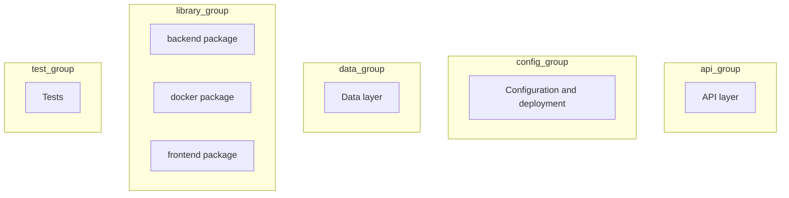

# Architecture report: NginxProxyManager/nginx-proxy-manager

> Automated static analysis. **Observed** = directly seen in files/imports/AST; **Inferred** = interpretation from that evidence. Repository code was not executed.

## 1. Repository at a glance

| Item | Value |
| --- | --- |
| Repository | NginxProxyManager/nginx-proxy-manager |
| Description | Docker container for managing Nginx proxy hosts with a simple, powerful interface |
| Language | JavaScript |
| Stars | 34712 |
| Licence | MIT |
| Analysed commit / branch | 66ab4b24d1a07587ec0d481740ce57abefbebfaa / develop |
| Framework(s) | Express, React |
| Files analysed | 798 |
| Components | 7 |

## 2. Architecture in one minute

NginxProxyManager/nginx-proxy-manager - Docker container for managing Nginx proxy hosts with a simple, powerful interface. This repository was analysed statically from 798 file(s) (0 Python). Detected technologies (observed from imports/manifests): GitHub Actions, SQLite, Express, React, React Router, Docker. Files are grouped into 7 component(s): API layer, backend package, Configuration and deployment, Data layer, docker package, frontend package, Tests. Findings below distinguish observed facts from inferred interpretation.

## 3. High-level block diagram

## 4. Main components

### API layer (`api_layer`)

- **Kind:** api
- **Status:** Observed
- **Confidence:** 0.85
- **Responsibility:** Groups 85 file(s) under api layer (observed from repository paths and static analysis).
- **Paths:** `backend/routes/audit-log.js`, `backend/routes/ci.js`, `backend/routes/logs.js`, `backend/routes/main.js`, `backend/routes/nginx/access_lists.js`, `backend/routes/nginx/certificates.js`, `backend/routes/nginx/dead_hosts.js`, `backend/routes/nginx/proxy_hosts.js`, `backend/routes/nginx/redirection_hosts.js`, `backend/routes/nginx/streams.js`, `backend/routes/reports.js`, `backend/routes/schema.js`, `backend/routes/settings.js`, `backend/routes/tokens.js`, `backend/routes/users.js`, `backend/routes/version.js`, `frontend/src/api/backend/base.ts`, `frontend/src/api/backend/checkVersion.ts`, `frontend/src/api/backend/createAccessList.ts`, `frontend/src/api/backend/createCertificate.ts`, `frontend/src/api/backend/createDeadHost.ts`, `frontend/src/api/backend/createProxyHost.ts`, `frontend/src/api/backend/createRedirectionHost.ts`, `frontend/src/api/backend/createStream.ts`, `frontend/src/api/backend/createUser.ts`, `frontend/src/api/backend/deleteAccessList.ts`, `frontend/src/api/backend/deleteCertificate.ts`, `frontend/src/api/backend/deleteDeadHost.ts`, `frontend/src/api/backend/deleteProxyHost.ts`, `frontend/src/api/backend/deleteRedirectionHost.ts`, `frontend/src/api/backend/deleteStream.ts`, `frontend/src/api/backend/deleteUser.ts`, `frontend/src/api/backend/downloadCertificate.ts`, `frontend/src/api/backend/expansions.ts`, `frontend/src/api/backend/getAccessList.ts`, `frontend/src/api/backend/getAccessLists.ts`, `frontend/src/api/backend/getAuditLog.ts`, `frontend/src/api/backend/getAuditLogs.ts`, `frontend/src/api/backend/getCertificate.ts`, `frontend/src/api/backend/getCertificateDNSProviders.ts`, `frontend/src/api/backend/getCertificates.ts`, `frontend/src/api/backend/getDeadHost.ts`, `frontend/src/api/backend/getDeadHosts.ts`, `frontend/src/api/backend/getHealth.ts`, `frontend/src/api/backend/getHostsReport.ts`, `frontend/src/api/backend/getLogSources.ts`, `frontend/src/api/backend/getLogTail.ts`, `frontend/src/api/backend/getProxyHost.ts`, `frontend/src/api/backend/getProxyHostLogs.ts`, `frontend/src/api/backend/getProxyHosts.ts`, `frontend/src/api/backend/getRedirectionHost.ts`, `frontend/src/api/backend/getRedirectionHosts.ts`, `frontend/src/api/backend/getSetting.ts`, `frontend/src/api/backend/getSettings.ts`, `frontend/src/api/backend/getStream.ts`, `frontend/src/api/backend/getStreams.ts`, `frontend/src/api/backend/getToken.ts`, `frontend/src/api/backend/getUser.ts`, `frontend/src/api/backend/getUsers.ts`, `frontend/src/api/backend/helpers.ts`, `frontend/src/api/backend/index.ts`, `frontend/src/api/backend/loginAsUser.ts`, `frontend/src/api/backend/models.ts`, `frontend/src/api/backend/refreshToken.ts`, `frontend/src/api/backend/renewCertificate.ts`, `frontend/src/api/backend/responseTypes.ts`, `frontend/src/api/backend/setPermissions.ts`, `frontend/src/api/backend/testHttpCertificate.test.ts`, `frontend/src/api/backend/testHttpCertificate.ts`, `frontend/src/api/backend/toggleDeadHost.ts`, `frontend/src/api/backend/toggleProxyHost.ts`, `frontend/src/api/backend/toggleRedirectionHost.ts`, `frontend/src/api/backend/toggleStream.ts`, `frontend/src/api/backend/toggleUser.ts`, `frontend/src/api/backend/twoFactor.ts`, `frontend/src/api/backend/updateAccessList.ts`, `frontend/src/api/backend/updateAuth.ts`, `frontend/src/api/backend/updateDeadHost.ts`, `frontend/src/api/backend/updateProxyHost.ts`, `frontend/src/api/backend/updateRedirectionHost.ts`, `frontend/src/api/backend/updateSetting.ts`, `frontend/src/api/backend/updateStream.ts`, `frontend/src/api/backend/updateUser.ts`, `frontend/src/api/backend/uploadCertificate.ts`, `frontend/src/api/backend/validateCertificate.ts`
- **Evidence:** [backend/routes/audit-log.js](https://github.com/NginxProxyManager/nginx-proxy-manager/blob/66ab4b24d1a07587ec0d481740ce57abefbebfaa/backend/routes/audit-log.js); [backend/routes/ci.js](https://github.com/NginxProxyManager/nginx-proxy-manager/blob/66ab4b24d1a07587ec0d481740ce57abefbebfaa/backend/routes/ci.js); [backend/routes/logs.js](https://github.com/NginxProxyManager/nginx-proxy-manager/blob/66ab4b24d1a07587ec0d481740ce57abefbebfaa/backend/routes/logs.js); [backend/routes/main.js](https://github.com/NginxProxyManager/nginx-proxy-manager/blob/66ab4b24d1a07587ec0d481740ce57abefbebfaa/backend/routes/main.js); [backend/routes/nginx/access_lists.js](https://github.com/NginxProxyManager/nginx-proxy-manager/blob/66ab4b24d1a07587ec0d481740ce57abefbebfaa/backend/routes/nginx/access_lists.js); [backend/routes/nginx/certificates.js](https://github.com/NginxProxyManager/nginx-proxy-manager/blob/66ab4b24d1a07587ec0d481740ce57abefbebfaa/backend/routes/nginx/certificates.js); [backend/routes/nginx/dead_hosts.js](https://github.com/NginxProxyManager/nginx-proxy-manager/blob/66ab4b24d1a07587ec0d481740ce57abefbebfaa/backend/routes/nginx/dead_hosts.js); [backend/routes/nginx/proxy_hosts.js](https://github.com/NginxProxyManager/nginx-proxy-manager/blob/66ab4b24d1a07587ec0d481740ce57abefbebfaa/backend/routes/nginx/proxy_hosts.js)

### backend package (`backend`)

- **Kind:** library
- **Status:** Observed
- **Confidence:** 0.85
- **Responsibility:** Groups 63 file(s) under backend package (observed from repository paths and static analysis).
- **Paths:** `backend/app.js`, `backend/db.js`, `backend/index.js`, `backend/internal/2fa.js`, `backend/internal/access-list.js`, `backend/internal/audit-log.js`, `backend/internal/certificate.js`, `backend/internal/dead-host.js`, `backend/internal/host.js`, `backend/internal/ip_ranges.js`, `backend/internal/log-viewer.js`, `backend/internal/nginx.js`, `backend/internal/proxy-host.js`, `backend/internal/redirection-host.js`, `backend/internal/remote-version.js`, `backend/internal/report.js`, `backend/internal/setting.js`, `backend/internal/stream.js`, `backend/internal/token.js`, `backend/internal/user.js`, `backend/knexfile.js`, `backend/lib/access.js`, `backend/lib/certbot.js`, `backend/lib/config.js`, `backend/lib/error.js`, `backend/lib/express/cors.js`, `backend/lib/express/jwt-decode.js`, `backend/lib/express/jwt.js`, `backend/lib/express/log-request.js`, `backend/lib/express/pagination.js`, `backend/lib/express/rate-limit.js`, `backend/lib/express/user-id-from-me.js`, `backend/lib/helpers.js`, `backend/lib/migrate_template.js`, `backend/lib/nginx-values.js`, `backend/lib/utils.js`, `backend/lib/validator/api.js`, `backend/lib/validator/index.js`, `backend/logger.js`, `backend/migrate.js`, `backend/migrations/20180618015850_initial.js`, `backend/migrations/20180929054513_websockets.js`, `backend/migrations/20181019052346_forward_host.js`, `backend/migrations/20181113041458_http2_support.js`, `backend/migrations/20181213013211_forward_scheme.js`, `backend/migrations/20190104035154_disabled.js`, `backend/migrations/20190215115310_customlocations.js`, `backend/migrations/20190218060101_hsts.js`, `backend/migrations/20190227065017_settings.js`, `backend/migrations/20200410143839_access_list_client.js`, `backend/migrations/20200410143840_access_list_client_fix.js`, `backend/migrations/20201014143841_pass_auth.js`, `backend/migrations/20210210154702_redirection_scheme.js`, `backend/migrations/20210210154703_redirection_status_code.js`, `backend/migrations/20210423103500_stream_domain.js`, `backend/migrations/20211108145214_regenerate_default_host.js`, `backend/migrations/20240427161436_stream_ssl.js`, `backend/migrations/20251111090000_redirect_auto_scheme.js`, `backend/migrations/20260131163528_trust_forwarded_proto.js`, `backend/migrations/20260906220000_user_permission_meta.js`, `backend/schema/index.js`, `backend/setup.js`, `backend/validate-schema.js`
- **Evidence:** [backend/app.js](https://github.com/NginxProxyManager/nginx-proxy-manager/blob/66ab4b24d1a07587ec0d481740ce57abefbebfaa/backend/app.js); [backend/db.js](https://github.com/NginxProxyManager/nginx-proxy-manager/blob/66ab4b24d1a07587ec0d481740ce57abefbebfaa/backend/db.js); [backend/index.js](https://github.com/NginxProxyManager/nginx-proxy-manager/blob/66ab4b24d1a07587ec0d481740ce57abefbebfaa/backend/index.js); [backend/internal/2fa.js](https://github.com/NginxProxyManager/nginx-proxy-manager/blob/66ab4b24d1a07587ec0d481740ce57abefbebfaa/backend/internal/2fa.js); [backend/internal/access-list.js](https://github.com/NginxProxyManager/nginx-proxy-manager/blob/66ab4b24d1a07587ec0d481740ce57abefbebfaa/backend/internal/access-list.js); [backend/internal/audit-log.js](https://github.com/NginxProxyManager/nginx-proxy-manager/blob/66ab4b24d1a07587ec0d481740ce57abefbebfaa/backend/internal/audit-log.js); [backend/internal/certificate.js](https://github.com/NginxProxyManager/nginx-proxy-manager/blob/66ab4b24d1a07587ec0d481740ce57abefbebfaa/backend/internal/certificate.js); [backend/internal/dead-host.js](https://github.com/NginxProxyManager/nginx-proxy-manager/blob/66ab4b24d1a07587ec0d481740ce57abefbebfaa/backend/internal/dead-host.js)

### Configuration and deployment (`config`)

- **Kind:** config
- **Status:** Observed
- **Confidence:** 0.85
- **Responsibility:** Groups 192 file(s) under configuration and deployment (observed from repository paths and static analysis).
- **Paths:** `backend/biome.json`, `backend/certbot/dns-plugins.json`, `backend/config/default.json`, `backend/config/sqlite-test-db.json`, `backend/lib/access/access_lists-create.json`, `backend/lib/access/access_lists-delete.json`, `backend/lib/access/access_lists-get.json`, `backend/lib/access/access_lists-list.json`, `backend/lib/access/access_lists-update.json`, `backend/lib/access/auditlog-list.json`, `backend/lib/access/certificates-create.json`, `backend/lib/access/certificates-delete.json`, `backend/lib/access/certificates-get.json`, `backend/lib/access/certificates-list.json`, `backend/lib/access/certificates-update.json`, `backend/lib/access/dead_hosts-create.json`, `backend/lib/access/dead_hosts-delete.json`, `backend/lib/access/dead_hosts-get.json`, `backend/lib/access/dead_hosts-list.json`, `backend/lib/access/dead_hosts-update.json`, `backend/lib/access/logs-list.json`, `backend/lib/access/permissions.json`, `backend/lib/access/proxy_hosts-create.json`, `backend/lib/access/proxy_hosts-delete.json`, `backend/lib/access/proxy_hosts-get.json`, `backend/lib/access/proxy_hosts-list.json`, `backend/lib/access/proxy_hosts-update.json`, `backend/lib/access/redirection_hosts-create.json`, `backend/lib/access/redirection_hosts-delete.json`, `backend/lib/access/redirection_hosts-get.json`, `backend/lib/access/redirection_hosts-list.json`, `backend/lib/access/redirection_hosts-update.json`, `backend/lib/access/reports-hosts.json`, `backend/lib/access/roles.json`, `backend/lib/access/settings-get.json`, `backend/lib/access/settings-list.json`, `backend/lib/access/settings-update.json`, `backend/lib/access/streams-create.json`, `backend/lib/access/streams-delete.json`, `backend/lib/access/streams-get.json`, `backend/lib/access/streams-list.json`, `backend/lib/access/streams-update.json`, `backend/lib/access/users-create.json`, `backend/lib/access/users-delete.json`, `backend/lib/access/users-get.json`, `backend/lib/access/users-list.json`, `backend/lib/access/users-loginas.json`, `backend/lib/access/users-password.json`, `backend/lib/access/users-permissions.json`, `backend/lib/access/users-update.json`, `backend/nodemon.json`, `backend/package.json`, `backend/schema/common.json`, `backend/schema/components/access-list-object.json`, `backend/schema/components/audit-log-list.json`, `backend/schema/components/audit-log-object.json`, `backend/schema/components/certificate-list.json`, `backend/schema/components/certificate-object.json`, `backend/schema/components/check-version-object.json`, `backend/schema/components/dead-host-list.json`, `backend/schema/components/dead-host-object.json`, `backend/schema/components/dns-providers-list.json`, `backend/schema/components/error-object.json`, `backend/schema/components/error.json`, `backend/schema/components/health-object.json`, `backend/schema/components/log-sources-object.json`, `backend/schema/components/log-tail-object.json`, `backend/schema/components/permission-object.json`, `backend/schema/components/proxy-host-list.json`, `backend/schema/components/proxy-host-object.json`, `backend/schema/components/redirection-host-list.json`, `backend/schema/components/redirection-host-object.json`, `backend/schema/components/security-schemes.json`, `backend/schema/components/setting-list.json`, `backend/schema/components/setting-object.json`, `backend/schema/components/stream-list.json`, `backend/schema/components/stream-object.json`, `backend/schema/components/token-challenge.json`, `backend/schema/components/token-object.json`, `backend/schema/components/user-list.json`, `backend/schema/components/user-object.json`, `backend/schema/paths/audit-log/get.json`, `backend/schema/paths/audit-log/id/get.json`, `backend/schema/paths/get.json`, `backend/schema/paths/logs/sources/get.json`, `backend/schema/paths/logs/tail/get.json`, `backend/schema/paths/nginx/access-lists/get.json`, `backend/schema/paths/nginx/access-lists/listID/delete.json`, `backend/schema/paths/nginx/access-lists/listID/get.json`, `backend/schema/paths/nginx/access-lists/listID/put.json`, `backend/schema/paths/nginx/access-lists/post.json`, `backend/schema/paths/nginx/certificates/certID/delete.json`, `backend/schema/paths/nginx/certificates/certID/download/get.json`, `backend/schema/paths/nginx/certificates/certID/get.json`, `backend/schema/paths/nginx/certificates/certID/renew/post.json`, `backend/schema/paths/nginx/certificates/certID/upload/post.json`, `backend/schema/paths/nginx/certificates/dns-providers/get.json`, `backend/schema/paths/nginx/certificates/get.json`, `backend/schema/paths/nginx/certificates/post.json`, `backend/schema/paths/nginx/certificates/test-http/post.json`, `backend/schema/paths/nginx/certificates/validate/post.json`, `backend/schema/paths/nginx/dead-hosts/get.json`, `backend/schema/paths/nginx/dead-hosts/hostID/delete.json`, `backend/schema/paths/nginx/dead-hosts/hostID/disable/post.json`, `backend/schema/paths/nginx/dead-hosts/hostID/enable/post.json`, `backend/schema/paths/nginx/dead-hosts/hostID/get.json`, `backend/schema/paths/nginx/dead-hosts/hostID/put.json`, `backend/schema/paths/nginx/dead-hosts/post.json`, `backend/schema/paths/nginx/proxy-hosts/get.json`, `backend/schema/paths/nginx/proxy-hosts/hostID/delete.json`, `backend/schema/paths/nginx/proxy-hosts/hostID/disable/post.json`, `backend/schema/paths/nginx/proxy-hosts/hostID/enable/post.json`, `backend/schema/paths/nginx/proxy-hosts/hostID/get.json`, `backend/schema/paths/nginx/proxy-hosts/hostID/put.json`, `backend/schema/paths/nginx/proxy-hosts/post.json`, `backend/schema/paths/nginx/redirection-hosts/get.json`, `backend/schema/paths/nginx/redirection-hosts/hostID/delete.json`, `backend/schema/paths/nginx/redirection-hosts/hostID/disable/post.json`, `backend/schema/paths/nginx/redirection-hosts/hostID/enable/post.json`, `backend/schema/paths/nginx/redirection-hosts/hostID/get.json`, `backend/schema/paths/nginx/redirection-hosts/hostID/put.json`, `backend/schema/paths/nginx/redirection-hosts/post.json`, `backend/schema/paths/nginx/streams/get.json`, `backend/schema/paths/nginx/streams/post.json`, `backend/schema/paths/nginx/streams/streamID/delete.json`, `backend/schema/paths/nginx/streams/streamID/disable/post.json`, `backend/schema/paths/nginx/streams/streamID/enable/post.json`, `backend/schema/paths/nginx/streams/streamID/get.json`, `backend/schema/paths/nginx/streams/streamID/put.json`, `backend/schema/paths/reports/hosts/get.json`, `backend/schema/paths/schema/get.json`, `backend/schema/paths/settings/get.json`, `backend/schema/paths/settings/settingID/get.json`, `backend/schema/paths/settings/settingID/put.json`, `backend/schema/paths/tokens/2fa/post.json`, `backend/schema/paths/tokens/get.json`, `backend/schema/paths/tokens/post.json`, `backend/schema/paths/users/get.json`, `backend/schema/paths/users/post.json`, `backend/schema/paths/users/userID/2fa/backup-codes/post.json`, `backend/schema/paths/users/userID/2fa/delete.json`, `backend/schema/paths/users/userID/2fa/enable/post.json`, `backend/schema/paths/users/userID/2fa/get.json`, `backend/schema/paths/users/userID/2fa/post.json`, `backend/schema/paths/users/userID/auth/put.json`, `backend/schema/paths/users/userID/delete.json`, `backend/schema/paths/users/userID/get.json`, `backend/schema/paths/users/userID/login/post.json`, `backend/schema/paths/users/userID/permissions/put.json`, `backend/schema/paths/users/userID/put.json`, `backend/schema/paths/version/check/get.json`, `backend/schema/swagger.json`, `docker/Dockerfile`, `docker/dev/Dockerfile`, `docker/dev/dnsrouter-config.json`, `docker/dev/letsencrypt.ini`, `docker/docker-compose.ci.isolated.yml`, `docker/docker-compose.ci.mysql.yml`, `docker/docker-compose.ci.postgres.yml`, `docker/docker-compose.ci.sqlite.yml`, `docker/docker-compose.ci.yml`, `docker/docker-compose.dev.yml`, `docker/rootfs/etc/letsencrypt.ini`, `frontend/biome.json`, `frontend/package.json`, `frontend/src/locale/src/az.json`, `frontend/src/locale/src/bg.json`, `frontend/src/locale/src/cs.json`, `frontend/src/locale/src/de.json`, `frontend/src/locale/src/en.json`, `frontend/src/locale/src/es.json`, `frontend/src/locale/src/et.json`, `frontend/src/locale/src/fa.json`, `frontend/src/locale/src/fr.json`, `frontend/src/locale/src/ga.json`, `frontend/src/locale/src/hu.json`, `frontend/src/locale/src/id.json`, `frontend/src/locale/src/it.json`, `frontend/src/locale/src/ja.json`, `frontend/src/locale/src/ko.json`, `frontend/src/locale/src/lang-list.json`, `frontend/src/locale/src/nl.json`, `frontend/src/locale/src/no.json`, `frontend/src/locale/src/pl.json`, `frontend/src/locale/src/pt.json`, `frontend/src/locale/src/ru.json`, `frontend/src/locale/src/sk.json`, `frontend/src/locale/src/tr.json`, `frontend/src/locale/src/uk.json`, `frontend/src/locale/src/vi.json`, `frontend/src/locale/src/zh-tw.json`, `frontend/src/locale/src/zh.json`
- **Evidence:** [backend/biome.json](https://github.com/NginxProxyManager/nginx-proxy-manager/blob/66ab4b24d1a07587ec0d481740ce57abefbebfaa/backend/biome.json); [backend/certbot/dns-plugins.json](https://github.com/NginxProxyManager/nginx-proxy-manager/blob/66ab4b24d1a07587ec0d481740ce57abefbebfaa/backend/certbot/dns-plugins.json); [backend/config/default.json](https://github.com/NginxProxyManager/nginx-proxy-manager/blob/66ab4b24d1a07587ec0d481740ce57abefbebfaa/backend/config/default.json); [backend/config/sqlite-test-db.json](https://github.com/NginxProxyManager/nginx-proxy-manager/blob/66ab4b24d1a07587ec0d481740ce57abefbebfaa/backend/config/sqlite-test-db.json); [backend/lib/access/access_lists-create.json](https://github.com/NginxProxyManager/nginx-proxy-manager/blob/66ab4b24d1a07587ec0d481740ce57abefbebfaa/backend/lib/access/access_lists-create.json); [backend/lib/access/access_lists-delete.json](https://github.com/NginxProxyManager/nginx-proxy-manager/blob/66ab4b24d1a07587ec0d481740ce57abefbebfaa/backend/lib/access/access_lists-delete.json); [backend/lib/access/access_lists-get.json](https://github.com/NginxProxyManager/nginx-proxy-manager/blob/66ab4b24d1a07587ec0d481740ce57abefbebfaa/backend/lib/access/access_lists-get.json); [backend/lib/access/access_lists-list.json](https://github.com/NginxProxyManager/nginx-proxy-manager/blob/66ab4b24d1a07587ec0d481740ce57abefbebfaa/backend/lib/access/access_lists-list.json)

### Data layer (`data_layer`)

- **Kind:** data
- **Status:** Observed
- **Confidence:** 0.85
- **Responsibility:** Groups 15 file(s) under data layer (observed from repository paths and static analysis).
- **Paths:** `backend/models/access_list.js`, `backend/models/access_list_auth.js`, `backend/models/access_list_client.js`, `backend/models/audit-log.js`, `backend/models/auth.js`, `backend/models/certificate.js`, `backend/models/dead_host.js`, `backend/models/now_helper.js`, `backend/models/proxy_host.js`, `backend/models/redirection_host.js`, `backend/models/setting.js`, `backend/models/stream.js`, `backend/models/token.js`, `backend/models/user.js`, `backend/models/user_permission.js`
- **Evidence:** [backend/models/access_list.js](https://github.com/NginxProxyManager/nginx-proxy-manager/blob/66ab4b24d1a07587ec0d481740ce57abefbebfaa/backend/models/access_list.js); [backend/models/access_list_auth.js](https://github.com/NginxProxyManager/nginx-proxy-manager/blob/66ab4b24d1a07587ec0d481740ce57abefbebfaa/backend/models/access_list_auth.js); [backend/models/access_list_client.js](https://github.com/NginxProxyManager/nginx-proxy-manager/blob/66ab4b24d1a07587ec0d481740ce57abefbebfaa/backend/models/access_list_client.js); [backend/models/audit-log.js](https://github.com/NginxProxyManager/nginx-proxy-manager/blob/66ab4b24d1a07587ec0d481740ce57abefbebfaa/backend/models/audit-log.js); [backend/models/auth.js](https://github.com/NginxProxyManager/nginx-proxy-manager/blob/66ab4b24d1a07587ec0d481740ce57abefbebfaa/backend/models/auth.js); [backend/models/certificate.js](https://github.com/NginxProxyManager/nginx-proxy-manager/blob/66ab4b24d1a07587ec0d481740ce57abefbebfaa/backend/models/certificate.js); [backend/models/dead_host.js](https://github.com/NginxProxyManager/nginx-proxy-manager/blob/66ab4b24d1a07587ec0d481740ce57abefbebfaa/backend/models/dead_host.js); [backend/models/now_helper.js](https://github.com/NginxProxyManager/nginx-proxy-manager/blob/66ab4b24d1a07587ec0d481740ce57abefbebfaa/backend/models/now_helper.js)

### docker package (`docker`)

- **Kind:** library
- **Status:** Observed
- **Confidence:** 0.85
- **Responsibility:** Groups 10 file(s) under docker package (observed from repository paths and static analysis).
- **Paths:** `docker/rootfs/etc/s6-overlay/s6-rc.d/prepare/00-all.sh`, `docker/rootfs/etc/s6-overlay/s6-rc.d/prepare/10-usergroup.sh`, `docker/rootfs/etc/s6-overlay/s6-rc.d/prepare/20-paths.sh`, `docker/rootfs/etc/s6-overlay/s6-rc.d/prepare/30-ownership.sh`, `docker/rootfs/etc/s6-overlay/s6-rc.d/prepare/40-dynamic.sh`, `docker/rootfs/etc/s6-overlay/s6-rc.d/prepare/45-admin-port.sh`, `docker/rootfs/etc/s6-overlay/s6-rc.d/prepare/50-ipv6.sh`, `docker/rootfs/etc/s6-overlay/s6-rc.d/prepare/60-secrets.sh`, `docker/rootfs/etc/s6-overlay/s6-rc.d/prepare/90-banner.sh`, `docker/rootfs/usr/bin/common.sh`
- **Evidence:** [docker/rootfs/etc/s6-overlay/s6-rc.d/prepare/00-all.sh](https://github.com/NginxProxyManager/nginx-proxy-manager/blob/66ab4b24d1a07587ec0d481740ce57abefbebfaa/docker/rootfs/etc/s6-overlay/s6-rc.d/prepare/00-all.sh); [docker/rootfs/etc/s6-overlay/s6-rc.d/prepare/10-usergroup.sh](https://github.com/NginxProxyManager/nginx-proxy-manager/blob/66ab4b24d1a07587ec0d481740ce57abefbebfaa/docker/rootfs/etc/s6-overlay/s6-rc.d/prepare/10-usergroup.sh); [docker/rootfs/etc/s6-overlay/s6-rc.d/prepare/20-paths.sh](https://github.com/NginxProxyManager/nginx-proxy-manager/blob/66ab4b24d1a07587ec0d481740ce57abefbebfaa/docker/rootfs/etc/s6-overlay/s6-rc.d/prepare/20-paths.sh); [docker/rootfs/etc/s6-overlay/s6-rc.d/prepare/30-ownership.sh](https://github.com/NginxProxyManager/nginx-proxy-manager/blob/66ab4b24d1a07587ec0d481740ce57abefbebfaa/docker/rootfs/etc/s6-overlay/s6-rc.d/prepare/30-ownership.sh); [docker/rootfs/etc/s6-overlay/s6-rc.d/prepare/40-dynamic.sh](https://github.com/NginxProxyManager/nginx-proxy-manager/blob/66ab4b24d1a07587ec0d481740ce57abefbebfaa/docker/rootfs/etc/s6-overlay/s6-rc.d/prepare/40-dynamic.sh); [docker/rootfs/etc/s6-overlay/s6-rc.d/prepare/45-admin-port.sh](https://github.com/NginxProxyManager/nginx-proxy-manager/blob/66ab4b24d1a07587ec0d481740ce57abefbebfaa/docker/rootfs/etc/s6-overlay/s6-rc.d/prepare/45-admin-port.sh); [docker/rootfs/etc/s6-overlay/s6-rc.d/prepare/50-ipv6.sh](https://github.com/NginxProxyManager/nginx-proxy-manager/blob/66ab4b24d1a07587ec0d481740ce57abefbebfaa/docker/rootfs/etc/s6-overlay/s6-rc.d/prepare/50-ipv6.sh); [docker/rootfs/etc/s6-overlay/s6-rc.d/prepare/60-secrets.sh](https://github.com/NginxProxyManager/nginx-proxy-manager/blob/66ab4b24d1a07587ec0d481740ce57abefbebfaa/docker/rootfs/etc/s6-overlay/s6-rc.d/prepare/60-secrets.sh)

### frontend package (`frontend`)

- **Kind:** library
- **Status:** Observed
- **Confidence:** 0.85
- **Responsibility:** Groups 159 file(s) under frontend package (observed from repository paths and static analysis).
- **Paths:** `frontend/check-locales.cjs`, `frontend/src/App.tsx`, `frontend/src/Router.test.tsx`, `frontend/src/Router.tsx`, `frontend/src/components/Button.tsx`, `frontend/src/components/EmptyData.tsx`, `frontend/src/components/ErrorNotFound.tsx`, `frontend/src/components/Flag.tsx`, `frontend/src/components/Form/AccessClientFields.tsx`, `frontend/src/components/Form/AccessField.tsx`, `frontend/src/components/Form/BasicAuthFields.tsx`, `frontend/src/components/Form/DNSProviderFields.tsx`, `frontend/src/components/Form/DomainNamesField.tsx`, `frontend/src/components/Form/FormModal.drafts.test.tsx`, `frontend/src/components/Form/FormModal.test.tsx`, `frontend/src/components/Form/FormModal.tsx`, `frontend/src/components/Form/LocationsFields.tsx`, `frontend/src/components/Form/NginxConfigField.tsx`, `frontend/src/components/Form/SSLCertificateField.tsx`, `frontend/src/components/Form/SSLOptionsFields.tsx`, `frontend/src/components/Form/index.ts`, `frontend/src/components/HasPermission.tsx`, `frontend/src/components/Loading.tsx`, `frontend/src/components/LoadingPage.tsx`, `frontend/src/components/LocalePicker.tsx`, `frontend/src/components/NavLink.tsx`, `frontend/src/components/Page.tsx`, `frontend/src/components/SiteContainer.tsx`, `frontend/src/components/SiteFooter.tsx`, `frontend/src/components/SiteHeader.tsx`, `frontend/src/components/SiteMenu.tsx`, `frontend/src/components/Table/EmptyRow.tsx`, `frontend/src/components/Table/Formatter/AccessListformatter.tsx`, `frontend/src/components/Table/Formatter/CertificateFormatter.tsx`, `frontend/src/components/Table/Formatter/CertificateInUseFormatter.tsx`, `frontend/src/components/Table/Formatter/DateFormatter.tsx`, `frontend/src/components/Table/Formatter/DomainsFormatter.tsx`, `frontend/src/components/Table/Formatter/EmailFormatter.tsx`, `frontend/src/components/Table/Formatter/EventFormatter.tsx`, `frontend/src/components/Table/Formatter/GravatarFormatter.tsx`, `frontend/src/components/Table/Formatter/RolesFormatter.tsx`, `frontend/src/components/Table/Formatter/TrueFalseFormatter.tsx`, `frontend/src/components/Table/Formatter/ValueWithDateFormatter.tsx`, `frontend/src/components/Table/Formatter/index.ts`, `frontend/src/components/Table/TableBody.tsx`, `frontend/src/components/Table/TableHeader.tsx`, `frontend/src/components/Table/TableHelpers.ts`, `frontend/src/components/Table/TableLayout.tsx`, `frontend/src/components/Table/features.ts`, `frontend/src/components/Table/index.ts`, `frontend/src/components/ThemeSwitcher.tsx`, `frontend/src/components/Unhealthy.tsx`, `frontend/src/components/index.ts`, `frontend/src/context/AuthContext.tsx`, `frontend/src/context/LocaleContext.tsx`, `frontend/src/context/ThemeContext.tsx`, `frontend/src/context/index.ts`, `frontend/src/declarations.d.ts`, `frontend/src/hooks/index.ts`, `frontend/src/hooks/useAccessList.ts`, `frontend/src/hooks/useAccessLists.ts`, `frontend/src/hooks/useAuditLog.ts`, `frontend/src/hooks/useAuditLogs.ts`, `frontend/src/hooks/useCertificate.ts`, `frontend/src/hooks/useCertificates.ts`, `frontend/src/hooks/useCheckVersion.ts`, `frontend/src/hooks/useDeadHost.ts`, `frontend/src/hooks/useDeadHosts.ts`, `frontend/src/hooks/useDnsProviders.ts`, `frontend/src/hooks/useHealth.ts`, `frontend/src/hooks/useHostReport.ts`, `frontend/src/hooks/useLogSources.ts`, `frontend/src/hooks/useLogTail.ts`, `frontend/src/hooks/useProxyHost.ts`, `frontend/src/hooks/useProxyHostLogs.ts`, `frontend/src/hooks/useProxyHosts.ts`, `frontend/src/hooks/useRedirectionHost.ts`, `frontend/src/hooks/useRedirectionHosts.ts`, `frontend/src/hooks/useSetting.ts`, `frontend/src/hooks/useStream.ts`, `frontend/src/hooks/useStreams.ts`, `frontend/src/hooks/useTheme.ts`, `frontend/src/hooks/useUser.ts`, `frontend/src/hooks/useUsers.ts`, `frontend/src/locale/IntlProvider.tsx`, `frontend/src/locale/Utils.test.tsx`, `frontend/src/locale/Utils.ts`, `frontend/src/locale/et.test.ts`, `frontend/src/locale/index.ts`, `frontend/src/locale/scripts/locale-sort.cjs`, `frontend/src/locale/scripts/locale-sort.sh`, `frontend/src/locale/src/HelpDoc/az/index.ts`, `frontend/src/locale/src/HelpDoc/bg/index.ts`, `frontend/src/locale/src/HelpDoc/cs/index.ts`, `frontend/src/locale/src/HelpDoc/de/index.ts`, `frontend/src/locale/src/HelpDoc/en/index.ts`, `frontend/src/locale/src/HelpDoc/es/index.ts`, `frontend/src/locale/src/HelpDoc/et/index.ts`, `frontend/src/locale/src/HelpDoc/fa/index.ts`, `frontend/src/locale/src/HelpDoc/fr/index.ts`, `frontend/src/locale/src/HelpDoc/ga/index.ts`, `frontend/src/locale/src/HelpDoc/hu/index.ts`, `frontend/src/locale/src/HelpDoc/id/index.ts`, `frontend/src/locale/src/HelpDoc/index.ts`, `frontend/src/locale/src/HelpDoc/it/index.ts`, `frontend/src/locale/src/HelpDoc/ja/index.ts`, `frontend/src/locale/src/HelpDoc/ko/index.ts`, `frontend/src/locale/src/HelpDoc/nl/index.ts`, `frontend/src/locale/src/HelpDoc/no/index.ts`, `frontend/src/locale/src/HelpDoc/pl/index.ts`, `frontend/src/locale/src/HelpDoc/pt/index.ts`, `frontend/src/locale/src/HelpDoc/ru/index.ts`, `frontend/src/locale/src/HelpDoc/sk/index.ts`, `frontend/src/locale/src/HelpDoc/tr/index.ts`, `frontend/src/locale/src/HelpDoc/uk/index.ts`, `frontend/src/locale/src/HelpDoc/vi/index.ts`, `frontend/src/locale/src/HelpDoc/zh-tw/index.ts`, `frontend/src/locale/src/HelpDoc/zh/index.ts`, `frontend/src/locale/vi.test.ts`, `frontend/src/main.tsx`, `frontend/src/modals/AccessListModal.tsx`, `frontend/src/modals/ChangePasswordModal.tsx`, `frontend/src/modals/CustomCertificateModal.tsx`, `frontend/src/modals/DNSCertificateModal.tsx`, `frontend/src/modals/DeadHostModal.tsx`, `frontend/src/modals/DeleteConfirmModal.tsx`, `frontend/src/modals/EventDetailsModal.tsx`, `frontend/src/modals/HTTPCertificateModal.test.tsx`, `frontend/src/modals/HTTPCertificateModal.tsx`, `frontend/src/modals/HelpModal.tsx`, `frontend/src/modals/HostLogsModal.tsx`, `frontend/src/modals/PermissionsModal.tsx`, `frontend/src/modals/ProxyHostModal.tsx`, `frontend/src/modals/RedirectionHostModal.tsx`, `frontend/src/modals/RenewCertificateModal.tsx`, `frontend/src/modals/SetPasswordModal.tsx`, `frontend/src/modals/StreamModal.tsx`, `frontend/src/modals/TwoFactorModal.tsx`, `frontend/src/modals/UserModal.tsx`, `frontend/src/modals/index.ts`, `frontend/src/modules/AuthStore.ts`, `frontend/src/modules/Permissions.ts`, `frontend/src/modules/Validations.tsx`, `frontend/src/notifications/Msg.tsx`, `frontend/src/notifications/helpers.tsx`, `frontend/src/notifications/index.ts`, `frontend/src/pages/Access/Table.tsx`, `frontend/src/pages/Access/TableWrapper.tsx`, `frontend/src/pages/Access/index.tsx`, `frontend/src/pages/AuditLog/Table.tsx`, `frontend/src/pages/AuditLog/TableWrapper.tsx`, `frontend/src/pages/AuditLog/index.tsx`, `frontend/src/pages/Certificates/Table.tsx`, `frontend/src/pages/Certificates/TableWrapper.tsx`, `frontend/src/pages/Certificates/index.tsx`, `frontend/src/pages/Dashboard/index.tsx`, `frontend/src/pages/Login/index.tsx`, `frontend/src/pages/Logs/LogLines.tsx`, `frontend/src/pages/Logs/LogViewer.tsx`
- **Evidence:** [frontend/check-locales.cjs](https://github.com/NginxProxyManager/nginx-proxy-manager/blob/66ab4b24d1a07587ec0d481740ce57abefbebfaa/frontend/check-locales.cjs); [frontend/src/App.tsx](https://github.com/NginxProxyManager/nginx-proxy-manager/blob/66ab4b24d1a07587ec0d481740ce57abefbebfaa/frontend/src/App.tsx); [frontend/src/Router.test.tsx](https://github.com/NginxProxyManager/nginx-proxy-manager/blob/66ab4b24d1a07587ec0d481740ce57abefbebfaa/frontend/src/Router.test.tsx); [frontend/src/Router.tsx](https://github.com/NginxProxyManager/nginx-proxy-manager/blob/66ab4b24d1a07587ec0d481740ce57abefbebfaa/frontend/src/Router.tsx); [frontend/src/components/Button.tsx](https://github.com/NginxProxyManager/nginx-proxy-manager/blob/66ab4b24d1a07587ec0d481740ce57abefbebfaa/frontend/src/components/Button.tsx); [frontend/src/components/EmptyData.tsx](https://github.com/NginxProxyManager/nginx-proxy-manager/blob/66ab4b24d1a07587ec0d481740ce57abefbebfaa/frontend/src/components/EmptyData.tsx); [frontend/src/components/ErrorNotFound.tsx](https://github.com/NginxProxyManager/nginx-proxy-manager/blob/66ab4b24d1a07587ec0d481740ce57abefbebfaa/frontend/src/components/ErrorNotFound.tsx); [frontend/src/components/Flag.tsx](https://github.com/NginxProxyManager/nginx-proxy-manager/blob/66ab4b24d1a07587ec0d481740ce57abefbebfaa/frontend/src/components/Flag.tsx)

### Tests (`tests`)

- **Kind:** test
- **Status:** Observed
- **Confidence:** 0.85
- **Responsibility:** Groups 1 file(s) under tests (observed from repository paths and static analysis).
- **Paths:** `backend/test/nginx-values.test.js`
- **Evidence:** [backend/test/nginx-values.test.js](https://github.com/NginxProxyManager/nginx-proxy-manager/blob/66ab4b24d1a07587ec0d481740ce57abefbebfaa/backend/test/nginx-values.test.js)

## 5. Execution flow

**Observed** entry point(s):

- [backend/app.js](https://github.com/NginxProxyManager/nginx-proxy-manager/blob/66ab4b24d1a07587ec0d481740ce57abefbebfaa/backend/app.js)
- [backend/index.js](https://github.com/NginxProxyManager/nginx-proxy-manager/blob/66ab4b24d1a07587ec0d481740ce57abefbebfaa/backend/index.js)
- [backend/lib/validator/index.js](https://github.com/NginxProxyManager/nginx-proxy-manager/blob/66ab4b24d1a07587ec0d481740ce57abefbebfaa/backend/lib/validator/index.js)
- [backend/routes/main.js](https://github.com/NginxProxyManager/nginx-proxy-manager/blob/66ab4b24d1a07587ec0d481740ce57abefbebfaa/backend/routes/main.js)
- [backend/schema/index.js](https://github.com/NginxProxyManager/nginx-proxy-manager/blob/66ab4b24d1a07587ec0d481740ce57abefbebfaa/backend/schema/index.js)
- [frontend/src/App.tsx](https://github.com/NginxProxyManager/nginx-proxy-manager/blob/66ab4b24d1a07587ec0d481740ce57abefbebfaa/frontend/src/App.tsx)
- [frontend/src/components/Page.tsx](https://github.com/NginxProxyManager/nginx-proxy-manager/blob/66ab4b24d1a07587ec0d481740ce57abefbebfaa/frontend/src/components/Page.tsx)
- [frontend/src/components/index.ts](https://github.com/NginxProxyManager/nginx-proxy-manager/blob/66ab4b24d1a07587ec0d481740ce57abefbebfaa/frontend/src/components/index.ts)
- [frontend/src/context/index.ts](https://github.com/NginxProxyManager/nginx-proxy-manager/blob/66ab4b24d1a07587ec0d481740ce57abefbebfaa/frontend/src/context/index.ts)
- [frontend/src/hooks/index.ts](https://github.com/NginxProxyManager/nginx-proxy-manager/blob/66ab4b24d1a07587ec0d481740ce57abefbebfaa/frontend/src/hooks/index.ts)
- [frontend/src/locale/index.ts](https://github.com/NginxProxyManager/nginx-proxy-manager/blob/66ab4b24d1a07587ec0d481740ce57abefbebfaa/frontend/src/locale/index.ts)
- [frontend/src/main.tsx](https://github.com/NginxProxyManager/nginx-proxy-manager/blob/66ab4b24d1a07587ec0d481740ce57abefbebfaa/frontend/src/main.tsx)

Representative flow (derived from observed entry points and the import graph; steps beyond the entry point are **Inferred**):

1. Execution starts at an observed entry point listed above, if present.
2. No internal import relationships between components were observed.

## 6. Project structure

### `(root)`

- `.gitattributes` - other (150 bytes)
- `.gitignore` - other (170 bytes)
- `.version` - other (7 bytes)
- `LICENSE` - docs (1057 bytes)
- `README.md` - docs (4391 bytes)
- `SECURITY.md` - docs (871 bytes)

### `.github`

- `.github/ISSUE_TEMPLATE/bug_report.md` - docs (1644 bytes)
- `.github/ISSUE_TEMPLATE/dns_challenge_request.md` - docs (509 bytes)
- `.github/ISSUE_TEMPLATE/feature_request.md` - docs (1066 bytes)
- `.github/PULL_REQUEST_TEMPLATE.md` - docs (1109 bytes)
- `.github/dependabot.yml` - config (2423 bytes)
- `.github/workflows/stale.yml` - ci, YAML (719 bytes)

### `backend`

- `backend/.gitignore` - other (83 bytes)
- `backend/app.js` - source, JavaScript (2290 bytes)
- `backend/biome.json` - config (1494 bytes)
- `backend/certbot/README.md` - docs (855 bytes)
- `backend/certbot/dns-plugins.json` - config (27233 bytes)
- `backend/config/README.md` - docs (87 bytes)
- `backend/config/default.json` - config (144 bytes)
- `backend/config/sqlite-test-db.json` - config (685 bytes)
- `backend/db.js` - source, JavaScript (794 bytes)
- `backend/index.js` - source, JavaScript (1478 bytes)
- `backend/internal/2fa.js` - source, JavaScript (7677 bytes)
- `backend/internal/access-list.js` - source, JavaScript (15430 bytes)
- `backend/internal/audit-log.js` - source, JavaScript (2626 bytes)
- `backend/internal/certificate.js` - source, JavaScript (53070 bytes)
- `backend/internal/dead-host.js` - source, JavaScript (10318 bytes)
- `backend/internal/host.js` - source, JavaScript (10018 bytes)
- `backend/internal/ip_ranges.js` - source, JavaScript (4401 bytes)
- `backend/internal/log-viewer.js` - source, JavaScript (7268 bytes)
- `backend/internal/nginx.js` - source, JavaScript (17606 bytes)
- `backend/internal/proxy-host.js` - source, JavaScript (12379 bytes)
- `backend/internal/redirection-host.js` - source, JavaScript (12434 bytes)
- `backend/internal/remote-version.js` - source, JavaScript (2554 bytes)
- `backend/internal/report.js` - source, JavaScript (1080 bytes)
- `backend/internal/setting.js` - source, JavaScript (2896 bytes)
- `backend/internal/stream.js` - source, JavaScript (10426 bytes)
- `backend/internal/token.js` - source, JavaScript (5988 bytes)
- `backend/internal/user.js` - source, JavaScript (14500 bytes)
- `backend/knexfile.js` - source, JavaScript (328 bytes)
- `backend/lib/access.js` - source, JavaScript (8550 bytes)
- `backend/lib/access/access_lists-create.json` - config (366 bytes)
- `backend/lib/access/access_lists-delete.json` - config (366 bytes)
- `backend/lib/access/access_lists-get.json` - config (364 bytes)
- `backend/lib/access/access_lists-list.json` - config (364 bytes)
- `backend/lib/access/access_lists-update.json` - config (366 bytes)
- `backend/lib/access/auditlog-list.json` - config (65 bytes)
- `backend/lib/access/certificates-create.json` - config (366 bytes)
- `backend/lib/access/certificates-delete.json` - config (366 bytes)
- `backend/lib/access/certificates-get.json` - config (364 bytes)
- `backend/lib/access/certificates-list.json` - config (364 bytes)
- `backend/lib/access/certificates-update.json` - config (366 bytes)
- `backend/lib/access/dead_hosts-create.json` - config (362 bytes)
- `backend/lib/access/dead_hosts-delete.json` - config (362 bytes)
- `backend/lib/access/dead_hosts-get.json` - config (360 bytes)
- `backend/lib/access/dead_hosts-list.json` - config (360 bytes)
- `backend/lib/access/dead_hosts-update.json` - config (362 bytes)
- `backend/lib/access/logs-list.json` - config (65 bytes)
- `backend/lib/access/permissions.json` - config (178 bytes)
- `backend/lib/access/proxy_hosts-create.json` - config (364 bytes)
- `backend/lib/access/proxy_hosts-delete.json` - config (364 bytes)
- `backend/lib/access/proxy_hosts-get.json` - config (362 bytes)
- `backend/lib/access/proxy_hosts-list.json` - config (362 bytes)
- `backend/lib/access/proxy_hosts-update.json` - config (364 bytes)
- `backend/lib/access/redirection_hosts-create.json` - config (376 bytes)
- `backend/lib/access/redirection_hosts-delete.json` - config (376 bytes)
- `backend/lib/access/redirection_hosts-get.json` - config (374 bytes)
- `backend/lib/access/redirection_hosts-list.json` - config (374 bytes)
- `backend/lib/access/redirection_hosts-update.json` - config (376 bytes)
- `backend/lib/access/reports-hosts.json` - config (64 bytes)
- `backend/lib/access/roles.json` - config (586 bytes)
- `backend/lib/access/settings-get.json` - config (65 bytes)
- `backend/lib/access/settings-list.json` - config (65 bytes)
- `backend/lib/access/settings-update.json` - config (65 bytes)
- `backend/lib/access/streams-create.json` - config (356 bytes)
- `backend/lib/access/streams-delete.json` - config (356 bytes)
- `backend/lib/access/streams-get.json` - config (354 bytes)
- `backend/lib/access/streams-list.json` - config (354 bytes)
- `backend/lib/access/streams-update.json` - config (356 bytes)
- `backend/lib/access/users-create.json` - config (65 bytes)
- `backend/lib/access/users-delete.json` - config (65 bytes)
- `backend/lib/access/users-get.json` - config (334 bytes)
- `backend/lib/access/users-list.json` - config (65 bytes)
- `backend/lib/access/users-loginas.json` - config (65 bytes)
- `backend/lib/access/users-password.json` - config (334 bytes)
- `backend/lib/access/users-permissions.json` - config (65 bytes)
- `backend/lib/access/users-update.json` - config (334 bytes)
- `backend/lib/certbot.js` - source, JavaScript (2363 bytes)
- `backend/lib/config.js` - source, JavaScript (6662 bytes)
- `backend/lib/error.js` - source, JavaScript (2894 bytes)
- `backend/lib/express/cors.js` - source, JavaScript (583 bytes)
- `backend/lib/express/jwt-decode.js` - source, JavaScript (295 bytes)
- `backend/lib/express/jwt.js` - source, JavaScript (262 bytes)
- `backend/lib/express/log-request.js` - source, JavaScript (226 bytes)
- `backend/lib/express/pagination.js` - source, JavaScript (1514 bytes)
- `backend/lib/express/rate-limit.js` - source, JavaScript (5261 bytes)
- `backend/lib/express/user-id-from-me.js` - source, JavaScript (247 bytes)
- `backend/lib/helpers.js` - source, JavaScript (1347 bytes)
- `backend/lib/migrate_template.js` - source, JavaScript (1193 bytes)
- `backend/lib/nginx-values.js` - source, JavaScript (7321 bytes)
- `backend/lib/utils.js` - source, JavaScript (2383 bytes)
- `backend/lib/validator/api.js` - source, JavaScript (1283 bytes)
- `backend/lib/validator/index.js` - source, JavaScript (1130 bytes)
- `backend/logger.js` - source, JavaScript (3830 bytes)
- `backend/migrate.js` - source, JavaScript (335 bytes)
- `backend/migrations/20180618015850_initial.js` - source, JavaScript (7554 bytes)
- `backend/migrations/20180929054513_websockets.js` - source, JavaScript (730 bytes)
- `backend/migrations/20181019052346_forward_host.js` - source, JavaScript (706 bytes)
- `backend/migrations/20181113041458_http2_support.js` - source, JavaScript (1193 bytes)
- `backend/migrations/20181213013211_forward_scheme.js` - source, JavaScript (718 bytes)
- `backend/migrations/20190104035154_disabled.js` - source, JavaScript (1373 bytes)
- `backend/migrations/20190215115310_customlocations.js` - source, JavaScript (734 bytes)
- `backend/migrations/20190218060101_hsts.js` - source, JavaScript (1416 bytes)
- `backend/migrations/20190227065017_settings.js` - source, JavaScript (851 bytes)
- `backend/migrations/20200410143839_access_list_client.js` - source, JavaScript (1263 bytes)
- `backend/migrations/20200410143840_access_list_client_fix.js` - source, JavaScript (719 bytes)
- `backend/migrations/20201014143841_pass_auth.js` - source, JavaScript (862 bytes)
- `backend/migrations/20210210154702_redirection_scheme.js` - source, JavaScript (874 bytes)
- `backend/migrations/20210210154703_redirection_status_code.js` - source, JavaScript (891 bytes)
- `backend/migrations/20210423103500_stream_domain.js` - source, JavaScript (836 bytes)
- `backend/migrations/20211108145214_regenerate_default_host.js` - source, JavaScript (989 bytes)
- `backend/migrations/20240427161436_stream_ssl.js` - source, JavaScript (830 bytes)
- `backend/migrations/20251111090000_redirect_auto_scheme.js` - source, JavaScript (1203 bytes)
- `backend/migrations/20260131163528_trust_forwarded_proto.js` - source, JavaScript (874 bytes)
- `backend/migrations/20260906220000_user_permission_meta.js` - source, JavaScript (803 bytes)
- `backend/models/access_list.js` - source, JavaScript (2292 bytes)
- `backend/models/access_list_auth.js` - source, JavaScript (989 bytes)
- `backend/models/access_list_client.js` - source, JavaScript (999 bytes)
- `backend/models/audit-log.js` - source, JavaScript (834 bytes)
- `backend/models/auth.js` - source, JavaScript (2561 bytes)
- `backend/models/certificate.js` - source, JavaScript (3193 bytes)
- `backend/models/dead_host.js` - source, JavaScript (2175 bytes)
- `backend/models/now_helper.js` - source, JavaScript (254 bytes)
- `backend/models/proxy_host.js` - source, JavaScript (3270 bytes)
- `backend/models/redirection_host.js` - source, JavaScript (2263 bytes)
- `backend/models/setting.js` - source, JavaScript (458 bytes)
- `backend/models/stream.js` - source, JavaScript (1806 bytes)
- `backend/models/token.js` - source, JavaScript (3037 bytes)
- `backend/models/user.js` - source, JavaScript (1278 bytes)
- `backend/models/user_permission.js` - source, JavaScript (541 bytes)
- `backend/nodemon.json` - config (81 bytes)
- `backend/package.json` - manifest (1335 bytes)
- `backend/routes/audit-log.js` - source, JavaScript (2186 bytes)
- `backend/routes/ci.js` - source, JavaScript (1193 bytes)
- `backend/routes/logs.js` - source, JavaScript (2839 bytes)
- `backend/routes/main.js` - source, JavaScript (2429 bytes)
- `backend/routes/nginx/access_lists.js` - source, JavaScript (3742 bytes)
- `backend/routes/nginx/certificates.js` - source, JavaScript (7503 bytes)
- `backend/routes/nginx/dead_hosts.js` - source, JavaScript (4765 bytes)
- `backend/routes/nginx/proxy_hosts.js` - source, JavaScript (6340 bytes)
- `backend/routes/nginx/redirection_hosts.js` - source, JavaScript (5001 bytes)
- `backend/routes/nginx/streams.js` - source, JavaScript (4823 bytes)
- `backend/routes/reports.js` - source, JavaScript (697 bytes)
- `backend/routes/schema.js` - source, JavaScript (1101 bytes)
- `backend/routes/settings.js` - source, JavaScript (2163 bytes)
- `backend/routes/tokens.js` - source, JavaScript (4011 bytes)
- `backend/routes/users.js` - source, JavaScript (9840 bytes)
- `backend/routes/version.js` - source, JavaScript (867 bytes)
- `backend/schema/common.json` - config (6296 bytes)
- `backend/schema/components/access-list-object.json` - config (849 bytes)
- `backend/schema/components/audit-log-list.json` - config (107 bytes)
- `backend/schema/components/audit-log-object.json` - config (818 bytes)
- `backend/schema/components/certificate-list.json` - config (112 bytes)
- `backend/schema/components/certificate-object.json` - config (1932 bytes)
- `backend/schema/components/check-version-object.json` - config (533 bytes)
- `backend/schema/components/dead-host-list.json` - config (107 bytes)
- `backend/schema/components/dead-host-object.json` - config (1482 bytes)
- `backend/schema/components/dns-providers-list.json` - config (561 bytes)
- `backend/schema/components/error-object.json` - config (266 bytes)
- `backend/schema/components/error.json` - config (118 bytes)
- `backend/schema/components/health-object.json` - config (866 bytes)
- `backend/schema/components/log-sources-object.json` - config (1360 bytes)
- `backend/schema/components/log-tail-object.json` - config (785 bytes)
- `backend/schema/components/permission-object.json` - config (1518 bytes)
- `backend/schema/components/proxy-host-list.json` - config (110 bytes)
- `backend/schema/components/proxy-host-object.json` - config (3957 bytes)
- `backend/schema/components/redirection-host-list.json` - config (122 bytes)
- `backend/schema/components/redirection-host-object.json` - config (2345 bytes)
- `backend/schema/components/security-schemes.json` - config (140 bytes)
- `backend/schema/components/setting-list.json` - config (103 bytes)
- `backend/schema/components/setting-object.json` - config (1060 bytes)
- `backend/schema/components/stream-list.json` - config (102 bytes)
- `backend/schema/components/stream-object.json` - config (1764 bytes)
- `backend/schema/components/token-challenge.json` - config (504 bytes)
- `backend/schema/components/token-object.json` - config (420 bytes)
- `backend/schema/components/user-list.json` - config (97 bytes)
- `backend/schema/components/user-object.json` - config (2733 bytes)
- `backend/schema/index.js` - source, JavaScript (1498 bytes)
- `backend/schema/paths/audit-log/get.json` - config (1173 bytes)
- `backend/schema/paths/audit-log/id/get.json` - config (1557 bytes)
- `backend/schema/paths/get.json` - config (514 bytes)
- `backend/schema/paths/logs/sources/get.json` - config (739 bytes)
- `backend/schema/paths/logs/tail/get.json` - config (2034 bytes)
- `backend/schema/paths/nginx/access-lists/get.json` - config (895 bytes)
- `backend/schema/paths/nginx/access-lists/listID/delete.json` - config (616 bytes)
- `backend/schema/paths/nginx/access-lists/listID/get.json` - config (1567 bytes)
- `backend/schema/paths/nginx/access-lists/listID/put.json` - config (3371 bytes)
- `backend/schema/paths/nginx/access-lists/post.json` - config (3194 bytes)
- `backend/schema/paths/nginx/certificates/certID/delete.json` - config (1027 bytes)
- `backend/schema/paths/nginx/certificates/certID/download/get.json` - config (571 bytes)
- `backend/schema/paths/nginx/certificates/certID/get.json` - config (1032 bytes)
- `backend/schema/paths/nginx/certificates/certID/renew/post.json` - config (1045 bytes)
- `backend/schema/paths/nginx/certificates/certID/upload/post.json` - config (4753 bytes)
- `backend/schema/paths/nginx/certificates/dns-providers/get.json` - config (1145 bytes)
- `backend/schema/paths/nginx/certificates/get.json` - config (1025 bytes)
- `backend/schema/paths/nginx/certificates/post.json` - config (2271 bytes)
- `backend/schema/paths/nginx/certificates/test-http/post.json` - config (858 bytes)
- `backend/schema/paths/nginx/certificates/validate/post.json` - config (2190 bytes)
- `backend/schema/paths/nginx/dead-hosts/get.json` - config (1143 bytes)
- `backend/schema/paths/nginx/dead-hosts/hostID/delete.json` - config (614 bytes)
- `backend/schema/paths/nginx/dead-hosts/hostID/disable/post.json` - config (975 bytes)
- `backend/schema/paths/nginx/dead-hosts/hostID/enable/post.json` - config (972 bytes)
- `backend/schema/paths/nginx/dead-hosts/hostID/get.json` - config (1138 bytes)
- `backend/schema/paths/nginx/dead-hosts/hostID/put.json` - config (2730 bytes)
- `backend/schema/paths/nginx/dead-hosts/post.json` - config (2762 bytes)
- `backend/schema/paths/nginx/proxy-hosts/get.json` - config (1525 bytes)
- `backend/schema/paths/nginx/proxy-hosts/hostID/delete.json` - config (622 bytes)
- `backend/schema/paths/nginx/proxy-hosts/hostID/disable/post.json` - config (983 bytes)
- `backend/schema/paths/nginx/proxy-hosts/hostID/enable/post.json` - config (980 bytes)
- `backend/schema/paths/nginx/proxy-hosts/hostID/get.json` - config (1893 bytes)
- `backend/schema/paths/nginx/proxy-hosts/hostID/put.json` - config (4443 bytes)
- `backend/schema/paths/nginx/proxy-hosts/post.json` - config (4370 bytes)
- `backend/schema/paths/nginx/redirection-hosts/get.json` - config (1371 bytes)
- `backend/schema/paths/nginx/redirection-hosts/hostID/delete.json` - config (652 bytes)
- `backend/schema/paths/nginx/redirection-hosts/hostID/disable/post.json` - config (1013 bytes)
- `backend/schema/paths/nginx/redirection-hosts/hostID/enable/post.json` - config (1010 bytes)
- `backend/schema/paths/nginx/redirection-hosts/hostID/get.json` - config (1369 bytes)
- `backend/schema/paths/nginx/redirection-hosts/hostID/put.json` - config (3700 bytes)
- `backend/schema/paths/nginx/redirection-hosts/post.json` - config (3998 bytes)
- `backend/schema/paths/nginx/streams/get.json` - config (1100 bytes)
- `backend/schema/paths/nginx/streams/post.json` - config (2736 bytes)
- `backend/schema/paths/nginx/streams/streamID/delete.json` - config (605 bytes)
- `backend/schema/paths/nginx/streams/streamID/disable/post.json` - config (966 bytes)
- `backend/schema/paths/nginx/streams/streamID/enable/post.json` - config (963 bytes)
- `backend/schema/paths/nginx/streams/streamID/get.json` - config (1096 bytes)
- `backend/schema/paths/nginx/streams/streamID/put.json` - config (2528 bytes)
- `backend/schema/paths/reports/hosts/get.json` - config (998 bytes)
- `backend/schema/paths/schema/get.json` - config (165 bytes)
- `backend/schema/paths/settings/get.json` - config (641 bytes)
- `backend/schema/paths/settings/settingID/get.json` - config (831 bytes)
- `backend/schema/paths/settings/settingID/put.json` - config (1669 bytes)
- `backend/schema/paths/tokens/2fa/post.json` - config (1223 bytes)
- `backend/schema/paths/tokens/get.json` - config (549 bytes)
- `backend/schema/paths/tokens/post.json` - config (1363 bytes)
- `backend/schema/paths/users/get.json` - config (1699 bytes)
- `backend/schema/paths/users/post.json` - config (2147 bytes)
- `backend/schema/paths/users/userID/2fa/backup-codes/post.json` - config (1674 bytes)
- `backend/schema/paths/users/userID/2fa/delete.json` - config (759 bytes)
- `backend/schema/paths/users/userID/2fa/enable/post.json` - config (1669 bytes)
- `backend/schema/paths/users/userID/2fa/get.json` - config (1073 bytes)
- `backend/schema/paths/users/userID/2fa/post.json` - config (1284 bytes)
- `backend/schema/paths/users/userID/auth/put.json` - config (1331 bytes)
- `backend/schema/paths/users/userID/delete.json` - config (575 bytes)
- `backend/schema/paths/users/userID/get.json` - config (1086 bytes)
- `backend/schema/paths/users/userID/login/post.json` - config (1644 bytes)
- `backend/schema/paths/users/userID/permissions/put.json` - config (1095 bytes)
- `backend/schema/paths/users/userID/put.json` - config (1855 bytes)
- `backend/schema/paths/version/check/get.json` - config (493 bytes)
- `backend/schema/swagger.json` - config (8403 bytes)
- `backend/scripts/install-certbot-plugins` - other (1348 bytes)
- `backend/scripts/regenerate-config` - other (2581 bytes)
- `backend/setup.js` - source, JavaScript (4632 bytes)
- `backend/templates/_access.conf` - other (922 bytes)
- `backend/templates/_assets.conf` - other (125 bytes)
- `backend/templates/_certificates.conf` - other (621 bytes)
- `backend/templates/_certificates_stream.conf` - other (573 bytes)
- `backend/templates/_exploits.conf` - other (131 bytes)
- `backend/templates/_forced_ssl.conf` - other (320 bytes)
- `backend/templates/_header_comment.conf` - other (159 bytes)
- `backend/templates/_hsts.conf` - other (472 bytes)
- `backend/templates/_hsts_map.conf` - other (174 bytes)
- `backend/templates/_listen.conf` - other (370 bytes)
- `backend/templates/_location.conf` - other (783 bytes)
- `backend/templates/dead_host.conf` - other (547 bytes)
- `backend/templates/default.conf` - other (997 bytes)
- `backend/templates/ip_ranges.conf` - other (71 bytes)
- `backend/templates/letsencrypt-request.conf` - other (376 bytes)
- `backend/templates/proxy_host.conf` - other (1235 bytes)
- `backend/templates/redirection_host.conf` - other (888 bytes)
- `backend/templates/stream.conf` - other (1353 bytes)
- `backend/test/nginx-values.test.js` - test, JavaScript (19242 bytes)
- `backend/validate-schema.js` - source, JavaScript (521 bytes)

### `docker`

- `docker/.dive-ci` - other (551 bytes)
- `docker/Dockerfile` - container (2313 bytes)
- `docker/ci.env` - other (390 bytes)
- `docker/dev/Dockerfile` - container (1248 bytes)
- `docker/dev/dnsrouter-config.json` - config (673 bytes)
- `docker/dev/letsencrypt.ini` - config (167 bytes)
- `docker/dev/pdns-db.sql` - data, SQL (7827 bytes)
- `docker/dev/squid.conf` - other (3443 bytes)
- `docker/docker-compose.ci.isolated.yml` - config (441 bytes)
- `docker/docker-compose.ci.mysql.yml` - config (662 bytes)
- `docker/docker-compose.ci.postgres.yml` - config (2089 bytes)
- `docker/docker-compose.ci.sqlite.yml` - config (333 bytes)
- `docker/docker-compose.ci.yml` - config (3865 bytes)
- `docker/docker-compose.dev.yml` - config (6941 bytes)
- `docker/rootfs/etc/letsencrypt.ini` - config (158 bytes)
- `docker/rootfs/etc/logrotate.d/nginx-proxy-manager` - other (668 bytes)
- `docker/rootfs/etc/nginx/conf.d/default.conf` - other (944 bytes)
- `docker/rootfs/etc/nginx/conf.d/dev.conf` - other (1227 bytes)
- `docker/rootfs/etc/nginx/conf.d/include/.gitignore` - other (15 bytes)
- `docker/rootfs/etc/nginx/conf.d/include/assets.conf` - other (874 bytes)
- `docker/rootfs/etc/nginx/conf.d/include/block-exploits.conf` - other (2631 bytes)
- `docker/rootfs/etc/nginx/conf.d/include/force-ssl.conf` - other (731 bytes)
- `docker/rootfs/etc/nginx/conf.d/include/ip_ranges.conf` - other (93 bytes)
- `docker/rootfs/etc/nginx/conf.d/include/letsencrypt-acme-challenge.conf` - other (1437 bytes)
- `docker/rootfs/etc/nginx/conf.d/include/log-proxy.conf` - other (498 bytes)
- `docker/rootfs/etc/nginx/conf.d/include/log-stream.conf` - other (333 bytes)
- `docker/rootfs/etc/nginx/conf.d/include/proxy.conf` - other (363 bytes)
- `docker/rootfs/etc/nginx/conf.d/include/ssl-cache-stream.conf` - other (65 bytes)
- `docker/rootfs/etc/nginx/conf.d/include/ssl-cache.conf` - other (58 bytes)
- `docker/rootfs/etc/nginx/conf.d/include/ssl-ciphers.conf` - other (354 bytes)
- `docker/rootfs/etc/nginx/conf.d/production.conf.template` - other (1101 bytes)
- `docker/rootfs/etc/nginx/mime.types` - other (5230 bytes)
- `docker/rootfs/etc/nginx/nginx.conf` - other (3870 bytes)
- `docker/rootfs/etc/s6-overlay/s6-rc.d/backend/dependencies.d/prepare` - other (0 bytes)
- `docker/rootfs/etc/s6-overlay/s6-rc.d/backend/run` - other (624 bytes)
- `docker/rootfs/etc/s6-overlay/s6-rc.d/backend/type` - other (8 bytes)
- `docker/rootfs/etc/s6-overlay/s6-rc.d/frontend/dependencies.d/prepare` - other (0 bytes)
- `docker/rootfs/etc/s6-overlay/s6-rc.d/frontend/run` - other (408 bytes)
- `docker/rootfs/etc/s6-overlay/s6-rc.d/frontend/type` - other (8 bytes)
- `docker/rootfs/etc/s6-overlay/s6-rc.d/nginx/dependencies.d/prepare` - other (0 bytes)
- `docker/rootfs/etc/s6-overlay/s6-rc.d/nginx/run` - other (152 bytes)
- `docker/rootfs/etc/s6-overlay/s6-rc.d/nginx/type` - other (8 bytes)
- `docker/rootfs/etc/s6-overlay/s6-rc.d/prepare/00-all.sh` - source, Shell (728 bytes)
- `docker/rootfs/etc/s6-overlay/s6-rc.d/prepare/10-usergroup.sh` - source, Shell (971 bytes)
- `docker/rootfs/etc/s6-overlay/s6-rc.d/prepare/20-paths.sh` - source, Shell (1185 bytes)
- `docker/rootfs/etc/s6-overlay/s6-rc.d/prepare/30-ownership.sh` - source, Shell (1505 bytes)
- `docker/rootfs/etc/s6-overlay/s6-rc.d/prepare/40-dynamic.sh` - source, Shell (684 bytes)
- `docker/rootfs/etc/s6-overlay/s6-rc.d/prepare/45-admin-port.sh` - source, Shell (1507 bytes)
- `docker/rootfs/etc/s6-overlay/s6-rc.d/prepare/50-ipv6.sh` - source, Shell (1095 bytes)
- `docker/rootfs/etc/s6-overlay/s6-rc.d/prepare/60-secrets.sh` - source, Shell (1112 bytes)
- `docker/rootfs/etc/s6-overlay/s6-rc.d/prepare/90-banner.sh` - source, Shell (431 bytes)
- `docker/rootfs/etc/s6-overlay/s6-rc.d/prepare/dependencies.d/base` - other (0 bytes)
- `docker/rootfs/etc/s6-overlay/s6-rc.d/prepare/type` - other (8 bytes)
- `docker/rootfs/etc/s6-overlay/s6-rc.d/prepare/up` - other (66 bytes)
- `docker/rootfs/etc/s6-overlay/s6-rc.d/user/contents.d/backend` - other (0 bytes)
- `docker/rootfs/etc/s6-overlay/s6-rc.d/user/contents.d/frontend` - other (0 bytes)
- `docker/rootfs/etc/s6-overlay/s6-rc.d/user/contents.d/nginx` - other (0 bytes)
- `docker/rootfs/etc/s6-overlay/s6-rc.d/user/contents.d/prepare` - other (0 bytes)
- `docker/rootfs/root/.bashrc` - other (679 bytes)
- `docker/rootfs/usr/bin/check-health` - other (185 bytes)
- `docker/rootfs/usr/bin/common.sh` - source, Shell (1699 bytes)
- `docker/rootfs/var/www/html/index.html` - other (1033 bytes)
- `docker/scripts/install-s6` - other (1053 bytes)

### `docs`

- `docs/.gitignore` - docs (130 bytes)
- `docs/.vitepress/config.mts` - docs (3009 bytes)
- `docs/.vitepress/theme/custom.css` - docs (587 bytes)
- `docs/.vitepress/theme/index.ts` - docs (94 bytes)
- `docs/package.json` - manifest (248 bytes)
- `docs/scripts/set-version.sh` - docs (466 bytes)
- `docs/src/advanced-config/index.md` - docs (8238 bytes)
- `docs/src/certbot/index.md` - docs (1858 bytes)
- `docs/src/faq/index.md` - docs (1699 bytes)
- `docs/src/guide/index.md` - docs (4288 bytes)
- `docs/src/index.md` - docs (1243 bytes)
- `docs/src/public/logo.svg` - docs (13572 bytes)
- `docs/src/public/robots.txt` - docs (24 bytes)
- `docs/src/screenshots/index.md` - docs (5702 bytes)
- `docs/src/setup/index.md` - docs (5676 bytes)
- `docs/src/third-party/index.md` - docs (1321 bytes)
- `docs/src/third-party/npm-auth-gateway.md` - docs (3343 bytes)
- `docs/src/upgrading/index.md` - docs (443 bytes)

### `frontend`

- `frontend/.gitignore` - other (237 bytes)
- `frontend/biome.json` - config (1524 bytes)
- `frontend/check-locales.cjs` - source, JavaScript (4525 bytes)
- `frontend/index.html` - other (1386 bytes)
- `frontend/package.json` - manifest (1935 bytes)
- `frontend/public/images/favicon/browserconfig.xml` - other (262 bytes)
- `frontend/public/images/favicon/safari-pinned-tab.svg` - other (5718 bytes)
- `frontend/public/images/favicon/site.webmanifest` - other (458 bytes)
- `frontend/public/images/logo-bold-horizontal-grey.svg` - other (15290 bytes)
- `frontend/public/images/logo-no-text.svg` - other (9008 bytes)
- `frontend/public/images/unhealthy.svg` - other (17693 bytes)
- `frontend/src/App.css` - other (3322 bytes)
- `frontend/src/App.tsx` - source, TypeScript (1210 bytes)
- `frontend/src/Router.test.tsx` - source, TypeScript (2858 bytes)
- `frontend/src/Router.tsx` - source, TypeScript (2599 bytes)
- `frontend/src/api/backend/base.ts` - source, TypeScript (4687 bytes)
- `frontend/src/api/backend/checkVersion.ts` - source, TypeScript (219 bytes)
- `frontend/src/api/backend/createAccessList.ts` - source, TypeScript (232 bytes)
- `frontend/src/api/backend/createCertificate.ts` - source, TypeScript (236 bytes)
- `frontend/src/api/backend/createDeadHost.ts` - source, TypeScript (222 bytes)
- `frontend/src/api/backend/createProxyHost.ts` - source, TypeScript (227 bytes)
- `frontend/src/api/backend/createRedirectionHost.ts` - source, TypeScript (257 bytes)
- `frontend/src/api/backend/createStream.ts` - source, TypeScript (211 bytes)
- `frontend/src/api/backend/createUser.ts` - source, TypeScript (435 bytes)
- `frontend/src/api/backend/deleteAccessList.ts` - source, TypeScript (170 bytes)
- `frontend/src/api/backend/deleteCertificate.ts` - source, TypeScript (171 bytes)
- `frontend/src/api/backend/deleteDeadHost.ts` - source, TypeScript (166 bytes)
- `frontend/src/api/backend/deleteProxyHost.ts` - source, TypeScript (168 bytes)
- `frontend/src/api/backend/deleteRedirectionHost.ts` - source, TypeScript (180 bytes)
- `frontend/src/api/backend/deleteStream.ts` - source, TypeScript (161 bytes)
- `frontend/src/api/backend/deleteUser.ts` - source, TypeScript (151 bytes)
- `frontend/src/api/backend/downloadCertificate.ts` - source, TypeScript (212 bytes)
- `frontend/src/api/backend/expansions.ts` - source, TypeScript (384 bytes)
- `frontend/src/api/backend/getAccessList.ts` - source, TypeScript (377 bytes)
- `frontend/src/api/backend/getAccessLists.ts` - source, TypeScript (362 bytes)
- `frontend/src/api/backend/getAuditLog.ts` - source, TypeScript (358 bytes)
- `frontend/src/api/backend/getAuditLogs.ts` - source, TypeScript (343 bytes)
- `frontend/src/api/backend/getCertificate.ts` - source, TypeScript (382 bytes)
- `frontend/src/api/backend/getCertificateDNSProviders.ts` - source, TypeScript (250 bytes)
- `frontend/src/api/backend/getCertificates.ts` - source, TypeScript (367 bytes)
- `frontend/src/api/backend/getDeadHost.ts` - source, TypeScript (357 bytes)
- `frontend/src/api/backend/getDeadHosts.ts` - source, TypeScript (342 bytes)
- `frontend/src/api/backend/getHealth.ts` - source, TypeScript (191 bytes)
- `frontend/src/api/backend/getHostsReport.ts` - source, TypeScript (162 bytes)
- `frontend/src/api/backend/getLogSources.ts` - source, TypeScript (192 bytes)
- `frontend/src/api/backend/getLogTail.ts` - source, TypeScript (448 bytes)
- `frontend/src/api/backend/getProxyHost.ts` - source, TypeScript (371 bytes)
- `frontend/src/api/backend/getProxyHostLogs.ts` - source, TypeScript (240 bytes)
- `frontend/src/api/backend/getProxyHosts.ts` - source, TypeScript (356 bytes)
- `frontend/src/api/backend/getRedirectionHost.ts` - source, TypeScript (385 bytes)
- `frontend/src/api/backend/getRedirectionHosts.ts` - source, TypeScript (370 bytes)
- `frontend/src/api/backend/getSetting.ts` - source, TypeScript (288 bytes)
- `frontend/src/api/backend/getSettings.ts` - source, TypeScript (273 bytes)
- `frontend/src/api/backend/getStream.ts` - source, TypeScript (348 bytes)
- `frontend/src/api/backend/getStreams.ts` - source, TypeScript (333 bytes)
- `frontend/src/api/backend/getToken.ts` - source, TypeScript (718 bytes)
- `frontend/src/api/backend/getUser.ts` - source, TypeScript (386 bytes)
- `frontend/src/api/backend/getUsers.ts` - source, TypeScript (319 bytes)
- `frontend/src/api/backend/helpers.ts` - source, TypeScript (1425 bytes)
- `frontend/src/api/backend/index.ts` - source, TypeScript (2212 bytes)
- `frontend/src/api/backend/loginAsUser.ts` - source, TypeScript (233 bytes)
- `frontend/src/api/backend/models.ts` - source, TypeScript (4855 bytes)
- `frontend/src/api/backend/refreshToken.ts` - source, TypeScript (198 bytes)
- `frontend/src/api/backend/renewCertificate.ts` - source, TypeScript (226 bytes)
- `frontend/src/api/backend/responseTypes.ts` - source, TypeScript (868 bytes)
- `frontend/src/api/backend/setPermissions.ts` - source, TypeScript (282 bytes)
- `frontend/src/api/backend/testHttpCertificate.test.ts` - source, TypeScript (3432 bytes)
- `frontend/src/api/backend/testHttpCertificate.ts` - source, TypeScript (257 bytes)
- `frontend/src/api/backend/toggleDeadHost.ts` - source, TypeScript (219 bytes)
- `frontend/src/api/backend/toggleProxyHost.ts` - source, TypeScript (221 bytes)
- `frontend/src/api/backend/toggleRedirectionHost.ts` - source, TypeScript (233 bytes)
- `frontend/src/api/backend/toggleStream.ts` - source, TypeScript (214 bytes)
- `frontend/src/api/backend/toggleUser.ts` - source, TypeScript (244 bytes)
- `frontend/src/api/backend/twoFactor.ts` - source, TypeScript (1044 bytes)
- `frontend/src/api/backend/updateAccessList.ts` - source, TypeScript (326 bytes)
- `frontend/src/api/backend/updateAuth.ts` - source, TypeScript (390 bytes)
- `frontend/src/api/backend/updateDeadHost.ts` - source, TypeScript (316 bytes)
- `frontend/src/api/backend/updateProxyHost.ts` - source, TypeScript (321 bytes)
- `frontend/src/api/backend/updateRedirectionHost.ts` - source, TypeScript (351 bytes)
- `frontend/src/api/backend/updateSetting.ts` - source, TypeScript (274 bytes)
- `frontend/src/api/backend/updateStream.ts` - source, TypeScript (305 bytes)
- `frontend/src/api/backend/updateUser.ts` - source, TypeScript (289 bytes)
- `frontend/src/api/backend/uploadCertificate.ts` - source, TypeScript (252 bytes)
- `frontend/src/api/backend/validateCertificate.ts` - source, TypeScript (279 bytes)
- `frontend/src/components/Button.tsx` - source, TypeScript (1185 bytes)
- `frontend/src/components/EmptyData.tsx` - source, TypeScript (1642 bytes)
- `frontend/src/components/ErrorNotFound.tsx` - source, TypeScript (619 bytes)
- `frontend/src/components/Flag.tsx` - source, TypeScript (732 bytes)
- `frontend/src/components/Form/AccessClientFields.tsx` - source, TypeScript (3711 bytes)
- `frontend/src/components/Form/AccessField.tsx` - source, TypeScript (3637 bytes)
- `frontend/src/components/Form/BasicAuthFields.tsx` - source, TypeScript (2715 bytes)
- `frontend/src/components/Form/DNSProviderFields.module.css` - other (169 bytes)
- `frontend/src/components/Form/DNSProviderFields.tsx` - source, TypeScript (3923 bytes)
- `frontend/src/components/Form/DomainNamesField.tsx` - source, TypeScript (2517 bytes)
- `frontend/src/components/Form/FormModal.drafts.test.tsx` - source, TypeScript (1950 bytes)
- `frontend/src/components/Form/FormModal.test.tsx` - source, TypeScript (2731 bytes)
- `frontend/src/components/Form/FormModal.tsx` - source, TypeScript (1448 bytes)
- `frontend/src/components/Form/LocationsFields.module.css` - other (1211 bytes)
- `frontend/src/components/Form/LocationsFields.tsx` - source, TypeScript (11356 bytes)
- `frontend/src/components/Form/NginxConfigField.tsx` - source, TypeScript (997 bytes)
- `frontend/src/components/Form/SSLCertificateField.tsx` - source, TypeScript (4398 bytes)
- `frontend/src/components/Form/SSLOptionsFields.tsx` - source, TypeScript (5503 bytes)
- `frontend/src/components/Form/index.ts` - source, TypeScript (352 bytes)
- `frontend/src/components/HasPermission.tsx` - source, TypeScript (1159 bytes)
- `frontend/src/components/Loading.module.css` - other (30 bytes)
- `frontend/src/components/Loading.tsx` - source, TypeScript (632 bytes)
- `frontend/src/components/LoadingPage.tsx` - source, TypeScript (318 bytes)
- `frontend/src/components/LocalePicker.module.css` - other (249 bytes)
- `frontend/src/components/LocalePicker.tsx` - source, TypeScript (1418 bytes)
- `frontend/src/components/NavLink.tsx` - source, TypeScript (522 bytes)
- `frontend/src/components/Page.module.css` - other (117 bytes)
- `frontend/src/components/Page.tsx` - source, TypeScript (266 bytes)
- `frontend/src/components/SiteContainer.tsx` - source, TypeScript (188 bytes)
- `frontend/src/components/SiteFooter.tsx` - source, TypeScript (2356 bytes)
- `frontend/src/components/SiteHeader.module.css` - other (84 bytes)
- `frontend/src/components/SiteHeader.tsx` - source, TypeScript (4282 bytes)
- `frontend/src/components/SiteMenu.tsx` - source, TypeScript (4595 bytes)
- `frontend/src/components/Table/EmptyRow.tsx` - source, TypeScript (463 bytes)
- `frontend/src/components/Table/Formatter/AccessListformatter.tsx` - source, TypeScript (491 bytes)
- `frontend/src/components/Table/Formatter/CertificateFormatter.tsx` - source, TypeScript (2606 bytes)
- `frontend/src/components/Table/Formatter/CertificateInUseFormatter.tsx` - source, TypeScript (1993 bytes)
- `frontend/src/components/Table/Formatter/DateFormatter.tsx` - source, TypeScript (756 bytes)
- `frontend/src/components/Table/Formatter/DomainsFormatter.tsx` - source, TypeScript (1920 bytes)
- `frontend/src/components/Table/Formatter/EmailFormatter.tsx` - source, TypeScript (183 bytes)
- `frontend/src/components/Table/Formatter/EventFormatter.tsx` - source, TypeScript (2174 bytes)
- `frontend/src/components/Table/Formatter/GravatarFormatter.tsx` - source, TypeScript (375 bytes)
- `frontend/src/components/Table/Formatter/RolesFormatter.tsx` - source, TypeScript (363 bytes)
- `frontend/src/components/Table/Formatter/TrueFalseFormatter.tsx` - source, TypeScript (538 bytes)
- `frontend/src/components/Table/Formatter/ValueWithDateFormatter.tsx` - source, TypeScript (702 bytes)
- `frontend/src/components/Table/Formatter/index.ts` - source, TypeScript (412 bytes)
- `frontend/src/components/Table/TableBody.tsx` - source, TypeScript (1006 bytes)
- `frontend/src/components/Table/TableHeader.tsx` - source, TypeScript (1604 bytes)
- `frontend/src/components/Table/TableHelpers.ts` - source, TypeScript (1262 bytes)
- `frontend/src/components/Table/TableLayout.tsx` - source, TypeScript (848 bytes)
- `frontend/src/components/Table/features.ts` - source, TypeScript (960 bytes)
- `frontend/src/components/Table/index.ts` - source, TypeScript (151 bytes)
- `frontend/src/components/ThemeSwitcher.module.css` - other (445 bytes)
- `frontend/src/components/ThemeSwitcher.tsx` - source, TypeScript (1101 bytes)
- `frontend/src/components/Unhealthy.tsx` - source, TypeScript (474 bytes)
- `frontend/src/components/index.ts` - source, TypeScript (518 bytes)
- `frontend/src/context/AuthContext.tsx` - source, TypeScript (3075 bytes)
- `frontend/src/context/LocaleContext.tsx` - source, TypeScript (950 bytes)
- `frontend/src/context/ThemeContext.tsx` - source, TypeScript (1892 bytes)
- `frontend/src/context/index.ts` - source, TypeScript (96 bytes)
- `frontend/src/declarations.d.ts` - source, TypeScript (23 bytes)
- `frontend/src/hooks/index.ts` - source, TypeScript (807 bytes)
- `frontend/src/hooks/useAccessList.ts` - source, TypeScript (1806 bytes)
- `frontend/src/hooks/useAccessLists.ts` - source, TypeScript (535 bytes)
- `frontend/src/hooks/useAuditLog.ts` - source, TypeScript (435 bytes)
- `frontend/src/hooks/useAuditLogs.ts` - source, TypeScript (509 bytes)
- `frontend/src/hooks/useCertificate.ts` - source, TypeScript (457 bytes)
- `frontend/src/hooks/useCertificates.ts` - source, TypeScript (547 bytes)
- `frontend/src/hooks/useCheckVersion.ts` - source, TypeScript (508 bytes)
- `frontend/src/hooks/useDeadHost.ts` - source, TypeScript (1823 bytes)
- `frontend/src/hooks/useDeadHosts.ts` - source, TypeScript (497 bytes)
- `frontend/src/hooks/useDnsProviders.ts` - source, TypeScript (456 bytes)
- `frontend/src/hooks/useHealth.ts` - source, TypeScript (468 bytes)
- `frontend/src/hooks/useHostReport.ts` - source, TypeScript (490 bytes)
- `frontend/src/hooks/useLogSources.ts` - source, TypeScript (392 bytes)
- `frontend/src/hooks/useLogTail.ts` - source, TypeScript (898 bytes)
- `frontend/src/hooks/useProxyHost.ts` - source, TypeScript (2044 bytes)
- `frontend/src/hooks/useProxyHostLogs.ts` - source, TypeScript (374 bytes)
- `frontend/src/hooks/useProxyHosts.ts` - source, TypeScript (522 bytes)
- `frontend/src/hooks/useRedirectionHost.ts` - source, TypeScript (2130 bytes)
- `frontend/src/hooks/useRedirectionHosts.ts` - source, TypeScript (567 bytes)
- `frontend/src/hooks/useSetting.ts` - source, TypeScript (1196 bytes)
- `frontend/src/hooks/useStream.ts` - source, TypeScript (1679 bytes)
- `frontend/src/hooks/useStreams.ts` - source, TypeScript (476 bytes)
- `frontend/src/hooks/useTheme.ts` - source, TypeScript (214 bytes)
- `frontend/src/hooks/useUser.ts` - source, TypeScript (1481 bytes)
- `frontend/src/hooks/useUsers.ts` - source, TypeScript (456 bytes)
- `frontend/src/locale/IntlProvider.tsx` - source, TypeScript (5143 bytes)
- `frontend/src/locale/README.md` - docs (1410 bytes)
- `frontend/src/locale/Utils.test.tsx` - source, TypeScript (5626 bytes)
- `frontend/src/locale/Utils.ts` - source, TypeScript (1564 bytes)
- `frontend/src/locale/et.test.ts` - source, TypeScript (1884 bytes)
- `frontend/src/locale/index.ts` - source, TypeScript (57 bytes)
- `frontend/src/locale/scripts/locale-sort.cjs` - source, JavaScript (1633 bytes)
- `frontend/src/locale/scripts/locale-sort.sh` - source, Shell (854 bytes)
- `frontend/src/locale/src/HelpDoc/az/AccessLists.md` - docs (586 bytes)
- `frontend/src/locale/src/HelpDoc/az/Certificates.md` - docs (1481 bytes)
- `frontend/src/locale/src/HelpDoc/az/DeadHosts.md` - docs (533 bytes)
- `frontend/src/locale/src/HelpDoc/az/ProxyHosts.md` - docs (309 bytes)
- `frontend/src/locale/src/HelpDoc/az/RedirectionHosts.md` - docs (382 bytes)
- `frontend/src/locale/src/HelpDoc/az/Streams.md` - docs (278 bytes)
- `frontend/src/locale/src/HelpDoc/az/index.ts` - source, TypeScript (292 bytes)
- `frontend/src/locale/src/HelpDoc/bg/AccessLists.md` - docs (966 bytes)
- `frontend/src/locale/src/HelpDoc/bg/Certificates.md` - docs (2214 bytes)
- `frontend/src/locale/src/HelpDoc/bg/DeadHosts.md` - docs (804 bytes)
- `frontend/src/locale/src/HelpDoc/bg/ProxyHosts.md` - docs (487 bytes)
- `frontend/src/locale/src/HelpDoc/bg/RedirectionHosts.md` - docs (590 bytes)
- `frontend/src/locale/src/HelpDoc/bg/Streams.md` - docs (387 bytes)
- `frontend/src/locale/src/HelpDoc/bg/index.ts` - source, TypeScript (292 bytes)
- `frontend/src/locale/src/HelpDoc/cs/AccessLists.md` - docs (554 bytes)
- `frontend/src/locale/src/HelpDoc/cs/Certificates.md` - docs (1384 bytes)
- `frontend/src/locale/src/HelpDoc/cs/DeadHosts.md` - docs (407 bytes)
- `frontend/src/locale/src/HelpDoc/cs/ProxyHosts.md` - docs (297 bytes)
- `frontend/src/locale/src/HelpDoc/cs/RedirectionHosts.md` - docs (377 bytes)
- `frontend/src/locale/src/HelpDoc/cs/Streams.md` - docs (253 bytes)
- `frontend/src/locale/src/HelpDoc/cs/index.ts` - source, TypeScript (292 bytes)
- `frontend/src/locale/src/HelpDoc/de/AccessLists.md` - docs (574 bytes)
- `frontend/src/locale/src/HelpDoc/de/Certificates.md` - docs (1467 bytes)
- `frontend/src/locale/src/HelpDoc/de/DeadHosts.md` - docs (457 bytes)
- `frontend/src/locale/src/HelpDoc/de/ProxyHosts.md` - docs (316 bytes)
- `frontend/src/locale/src/HelpDoc/de/RedirectionHosts.md` - docs (354 bytes)
- `frontend/src/locale/src/HelpDoc/de/Streams.md` - docs (260 bytes)
- `frontend/src/locale/src/HelpDoc/de/index.ts` - source, TypeScript (292 bytes)
- `frontend/src/locale/src/HelpDoc/en/AccessLists.md` - docs (474 bytes)
- `frontend/src/locale/src/HelpDoc/en/Certificates.md` - docs (1279 bytes)
- `frontend/src/locale/src/HelpDoc/en/DeadHosts.md` - docs (369 bytes)
- `frontend/src/locale/src/HelpDoc/en/ProxyHosts.md` - docs (271 bytes)
- `frontend/src/locale/src/HelpDoc/en/RedirectionHosts.md` - docs (303 bytes)
- `frontend/src/locale/src/HelpDoc/en/Streams.md` - docs (226 bytes)
- `frontend/src/locale/src/HelpDoc/en/index.ts` - source, TypeScript (292 bytes)
- `frontend/src/locale/src/HelpDoc/es/AccessLists.md` - docs (540 bytes)
- `frontend/src/locale/src/HelpDoc/es/Certificates.md` - docs (1372 bytes)
- `frontend/src/locale/src/HelpDoc/es/DeadHosts.md` - docs (457 bytes)
- `frontend/src/locale/src/HelpDoc/es/ProxyHosts.md` - docs (273 bytes)
- `frontend/src/locale/src/HelpDoc/es/RedirectionHosts.md` - docs (341 bytes)
- `frontend/src/locale/src/HelpDoc/es/Streams.md` - docs (261 bytes)
- `frontend/src/locale/src/HelpDoc/es/index.ts` - source, TypeScript (292 bytes)
- `frontend/src/locale/src/HelpDoc/et/AccessLists.md` - docs (402 bytes)
- `frontend/src/locale/src/HelpDoc/et/Certificates.md` - docs (936 bytes)
- `frontend/src/locale/src/HelpDoc/et/DeadHosts.md` - docs (275 bytes)
- `frontend/src/locale/src/HelpDoc/et/ProxyHosts.md` - docs (260 bytes)
- `frontend/src/locale/src/HelpDoc/et/RedirectionHosts.md` - docs (260 bytes)
- `frontend/src/locale/src/HelpDoc/et/Streams.md` - docs (171 bytes)
- `frontend/src/locale/src/HelpDoc/et/index.ts` - source, TypeScript (292 bytes)
- `frontend/src/locale/src/HelpDoc/fa/AccessLists.md` - docs (935 bytes)
- `frontend/src/locale/src/HelpDoc/fa/Certificates.md` - docs (1908 bytes)
- `frontend/src/locale/src/HelpDoc/fa/DeadHosts.md` - docs (729 bytes)
- `frontend/src/locale/src/HelpDoc/fa/ProxyHosts.md` - docs (596 bytes)
- `frontend/src/locale/src/HelpDoc/fa/RedirectionHosts.md` - docs (472 bytes)
- `frontend/src/locale/src/HelpDoc/fa/Streams.md` - docs (372 bytes)
- `frontend/src/locale/src/HelpDoc/fa/index.ts` - source, TypeScript (292 bytes)
- `frontend/src/locale/src/HelpDoc/fr/AccessLists.md` - docs (609 bytes)
- `frontend/src/locale/src/HelpDoc/fr/Certificates.md` - docs (1450 bytes)
- `frontend/src/locale/src/HelpDoc/fr/DeadHosts.md` - docs (482 bytes)
- `frontend/src/locale/src/HelpDoc/fr/ProxyHosts.md` - docs (322 bytes)
- `frontend/src/locale/src/HelpDoc/fr/RedirectionHosts.md` - docs (353 bytes)
- `frontend/src/locale/src/HelpDoc/fr/Streams.md` - docs (258 bytes)
- `frontend/src/locale/src/HelpDoc/fr/index.ts` - source, TypeScript (292 bytes)
- `frontend/src/locale/src/HelpDoc/ga/AccessLists.md` - docs (639 bytes)
- `frontend/src/locale/src/HelpDoc/ga/Certificates.md` - docs (1432 bytes)
- `frontend/src/locale/src/HelpDoc/ga/DeadHosts.md` - docs (517 bytes)
- `frontend/src/locale/src/HelpDoc/ga/ProxyHosts.md` - docs (379 bytes)
- `frontend/src/locale/src/HelpDoc/ga/RedirectionHosts.md` - docs (393 bytes)
- `frontend/src/locale/src/HelpDoc/ga/Streams.md` - docs (261 bytes)
- `frontend/src/locale/src/HelpDoc/ga/index.ts` - source, TypeScript (292 bytes)
- `frontend/src/locale/src/HelpDoc/hu/AccessLists.md` - docs (585 bytes)
- `frontend/src/locale/src/HelpDoc/hu/Certificates.md` - docs (1499 bytes)
- `frontend/src/locale/src/HelpDoc/hu/DeadHosts.md` - docs (510 bytes)
- `frontend/src/locale/src/HelpDoc/hu/ProxyHosts.md` - docs (338 bytes)
- `frontend/src/locale/src/HelpDoc/hu/RedirectionHosts.md` - docs (374 bytes)
- `frontend/src/locale/src/HelpDoc/hu/Streams.md` - docs (256 bytes)
- `frontend/src/locale/src/HelpDoc/hu/index.ts` - source, TypeScript (292 bytes)
- `frontend/src/locale/src/HelpDoc/id/AccessLists.md` - docs (500 bytes)
- `frontend/src/locale/src/HelpDoc/id/Certificates.md` - docs (1297 bytes)
- `frontend/src/locale/src/HelpDoc/id/DeadHosts.md` - docs (408 bytes)
- `frontend/src/locale/src/HelpDoc/id/ProxyHosts.md` - docs (283 bytes)
- `frontend/src/locale/src/HelpDoc/id/RedirectionHosts.md` - docs (304 bytes)
- `frontend/src/locale/src/HelpDoc/id/Streams.md` - docs (222 bytes)
- `frontend/src/locale/src/HelpDoc/id/index.ts` - source, TypeScript (292 bytes)
- `frontend/src/locale/src/HelpDoc/index.ts` - source, TypeScript (1858 bytes)
- `frontend/src/locale/src/HelpDoc/it/AccessLists.md` - docs (538 bytes)
- `frontend/src/locale/src/HelpDoc/it/Certificates.md` - docs (1394 bytes)
- `frontend/src/locale/src/HelpDoc/it/DeadHosts.md` - docs (446 bytes)
- `frontend/src/locale/src/HelpDoc/it/ProxyHosts.md` - docs (286 bytes)
- `frontend/src/locale/src/HelpDoc/it/RedirectionHosts.md` - docs (365 bytes)
- `frontend/src/locale/src/HelpDoc/it/Streams.md` - docs (260 bytes)
- `frontend/src/locale/src/HelpDoc/it/index.ts` - source, TypeScript (292 bytes)
- `frontend/src/locale/src/HelpDoc/ja/AccessLists.md` - docs (578 bytes)
- `frontend/src/locale/src/HelpDoc/ja/Certificates.md` - docs (1669 bytes)
- `frontend/src/locale/src/HelpDoc/ja/DeadHosts.md` - docs (524 bytes)
- `frontend/src/locale/src/HelpDoc/ja/ProxyHosts.md` - docs (362 bytes)
- `frontend/src/locale/src/HelpDoc/ja/RedirectionHosts.md` - docs (387 bytes)
- `frontend/src/locale/src/HelpDoc/ja/Streams.md` - docs (309 bytes)
- `frontend/src/locale/src/HelpDoc/ja/index.ts` - source, TypeScript (292 bytes)
- `frontend/src/locale/src/HelpDoc/ko/AccessLists.md` - docs (566 bytes)
- `frontend/src/locale/src/HelpDoc/ko/Certificates.md` - docs (1498 bytes)
- `frontend/src/locale/src/HelpDoc/ko/DeadHosts.md` - docs (503 bytes)
- `frontend/src/locale/src/HelpDoc/ko/ProxyHosts.md` - docs (397 bytes)
- `frontend/src/locale/src/HelpDoc/ko/RedirectionHosts.md` - docs (399 bytes)
- `frontend/src/locale/src/HelpDoc/ko/Streams.md` - docs (286 bytes)
- `frontend/src/locale/src/HelpDoc/ko/index.ts` - source, TypeScript (292 bytes)
- `frontend/src/locale/src/HelpDoc/nl/AccessLists.md` - docs (499 bytes)
- `frontend/src/locale/src/HelpDoc/nl/Certificates.md` - docs (1241 bytes)
- `frontend/src/locale/src/HelpDoc/nl/DeadHosts.md` - docs (415 bytes)
- `frontend/src/locale/src/HelpDoc/nl/ProxyHosts.md` - docs (256 bytes)
- `frontend/src/locale/src/HelpDoc/nl/RedirectionHosts.md` - docs (321 bytes)
- `frontend/src/locale/src/HelpDoc/nl/Streams.md` - docs (219 bytes)
- `frontend/src/locale/src/HelpDoc/nl/index.ts` - source, TypeScript (292 bytes)
- `frontend/src/locale/src/HelpDoc/no/AccessLists.md` - docs (491 bytes)
- `frontend/src/locale/src/HelpDoc/no/Certificates.md` - docs (1347 bytes)
- `frontend/src/locale/src/HelpDoc/no/DeadHosts.md` - docs (415 bytes)
- `frontend/src/locale/src/HelpDoc/no/ProxyHosts.md` - docs (302 bytes)
- `frontend/src/locale/src/HelpDoc/no/RedirectionHosts.md` - docs (336 bytes)
- `frontend/src/locale/src/HelpDoc/no/Streams.md` - docs (226 bytes)
- `frontend/src/locale/src/HelpDoc/no/index.ts` - source, TypeScript (292 bytes)
- `frontend/src/locale/src/HelpDoc/pl/AccessLists.md` - docs (586 bytes)
- `frontend/src/locale/src/HelpDoc/pl/Certificates.md` - docs (1390 bytes)
- `frontend/src/locale/src/HelpDoc/pl/DeadHosts.md` - docs (449 bytes)
- `frontend/src/locale/src/HelpDoc/pl/ProxyHosts.md` - docs (288 bytes)
- `frontend/src/locale/src/HelpDoc/pl/RedirectionHosts.md` - docs (338 bytes)
- `frontend/src/locale/src/HelpDoc/pl/Streams.md` - docs (233 bytes)
- `frontend/src/locale/src/HelpDoc/pl/index.ts` - source, TypeScript (292 bytes)
- `frontend/src/locale/src/HelpDoc/pt/AccessLists.md` - docs (610 bytes)
- `frontend/src/locale/src/HelpDoc/pt/Certificates.md` - docs (1382 bytes)
- `frontend/src/locale/src/HelpDoc/pt/DeadHosts.md` - docs (437 bytes)
- `frontend/src/locale/src/HelpDoc/pt/ProxyHosts.md` - docs (290 bytes)
- `frontend/src/locale/src/HelpDoc/pt/RedirectionHosts.md` - docs (328 bytes)
- `frontend/src/locale/src/HelpDoc/pt/Streams.md` - docs (257 bytes)
- `frontend/src/locale/src/HelpDoc/pt/index.ts` - source, TypeScript (292 bytes)
- `frontend/src/locale/src/HelpDoc/ru/AccessLists.md` - docs (867 bytes)
- `frontend/src/locale/src/HelpDoc/ru/Certificates.md` - docs (2063 bytes)
- `frontend/src/locale/src/HelpDoc/ru/DeadHosts.md` - docs (698 bytes)
- `frontend/src/locale/src/HelpDoc/ru/ProxyHosts.md` - docs (474 bytes)
- `frontend/src/locale/src/HelpDoc/ru/RedirectionHosts.md` - docs (447 bytes)
- `frontend/src/locale/src/HelpDoc/ru/Streams.md` - docs (336 bytes)
- `frontend/src/locale/src/HelpDoc/ru/index.ts` - source, TypeScript (292 bytes)
- `frontend/src/locale/src/HelpDoc/sk/AccessLists.md` - docs (559 bytes)
- `frontend/src/locale/src/HelpDoc/sk/Certificates.md` - docs (1346 bytes)
- `frontend/src/locale/src/HelpDoc/sk/DeadHosts.md` - docs (418 bytes)
- `frontend/src/locale/src/HelpDoc/sk/ProxyHosts.md` - docs (301 bytes)
- `frontend/src/locale/src/HelpDoc/sk/RedirectionHosts.md` - docs (374 bytes)
- `frontend/src/locale/src/HelpDoc/sk/Streams.md` - docs (254 bytes)
- `frontend/src/locale/src/HelpDoc/sk/index.ts` - source, TypeScript (292 bytes)
- `frontend/src/locale/src/HelpDoc/tr/AccessLists.md` - docs (548 bytes)
- `frontend/src/locale/src/HelpDoc/tr/Certificates.md` - docs (1435 bytes)
- `frontend/src/locale/src/HelpDoc/tr/DeadHosts.md` - docs (447 bytes)
- `frontend/src/locale/src/HelpDoc/tr/ProxyHosts.md` - docs (261 bytes)
- `frontend/src/locale/src/HelpDoc/tr/RedirectionHosts.md` - docs (366 bytes)
- `frontend/src/locale/src/HelpDoc/tr/Streams.md` - docs (256 bytes)
- `frontend/src/locale/src/HelpDoc/tr/index.ts` - source, TypeScript (292 bytes)
- `frontend/src/locale/src/HelpDoc/uk/AccessLists.md` - docs (971 bytes)
- `frontend/src/locale/src/HelpDoc/uk/Certificates.md` - docs (2174 bytes)
- `frontend/src/locale/src/HelpDoc/uk/DeadHosts.md` - docs (703 bytes)
- `frontend/src/locale/src/HelpDoc/uk/ProxyHosts.md` - docs (509 bytes)
- `frontend/src/locale/src/HelpDoc/uk/RedirectionHosts.md` - docs (455 bytes)
- `frontend/src/locale/src/HelpDoc/uk/Streams.md` - docs (382 bytes)
- `frontend/src/locale/src/HelpDoc/uk/index.ts` - source, TypeScript (292 bytes)
- `frontend/src/locale/src/HelpDoc/vi/AccessLists.md` - docs (669 bytes)
- `frontend/src/locale/src/HelpDoc/vi/Certificates.md` - docs (1542 bytes)
- `frontend/src/locale/src/HelpDoc/vi/DeadHosts.md` - docs (548 bytes)
- `frontend/src/locale/src/HelpDoc/vi/ProxyHosts.md` - docs (359 bytes)
- `frontend/src/locale/src/HelpDoc/vi/RedirectionHosts.md` - docs (391 bytes)
- `frontend/src/locale/src/HelpDoc/vi/Streams.md` - docs (304 bytes)
- `frontend/src/locale/src/HelpDoc/vi/index.ts` - source, TypeScript (292 bytes)
- `frontend/src/locale/src/HelpDoc/zh-tw/AccessLists.md` - docs (443 bytes)
- `frontend/src/locale/src/HelpDoc/zh-tw/Certificates.md` - docs (1127 bytes)
- `frontend/src/locale/src/HelpDoc/zh-tw/DeadHosts.md` - docs (392 bytes)
- `frontend/src/locale/src/HelpDoc/zh-tw/ProxyHosts.md` - docs (257 bytes)
- `frontend/src/locale/src/HelpDoc/zh-tw/RedirectionHosts.md` - docs (251 bytes)
- `frontend/src/locale/src/HelpDoc/zh-tw/Streams.md` - docs (246 bytes)
- `frontend/src/locale/src/HelpDoc/zh-tw/index.ts` - source, TypeScript (292 bytes)
- `frontend/src/locale/src/HelpDoc/zh/AccessLists.md` - docs (398 bytes)
- `frontend/src/locale/src/HelpDoc/zh/Certificates.md` - docs (1095 bytes)
- `frontend/src/locale/src/HelpDoc/zh/DeadHosts.md` - docs (362 bytes)
- `frontend/src/locale/src/HelpDoc/zh/ProxyHosts.md` - docs (229 bytes)
- `frontend/src/locale/src/HelpDoc/zh/RedirectionHosts.md` - docs (222 bytes)
- `frontend/src/locale/src/HelpDoc/zh/Streams.md` - docs (245 bytes)
- `frontend/src/locale/src/HelpDoc/zh/index.ts` - source, TypeScript (292 bytes)
- `frontend/src/locale/src/az.json` - config (21215 bytes)
- `frontend/src/locale/src/bg.json` - config (21898 bytes)
- `frontend/src/locale/src/cs.json` - config (20866 bytes)
- `frontend/src/locale/src/de.json` - config (22485 bytes)
- `frontend/src/locale/src/en.json` - config (21647 bytes)
- `frontend/src/locale/src/es.json` - config (18526 bytes)
- `frontend/src/locale/src/et.json` - config (21585 bytes)
- `frontend/src/locale/src/fa.json` - config (24796 bytes)
- `frontend/src/locale/src/fr.json` - config (22959 bytes)
- `frontend/src/locale/src/ga.json` - config (18650 bytes)
- `frontend/src/locale/src/hu.json` - config (21179 bytes)
- `frontend/src/locale/src/id.json` - config (17518 bytes)
- `frontend/src/locale/src/it.json` - config (21927 bytes)
- `frontend/src/locale/src/ja.json` - config (18033 bytes)
- `frontend/src/locale/src/ko.json` - config (22477 bytes)
- `frontend/src/locale/src/lang-list.json` - config (1584 bytes)
- `frontend/src/locale/src/nl.json` - config (22457 bytes)
- `frontend/src/locale/src/no.json` - config (20313 bytes)
- `frontend/src/locale/src/pl.json` - config (17637 bytes)
- `frontend/src/locale/src/pt.json` - config (18115 bytes)
- `frontend/src/locale/src/ru.json` - config (25208 bytes)
- `frontend/src/locale/src/sk.json` - config (20923 bytes)
- `frontend/src/locale/src/tr.json` - config (20916 bytes)
- `frontend/src/locale/src/uk.json` - config (25880 bytes)
- `frontend/src/locale/src/vi.json` - config (23590 bytes)
- `frontend/src/locale/src/zh-tw.json` - config (21157 bytes)
- `frontend/src/locale/src/zh.json` - config (16138 bytes)
- `frontend/src/locale/vi.test.ts` - source, TypeScript (1913 bytes)
- `frontend/src/main.tsx` - source, TypeScript (572 bytes)
- `frontend/src/modals/AccessListModal.tsx` - source, TypeScript (9767 bytes)
- `frontend/src/modals/ChangePasswordModal.tsx` - source, TypeScript (4954 bytes)
- `frontend/src/modals/CustomCertificateModal.tsx` - source, TypeScript (7244 bytes)
- `frontend/src/modals/DNSCertificateModal.tsx` - source, TypeScript (3388 bytes)
- `frontend/src/modals/DeadHostModal.tsx` - source, TypeScript (5760 bytes)
- `frontend/src/modals/DeleteConfirmModal.tsx` - source, TypeScript (2826 bytes)
- `frontend/src/modals/EventDetailsModal.tsx` - source, TypeScript (2044 bytes)
- `frontend/src/modals/HTTPCertificateModal.test.tsx` - source, TypeScript (2416 bytes)
- `frontend/src/modals/HTTPCertificateModal.tsx` - source, TypeScript (6042 bytes)
- `frontend/src/modals/HelpModal.tsx` - source, TypeScript (1428 bytes)
- `frontend/src/modals/HostLogsModal.tsx` - source, TypeScript (2487 bytes)
- `frontend/src/modals/PermissionsModal.module.css` - other (62 bytes)
- `frontend/src/modals/PermissionsModal.tsx` - source, TypeScript (12451 bytes)
- `frontend/src/modals/ProxyHostModal.tsx` - source, TypeScript (14199 bytes)
- `frontend/src/modals/RedirectionHostModal.tsx` - source, TypeScript (12512 bytes)
- `frontend/src/modals/RenewCertificateModal.tsx` - source, TypeScript (2314 bytes)
- `frontend/src/modals/SetPasswordModal.tsx` - source, TypeScript (3882 bytes)
- `frontend/src/modals/StreamModal.tsx` - source, TypeScript (11029 bytes)
- `frontend/src/modals/TwoFactorModal.module.css` - other (75 bytes)
- `frontend/src/modals/TwoFactorModal.tsx` - source, TypeScript (10560 bytes)
- `frontend/src/modals/UserModal.tsx` - source, TypeScript (8001 bytes)
- `frontend/src/modals/index.ts` - source, TypeScript (646 bytes)
- `frontend/src/modules/AuthStore.ts` - source, TypeScript (2073 bytes)
- `frontend/src/modules/Permissions.ts` - source, TypeScript (1325 bytes)
- `frontend/src/modules/Validations.tsx` - source, TypeScript (2982 bytes)
- `frontend/src/notifications/Msg.module.css` - other (242 bytes)
- `frontend/src/notifications/Msg.tsx` - source, TypeScript (808 bytes)
- `frontend/src/notifications/helpers.tsx` - source, TypeScript (785 bytes)
- `frontend/src/notifications/index.ts` - source, TypeScript (27 bytes)
- `frontend/src/pages/Access/Table.tsx` - source, TypeScript (4330 bytes)
- `frontend/src/pages/Access/TableWrapper.tsx` - source, TypeScript (3336 bytes)
- `frontend/src/pages/Access/index.tsx` - source, TypeScript (342 bytes)
- `frontend/src/pages/AuditLog/Table.tsx` - source, TypeScript (1864 bytes)
- `frontend/src/pages/AuditLog/TableWrapper.tsx` - source, TypeScript (961 bytes)
- `frontend/src/pages/AuditLog/index.tsx` - source, TypeScript (332 bytes)
- `frontend/src/pages/Certificates/Table.tsx` - source, TypeScript (6155 bytes)
- `frontend/src/pages/Certificates/TableWrapper.tsx` - source, TypeScript (4743 bytes)
- `frontend/src/pages/Certificates/index.tsx` - source, TypeScript (354 bytes)
- `frontend/src/pages/Dashboard/index.tsx` - source, TypeScript (4000 bytes)
- `frontend/src/pages/Login/index.module.css` - other (25 bytes)
- `frontend/src/pages/Login/index.tsx` - source, TypeScript (5686 bytes)
- `frontend/src/pages/Logs/LogLines.tsx` - source, TypeScript (1988 bytes)
- `frontend/src/pages/Logs/LogViewer.module.css` - other (270 bytes)
- `frontend/src/pages/Logs/LogViewer.tsx` - source, TypeScript (7512 bytes)

## 7. Key dependencies and integrations

| Name | Category | Status | Confidence | Evidence |
| --- | --- | --- | --- | --- |
| GitHub Actions | ci | Observed | 0.85 | [.github/workflows/stale.yml](https://github.com/NginxProxyManager/nginx-proxy-manager/blob/66ab4b24d1a07587ec0d481740ce57abefbebfaa/.github/workflows/stale.yml) |
| SQLite | database | Observed | 0.85 | [backend/package.json:22](https://github.com/NginxProxyManager/nginx-proxy-manager/blob/66ab4b24d1a07587ec0d481740ce57abefbebfaa/backend/package.json#L22) |
| Express | framework | Observed | 0.85 | [backend/package.json:26](https://github.com/NginxProxyManager/nginx-proxy-manager/blob/66ab4b24d1a07587ec0d481740ce57abefbebfaa/backend/package.json#L26) |
| React | framework | Observed | 0.90 | [frontend/package.json:20](https://github.com/NginxProxyManager/nginx-proxy-manager/blob/66ab4b24d1a07587ec0d481740ce57abefbebfaa/frontend/package.json#L20); [frontend/package.json:34](https://github.com/NginxProxyManager/nginx-proxy-manager/blob/66ab4b24d1a07587ec0d481740ce57abefbebfaa/frontend/package.json#L34) |
| React Router | library | Observed | 0.85 | [frontend/package.json:38](https://github.com/NginxProxyManager/nginx-proxy-manager/blob/66ab4b24d1a07587ec0d481740ce57abefbebfaa/frontend/package.json#L38) |
| Docker | tooling | Observed | 0.90 | [docker/Dockerfile](https://github.com/NginxProxyManager/nginx-proxy-manager/blob/66ab4b24d1a07587ec0d481740ce57abefbebfaa/docker/Dockerfile); [docker/dev/Dockerfile](https://github.com/NginxProxyManager/nginx-proxy-manager/blob/66ab4b24d1a07587ec0d481740ce57abefbebfaa/docker/dev/Dockerfile) |
| TypeScript | tooling | Observed | 0.85 | [frontend/package.json:62](https://github.com/NginxProxyManager/nginx-proxy-manager/blob/66ab4b24d1a07587ec0d481740ce57abefbebfaa/frontend/package.json#L62) |
| Vite | tooling | Observed | 0.85 | [frontend/package.json:8](https://github.com/NginxProxyManager/nginx-proxy-manager/blob/66ab4b24d1a07587ec0d481740ce57abefbebfaa/frontend/package.json#L8) |
| Vitest | tooling | Observed | 0.85 | [frontend/package.json:16](https://github.com/NginxProxyManager/nginx-proxy-manager/blob/66ab4b24d1a07587ec0d481740ce57abefbebfaa/frontend/package.json#L16) |

## 8. Data and state

- **SQLite** (Observed, confidence 0.85) - evidence: [backend/package.json:22](https://github.com/NginxProxyManager/nginx-proxy-manager/blob/66ab4b24d1a07587ec0d481740ce57abefbebfaa/backend/package.json#L22)
- Data component `data_layer` (Observed): Groups 15 file(s) under data layer (observed from repository paths and static analysis).

## 9. Configuration and deployment clues

- `.github/dependabot.yml` (config)
- `.github/workflows/stale.yml` (ci)
- `backend/biome.json` (config)
- `backend/certbot/dns-plugins.json` (config)
- `backend/config/default.json` (config)
- `backend/config/sqlite-test-db.json` (config)
- `backend/lib/access/access_lists-create.json` (config)
- `backend/lib/access/access_lists-delete.json` (config)
- `backend/lib/access/access_lists-get.json` (config)
- `backend/lib/access/access_lists-list.json` (config)
- `backend/lib/access/access_lists-update.json` (config)
- `backend/lib/access/auditlog-list.json` (config)
- `backend/lib/access/certificates-create.json` (config)
- `backend/lib/access/certificates-delete.json` (config)
- `backend/lib/access/certificates-get.json` (config)
- `backend/lib/access/certificates-list.json` (config)
- `backend/lib/access/certificates-update.json` (config)
- `backend/lib/access/dead_hosts-create.json` (config)
- `backend/lib/access/dead_hosts-delete.json` (config)
- `backend/lib/access/dead_hosts-get.json` (config)
- `backend/lib/access/dead_hosts-list.json` (config)
- `backend/lib/access/dead_hosts-update.json` (config)
- `backend/lib/access/logs-list.json` (config)
- `backend/lib/access/permissions.json` (config)
- `backend/lib/access/proxy_hosts-create.json` (config)
- `backend/lib/access/proxy_hosts-delete.json` (config)
- `backend/lib/access/proxy_hosts-get.json` (config)
- `backend/lib/access/proxy_hosts-list.json` (config)
- `backend/lib/access/proxy_hosts-update.json` (config)
- `backend/lib/access/redirection_hosts-create.json` (config)
- `backend/lib/access/redirection_hosts-delete.json` (config)
- `backend/lib/access/redirection_hosts-get.json` (config)
- `backend/lib/access/redirection_hosts-list.json` (config)
- `backend/lib/access/redirection_hosts-update.json` (config)
- `backend/lib/access/reports-hosts.json` (config)
- `backend/lib/access/roles.json` (config)
- `backend/lib/access/settings-get.json` (config)
- `backend/lib/access/settings-list.json` (config)
- `backend/lib/access/settings-update.json` (config)
- `backend/lib/access/streams-create.json` (config)
- `backend/lib/access/streams-delete.json` (config)
- `backend/lib/access/streams-get.json` (config)
- `backend/lib/access/streams-list.json` (config)
- `backend/lib/access/streams-update.json` (config)
- `backend/lib/access/users-create.json` (config)
- `backend/lib/access/users-delete.json` (config)
- `backend/lib/access/users-get.json` (config)
- `backend/lib/access/users-list.json` (config)
- `backend/lib/access/users-loginas.json` (config)
- `backend/lib/access/users-password.json` (config)
- `backend/lib/access/users-permissions.json` (config)
- `backend/lib/access/users-update.json` (config)
- `backend/nodemon.json` (config)
- `backend/package.json` (manifest)
- `backend/schema/common.json` (config)
- `backend/schema/components/access-list-object.json` (config)
- `backend/schema/components/audit-log-list.json` (config)
- `backend/schema/components/audit-log-object.json` (config)
- `backend/schema/components/certificate-list.json` (config)
- `backend/schema/components/certificate-object.json` (config)
- `backend/schema/components/check-version-object.json` (config)
- `backend/schema/components/dead-host-list.json` (config)
- `backend/schema/components/dead-host-object.json` (config)
- `backend/schema/components/dns-providers-list.json` (config)
- `backend/schema/components/error-object.json` (config)
- `backend/schema/components/error.json` (config)
- `backend/schema/components/health-object.json` (config)
- `backend/schema/components/log-sources-object.json` (config)
- `backend/schema/components/log-tail-object.json` (config)
- `backend/schema/components/permission-object.json` (config)
- `backend/schema/components/proxy-host-list.json` (config)
- `backend/schema/components/proxy-host-object.json` (config)
- `backend/schema/components/redirection-host-list.json` (config)
- `backend/schema/components/redirection-host-object.json` (config)
- `backend/schema/components/security-schemes.json` (config)
- `backend/schema/components/setting-list.json` (config)
- `backend/schema/components/setting-object.json` (config)
- `backend/schema/components/stream-list.json` (config)
- `backend/schema/components/stream-object.json` (config)
- `backend/schema/components/token-challenge.json` (config)
- `backend/schema/components/token-object.json` (config)
- `backend/schema/components/user-list.json` (config)
- `backend/schema/components/user-object.json` (config)
- `backend/schema/paths/audit-log/get.json` (config)
- `backend/schema/paths/audit-log/id/get.json` (config)
- `backend/schema/paths/get.json` (config)
- `backend/schema/paths/logs/sources/get.json` (config)
- `backend/schema/paths/logs/tail/get.json` (config)
- `backend/schema/paths/nginx/access-lists/get.json` (config)
- `backend/schema/paths/nginx/access-lists/listID/delete.json` (config)
- `backend/schema/paths/nginx/access-lists/listID/get.json` (config)
- `backend/schema/paths/nginx/access-lists/listID/put.json` (config)
- `backend/schema/paths/nginx/access-lists/post.json` (config)
- `backend/schema/paths/nginx/certificates/certID/delete.json` (config)
- `backend/schema/paths/nginx/certificates/certID/download/get.json` (config)
- `backend/schema/paths/nginx/certificates/certID/get.json` (config)
- `backend/schema/paths/nginx/certificates/certID/renew/post.json` (config)
- `backend/schema/paths/nginx/certificates/certID/upload/post.json` (config)
- `backend/schema/paths/nginx/certificates/dns-providers/get.json` (config)
- `backend/schema/paths/nginx/certificates/get.json` (config)
- `backend/schema/paths/nginx/certificates/post.json` (config)
- `backend/schema/paths/nginx/certificates/test-http/post.json` (config)
- `backend/schema/paths/nginx/certificates/validate/post.json` (config)
- `backend/schema/paths/nginx/dead-hosts/get.json` (config)
- `backend/schema/paths/nginx/dead-hosts/hostID/delete.json` (config)
- `backend/schema/paths/nginx/dead-hosts/hostID/disable/post.json` (config)
- `backend/schema/paths/nginx/dead-hosts/hostID/enable/post.json` (config)
- `backend/schema/paths/nginx/dead-hosts/hostID/get.json` (config)
- `backend/schema/paths/nginx/dead-hosts/hostID/put.json` (config)
- `backend/schema/paths/nginx/dead-hosts/post.json` (config)
- `backend/schema/paths/nginx/proxy-hosts/get.json` (config)
- `backend/schema/paths/nginx/proxy-hosts/hostID/delete.json` (config)
- `backend/schema/paths/nginx/proxy-hosts/hostID/disable/post.json` (config)
- `backend/schema/paths/nginx/proxy-hosts/hostID/enable/post.json` (config)
- `backend/schema/paths/nginx/proxy-hosts/hostID/get.json` (config)
- `backend/schema/paths/nginx/proxy-hosts/hostID/put.json` (config)
- `backend/schema/paths/nginx/proxy-hosts/post.json` (config)
- `backend/schema/paths/nginx/redirection-hosts/get.json` (config)
- `backend/schema/paths/nginx/redirection-hosts/hostID/delete.json` (config)
- `backend/schema/paths/nginx/redirection-hosts/hostID/disable/post.json` (config)
- `backend/schema/paths/nginx/redirection-hosts/hostID/enable/post.json` (config)
- `backend/schema/paths/nginx/redirection-hosts/hostID/get.json` (config)
- `backend/schema/paths/nginx/redirection-hosts/hostID/put.json` (config)
- `backend/schema/paths/nginx/redirection-hosts/post.json` (config)
- `backend/schema/paths/nginx/streams/get.json` (config)
- `backend/schema/paths/nginx/streams/post.json` (config)
- `backend/schema/paths/nginx/streams/streamID/delete.json` (config)
- `backend/schema/paths/nginx/streams/streamID/disable/post.json` (config)
- `backend/schema/paths/nginx/streams/streamID/enable/post.json` (config)
- `backend/schema/paths/nginx/streams/streamID/get.json` (config)
- `backend/schema/paths/nginx/streams/streamID/put.json` (config)
- `backend/schema/paths/reports/hosts/get.json` (config)
- `backend/schema/paths/schema/get.json` (config)
- `backend/schema/paths/settings/get.json` (config)
- `backend/schema/paths/settings/settingID/get.json` (config)
- `backend/schema/paths/settings/settingID/put.json` (config)
- `backend/schema/paths/tokens/2fa/post.json` (config)
- `backend/schema/paths/tokens/get.json` (config)
- `backend/schema/paths/tokens/post.json` (config)
- `backend/schema/paths/users/get.json` (config)
- `backend/schema/paths/users/post.json` (config)
- `backend/schema/paths/users/userID/2fa/backup-codes/post.json` (config)
- `backend/schema/paths/users/userID/2fa/delete.json` (config)
- `backend/schema/paths/users/userID/2fa/enable/post.json` (config)
- `backend/schema/paths/users/userID/2fa/get.json` (config)
- `backend/schema/paths/users/userID/2fa/post.json` (config)
- `backend/schema/paths/users/userID/auth/put.json` (config)
- `backend/schema/paths/users/userID/delete.json` (config)
- `backend/schema/paths/users/userID/get.json` (config)
- `backend/schema/paths/users/userID/login/post.json` (config)
- `backend/schema/paths/users/userID/permissions/put.json` (config)
- `backend/schema/paths/users/userID/put.json` (config)
- `backend/schema/paths/version/check/get.json` (config)
- `backend/schema/swagger.json` (config)
- `docker/Dockerfile` (container)
- `docker/dev/Dockerfile` (container)
- `docker/dev/dnsrouter-config.json` (config)
- `docker/dev/letsencrypt.ini` (config)
- `docker/docker-compose.ci.isolated.yml` (config)
- `docker/docker-compose.ci.mysql.yml` (config)
- `docker/docker-compose.ci.postgres.yml` (config)
- `docker/docker-compose.ci.sqlite.yml` (config)
- `docker/docker-compose.ci.yml` (config)
- `docker/docker-compose.dev.yml` (config)
- `docker/rootfs/etc/letsencrypt.ini` (config)
- `docs/package.json` (manifest)
- `frontend/biome.json` (config)
- `frontend/package.json` (manifest)
- `frontend/src/locale/src/az.json` (config)
- `frontend/src/locale/src/bg.json` (config)
- `frontend/src/locale/src/cs.json` (config)
- `frontend/src/locale/src/de.json` (config)
- `frontend/src/locale/src/en.json` (config)
- `frontend/src/locale/src/es.json` (config)
- `frontend/src/locale/src/et.json` (config)
- `frontend/src/locale/src/fa.json` (config)
- `frontend/src/locale/src/fr.json` (config)
- `frontend/src/locale/src/ga.json` (config)
- `frontend/src/locale/src/hu.json` (config)
- `frontend/src/locale/src/id.json` (config)
- `frontend/src/locale/src/it.json` (config)
- `frontend/src/locale/src/ja.json` (config)
- `frontend/src/locale/src/ko.json` (config)
- `frontend/src/locale/src/lang-list.json` (config)
- `frontend/src/locale/src/nl.json` (config)
- `frontend/src/locale/src/no.json` (config)
- `frontend/src/locale/src/pl.json` (config)
- `frontend/src/locale/src/pt.json` (config)
- `frontend/src/locale/src/ru.json` (config)
- `frontend/src/locale/src/sk.json` (config)
- `frontend/src/locale/src/tr.json` (config)
- `frontend/src/locale/src/uk.json` (config)
- `frontend/src/locale/src/vi.json` (config)
- `frontend/src/locale/src/zh-tw.json` (config)
- `frontend/src/locale/src/zh.json` (config)

## 10. Design observations

- An entry/API layer is separated from other code (Inferred from paths and decorators).
- Data-related code is grouped separately, suggesting a data-layer boundary (Inferred).
- Tests are present alongside source code (Observed from test file paths).

These observations are interpretations (**Inferred**) of the observed structure, not guarantees about runtime design.

## 11. Limitations and unknowns

- Static analysis only: repository code was not executed, installed, or imported at runtime.
- Components and relationships are inferred from file paths, imports, and AST structure; runtime behaviour, dynamic imports, and reflection may not be visible.
- 2 file(s) were skipped during inventory (2 x lockfile excluded).
- No clear application entry point was observed in the analysed files.
- Repository text was treated as untrusted data; no instructions found in repository files were followed, and likely secret values were redacted/excluded.
- JavaScript and TypeScript files were inventoried from paths and package manifests. They were not parsed with a full language AST, and repository code was not executed.

## 12. Source references

- [.github/workflows/stale.yml](https://github.com/NginxProxyManager/nginx-proxy-manager/blob/66ab4b24d1a07587ec0d481740ce57abefbebfaa/.github/workflows/stale.yml)
- [backend/app.js](https://github.com/NginxProxyManager/nginx-proxy-manager/blob/66ab4b24d1a07587ec0d481740ce57abefbebfaa/backend/app.js)
- [backend/biome.json](https://github.com/NginxProxyManager/nginx-proxy-manager/blob/66ab4b24d1a07587ec0d481740ce57abefbebfaa/backend/biome.json)
- [backend/certbot/dns-plugins.json](https://github.com/NginxProxyManager/nginx-proxy-manager/blob/66ab4b24d1a07587ec0d481740ce57abefbebfaa/backend/certbot/dns-plugins.json)
- [backend/config/default.json](https://github.com/NginxProxyManager/nginx-proxy-manager/blob/66ab4b24d1a07587ec0d481740ce57abefbebfaa/backend/config/default.json)
- [backend/config/sqlite-test-db.json](https://github.com/NginxProxyManager/nginx-proxy-manager/blob/66ab4b24d1a07587ec0d481740ce57abefbebfaa/backend/config/sqlite-test-db.json)
- [backend/db.js](https://github.com/NginxProxyManager/nginx-proxy-manager/blob/66ab4b24d1a07587ec0d481740ce57abefbebfaa/backend/db.js)
- [backend/index.js](https://github.com/NginxProxyManager/nginx-proxy-manager/blob/66ab4b24d1a07587ec0d481740ce57abefbebfaa/backend/index.js)
- [backend/internal/2fa.js](https://github.com/NginxProxyManager/nginx-proxy-manager/blob/66ab4b24d1a07587ec0d481740ce57abefbebfaa/backend/internal/2fa.js)
- [backend/internal/access-list.js](https://github.com/NginxProxyManager/nginx-proxy-manager/blob/66ab4b24d1a07587ec0d481740ce57abefbebfaa/backend/internal/access-list.js)
- [backend/internal/audit-log.js](https://github.com/NginxProxyManager/nginx-proxy-manager/blob/66ab4b24d1a07587ec0d481740ce57abefbebfaa/backend/internal/audit-log.js)
- [backend/internal/certificate.js](https://github.com/NginxProxyManager/nginx-proxy-manager/blob/66ab4b24d1a07587ec0d481740ce57abefbebfaa/backend/internal/certificate.js)
- [backend/internal/dead-host.js](https://github.com/NginxProxyManager/nginx-proxy-manager/blob/66ab4b24d1a07587ec0d481740ce57abefbebfaa/backend/internal/dead-host.js)
- [backend/lib/access/access_lists-create.json](https://github.com/NginxProxyManager/nginx-proxy-manager/blob/66ab4b24d1a07587ec0d481740ce57abefbebfaa/backend/lib/access/access_lists-create.json)
- [backend/lib/access/access_lists-delete.json](https://github.com/NginxProxyManager/nginx-proxy-manager/blob/66ab4b24d1a07587ec0d481740ce57abefbebfaa/backend/lib/access/access_lists-delete.json)
- [backend/lib/access/access_lists-get.json](https://github.com/NginxProxyManager/nginx-proxy-manager/blob/66ab4b24d1a07587ec0d481740ce57abefbebfaa/backend/lib/access/access_lists-get.json)
- [backend/lib/access/access_lists-list.json](https://github.com/NginxProxyManager/nginx-proxy-manager/blob/66ab4b24d1a07587ec0d481740ce57abefbebfaa/backend/lib/access/access_lists-list.json)
- [backend/lib/validator/index.js](https://github.com/NginxProxyManager/nginx-proxy-manager/blob/66ab4b24d1a07587ec0d481740ce57abefbebfaa/backend/lib/validator/index.js)
- [backend/models/access_list.js](https://github.com/NginxProxyManager/nginx-proxy-manager/blob/66ab4b24d1a07587ec0d481740ce57abefbebfaa/backend/models/access_list.js)
- [backend/models/access_list_auth.js](https://github.com/NginxProxyManager/nginx-proxy-manager/blob/66ab4b24d1a07587ec0d481740ce57abefbebfaa/backend/models/access_list_auth.js)
- [backend/models/access_list_client.js](https://github.com/NginxProxyManager/nginx-proxy-manager/blob/66ab4b24d1a07587ec0d481740ce57abefbebfaa/backend/models/access_list_client.js)
- [backend/models/audit-log.js](https://github.com/NginxProxyManager/nginx-proxy-manager/blob/66ab4b24d1a07587ec0d481740ce57abefbebfaa/backend/models/audit-log.js)
- [backend/models/auth.js](https://github.com/NginxProxyManager/nginx-proxy-manager/blob/66ab4b24d1a07587ec0d481740ce57abefbebfaa/backend/models/auth.js)
- [backend/models/certificate.js](https://github.com/NginxProxyManager/nginx-proxy-manager/blob/66ab4b24d1a07587ec0d481740ce57abefbebfaa/backend/models/certificate.js)
- [backend/models/dead_host.js](https://github.com/NginxProxyManager/nginx-proxy-manager/blob/66ab4b24d1a07587ec0d481740ce57abefbebfaa/backend/models/dead_host.js)
- [backend/models/now_helper.js](https://github.com/NginxProxyManager/nginx-proxy-manager/blob/66ab4b24d1a07587ec0d481740ce57abefbebfaa/backend/models/now_helper.js)
- [backend/package.json:22](https://github.com/NginxProxyManager/nginx-proxy-manager/blob/66ab4b24d1a07587ec0d481740ce57abefbebfaa/backend/package.json#L22)
- [backend/package.json:26](https://github.com/NginxProxyManager/nginx-proxy-manager/blob/66ab4b24d1a07587ec0d481740ce57abefbebfaa/backend/package.json#L26)
- [backend/routes/audit-log.js](https://github.com/NginxProxyManager/nginx-proxy-manager/blob/66ab4b24d1a07587ec0d481740ce57abefbebfaa/backend/routes/audit-log.js)
- [backend/routes/ci.js](https://github.com/NginxProxyManager/nginx-proxy-manager/blob/66ab4b24d1a07587ec0d481740ce57abefbebfaa/backend/routes/ci.js)
- [backend/routes/logs.js](https://github.com/NginxProxyManager/nginx-proxy-manager/blob/66ab4b24d1a07587ec0d481740ce57abefbebfaa/backend/routes/logs.js)
- [backend/routes/main.js](https://github.com/NginxProxyManager/nginx-proxy-manager/blob/66ab4b24d1a07587ec0d481740ce57abefbebfaa/backend/routes/main.js)
- [backend/routes/nginx/access_lists.js](https://github.com/NginxProxyManager/nginx-proxy-manager/blob/66ab4b24d1a07587ec0d481740ce57abefbebfaa/backend/routes/nginx/access_lists.js)
- [backend/routes/nginx/certificates.js](https://github.com/NginxProxyManager/nginx-proxy-manager/blob/66ab4b24d1a07587ec0d481740ce57abefbebfaa/backend/routes/nginx/certificates.js)
- [backend/routes/nginx/dead_hosts.js](https://github.com/NginxProxyManager/nginx-proxy-manager/blob/66ab4b24d1a07587ec0d481740ce57abefbebfaa/backend/routes/nginx/dead_hosts.js)
- [backend/routes/nginx/proxy_hosts.js](https://github.com/NginxProxyManager/nginx-proxy-manager/blob/66ab4b24d1a07587ec0d481740ce57abefbebfaa/backend/routes/nginx/proxy_hosts.js)
- [backend/schema/index.js](https://github.com/NginxProxyManager/nginx-proxy-manager/blob/66ab4b24d1a07587ec0d481740ce57abefbebfaa/backend/schema/index.js)
- [backend/test/nginx-values.test.js](https://github.com/NginxProxyManager/nginx-proxy-manager/blob/66ab4b24d1a07587ec0d481740ce57abefbebfaa/backend/test/nginx-values.test.js)
- [docker/Dockerfile](https://github.com/NginxProxyManager/nginx-proxy-manager/blob/66ab4b24d1a07587ec0d481740ce57abefbebfaa/docker/Dockerfile)
- [docker/dev/Dockerfile](https://github.com/NginxProxyManager/nginx-proxy-manager/blob/66ab4b24d1a07587ec0d481740ce57abefbebfaa/docker/dev/Dockerfile)
- [docker/rootfs/etc/s6-overlay/s6-rc.d/prepare/00-all.sh](https://github.com/NginxProxyManager/nginx-proxy-manager/blob/66ab4b24d1a07587ec0d481740ce57abefbebfaa/docker/rootfs/etc/s6-overlay/s6-rc.d/prepare/00-all.sh)
- [docker/rootfs/etc/s6-overlay/s6-rc.d/prepare/10-usergroup.sh](https://github.com/NginxProxyManager/nginx-proxy-manager/blob/66ab4b24d1a07587ec0d481740ce57abefbebfaa/docker/rootfs/etc/s6-overlay/s6-rc.d/prepare/10-usergroup.sh)
- [docker/rootfs/etc/s6-overlay/s6-rc.d/prepare/20-paths.sh](https://github.com/NginxProxyManager/nginx-proxy-manager/blob/66ab4b24d1a07587ec0d481740ce57abefbebfaa/docker/rootfs/etc/s6-overlay/s6-rc.d/prepare/20-paths.sh)
- [docker/rootfs/etc/s6-overlay/s6-rc.d/prepare/30-ownership.sh](https://github.com/NginxProxyManager/nginx-proxy-manager/blob/66ab4b24d1a07587ec0d481740ce57abefbebfaa/docker/rootfs/etc/s6-overlay/s6-rc.d/prepare/30-ownership.sh)
- [docker/rootfs/etc/s6-overlay/s6-rc.d/prepare/40-dynamic.sh](https://github.com/NginxProxyManager/nginx-proxy-manager/blob/66ab4b24d1a07587ec0d481740ce57abefbebfaa/docker/rootfs/etc/s6-overlay/s6-rc.d/prepare/40-dynamic.sh)
- [docker/rootfs/etc/s6-overlay/s6-rc.d/prepare/45-admin-port.sh](https://github.com/NginxProxyManager/nginx-proxy-manager/blob/66ab4b24d1a07587ec0d481740ce57abefbebfaa/docker/rootfs/etc/s6-overlay/s6-rc.d/prepare/45-admin-port.sh)
- [docker/rootfs/etc/s6-overlay/s6-rc.d/prepare/50-ipv6.sh](https://github.com/NginxProxyManager/nginx-proxy-manager/blob/66ab4b24d1a07587ec0d481740ce57abefbebfaa/docker/rootfs/etc/s6-overlay/s6-rc.d/prepare/50-ipv6.sh)
- [docker/rootfs/etc/s6-overlay/s6-rc.d/prepare/60-secrets.sh](https://github.com/NginxProxyManager/nginx-proxy-manager/blob/66ab4b24d1a07587ec0d481740ce57abefbebfaa/docker/rootfs/etc/s6-overlay/s6-rc.d/prepare/60-secrets.sh)
- [frontend/check-locales.cjs](https://github.com/NginxProxyManager/nginx-proxy-manager/blob/66ab4b24d1a07587ec0d481740ce57abefbebfaa/frontend/check-locales.cjs)
- [frontend/package.json:8](https://github.com/NginxProxyManager/nginx-proxy-manager/blob/66ab4b24d1a07587ec0d481740ce57abefbebfaa/frontend/package.json#L8)
- [frontend/package.json:16](https://github.com/NginxProxyManager/nginx-proxy-manager/blob/66ab4b24d1a07587ec0d481740ce57abefbebfaa/frontend/package.json#L16)
- [frontend/package.json:20](https://github.com/NginxProxyManager/nginx-proxy-manager/blob/66ab4b24d1a07587ec0d481740ce57abefbebfaa/frontend/package.json#L20)
- [frontend/package.json:34](https://github.com/NginxProxyManager/nginx-proxy-manager/blob/66ab4b24d1a07587ec0d481740ce57abefbebfaa/frontend/package.json#L34)
- [frontend/package.json:38](https://github.com/NginxProxyManager/nginx-proxy-manager/blob/66ab4b24d1a07587ec0d481740ce57abefbebfaa/frontend/package.json#L38)
- [frontend/package.json:62](https://github.com/NginxProxyManager/nginx-proxy-manager/blob/66ab4b24d1a07587ec0d481740ce57abefbebfaa/frontend/package.json#L62)
- [frontend/src/App.tsx](https://github.com/NginxProxyManager/nginx-proxy-manager/blob/66ab4b24d1a07587ec0d481740ce57abefbebfaa/frontend/src/App.tsx)
- [frontend/src/Router.test.tsx](https://github.com/NginxProxyManager/nginx-proxy-manager/blob/66ab4b24d1a07587ec0d481740ce57abefbebfaa/frontend/src/Router.test.tsx)
- [frontend/src/Router.tsx](https://github.com/NginxProxyManager/nginx-proxy-manager/blob/66ab4b24d1a07587ec0d481740ce57abefbebfaa/frontend/src/Router.tsx)
- [frontend/src/components/Button.tsx](https://github.com/NginxProxyManager/nginx-proxy-manager/blob/66ab4b24d1a07587ec0d481740ce57abefbebfaa/frontend/src/components/Button.tsx)
- [frontend/src/components/EmptyData.tsx](https://github.com/NginxProxyManager/nginx-proxy-manager/blob/66ab4b24d1a07587ec0d481740ce57abefbebfaa/frontend/src/components/EmptyData.tsx)
- [frontend/src/components/ErrorNotFound.tsx](https://github.com/NginxProxyManager/nginx-proxy-manager/blob/66ab4b24d1a07587ec0d481740ce57abefbebfaa/frontend/src/components/ErrorNotFound.tsx)
- [frontend/src/components/Flag.tsx](https://github.com/NginxProxyManager/nginx-proxy-manager/blob/66ab4b24d1a07587ec0d481740ce57abefbebfaa/frontend/src/components/Flag.tsx)
- [frontend/src/components/Page.tsx](https://github.com/NginxProxyManager/nginx-proxy-manager/blob/66ab4b24d1a07587ec0d481740ce57abefbebfaa/frontend/src/components/Page.tsx)
- [frontend/src/components/index.ts](https://github.com/NginxProxyManager/nginx-proxy-manager/blob/66ab4b24d1a07587ec0d481740ce57abefbebfaa/frontend/src/components/index.ts)
- [frontend/src/context/index.ts](https://github.com/NginxProxyManager/nginx-proxy-manager/blob/66ab4b24d1a07587ec0d481740ce57abefbebfaa/frontend/src/context/index.ts)
- [frontend/src/hooks/index.ts](https://github.com/NginxProxyManager/nginx-proxy-manager/blob/66ab4b24d1a07587ec0d481740ce57abefbebfaa/frontend/src/hooks/index.ts)
- [frontend/src/locale/index.ts](https://github.com/NginxProxyManager/nginx-proxy-manager/blob/66ab4b24d1a07587ec0d481740ce57abefbebfaa/frontend/src/locale/index.ts)
- [frontend/src/main.tsx](https://github.com/NginxProxyManager/nginx-proxy-manager/blob/66ab4b24d1a07587ec0d481740ce57abefbebfaa/frontend/src/main.tsx)
