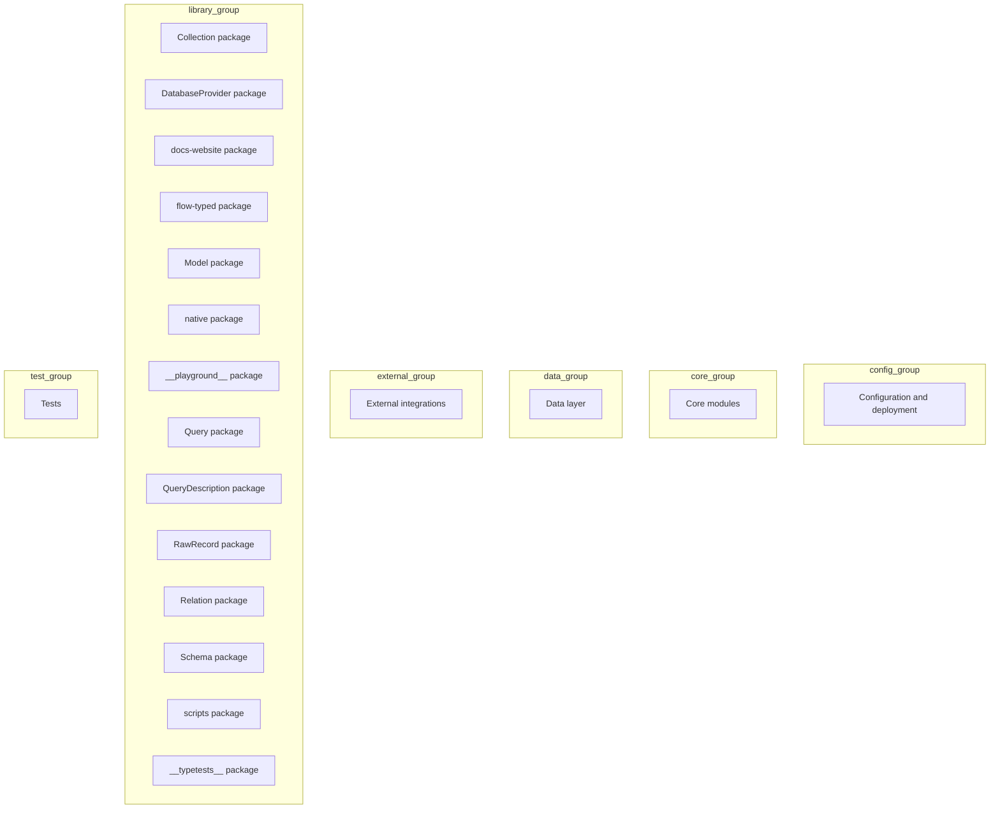

# Architecture report: Nozbe/WatermelonDB

> Automated static analysis. **Observed** = directly seen in files/imports/AST; **Inferred** = interpretation from that evidence. Repository code was not executed.

## 1. Repository at a glance

| Item | Value |
| --- | --- |
| Repository | Nozbe/WatermelonDB |
| Description | 🍉 Reactive & asynchronous database for powerful React and React Native apps ⚡️ |
| Language | JavaScript |
| Stars | 11802 |
| Licence | MIT |
| Analysed commit / branch | 5c463222ecd79928861385bac94b486fcc7623d4 / master |
| Framework(s) | React |
| Files analysed | 799 |
| Components | 19 |

## 2. Architecture in one minute

Nozbe/WatermelonDB - 🍉 Reactive & asynchronous database for powerful React and React Native apps ⚡️. This repository was analysed statically from 799 file(s) (0 Python). Detected technologies (observed from imports/manifests): GitHub Actions, React, Jest, TypeScript. Files are grouped into 19 component(s): Collection package, Configuration and deployment, Core modules, Data layer, DatabaseProvider package, docs-website package, External integrations, flow-typed package. Findings below distinguish observed facts from inferred interpretation.

## 3. High-level block diagram

## 4. Main components

### Collection package (`collection`)

- **Kind:** library
- **Status:** Observed
- **Confidence:** 0.85
- **Responsibility:** Groups 5 file(s) under collection package (observed from repository paths and static analysis).
- **Paths:** `src/Collection/RecordCache.d.ts`, `src/Collection/RecordCache.js`, `src/Collection/index.d.ts`, `src/Collection/index.js`, `src/Collection/test.js`
- **Evidence:** [src/Collection/RecordCache.d.ts](https://github.com/Nozbe/WatermelonDB/blob/5c463222ecd79928861385bac94b486fcc7623d4/src/Collection/RecordCache.d.ts); [src/Collection/RecordCache.js](https://github.com/Nozbe/WatermelonDB/blob/5c463222ecd79928861385bac94b486fcc7623d4/src/Collection/RecordCache.js); [src/Collection/index.d.ts](https://github.com/Nozbe/WatermelonDB/blob/5c463222ecd79928861385bac94b486fcc7623d4/src/Collection/index.d.ts); [src/Collection/index.js](https://github.com/Nozbe/WatermelonDB/blob/5c463222ecd79928861385bac94b486fcc7623d4/src/Collection/index.js); [src/Collection/test.js](https://github.com/Nozbe/WatermelonDB/blob/5c463222ecd79928861385bac94b486fcc7623d4/src/Collection/test.js)

### Configuration and deployment (`config`)

- **Kind:** config
- **Status:** Observed
- **Confidence:** 0.85
- **Responsibility:** Groups 67 file(s) under configuration and deployment (observed from repository paths and static analysis).
- **Paths:** `docs-website/blog/authors.yml`, `docs-website/package.json`, `native/android-jsi/build.gradle`, `native/android/build.gradle`, `native/androidTest/app/build.gradle`, `native/androidTest/build.gradle`, `native/iosTest/Pods/Local Podspecs/DoubleConversion.podspec.json`, `native/iosTest/Pods/Local Podspecs/FBLazyVector.podspec.json`, `native/iosTest/Pods/Local Podspecs/RCT-Folly.podspec.json`, `native/iosTest/Pods/Local Podspecs/RCTDeprecation.podspec.json`, `native/iosTest/Pods/Local Podspecs/RCTRequired.podspec.json`, `native/iosTest/Pods/Local Podspecs/RCTTypeSafety.podspec.json`, `native/iosTest/Pods/Local Podspecs/React-Codegen.podspec.json`, `native/iosTest/Pods/Local Podspecs/React-Core.podspec.json`, `native/iosTest/Pods/Local Podspecs/React-CoreModules.podspec.json`, `native/iosTest/Pods/Local Podspecs/React-Fabric.podspec.json`, `native/iosTest/Pods/Local Podspecs/React-FabricImage.podspec.json`, `native/iosTest/Pods/Local Podspecs/React-ImageManager.podspec.json`, `native/iosTest/Pods/Local Podspecs/React-Mapbuffer.podspec.json`, `native/iosTest/Pods/Local Podspecs/React-NativeModulesApple.podspec.json`, `native/iosTest/Pods/Local Podspecs/React-RCTActionSheet.podspec.json`, `native/iosTest/Pods/Local Podspecs/React-RCTAnimation.podspec.json`, `native/iosTest/Pods/Local Podspecs/React-RCTAppDelegate.podspec.json`, `native/iosTest/Pods/Local Podspecs/React-RCTBlob.podspec.json`, `native/iosTest/Pods/Local Podspecs/React-RCTFabric.podspec.json`, `native/iosTest/Pods/Local Podspecs/React-RCTImage.podspec.json`, `native/iosTest/Pods/Local Podspecs/React-RCTLinking.podspec.json`, `native/iosTest/Pods/Local Podspecs/React-RCTNetwork.podspec.json`, `native/iosTest/Pods/Local Podspecs/React-RCTSettings.podspec.json`, `native/iosTest/Pods/Local Podspecs/React-RCTText.podspec.json`, `native/iosTest/Pods/Local Podspecs/React-RCTVibration.podspec.json`, `native/iosTest/Pods/Local Podspecs/React-RuntimeApple.podspec.json`, `native/iosTest/Pods/Local Podspecs/React-RuntimeCore.podspec.json`, `native/iosTest/Pods/Local Podspecs/React-RuntimeHermes.podspec.json`, `native/iosTest/Pods/Local Podspecs/React-callinvoker.podspec.json`, `native/iosTest/Pods/Local Podspecs/React-cxxreact.podspec.json`, `native/iosTest/Pods/Local Podspecs/React-debug.podspec.json`, `native/iosTest/Pods/Local Podspecs/React-featureflags.podspec.json`, `native/iosTest/Pods/Local Podspecs/React-graphics.podspec.json`, `native/iosTest/Pods/Local Podspecs/React-hermes.podspec.json`, `native/iosTest/Pods/Local Podspecs/React-jserrorhandler.podspec.json`, `native/iosTest/Pods/Local Podspecs/React-jsi.podspec.json`, `native/iosTest/Pods/Local Podspecs/React-jsiexecutor.podspec.json`, `native/iosTest/Pods/Local Podspecs/React-jsinspector.podspec.json`, `native/iosTest/Pods/Local Podspecs/React-jsitracing.podspec.json`, `native/iosTest/Pods/Local Podspecs/React-logger.podspec.json`, `native/iosTest/Pods/Local Podspecs/React-nativeconfig.podspec.json`, `native/iosTest/Pods/Local Podspecs/React-perflogger.podspec.json`, `native/iosTest/Pods/Local Podspecs/React-rendererdebug.podspec.json`, `native/iosTest/Pods/Local Podspecs/React-rncore.podspec.json`, `native/iosTest/Pods/Local Podspecs/React-runtimeexecutor.podspec.json`, `native/iosTest/Pods/Local Podspecs/React-runtimescheduler.podspec.json`, `native/iosTest/Pods/Local Podspecs/React-utils.podspec.json`, `native/iosTest/Pods/Local Podspecs/React.podspec.json`, `native/iosTest/Pods/Local Podspecs/ReactCommon.podspec.json`, `native/iosTest/Pods/Local Podspecs/WatermelonDB.podspec.json`, `native/iosTest/Pods/Local Podspecs/Yoga.podspec.json`, `native/iosTest/Pods/Local Podspecs/boost.podspec.json`, `native/iosTest/Pods/Local Podspecs/fmt.podspec.json`, `native/iosTest/Pods/Local Podspecs/glog.podspec.json`, `native/iosTest/Pods/Local Podspecs/hermes-engine.podspec.json`, `native/iosTest/Pods/Local Podspecs/simdjson.podspec.json`, `native/iosTest/WatermelonTester/Images.xcassets/AppIcon.appiconset/Contents.json`, `native/iosTest/WatermelonTester/Images.xcassets/Contents.json`, `native/windowsE2E/package.json`, `native/windowsE2E/tsconfig.json`, `package.json`
- **Evidence:** [docs-website/blog/authors.yml](https://github.com/Nozbe/WatermelonDB/blob/5c463222ecd79928861385bac94b486fcc7623d4/docs-website/blog/authors.yml); [docs-website/package.json](https://github.com/Nozbe/WatermelonDB/blob/5c463222ecd79928861385bac94b486fcc7623d4/docs-website/package.json); [native/android-jsi/build.gradle](https://github.com/Nozbe/WatermelonDB/blob/5c463222ecd79928861385bac94b486fcc7623d4/native/android-jsi/build.gradle); [native/android/build.gradle](https://github.com/Nozbe/WatermelonDB/blob/5c463222ecd79928861385bac94b486fcc7623d4/native/android/build.gradle); [native/androidTest/app/build.gradle](https://github.com/Nozbe/WatermelonDB/blob/5c463222ecd79928861385bac94b486fcc7623d4/native/androidTest/app/build.gradle); [native/androidTest/build.gradle](https://github.com/Nozbe/WatermelonDB/blob/5c463222ecd79928861385bac94b486fcc7623d4/native/androidTest/build.gradle); [native/iosTest/Pods/Local Podspecs/DoubleConversion.podspec.json](https://github.com/Nozbe/WatermelonDB/blob/5c463222ecd79928861385bac94b486fcc7623d4/native/iosTest/Pods/Local%20Podspecs/DoubleConversion.podspec.json); [native/iosTest/Pods/Local Podspecs/FBLazyVector.podspec.json](https://github.com/Nozbe/WatermelonDB/blob/5c463222ecd79928861385bac94b486fcc7623d4/native/iosTest/Pods/Local%20Podspecs/FBLazyVector.podspec.json)

### Core modules (`core`)

- **Kind:** core
- **Status:** Observed
- **Confidence:** 0.85
- **Responsibility:** Groups 5 file(s) under core modules (observed from repository paths and static analysis).
- **Paths:** `babel.config.js`, `jest.config.js`, `metro.config.js`, `prettier.config.js`, `react-native.config.js`
- **Evidence:** [babel.config.js](https://github.com/Nozbe/WatermelonDB/blob/5c463222ecd79928861385bac94b486fcc7623d4/babel.config.js); [jest.config.js](https://github.com/Nozbe/WatermelonDB/blob/5c463222ecd79928861385bac94b486fcc7623d4/jest.config.js); [metro.config.js](https://github.com/Nozbe/WatermelonDB/blob/5c463222ecd79928861385bac94b486fcc7623d4/metro.config.js); [prettier.config.js](https://github.com/Nozbe/WatermelonDB/blob/5c463222ecd79928861385bac94b486fcc7623d4/prettier.config.js); [react-native.config.js](https://github.com/Nozbe/WatermelonDB/blob/5c463222ecd79928861385bac94b486fcc7623d4/react-native.config.js)

### Data layer (`data_layer`)

- **Kind:** data
- **Status:** Observed
- **Confidence:** 0.85
- **Responsibility:** Groups 11 file(s) under data layer (observed from repository paths and static analysis).
- **Paths:** `src/Database/CollectionMap/index.d.ts`, `src/Database/CollectionMap/index.js`, `src/Database/CollectionMap/test.js`, `src/Database/LocalStorage/index.d.ts`, `src/Database/LocalStorage/index.js`, `src/Database/LocalStorage/test.js`, `src/Database/WorkQueue.d.ts`, `src/Database/WorkQueue.js`, `src/Database/index.d.ts`, `src/Database/index.js`, `src/Database/test.js`
- **Evidence:** [src/Database/CollectionMap/index.d.ts](https://github.com/Nozbe/WatermelonDB/blob/5c463222ecd79928861385bac94b486fcc7623d4/src/Database/CollectionMap/index.d.ts); [src/Database/CollectionMap/index.js](https://github.com/Nozbe/WatermelonDB/blob/5c463222ecd79928861385bac94b486fcc7623d4/src/Database/CollectionMap/index.js); [src/Database/CollectionMap/test.js](https://github.com/Nozbe/WatermelonDB/blob/5c463222ecd79928861385bac94b486fcc7623d4/src/Database/CollectionMap/test.js); [src/Database/LocalStorage/index.d.ts](https://github.com/Nozbe/WatermelonDB/blob/5c463222ecd79928861385bac94b486fcc7623d4/src/Database/LocalStorage/index.d.ts); [src/Database/LocalStorage/index.js](https://github.com/Nozbe/WatermelonDB/blob/5c463222ecd79928861385bac94b486fcc7623d4/src/Database/LocalStorage/index.js); [src/Database/LocalStorage/test.js](https://github.com/Nozbe/WatermelonDB/blob/5c463222ecd79928861385bac94b486fcc7623d4/src/Database/LocalStorage/test.js); [src/Database/WorkQueue.d.ts](https://github.com/Nozbe/WatermelonDB/blob/5c463222ecd79928861385bac94b486fcc7623d4/src/Database/WorkQueue.d.ts); [src/Database/WorkQueue.js](https://github.com/Nozbe/WatermelonDB/blob/5c463222ecd79928861385bac94b486fcc7623d4/src/Database/WorkQueue.js)

### DatabaseProvider package (`databaseprovider`)

- **Kind:** library
- **Status:** Observed
- **Confidence:** 0.85
- **Responsibility:** Groups 2 file(s) under databaseprovider package (observed from repository paths and static analysis).
- **Paths:** `src/DatabaseProvider/index.d.ts`, `src/DatabaseProvider/index.js`
- **Evidence:** [src/DatabaseProvider/index.d.ts](https://github.com/Nozbe/WatermelonDB/blob/5c463222ecd79928861385bac94b486fcc7623d4/src/DatabaseProvider/index.d.ts); [src/DatabaseProvider/index.js](https://github.com/Nozbe/WatermelonDB/blob/5c463222ecd79928861385bac94b486fcc7623d4/src/DatabaseProvider/index.js)

### docs-website package (`docs_website`)

- **Kind:** library
- **Status:** Observed
- **Confidence:** 0.85
- **Responsibility:** Groups 5 file(s) under docs-website package (observed from repository paths and static analysis).
- **Paths:** `docs-website/babel.config.js`, `docs-website/docusaurus.config.js`, `docs-website/sidebars.js`, `docs-website/src/components/HomepageFeatures/index.js`, `docs-website/src/pages/index.js`
- **Evidence:** [docs-website/babel.config.js](https://github.com/Nozbe/WatermelonDB/blob/5c463222ecd79928861385bac94b486fcc7623d4/docs-website/babel.config.js); [docs-website/docusaurus.config.js](https://github.com/Nozbe/WatermelonDB/blob/5c463222ecd79928861385bac94b486fcc7623d4/docs-website/docusaurus.config.js); [docs-website/sidebars.js](https://github.com/Nozbe/WatermelonDB/blob/5c463222ecd79928861385bac94b486fcc7623d4/docs-website/sidebars.js); [docs-website/src/components/HomepageFeatures/index.js](https://github.com/Nozbe/WatermelonDB/blob/5c463222ecd79928861385bac94b486fcc7623d4/docs-website/src/components/HomepageFeatures/index.js); [docs-website/src/pages/index.js](https://github.com/Nozbe/WatermelonDB/blob/5c463222ecd79928861385bac94b486fcc7623d4/docs-website/src/pages/index.js)

### External integrations (`external_integrations`)

- **Kind:** external
- **Status:** Observed
- **Confidence:** 0.85
- **Responsibility:** Groups 21 file(s) under external integrations (observed from repository paths and static analysis).
- **Paths:** `src/adapters/__tests__/commonTests.js`, `src/adapters/__tests__/helpers.js`, `src/adapters/common.js`, `src/adapters/compat.d.ts`, `src/adapters/compat.js`, `src/adapters/error.js`, `src/adapters/lokijs/common.d.ts`, `src/adapters/lokijs/common.js`, `src/adapters/lokijs/dispatcher.d.ts`, `src/adapters/lokijs/dispatcher.js`, `src/adapters/lokijs/index.d.ts`, `src/adapters/lokijs/index.js`, `src/adapters/lokijs/test.js`, `src/adapters/lokijs/type.d.ts`, `src/adapters/lokijs/type.js`, `src/adapters/lokijs/worker/DatabaseBridge.js`, `src/adapters/lokijs/worker/DatabaseDriver.js`, `src/adapters/lokijs/worker/cloneMessage/index.js`, `src/adapters/lokijs/worker/cloneMessage/test.js`, `src/adapters/lokijs/worker/encodeQuery/index.js`, `src/adapters/lokijs/worker/encodeQuery/test.js`
- **Evidence:** [src/adapters/__tests__/commonTests.js](https://github.com/Nozbe/WatermelonDB/blob/5c463222ecd79928861385bac94b486fcc7623d4/src/adapters/__tests__/commonTests.js); [src/adapters/__tests__/helpers.js](https://github.com/Nozbe/WatermelonDB/blob/5c463222ecd79928861385bac94b486fcc7623d4/src/adapters/__tests__/helpers.js); [src/adapters/common.js](https://github.com/Nozbe/WatermelonDB/blob/5c463222ecd79928861385bac94b486fcc7623d4/src/adapters/common.js); [src/adapters/compat.d.ts](https://github.com/Nozbe/WatermelonDB/blob/5c463222ecd79928861385bac94b486fcc7623d4/src/adapters/compat.d.ts); [src/adapters/compat.js](https://github.com/Nozbe/WatermelonDB/blob/5c463222ecd79928861385bac94b486fcc7623d4/src/adapters/compat.js); [src/adapters/error.js](https://github.com/Nozbe/WatermelonDB/blob/5c463222ecd79928861385bac94b486fcc7623d4/src/adapters/error.js); [src/adapters/lokijs/common.d.ts](https://github.com/Nozbe/WatermelonDB/blob/5c463222ecd79928861385bac94b486fcc7623d4/src/adapters/lokijs/common.d.ts); [src/adapters/lokijs/common.js](https://github.com/Nozbe/WatermelonDB/blob/5c463222ecd79928861385bac94b486fcc7623d4/src/adapters/lokijs/common.js)

### flow-typed package (`flow_typed`)

- **Kind:** library
- **Status:** Observed
- **Confidence:** 0.85
- **Responsibility:** Groups 3 file(s) under flow-typed package (observed from repository paths and static analysis).
- **Paths:** `flow-typed/custom/lokijs.js`, `flow-typed/custom/react-native.js`, `flow-typed/npm/rxjs_v6.x.js`
- **Evidence:** [flow-typed/custom/lokijs.js](https://github.com/Nozbe/WatermelonDB/blob/5c463222ecd79928861385bac94b486fcc7623d4/flow-typed/custom/lokijs.js); [flow-typed/custom/react-native.js](https://github.com/Nozbe/WatermelonDB/blob/5c463222ecd79928861385bac94b486fcc7623d4/flow-typed/custom/react-native.js); [flow-typed/npm/rxjs_v6.x.js](https://github.com/Nozbe/WatermelonDB/blob/5c463222ecd79928861385bac94b486fcc7623d4/flow-typed/npm/rxjs_v6.x.js)

### Model package (`model`)

- **Kind:** library
- **Status:** Observed
- **Confidence:** 0.85
- **Responsibility:** Groups 5 file(s) under model package (observed from repository paths and static analysis).
- **Paths:** `src/Model/helpers.d.ts`, `src/Model/helpers.js`, `src/Model/index.d.ts`, `src/Model/index.js`, `src/Model/test.js`
- **Evidence:** [src/Model/helpers.d.ts](https://github.com/Nozbe/WatermelonDB/blob/5c463222ecd79928861385bac94b486fcc7623d4/src/Model/helpers.d.ts); [src/Model/helpers.js](https://github.com/Nozbe/WatermelonDB/blob/5c463222ecd79928861385bac94b486fcc7623d4/src/Model/helpers.js); [src/Model/index.d.ts](https://github.com/Nozbe/WatermelonDB/blob/5c463222ecd79928861385bac94b486fcc7623d4/src/Model/index.d.ts); [src/Model/index.js](https://github.com/Nozbe/WatermelonDB/blob/5c463222ecd79928861385bac94b486fcc7623d4/src/Model/index.js); [src/Model/test.js](https://github.com/Nozbe/WatermelonDB/blob/5c463222ecd79928861385bac94b486fcc7623d4/src/Model/test.js)

### native package (`native`)

- **Kind:** library
- **Status:** Observed
- **Confidence:** 0.85
- **Responsibility:** Groups 158 file(s) under native package (observed from repository paths and static analysis).
- **Paths:** `native/android-jsi/src/main/cpp/DatabasePlatformAndroid.cpp`, `native/android-jsi/src/main/cpp/DatabasePlatformAndroid.h`, `native/android-jsi/src/main/cpp/JSIInstaller.cpp`, `native/android-jsi/src/main/java/com/nozbe/watermelondb/WatermelonDBJSIModule.java`, `native/android-jsi/src/main/java/com/nozbe/watermelondb/jsi/JSIInstaller.java`, `native/android-jsi/src/main/java/com/nozbe/watermelondb/jsi/WatermelonDBJSIPackage.java`, `native/android-jsi/src/main/java/com/nozbe/watermelondb/jsi/WatermelonJSI.java`, `native/android/src/main/java/com/nozbe/watermelondb/Connection.java`, `native/android/src/main/java/com/nozbe/watermelondb/DatabaseUtils.java`, `native/android/src/main/java/com/nozbe/watermelondb/MigrationNeededError.java`, `native/android/src/main/java/com/nozbe/watermelondb/Queries.java`, `native/android/src/main/java/com/nozbe/watermelondb/SchemaNeededError.java`, `native/android/src/main/java/com/nozbe/watermelondb/WMDatabase.java`, `native/android/src/main/java/com/nozbe/watermelondb/WMDatabaseBridge.java`, `native/android/src/main/java/com/nozbe/watermelondb/WMDatabaseDriver.java`, `native/android/src/main/java/com/nozbe/watermelondb/WatermelonDBPackage.java`, `native/android/src/main/java/com/nozbe/watermelondb/utils/MigrationSet.java`, `native/android/src/main/java/com/nozbe/watermelondb/utils/Pair.java`, `native/android/src/main/java/com/nozbe/watermelondb/utils/Schema.java`, `native/ios/WatermelonDB/FMDB/src/fmdb/FMDB.h`, `native/ios/WatermelonDB/FMDB/src/fmdb/FMDatabase.h`, `native/ios/WatermelonDB/FMDB/src/fmdb/FMDatabaseAdditions.h`, `native/ios/WatermelonDB/FMDB/src/fmdb/FMDatabasePool.h`, `native/ios/WatermelonDB/FMDB/src/fmdb/FMDatabaseQueue.h`, `native/ios/WatermelonDB/FMDB/src/fmdb/FMResultSet.h`, `native/ios/WatermelonDB/JSIInstaller.h`, `native/ios/WatermelonDB/WatermelonDB.h`, `native/ios/WatermelonDB/objc/WMDatabase.h`, `native/ios/WatermelonDB/objc/WMDatabaseBridge.h`, `native/ios/WatermelonDB/objc/WMDatabaseDriver.h`, `native/iosTest/Pods/DoubleConversion/double-conversion/bignum-dtoa.h`, `native/iosTest/Pods/DoubleConversion/double-conversion/bignum.h`, `native/iosTest/Pods/DoubleConversion/double-conversion/cached-powers.h`, `native/iosTest/Pods/DoubleConversion/double-conversion/diy-fp.h`, `native/iosTest/Pods/DoubleConversion/double-conversion/double-conversion.h`, `native/iosTest/Pods/DoubleConversion/double-conversion/fast-dtoa.h`, `native/iosTest/Pods/DoubleConversion/double-conversion/fixed-dtoa.h`, `native/iosTest/Pods/DoubleConversion/double-conversion/ieee.h`, `native/iosTest/Pods/DoubleConversion/double-conversion/strtod.h`, `native/iosTest/Pods/DoubleConversion/double-conversion/utils.h`, `native/iosTest/Pods/SocketRocket/SocketRocket/Internal/Delegate/SRDelegateController.h`, `native/iosTest/Pods/SocketRocket/SocketRocket/Internal/IOConsumer/SRIOConsumer.h`, `native/iosTest/Pods/SocketRocket/SocketRocket/Internal/IOConsumer/SRIOConsumerPool.h`, `native/iosTest/Pods/SocketRocket/SocketRocket/Internal/NSRunLoop+SRWebSocketPrivate.h`, `native/iosTest/Pods/SocketRocket/SocketRocket/Internal/NSURLRequest+SRWebSocketPrivate.h`, `native/iosTest/Pods/SocketRocket/SocketRocket/Internal/Proxy/SRProxyConnect.h`, `native/iosTest/Pods/SocketRocket/SocketRocket/Internal/RunLoop/SRRunLoopThread.h`, `native/iosTest/Pods/SocketRocket/SocketRocket/Internal/SRConstants.h`, `native/iosTest/Pods/SocketRocket/SocketRocket/Internal/Security/SRPinningSecurityPolicy.h`, `native/iosTest/Pods/SocketRocket/SocketRocket/Internal/Utilities/SRError.h`, `native/iosTest/Pods/SocketRocket/SocketRocket/Internal/Utilities/SRHTTPConnectMessage.h`, `native/iosTest/Pods/SocketRocket/SocketRocket/Internal/Utilities/SRHash.h`, `native/iosTest/Pods/SocketRocket/SocketRocket/Internal/Utilities/SRLog.h`, `native/iosTest/Pods/SocketRocket/SocketRocket/Internal/Utilities/SRMutex.h`, `native/iosTest/Pods/SocketRocket/SocketRocket/Internal/Utilities/SRRandom.h`, `native/iosTest/Pods/SocketRocket/SocketRocket/Internal/Utilities/SRSIMDHelpers.h`, `native/iosTest/Pods/SocketRocket/SocketRocket/Internal/Utilities/SRURLUtilities.h`, `native/iosTest/Pods/SocketRocket/SocketRocket/NSRunLoop+SRWebSocket.h`, `native/iosTest/Pods/SocketRocket/SocketRocket/NSURLRequest+SRWebSocket.h`, `native/iosTest/Pods/SocketRocket/SocketRocket/SRSecurityPolicy.h`, `native/iosTest/Pods/SocketRocket/SocketRocket/SRWebSocket.h`, `native/iosTest/Pods/SocketRocket/SocketRocket/SocketRocket.h`, `native/iosTest/Pods/Target Support Files/DoubleConversion/DoubleConversion-umbrella.h`, `native/iosTest/Pods/Target Support Files/Pods-WatermelonTester-WatermelonTesterTests/Pods-WatermelonTester-WatermelonTesterTests-frameworks.sh`, `native/iosTest/Pods/Target Support Files/Pods-WatermelonTester-WatermelonTesterTests/Pods-WatermelonTester-WatermelonTesterTests-resources.sh`, `native/iosTest/Pods/Target Support Files/Pods-WatermelonTester/Pods-WatermelonTester-frameworks.sh`, `native/iosTest/Pods/Target Support Files/Pods-WatermelonTester/Pods-WatermelonTester-resources.sh`, `native/iosTest/Pods/Target Support Files/RCT-Folly/RCT-Folly-umbrella.h`, `native/iosTest/Pods/Target Support Files/RCTDeprecation/RCTDeprecation-umbrella.h`, `native/iosTest/Pods/Target Support Files/RCTTypeSafety/RCTTypeSafety-umbrella.h`, `native/iosTest/Pods/Target Support Files/React-Codegen/React-Codegen-umbrella.h`, `native/iosTest/Pods/Target Support Files/React-Core/React-Core-umbrella.h`, `native/iosTest/Pods/Target Support Files/React-Fabric/React-Fabric-umbrella.h`, `native/iosTest/Pods/Target Support Files/React-ImageManager/React-ImageManager-umbrella.h`, `native/iosTest/Pods/Target Support Files/React-NativeModulesApple/React-NativeModulesApple-umbrella.h`, `native/iosTest/Pods/Target Support Files/React-RCTAppDelegate/React-RCTAppDelegate-umbrella.h`, `native/iosTest/Pods/Target Support Files/React-RCTFabric/React-RCTFabric-umbrella.h`, `native/iosTest/Pods/Target Support Files/React-debug/React-debug-umbrella.h`, `native/iosTest/Pods/Target Support Files/React-featureflags/React-featureflags-umbrella.h`, `native/iosTest/Pods/Target Support Files/React-graphics/React-graphics-umbrella.h`, `native/iosTest/Pods/Target Support Files/React-jsi/React-jsi-umbrella.h`, `native/iosTest/Pods/Target Support Files/React-jsinspector/React-jsinspector-umbrella.h`, `native/iosTest/Pods/Target Support Files/React-rendererdebug/React-rendererdebug-umbrella.h`, `native/iosTest/Pods/Target Support Files/React-utils/React-utils-umbrella.h`, `native/iosTest/Pods/Target Support Files/ReactCommon/ReactCommon-umbrella.h`, `native/iosTest/Pods/Target Support Files/Yoga/Yoga-umbrella.h`, `native/iosTest/Pods/Target Support Files/glog/glog-umbrella.h`, `native/iosTest/Pods/Target Support Files/hermes-engine/hermes-engine-xcframeworks.sh`, `native/iosTest/Pods/Target Support Files/simdjson/simdjson-umbrella.h`, `native/iosTest/Pods/fmt/include/fmt/args.h`, `native/iosTest/Pods/fmt/include/fmt/chrono.h`, `native/iosTest/Pods/fmt/include/fmt/color.h`, `native/iosTest/Pods/fmt/include/fmt/compile.h`, `native/iosTest/Pods/fmt/include/fmt/core.h`, `native/iosTest/Pods/fmt/include/fmt/format-inl.h`, `native/iosTest/Pods/fmt/include/fmt/format.h`, `native/iosTest/Pods/fmt/include/fmt/os.h`, `native/iosTest/Pods/fmt/include/fmt/ostream.h`, `native/iosTest/Pods/fmt/include/fmt/printf.h`, `native/iosTest/Pods/fmt/include/fmt/ranges.h`, `native/iosTest/Pods/fmt/include/fmt/std.h`, `native/iosTest/Pods/fmt/include/fmt/xchar.h`, `native/iosTest/Pods/glog/src/base/commandlineflags.h`, `native/iosTest/Pods/glog/src/base/googleinit.h`, `native/iosTest/Pods/glog/src/base/mutex.h`, `native/iosTest/Pods/glog/src/config.h`, `native/iosTest/Pods/glog/src/config_for_unittests.h`, `native/iosTest/Pods/glog/src/demangle.h`, `native/iosTest/Pods/glog/src/glog/log_severity.h`, `native/iosTest/Pods/glog/src/glog/logging.h`, `native/iosTest/Pods/glog/src/glog/raw_logging.h`, `native/iosTest/Pods/glog/src/glog/stl_logging.h`, `native/iosTest/Pods/glog/src/glog/vlog_is_on.h`, `native/iosTest/Pods/glog/src/googletest.h`, `native/iosTest/Pods/glog/src/mock-log.h`, `native/iosTest/Pods/glog/src/stacktrace.h`, `native/iosTest/Pods/glog/src/stacktrace_generic-inl.h`, `native/iosTest/Pods/glog/src/stacktrace_libunwind-inl.h`, `native/iosTest/Pods/glog/src/stacktrace_powerpc-inl.h`, `native/iosTest/Pods/glog/src/stacktrace_x86-inl.h`, `native/iosTest/Pods/glog/src/stacktrace_x86_64-inl.h`, `native/iosTest/Pods/glog/src/symbolize.h`, `native/iosTest/Pods/glog/src/utilities.h`, `native/iosTest/WatermelonTester/WatermelonTester-Bridging-Header.h`, `native/iosTest/WatermelonTesterTests/WatermelonTesterTests-Bridging-Header.h`, `native/metro-transformer.js`, `native/shared/Database-batch.cpp`, `native/shared/Database-jsi.cpp`, `native/shared/Database-query.cpp`, `native/shared/Database-sqlite.cpp`, `native/shared/Database-turboSync.cpp`, `native/shared/Database.cpp`, `native/shared/Database.h`, `native/shared/DatabaseBridge.cpp`, `native/shared/DatabasePlatform.h`, `native/shared/JSIHelpers.h`, `native/shared/Sqlite.cpp`, `native/shared/Sqlite.h`, `native/windows/WatermelonDB/DatabasePlatformWindows.cpp`, `native/windows/WatermelonDB/ReactPackageProvider.cpp`, `native/windows/WatermelonDB/ReactPackageProvider.h`, `native/windows/WatermelonDB/WMDatabaseBridge.cpp`, `native/windows/WatermelonDB/WMDatabaseBridge.h`, `native/windows/WatermelonDB/pch.cpp`, `native/windows/WatermelonDB/pch.h`, `native/windowsE2E/babel.config.js`, `native/windowsE2E/custom-transformer.js`, `native/windowsE2E/jest.config.js`, `native/windowsTest/WatermelonTester/App.cpp`, `native/windowsTest/WatermelonTester/App.h`, `native/windowsTest/WatermelonTester/AutolinkedNativeModules.g.cpp`, `native/windowsTest/WatermelonTester/AutolinkedNativeModules.g.h`, `native/windowsTest/WatermelonTester/MainPage.cpp`, `native/windowsTest/WatermelonTester/MainPage.h`, `native/windowsTest/WatermelonTester/ReactPackageProvider.cpp`, `native/windowsTest/WatermelonTester/ReactPackageProvider.h`, `native/windowsTest/WatermelonTester/pch.cpp`, `native/windowsTest/WatermelonTester/pch.h`
- **Evidence:** [native/android-jsi/src/main/cpp/DatabasePlatformAndroid.cpp](https://github.com/Nozbe/WatermelonDB/blob/5c463222ecd79928861385bac94b486fcc7623d4/native/android-jsi/src/main/cpp/DatabasePlatformAndroid.cpp); [native/android-jsi/src/main/cpp/DatabasePlatformAndroid.h](https://github.com/Nozbe/WatermelonDB/blob/5c463222ecd79928861385bac94b486fcc7623d4/native/android-jsi/src/main/cpp/DatabasePlatformAndroid.h); [native/android-jsi/src/main/cpp/JSIInstaller.cpp](https://github.com/Nozbe/WatermelonDB/blob/5c463222ecd79928861385bac94b486fcc7623d4/native/android-jsi/src/main/cpp/JSIInstaller.cpp); [native/android-jsi/src/main/java/com/nozbe/watermelondb/WatermelonDBJSIModule.java](https://github.com/Nozbe/WatermelonDB/blob/5c463222ecd79928861385bac94b486fcc7623d4/native/android-jsi/src/main/java/com/nozbe/watermelondb/WatermelonDBJSIModule.java); [native/android-jsi/src/main/java/com/nozbe/watermelondb/jsi/JSIInstaller.java](https://github.com/Nozbe/WatermelonDB/blob/5c463222ecd79928861385bac94b486fcc7623d4/native/android-jsi/src/main/java/com/nozbe/watermelondb/jsi/JSIInstaller.java); [native/android-jsi/src/main/java/com/nozbe/watermelondb/jsi/WatermelonDBJSIPackage.java](https://github.com/Nozbe/WatermelonDB/blob/5c463222ecd79928861385bac94b486fcc7623d4/native/android-jsi/src/main/java/com/nozbe/watermelondb/jsi/WatermelonDBJSIPackage.java); [native/android-jsi/src/main/java/com/nozbe/watermelondb/jsi/WatermelonJSI.java](https://github.com/Nozbe/WatermelonDB/blob/5c463222ecd79928861385bac94b486fcc7623d4/native/android-jsi/src/main/java/com/nozbe/watermelondb/jsi/WatermelonJSI.java); [native/android/src/main/java/com/nozbe/watermelondb/Connection.java](https://github.com/Nozbe/WatermelonDB/blob/5c463222ecd79928861385bac94b486fcc7623d4/native/android/src/main/java/com/nozbe/watermelondb/Connection.java)

### __playground__ package (`playground`)

- **Kind:** library
- **Status:** Observed
- **Confidence:** 0.85
- **Responsibility:** Groups 1 file(s) under __playground__ package (observed from repository paths and static analysis).
- **Paths:** `src/__playground__/index.js`
- **Evidence:** [src/__playground__/index.js](https://github.com/Nozbe/WatermelonDB/blob/5c463222ecd79928861385bac94b486fcc7623d4/src/__playground__/index.js)

### Query package (`query`)

- **Kind:** library
- **Status:** Observed
- **Confidence:** 0.85
- **Responsibility:** Groups 5 file(s) under query package (observed from repository paths and static analysis).
- **Paths:** `src/Query/helpers.d.ts`, `src/Query/helpers.js`, `src/Query/index.d.ts`, `src/Query/index.js`, `src/Query/test.js`
- **Evidence:** [src/Query/helpers.d.ts](https://github.com/Nozbe/WatermelonDB/blob/5c463222ecd79928861385bac94b486fcc7623d4/src/Query/helpers.d.ts); [src/Query/helpers.js](https://github.com/Nozbe/WatermelonDB/blob/5c463222ecd79928861385bac94b486fcc7623d4/src/Query/helpers.js); [src/Query/index.d.ts](https://github.com/Nozbe/WatermelonDB/blob/5c463222ecd79928861385bac94b486fcc7623d4/src/Query/index.d.ts); [src/Query/index.js](https://github.com/Nozbe/WatermelonDB/blob/5c463222ecd79928861385bac94b486fcc7623d4/src/Query/index.js); [src/Query/test.js](https://github.com/Nozbe/WatermelonDB/blob/5c463222ecd79928861385bac94b486fcc7623d4/src/Query/test.js)

### QueryDescription package (`querydescription`)

- **Kind:** library
- **Status:** Observed
- **Confidence:** 0.85
- **Responsibility:** Groups 10 file(s) under querydescription package (observed from repository paths and static analysis).
- **Paths:** `src/QueryDescription/__tests__/queryWithoutDeleted.test.js`, `src/QueryDescription/__tests__/test.js`, `src/QueryDescription/helpers.d.ts`, `src/QueryDescription/helpers.js`, `src/QueryDescription/index.d.ts`, `src/QueryDescription/index.js`, `src/QueryDescription/operators.d.ts`, `src/QueryDescription/operators.js`, `src/QueryDescription/type.d.ts`, `src/QueryDescription/type.js`
- **Evidence:** [src/QueryDescription/__tests__/queryWithoutDeleted.test.js](https://github.com/Nozbe/WatermelonDB/blob/5c463222ecd79928861385bac94b486fcc7623d4/src/QueryDescription/__tests__/queryWithoutDeleted.test.js); [src/QueryDescription/__tests__/test.js](https://github.com/Nozbe/WatermelonDB/blob/5c463222ecd79928861385bac94b486fcc7623d4/src/QueryDescription/__tests__/test.js); [src/QueryDescription/helpers.d.ts](https://github.com/Nozbe/WatermelonDB/blob/5c463222ecd79928861385bac94b486fcc7623d4/src/QueryDescription/helpers.d.ts); [src/QueryDescription/helpers.js](https://github.com/Nozbe/WatermelonDB/blob/5c463222ecd79928861385bac94b486fcc7623d4/src/QueryDescription/helpers.js); [src/QueryDescription/index.d.ts](https://github.com/Nozbe/WatermelonDB/blob/5c463222ecd79928861385bac94b486fcc7623d4/src/QueryDescription/index.d.ts); [src/QueryDescription/index.js](https://github.com/Nozbe/WatermelonDB/blob/5c463222ecd79928861385bac94b486fcc7623d4/src/QueryDescription/index.js); [src/QueryDescription/operators.d.ts](https://github.com/Nozbe/WatermelonDB/blob/5c463222ecd79928861385bac94b486fcc7623d4/src/QueryDescription/operators.d.ts); [src/QueryDescription/operators.js](https://github.com/Nozbe/WatermelonDB/blob/5c463222ecd79928861385bac94b486fcc7623d4/src/QueryDescription/operators.js)

### RawRecord package (`rawrecord`)

- **Kind:** library
- **Status:** Observed
- **Confidence:** 0.85
- **Responsibility:** Groups 4 file(s) under rawrecord package (observed from repository paths and static analysis).
- **Paths:** `src/RawRecord/__tests__/helpers.js`, `src/RawRecord/__tests__/test.js`, `src/RawRecord/index.d.ts`, `src/RawRecord/index.js`
- **Evidence:** [src/RawRecord/__tests__/helpers.js](https://github.com/Nozbe/WatermelonDB/blob/5c463222ecd79928861385bac94b486fcc7623d4/src/RawRecord/__tests__/helpers.js); [src/RawRecord/__tests__/test.js](https://github.com/Nozbe/WatermelonDB/blob/5c463222ecd79928861385bac94b486fcc7623d4/src/RawRecord/__tests__/test.js); [src/RawRecord/index.d.ts](https://github.com/Nozbe/WatermelonDB/blob/5c463222ecd79928861385bac94b486fcc7623d4/src/RawRecord/index.d.ts); [src/RawRecord/index.js](https://github.com/Nozbe/WatermelonDB/blob/5c463222ecd79928861385bac94b486fcc7623d4/src/RawRecord/index.js)

### Relation package (`relation`)

- **Kind:** library
- **Status:** Observed
- **Confidence:** 0.85
- **Responsibility:** Groups 5 file(s) under relation package (observed from repository paths and static analysis).
- **Paths:** `src/Relation/helpers.d.ts`, `src/Relation/helpers.js`, `src/Relation/index.d.ts`, `src/Relation/index.js`, `src/Relation/test.js`
- **Evidence:** [src/Relation/helpers.d.ts](https://github.com/Nozbe/WatermelonDB/blob/5c463222ecd79928861385bac94b486fcc7623d4/src/Relation/helpers.d.ts); [src/Relation/helpers.js](https://github.com/Nozbe/WatermelonDB/blob/5c463222ecd79928861385bac94b486fcc7623d4/src/Relation/helpers.js); [src/Relation/index.d.ts](https://github.com/Nozbe/WatermelonDB/blob/5c463222ecd79928861385bac94b486fcc7623d4/src/Relation/index.d.ts); [src/Relation/index.js](https://github.com/Nozbe/WatermelonDB/blob/5c463222ecd79928861385bac94b486fcc7623d4/src/Relation/index.js); [src/Relation/test.js](https://github.com/Nozbe/WatermelonDB/blob/5c463222ecd79928861385bac94b486fcc7623d4/src/Relation/test.js)

### Schema package (`schema`)

- **Kind:** library
- **Status:** Observed
- **Confidence:** 0.85
- **Responsibility:** Groups 11 file(s) under schema package (observed from repository paths and static analysis).
- **Paths:** `src/Schema/index.d.ts`, `src/Schema/index.js`, `src/Schema/migrations/getSyncChanges/index.d.ts`, `src/Schema/migrations/getSyncChanges/index.js`, `src/Schema/migrations/getSyncChanges/test.js`, `src/Schema/migrations/index.d.ts`, `src/Schema/migrations/index.js`, `src/Schema/migrations/stepsForMigration.d.ts`, `src/Schema/migrations/stepsForMigration.js`, `src/Schema/migrations/test.js`, `src/Schema/test.js`
- **Evidence:** [src/Schema/index.d.ts](https://github.com/Nozbe/WatermelonDB/blob/5c463222ecd79928861385bac94b486fcc7623d4/src/Schema/index.d.ts); [src/Schema/index.js](https://github.com/Nozbe/WatermelonDB/blob/5c463222ecd79928861385bac94b486fcc7623d4/src/Schema/index.js); [src/Schema/migrations/getSyncChanges/index.d.ts](https://github.com/Nozbe/WatermelonDB/blob/5c463222ecd79928861385bac94b486fcc7623d4/src/Schema/migrations/getSyncChanges/index.d.ts); [src/Schema/migrations/getSyncChanges/index.js](https://github.com/Nozbe/WatermelonDB/blob/5c463222ecd79928861385bac94b486fcc7623d4/src/Schema/migrations/getSyncChanges/index.js); [src/Schema/migrations/getSyncChanges/test.js](https://github.com/Nozbe/WatermelonDB/blob/5c463222ecd79928861385bac94b486fcc7623d4/src/Schema/migrations/getSyncChanges/test.js); [src/Schema/migrations/index.d.ts](https://github.com/Nozbe/WatermelonDB/blob/5c463222ecd79928861385bac94b486fcc7623d4/src/Schema/migrations/index.d.ts); [src/Schema/migrations/index.js](https://github.com/Nozbe/WatermelonDB/blob/5c463222ecd79928861385bac94b486fcc7623d4/src/Schema/migrations/index.js); [src/Schema/migrations/stepsForMigration.d.ts](https://github.com/Nozbe/WatermelonDB/blob/5c463222ecd79928861385bac94b486fcc7623d4/src/Schema/migrations/stepsForMigration.d.ts)

### scripts package (`scripts`)

- **Kind:** library
- **Status:** Observed
- **Confidence:** 0.85
- **Responsibility:** Groups 5 file(s) under scripts package (observed from repository paths and static analysis).
- **Paths:** `scripts/emulator.mjs`, `scripts/make.mjs`, `scripts/pkg.cjs`, `scripts/release.mjs`, `scripts/replace-docs-path.mjs`
- **Evidence:** [scripts/emulator.mjs](https://github.com/Nozbe/WatermelonDB/blob/5c463222ecd79928861385bac94b486fcc7623d4/scripts/emulator.mjs); [scripts/make.mjs](https://github.com/Nozbe/WatermelonDB/blob/5c463222ecd79928861385bac94b486fcc7623d4/scripts/make.mjs); [scripts/pkg.cjs](https://github.com/Nozbe/WatermelonDB/blob/5c463222ecd79928861385bac94b486fcc7623d4/scripts/pkg.cjs); [scripts/release.mjs](https://github.com/Nozbe/WatermelonDB/blob/5c463222ecd79928861385bac94b486fcc7623d4/scripts/release.mjs); [scripts/replace-docs-path.mjs](https://github.com/Nozbe/WatermelonDB/blob/5c463222ecd79928861385bac94b486fcc7623d4/scripts/replace-docs-path.mjs)

### Tests (`tests`)

- **Kind:** test
- **Status:** Observed
- **Confidence:** 0.85
- **Responsibility:** Groups 11 file(s) under tests (observed from repository paths and static analysis).
- **Paths:** `native/windowsE2E/test/watermelon.test.ts`, `src/__tests__/databaseTests.js`, `src/__tests__/emptyMock/index.js`, `src/__tests__/integrationTests.js`, `src/__tests__/setUpIntegrationTestEnv.js`, `src/__tests__/setup.js`, `src/__tests__/testModels.js`, `src/__tests__/utils/expectToRejectWithMessage/index.js`, `src/__tests__/utils/index.js`, `src/__tests__/utils/makeScheduler.js`, `src/__tests__/utils/naughtyStrings.js`
- **Evidence:** [native/windowsE2E/test/watermelon.test.ts](https://github.com/Nozbe/WatermelonDB/blob/5c463222ecd79928861385bac94b486fcc7623d4/native/windowsE2E/test/watermelon.test.ts); [src/__tests__/databaseTests.js](https://github.com/Nozbe/WatermelonDB/blob/5c463222ecd79928861385bac94b486fcc7623d4/src/__tests__/databaseTests.js); [src/__tests__/emptyMock/index.js](https://github.com/Nozbe/WatermelonDB/blob/5c463222ecd79928861385bac94b486fcc7623d4/src/__tests__/emptyMock/index.js); [src/__tests__/integrationTests.js](https://github.com/Nozbe/WatermelonDB/blob/5c463222ecd79928861385bac94b486fcc7623d4/src/__tests__/integrationTests.js); [src/__tests__/setUpIntegrationTestEnv.js](https://github.com/Nozbe/WatermelonDB/blob/5c463222ecd79928861385bac94b486fcc7623d4/src/__tests__/setUpIntegrationTestEnv.js); [src/__tests__/setup.js](https://github.com/Nozbe/WatermelonDB/blob/5c463222ecd79928861385bac94b486fcc7623d4/src/__tests__/setup.js); [src/__tests__/testModels.js](https://github.com/Nozbe/WatermelonDB/blob/5c463222ecd79928861385bac94b486fcc7623d4/src/__tests__/testModels.js); [src/__tests__/utils/expectToRejectWithMessage/index.js](https://github.com/Nozbe/WatermelonDB/blob/5c463222ecd79928861385bac94b486fcc7623d4/src/__tests__/utils/expectToRejectWithMessage/index.js)

### __typetests__ package (`typetests`)

- **Kind:** library
- **Status:** Observed
- **Confidence:** 0.85
- **Responsibility:** Groups 1 file(s) under __typetests__ package (observed from repository paths and static analysis).
- **Paths:** `src/__typetests__/query.js`
- **Evidence:** [src/__typetests__/query.js](https://github.com/Nozbe/WatermelonDB/blob/5c463222ecd79928861385bac94b486fcc7623d4/src/__typetests__/query.js)

## 5. Execution flow

**Observed** entry point(s):

- [docs-website/src/pages/index.js](https://github.com/Nozbe/WatermelonDB/blob/5c463222ecd79928861385bac94b486fcc7623d4/docs-website/src/pages/index.js)
- [src/Collection/index.js](https://github.com/Nozbe/WatermelonDB/blob/5c463222ecd79928861385bac94b486fcc7623d4/src/Collection/index.js)
- [src/Database/CollectionMap/index.js](https://github.com/Nozbe/WatermelonDB/blob/5c463222ecd79928861385bac94b486fcc7623d4/src/Database/CollectionMap/index.js)
- [src/Database/LocalStorage/index.js](https://github.com/Nozbe/WatermelonDB/blob/5c463222ecd79928861385bac94b486fcc7623d4/src/Database/LocalStorage/index.js)
- [src/Database/index.js](https://github.com/Nozbe/WatermelonDB/blob/5c463222ecd79928861385bac94b486fcc7623d4/src/Database/index.js)
- [src/DatabaseProvider/index.js](https://github.com/Nozbe/WatermelonDB/blob/5c463222ecd79928861385bac94b486fcc7623d4/src/DatabaseProvider/index.js)
- [src/Model/index.js](https://github.com/Nozbe/WatermelonDB/blob/5c463222ecd79928861385bac94b486fcc7623d4/src/Model/index.js)
- [src/Query/index.js](https://github.com/Nozbe/WatermelonDB/blob/5c463222ecd79928861385bac94b486fcc7623d4/src/Query/index.js)
- [src/QueryDescription/index.js](https://github.com/Nozbe/WatermelonDB/blob/5c463222ecd79928861385bac94b486fcc7623d4/src/QueryDescription/index.js)
- [src/RawRecord/index.js](https://github.com/Nozbe/WatermelonDB/blob/5c463222ecd79928861385bac94b486fcc7623d4/src/RawRecord/index.js)
- [src/Relation/index.js](https://github.com/Nozbe/WatermelonDB/blob/5c463222ecd79928861385bac94b486fcc7623d4/src/Relation/index.js)
- [src/Schema/index.js](https://github.com/Nozbe/WatermelonDB/blob/5c463222ecd79928861385bac94b486fcc7623d4/src/Schema/index.js)

Representative flow (derived from observed entry points and the import graph; steps beyond the entry point are **Inferred**):

1. Execution starts at an observed entry point listed above, if present.
2. No internal import relationships between components were observed.

## 6. Project structure

### `(root)`

- `.eslintignore` - other (105 bytes)
- `.eslintrc.js` - source, JavaScript (1305 bytes)
- `.flowconfig` - other (633 bytes)
- `.gitattributes` - other (63 bytes)
- `.gitignore` - other (267 bytes)
- `.imgbotconfig` - other (47 bytes)
- `CHANGELOG-Unreleased.md` - docs (378 bytes)
- `CHANGELOG.md` - docs (53684 bytes)
- `CONTRIBUTING.md` - docs (3803 bytes)
- `Gemfile` - other (520 bytes)
- `Gemfile.lock` - other (2828 bytes)
- `LICENSE` - docs (1057 bytes)
- `README.md` - docs (8963 bytes)
- `SECURITY.md` - docs (1114 bytes)
- `WatermelonDB.podspec` - other (1700 bytes)
- `babel.config.js` - source, JavaScript (2554 bytes)
- `jest.config.js` - source, JavaScript (636 bytes)
- `metro.config.js` - source, JavaScript (2530 bytes)
- `package.json` - manifest (7376 bytes)
- `prettier.config.js` - source, JavaScript (319 bytes)
- `react-native.config.js` - source, JavaScript (833 bytes)

### `.github`

- `.github/stale.yml` - config (39 bytes)
- `.github/workflows/ci.yml` - ci, YAML (4036 bytes)

### `docs-website`

- `docs-website/.gitignore` - other (233 bytes)
- `docs-website/README.md` - docs (770 bytes)
- `docs-website/babel.config.js` - source, JavaScript (89 bytes)
- `docs-website/blog/2021-08-01-mdx-blog-post.mdx` - other (454 bytes)
- `docs-website/blog/authors.yml` - config (167 bytes)
- `docs-website/docs/docs/Advanced/AdvancedFields.md` - docs (6330 bytes)
- `docs-website/docs/docs/Advanced/CreateUpdateTracking.md` - docs (2163 bytes)
- `docs-website/docs/docs/Advanced/Flow.md` - docs (4458 bytes)
- `docs-website/docs/docs/Advanced/LocalStorage.md` - docs (1364 bytes)
- `docs-website/docs/docs/Advanced/Logging.md` - docs (1295 bytes)
- `docs-website/docs/docs/Advanced/Migrations.md` - docs (7548 bytes)
- `docs-website/docs/docs/Advanced/Performance.md` - docs (91 bytes)
- `docs-website/docs/docs/Advanced/ProTips.md` - docs (2794 bytes)
- `docs-website/docs/docs/Advanced/SharingDatabaseAcrossTargets.md` - docs (4215 bytes)
- `docs-website/docs/docs/CHANGELOG.md` - docs (53705 bytes)
- `docs-website/docs/docs/CONTRIBUTING.md` - docs (3849 bytes)
- `docs-website/docs/docs/CRUD.md` - docs (5127 bytes)
- `docs-website/docs/docs/Components.md` - docs (12311 bytes)
- `docs-website/docs/docs/Implementation/Architecture.md` - docs (2407 bytes)
- `docs-website/docs/docs/Implementation/DatabaseAdapters.md` - docs (6018 bytes)
- `docs-website/docs/docs/Implementation/Publishing.md` - docs (652 bytes)
- `docs-website/docs/docs/Implementation/SyncImpl.md` - docs (8078 bytes)
- `docs-website/docs/docs/Installation.mdx` - docs (11099 bytes)
- `docs-website/docs/docs/Model.md` - docs (6206 bytes)
- `docs-website/docs/docs/Query.md` - docs (19286 bytes)
- `docs-website/docs/docs/README.md` - docs (8849 bytes)
- `docs-website/docs/docs/Relation.md` - docs (4744 bytes)
- `docs-website/docs/docs/Roadmap.md` - docs (609 bytes)
- `docs-website/docs/docs/Schema.md` - docs (5432 bytes)
- `docs-website/docs/docs/Setup.md` - docs (3466 bytes)
- `docs-website/docs/docs/Sync/Backend.md` - docs (12616 bytes)
- `docs-website/docs/docs/Sync/Contribute.md` - docs (539 bytes)
- `docs-website/docs/docs/Sync/FAQ.md` - docs (1909 bytes)
- `docs-website/docs/docs/Sync/Frontend.md` - docs (17163 bytes)
- `docs-website/docs/docs/Sync/Intro.md` - docs (1006 bytes)
- `docs-website/docs/docs/Sync/Limitations.md` - docs (1003 bytes)
- `docs-website/docs/docs/Sync/Troubleshoot.md` - docs (499 bytes)
- `docs-website/docs/docs/Writers.md` - docs (9010 bytes)
- `docs-website/docusaurus.config.js` - source, JavaScript (4673 bytes)
- `docs-website/package.json` - manifest (1030 bytes)
- `docs-website/sidebars.js` - source, JavaScript (1487 bytes)
- `docs-website/src/components/HomepageFeatures/index.js` - source, JavaScript (1444 bytes)
- `docs-website/src/components/HomepageFeatures/styles.module.css` - other (138 bytes)
- `docs-website/src/css/custom.css` - other (998 bytes)
- `docs-website/src/pages/index.js` - source, JavaScript (1240 bytes)
- `docs-website/src/pages/index.module.css` - other (365 bytes)
- `docs-website/static/.nojekyll` - other (0 bytes)
- `docs-website/static/CNAME` - other (16 bytes)
- `docs-website/static/img/logo.svg` - other (34539 bytes)

### `examples`

- `examples/typescript/AppSchema.ts` - source, TypeScript (555 bytes)
- `examples/typescript/__typetests__/README.md` - docs (159 bytes)
- `examples/typescript/__typetests__/index.ts` - source, TypeScript (44 bytes)
- `examples/typescript/__typetests__/query.ts` - source, TypeScript (738 bytes)
- `examples/typescript/__typetests__/withObservables.tsx` - source, TypeScript (1455 bytes)
- `examples/typescript/package.json` - manifest (279 bytes)
- `examples/typescript/ts-example.ts` - source, TypeScript (2803 bytes)
- `examples/typescript/tsconfig.json` - config (463 bytes)

### `flow-typed`

- `flow-typed/custom/lokijs.js` - source, JavaScript (144 bytes)
- `flow-typed/custom/react-native.js` - source, JavaScript (65 bytes)
- `flow-typed/npm/rxjs_v6.x.js` - source, JavaScript (48698 bytes)

### `native`

- `native/.clang-format` - other (1420 bytes)
- `native/.gitignore` - other (1035 bytes)
- `native/android-jsi/.gitignore` - other (134 bytes)
- `native/android-jsi/build.gradle` - manifest (2711 bytes)
- `native/android-jsi/src/main/AndroidManifest.xml` - other (52 bytes)
- `native/android-jsi/src/main/cpp/CMakeLists.txt` - docs (3900 bytes)
- `native/android-jsi/src/main/cpp/DatabasePlatformAndroid.cpp` - source, C++ (7532 bytes)
- `native/android-jsi/src/main/cpp/DatabasePlatformAndroid.h` - source, C/C++ (224 bytes)
- `native/android-jsi/src/main/cpp/JSIInstaller.cpp` - source, C++ (815 bytes)
- `native/android-jsi/src/main/java/com/nozbe/watermelondb/WatermelonDBJSIModule.java` - source, Java (1366 bytes)
- `native/android-jsi/src/main/java/com/nozbe/watermelondb/jsi/JSIInstaller.java` - source, Java (1105 bytes)
- `native/android-jsi/src/main/java/com/nozbe/watermelondb/jsi/WatermelonDBJSIPackage.java` - source, Java (869 bytes)
- `native/android-jsi/src/main/java/com/nozbe/watermelondb/jsi/WatermelonJSI.java` - source, Java (438 bytes)
- `native/android/.gitignore` - other (129 bytes)
- `native/android/build.gradle` - manifest (1244 bytes)
- `native/android/gradle.properties` - other (224 bytes)
- `native/android/src/main/AndroidManifest.xml` - other (52 bytes)
- `native/android/src/main/java/com/nozbe/watermelondb/Connection.java` - source, Java (798 bytes)
- `native/android/src/main/java/com/nozbe/watermelondb/DatabaseUtils.java` - source, Java (1558 bytes)
- `native/android/src/main/java/com/nozbe/watermelondb/MigrationNeededError.java` - source, Java (238 bytes)
- `native/android/src/main/java/com/nozbe/watermelondb/Queries.java` - source, Java (370 bytes)
- `native/android/src/main/java/com/nozbe/watermelondb/SchemaNeededError.java` - source, Java (93 bytes)
- `native/android/src/main/java/com/nozbe/watermelondb/WMDatabase.java` - source, Java (7086 bytes)
- `native/android/src/main/java/com/nozbe/watermelondb/WMDatabaseBridge.java` - source, Java (11220 bytes)
- `native/android/src/main/java/com/nozbe/watermelondb/WMDatabaseDriver.java` - source, Java (9618 bytes)
- `native/android/src/main/java/com/nozbe/watermelondb/WatermelonDBPackage.java` - source, Java (855 bytes)
- `native/android/src/main/java/com/nozbe/watermelondb/utils/MigrationSet.java` - source, Java (267 bytes)
- `native/android/src/main/java/com/nozbe/watermelondb/utils/Pair.java` - source, Java (299 bytes)
- `native/android/src/main/java/com/nozbe/watermelondb/utils/Schema.java` - source, Java (218 bytes)
- `native/androidTest/.gitignore` - other (99 bytes)
- `native/androidTest/app/BUCK` - other (1594 bytes)
- `native/androidTest/app/build.gradle` - manifest (7362 bytes)
- `native/androidTest/app/proguard-rules.pro` - other (2833 bytes)
- `native/androidTest/app/src/androidTest/java/com/nozbe/watermelonTest/BridgeTest.kt` - other (1206 bytes)
- `native/androidTest/app/src/main/AndroidManifest.xml` - other (885 bytes)
- `native/androidTest/app/src/main/java/com/nozbe/watermelonTest/BridgeTestReporter.kt` - other (1660 bytes)
- `native/androidTest/app/src/main/java/com/nozbe/watermelonTest/MainActivity.kt` - other (702 bytes)
- `native/androidTest/app/src/main/java/com/nozbe/watermelonTest/MainApplication.kt` - other (1194 bytes)
- `native/androidTest/app/src/main/java/com/nozbe/watermelonTest/NativeModulesPackage.kt` - other (542 bytes)
- `native/androidTest/app/src/main/res/values/strings.xml` - other (79 bytes)
- `native/androidTest/build.gradle` - manifest (2452 bytes)
- `native/androidTest/gradle.properties` - other (1863 bytes)
- `native/androidTest/gradle/wrapper/gradle-wrapper.properties` - other (250 bytes)
- `native/androidTest/gradlew` - other (8692 bytes)
- `native/androidTest/gradlew.bat` - other (2918 bytes)
- `native/androidTest/keystores/BUCK` - other (152 bytes)
- `native/androidTest/keystores/debug.keystore.properties` - other (105 bytes)
- `native/androidTest/settings.gradle` - other (367 bytes)
- `native/ios/WatermelonDB/DatabasePlatformIOS.mm` - other (3822 bytes)
- `native/ios/WatermelonDB/FMDB/LICENSE.txt` - docs (1399 bytes)
- `native/ios/WatermelonDB/FMDB/README.markdown` - other (26527 bytes)
- `native/ios/WatermelonDB/FMDB/src/fmdb/FMDB.h` - source, C/C++ (273 bytes)
- `native/ios/WatermelonDB/FMDB/src/fmdb/FMDatabase.h` - source, C/C++ (56714 bytes)
- `native/ios/WatermelonDB/FMDB/src/fmdb/FMDatabase.m` - other (50913 bytes)
- `native/ios/WatermelonDB/FMDB/src/fmdb/FMDatabaseAdditions.h` - source, C/C++ (6599 bytes)
- `native/ios/WatermelonDB/FMDB/src/fmdb/FMDatabaseAdditions.m` - other (7627 bytes)
- `native/ios/WatermelonDB/FMDB/src/fmdb/FMDatabasePool.h` - source, C/C++ (8268 bytes)
- `native/ios/WatermelonDB/FMDB/src/fmdb/FMDatabasePool.m` - other (9437 bytes)
- `native/ios/WatermelonDB/FMDB/src/fmdb/FMDatabaseQueue.h` - source, C/C++ (10665 bytes)
- `native/ios/WatermelonDB/FMDB/src/fmdb/FMDatabaseQueue.m` - other (9554 bytes)
- `native/ios/WatermelonDB/FMDB/src/fmdb/FMResultSet.h` - source, C/C++ (12573 bytes)
- `native/ios/WatermelonDB/FMDB/src/fmdb/FMResultSet.m` - other (13060 bytes)
- `native/ios/WatermelonDB/JSIInstaller.h` - source, C/C++ (259 bytes)
- `native/ios/WatermelonDB/JSIInstaller.mm` - other (308 bytes)
- `native/ios/WatermelonDB/WatermelonDB.h` - source, C/C++ (41 bytes)
- `native/ios/WatermelonDB/objc/WMDatabase.h` - source, C/C++ (918 bytes)
- `native/ios/WatermelonDB/objc/WMDatabase.m` - other (5792 bytes)
- `native/ios/WatermelonDB/objc/WMDatabaseBridge.h` - source, C/C++ (98 bytes)
- `native/ios/WatermelonDB/objc/WMDatabaseBridge.m` - other (8863 bytes)
- `native/ios/WatermelonDB/objc/WMDatabaseDriver.h` - source, C/C++ (1631 bytes)
- `native/ios/WatermelonDB/objc/WMDatabaseDriver.m` - other (7878 bytes)
- `native/iosTest/.xcode.env` - other (482 bytes)
- `native/iosTest/Podfile` - other (2791 bytes)
- `native/iosTest/Podfile.lock` - other (41921 bytes)
- `native/iosTest/Pods/DoubleConversion/LICENSE` - docs (1527 bytes)
- `native/iosTest/Pods/DoubleConversion/README` - other (1489 bytes)
- `native/iosTest/Pods/DoubleConversion/double-conversion/bignum-dtoa.cc` - other (27312 bytes)
- `native/iosTest/Pods/DoubleConversion/double-conversion/bignum-dtoa.h` - source, C/C++ (4300 bytes)
- `native/iosTest/Pods/DoubleConversion/double-conversion/bignum.cc` - other (23075 bytes)
- `native/iosTest/Pods/DoubleConversion/double-conversion/bignum.h` - source, C/C++ (5513 bytes)
- `native/iosTest/Pods/DoubleConversion/double-conversion/cached-powers.cc` - other (8489 bytes)
- `native/iosTest/Pods/DoubleConversion/double-conversion/cached-powers.h` - source, C/C++ (3027 bytes)
- `native/iosTest/Pods/DoubleConversion/double-conversion/diy-fp.cc` - other (2474 bytes)
- `native/iosTest/Pods/DoubleConversion/double-conversion/diy-fp.h` - source, C/C++ (3964 bytes)
- `native/iosTest/Pods/DoubleConversion/double-conversion/double-conversion.cc` - other (30281 bytes)
- `native/iosTest/Pods/DoubleConversion/double-conversion/double-conversion.h` - source, C/C++ (26197 bytes)
- `native/iosTest/Pods/DoubleConversion/double-conversion/fast-dtoa.cc` - other (31124 bytes)
- `native/iosTest/Pods/DoubleConversion/double-conversion/fast-dtoa.h` - source, C/C++ (4064 bytes)
- `native/iosTest/Pods/DoubleConversion/double-conversion/fixed-dtoa.cc` - other (15102 bytes)
- `native/iosTest/Pods/DoubleConversion/double-conversion/fixed-dtoa.h` - source, C/C++ (2770 bytes)
- `native/iosTest/Pods/DoubleConversion/double-conversion/ieee.h` - source, C/C++ (13526 bytes)
- `native/iosTest/Pods/DoubleConversion/double-conversion/strtod.cc` - other (21038 bytes)
- `native/iosTest/Pods/DoubleConversion/double-conversion/strtod.h` - source, C/C++ (2209 bytes)
- `native/iosTest/Pods/DoubleConversion/double-conversion/utils.h` - source, C/C++ (11211 bytes)
- `native/iosTest/Pods/Local Podspecs/DoubleConversion.podspec.json` - config (787 bytes)
- `native/iosTest/Pods/Local Podspecs/FBLazyVector.podspec.json` - config (400 bytes)
- `native/iosTest/Pods/Local Podspecs/RCT-Folly.podspec.json` - config (3500 bytes)
- `native/iosTest/Pods/Local Podspecs/RCTDeprecation.podspec.json` - config (700 bytes)
- `native/iosTest/Pods/Local Podspecs/RCTRequired.podspec.json` - config (398 bytes)
- `native/iosTest/Pods/Local Podspecs/RCTTypeSafety.podspec.json` - config (736 bytes)
- `native/iosTest/Pods/Local Podspecs/React-Codegen.podspec.json` - config (2587 bytes)
- `native/iosTest/Pods/Local Podspecs/React-Core.podspec.json` - config (5088 bytes)
- `native/iosTest/Pods/Local Podspecs/React-CoreModules.podspec.json` - config (1990 bytes)
- `native/iosTest/Pods/Local Podspecs/React-Fabric.podspec.json` - config (15374 bytes)
- `native/iosTest/Pods/Local Podspecs/React-FabricImage.podspec.json` - config (2360 bytes)
- `native/iosTest/Pods/Local Podspecs/React-ImageManager.podspec.json` - config (1776 bytes)
- `native/iosTest/Pods/Local Podspecs/React-Mapbuffer.podspec.json` - config (853 bytes)
- `native/iosTest/Pods/Local Podspecs/React-NativeModulesApple.podspec.json` - config (1434 bytes)
- `native/iosTest/Pods/Local Podspecs/React-RCTActionSheet.podspec.json` - config (691 bytes)
- `native/iosTest/Pods/Local Podspecs/React-RCTAnimation.podspec.json` - config (1696 bytes)
- `native/iosTest/Pods/Local Podspecs/React-RCTAppDelegate.podspec.json` - config (3757 bytes)
- `native/iosTest/Pods/Local Podspecs/React-RCTBlob.podspec.json` - config (1951 bytes)
- `native/iosTest/Pods/Local Podspecs/React-RCTFabric.podspec.json` - config (3914 bytes)
- `native/iosTest/Pods/Local Podspecs/React-RCTImage.podspec.json` - config (1747 bytes)
- `native/iosTest/Pods/Local Podspecs/React-RCTLinking.podspec.json` - config (1918 bytes)
- `native/iosTest/Pods/Local Podspecs/React-RCTNetwork.podspec.json` - config (1849 bytes)
- `native/iosTest/Pods/Local Podspecs/React-RCTSettings.podspec.json` - config (1920 bytes)
- `native/iosTest/Pods/Local Podspecs/React-RCTText.podspec.json` - config (794 bytes)
- `native/iosTest/Pods/Local Podspecs/React-RCTVibration.podspec.json` - config (1780 bytes)
- `native/iosTest/Pods/Local Podspecs/React-RuntimeApple.podspec.json` - config (1643 bytes)
- `native/iosTest/Pods/Local Podspecs/React-RuntimeCore.podspec.json` - config (1429 bytes)
- `native/iosTest/Pods/Local Podspecs/React-RuntimeHermes.podspec.json` - config (1357 bytes)
- `native/iosTest/Pods/Local Podspecs/React-callinvoker.podspec.json` - config (397 bytes)
- `native/iosTest/Pods/Local Podspecs/React-cxxreact.podspec.json` - config (1644 bytes)
- `native/iosTest/Pods/Local Podspecs/React-debug.podspec.json` - config (495 bytes)
- `native/iosTest/Pods/Local Podspecs/React-featureflags.podspec.json` - config (571 bytes)
- `native/iosTest/Pods/Local Podspecs/React-graphics.podspec.json` - config (1318 bytes)
- `native/iosTest/Pods/Local Podspecs/React-hermes.podspec.json` - config (1591 bytes)
- `native/iosTest/Pods/Local Podspecs/React-jserrorhandler.podspec.json` - config (1066 bytes)
- `native/iosTest/Pods/Local Podspecs/React-jsi.podspec.json` - config (1163 bytes)
- `native/iosTest/Pods/Local Podspecs/React-jsiexecutor.podspec.json` - config (1260 bytes)
- `native/iosTest/Pods/Local Podspecs/React-jsinspector.podspec.json` - config (1122 bytes)
- `native/iosTest/Pods/Local Podspecs/React-jsitracing.podspec.json` - config (675 bytes)
- `native/iosTest/Pods/Local Podspecs/React-logger.podspec.json` - config (680 bytes)
- `native/iosTest/Pods/Local Podspecs/React-nativeconfig.podspec.json` - config (489 bytes)
- `native/iosTest/Pods/Local Podspecs/React-perflogger.podspec.json` - config (475 bytes)
- `native/iosTest/Pods/Local Podspecs/React-rendererdebug.podspec.json` - config (1129 bytes)
- `native/iosTest/Pods/Local Podspecs/React-rncore.podspec.json` - config (584 bytes)
- `native/iosTest/Pods/Local Podspecs/React-runtimeexecutor.podspec.json` - config (466 bytes)
- `native/iosTest/Pods/Local Podspecs/React-runtimescheduler.podspec.json` - config (1241 bytes)
- `native/iosTest/Pods/Local Podspecs/React-utils.podspec.json` - config (1091 bytes)
- `native/iosTest/Pods/Local Podspecs/React.podspec.json` - config (1642 bytes)
- `native/iosTest/Pods/Local Podspecs/ReactCommon.podspec.json` - config (2635 bytes)
- `native/iosTest/Pods/Local Podspecs/WatermelonDB.podspec.json` - config (1022 bytes)
- `native/iosTest/Pods/Local Podspecs/Yoga.podspec.json` - config (2488 bytes)
- `native/iosTest/Pods/Local Podspecs/boost.podspec.json` - config (609 bytes)
- `native/iosTest/Pods/Local Podspecs/fmt.podspec.json` - config (677 bytes)
- `native/iosTest/Pods/Local Podspecs/glog.podspec.json` - config (3792 bytes)
- `native/iosTest/Pods/Local Podspecs/hermes-engine.podspec.json` - config (2144 bytes)
- `native/iosTest/Pods/Local Podspecs/simdjson.podspec.json` - config (579 bytes)
- `native/iosTest/Pods/Manifest.lock` - other (41921 bytes)
- `native/iosTest/Pods/SocketRocket/LICENSE` - docs (1532 bytes)
- `native/iosTest/Pods/SocketRocket/LICENSE-examples` - other (650 bytes)
- `native/iosTest/Pods/SocketRocket/README.md` - docs (6721 bytes)
- `native/iosTest/Pods/SocketRocket/SocketRocket/Internal/Delegate/SRDelegateController.h` - source, C/C++ (1868 bytes)
- `native/iosTest/Pods/SocketRocket/SocketRocket/Internal/Delegate/SRDelegateController.m` - other (4413 bytes)
- `native/iosTest/Pods/SocketRocket/SocketRocket/Internal/IOConsumer/SRIOConsumer.h` - source, C/C++ (1418 bytes)
- `native/iosTest/Pods/SocketRocket/SocketRocket/Internal/IOConsumer/SRIOConsumer.m` - other (1061 bytes)
- `native/iosTest/Pods/SocketRocket/SocketRocket/Internal/IOConsumer/SRIOConsumerPool.h` - source, C/C++ (1029 bytes)
- `native/iosTest/Pods/SocketRocket/SocketRocket/Internal/IOConsumer/SRIOConsumerPool.m` - other (1744 bytes)
- `native/iosTest/Pods/SocketRocket/SocketRocket/Internal/NSRunLoop+SRWebSocketPrivate.h` - source, C/C++ (473 bytes)
- `native/iosTest/Pods/SocketRocket/SocketRocket/Internal/NSURLRequest+SRWebSocketPrivate.h` - source, C/C++ (479 bytes)
- `native/iosTest/Pods/SocketRocket/SocketRocket/Internal/Proxy/SRProxyConnect.h` - source, C/C++ (780 bytes)
- `native/iosTest/Pods/SocketRocket/SocketRocket/Internal/Proxy/SRProxyConnect.m` - other (16676 bytes)
- `native/iosTest/Pods/SocketRocket/SocketRocket/Internal/RunLoop/SRRunLoopThread.h` - source, C/C++ (569 bytes)
- `native/iosTest/Pods/SocketRocket/SocketRocket/Internal/RunLoop/SRRunLoopThread.m` - other (2079 bytes)
- `native/iosTest/Pods/SocketRocket/SocketRocket/Internal/SRConstants.h` - source, C/C++ (684 bytes)
- `native/iosTest/Pods/SocketRocket/SocketRocket/Internal/SRConstants.m` - other (520 bytes)
- `native/iosTest/Pods/SocketRocket/SocketRocket/Internal/Security/SRPinningSecurityPolicy.h` - source, C/C++ (897 bytes)
- `native/iosTest/Pods/SocketRocket/SocketRocket/Internal/Security/SRPinningSecurityPolicy.m` - other (2414 bytes)
- `native/iosTest/Pods/SocketRocket/SocketRocket/Internal/Utilities/SRError.h` - source, C/C++ (818 bytes)
- `native/iosTest/Pods/SocketRocket/SocketRocket/Internal/Utilities/SRError.m` - other (1534 bytes)
- `native/iosTest/Pods/SocketRocket/SocketRocket/Internal/Utilities/SRHTTPConnectMessage.h` - source, C/C++ (854 bytes)
- `native/iosTest/Pods/SocketRocket/SocketRocket/Internal/Utilities/SRHTTPConnectMessage.m` - other (3149 bytes)
- `native/iosTest/Pods/SocketRocket/SocketRocket/Internal/Utilities/SRHash.h` - source, C/C++ (579 bytes)
- `native/iosTest/Pods/SocketRocket/SocketRocket/Internal/Utilities/SRHash.m` - other (1224 bytes)
- `native/iosTest/Pods/SocketRocket/SocketRocket/Internal/Utilities/SRLog.h` - source, C/C++ (564 bytes)
- `native/iosTest/Pods/SocketRocket/SocketRocket/Internal/Utilities/SRLog.m` - other (771 bytes)
- `native/iosTest/Pods/SocketRocket/SocketRocket/Internal/Utilities/SRMutex.h` - source, C/C++ (718 bytes)
- `native/iosTest/Pods/SocketRocket/SocketRocket/Internal/Utilities/SRMutex.m` - other (1078 bytes)
- `native/iosTest/Pods/SocketRocket/SocketRocket/Internal/Utilities/SRRandom.h` - source, C/C++ (439 bytes)
- `native/iosTest/Pods/SocketRocket/SocketRocket/Internal/Utilities/SRRandom.m` - other (942 bytes)
- `native/iosTest/Pods/SocketRocket/SocketRocket/Internal/Utilities/SRSIMDHelpers.h` - source, C/C++ (616 bytes)
- `native/iosTest/Pods/SocketRocket/SocketRocket/Internal/Utilities/SRSIMDHelpers.m` - other (2590 bytes)
- `native/iosTest/Pods/SocketRocket/SocketRocket/Internal/Utilities/SRURLUtilities.h` - source, C/C++ (923 bytes)
- `native/iosTest/Pods/SocketRocket/SocketRocket/Internal/Utilities/SRURLUtilities.m` - other (3010 bytes)
- `native/iosTest/Pods/SocketRocket/SocketRocket/NSRunLoop+SRWebSocket.h` - source, C/C++ (635 bytes)
- `native/iosTest/Pods/SocketRocket/SocketRocket/NSRunLoop+SRWebSocket.m` - other (684 bytes)
- `native/iosTest/Pods/SocketRocket/SocketRocket/NSURLRequest+SRWebSocket.h` - source, C/C++ (1355 bytes)
- `native/iosTest/Pods/SocketRocket/SocketRocket/NSURLRequest+SRWebSocket.m` - other (1196 bytes)
- `native/iosTest/Pods/SocketRocket/SocketRocket/SRSecurityPolicy.h` - source, C/C++ (2653 bytes)
- `native/iosTest/Pods/SocketRocket/SocketRocket/SRSecurityPolicy.m` - other (2108 bytes)
- `native/iosTest/Pods/SocketRocket/SocketRocket/SRWebSocket.h` - source, C/C++ (15489 bytes)
- `native/iosTest/Pods/SocketRocket/SocketRocket/SRWebSocket.m` - other (55883 bytes)
- `native/iosTest/Pods/SocketRocket/SocketRocket/SocketRocket.h` - source, C/C++ (526 bytes)
- `native/iosTest/Pods/Target Support Files/DoubleConversion/DoubleConversion-dummy.m` - other (136 bytes)
- `native/iosTest/Pods/Target Support Files/DoubleConversion/DoubleConversion-prefix.pch` - other (195 bytes)
- `native/iosTest/Pods/Target Support Files/DoubleConversion/DoubleConversion-umbrella.h` - source, C/C++ (721 bytes)
- `native/iosTest/Pods/Target Support Files/DoubleConversion/DoubleConversion.debug.xcconfig` - other (876 bytes)
- `native/iosTest/Pods/Target Support Files/DoubleConversion/DoubleConversion.modulemap` - other (112 bytes)
- `native/iosTest/Pods/Target Support Files/DoubleConversion/DoubleConversion.release.xcconfig` - other (876 bytes)
- `native/iosTest/Pods/Target Support Files/FBLazyVector/FBLazyVector.debug.xcconfig` - other (884 bytes)
- `native/iosTest/Pods/Target Support Files/FBLazyVector/FBLazyVector.release.xcconfig` - other (884 bytes)
- `native/iosTest/Pods/Target Support Files/Pods-WatermelonTester-WatermelonTesterTests/Pods-WatermelonTester-WatermelonTesterTests-acknowledgements.markdown` - other (36353 bytes)
- `native/iosTest/Pods/Target Support Files/Pods-WatermelonTester-WatermelonTesterTests/Pods-WatermelonTester-WatermelonTesterTests-acknowledgements.plist` - other (39299 bytes)
- `native/iosTest/Pods/Target Support Files/Pods-WatermelonTester-WatermelonTesterTests/Pods-WatermelonTester-WatermelonTesterTests-dummy.m` - other (190 bytes)
- `native/iosTest/Pods/Target Support Files/Pods-WatermelonTester-WatermelonTesterTests/Pods-WatermelonTester-WatermelonTesterTests-frameworks-Debug-input-files.xcfilelist` - other (214 bytes)
- `native/iosTest/Pods/Target Support Files/Pods-WatermelonTester-WatermelonTesterTests/Pods-WatermelonTester-WatermelonTesterTests-frameworks-Debug-output-files.xcfilelist` - other (62 bytes)
- `native/iosTest/Pods/Target Support Files/Pods-WatermelonTester-WatermelonTesterTests/Pods-WatermelonTester-WatermelonTesterTests-frameworks-Release-input-files.xcfilelist` - other (214 bytes)
- `native/iosTest/Pods/Target Support Files/Pods-WatermelonTester-WatermelonTesterTests/Pods-WatermelonTester-WatermelonTesterTests-frameworks-Release-output-files.xcfilelist` - other (62 bytes)
- `native/iosTest/Pods/Target Support Files/Pods-WatermelonTester-WatermelonTesterTests/Pods-WatermelonTester-WatermelonTesterTests-frameworks.sh` - source, Shell (8537 bytes)
- `native/iosTest/Pods/Target Support Files/Pods-WatermelonTester-WatermelonTesterTests/Pods-WatermelonTester-WatermelonTesterTests-resources-Debug-input-files.xcfilelist` - other (199 bytes)
- `native/iosTest/Pods/Target Support Files/Pods-WatermelonTester-WatermelonTesterTests/Pods-WatermelonTester-WatermelonTesterTests-resources-Debug-output-files.xcfilelist` - other (78 bytes)
- `native/iosTest/Pods/Target Support Files/Pods-WatermelonTester-WatermelonTesterTests/Pods-WatermelonTester-WatermelonTesterTests-resources-Release-input-files.xcfilelist` - other (199 bytes)
- `native/iosTest/Pods/Target Support Files/Pods-WatermelonTester-WatermelonTesterTests/Pods-WatermelonTester-WatermelonTesterTests-resources-Release-output-files.xcfilelist` - other (78 bytes)
- `native/iosTest/Pods/Target Support Files/Pods-WatermelonTester-WatermelonTesterTests/Pods-WatermelonTester-WatermelonTesterTests-resources.sh` - source, Shell (6711 bytes)
- `native/iosTest/Pods/Target Support Files/Pods-WatermelonTester-WatermelonTesterTests/Pods-WatermelonTester-WatermelonTesterTests.debug.xcconfig` - other (10670 bytes)
- `native/iosTest/Pods/Target Support Files/Pods-WatermelonTester-WatermelonTesterTests/Pods-WatermelonTester-WatermelonTesterTests.release.xcconfig` - other (10688 bytes)
- `native/iosTest/Pods/Target Support Files/Pods-WatermelonTester/Pods-WatermelonTester-acknowledgements.markdown` - other (36353 bytes)
- `native/iosTest/Pods/Target Support Files/Pods-WatermelonTester/Pods-WatermelonTester-acknowledgements.plist` - other (39299 bytes)
- `native/iosTest/Pods/Target Support Files/Pods-WatermelonTester/Pods-WatermelonTester-dummy.m` - other (146 bytes)
- `native/iosTest/Pods/Target Support Files/Pods-WatermelonTester/Pods-WatermelonTester-frameworks-Debug-input-files.xcfilelist` - other (170 bytes)
- `native/iosTest/Pods/Target Support Files/Pods-WatermelonTester/Pods-WatermelonTester-frameworks-Debug-output-files.xcfilelist` - other (62 bytes)
- `native/iosTest/Pods/Target Support Files/Pods-WatermelonTester/Pods-WatermelonTester-frameworks-Release-input-files.xcfilelist` - other (170 bytes)
- `native/iosTest/Pods/Target Support Files/Pods-WatermelonTester/Pods-WatermelonTester-frameworks-Release-output-files.xcfilelist` - other (62 bytes)
- `native/iosTest/Pods/Target Support Files/Pods-WatermelonTester/Pods-WatermelonTester-frameworks.sh` - source, Shell (8537 bytes)
- `native/iosTest/Pods/Target Support Files/Pods-WatermelonTester/Pods-WatermelonTester-resources-Debug-input-files.xcfilelist` - other (155 bytes)
- `native/iosTest/Pods/Target Support Files/Pods-WatermelonTester/Pods-WatermelonTester-resources-Debug-output-files.xcfilelist` - other (78 bytes)
- `native/iosTest/Pods/Target Support Files/Pods-WatermelonTester/Pods-WatermelonTester-resources-Release-input-files.xcfilelist` - other (155 bytes)
- `native/iosTest/Pods/Target Support Files/Pods-WatermelonTester/Pods-WatermelonTester-resources-Release-output-files.xcfilelist` - other (78 bytes)
- `native/iosTest/Pods/Target Support Files/Pods-WatermelonTester/Pods-WatermelonTester-resources.sh` - source, Shell (6711 bytes)
- `native/iosTest/Pods/Target Support Files/Pods-WatermelonTester/Pods-WatermelonTester.debug.xcconfig` - other (10670 bytes)
- `native/iosTest/Pods/Target Support Files/Pods-WatermelonTester/Pods-WatermelonTester.release.xcconfig` - other (10688 bytes)
- `native/iosTest/Pods/Target Support Files/RCT-Folly/RCT-Folly-dummy.m` - other (122 bytes)
- `native/iosTest/Pods/Target Support Files/RCT-Folly/RCT-Folly-prefix.pch` - other (195 bytes)
- `native/iosTest/Pods/Target Support Files/RCT-Folly/RCT-Folly-umbrella.h` - source, C/C++ (12322 bytes)
- `native/iosTest/Pods/Target Support Files/RCT-Folly/RCT-Folly.debug.xcconfig` - other (1385 bytes)
- `native/iosTest/Pods/Target Support Files/RCT-Folly/RCT-Folly.modulemap` - other (94 bytes)
- `native/iosTest/Pods/Target Support Files/RCT-Folly/RCT-Folly.release.xcconfig` - other (1385 bytes)
- `native/iosTest/Pods/Target Support Files/RCTDeprecation/RCTDeprecation-dummy.m` - other (132 bytes)
- `native/iosTest/Pods/Target Support Files/RCTDeprecation/RCTDeprecation-prefix.pch` - other (195 bytes)
- `native/iosTest/Pods/Target Support Files/RCTDeprecation/RCTDeprecation-umbrella.h` - source, C/C++ (347 bytes)
- `native/iosTest/Pods/Target Support Files/RCTDeprecation/RCTDeprecation.debug.xcconfig` - other (929 bytes)
- `native/iosTest/Pods/Target Support Files/RCTDeprecation/RCTDeprecation.modulemap` - other (108 bytes)
- `native/iosTest/Pods/Target Support Files/RCTDeprecation/RCTDeprecation.release.xcconfig` - other (929 bytes)
- `native/iosTest/Pods/Target Support Files/RCTRequired/RCTRequired.debug.xcconfig` - other (877 bytes)
- `native/iosTest/Pods/Target Support Files/RCTRequired/RCTRequired.release.xcconfig` - other (877 bytes)
- `native/iosTest/Pods/Target Support Files/RCTTypeSafety/RCTTypeSafety-dummy.m` - other (130 bytes)
- `native/iosTest/Pods/Target Support Files/RCTTypeSafety/RCTTypeSafety-prefix.pch` - other (195 bytes)
- `native/iosTest/Pods/Target Support Files/RCTTypeSafety/RCTTypeSafety-umbrella.h` - source, C/C++ (412 bytes)
- `native/iosTest/Pods/Target Support Files/RCTTypeSafety/RCTTypeSafety.debug.xcconfig` - other (3179 bytes)
- `native/iosTest/Pods/Target Support Files/RCTTypeSafety/RCTTypeSafety.modulemap` - other (106 bytes)
- `native/iosTest/Pods/Target Support Files/RCTTypeSafety/RCTTypeSafety.release.xcconfig` - other (3179 bytes)
- `native/iosTest/Pods/Target Support Files/React-Codegen/React-Codegen-dummy.m` - other (130 bytes)
- `native/iosTest/Pods/Target Support Files/React-Codegen/React-Codegen-prefix.pch` - other (195 bytes)
- `native/iosTest/Pods/Target Support Files/React-Codegen/React-Codegen-umbrella.h` - source, C/C++ (451 bytes)
- `native/iosTest/Pods/Target Support Files/React-Codegen/React-Codegen.debug.xcconfig` - other (4318 bytes)
- `native/iosTest/Pods/Target Support Files/React-Codegen/React-Codegen.modulemap` - other (106 bytes)
- `native/iosTest/Pods/Target Support Files/React-Codegen/React-Codegen.release.xcconfig` - other (4318 bytes)
- `native/iosTest/Pods/Target Support Files/React-Core/React-Core-dummy.m` - other (124 bytes)
- `native/iosTest/Pods/Target Support Files/React-Core/React-Core-prefix.pch` - other (195 bytes)
- `native/iosTest/Pods/Target Support Files/React-Core/React-Core-umbrella.h` - source, C/C++ (10171 bytes)
- `native/iosTest/Pods/Target Support Files/React-Core/React-Core.debug.xcconfig` - other (3448 bytes)
- `native/iosTest/Pods/Target Support Files/React-Core/React-Core.modulemap` - other (95 bytes)
- `native/iosTest/Pods/Target Support Files/React-Core/React-Core.release.xcconfig` - other (3448 bytes)
- `native/iosTest/Pods/Target Support Files/React-Core/ResourceBundle-RCTI18nStrings-React-Core-Info.plist` - other (760 bytes)
- `native/iosTest/Pods/Target Support Files/React-CoreModules/React-CoreModules-dummy.m` - other (138 bytes)
- `native/iosTest/Pods/Target Support Files/React-CoreModules/React-CoreModules-prefix.pch` - other (195 bytes)
- `native/iosTest/Pods/Target Support Files/React-CoreModules/React-CoreModules.debug.xcconfig` - other (4829 bytes)
- `native/iosTest/Pods/Target Support Files/React-CoreModules/React-CoreModules.release.xcconfig` - other (4829 bytes)
- `native/iosTest/Pods/Target Support Files/React-Fabric/React-Fabric-dummy.m` - other (128 bytes)
- `native/iosTest/Pods/Target Support Files/React-Fabric/React-Fabric-prefix.pch` - other (195 bytes)
- `native/iosTest/Pods/Target Support Files/React-Fabric/React-Fabric-umbrella.h` - source, C/C++ (12791 bytes)
- `native/iosTest/Pods/Target Support Files/React-Fabric/React-Fabric.debug.xcconfig` - other (5015 bytes)
- `native/iosTest/Pods/Target Support Files/React-Fabric/React-Fabric.modulemap` - other (104 bytes)
- `native/iosTest/Pods/Target Support Files/React-Fabric/React-Fabric.release.xcconfig` - other (5015 bytes)
- `native/iosTest/Pods/Target Support Files/React-FabricImage/React-FabricImage-dummy.m` - other (138 bytes)
- `native/iosTest/Pods/Target Support Files/React-FabricImage/React-FabricImage-prefix.pch` - other (195 bytes)
- `native/iosTest/Pods/Target Support Files/React-FabricImage/React-FabricImage.debug.xcconfig` - other (4767 bytes)
- `native/iosTest/Pods/Target Support Files/React-FabricImage/React-FabricImage.release.xcconfig` - other (4767 bytes)
- `native/iosTest/Pods/Target Support Files/React-ImageManager/React-ImageManager-dummy.m` - other (140 bytes)
- `native/iosTest/Pods/Target Support Files/React-ImageManager/React-ImageManager-prefix.pch` - other (195 bytes)
- `native/iosTest/Pods/Target Support Files/React-ImageManager/React-ImageManager-umbrella.h` - source, C/C++ (596 bytes)
- `native/iosTest/Pods/Target Support Files/React-ImageManager/React-ImageManager.debug.xcconfig` - other (4411 bytes)
- `native/iosTest/Pods/Target Support Files/React-ImageManager/React-ImageManager.modulemap` - other (125 bytes)
- `native/iosTest/Pods/Target Support Files/React-ImageManager/React-ImageManager.release.xcconfig` - other (4411 bytes)
- `native/iosTest/Pods/Target Support Files/React-Mapbuffer/React-Mapbuffer-dummy.m` - other (134 bytes)
- `native/iosTest/Pods/Target Support Files/React-Mapbuffer/React-Mapbuffer-prefix.pch` - other (195 bytes)
- `native/iosTest/Pods/Target Support Files/React-Mapbuffer/React-Mapbuffer.debug.xcconfig` - other (1294 bytes)
- `native/iosTest/Pods/Target Support Files/React-Mapbuffer/React-Mapbuffer.release.xcconfig` - other (1294 bytes)
- `native/iosTest/Pods/Target Support Files/React-NativeModulesApple/React-NativeModulesApple-dummy.m` - other (152 bytes)
- `native/iosTest/Pods/Target Support Files/React-NativeModulesApple/React-NativeModulesApple-prefix.pch` - other (195 bytes)
- `native/iosTest/Pods/Target Support Files/React-NativeModulesApple/React-NativeModulesApple-umbrella.h` - source, C/C++ (514 bytes)
- `native/iosTest/Pods/Target Support Files/React-NativeModulesApple/React-NativeModulesApple.debug.xcconfig` - other (3493 bytes)
- `native/iosTest/Pods/Target Support Files/React-NativeModulesApple/React-NativeModulesApple.modulemap` - other (128 bytes)
- `native/iosTest/Pods/Target Support Files/React-NativeModulesApple/React-NativeModulesApple.release.xcconfig` - other (3493 bytes)
- `native/iosTest/Pods/Target Support Files/React-RCTActionSheet/React-RCTActionSheet.debug.xcconfig` - other (2971 bytes)
- `native/iosTest/Pods/Target Support Files/React-RCTActionSheet/React-RCTActionSheet.release.xcconfig` - other (2971 bytes)
- `native/iosTest/Pods/Target Support Files/React-RCTAnimation/React-RCTAnimation-dummy.m` - other (140 bytes)
- `native/iosTest/Pods/Target Support Files/React-RCTAnimation/React-RCTAnimation-prefix.pch` - other (195 bytes)
- `native/iosTest/Pods/Target Support Files/React-RCTAnimation/React-RCTAnimation.debug.xcconfig` - other (4812 bytes)
- `native/iosTest/Pods/Target Support Files/React-RCTAnimation/React-RCTAnimation.release.xcconfig` - other (4812 bytes)
- `native/iosTest/Pods/Target Support Files/React-RCTAppDelegate/React-RCTAppDelegate-dummy.m` - other (144 bytes)
- `native/iosTest/Pods/Target Support Files/React-RCTAppDelegate/React-RCTAppDelegate-prefix.pch` - other (195 bytes)
- `native/iosTest/Pods/Target Support Files/React-RCTAppDelegate/React-RCTAppDelegate-umbrella.h` - source, C/C++ (456 bytes)
- `native/iosTest/Pods/Target Support Files/React-RCTAppDelegate/React-RCTAppDelegate.debug.xcconfig` - other (6614 bytes)
- `native/iosTest/Pods/Target Support Files/React-RCTAppDelegate/React-RCTAppDelegate.modulemap` - other (120 bytes)
- `native/iosTest/Pods/Target Support Files/React-RCTAppDelegate/React-RCTAppDelegate.release.xcconfig` - other (6614 bytes)
- `native/iosTest/Pods/Target Support Files/React-RCTBlob/React-RCTBlob-dummy.m` - other (130 bytes)
- `native/iosTest/Pods/Target Support Files/React-RCTBlob/React-RCTBlob-prefix.pch` - other (195 bytes)
- `native/iosTest/Pods/Target Support Files/React-RCTBlob/React-RCTBlob.debug.xcconfig` - other (4855 bytes)
- `native/iosTest/Pods/Target Support Files/React-RCTBlob/React-RCTBlob.release.xcconfig` - other (4855 bytes)
- `native/iosTest/Pods/Target Support Files/React-RCTFabric/React-RCTFabric-dummy.m` - other (134 bytes)
- `native/iosTest/Pods/Target Support Files/React-RCTFabric/React-RCTFabric-prefix.pch` - other (195 bytes)
- `native/iosTest/Pods/Target Support Files/React-RCTFabric/React-RCTFabric-umbrella.h` - source, C/C++ (2758 bytes)
- `native/iosTest/Pods/Target Support Files/React-RCTFabric/React-RCTFabric.debug.xcconfig` - other (6198 bytes)
- `native/iosTest/Pods/Target Support Files/React-RCTFabric/React-RCTFabric.modulemap` - other (104 bytes)
- `native/iosTest/Pods/Target Support Files/React-RCTFabric/React-RCTFabric.release.xcconfig` - other (6198 bytes)
- `native/iosTest/Pods/Target Support Files/React-RCTImage/React-RCTImage-dummy.m` - other (132 bytes)
- `native/iosTest/Pods/Target Support Files/React-RCTImage/React-RCTImage-prefix.pch` - other (195 bytes)
- `native/iosTest/Pods/Target Support Files/React-RCTImage/React-RCTImage.debug.xcconfig` - other (4568 bytes)
- `native/iosTest/Pods/Target Support Files/React-RCTImage/React-RCTImage.release.xcconfig` - other (4568 bytes)
- `native/iosTest/Pods/Target Support Files/React-RCTLinking/React-RCTLinking-dummy.m` - other (136 bytes)
- `native/iosTest/Pods/Target Support Files/React-RCTLinking/React-RCTLinking-prefix.pch` - other (195 bytes)
- `native/iosTest/Pods/Target Support Files/React-RCTLinking/React-RCTLinking.debug.xcconfig` - other (4797 bytes)
- `native/iosTest/Pods/Target Support Files/React-RCTLinking/React-RCTLinking.release.xcconfig` - other (4797 bytes)
- `native/iosTest/Pods/Target Support Files/React-RCTNetwork/React-RCTNetwork-dummy.m` - other (136 bytes)
- `native/iosTest/Pods/Target Support Files/React-RCTNetwork/React-RCTNetwork-prefix.pch` - other (195 bytes)
- `native/iosTest/Pods/Target Support Files/React-RCTNetwork/React-RCTNetwork.debug.xcconfig` - other (4794 bytes)
- `native/iosTest/Pods/Target Support Files/React-RCTNetwork/React-RCTNetwork.release.xcconfig` - other (4794 bytes)
- `native/iosTest/Pods/Target Support Files/React-RCTSettings/React-RCTSettings-dummy.m` - other (138 bytes)
- `native/iosTest/Pods/Target Support Files/React-RCTSettings/React-RCTSettings-prefix.pch` - other (195 bytes)
- `native/iosTest/Pods/Target Support Files/React-RCTSettings/React-RCTSettings.debug.xcconfig` - other (4796 bytes)
- `native/iosTest/Pods/Target Support Files/React-RCTSettings/React-RCTSettings.release.xcconfig` - other (4796 bytes)
- `native/iosTest/Pods/Target Support Files/React-RCTText/React-RCTText-dummy.m` - other (130 bytes)
- `native/iosTest/Pods/Target Support Files/React-RCTText/React-RCTText-prefix.pch` - other (195 bytes)
- `native/iosTest/Pods/Target Support Files/React-RCTText/React-RCTText.debug.xcconfig` - other (3110 bytes)
- `native/iosTest/Pods/Target Support Files/React-RCTText/React-RCTText.release.xcconfig` - other (3110 bytes)
- `native/iosTest/Pods/Target Support Files/React-RCTVibration/React-RCTVibration-dummy.m` - other (140 bytes)
- `native/iosTest/Pods/Target Support Files/React-RCTVibration/React-RCTVibration-prefix.pch` - other (195 bytes)
- `native/iosTest/Pods/Target Support Files/React-RCTVibration/React-RCTVibration.debug.xcconfig` - other (4676 bytes)
- `native/iosTest/Pods/Target Support Files/React-RCTVibration/React-RCTVibration.release.xcconfig` - other (4676 bytes)
- `native/iosTest/Pods/Target Support Files/React-RuntimeApple/React-RuntimeApple-dummy.m` - other (140 bytes)
- `native/iosTest/Pods/Target Support Files/React-RuntimeApple/React-RuntimeApple-prefix.pch` - other (195 bytes)
- `native/iosTest/Pods/Target Support Files/React-RuntimeApple/React-RuntimeApple.debug.xcconfig` - other (4890 bytes)
- `native/iosTest/Pods/Target Support Files/React-RuntimeApple/React-RuntimeApple.release.xcconfig` - other (4890 bytes)
- `native/iosTest/Pods/Target Support Files/React-RuntimeCore/React-RuntimeCore-dummy.m` - other (138 bytes)
- `native/iosTest/Pods/Target Support Files/React-RuntimeCore/React-RuntimeCore-prefix.pch` - other (195 bytes)
- `native/iosTest/Pods/Target Support Files/React-RuntimeCore/React-RuntimeCore.debug.xcconfig` - other (2930 bytes)
- `native/iosTest/Pods/Target Support Files/React-RuntimeCore/React-RuntimeCore.release.xcconfig` - other (2930 bytes)
- `native/iosTest/Pods/Target Support Files/React-RuntimeHermes/React-RuntimeHermes-dummy.m` - other (142 bytes)
- `native/iosTest/Pods/Target Support Files/React-RuntimeHermes/React-RuntimeHermes-prefix.pch` - other (195 bytes)
- `native/iosTest/Pods/Target Support Files/React-RuntimeHermes/React-RuntimeHermes.debug.xcconfig` - other (3170 bytes)
- `native/iosTest/Pods/Target Support Files/React-RuntimeHermes/React-RuntimeHermes.release.xcconfig` - other (3170 bytes)
- `native/iosTest/Pods/Target Support Files/React-callinvoker/React-callinvoker.debug.xcconfig` - other (900 bytes)
- `native/iosTest/Pods/Target Support Files/React-callinvoker/React-callinvoker.release.xcconfig` - other (900 bytes)
- `native/iosTest/Pods/Target Support Files/React-cxxreact/React-cxxreact-dummy.m` - other (132 bytes)
- `native/iosTest/Pods/Target Support Files/React-cxxreact/React-cxxreact-prefix.pch` - other (195 bytes)
- `native/iosTest/Pods/Target Support Files/React-cxxreact/React-cxxreact.debug.xcconfig` - other (2628 bytes)
- `native/iosTest/Pods/Target Support Files/React-cxxreact/React-cxxreact.release.xcconfig` - other (2628 bytes)
- `native/iosTest/Pods/Target Support Files/React-debug/React-debug-dummy.m` - other (126 bytes)
- `native/iosTest/Pods/Target Support Files/React-debug/React-debug-prefix.pch` - other (195 bytes)
- `native/iosTest/Pods/Target Support Files/React-debug/React-debug-umbrella.h` - source, C/C++ (432 bytes)
- `native/iosTest/Pods/Target Support Files/React-debug/React-debug.debug.xcconfig` - other (939 bytes)
- `native/iosTest/Pods/Target Support Files/React-debug/React-debug.modulemap` - other (102 bytes)
- `native/iosTest/Pods/Target Support Files/React-debug/React-debug.release.xcconfig` - other (939 bytes)
- `native/iosTest/Pods/Target Support Files/React-featureflags/React-featureflags-dummy.m` - other (140 bytes)
- `native/iosTest/Pods/Target Support Files/React-featureflags/React-featureflags-prefix.pch` - other (195 bytes)
- `native/iosTest/Pods/Target Support Files/React-featureflags/React-featureflags-umbrella.h` - source, C/C++ (572 bytes)
- `native/iosTest/Pods/Target Support Files/React-featureflags/React-featureflags.debug.xcconfig` - other (967 bytes)
- `native/iosTest/Pods/Target Support Files/React-featureflags/React-featureflags.modulemap` - other (116 bytes)
- `native/iosTest/Pods/Target Support Files/React-featureflags/React-featureflags.release.xcconfig` - other (967 bytes)
- `native/iosTest/Pods/Target Support Files/React-graphics/React-graphics-dummy.m` - other (132 bytes)
- `native/iosTest/Pods/Target Support Files/React-graphics/React-graphics-prefix.pch` - other (195 bytes)
- `native/iosTest/Pods/Target Support Files/React-graphics/React-graphics-umbrella.h` - source, C/C++ (1198 bytes)
- `native/iosTest/Pods/Target Support Files/React-graphics/React-graphics.debug.xcconfig` - other (3226 bytes)
- `native/iosTest/Pods/Target Support Files/React-graphics/React-graphics.modulemap` - other (117 bytes)
- `native/iosTest/Pods/Target Support Files/React-graphics/React-graphics.release.xcconfig` - other (3226 bytes)
- `native/iosTest/Pods/Target Support Files/React-hermes/React-hermes-dummy.m` - other (128 bytes)
- `native/iosTest/Pods/Target Support Files/React-hermes/React-hermes-prefix.pch` - other (195 bytes)
- `native/iosTest/Pods/Target Support Files/React-hermes/React-hermes.debug.xcconfig` - other (2615 bytes)
- `native/iosTest/Pods/Target Support Files/React-hermes/React-hermes.release.xcconfig` - other (2615 bytes)
- `native/iosTest/Pods/Target Support Files/React-jserrorhandler/React-jserrorhandler-dummy.m` - other (144 bytes)
- `native/iosTest/Pods/Target Support Files/React-jserrorhandler/React-jserrorhandler-prefix.pch` - other (195 bytes)
- `native/iosTest/Pods/Target Support Files/React-jserrorhandler/React-jserrorhandler.debug.xcconfig` - other (2034 bytes)
- `native/iosTest/Pods/Target Support Files/React-jserrorhandler/React-jserrorhandler.release.xcconfig` - other (2034 bytes)
- `native/iosTest/Pods/Target Support Files/React-jsi/React-jsi-dummy.m` - other (122 bytes)
- `native/iosTest/Pods/Target Support Files/React-jsi/React-jsi-prefix.pch` - other (195 bytes)
- `native/iosTest/Pods/Target Support Files/React-jsi/React-jsi-umbrella.h` - source, C/C++ (477 bytes)
- `native/iosTest/Pods/Target Support Files/React-jsi/React-jsi.debug.xcconfig` - other (1618 bytes)
- `native/iosTest/Pods/Target Support Files/React-jsi/React-jsi.modulemap` - other (92 bytes)
- `native/iosTest/Pods/Target Support Files/React-jsi/React-jsi.release.xcconfig` - other (1618 bytes)
- `native/iosTest/Pods/Target Support Files/React-jsiexecutor/React-jsiexecutor-dummy.m` - other (138 bytes)
- `native/iosTest/Pods/Target Support Files/React-jsiexecutor/React-jsiexecutor-prefix.pch` - other (195 bytes)
- `native/iosTest/Pods/Target Support Files/React-jsiexecutor/React-jsiexecutor.debug.xcconfig` - other (2513 bytes)
- `native/iosTest/Pods/Target Support Files/React-jsiexecutor/React-jsiexecutor.release.xcconfig` - other (2513 bytes)
- `native/iosTest/Pods/Target Support Files/React-jsinspector/React-jsinspector-dummy.m` - other (138 bytes)
- `native/iosTest/Pods/Target Support Files/React-jsinspector/React-jsinspector-prefix.pch` - other (195 bytes)
- `native/iosTest/Pods/Target Support Files/React-jsinspector/React-jsinspector-umbrella.h` - source, C/C++ (1382 bytes)
- `native/iosTest/Pods/Target Support Files/React-jsinspector/React-jsinspector.debug.xcconfig` - other (2030 bytes)
- `native/iosTest/Pods/Target Support Files/React-jsinspector/React-jsinspector.modulemap` - other (115 bytes)
- `native/iosTest/Pods/Target Support Files/React-jsinspector/React-jsinspector.release.xcconfig` - other (2030 bytes)
- `native/iosTest/Pods/Target Support Files/React-jsitracing/React-jsitracing.debug.xcconfig` - other (1622 bytes)
- `native/iosTest/Pods/Target Support Files/React-jsitracing/React-jsitracing.release.xcconfig` - other (1622 bytes)
- `native/iosTest/Pods/Target Support Files/React-logger/React-logger-dummy.m` - other (128 bytes)
- `native/iosTest/Pods/Target Support Files/React-logger/React-logger-prefix.pch` - other (195 bytes)
- `native/iosTest/Pods/Target Support Files/React-logger/React-logger.debug.xcconfig` - other (1011 bytes)
- `native/iosTest/Pods/Target Support Files/React-logger/React-logger.release.xcconfig` - other (1011 bytes)
- `native/iosTest/Pods/Target Support Files/React-nativeconfig/React-nativeconfig-dummy.m` - other (140 bytes)
- `native/iosTest/Pods/Target Support Files/React-nativeconfig/React-nativeconfig-prefix.pch` - other (195 bytes)
- `native/iosTest/Pods/Target Support Files/React-nativeconfig/React-nativeconfig.debug.xcconfig` - other (927 bytes)
- `native/iosTest/Pods/Target Support Files/React-nativeconfig/React-nativeconfig.release.xcconfig` - other (927 bytes)
- `native/iosTest/Pods/Target Support Files/React-perflogger/React-perflogger-dummy.m` - other (136 bytes)
- `native/iosTest/Pods/Target Support Files/React-perflogger/React-perflogger-prefix.pch` - other (195 bytes)
- `native/iosTest/Pods/Target Support Files/React-perflogger/React-perflogger.debug.xcconfig` - other (937 bytes)
- `native/iosTest/Pods/Target Support Files/React-perflogger/React-perflogger.release.xcconfig` - other (937 bytes)
- `native/iosTest/Pods/Target Support Files/React-rendererdebug/React-rendererdebug-dummy.m` - other (142 bytes)
- `native/iosTest/Pods/Target Support Files/React-rendererdebug/React-rendererdebug-prefix.pch` - other (195 bytes)
- `native/iosTest/Pods/Target Support Files/React-rendererdebug/React-rendererdebug-umbrella.h` - source, C/C++ (597 bytes)
- `native/iosTest/Pods/Target Support Files/React-rendererdebug/React-rendererdebug.debug.xcconfig` - other (1720 bytes)
- `native/iosTest/Pods/Target Support Files/React-rendererdebug/React-rendererdebug.modulemap` - other (119 bytes)
- `native/iosTest/Pods/Target Support Files/React-rendererdebug/React-rendererdebug.release.xcconfig` - other (1720 bytes)
- `native/iosTest/Pods/Target Support Files/React-rncore/React-rncore.debug.xcconfig` - other (843 bytes)
- `native/iosTest/Pods/Target Support Files/React-rncore/React-rncore.release.xcconfig` - other (843 bytes)
- `native/iosTest/Pods/Target Support Files/React-runtimeexecutor/React-runtimeexecutor.debug.xcconfig` - other (1652 bytes)
- `native/iosTest/Pods/Target Support Files/React-runtimeexecutor/React-runtimeexecutor.release.xcconfig` - other (1652 bytes)
- `native/iosTest/Pods/Target Support Files/React-runtimescheduler/React-runtimescheduler-dummy.m` - other (148 bytes)
- `native/iosTest/Pods/Target Support Files/React-runtimescheduler/React-runtimescheduler-prefix.pch` - other (195 bytes)
- `native/iosTest/Pods/Target Support Files/React-runtimescheduler/React-runtimescheduler.debug.xcconfig` - other (2749 bytes)
- `native/iosTest/Pods/Target Support Files/React-runtimescheduler/React-runtimescheduler.release.xcconfig` - other (2749 bytes)
- `native/iosTest/Pods/Target Support Files/React-utils/React-utils-dummy.m` - other (126 bytes)
- `native/iosTest/Pods/Target Support Files/React-utils/React-utils-prefix.pch` - other (195 bytes)
- `native/iosTest/Pods/Target Support Files/React-utils/React-utils-umbrella.h` - source, C/C++ (804 bytes)
- `native/iosTest/Pods/Target Support Files/React-utils/React-utils.debug.xcconfig` - other (1962 bytes)
- `native/iosTest/Pods/Target Support Files/React-utils/React-utils.modulemap` - other (102 bytes)
- `native/iosTest/Pods/Target Support Files/React-utils/React-utils.release.xcconfig` - other (1962 bytes)
- `native/iosTest/Pods/Target Support Files/React/React.debug.xcconfig` - other (4171 bytes)
- `native/iosTest/Pods/Target Support Files/React/React.release.xcconfig` - other (4171 bytes)
- `native/iosTest/Pods/Target Support Files/ReactCommon/ReactCommon-dummy.m` - other (126 bytes)
- `native/iosTest/Pods/Target Support Files/ReactCommon/ReactCommon-prefix.pch` - other (195 bytes)
- `native/iosTest/Pods/Target Support Files/ReactCommon/ReactCommon-umbrella.h` - source, C/C++ (1205 bytes)
- `native/iosTest/Pods/Target Support Files/ReactCommon/ReactCommon.debug.xcconfig` - other (3170 bytes)
- `native/iosTest/Pods/Target Support Files/ReactCommon/ReactCommon.modulemap` - other (102 bytes)
- `native/iosTest/Pods/Target Support Files/ReactCommon/ReactCommon.release.xcconfig` - other (3170 bytes)
- `native/iosTest/Pods/Target Support Files/SocketRocket/SocketRocket-dummy.m` - other (128 bytes)
- `native/iosTest/Pods/Target Support Files/SocketRocket/SocketRocket-prefix.pch` - other (195 bytes)
- `native/iosTest/Pods/Target Support Files/SocketRocket/SocketRocket.debug.xcconfig` - other (839 bytes)
- `native/iosTest/Pods/Target Support Files/SocketRocket/SocketRocket.release.xcconfig` - other (839 bytes)
- `native/iosTest/Pods/Target Support Files/WatermelonDB/WatermelonDB-dummy.m` - other (128 bytes)
- `native/iosTest/Pods/Target Support Files/WatermelonDB/WatermelonDB-prefix.pch` - other (195 bytes)
- `native/iosTest/Pods/Target Support Files/WatermelonDB/WatermelonDB.debug.xcconfig` - other (4385 bytes)
- `native/iosTest/Pods/Target Support Files/WatermelonDB/WatermelonDB.release.xcconfig` - other (4385 bytes)
- `native/iosTest/Pods/Target Support Files/Yoga/Yoga-dummy.m` - other (112 bytes)
- `native/iosTest/Pods/Target Support Files/Yoga/Yoga-prefix.pch` - other (195 bytes)
- `native/iosTest/Pods/Target Support Files/Yoga/Yoga-umbrella.h` - source, C/C++ (536 bytes)
- `native/iosTest/Pods/Target Support Files/Yoga/Yoga.debug.xcconfig` - other (875 bytes)
- `native/iosTest/Pods/Target Support Files/Yoga/Yoga.modulemap` - other (88 bytes)
- `native/iosTest/Pods/Target Support Files/Yoga/Yoga.release.xcconfig` - other (875 bytes)
- `native/iosTest/Pods/Target Support Files/boost/boost.debug.xcconfig` - other (642 bytes)
- `native/iosTest/Pods/Target Support Files/boost/boost.release.xcconfig` - other (642 bytes)
- `native/iosTest/Pods/Target Support Files/fmt/fmt-dummy.m` - other (110 bytes)
- `native/iosTest/Pods/Target Support Files/fmt/fmt-prefix.pch` - other (195 bytes)
- `native/iosTest/Pods/Target Support Files/fmt/fmt.debug.xcconfig` - other (839 bytes)
- `native/iosTest/Pods/Target Support Files/fmt/fmt.release.xcconfig` - other (839 bytes)
- `native/iosTest/Pods/Target Support Files/glog/glog-dummy.m` - other (112 bytes)
- `native/iosTest/Pods/Target Support Files/glog/glog-prefix.pch` - other (195 bytes)
- `native/iosTest/Pods/Target Support Files/glog/glog-umbrella.h` - source, C/C++ (441 bytes)
- `native/iosTest/Pods/Target Support Files/glog/glog.debug.xcconfig` - other (874 bytes)
- `native/iosTest/Pods/Target Support Files/glog/glog.modulemap` - other (88 bytes)
- `native/iosTest/Pods/Target Support Files/glog/glog.release.xcconfig` - other (874 bytes)
- `native/iosTest/Pods/Target Support Files/hermes-engine/hermes-engine-xcframeworks-input-files.xcfilelist` - other (161 bytes)
- `native/iosTest/Pods/Target Support Files/hermes-engine/hermes-engine-xcframeworks-output-files.xcfilelist` - other (71 bytes)
- `native/iosTest/Pods/Target Support Files/hermes-engine/hermes-engine-xcframeworks.sh` - source, Shell (4033 bytes)
- `native/iosTest/Pods/Target Support Files/hermes-engine/hermes-engine.debug.xcconfig` - other (1078 bytes)
- `native/iosTest/Pods/Target Support Files/hermes-engine/hermes-engine.release.xcconfig` - other (1078 bytes)
- `native/iosTest/Pods/Target Support Files/simdjson/simdjson-dummy.m` - other (120 bytes)
- `native/iosTest/Pods/Target Support Files/simdjson/simdjson-prefix.pch` - other (195 bytes)
- `native/iosTest/Pods/Target Support Files/simdjson/simdjson-umbrella.h` - source, C/C++ (329 bytes)
- `native/iosTest/Pods/Target Support Files/simdjson/simdjson.debug.xcconfig` - other (813 bytes)
- `native/iosTest/Pods/Target Support Files/simdjson/simdjson.modulemap` - other (96 bytes)
- `native/iosTest/Pods/Target Support Files/simdjson/simdjson.release.xcconfig` - other (813 bytes)
- `native/iosTest/Pods/fmt/LICENSE.rst` - docs (1408 bytes)
- `native/iosTest/Pods/fmt/README.rst` - docs (19531 bytes)
- `native/iosTest/Pods/fmt/include/fmt/args.h` - source, C/C++ (7420 bytes)
- `native/iosTest/Pods/fmt/include/fmt/chrono.h` - source, C/C++ (68076 bytes)
- `native/iosTest/Pods/fmt/include/fmt/color.h` - source, C/C++ (24896 bytes)
- `native/iosTest/Pods/fmt/include/fmt/compile.h` - source, C/C++ (21245 bytes)
- `native/iosTest/Pods/fmt/include/fmt/core.h` - source, C/C++ (111215 bytes)
- `native/iosTest/Pods/fmt/include/fmt/format-inl.h` - source, C/C++ (74272 bytes)
- `native/iosTest/Pods/fmt/include/fmt/format.h` - source, C/C++ (154181 bytes)
- `native/iosTest/Pods/fmt/include/fmt/os.h` - source, C/C++ (14123 bytes)
- `native/iosTest/Pods/fmt/include/fmt/ostream.h` - source, C/C++ (7586 bytes)
- `native/iosTest/Pods/fmt/include/fmt/printf.h` - source, C/C++ (20023 bytes)
- `native/iosTest/Pods/fmt/include/fmt/ranges.h` - source, C/C++ (23218 bytes)
- `native/iosTest/Pods/fmt/include/fmt/std.h` - source, C/C++ (4880 bytes)
- `native/iosTest/Pods/fmt/include/fmt/xchar.h` - source, C/C++ (9001 bytes)
- `native/iosTest/Pods/fmt/src/format.cc` - other (1513 bytes)
- `native/iosTest/Pods/glog/COPYING` - other (3215 bytes)
- `native/iosTest/Pods/glog/README` - other (237 bytes)
- `native/iosTest/Pods/glog/README.windows` - other (983 bytes)
- `native/iosTest/Pods/glog/src/base/commandlineflags.h` - source, C/C++ (5981 bytes)
- `native/iosTest/Pods/glog/src/base/googleinit.h` - source, C/C++ (2155 bytes)
- `native/iosTest/Pods/glog/src/base/mutex.h` - source, C/C++ (13653 bytes)
- `native/iosTest/Pods/glog/src/config.h` - source, C/C++ (5437 bytes)
- `native/iosTest/Pods/glog/src/config.h.cmake.in` - other (5364 bytes)
- `native/iosTest/Pods/glog/src/config.h.in` - other (4699 bytes)
- `native/iosTest/Pods/glog/src/config_for_unittests.h` - source, C/C++ (3066 bytes)
- `native/iosTest/Pods/glog/src/demangle.cc` - other (37739 bytes)
- `native/iosTest/Pods/glog/src/demangle.h` - source, C/C++ (3617 bytes)
- `native/iosTest/Pods/glog/src/glog/log_severity.h` - source, C/C++ (3376 bytes)
- `native/iosTest/Pods/glog/src/glog/logging.h` - source, C/C++ (65821 bytes)
- `native/iosTest/Pods/glog/src/glog/logging.h.in` - other (67770 bytes)
- `native/iosTest/Pods/glog/src/glog/raw_logging.h` - source, C/C++ (6937 bytes)
- `native/iosTest/Pods/glog/src/glog/raw_logging.h.in` - other (7151 bytes)
- `native/iosTest/Pods/glog/src/glog/stl_logging.h` - source, C/C++ (7856 bytes)
- `native/iosTest/Pods/glog/src/glog/stl_logging.h.in` - other (8007 bytes)
- `native/iosTest/Pods/glog/src/glog/vlog_is_on.h` - source, C/C++ (6038 bytes)
- `native/iosTest/Pods/glog/src/glog/vlog_is_on.h.in` - other (6173 bytes)
- `native/iosTest/Pods/glog/src/googletest.h` - source, C/C++ (19003 bytes)
- `native/iosTest/Pods/glog/src/logging.cc` - other (70552 bytes)
- `native/iosTest/Pods/glog/src/mock-log.h` - source, C/C++ (6551 bytes)
- `native/iosTest/Pods/glog/src/raw_logging.cc` - other (6246 bytes)
- `native/iosTest/Pods/glog/src/signalhandler.cc` - other (12988 bytes)
- `native/iosTest/Pods/glog/src/stacktrace.h` - source, C/C++ (2331 bytes)
- `native/iosTest/Pods/glog/src/stacktrace_generic-inl.h` - source, C/C++ (2413 bytes)
- `native/iosTest/Pods/glog/src/stacktrace_libunwind-inl.h` - source, C/C++ (3086 bytes)
- `native/iosTest/Pods/glog/src/stacktrace_powerpc-inl.h` - source, C/C++ (5641 bytes)
- `native/iosTest/Pods/glog/src/stacktrace_x86-inl.h` - source, C/C++ (5393 bytes)
- `native/iosTest/Pods/glog/src/stacktrace_x86_64-inl.h` - source, C/C++ (3287 bytes)
- `native/iosTest/Pods/glog/src/symbolize.cc` - other (29771 bytes)
- `native/iosTest/Pods/glog/src/symbolize.h` - source, C/C++ (6107 bytes)
- `native/iosTest/Pods/glog/src/utilities.cc` - other (10207 bytes)
- `native/iosTest/Pods/glog/src/utilities.h` - source, C/C++ (7130 bytes)
- `native/iosTest/Pods/glog/src/vlog_is_on.cc` - other (8952 bytes)
- `native/iosTest/PrivacyInfo.xcprivacy` - other (986 bytes)
- `native/iosTest/WatermelonTester.xcodeproj/project.pbxproj` - other (32907 bytes)
- `native/iosTest/WatermelonTester.xcodeproj/xcshareddata/xcschemes/WatermelonTester.xcscheme` - other (4980 bytes)
- `native/iosTest/WatermelonTester.xcworkspace/contents.xcworkspacedata` - other (234 bytes)
- `native/iosTest/WatermelonTester.xcworkspace/xcshareddata/IDEWorkspaceChecks.plist` - other (238 bytes)
- `native/iosTest/WatermelonTester/AppDelegate.swift` - other (3305 bytes)
- `native/iosTest/WatermelonTester/Base.lproj/LaunchScreen.xib` - other (3719 bytes)
- `native/iosTest/WatermelonTester/BridgeTestReporter.m` - other (182 bytes)
- `native/iosTest/WatermelonTester/BridgeTestReporter.swift` - other (1822 bytes)
- `native/iosTest/WatermelonTester/Images.xcassets/AppIcon.appiconset/Contents.json` - config (848 bytes)
- `native/iosTest/WatermelonTester/Images.xcassets/Contents.json` - config (63 bytes)
- `native/iosTest/WatermelonTester/Info.plist` - other (1607 bytes)
- `native/iosTest/WatermelonTester/WatermelonTester-Bridging-Header.h` - source, C/C++ (141 bytes)
- `native/iosTest/WatermelonTesterTests/BridgeTests.swift` - other (804 bytes)
- `native/iosTest/WatermelonTesterTests/Info.plist` - other (733 bytes)
- `native/iosTest/WatermelonTesterTests/Tests.swift` - other (177 bytes)
- `native/iosTest/WatermelonTesterTests/WatermelonTesterTests-Bridging-Header.h` - source, C/C++ (136 bytes)
- `native/metro-transformer.js` - source, JavaScript (494 bytes)
- `native/shared/Database-batch.cpp` - source, C++ (4216 bytes)
- `native/shared/Database-jsi.cpp` - source, C++ (1210 bytes)
- `native/shared/Database-query.cpp` - source, C++ (5320 bytes)
- `native/shared/Database-sqlite.cpp` - source, C++ (11336 bytes)
- `native/shared/Database-turboSync.cpp` - source, C++ (9290 bytes)
- `native/shared/Database.cpp` - source, C++ (3999 bytes)
- `native/shared/Database.h` - source, C/C++ (3387 bytes)
- `native/shared/DatabaseBridge.cpp` - source, C++ (11612 bytes)
- `native/shared/DatabasePlatform.h` - source, C/C++ (1117 bytes)
- `native/shared/JSIHelpers.h` - source, C/C++ (2723 bytes)
- `native/shared/Sqlite.cpp` - source, C++ (3333 bytes)
- `native/shared/Sqlite.h` - source, C/C++ (559 bytes)
- `native/windows/.gitignore` - other (863 bytes)
- `native/windows/ExperimentalFeatures.props` - other (1335 bytes)
- `native/windows/NuGet.Config` - other (474 bytes)
- `native/windows/WatermelonDB.sln` - other (11486 bytes)
- `native/windows/WatermelonDB/DatabasePlatformWindows.cpp` - source, C++ (2158 bytes)
- `native/windows/WatermelonDB/PropertySheet.props` - other (605 bytes)
- `native/windows/WatermelonDB/ReactPackageProvider.cpp` - source, C++ (597 bytes)
- `native/windows/WatermelonDB/ReactPackageProvider.h` - source, C/C++ (646 bytes)
- `native/windows/WatermelonDB/ReactPackageProvider.idl` - other (200 bytes)
- `native/windows/WatermelonDB/WMDatabaseBridge.cpp` - source, C++ (46 bytes)
- `native/windows/WatermelonDB/WMDatabaseBridge.h` - source, C/C++ (923 bytes)
- `native/windows/WatermelonDB/WatermelonDB.def` - other (139 bytes)
- `native/windows/WatermelonDB/WatermelonDB.vcxproj` - other (10122 bytes)
- `native/windows/WatermelonDB/WatermelonDB.vcxproj.filters` - other (587 bytes)
- `native/windows/WatermelonDB/pch.cpp` - source, C++ (20 bytes)
- `native/windows/WatermelonDB/pch.h` - source, C/C++ (567 bytes)
- `native/windowsE2E/.gitignore` - other (139 bytes)
- `native/windowsE2E/README.md` - docs (670 bytes)
- `native/windowsE2E/babel.config.js` - source, JavaScript (185 bytes)
- `native/windowsE2E/custom-transformer.js` - source, JavaScript (529 bytes)
- `native/windowsE2E/jest.config.js` - source, JavaScript (1392 bytes)
- `native/windowsE2E/package.json` - manifest (1101 bytes)
- `native/windowsE2E/test/watermelon.test.ts` - test, TypeScript (390 bytes)
- `native/windowsE2E/tsconfig.json` - config (174 bytes)
- `native/windowsTest/.gitignore` - other (879 bytes)
- `native/windowsTest/ExperimentalFeatures.props` - other (1299 bytes)
- `native/windowsTest/NuGet.Config` - other (341 bytes)
- `native/windowsTest/WatermelonTester.sln` - other (12878 bytes)
- `native/windowsTest/WatermelonTester/.gitignore` - other (8 bytes)
- `native/windowsTest/WatermelonTester/App.cpp` - source, C++ (3392 bytes)
- `native/windowsTest/WatermelonTester/App.h` - source, C/C++ (733 bytes)
- `native/windowsTest/WatermelonTester/App.idl` - other (31 bytes)
- `native/windowsTest/WatermelonTester/App.xaml` - other (437 bytes)
- `native/windowsTest/WatermelonTester/AutolinkedNativeModules.g.cpp` - source, C++ (433 bytes)
- `native/windowsTest/WatermelonTester/AutolinkedNativeModules.g.h` - source, C/C++ (338 bytes)
- `native/windowsTest/WatermelonTester/AutolinkedNativeModules.g.props` - other (254 bytes)
- `native/windowsTest/WatermelonTester/AutolinkedNativeModules.g.targets` - other (248 bytes)
- `native/windowsTest/WatermelonTester/MainPage.cpp` - source, C++ (405 bytes)
- `native/windowsTest/WatermelonTester/MainPage.h` - source, C/C++ (356 bytes)
- `native/windowsTest/WatermelonTester/MainPage.idl` - other (176 bytes)
- `native/windowsTest/WatermelonTester/MainPage.xaml` - other (698 bytes)
- `native/windowsTest/WatermelonTester/Package.appxmanifest` - other (1569 bytes)
- `native/windowsTest/WatermelonTester/PropertySheet.props` - other (605 bytes)
- `native/windowsTest/WatermelonTester/ReactPackageProvider.cpp` - source, C++ (382 bytes)
- `native/windowsTest/WatermelonTester/ReactPackageProvider.h` - source, C/C++ (454 bytes)
- `native/windowsTest/WatermelonTester/WatermelonTester.filters` - other (1943 bytes)
- `native/windowsTest/WatermelonTester/WatermelonTester.vcxproj` - other (8412 bytes)
- `native/windowsTest/WatermelonTester/pch.cpp` - source, C++ (20 bytes)
- `native/windowsTest/WatermelonTester/pch.h` - source, C/C++ (740 bytes)

### `scripts`

- `scripts/any-android-device` - other (93 bytes)
- `scripts/ccache-clang` - other (2314 bytes)
- `scripts/emulator.mjs` - source, JavaScript (3105 bytes)
- `scripts/emulatorWithJavaCheck` - other (288 bytes)
- `scripts/make.mjs` - source, JavaScript (5619 bytes)
- `scripts/pkg.cjs` - source, JavaScript (61 bytes)
- `scripts/release.mjs` - source, JavaScript (5468 bytes)
- `scripts/replace-docs-path.mjs` - source, JavaScript (427 bytes)
- `scripts/retryEmuAndTest` - other (139 bytes)
- `scripts/test-ios` - other (164 bytes)
- `scripts/update-docusaurus` - other (601 bytes)

### `src`

- `src/Collection/RecordCache.d.ts` - source, TypeScript (977 bytes)
- `src/Collection/RecordCache.js` - source, JavaScript (3625 bytes)
- `src/Collection/index.d.ts` - source, TypeScript (3684 bytes)
- `src/Collection/index.js` - source, JavaScript (9416 bytes)
- `src/Collection/test.js` - source, JavaScript (12612 bytes)
- `src/Database/CollectionMap/index.d.ts` - source, TypeScript (374 bytes)
- `src/Database/CollectionMap/index.js` - source, JavaScript (1168 bytes)
- `src/Database/CollectionMap/test.js` - source, JavaScript (2068 bytes)
- `src/Database/LocalStorage/index.d.ts` - source, TypeScript (1297 bytes)
- `src/Database/LocalStorage/index.js` - source, JavaScript (1957 bytes)
- `src/Database/LocalStorage/test.js` - source, JavaScript (3167 bytes)
- `src/Database/WorkQueue.d.ts` - source, TypeScript (1052 bytes)
- `src/Database/WorkQueue.js` - source, JavaScript (6660 bytes)
- `src/Database/index.d.ts` - source, TypeScript (4060 bytes)
- `src/Database/index.js` - source, JavaScript (14795 bytes)
- `src/Database/test.js` - source, JavaScript (29551 bytes)
- `src/DatabaseProvider/index.d.ts` - source, TypeScript (224 bytes)
- `src/DatabaseProvider/index.js` - source, JavaScript (319 bytes)
- `src/Model/helpers.d.ts` - source, TypeScript (273 bytes)
- `src/Model/helpers.js` - source, JavaScript (1797 bytes)
- `src/Model/index.d.ts` - source, TypeScript (4754 bytes)
- `src/Model/index.js` - source, JavaScript (15117 bytes)
- `src/Model/test.js` - source, JavaScript (29621 bytes)
- `src/Query/helpers.d.ts` - source, TypeScript (422 bytes)
- `src/Query/helpers.js` - source, JavaScript (1373 bytes)
- `src/Query/index.d.ts` - source, TypeScript (3465 bytes)
- `src/Query/index.js` - source, JavaScript (9622 bytes)
- `src/Query/test.js` - source, JavaScript (16465 bytes)
- `src/QueryDescription/__tests__/queryWithoutDeleted.test.js` - source, JavaScript (3227 bytes)
- `src/QueryDescription/__tests__/test.js` - source, JavaScript (19633 bytes)
- `src/QueryDescription/helpers.d.ts` - source, TypeScript (211 bytes)
- `src/QueryDescription/helpers.js` - source, JavaScript (3576 bytes)
- `src/QueryDescription/index.d.ts` - source, TypeScript (919 bytes)
- `src/QueryDescription/index.js` - source, JavaScript (971 bytes)
- `src/QueryDescription/operators.d.ts` - source, TypeScript (4947 bytes)
- `src/QueryDescription/operators.js` - source, JavaScript (11455 bytes)
- `src/QueryDescription/type.d.ts` - source, TypeScript (2485 bytes)
- `src/QueryDescription/type.js` - source, JavaScript (2466 bytes)
- `src/RawRecord/__tests__/helpers.js` - source, JavaScript (2441 bytes)
- `src/RawRecord/__tests__/test.js` - source, JavaScript (7125 bytes)
- `src/RawRecord/index.d.ts` - source, TypeScript (1538 bytes)
- `src/RawRecord/index.js` - source, JavaScript (4793 bytes)
- `src/Relation/helpers.d.ts` - source, TypeScript (317 bytes)
- `src/Relation/helpers.js` - source, JavaScript (991 bytes)
- `src/Relation/index.d.ts` - source, TypeScript (1447 bytes)
- `src/Relation/index.js` - source, JavaScript (2521 bytes)
- `src/Relation/test.js` - source, JavaScript (4744 bytes)
- `src/Schema/index.d.ts` - source, TypeScript (1736 bytes)
- `src/Schema/index.js` - source, JavaScript (4219 bytes)
- `src/Schema/migrations/getSyncChanges/index.d.ts` - source, TypeScript (510 bytes)
- `src/Schema/migrations/getSyncChanges/index.js` - source, JavaScript (2293 bytes)
- `src/Schema/migrations/getSyncChanges/test.js` - source, JavaScript (7009 bytes)
- `src/Schema/migrations/index.d.ts` - source, TypeScript (1289 bytes)
- `src/Schema/migrations/index.js` - source, JavaScript (6045 bytes)
- `src/Schema/migrations/stepsForMigration.d.ts` - source, TypeScript (371 bytes)
- `src/Schema/migrations/stepsForMigration.js` - source, JavaScript (853 bytes)
- `src/Schema/migrations/test.js` - source, JavaScript (7804 bytes)
- `src/Schema/test.js` - source, JavaScript (2693 bytes)
- `src/__playground__/index.js` - source, JavaScript (433 bytes)
- `src/__tests__/databaseTests.js` - source, JavaScript (48059 bytes)
- `src/__tests__/emptyMock/index.js` - source, JavaScript (95 bytes)
- `src/__tests__/integrationTests.js` - source, JavaScript (113 bytes)
- `src/__tests__/setUpIntegrationTestEnv.js` - source, JavaScript (238 bytes)
- `src/__tests__/setup.js` - source, JavaScript (59 bytes)
- `src/__tests__/testModels.js` - source, JavaScript (3630 bytes)
- `src/__tests__/utils/expectToRejectWithMessage/index.js` - source, JavaScript (275 bytes)
- `src/__tests__/utils/index.js` - source, JavaScript (175 bytes)
- `src/__tests__/utils/makeScheduler.js` - source, JavaScript (473 bytes)
- `src/__tests__/utils/naughtyStrings.js` - source, JavaScript (311 bytes)
- `src/__typetests__/README.md` - docs (120 bytes)
- `src/__typetests__/query.js` - source, JavaScript (732 bytes)
- `src/adapters/__tests__/commonTests.js` - source, JavaScript (48884 bytes)
- `src/adapters/__tests__/helpers.js` - source, JavaScript (6558 bytes)
- `src/adapters/common.js` - source, JavaScript (3073 bytes)
- `src/adapters/compat.d.ts` - source, TypeScript (1542 bytes)
- `src/adapters/compat.js` - source, JavaScript (3355 bytes)
- `src/adapters/error.js` - source, JavaScript (858 bytes)
- `src/adapters/lokijs/common.d.ts` - source, TypeScript (967 bytes)
- `src/adapters/lokijs/common.js` - source, JavaScript (947 bytes)
- `src/adapters/lokijs/dispatcher.d.ts` - source, TypeScript (786 bytes)
- `src/adapters/lokijs/dispatcher.js` - source, JavaScript (1871 bytes)
- `src/adapters/lokijs/index.d.ts` - source, TypeScript (5472 bytes)
- `src/adapters/lokijs/index.js` - source, JavaScript (10081 bytes)
- `src/adapters/lokijs/test.js` - source, JavaScript (973 bytes)
- `src/adapters/lokijs/type.d.ts` - source, TypeScript (124 bytes)
- `src/adapters/lokijs/type.js` - source, JavaScript (162 bytes)
- `src/adapters/lokijs/worker/DatabaseBridge.js` - source, JavaScript (3284 bytes)
- `src/adapters/lokijs/worker/DatabaseDriver.js` - source, JavaScript (13967 bytes)
- `src/adapters/lokijs/worker/cloneMessage/index.js` - source, JavaScript (1058 bytes)
- `src/adapters/lokijs/worker/cloneMessage/test.js` - source, JavaScript (490 bytes)
- `src/adapters/lokijs/worker/encodeQuery/index.js` - source, JavaScript (6853 bytes)
- `src/adapters/lokijs/worker/encodeQuery/test.js` - source, JavaScript (11251 bytes)

## 7. Key dependencies and integrations

| Name | Category | Status | Confidence | Evidence |
| --- | --- | --- | --- | --- |
| GitHub Actions | ci | Observed | 0.85 | [.github/workflows/ci.yml](https://github.com/Nozbe/WatermelonDB/blob/5c463222ecd79928861385bac94b486fcc7623d4/.github/workflows/ci.yml) |
| React | framework | Observed | 0.90 | [docs-website/package.json:19](https://github.com/Nozbe/WatermelonDB/blob/5c463222ecd79928861385bac94b486fcc7623d4/docs-website/package.json#L19); [docs-website/package.json:23](https://github.com/Nozbe/WatermelonDB/blob/5c463222ecd79928861385bac94b486fcc7623d4/docs-website/package.json#L23); [native/windowsE2E/package.json:9](https://github.com/Nozbe/WatermelonDB/blob/5c463222ecd79928861385bac94b486fcc7623d4/native/windowsE2E/package.json#L9); [package.json:3](https://github.com/Nozbe/WatermelonDB/blob/5c463222ecd79928861385bac94b486fcc7623d4/package.json#L3) |
| Jest | tooling | Observed | 0.90 | [native/windowsE2E/package.json:6](https://github.com/Nozbe/WatermelonDB/blob/5c463222ecd79928861385bac94b486fcc7623d4/native/windowsE2E/package.json#L6); [package.json:18](https://github.com/Nozbe/WatermelonDB/blob/5c463222ecd79928861385bac94b486fcc7623d4/package.json#L18) |
| TypeScript | tooling | Observed | 0.90 | [examples/typescript/package.json:2](https://github.com/Nozbe/WatermelonDB/blob/5c463222ecd79928861385bac94b486fcc7623d4/examples/typescript/package.json#L2); [native/windowsE2E/package.json:18](https://github.com/Nozbe/WatermelonDB/blob/5c463222ecd79928861385bac94b486fcc7623d4/native/windowsE2E/package.json#L18); [package.json:20](https://github.com/Nozbe/WatermelonDB/blob/5c463222ecd79928861385bac94b486fcc7623d4/package.json#L20) |

## 8. Data and state

- Data component `data_layer` (Observed): Groups 11 file(s) under data layer (observed from repository paths and static analysis).

## 9. Configuration and deployment clues

- `.github/stale.yml` (config)
- `.github/workflows/ci.yml` (ci)
- `docs-website/blog/authors.yml` (config)
- `docs-website/package.json` (manifest)
- `examples/typescript/package.json` (manifest)
- `examples/typescript/tsconfig.json` (config)
- `native/android-jsi/build.gradle` (manifest)
- `native/android/build.gradle` (manifest)
- `native/androidTest/app/build.gradle` (manifest)
- `native/androidTest/build.gradle` (manifest)
- `native/iosTest/Pods/Local Podspecs/DoubleConversion.podspec.json` (config)
- `native/iosTest/Pods/Local Podspecs/FBLazyVector.podspec.json` (config)
- `native/iosTest/Pods/Local Podspecs/RCT-Folly.podspec.json` (config)
- `native/iosTest/Pods/Local Podspecs/RCTDeprecation.podspec.json` (config)
- `native/iosTest/Pods/Local Podspecs/RCTRequired.podspec.json` (config)
- `native/iosTest/Pods/Local Podspecs/RCTTypeSafety.podspec.json` (config)
- `native/iosTest/Pods/Local Podspecs/React-Codegen.podspec.json` (config)
- `native/iosTest/Pods/Local Podspecs/React-Core.podspec.json` (config)
- `native/iosTest/Pods/Local Podspecs/React-CoreModules.podspec.json` (config)
- `native/iosTest/Pods/Local Podspecs/React-Fabric.podspec.json` (config)
- `native/iosTest/Pods/Local Podspecs/React-FabricImage.podspec.json` (config)
- `native/iosTest/Pods/Local Podspecs/React-ImageManager.podspec.json` (config)
- `native/iosTest/Pods/Local Podspecs/React-Mapbuffer.podspec.json` (config)
- `native/iosTest/Pods/Local Podspecs/React-NativeModulesApple.podspec.json` (config)
- `native/iosTest/Pods/Local Podspecs/React-RCTActionSheet.podspec.json` (config)
- `native/iosTest/Pods/Local Podspecs/React-RCTAnimation.podspec.json` (config)
- `native/iosTest/Pods/Local Podspecs/React-RCTAppDelegate.podspec.json` (config)
- `native/iosTest/Pods/Local Podspecs/React-RCTBlob.podspec.json` (config)
- `native/iosTest/Pods/Local Podspecs/React-RCTFabric.podspec.json` (config)
- `native/iosTest/Pods/Local Podspecs/React-RCTImage.podspec.json` (config)
- `native/iosTest/Pods/Local Podspecs/React-RCTLinking.podspec.json` (config)
- `native/iosTest/Pods/Local Podspecs/React-RCTNetwork.podspec.json` (config)
- `native/iosTest/Pods/Local Podspecs/React-RCTSettings.podspec.json` (config)
- `native/iosTest/Pods/Local Podspecs/React-RCTText.podspec.json` (config)
- `native/iosTest/Pods/Local Podspecs/React-RCTVibration.podspec.json` (config)
- `native/iosTest/Pods/Local Podspecs/React-RuntimeApple.podspec.json` (config)
- `native/iosTest/Pods/Local Podspecs/React-RuntimeCore.podspec.json` (config)
- `native/iosTest/Pods/Local Podspecs/React-RuntimeHermes.podspec.json` (config)
- `native/iosTest/Pods/Local Podspecs/React-callinvoker.podspec.json` (config)
- `native/iosTest/Pods/Local Podspecs/React-cxxreact.podspec.json` (config)
- `native/iosTest/Pods/Local Podspecs/React-debug.podspec.json` (config)
- `native/iosTest/Pods/Local Podspecs/React-featureflags.podspec.json` (config)
- `native/iosTest/Pods/Local Podspecs/React-graphics.podspec.json` (config)
- `native/iosTest/Pods/Local Podspecs/React-hermes.podspec.json` (config)
- `native/iosTest/Pods/Local Podspecs/React-jserrorhandler.podspec.json` (config)
- `native/iosTest/Pods/Local Podspecs/React-jsi.podspec.json` (config)
- `native/iosTest/Pods/Local Podspecs/React-jsiexecutor.podspec.json` (config)
- `native/iosTest/Pods/Local Podspecs/React-jsinspector.podspec.json` (config)
- `native/iosTest/Pods/Local Podspecs/React-jsitracing.podspec.json` (config)
- `native/iosTest/Pods/Local Podspecs/React-logger.podspec.json` (config)
- `native/iosTest/Pods/Local Podspecs/React-nativeconfig.podspec.json` (config)
- `native/iosTest/Pods/Local Podspecs/React-perflogger.podspec.json` (config)
- `native/iosTest/Pods/Local Podspecs/React-rendererdebug.podspec.json` (config)
- `native/iosTest/Pods/Local Podspecs/React-rncore.podspec.json` (config)
- `native/iosTest/Pods/Local Podspecs/React-runtimeexecutor.podspec.json` (config)
- `native/iosTest/Pods/Local Podspecs/React-runtimescheduler.podspec.json` (config)
- `native/iosTest/Pods/Local Podspecs/React-utils.podspec.json` (config)
- `native/iosTest/Pods/Local Podspecs/React.podspec.json` (config)
- `native/iosTest/Pods/Local Podspecs/ReactCommon.podspec.json` (config)
- `native/iosTest/Pods/Local Podspecs/WatermelonDB.podspec.json` (config)
- `native/iosTest/Pods/Local Podspecs/Yoga.podspec.json` (config)
- `native/iosTest/Pods/Local Podspecs/boost.podspec.json` (config)
- `native/iosTest/Pods/Local Podspecs/fmt.podspec.json` (config)
- `native/iosTest/Pods/Local Podspecs/glog.podspec.json` (config)
- `native/iosTest/Pods/Local Podspecs/hermes-engine.podspec.json` (config)
- `native/iosTest/Pods/Local Podspecs/simdjson.podspec.json` (config)
- `native/iosTest/WatermelonTester/Images.xcassets/AppIcon.appiconset/Contents.json` (config)
- `native/iosTest/WatermelonTester/Images.xcassets/Contents.json` (config)
- `native/windowsE2E/package.json` (manifest)
- `native/windowsE2E/tsconfig.json` (config)
- `package.json` (manifest)

## 10. Design observations

- Data-related code is grouped separately, suggesting a data-layer boundary (Inferred).
- Tests are present alongside source code (Observed from test file paths).
- External integrations appear isolated behind a boundary component (Inferred from imports/paths).

These observations are interpretations (**Inferred**) of the observed structure, not guarantees about runtime design.

## 11. Limitations and unknowns

- Static analysis only: repository code was not executed, installed, or imported at runtime.
- Components and relationships are inferred from file paths, imports, and AST structure; runtime behaviour, dynamic imports, and reflection may not be visible.
- 1 file(s) were skipped during inventory (1 x lockfile excluded).
- No clear application entry point was observed in the analysed files.
- Repository text was treated as untrusted data; no instructions found in repository files were followed, and likely secret values were redacted/excluded.
- JavaScript and TypeScript files were inventoried from paths and package manifests. They were not parsed with a full language AST, and repository code was not executed.

## 12. Source references

- [.github/workflows/ci.yml](https://github.com/Nozbe/WatermelonDB/blob/5c463222ecd79928861385bac94b486fcc7623d4/.github/workflows/ci.yml)
- [babel.config.js](https://github.com/Nozbe/WatermelonDB/blob/5c463222ecd79928861385bac94b486fcc7623d4/babel.config.js)
- [docs-website/babel.config.js](https://github.com/Nozbe/WatermelonDB/blob/5c463222ecd79928861385bac94b486fcc7623d4/docs-website/babel.config.js)
- [docs-website/blog/authors.yml](https://github.com/Nozbe/WatermelonDB/blob/5c463222ecd79928861385bac94b486fcc7623d4/docs-website/blog/authors.yml)
- [docs-website/docusaurus.config.js](https://github.com/Nozbe/WatermelonDB/blob/5c463222ecd79928861385bac94b486fcc7623d4/docs-website/docusaurus.config.js)
- [docs-website/package.json](https://github.com/Nozbe/WatermelonDB/blob/5c463222ecd79928861385bac94b486fcc7623d4/docs-website/package.json)
- [docs-website/package.json:19](https://github.com/Nozbe/WatermelonDB/blob/5c463222ecd79928861385bac94b486fcc7623d4/docs-website/package.json#L19)
- [docs-website/package.json:23](https://github.com/Nozbe/WatermelonDB/blob/5c463222ecd79928861385bac94b486fcc7623d4/docs-website/package.json#L23)
- [docs-website/sidebars.js](https://github.com/Nozbe/WatermelonDB/blob/5c463222ecd79928861385bac94b486fcc7623d4/docs-website/sidebars.js)
- [docs-website/src/components/HomepageFeatures/index.js](https://github.com/Nozbe/WatermelonDB/blob/5c463222ecd79928861385bac94b486fcc7623d4/docs-website/src/components/HomepageFeatures/index.js)
- [docs-website/src/pages/index.js](https://github.com/Nozbe/WatermelonDB/blob/5c463222ecd79928861385bac94b486fcc7623d4/docs-website/src/pages/index.js)
- [examples/typescript/package.json:2](https://github.com/Nozbe/WatermelonDB/blob/5c463222ecd79928861385bac94b486fcc7623d4/examples/typescript/package.json#L2)
- [flow-typed/custom/lokijs.js](https://github.com/Nozbe/WatermelonDB/blob/5c463222ecd79928861385bac94b486fcc7623d4/flow-typed/custom/lokijs.js)
- [flow-typed/custom/react-native.js](https://github.com/Nozbe/WatermelonDB/blob/5c463222ecd79928861385bac94b486fcc7623d4/flow-typed/custom/react-native.js)
- [flow-typed/npm/rxjs_v6.x.js](https://github.com/Nozbe/WatermelonDB/blob/5c463222ecd79928861385bac94b486fcc7623d4/flow-typed/npm/rxjs_v6.x.js)
- [jest.config.js](https://github.com/Nozbe/WatermelonDB/blob/5c463222ecd79928861385bac94b486fcc7623d4/jest.config.js)
- [metro.config.js](https://github.com/Nozbe/WatermelonDB/blob/5c463222ecd79928861385bac94b486fcc7623d4/metro.config.js)
- [native/android-jsi/build.gradle](https://github.com/Nozbe/WatermelonDB/blob/5c463222ecd79928861385bac94b486fcc7623d4/native/android-jsi/build.gradle)
- [native/android-jsi/src/main/cpp/DatabasePlatformAndroid.cpp](https://github.com/Nozbe/WatermelonDB/blob/5c463222ecd79928861385bac94b486fcc7623d4/native/android-jsi/src/main/cpp/DatabasePlatformAndroid.cpp)
- [native/android-jsi/src/main/cpp/DatabasePlatformAndroid.h](https://github.com/Nozbe/WatermelonDB/blob/5c463222ecd79928861385bac94b486fcc7623d4/native/android-jsi/src/main/cpp/DatabasePlatformAndroid.h)
- [native/android-jsi/src/main/cpp/JSIInstaller.cpp](https://github.com/Nozbe/WatermelonDB/blob/5c463222ecd79928861385bac94b486fcc7623d4/native/android-jsi/src/main/cpp/JSIInstaller.cpp)
- [native/android-jsi/src/main/java/com/nozbe/watermelondb/WatermelonDBJSIModule.java](https://github.com/Nozbe/WatermelonDB/blob/5c463222ecd79928861385bac94b486fcc7623d4/native/android-jsi/src/main/java/com/nozbe/watermelondb/WatermelonDBJSIModule.java)
- [native/android-jsi/src/main/java/com/nozbe/watermelondb/jsi/JSIInstaller.java](https://github.com/Nozbe/WatermelonDB/blob/5c463222ecd79928861385bac94b486fcc7623d4/native/android-jsi/src/main/java/com/nozbe/watermelondb/jsi/JSIInstaller.java)
- [native/android-jsi/src/main/java/com/nozbe/watermelondb/jsi/WatermelonDBJSIPackage.java](https://github.com/Nozbe/WatermelonDB/blob/5c463222ecd79928861385bac94b486fcc7623d4/native/android-jsi/src/main/java/com/nozbe/watermelondb/jsi/WatermelonDBJSIPackage.java)
- [native/android-jsi/src/main/java/com/nozbe/watermelondb/jsi/WatermelonJSI.java](https://github.com/Nozbe/WatermelonDB/blob/5c463222ecd79928861385bac94b486fcc7623d4/native/android-jsi/src/main/java/com/nozbe/watermelondb/jsi/WatermelonJSI.java)
- [native/android/build.gradle](https://github.com/Nozbe/WatermelonDB/blob/5c463222ecd79928861385bac94b486fcc7623d4/native/android/build.gradle)
- [native/android/src/main/java/com/nozbe/watermelondb/Connection.java](https://github.com/Nozbe/WatermelonDB/blob/5c463222ecd79928861385bac94b486fcc7623d4/native/android/src/main/java/com/nozbe/watermelondb/Connection.java)
- [native/androidTest/app/build.gradle](https://github.com/Nozbe/WatermelonDB/blob/5c463222ecd79928861385bac94b486fcc7623d4/native/androidTest/app/build.gradle)
- [native/androidTest/build.gradle](https://github.com/Nozbe/WatermelonDB/blob/5c463222ecd79928861385bac94b486fcc7623d4/native/androidTest/build.gradle)
- [native/iosTest/Pods/Local Podspecs/DoubleConversion.podspec.json](https://github.com/Nozbe/WatermelonDB/blob/5c463222ecd79928861385bac94b486fcc7623d4/native/iosTest/Pods/Local%20Podspecs/DoubleConversion.podspec.json)
- [native/iosTest/Pods/Local Podspecs/FBLazyVector.podspec.json](https://github.com/Nozbe/WatermelonDB/blob/5c463222ecd79928861385bac94b486fcc7623d4/native/iosTest/Pods/Local%20Podspecs/FBLazyVector.podspec.json)
- [native/windowsE2E/package.json:6](https://github.com/Nozbe/WatermelonDB/blob/5c463222ecd79928861385bac94b486fcc7623d4/native/windowsE2E/package.json#L6)
- [native/windowsE2E/package.json:9](https://github.com/Nozbe/WatermelonDB/blob/5c463222ecd79928861385bac94b486fcc7623d4/native/windowsE2E/package.json#L9)
- [native/windowsE2E/package.json:18](https://github.com/Nozbe/WatermelonDB/blob/5c463222ecd79928861385bac94b486fcc7623d4/native/windowsE2E/package.json#L18)
- [native/windowsE2E/test/watermelon.test.ts](https://github.com/Nozbe/WatermelonDB/blob/5c463222ecd79928861385bac94b486fcc7623d4/native/windowsE2E/test/watermelon.test.ts)
- [package.json:3](https://github.com/Nozbe/WatermelonDB/blob/5c463222ecd79928861385bac94b486fcc7623d4/package.json#L3)
- [package.json:18](https://github.com/Nozbe/WatermelonDB/blob/5c463222ecd79928861385bac94b486fcc7623d4/package.json#L18)
- [package.json:20](https://github.com/Nozbe/WatermelonDB/blob/5c463222ecd79928861385bac94b486fcc7623d4/package.json#L20)
- [package.json:166](https://github.com/Nozbe/WatermelonDB/blob/5c463222ecd79928861385bac94b486fcc7623d4/package.json#L166)
- [prettier.config.js](https://github.com/Nozbe/WatermelonDB/blob/5c463222ecd79928861385bac94b486fcc7623d4/prettier.config.js)
- [react-native.config.js](https://github.com/Nozbe/WatermelonDB/blob/5c463222ecd79928861385bac94b486fcc7623d4/react-native.config.js)
- [scripts/emulator.mjs](https://github.com/Nozbe/WatermelonDB/blob/5c463222ecd79928861385bac94b486fcc7623d4/scripts/emulator.mjs)
- [scripts/make.mjs](https://github.com/Nozbe/WatermelonDB/blob/5c463222ecd79928861385bac94b486fcc7623d4/scripts/make.mjs)
- [scripts/pkg.cjs](https://github.com/Nozbe/WatermelonDB/blob/5c463222ecd79928861385bac94b486fcc7623d4/scripts/pkg.cjs)
- [scripts/release.mjs](https://github.com/Nozbe/WatermelonDB/blob/5c463222ecd79928861385bac94b486fcc7623d4/scripts/release.mjs)
- [scripts/replace-docs-path.mjs](https://github.com/Nozbe/WatermelonDB/blob/5c463222ecd79928861385bac94b486fcc7623d4/scripts/replace-docs-path.mjs)
- [src/Collection/RecordCache.d.ts](https://github.com/Nozbe/WatermelonDB/blob/5c463222ecd79928861385bac94b486fcc7623d4/src/Collection/RecordCache.d.ts)
- [src/Collection/RecordCache.js](https://github.com/Nozbe/WatermelonDB/blob/5c463222ecd79928861385bac94b486fcc7623d4/src/Collection/RecordCache.js)
- [src/Collection/index.d.ts](https://github.com/Nozbe/WatermelonDB/blob/5c463222ecd79928861385bac94b486fcc7623d4/src/Collection/index.d.ts)
- [src/Collection/index.js](https://github.com/Nozbe/WatermelonDB/blob/5c463222ecd79928861385bac94b486fcc7623d4/src/Collection/index.js)
- [src/Collection/test.js](https://github.com/Nozbe/WatermelonDB/blob/5c463222ecd79928861385bac94b486fcc7623d4/src/Collection/test.js)
- [src/Database/CollectionMap/index.d.ts](https://github.com/Nozbe/WatermelonDB/blob/5c463222ecd79928861385bac94b486fcc7623d4/src/Database/CollectionMap/index.d.ts)
- [src/Database/CollectionMap/index.js](https://github.com/Nozbe/WatermelonDB/blob/5c463222ecd79928861385bac94b486fcc7623d4/src/Database/CollectionMap/index.js)
- [src/Database/CollectionMap/test.js](https://github.com/Nozbe/WatermelonDB/blob/5c463222ecd79928861385bac94b486fcc7623d4/src/Database/CollectionMap/test.js)
- [src/Database/LocalStorage/index.d.ts](https://github.com/Nozbe/WatermelonDB/blob/5c463222ecd79928861385bac94b486fcc7623d4/src/Database/LocalStorage/index.d.ts)
- [src/Database/LocalStorage/index.js](https://github.com/Nozbe/WatermelonDB/blob/5c463222ecd79928861385bac94b486fcc7623d4/src/Database/LocalStorage/index.js)
- [src/Database/LocalStorage/test.js](https://github.com/Nozbe/WatermelonDB/blob/5c463222ecd79928861385bac94b486fcc7623d4/src/Database/LocalStorage/test.js)
- [src/Database/WorkQueue.d.ts](https://github.com/Nozbe/WatermelonDB/blob/5c463222ecd79928861385bac94b486fcc7623d4/src/Database/WorkQueue.d.ts)
- [src/Database/WorkQueue.js](https://github.com/Nozbe/WatermelonDB/blob/5c463222ecd79928861385bac94b486fcc7623d4/src/Database/WorkQueue.js)
- [src/Database/index.js](https://github.com/Nozbe/WatermelonDB/blob/5c463222ecd79928861385bac94b486fcc7623d4/src/Database/index.js)
- [src/DatabaseProvider/index.d.ts](https://github.com/Nozbe/WatermelonDB/blob/5c463222ecd79928861385bac94b486fcc7623d4/src/DatabaseProvider/index.d.ts)
- [src/DatabaseProvider/index.js](https://github.com/Nozbe/WatermelonDB/blob/5c463222ecd79928861385bac94b486fcc7623d4/src/DatabaseProvider/index.js)
- [src/Model/helpers.d.ts](https://github.com/Nozbe/WatermelonDB/blob/5c463222ecd79928861385bac94b486fcc7623d4/src/Model/helpers.d.ts)
- [src/Model/helpers.js](https://github.com/Nozbe/WatermelonDB/blob/5c463222ecd79928861385bac94b486fcc7623d4/src/Model/helpers.js)
- [src/Model/index.d.ts](https://github.com/Nozbe/WatermelonDB/blob/5c463222ecd79928861385bac94b486fcc7623d4/src/Model/index.d.ts)
- [src/Model/index.js](https://github.com/Nozbe/WatermelonDB/blob/5c463222ecd79928861385bac94b486fcc7623d4/src/Model/index.js)
- [src/Model/test.js](https://github.com/Nozbe/WatermelonDB/blob/5c463222ecd79928861385bac94b486fcc7623d4/src/Model/test.js)
- [src/Query/helpers.d.ts](https://github.com/Nozbe/WatermelonDB/blob/5c463222ecd79928861385bac94b486fcc7623d4/src/Query/helpers.d.ts)
- [src/Query/helpers.js](https://github.com/Nozbe/WatermelonDB/blob/5c463222ecd79928861385bac94b486fcc7623d4/src/Query/helpers.js)
- [src/Query/index.d.ts](https://github.com/Nozbe/WatermelonDB/blob/5c463222ecd79928861385bac94b486fcc7623d4/src/Query/index.d.ts)
- [src/Query/index.js](https://github.com/Nozbe/WatermelonDB/blob/5c463222ecd79928861385bac94b486fcc7623d4/src/Query/index.js)
- [src/Query/test.js](https://github.com/Nozbe/WatermelonDB/blob/5c463222ecd79928861385bac94b486fcc7623d4/src/Query/test.js)
- [src/QueryDescription/__tests__/queryWithoutDeleted.test.js](https://github.com/Nozbe/WatermelonDB/blob/5c463222ecd79928861385bac94b486fcc7623d4/src/QueryDescription/__tests__/queryWithoutDeleted.test.js)
- [src/QueryDescription/__tests__/test.js](https://github.com/Nozbe/WatermelonDB/blob/5c463222ecd79928861385bac94b486fcc7623d4/src/QueryDescription/__tests__/test.js)
- [src/QueryDescription/helpers.d.ts](https://github.com/Nozbe/WatermelonDB/blob/5c463222ecd79928861385bac94b486fcc7623d4/src/QueryDescription/helpers.d.ts)
- [src/QueryDescription/helpers.js](https://github.com/Nozbe/WatermelonDB/blob/5c463222ecd79928861385bac94b486fcc7623d4/src/QueryDescription/helpers.js)
- [src/QueryDescription/index.d.ts](https://github.com/Nozbe/WatermelonDB/blob/5c463222ecd79928861385bac94b486fcc7623d4/src/QueryDescription/index.d.ts)
- [src/QueryDescription/index.js](https://github.com/Nozbe/WatermelonDB/blob/5c463222ecd79928861385bac94b486fcc7623d4/src/QueryDescription/index.js)
- [src/QueryDescription/operators.d.ts](https://github.com/Nozbe/WatermelonDB/blob/5c463222ecd79928861385bac94b486fcc7623d4/src/QueryDescription/operators.d.ts)
- [src/QueryDescription/operators.js](https://github.com/Nozbe/WatermelonDB/blob/5c463222ecd79928861385bac94b486fcc7623d4/src/QueryDescription/operators.js)
- [src/RawRecord/__tests__/helpers.js](https://github.com/Nozbe/WatermelonDB/blob/5c463222ecd79928861385bac94b486fcc7623d4/src/RawRecord/__tests__/helpers.js)
- [src/RawRecord/__tests__/test.js](https://github.com/Nozbe/WatermelonDB/blob/5c463222ecd79928861385bac94b486fcc7623d4/src/RawRecord/__tests__/test.js)
- [src/RawRecord/index.d.ts](https://github.com/Nozbe/WatermelonDB/blob/5c463222ecd79928861385bac94b486fcc7623d4/src/RawRecord/index.d.ts)
- [src/RawRecord/index.js](https://github.com/Nozbe/WatermelonDB/blob/5c463222ecd79928861385bac94b486fcc7623d4/src/RawRecord/index.js)
- [src/Relation/helpers.d.ts](https://github.com/Nozbe/WatermelonDB/blob/5c463222ecd79928861385bac94b486fcc7623d4/src/Relation/helpers.d.ts)
- [src/Relation/helpers.js](https://github.com/Nozbe/WatermelonDB/blob/5c463222ecd79928861385bac94b486fcc7623d4/src/Relation/helpers.js)
- [src/Relation/index.d.ts](https://github.com/Nozbe/WatermelonDB/blob/5c463222ecd79928861385bac94b486fcc7623d4/src/Relation/index.d.ts)
- [src/Relation/index.js](https://github.com/Nozbe/WatermelonDB/blob/5c463222ecd79928861385bac94b486fcc7623d4/src/Relation/index.js)
- [src/Relation/test.js](https://github.com/Nozbe/WatermelonDB/blob/5c463222ecd79928861385bac94b486fcc7623d4/src/Relation/test.js)
- [src/Schema/index.d.ts](https://github.com/Nozbe/WatermelonDB/blob/5c463222ecd79928861385bac94b486fcc7623d4/src/Schema/index.d.ts)
- [src/Schema/index.js](https://github.com/Nozbe/WatermelonDB/blob/5c463222ecd79928861385bac94b486fcc7623d4/src/Schema/index.js)
- [src/Schema/migrations/getSyncChanges/index.d.ts](https://github.com/Nozbe/WatermelonDB/blob/5c463222ecd79928861385bac94b486fcc7623d4/src/Schema/migrations/getSyncChanges/index.d.ts)
- [src/Schema/migrations/getSyncChanges/index.js](https://github.com/Nozbe/WatermelonDB/blob/5c463222ecd79928861385bac94b486fcc7623d4/src/Schema/migrations/getSyncChanges/index.js)
- [src/Schema/migrations/getSyncChanges/test.js](https://github.com/Nozbe/WatermelonDB/blob/5c463222ecd79928861385bac94b486fcc7623d4/src/Schema/migrations/getSyncChanges/test.js)
- [src/Schema/migrations/index.d.ts](https://github.com/Nozbe/WatermelonDB/blob/5c463222ecd79928861385bac94b486fcc7623d4/src/Schema/migrations/index.d.ts)
- [src/Schema/migrations/index.js](https://github.com/Nozbe/WatermelonDB/blob/5c463222ecd79928861385bac94b486fcc7623d4/src/Schema/migrations/index.js)
- [src/Schema/migrations/stepsForMigration.d.ts](https://github.com/Nozbe/WatermelonDB/blob/5c463222ecd79928861385bac94b486fcc7623d4/src/Schema/migrations/stepsForMigration.d.ts)
- [src/__playground__/index.js](https://github.com/Nozbe/WatermelonDB/blob/5c463222ecd79928861385bac94b486fcc7623d4/src/__playground__/index.js)
- [src/__tests__/databaseTests.js](https://github.com/Nozbe/WatermelonDB/blob/5c463222ecd79928861385bac94b486fcc7623d4/src/__tests__/databaseTests.js)
- [src/__tests__/emptyMock/index.js](https://github.com/Nozbe/WatermelonDB/blob/5c463222ecd79928861385bac94b486fcc7623d4/src/__tests__/emptyMock/index.js)
- [src/__tests__/integrationTests.js](https://github.com/Nozbe/WatermelonDB/blob/5c463222ecd79928861385bac94b486fcc7623d4/src/__tests__/integrationTests.js)
- [src/__tests__/setUpIntegrationTestEnv.js](https://github.com/Nozbe/WatermelonDB/blob/5c463222ecd79928861385bac94b486fcc7623d4/src/__tests__/setUpIntegrationTestEnv.js)
- [src/__tests__/setup.js](https://github.com/Nozbe/WatermelonDB/blob/5c463222ecd79928861385bac94b486fcc7623d4/src/__tests__/setup.js)
- [src/__tests__/testModels.js](https://github.com/Nozbe/WatermelonDB/blob/5c463222ecd79928861385bac94b486fcc7623d4/src/__tests__/testModels.js)
- [src/__tests__/utils/expectToRejectWithMessage/index.js](https://github.com/Nozbe/WatermelonDB/blob/5c463222ecd79928861385bac94b486fcc7623d4/src/__tests__/utils/expectToRejectWithMessage/index.js)
- [src/__typetests__/query.js](https://github.com/Nozbe/WatermelonDB/blob/5c463222ecd79928861385bac94b486fcc7623d4/src/__typetests__/query.js)
- [src/adapters/__tests__/commonTests.js](https://github.com/Nozbe/WatermelonDB/blob/5c463222ecd79928861385bac94b486fcc7623d4/src/adapters/__tests__/commonTests.js)
- [src/adapters/__tests__/helpers.js](https://github.com/Nozbe/WatermelonDB/blob/5c463222ecd79928861385bac94b486fcc7623d4/src/adapters/__tests__/helpers.js)
- [src/adapters/common.js](https://github.com/Nozbe/WatermelonDB/blob/5c463222ecd79928861385bac94b486fcc7623d4/src/adapters/common.js)
- [src/adapters/compat.d.ts](https://github.com/Nozbe/WatermelonDB/blob/5c463222ecd79928861385bac94b486fcc7623d4/src/adapters/compat.d.ts)
- [src/adapters/compat.js](https://github.com/Nozbe/WatermelonDB/blob/5c463222ecd79928861385bac94b486fcc7623d4/src/adapters/compat.js)
- [src/adapters/error.js](https://github.com/Nozbe/WatermelonDB/blob/5c463222ecd79928861385bac94b486fcc7623d4/src/adapters/error.js)
- [src/adapters/lokijs/common.d.ts](https://github.com/Nozbe/WatermelonDB/blob/5c463222ecd79928861385bac94b486fcc7623d4/src/adapters/lokijs/common.d.ts)
- [src/adapters/lokijs/common.js](https://github.com/Nozbe/WatermelonDB/blob/5c463222ecd79928861385bac94b486fcc7623d4/src/adapters/lokijs/common.js)
