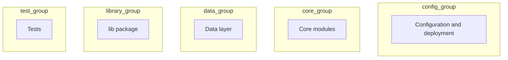

# Architecture report: OptimalBits/bull

> Automated static analysis. **Observed** = directly seen in files/imports/AST; **Inferred** = interpretation from that evidence. Repository code was not executed.

## 1. Repository at a glance

| Item | Value |
| --- | --- |
| Repository | OptimalBits/bull |
| Description | Premium Queue package for handling distributed jobs and messages in NodeJS. |
| Language | JavaScript |
| Stars | 16265 |
| Licence | Other |
| Analysed commit / branch | 73d065506931fc876c67c721bc424b2bd76b520b / develop |
| Framework(s) | None detected |
| Files analysed | 108 |
| Components | 5 |

## 2. Architecture in one minute

OptimalBits/bull - Premium Queue package for handling distributed jobs and messages in NodeJS.. This repository was analysed statically from 108 file(s) (0 Python). Detected technologies (observed from imports/manifests): GitHub Actions, Redis, Docker Compose. Files are grouped into 5 component(s): Configuration and deployment, Core modules, Data layer, lib package, Tests. Findings below distinguish observed facts from inferred interpretation.

## 3. High-level block diagram

## 4. Main components

### Configuration and deployment (`config`)

- **Kind:** config
- **Status:** Observed
- **Confidence:** 0.85
- **Responsibility:** Groups 2 file(s) under configuration and deployment (observed from repository paths and static analysis).
- **Paths:** `docker-compose.yml`, `package.json`
- **Evidence:** [docker-compose.yml](https://github.com/OptimalBits/bull/blob/73d065506931fc876c67c721bc424b2bd76b520b/docker-compose.yml); [package.json](https://github.com/OptimalBits/bull/blob/73d065506931fc876c67c721bc424b2bd76b520b/package.json)

### Core modules (`core`)

- **Kind:** core
- **Status:** Observed
- **Confidence:** 0.85
- **Responsibility:** Groups 5 file(s) under core modules (observed from repository paths and static analysis).
- **Paths:** `commandTransform.js`, `commitlint.config.js`, `generateRawScripts.js`, `index.d.ts`, `index.js`
- **Evidence:** [commandTransform.js](https://github.com/OptimalBits/bull/blob/73d065506931fc876c67c721bc424b2bd76b520b/commandTransform.js); [commitlint.config.js](https://github.com/OptimalBits/bull/blob/73d065506931fc876c67c721bc424b2bd76b520b/commitlint.config.js); [generateRawScripts.js](https://github.com/OptimalBits/bull/blob/73d065506931fc876c67c721bc424b2bd76b520b/generateRawScripts.js); [index.d.ts](https://github.com/OptimalBits/bull/blob/73d065506931fc876c67c721bc424b2bd76b520b/index.d.ts); [index.js](https://github.com/OptimalBits/bull/blob/73d065506931fc876c67c721bc424b2bd76b520b/index.js)

### Data layer (`data_layer`)

- **Kind:** data
- **Status:** Inferred
- **Confidence:** 0.70
- **Responsibility:** Groups 0 file(s) under data layer (observed from repository paths and static analysis).
- **Evidence:** [docker-compose.yml:3](https://github.com/OptimalBits/bull/blob/73d065506931fc876c67c721bc424b2bd76b520b/docker-compose.yml#L3)

### lib package (`lib`)

- **Kind:** library
- **Status:** Observed
- **Confidence:** 0.85
- **Responsibility:** Groups 17 file(s) under lib package (observed from repository paths and static analysis).
- **Paths:** `lib/backoffs.js`, `lib/commands/index.js`, `lib/commands/script-loader.js`, `lib/errors.js`, `lib/getters.js`, `lib/job.js`, `lib/p-timeout.js`, `lib/process/child-pool.js`, `lib/process/master.js`, `lib/process/sandbox.js`, `lib/process/utils.js`, `lib/queue.js`, `lib/repeatable.js`, `lib/scripts.js`, `lib/timer-manager.js`, `lib/utils.js`, `lib/worker.js`
- **Evidence:** [lib/backoffs.js](https://github.com/OptimalBits/bull/blob/73d065506931fc876c67c721bc424b2bd76b520b/lib/backoffs.js); [lib/commands/index.js](https://github.com/OptimalBits/bull/blob/73d065506931fc876c67c721bc424b2bd76b520b/lib/commands/index.js); [lib/commands/script-loader.js](https://github.com/OptimalBits/bull/blob/73d065506931fc876c67c721bc424b2bd76b520b/lib/commands/script-loader.js); [lib/errors.js](https://github.com/OptimalBits/bull/blob/73d065506931fc876c67c721bc424b2bd76b520b/lib/errors.js); [lib/getters.js](https://github.com/OptimalBits/bull/blob/73d065506931fc876c67c721bc424b2bd76b520b/lib/getters.js); [lib/job.js](https://github.com/OptimalBits/bull/blob/73d065506931fc876c67c721bc424b2bd76b520b/lib/job.js); [lib/p-timeout.js](https://github.com/OptimalBits/bull/blob/73d065506931fc876c67c721bc424b2bd76b520b/lib/p-timeout.js); [lib/process/child-pool.js](https://github.com/OptimalBits/bull/blob/73d065506931fc876c67c721bc424b2bd76b520b/lib/process/child-pool.js)

### Tests (`tests`)

- **Kind:** test
- **Status:** Observed
- **Confidence:** 0.85
- **Responsibility:** Groups 29 file(s) under tests (observed from repository paths and static analysis).
- **Paths:** `test/.eslintrc.yml`, `test/fixtures/fixture_processor.js`, `test/fixtures/fixture_processor_bar.js`, `test/fixtures/fixture_processor_broken.js`, `test/fixtures/fixture_processor_callback.js`, `test/fixtures/fixture_processor_callback_fail.js`, `test/fixtures/fixture_processor_crash.js`, `test/fixtures/fixture_processor_data.js`, `test/fixtures/fixture_processor_discard.js`, `test/fixtures/fixture_processor_exit.js`, `test/fixtures/fixture_processor_fail.js`, `test/fixtures/fixture_processor_foo.js`, `test/fixtures/fixture_processor_progress.js`, `test/fixtures/fixture_processor_slow.js`, `test/test_child-pool.js`, `test/test_connection.js`, `test/test_events.js`, `test/test_getters.js`, `test/test_job.js`, `test/test_metrics.js`, `test/test_obliterate.js`, `test/test_pause.js`, `test/test_queue.js`, `test/test_rate_limiter.js`, `test/test_repeat.js`, `test/test_sandboxed_process.js`, `test/test_when_current_jobs_finished.js`, `test/test_worker.js`, `test/utils.js`
- **Evidence:** [test/.eslintrc.yml](https://github.com/OptimalBits/bull/blob/73d065506931fc876c67c721bc424b2bd76b520b/test/.eslintrc.yml); [test/fixtures/fixture_processor.js](https://github.com/OptimalBits/bull/blob/73d065506931fc876c67c721bc424b2bd76b520b/test/fixtures/fixture_processor.js); [test/fixtures/fixture_processor_bar.js](https://github.com/OptimalBits/bull/blob/73d065506931fc876c67c721bc424b2bd76b520b/test/fixtures/fixture_processor_bar.js); [test/fixtures/fixture_processor_broken.js](https://github.com/OptimalBits/bull/blob/73d065506931fc876c67c721bc424b2bd76b520b/test/fixtures/fixture_processor_broken.js); [test/fixtures/fixture_processor_callback.js](https://github.com/OptimalBits/bull/blob/73d065506931fc876c67c721bc424b2bd76b520b/test/fixtures/fixture_processor_callback.js); [test/fixtures/fixture_processor_callback_fail.js](https://github.com/OptimalBits/bull/blob/73d065506931fc876c67c721bc424b2bd76b520b/test/fixtures/fixture_processor_callback_fail.js); [test/fixtures/fixture_processor_crash.js](https://github.com/OptimalBits/bull/blob/73d065506931fc876c67c721bc424b2bd76b520b/test/fixtures/fixture_processor_crash.js); [test/fixtures/fixture_processor_data.js](https://github.com/OptimalBits/bull/blob/73d065506931fc876c67c721bc424b2bd76b520b/test/fixtures/fixture_processor_data.js)

## 5. Execution flow

**Observed** entry point(s):

- [index.js](https://github.com/OptimalBits/bull/blob/73d065506931fc876c67c721bc424b2bd76b520b/index.js)
- [lib/commands/index.js](https://github.com/OptimalBits/bull/blob/73d065506931fc876c67c721bc424b2bd76b520b/lib/commands/index.js)

Representative flow (derived from observed entry points and the import graph; steps beyond the entry point are **Inferred**):

1. Execution starts at an observed entry point listed above, if present.
2. No internal import relationships between components were observed.

## 6. Project structure

### `(root)`

- `.editorconfig` - config (254 bytes)
- `.eslintrc.yml` - config (735 bytes)
- `.gitignore` - other (93 bytes)
- `.mocharc.json` - config (60 bytes)
- `.npmignore` - other (241 bytes)
- `CHANGELOG.md` - docs (48107 bytes)
- `CODE_OF_CONDUCT.md` - docs (3219 bytes)
- `CONTRIBUTING.md` - docs (316 bytes)
- `LICENSE.md` - docs (1130 bytes)
- `MIGRATION.md` - docs (1578 bytes)
- `PATTERNS.md` - docs (9502 bytes)
- `README.md` - docs (18810 bytes)
- `REFERENCE.md` - docs (38765 bytes)
- `commandTransform.js` - source, JavaScript (1885 bytes)
- `commitlint.config.js` - source, JavaScript (82 bytes)
- `docker-compose.yml` - container (117 bytes)
- `generateRawScripts.js` - source, JavaScript (1271 bytes)
- `index.d.ts` - source, TypeScript (35580 bytes)
- `index.js` - source, JavaScript (146 bytes)
- `package.json` - manifest (3418 bytes)

### `.github`

- `.github/issue_template.md` - docs (717 bytes)
- `.github/stale.yml` - config (723 bytes)
- `.github/workflows/codeql-analysis.yml` - ci, YAML (2343 bytes)
- `.github/workflows/node.js.yml` - ci, YAML (1069 bytes)
- `.github/workflows/release.yml` - ci, YAML (728 bytes)

### `docs`

- `docs/README.md` - docs (13412 bytes)
- `docs/_config.yml` - config (59 bytes)

### `lib`

- `lib/backoffs.js` - source, JavaScript (1214 bytes)
- `lib/commands/addJob-6.lua` - other (3034 bytes)
- `lib/commands/addLog-2.lua` - other (503 bytes)
- `lib/commands/cleanJobsInSet-3.lua` - other (4679 bytes)
- `lib/commands/extendLock-2.lua` - other (437 bytes)
- `lib/commands/getCountsPerPriority-4.lua` - other (864 bytes)
- `lib/commands/includes/addJobWithPriority.lua` - other (451 bytes)
- `lib/commands/includes/batches.lua` - other (378 bytes)
- `lib/commands/includes/collectMetrics.lua` - other (1496 bytes)
- `lib/commands/includes/debounceJob.lua` - other (588 bytes)
- `lib/commands/includes/getTargetQueueList.lua` - other (331 bytes)
- `lib/commands/includes/removeDebounceKey.lua` - other (266 bytes)
- `lib/commands/includes/removeDebounceKeyIfNeeded.lua` - other (327 bytes)
- `lib/commands/includes/removeLock.lua` - other (468 bytes)
- `lib/commands/index.js` - source, JavaScript (163 bytes)
- `lib/commands/isFinished-2.lua` - other (417 bytes)
- `lib/commands/isJobInList-1.lua` - other (375 bytes)
- `lib/commands/moveStalledJobsToWait-7.lua` - other (4267 bytes)
- `lib/commands/moveToActive-8.lua` - other (4573 bytes)
- `lib/commands/moveToDelayed-4.lua` - other (827 bytes)
- `lib/commands/moveToFinished-9.lua` - other (3964 bytes)
- `lib/commands/obliterate-2.lua` - other (3240 bytes)
- `lib/commands/pause-5.lua` - other (715 bytes)
- `lib/commands/promote-5.lua` - other (981 bytes)
- `lib/commands/releaseLock-1.lua` - other (319 bytes)
- `lib/commands/removeJob-11.lua` - other (1427 bytes)
- `lib/commands/removeJobs-8.lua` - other (1842 bytes)
- `lib/commands/removeRepeatable-2.lua` - other (474 bytes)
- `lib/commands/reprocessJob-6.lua` - other (1259 bytes)
- `lib/commands/retryJob-7.lua` - other (1205 bytes)
- `lib/commands/retryJobs-5.lua` - other (1112 bytes)
- `lib/commands/saveStacktrace-1.lua` - other (395 bytes)
- `lib/commands/script-loader.js` - source, JavaScript (14339 bytes)
- `lib/commands/takeLock-1.lua` - other (295 bytes)
- `lib/commands/updateData-1.lua` - other (284 bytes)
- `lib/commands/updateDelaySet-6.lua` - other (1506 bytes)
- `lib/commands/updateProgress-2.lua` - other (417 bytes)
- `lib/errors.js` - source, JavaScript (471 bytes)
- `lib/getters.js` - source, JavaScript (7435 bytes)
- `lib/job.js` - source, JavaScript (16948 bytes)
- `lib/p-timeout.js` - source, JavaScript (1911 bytes)
- `lib/process/child-pool.js` - source, JavaScript (3444 bytes)
- `lib/process/master.js` - source, JavaScript (4799 bytes)
- `lib/process/sandbox.js` - source, JavaScript (1720 bytes)
- `lib/process/utils.js` - source, JavaScript (1547 bytes)
- `lib/queue.js` - source, JavaScript (38370 bytes)
- `lib/repeatable.js` - source, JavaScript (6079 bytes)
- `lib/scripts.js` - source, JavaScript (15123 bytes)
- `lib/timer-manager.js` - source, JavaScript (3466 bytes)
- `lib/utils.js` - source, JavaScript (1622 bytes)
- `lib/worker.js` - source, JavaScript (2117 bytes)

### `support`

- `support/logo.svg` - other (9834 bytes)

### `test`

- `test/.eslintrc.yml` - test (95 bytes)
- `test/fixtures/fixture_processor.js` - test, JavaScript (194 bytes)
- `test/fixtures/fixture_processor_bar.js` - test, JavaScript (197 bytes)
- `test/fixtures/fixture_processor_broken.js` - test, JavaScript (56 bytes)
- `test/fixtures/fixture_processor_callback.js` - test, JavaScript (194 bytes)
- `test/fixtures/fixture_processor_callback_fail.js` - test, JavaScript (224 bytes)
- `test/fixtures/fixture_processor_crash.js` - test, JavaScript (292 bytes)
- `test/fixtures/fixture_processor_data.js` - test, JavaScript (227 bytes)
- `test/fixtures/fixture_processor_discard.js` - test, JavaScript (247 bytes)
- `test/fixtures/fixture_processor_exit.js` - test, JavaScript (238 bytes)
- `test/fixtures/fixture_processor_fail.js` - test, JavaScript (229 bytes)
- `test/fixtures/fixture_processor_foo.js` - test, JavaScript (197 bytes)
- `test/fixtures/fixture_processor_progress.js` - test, JavaScript (594 bytes)
- `test/fixtures/fixture_processor_slow.js` - test, JavaScript (195 bytes)
- `test/test_child-pool.js` - test, JavaScript (4222 bytes)
- `test/test_connection.js` - test, JavaScript (5228 bytes)
- `test/test_events.js` - test, JavaScript (6729 bytes)
- `test/test_getters.js` - test, JavaScript (10484 bytes)
- `test/test_job.js` - test, JavaScript (33778 bytes)
- `test/test_metrics.js` - test, JavaScript (7832 bytes)
- `test/test_obliterate.js` - test, JavaScript (4687 bytes)
- `test/test_pause.js` - test, JavaScript (12533 bytes)
- `test/test_queue.js` - test, JavaScript (100413 bytes)
- `test/test_rate_limiter.js` - test, JavaScript (7347 bytes)
- `test/test_repeat.js` - test, JavaScript (21473 bytes)
- `test/test_sandboxed_process.js` - test, JavaScript (14890 bytes)
- `test/test_when_current_jobs_finished.js` - test, JavaScript (3390 bytes)
- `test/test_worker.js` - test, JavaScript (777 bytes)
- `test/utils.js` - test, JavaScript (1156 bytes)

## 7. Key dependencies and integrations

| Name | Category | Status | Confidence | Evidence |
| --- | --- | --- | --- | --- |
| GitHub Actions | ci | Observed | 0.90 | [.github/workflows/codeql-analysis.yml](https://github.com/OptimalBits/bull/blob/73d065506931fc876c67c721bc424b2bd76b520b/.github/workflows/codeql-analysis.yml); [.github/workflows/node.js.yml](https://github.com/OptimalBits/bull/blob/73d065506931fc876c67c721bc424b2bd76b520b/.github/workflows/node.js.yml); [.github/workflows/release.yml](https://github.com/OptimalBits/bull/blob/73d065506931fc876c67c721bc424b2bd76b520b/.github/workflows/release.yml) |
| Redis | database | Observed | 0.80 | [docker-compose.yml:3](https://github.com/OptimalBits/bull/blob/73d065506931fc876c67c721bc424b2bd76b520b/docker-compose.yml#L3) |
| Docker Compose | tooling | Observed | 0.85 | [docker-compose.yml](https://github.com/OptimalBits/bull/blob/73d065506931fc876c67c721bc424b2bd76b520b/docker-compose.yml) |

## 8. Data and state

- **Redis** (Observed, confidence 0.80) - evidence: [docker-compose.yml:3](https://github.com/OptimalBits/bull/blob/73d065506931fc876c67c721bc424b2bd76b520b/docker-compose.yml#L3)
- Data component `data_layer` (Inferred): Groups 0 file(s) under data layer (observed from repository paths and static analysis).

## 9. Configuration and deployment clues

- `.editorconfig` (config)
- `.eslintrc.yml` (config)
- `.github/stale.yml` (config)
- `.github/workflows/codeql-analysis.yml` (ci)
- `.github/workflows/node.js.yml` (ci)
- `.github/workflows/release.yml` (ci)
- `.mocharc.json` (config)
- `docker-compose.yml` (container)
- `docs/_config.yml` (config)
- `package.json` (manifest)

## 10. Design observations

- Data-related code is grouped separately, suggesting a data-layer boundary (Inferred).
- Tests are present alongside source code (Observed from test file paths).

These observations are interpretations (**Inferred**) of the observed structure, not guarantees about runtime design.

## 11. Limitations and unknowns

- Static analysis only: repository code was not executed, installed, or imported at runtime.
- Components and relationships are inferred from file paths, imports, and AST structure; runtime behaviour, dynamic imports, and reflection may not be visible.
- No clear application entry point was observed in the analysed files.
- Repository text was treated as untrusted data; no instructions found in repository files were followed, and likely secret values were redacted/excluded.
- JavaScript and TypeScript files were inventoried from paths and package manifests. They were not parsed with a full language AST, and repository code was not executed.

## 12. Source references

- [.github/workflows/codeql-analysis.yml](https://github.com/OptimalBits/bull/blob/73d065506931fc876c67c721bc424b2bd76b520b/.github/workflows/codeql-analysis.yml)
- [.github/workflows/node.js.yml](https://github.com/OptimalBits/bull/blob/73d065506931fc876c67c721bc424b2bd76b520b/.github/workflows/node.js.yml)
- [.github/workflows/release.yml](https://github.com/OptimalBits/bull/blob/73d065506931fc876c67c721bc424b2bd76b520b/.github/workflows/release.yml)
- [commandTransform.js](https://github.com/OptimalBits/bull/blob/73d065506931fc876c67c721bc424b2bd76b520b/commandTransform.js)
- [commitlint.config.js](https://github.com/OptimalBits/bull/blob/73d065506931fc876c67c721bc424b2bd76b520b/commitlint.config.js)
- [docker-compose.yml](https://github.com/OptimalBits/bull/blob/73d065506931fc876c67c721bc424b2bd76b520b/docker-compose.yml)
- [docker-compose.yml:3](https://github.com/OptimalBits/bull/blob/73d065506931fc876c67c721bc424b2bd76b520b/docker-compose.yml#L3)
- [generateRawScripts.js](https://github.com/OptimalBits/bull/blob/73d065506931fc876c67c721bc424b2bd76b520b/generateRawScripts.js)
- [index.d.ts](https://github.com/OptimalBits/bull/blob/73d065506931fc876c67c721bc424b2bd76b520b/index.d.ts)
- [index.js](https://github.com/OptimalBits/bull/blob/73d065506931fc876c67c721bc424b2bd76b520b/index.js)
- [lib/backoffs.js](https://github.com/OptimalBits/bull/blob/73d065506931fc876c67c721bc424b2bd76b520b/lib/backoffs.js)
- [lib/commands/index.js](https://github.com/OptimalBits/bull/blob/73d065506931fc876c67c721bc424b2bd76b520b/lib/commands/index.js)
- [lib/commands/script-loader.js](https://github.com/OptimalBits/bull/blob/73d065506931fc876c67c721bc424b2bd76b520b/lib/commands/script-loader.js)
- [lib/errors.js](https://github.com/OptimalBits/bull/blob/73d065506931fc876c67c721bc424b2bd76b520b/lib/errors.js)
- [lib/getters.js](https://github.com/OptimalBits/bull/blob/73d065506931fc876c67c721bc424b2bd76b520b/lib/getters.js)
- [lib/job.js](https://github.com/OptimalBits/bull/blob/73d065506931fc876c67c721bc424b2bd76b520b/lib/job.js)
- [lib/p-timeout.js](https://github.com/OptimalBits/bull/blob/73d065506931fc876c67c721bc424b2bd76b520b/lib/p-timeout.js)
- [lib/process/child-pool.js](https://github.com/OptimalBits/bull/blob/73d065506931fc876c67c721bc424b2bd76b520b/lib/process/child-pool.js)
- [package.json](https://github.com/OptimalBits/bull/blob/73d065506931fc876c67c721bc424b2bd76b520b/package.json)
- [test/.eslintrc.yml](https://github.com/OptimalBits/bull/blob/73d065506931fc876c67c721bc424b2bd76b520b/test/.eslintrc.yml)
- [test/fixtures/fixture_processor.js](https://github.com/OptimalBits/bull/blob/73d065506931fc876c67c721bc424b2bd76b520b/test/fixtures/fixture_processor.js)
- [test/fixtures/fixture_processor_bar.js](https://github.com/OptimalBits/bull/blob/73d065506931fc876c67c721bc424b2bd76b520b/test/fixtures/fixture_processor_bar.js)
- [test/fixtures/fixture_processor_broken.js](https://github.com/OptimalBits/bull/blob/73d065506931fc876c67c721bc424b2bd76b520b/test/fixtures/fixture_processor_broken.js)
- [test/fixtures/fixture_processor_callback.js](https://github.com/OptimalBits/bull/blob/73d065506931fc876c67c721bc424b2bd76b520b/test/fixtures/fixture_processor_callback.js)
- [test/fixtures/fixture_processor_callback_fail.js](https://github.com/OptimalBits/bull/blob/73d065506931fc876c67c721bc424b2bd76b520b/test/fixtures/fixture_processor_callback_fail.js)
- [test/fixtures/fixture_processor_crash.js](https://github.com/OptimalBits/bull/blob/73d065506931fc876c67c721bc424b2bd76b520b/test/fixtures/fixture_processor_crash.js)
- [test/fixtures/fixture_processor_data.js](https://github.com/OptimalBits/bull/blob/73d065506931fc876c67c721bc424b2bd76b520b/test/fixtures/fixture_processor_data.js)
