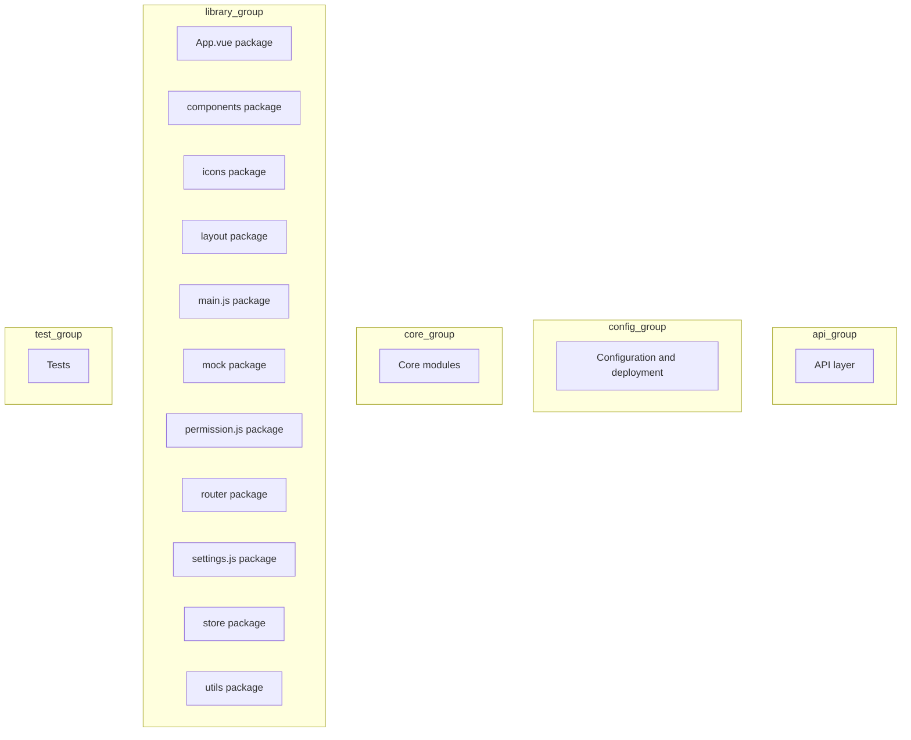

# Architecture report: PanJiaChen/vue-admin-template

> Automated static analysis. **Observed** = directly seen in files/imports/AST; **Inferred** = interpretation from that evidence. Repository code was not executed.

## 1. Repository at a glance

| Item | Value |
| --- | --- |
| Repository | PanJiaChen/vue-admin-template |
| Description | a vue2.0 minimal admin template  |
| Language | JavaScript |
| Stars | 20343 |
| Licence | MIT |
| Analysed commit / branch | 4c18a3f47bdb417ad8a25f09910f848cb574dee2 / master |
| Framework(s) | Vue |
| Files analysed | 91 |
| Components | 15 |

## 2. Architecture in one minute

PanJiaChen/vue-admin-template - a vue2.0 minimal admin template . This repository was analysed statically from 91 file(s) (0 Python). Detected technologies (observed from imports/manifests): Vue, axios. Files are grouped into 15 component(s): API layer, App.vue package, components package, Configuration and deployment, Core modules, icons package, layout package, main.js package. Findings below distinguish observed facts from inferred interpretation.

## 3. High-level block diagram

## 4. Main components

### API layer (`api_layer`)

- **Kind:** api
- **Status:** Observed
- **Confidence:** 0.85
- **Responsibility:** Groups 15 file(s) under api layer (observed from repository paths and static analysis).
- **Paths:** `src/api/table.js`, `src/api/user.js`, `src/views/404.vue`, `src/views/dashboard/index.vue`, `src/views/form/index.vue`, `src/views/login/index.vue`, `src/views/nested/menu1/index.vue`, `src/views/nested/menu1/menu1-1/index.vue`, `src/views/nested/menu1/menu1-2/index.vue`, `src/views/nested/menu1/menu1-2/menu1-2-1/index.vue`, `src/views/nested/menu1/menu1-2/menu1-2-2/index.vue`, `src/views/nested/menu1/menu1-3/index.vue`, `src/views/nested/menu2/index.vue`, `src/views/table/index.vue`, `src/views/tree/index.vue`
- **Evidence:** [src/api/table.js](https://github.com/PanJiaChen/vue-admin-template/blob/4c18a3f47bdb417ad8a25f09910f848cb574dee2/src/api/table.js); [src/api/user.js](https://github.com/PanJiaChen/vue-admin-template/blob/4c18a3f47bdb417ad8a25f09910f848cb574dee2/src/api/user.js); [src/views/404.vue](https://github.com/PanJiaChen/vue-admin-template/blob/4c18a3f47bdb417ad8a25f09910f848cb574dee2/src/views/404.vue); [src/views/dashboard/index.vue](https://github.com/PanJiaChen/vue-admin-template/blob/4c18a3f47bdb417ad8a25f09910f848cb574dee2/src/views/dashboard/index.vue); [src/views/form/index.vue](https://github.com/PanJiaChen/vue-admin-template/blob/4c18a3f47bdb417ad8a25f09910f848cb574dee2/src/views/form/index.vue); [src/views/login/index.vue](https://github.com/PanJiaChen/vue-admin-template/blob/4c18a3f47bdb417ad8a25f09910f848cb574dee2/src/views/login/index.vue); [src/views/nested/menu1/index.vue](https://github.com/PanJiaChen/vue-admin-template/blob/4c18a3f47bdb417ad8a25f09910f848cb574dee2/src/views/nested/menu1/index.vue); [src/views/nested/menu1/menu1-1/index.vue](https://github.com/PanJiaChen/vue-admin-template/blob/4c18a3f47bdb417ad8a25f09910f848cb574dee2/src/views/nested/menu1/menu1-1/index.vue)

### App.vue package (`app_vue`)

- **Kind:** library
- **Status:** Observed
- **Confidence:** 0.85
- **Responsibility:** Groups 1 file(s) under app.vue package (observed from repository paths and static analysis).
- **Paths:** `src/App.vue`
- **Evidence:** [src/App.vue](https://github.com/PanJiaChen/vue-admin-template/blob/4c18a3f47bdb417ad8a25f09910f848cb574dee2/src/App.vue)

### components package (`components`)

- **Kind:** library
- **Status:** Observed
- **Confidence:** 0.85
- **Responsibility:** Groups 3 file(s) under components package (observed from repository paths and static analysis).
- **Paths:** `src/components/Breadcrumb/index.vue`, `src/components/Hamburger/index.vue`, `src/components/SvgIcon/index.vue`
- **Evidence:** [src/components/Breadcrumb/index.vue](https://github.com/PanJiaChen/vue-admin-template/blob/4c18a3f47bdb417ad8a25f09910f848cb574dee2/src/components/Breadcrumb/index.vue); [src/components/Hamburger/index.vue](https://github.com/PanJiaChen/vue-admin-template/blob/4c18a3f47bdb417ad8a25f09910f848cb574dee2/src/components/Hamburger/index.vue); [src/components/SvgIcon/index.vue](https://github.com/PanJiaChen/vue-admin-template/blob/4c18a3f47bdb417ad8a25f09910f848cb574dee2/src/components/SvgIcon/index.vue)

### Configuration and deployment (`config`)

- **Kind:** config
- **Status:** Observed
- **Confidence:** 0.85
- **Responsibility:** Groups 3 file(s) under configuration and deployment (observed from repository paths and static analysis).
- **Paths:** `jsconfig.json`, `package.json`, `src/icons/svgo.yml`
- **Evidence:** [jsconfig.json](https://github.com/PanJiaChen/vue-admin-template/blob/4c18a3f47bdb417ad8a25f09910f848cb574dee2/jsconfig.json); [package.json](https://github.com/PanJiaChen/vue-admin-template/blob/4c18a3f47bdb417ad8a25f09910f848cb574dee2/package.json); [src/icons/svgo.yml](https://github.com/PanJiaChen/vue-admin-template/blob/4c18a3f47bdb417ad8a25f09910f848cb574dee2/src/icons/svgo.yml)

### Core modules (`core`)

- **Kind:** core
- **Status:** Observed
- **Confidence:** 0.85
- **Responsibility:** Groups 4 file(s) under core modules (observed from repository paths and static analysis).
- **Paths:** `babel.config.js`, `jest.config.js`, `postcss.config.js`, `vue.config.js`
- **Evidence:** [babel.config.js](https://github.com/PanJiaChen/vue-admin-template/blob/4c18a3f47bdb417ad8a25f09910f848cb574dee2/babel.config.js); [jest.config.js](https://github.com/PanJiaChen/vue-admin-template/blob/4c18a3f47bdb417ad8a25f09910f848cb574dee2/jest.config.js); [postcss.config.js](https://github.com/PanJiaChen/vue-admin-template/blob/4c18a3f47bdb417ad8a25f09910f848cb574dee2/postcss.config.js); [vue.config.js](https://github.com/PanJiaChen/vue-admin-template/blob/4c18a3f47bdb417ad8a25f09910f848cb574dee2/vue.config.js)

### icons package (`icons`)

- **Kind:** library
- **Status:** Observed
- **Confidence:** 0.85
- **Responsibility:** Groups 1 file(s) under icons package (observed from repository paths and static analysis).
- **Paths:** `src/icons/index.js`
- **Evidence:** [src/icons/index.js](https://github.com/PanJiaChen/vue-admin-template/blob/4c18a3f47bdb417ad8a25f09910f848cb574dee2/src/icons/index.js)

### layout package (`layout`)

- **Kind:** library
- **Status:** Observed
- **Confidence:** 0.85
- **Responsibility:** Groups 11 file(s) under layout package (observed from repository paths and static analysis).
- **Paths:** `src/layout/components/AppMain.vue`, `src/layout/components/Navbar.vue`, `src/layout/components/Sidebar/FixiOSBug.js`, `src/layout/components/Sidebar/Item.vue`, `src/layout/components/Sidebar/Link.vue`, `src/layout/components/Sidebar/Logo.vue`, `src/layout/components/Sidebar/SidebarItem.vue`, `src/layout/components/Sidebar/index.vue`, `src/layout/components/index.js`, `src/layout/index.vue`, `src/layout/mixin/ResizeHandler.js`
- **Evidence:** [src/layout/components/AppMain.vue](https://github.com/PanJiaChen/vue-admin-template/blob/4c18a3f47bdb417ad8a25f09910f848cb574dee2/src/layout/components/AppMain.vue); [src/layout/components/Navbar.vue](https://github.com/PanJiaChen/vue-admin-template/blob/4c18a3f47bdb417ad8a25f09910f848cb574dee2/src/layout/components/Navbar.vue); [src/layout/components/Sidebar/FixiOSBug.js](https://github.com/PanJiaChen/vue-admin-template/blob/4c18a3f47bdb417ad8a25f09910f848cb574dee2/src/layout/components/Sidebar/FixiOSBug.js); [src/layout/components/Sidebar/Item.vue](https://github.com/PanJiaChen/vue-admin-template/blob/4c18a3f47bdb417ad8a25f09910f848cb574dee2/src/layout/components/Sidebar/Item.vue); [src/layout/components/Sidebar/Link.vue](https://github.com/PanJiaChen/vue-admin-template/blob/4c18a3f47bdb417ad8a25f09910f848cb574dee2/src/layout/components/Sidebar/Link.vue); [src/layout/components/Sidebar/Logo.vue](https://github.com/PanJiaChen/vue-admin-template/blob/4c18a3f47bdb417ad8a25f09910f848cb574dee2/src/layout/components/Sidebar/Logo.vue); [src/layout/components/Sidebar/SidebarItem.vue](https://github.com/PanJiaChen/vue-admin-template/blob/4c18a3f47bdb417ad8a25f09910f848cb574dee2/src/layout/components/Sidebar/SidebarItem.vue); [src/layout/components/Sidebar/index.vue](https://github.com/PanJiaChen/vue-admin-template/blob/4c18a3f47bdb417ad8a25f09910f848cb574dee2/src/layout/components/Sidebar/index.vue)

### main.js package (`main_js`)

- **Kind:** library
- **Status:** Observed
- **Confidence:** 0.85
- **Responsibility:** Groups 1 file(s) under main.js package (observed from repository paths and static analysis).
- **Paths:** `src/main.js`
- **Evidence:** [src/main.js](https://github.com/PanJiaChen/vue-admin-template/blob/4c18a3f47bdb417ad8a25f09910f848cb574dee2/src/main.js)

### mock package (`mock`)

- **Kind:** library
- **Status:** Observed
- **Confidence:** 0.85
- **Responsibility:** Groups 5 file(s) under mock package (observed from repository paths and static analysis).
- **Paths:** `mock/index.js`, `mock/mock-server.js`, `mock/table.js`, `mock/user.js`, `mock/utils.js`
- **Evidence:** [mock/index.js](https://github.com/PanJiaChen/vue-admin-template/blob/4c18a3f47bdb417ad8a25f09910f848cb574dee2/mock/index.js); [mock/mock-server.js](https://github.com/PanJiaChen/vue-admin-template/blob/4c18a3f47bdb417ad8a25f09910f848cb574dee2/mock/mock-server.js); [mock/table.js](https://github.com/PanJiaChen/vue-admin-template/blob/4c18a3f47bdb417ad8a25f09910f848cb574dee2/mock/table.js); [mock/user.js](https://github.com/PanJiaChen/vue-admin-template/blob/4c18a3f47bdb417ad8a25f09910f848cb574dee2/mock/user.js); [mock/utils.js](https://github.com/PanJiaChen/vue-admin-template/blob/4c18a3f47bdb417ad8a25f09910f848cb574dee2/mock/utils.js)

### permission.js package (`permission_js`)

- **Kind:** library
- **Status:** Observed
- **Confidence:** 0.85
- **Responsibility:** Groups 1 file(s) under permission.js package (observed from repository paths and static analysis).
- **Paths:** `src/permission.js`
- **Evidence:** [src/permission.js](https://github.com/PanJiaChen/vue-admin-template/blob/4c18a3f47bdb417ad8a25f09910f848cb574dee2/src/permission.js)

### router package (`router`)

- **Kind:** library
- **Status:** Observed
- **Confidence:** 0.85
- **Responsibility:** Groups 1 file(s) under router package (observed from repository paths and static analysis).
- **Paths:** `src/router/index.js`
- **Evidence:** [src/router/index.js](https://github.com/PanJiaChen/vue-admin-template/blob/4c18a3f47bdb417ad8a25f09910f848cb574dee2/src/router/index.js)

### settings.js package (`settings_js`)

- **Kind:** library
- **Status:** Observed
- **Confidence:** 0.85
- **Responsibility:** Groups 1 file(s) under settings.js package (observed from repository paths and static analysis).
- **Paths:** `src/settings.js`
- **Evidence:** [src/settings.js](https://github.com/PanJiaChen/vue-admin-template/blob/4c18a3f47bdb417ad8a25f09910f848cb574dee2/src/settings.js)

### store package (`store`)

- **Kind:** library
- **Status:** Observed
- **Confidence:** 0.85
- **Responsibility:** Groups 5 file(s) under store package (observed from repository paths and static analysis).
- **Paths:** `src/store/getters.js`, `src/store/index.js`, `src/store/modules/app.js`, `src/store/modules/settings.js`, `src/store/modules/user.js`
- **Evidence:** [src/store/getters.js](https://github.com/PanJiaChen/vue-admin-template/blob/4c18a3f47bdb417ad8a25f09910f848cb574dee2/src/store/getters.js); [src/store/index.js](https://github.com/PanJiaChen/vue-admin-template/blob/4c18a3f47bdb417ad8a25f09910f848cb574dee2/src/store/index.js); [src/store/modules/app.js](https://github.com/PanJiaChen/vue-admin-template/blob/4c18a3f47bdb417ad8a25f09910f848cb574dee2/src/store/modules/app.js); [src/store/modules/settings.js](https://github.com/PanJiaChen/vue-admin-template/blob/4c18a3f47bdb417ad8a25f09910f848cb574dee2/src/store/modules/settings.js); [src/store/modules/user.js](https://github.com/PanJiaChen/vue-admin-template/blob/4c18a3f47bdb417ad8a25f09910f848cb574dee2/src/store/modules/user.js)

### Tests (`tests`)

- **Kind:** test
- **Status:** Observed
- **Confidence:** 0.85
- **Responsibility:** Groups 8 file(s) under tests (observed from repository paths and static analysis).
- **Paths:** `tests/unit/.eslintrc.js`, `tests/unit/components/Breadcrumb.spec.js`, `tests/unit/components/Hamburger.spec.js`, `tests/unit/components/SvgIcon.spec.js`, `tests/unit/utils/formatTime.spec.js`, `tests/unit/utils/param2Obj.spec.js`, `tests/unit/utils/parseTime.spec.js`, `tests/unit/utils/validate.spec.js`
- **Evidence:** [tests/unit/.eslintrc.js](https://github.com/PanJiaChen/vue-admin-template/blob/4c18a3f47bdb417ad8a25f09910f848cb574dee2/tests/unit/.eslintrc.js); [tests/unit/components/Breadcrumb.spec.js](https://github.com/PanJiaChen/vue-admin-template/blob/4c18a3f47bdb417ad8a25f09910f848cb574dee2/tests/unit/components/Breadcrumb.spec.js); [tests/unit/components/Hamburger.spec.js](https://github.com/PanJiaChen/vue-admin-template/blob/4c18a3f47bdb417ad8a25f09910f848cb574dee2/tests/unit/components/Hamburger.spec.js); [tests/unit/components/SvgIcon.spec.js](https://github.com/PanJiaChen/vue-admin-template/blob/4c18a3f47bdb417ad8a25f09910f848cb574dee2/tests/unit/components/SvgIcon.spec.js); [tests/unit/utils/formatTime.spec.js](https://github.com/PanJiaChen/vue-admin-template/blob/4c18a3f47bdb417ad8a25f09910f848cb574dee2/tests/unit/utils/formatTime.spec.js); [tests/unit/utils/param2Obj.spec.js](https://github.com/PanJiaChen/vue-admin-template/blob/4c18a3f47bdb417ad8a25f09910f848cb574dee2/tests/unit/utils/param2Obj.spec.js); [tests/unit/utils/parseTime.spec.js](https://github.com/PanJiaChen/vue-admin-template/blob/4c18a3f47bdb417ad8a25f09910f848cb574dee2/tests/unit/utils/parseTime.spec.js); [tests/unit/utils/validate.spec.js](https://github.com/PanJiaChen/vue-admin-template/blob/4c18a3f47bdb417ad8a25f09910f848cb574dee2/tests/unit/utils/validate.spec.js)

### utils package (`utils`)

- **Kind:** library
- **Status:** Observed
- **Confidence:** 0.85
- **Responsibility:** Groups 5 file(s) under utils package (observed from repository paths and static analysis).
- **Paths:** `src/utils/auth.js`, `src/utils/get-page-title.js`, `src/utils/index.js`, `src/utils/request.js`, `src/utils/validate.js`
- **Evidence:** [src/utils/auth.js](https://github.com/PanJiaChen/vue-admin-template/blob/4c18a3f47bdb417ad8a25f09910f848cb574dee2/src/utils/auth.js); [src/utils/get-page-title.js](https://github.com/PanJiaChen/vue-admin-template/blob/4c18a3f47bdb417ad8a25f09910f848cb574dee2/src/utils/get-page-title.js); [src/utils/index.js](https://github.com/PanJiaChen/vue-admin-template/blob/4c18a3f47bdb417ad8a25f09910f848cb574dee2/src/utils/index.js); [src/utils/request.js](https://github.com/PanJiaChen/vue-admin-template/blob/4c18a3f47bdb417ad8a25f09910f848cb574dee2/src/utils/request.js); [src/utils/validate.js](https://github.com/PanJiaChen/vue-admin-template/blob/4c18a3f47bdb417ad8a25f09910f848cb574dee2/src/utils/validate.js)

## 5. Execution flow

**Observed** entry point(s):

- [mock/index.js](https://github.com/PanJiaChen/vue-admin-template/blob/4c18a3f47bdb417ad8a25f09910f848cb574dee2/mock/index.js)
- [src/icons/index.js](https://github.com/PanJiaChen/vue-admin-template/blob/4c18a3f47bdb417ad8a25f09910f848cb574dee2/src/icons/index.js)
- [src/layout/components/index.js](https://github.com/PanJiaChen/vue-admin-template/blob/4c18a3f47bdb417ad8a25f09910f848cb574dee2/src/layout/components/index.js)
- [src/main.js](https://github.com/PanJiaChen/vue-admin-template/blob/4c18a3f47bdb417ad8a25f09910f848cb574dee2/src/main.js)
- [src/router/index.js](https://github.com/PanJiaChen/vue-admin-template/blob/4c18a3f47bdb417ad8a25f09910f848cb574dee2/src/router/index.js)
- [src/store/index.js](https://github.com/PanJiaChen/vue-admin-template/blob/4c18a3f47bdb417ad8a25f09910f848cb574dee2/src/store/index.js)
- [src/store/modules/app.js](https://github.com/PanJiaChen/vue-admin-template/blob/4c18a3f47bdb417ad8a25f09910f848cb574dee2/src/store/modules/app.js)
- [src/utils/index.js](https://github.com/PanJiaChen/vue-admin-template/blob/4c18a3f47bdb417ad8a25f09910f848cb574dee2/src/utils/index.js)

Representative flow (derived from observed entry points and the import graph; steps beyond the entry point are **Inferred**):

1. Execution starts at an observed entry point listed above, if present.
2. No internal import relationships between components were observed.

## 6. Project structure

### `(root)`

- `.editorconfig` - config (243 bytes)
- `.eslintignore` - other (34 bytes)
- `.eslintrc.js` - source, JavaScript (5120 bytes)
- `.gitignore` - other (190 bytes)
- `.travis.yml` - ci, YAML (81 bytes)
- `LICENSE` - docs (1075 bytes)
- `README-zh.md` - docs (4447 bytes)
- `README.md` - docs (3507 bytes)
- `babel.config.js` - source, JavaScript (557 bytes)
- `jest.config.js` - source, JavaScript (766 bytes)
- `jsconfig.json` - config (137 bytes)
- `package.json` - manifest (1821 bytes)
- `postcss.config.js` - source, JavaScript (197 bytes)
- `vue.config.js` - source, JavaScript (4071 bytes)

### `mock`

- `mock/index.js` - source, JavaScript (1385 bytes)
- `mock/mock-server.js` - source, JavaScript (2283 bytes)
- `mock/table.js` - source, JavaScript (545 bytes)
- `mock/user.js` - source, JavaScript (1552 bytes)
- `mock/utils.js` - source, JavaScript (501 bytes)

### `public`

- `public/index.html` - other (620 bytes)

### `src`

- `src/App.vue` - source, Vue (122 bytes)
- `src/api/table.js` - source, JavaScript (172 bytes)
- `src/api/user.js` - source, JavaScript (427 bytes)
- `src/components/Breadcrumb/index.vue` - source, Vue (2013 bytes)
- `src/components/Hamburger/index.vue` - source, Vue (1156 bytes)
- `src/components/SvgIcon/index.vue` - source, Vue (1312 bytes)
- `src/icons/index.js` - source, JavaScript (288 bytes)
- `src/icons/svg/dashboard.svg` - other (2335 bytes)
- `src/icons/svg/example.svg` - other (497 bytes)
- `src/icons/svg/eye-open.svg` - other (1290 bytes)
- `src/icons/svg/eye.svg` - other (944 bytes)
- `src/icons/svg/form.svg` - other (2494 bytes)
- `src/icons/svg/link.svg` - other (285 bytes)
- `src/icons/svg/nested.svg` - other (821 bytes)
- `src/icons/svg/password.svg` - other (623 bytes)
- `src/icons/svg/table.svg` - other (597 bytes)
- `src/icons/svg/tree.svg` - other (1814 bytes)
- `src/icons/svg/user.svg` - other (440 bytes)
- `src/icons/svgo.yml` - config (248 bytes)
- `src/layout/components/AppMain.vue` - source, Vue (637 bytes)
- `src/layout/components/Navbar.vue` - source, Vue (3118 bytes)
- `src/layout/components/Sidebar/FixiOSBug.js` - source, JavaScript (633 bytes)
- `src/layout/components/Sidebar/Item.vue` - source, Vue (682 bytes)
- `src/layout/components/Sidebar/Link.vue` - source, Vue (657 bytes)
- `src/layout/components/Sidebar/Logo.vue` - source, Vue (1747 bytes)
- `src/layout/components/Sidebar/SidebarItem.vue` - source, Vue (2653 bytes)
- `src/layout/components/Sidebar/index.vue` - source, Vue (1416 bytes)
- `src/layout/components/index.js` - source, JavaScript (139 bytes)
- `src/layout/index.vue` - source, Vue (1892 bytes)
- `src/layout/mixin/ResizeHandler.js` - source, JavaScript (1235 bytes)
- `src/main.js` - source, JavaScript (1017 bytes)
- `src/permission.js` - source, JavaScript (1729 bytes)
- `src/router/index.js` - source, JavaScript (4990 bytes)
- `src/settings.js` - source, JavaScript (282 bytes)
- `src/store/getters.js` - source, JavaScript (226 bytes)
- `src/store/index.js` - source, JavaScript (318 bytes)
- `src/store/modules/app.js` - source, JavaScript (1056 bytes)
- `src/store/modules/settings.js` - source, JavaScript (578 bytes)
- `src/store/modules/user.js` - source, JavaScript (2065 bytes)
- `src/styles/element-ui.scss` - other (684 bytes)
- `src/styles/index.scss` - other (912 bytes)
- `src/styles/mixin.scss` - other (384 bytes)
- `src/styles/sidebar.scss` - other (3980 bytes)
- `src/styles/transition.scss` - other (714 bytes)
- `src/styles/variables.scss` - other (616 bytes)
- `src/utils/auth.js` - source, JavaScript (284 bytes)
- `src/utils/get-page-title.js` - source, JavaScript (235 bytes)
- `src/utils/index.js` - source, JavaScript (2671 bytes)
- `src/utils/request.js` - source, JavaScript (2343 bytes)
- `src/utils/validate.js` - source, JavaScript (361 bytes)
- `src/views/404.vue` - source, Vue (5227 bytes)
- `src/views/dashboard/index.vue` - source, Vue (425 bytes)
- `src/views/form/index.vue` - source, Vue (2467 bytes)
- `src/views/login/index.vue` - source, Vue (5388 bytes)
- `src/views/nested/menu1/index.vue` - source, Vue (148 bytes)
- `src/views/nested/menu1/menu1-1/index.vue` - source, Vue (165 bytes)
- `src/views/nested/menu1/menu1-2/index.vue` - source, Vue (165 bytes)
- `src/views/nested/menu1/menu1-2/menu1-2-1/index.vue` - source, Vue (142 bytes)
- `src/views/nested/menu1/menu1-2/menu1-2-2/index.vue` - source, Vue (142 bytes)
- `src/views/nested/menu1/menu1-3/index.vue` - source, Vue (140 bytes)
- `src/views/nested/menu2/index.vue` - source, Vue (112 bytes)
- `src/views/table/index.vue` - source, Vue (2047 bytes)
- `src/views/tree/index.vue` - source, Vue (1449 bytes)

### `tests`

- `tests/unit/.eslintrc.js` - test, JavaScript (49 bytes)
- `tests/unit/components/Breadcrumb.spec.js` - test, JavaScript (2677 bytes)
- `tests/unit/components/Hamburger.spec.js` - test, JavaScript (641 bytes)
- `tests/unit/components/SvgIcon.spec.js` - test, JavaScript (621 bytes)
- `tests/unit/utils/formatTime.spec.js` - test, JavaScript (1068 bytes)
- `tests/unit/utils/param2Obj.spec.js` - test, JavaScript (397 bytes)
- `tests/unit/utils/parseTime.spec.js` - test, JavaScript (1145 bytes)
- `tests/unit/utils/validate.spec.js` - test, JavaScript (703 bytes)

## 7. Key dependencies and integrations

| Name | Category | Status | Confidence | Evidence |
| --- | --- | --- | --- | --- |
| Vue | framework | Observed | 0.85 | [package.json:2](https://github.com/PanJiaChen/vue-admin-template/blob/4c18a3f47bdb417ad8a25f09910f848cb574dee2/package.json#L2) |
| axios | library | Observed | 0.85 | [package.json:4](https://github.com/PanJiaChen/vue-admin-template/blob/4c18a3f47bdb417ad8a25f09910f848cb574dee2/package.json#L4) |

## 8. Data and state

No database, cache, queue, or persistent-state usage was observed in the analysed files. State handling, if any, may be in-memory or in files that were not analysed.

## 9. Configuration and deployment clues

- `.editorconfig` (config)
- `.travis.yml` (ci)
- `jsconfig.json` (config)
- `package.json` (manifest)
- `src/icons/svgo.yml` (config)

## 10. Design observations

- An entry/API layer is separated from other code (Inferred from paths and decorators).
- Tests are present alongside source code (Observed from test file paths).

These observations are interpretations (**Inferred**) of the observed structure, not guarantees about runtime design.

## 11. Limitations and unknowns

- Static analysis only: repository code was not executed, installed, or imported at runtime.
- Components and relationships are inferred from file paths, imports, and AST structure; runtime behaviour, dynamic imports, and reflection may not be visible.
- 4 file(s) were skipped during inventory (3 x likely secret file excluded; 1 x vendored/generated directory excluded).
- No clear application entry point was observed in the analysed files.
- Repository text was treated as untrusted data; no instructions found in repository files were followed, and likely secret values were redacted/excluded.
- JavaScript and TypeScript files were inventoried from paths and package manifests. They were not parsed with a full language AST, and repository code was not executed.

## 12. Source references

- [babel.config.js](https://github.com/PanJiaChen/vue-admin-template/blob/4c18a3f47bdb417ad8a25f09910f848cb574dee2/babel.config.js)
- [jest.config.js](https://github.com/PanJiaChen/vue-admin-template/blob/4c18a3f47bdb417ad8a25f09910f848cb574dee2/jest.config.js)
- [jsconfig.json](https://github.com/PanJiaChen/vue-admin-template/blob/4c18a3f47bdb417ad8a25f09910f848cb574dee2/jsconfig.json)
- [mock/index.js](https://github.com/PanJiaChen/vue-admin-template/blob/4c18a3f47bdb417ad8a25f09910f848cb574dee2/mock/index.js)
- [mock/mock-server.js](https://github.com/PanJiaChen/vue-admin-template/blob/4c18a3f47bdb417ad8a25f09910f848cb574dee2/mock/mock-server.js)
- [mock/table.js](https://github.com/PanJiaChen/vue-admin-template/blob/4c18a3f47bdb417ad8a25f09910f848cb574dee2/mock/table.js)
- [mock/user.js](https://github.com/PanJiaChen/vue-admin-template/blob/4c18a3f47bdb417ad8a25f09910f848cb574dee2/mock/user.js)
- [mock/utils.js](https://github.com/PanJiaChen/vue-admin-template/blob/4c18a3f47bdb417ad8a25f09910f848cb574dee2/mock/utils.js)
- [package.json](https://github.com/PanJiaChen/vue-admin-template/blob/4c18a3f47bdb417ad8a25f09910f848cb574dee2/package.json)
- [package.json:2](https://github.com/PanJiaChen/vue-admin-template/blob/4c18a3f47bdb417ad8a25f09910f848cb574dee2/package.json#L2)
- [package.json:4](https://github.com/PanJiaChen/vue-admin-template/blob/4c18a3f47bdb417ad8a25f09910f848cb574dee2/package.json#L4)
- [postcss.config.js](https://github.com/PanJiaChen/vue-admin-template/blob/4c18a3f47bdb417ad8a25f09910f848cb574dee2/postcss.config.js)
- [src/App.vue](https://github.com/PanJiaChen/vue-admin-template/blob/4c18a3f47bdb417ad8a25f09910f848cb574dee2/src/App.vue)
- [src/api/table.js](https://github.com/PanJiaChen/vue-admin-template/blob/4c18a3f47bdb417ad8a25f09910f848cb574dee2/src/api/table.js)
- [src/api/user.js](https://github.com/PanJiaChen/vue-admin-template/blob/4c18a3f47bdb417ad8a25f09910f848cb574dee2/src/api/user.js)
- [src/components/Breadcrumb/index.vue](https://github.com/PanJiaChen/vue-admin-template/blob/4c18a3f47bdb417ad8a25f09910f848cb574dee2/src/components/Breadcrumb/index.vue)
- [src/components/Hamburger/index.vue](https://github.com/PanJiaChen/vue-admin-template/blob/4c18a3f47bdb417ad8a25f09910f848cb574dee2/src/components/Hamburger/index.vue)
- [src/components/SvgIcon/index.vue](https://github.com/PanJiaChen/vue-admin-template/blob/4c18a3f47bdb417ad8a25f09910f848cb574dee2/src/components/SvgIcon/index.vue)
- [src/icons/index.js](https://github.com/PanJiaChen/vue-admin-template/blob/4c18a3f47bdb417ad8a25f09910f848cb574dee2/src/icons/index.js)
- [src/icons/svgo.yml](https://github.com/PanJiaChen/vue-admin-template/blob/4c18a3f47bdb417ad8a25f09910f848cb574dee2/src/icons/svgo.yml)
- [src/layout/components/AppMain.vue](https://github.com/PanJiaChen/vue-admin-template/blob/4c18a3f47bdb417ad8a25f09910f848cb574dee2/src/layout/components/AppMain.vue)
- [src/layout/components/Navbar.vue](https://github.com/PanJiaChen/vue-admin-template/blob/4c18a3f47bdb417ad8a25f09910f848cb574dee2/src/layout/components/Navbar.vue)
- [src/layout/components/Sidebar/FixiOSBug.js](https://github.com/PanJiaChen/vue-admin-template/blob/4c18a3f47bdb417ad8a25f09910f848cb574dee2/src/layout/components/Sidebar/FixiOSBug.js)
- [src/layout/components/Sidebar/Item.vue](https://github.com/PanJiaChen/vue-admin-template/blob/4c18a3f47bdb417ad8a25f09910f848cb574dee2/src/layout/components/Sidebar/Item.vue)
- [src/layout/components/Sidebar/Link.vue](https://github.com/PanJiaChen/vue-admin-template/blob/4c18a3f47bdb417ad8a25f09910f848cb574dee2/src/layout/components/Sidebar/Link.vue)
- [src/layout/components/Sidebar/Logo.vue](https://github.com/PanJiaChen/vue-admin-template/blob/4c18a3f47bdb417ad8a25f09910f848cb574dee2/src/layout/components/Sidebar/Logo.vue)
- [src/layout/components/Sidebar/SidebarItem.vue](https://github.com/PanJiaChen/vue-admin-template/blob/4c18a3f47bdb417ad8a25f09910f848cb574dee2/src/layout/components/Sidebar/SidebarItem.vue)
- [src/layout/components/Sidebar/index.vue](https://github.com/PanJiaChen/vue-admin-template/blob/4c18a3f47bdb417ad8a25f09910f848cb574dee2/src/layout/components/Sidebar/index.vue)
- [src/layout/components/index.js](https://github.com/PanJiaChen/vue-admin-template/blob/4c18a3f47bdb417ad8a25f09910f848cb574dee2/src/layout/components/index.js)
- [src/main.js](https://github.com/PanJiaChen/vue-admin-template/blob/4c18a3f47bdb417ad8a25f09910f848cb574dee2/src/main.js)
- [src/permission.js](https://github.com/PanJiaChen/vue-admin-template/blob/4c18a3f47bdb417ad8a25f09910f848cb574dee2/src/permission.js)
- [src/router/index.js](https://github.com/PanJiaChen/vue-admin-template/blob/4c18a3f47bdb417ad8a25f09910f848cb574dee2/src/router/index.js)
- [src/settings.js](https://github.com/PanJiaChen/vue-admin-template/blob/4c18a3f47bdb417ad8a25f09910f848cb574dee2/src/settings.js)
- [src/store/getters.js](https://github.com/PanJiaChen/vue-admin-template/blob/4c18a3f47bdb417ad8a25f09910f848cb574dee2/src/store/getters.js)
- [src/store/index.js](https://github.com/PanJiaChen/vue-admin-template/blob/4c18a3f47bdb417ad8a25f09910f848cb574dee2/src/store/index.js)
- [src/store/modules/app.js](https://github.com/PanJiaChen/vue-admin-template/blob/4c18a3f47bdb417ad8a25f09910f848cb574dee2/src/store/modules/app.js)
- [src/store/modules/settings.js](https://github.com/PanJiaChen/vue-admin-template/blob/4c18a3f47bdb417ad8a25f09910f848cb574dee2/src/store/modules/settings.js)
- [src/store/modules/user.js](https://github.com/PanJiaChen/vue-admin-template/blob/4c18a3f47bdb417ad8a25f09910f848cb574dee2/src/store/modules/user.js)
- [src/utils/auth.js](https://github.com/PanJiaChen/vue-admin-template/blob/4c18a3f47bdb417ad8a25f09910f848cb574dee2/src/utils/auth.js)
- [src/utils/get-page-title.js](https://github.com/PanJiaChen/vue-admin-template/blob/4c18a3f47bdb417ad8a25f09910f848cb574dee2/src/utils/get-page-title.js)
- [src/utils/index.js](https://github.com/PanJiaChen/vue-admin-template/blob/4c18a3f47bdb417ad8a25f09910f848cb574dee2/src/utils/index.js)
- [src/utils/request.js](https://github.com/PanJiaChen/vue-admin-template/blob/4c18a3f47bdb417ad8a25f09910f848cb574dee2/src/utils/request.js)
- [src/utils/validate.js](https://github.com/PanJiaChen/vue-admin-template/blob/4c18a3f47bdb417ad8a25f09910f848cb574dee2/src/utils/validate.js)
- [src/views/404.vue](https://github.com/PanJiaChen/vue-admin-template/blob/4c18a3f47bdb417ad8a25f09910f848cb574dee2/src/views/404.vue)
- [src/views/dashboard/index.vue](https://github.com/PanJiaChen/vue-admin-template/blob/4c18a3f47bdb417ad8a25f09910f848cb574dee2/src/views/dashboard/index.vue)
- [src/views/form/index.vue](https://github.com/PanJiaChen/vue-admin-template/blob/4c18a3f47bdb417ad8a25f09910f848cb574dee2/src/views/form/index.vue)
- [src/views/login/index.vue](https://github.com/PanJiaChen/vue-admin-template/blob/4c18a3f47bdb417ad8a25f09910f848cb574dee2/src/views/login/index.vue)
- [src/views/nested/menu1/index.vue](https://github.com/PanJiaChen/vue-admin-template/blob/4c18a3f47bdb417ad8a25f09910f848cb574dee2/src/views/nested/menu1/index.vue)
- [src/views/nested/menu1/menu1-1/index.vue](https://github.com/PanJiaChen/vue-admin-template/blob/4c18a3f47bdb417ad8a25f09910f848cb574dee2/src/views/nested/menu1/menu1-1/index.vue)
- [tests/unit/.eslintrc.js](https://github.com/PanJiaChen/vue-admin-template/blob/4c18a3f47bdb417ad8a25f09910f848cb574dee2/tests/unit/.eslintrc.js)
- [tests/unit/components/Breadcrumb.spec.js](https://github.com/PanJiaChen/vue-admin-template/blob/4c18a3f47bdb417ad8a25f09910f848cb574dee2/tests/unit/components/Breadcrumb.spec.js)
- [tests/unit/components/Hamburger.spec.js](https://github.com/PanJiaChen/vue-admin-template/blob/4c18a3f47bdb417ad8a25f09910f848cb574dee2/tests/unit/components/Hamburger.spec.js)
- [tests/unit/components/SvgIcon.spec.js](https://github.com/PanJiaChen/vue-admin-template/blob/4c18a3f47bdb417ad8a25f09910f848cb574dee2/tests/unit/components/SvgIcon.spec.js)
- [tests/unit/utils/formatTime.spec.js](https://github.com/PanJiaChen/vue-admin-template/blob/4c18a3f47bdb417ad8a25f09910f848cb574dee2/tests/unit/utils/formatTime.spec.js)
- [tests/unit/utils/param2Obj.spec.js](https://github.com/PanJiaChen/vue-admin-template/blob/4c18a3f47bdb417ad8a25f09910f848cb574dee2/tests/unit/utils/param2Obj.spec.js)
- [tests/unit/utils/parseTime.spec.js](https://github.com/PanJiaChen/vue-admin-template/blob/4c18a3f47bdb417ad8a25f09910f848cb574dee2/tests/unit/utils/parseTime.spec.js)
- [tests/unit/utils/validate.spec.js](https://github.com/PanJiaChen/vue-admin-template/blob/4c18a3f47bdb417ad8a25f09910f848cb574dee2/tests/unit/utils/validate.spec.js)
- [vue.config.js](https://github.com/PanJiaChen/vue-admin-template/blob/4c18a3f47bdb417ad8a25f09910f848cb574dee2/vue.config.js)
