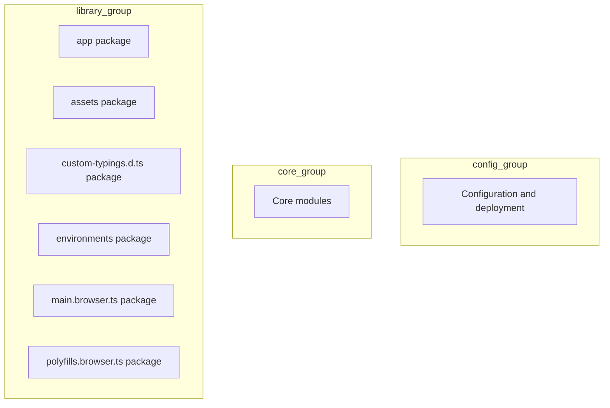

# Architecture report: PatrickJS/angular-webpack-starter

> Automated static analysis. **Observed** = directly seen in files/imports/AST; **Inferred** = interpretation from that evidence. Repository code was not executed.

## 1. Repository at a glance

| Item | Value |
| --- | --- |
| Repository | PatrickJS/angular-webpack-starter |
| Description | Angular Webpack Starter |
| Language | JavaScript |
| Stars | 10208 |
| Licence | MIT |
| Analysed commit / branch | 23ef49ac3f5dcebde5845a68b62b3d000ade72d0 / master |
| Framework(s) | None detected |
| Files analysed | 114 |
| Components | 8 |

## 2. Architecture in one minute

PatrickJS/angular-webpack-starter - Angular Webpack Starter. This repository was analysed statically from 114 file(s) (0 Python). Detected technologies (observed from imports/manifests): Docker, Docker Compose, TypeScript, webpack. Files are grouped into 8 component(s): app package, assets package, Configuration and deployment, Core modules, custom-typings.d.ts package, environments package, main.browser.ts package, polyfills.browser.ts package. Findings below distinguish observed facts from inferred interpretation.

## 3. High-level block diagram

## 4. Main components

### app package (`app`)

- **Kind:** library
- **Status:** Observed
- **Confidence:** 0.85
- **Responsibility:** Groups 43 file(s) under app package (observed from repository paths and static analysis).
- **Paths:** `src/app/+barrel/+child-barrel/child-barrel.component.ts`, `src/app/+barrel/+child-barrel/child-barrel.module.ts`, `src/app/+barrel/+child-barrel/child-barrel.routes.ts`, `src/app/+barrel/+child-barrel/index.ts`, `src/app/+barrel/barrel.component.ts`, `src/app/+barrel/barrel.module.ts`, `src/app/+barrel/barrel.routes.ts`, `src/app/+barrel/index.ts`, `src/app/+detail/+child-detail/child-detail.component.ts`, `src/app/+detail/+child-detail/child-detail.module.ts`, `src/app/+detail/+child-detail/child-detail.routes.ts`, `src/app/+detail/+child-detail/index.ts`, `src/app/+detail/detail.component.ts`, `src/app/+detail/detail.module.ts`, `src/app/+detail/detail.routes.ts`, `src/app/+detail/index.ts`, `src/app/+dev-module/dev-module.component.ts`, `src/app/+dev-module/dev-module.module.ts`, `src/app/+dev-module/dev-module.routes.ts`, `src/app/+dev-module/index.ts`, `src/app/about/about.component.spec.ts`, `src/app/about/about.component.ts`, `src/app/about/index.ts`, `src/app/app.component.spec.ts`, `src/app/app.component.ts`, `src/app/app.e2e.ts`, `src/app/app.module.ts`, `src/app/app.resolver.ts`, `src/app/app.routes.ts`, `src/app/app.service.ts`, `src/app/home/home.component.spec.ts`, `src/app/home/home.component.ts`, `src/app/home/home.e2e.ts`, `src/app/home/index.ts`, `src/app/home/title/index.ts`, `src/app/home/title/title.service.spec.ts`, `src/app/home/title/title.service.ts`, `src/app/home/x-large/index.ts`, `src/app/home/x-large/x-large.directive.spec.ts`, `src/app/home/x-large/x-large.directive.ts`, `src/app/index.ts`, `src/app/no-content/index.ts`, `src/app/no-content/no-content.component.ts`
- **Evidence:** [src/app/+barrel/+child-barrel/child-barrel.component.ts](https://github.com/PatrickJS/angular-webpack-starter/blob/23ef49ac3f5dcebde5845a68b62b3d000ade72d0/src/app/%2Bbarrel/%2Bchild-barrel/child-barrel.component.ts); [src/app/+barrel/+child-barrel/child-barrel.module.ts](https://github.com/PatrickJS/angular-webpack-starter/blob/23ef49ac3f5dcebde5845a68b62b3d000ade72d0/src/app/%2Bbarrel/%2Bchild-barrel/child-barrel.module.ts); [src/app/+barrel/+child-barrel/child-barrel.routes.ts](https://github.com/PatrickJS/angular-webpack-starter/blob/23ef49ac3f5dcebde5845a68b62b3d000ade72d0/src/app/%2Bbarrel/%2Bchild-barrel/child-barrel.routes.ts); [src/app/+barrel/+child-barrel/index.ts](https://github.com/PatrickJS/angular-webpack-starter/blob/23ef49ac3f5dcebde5845a68b62b3d000ade72d0/src/app/%2Bbarrel/%2Bchild-barrel/index.ts); [src/app/+barrel/barrel.component.ts](https://github.com/PatrickJS/angular-webpack-starter/blob/23ef49ac3f5dcebde5845a68b62b3d000ade72d0/src/app/%2Bbarrel/barrel.component.ts); [src/app/+barrel/barrel.module.ts](https://github.com/PatrickJS/angular-webpack-starter/blob/23ef49ac3f5dcebde5845a68b62b3d000ade72d0/src/app/%2Bbarrel/barrel.module.ts); [src/app/+barrel/barrel.routes.ts](https://github.com/PatrickJS/angular-webpack-starter/blob/23ef49ac3f5dcebde5845a68b62b3d000ade72d0/src/app/%2Bbarrel/barrel.routes.ts); [src/app/+barrel/index.ts](https://github.com/PatrickJS/angular-webpack-starter/blob/23ef49ac3f5dcebde5845a68b62b3d000ade72d0/src/app/%2Bbarrel/index.ts)

### assets package (`assets`)

- **Kind:** library
- **Status:** Observed
- **Confidence:** 0.85
- **Responsibility:** Groups 1 file(s) under assets package (observed from repository paths and static analysis).
- **Paths:** `src/assets/service-worker.js`
- **Evidence:** [src/assets/service-worker.js](https://github.com/PatrickJS/angular-webpack-starter/blob/23ef49ac3f5dcebde5845a68b62b3d000ade72d0/src/assets/service-worker.js)

### Configuration and deployment (`config`)

- **Kind:** config
- **Status:** Observed
- **Confidence:** 0.85
- **Responsibility:** Groups 31 file(s) under configuration and deployment (observed from repository paths and static analysis).
- **Paths:** `Dockerfile`, `Dockerfile-dev`, `config/build-utils.js`, `config/config.common.json`, `config/config.dev.json`, `config/config.prod.json`, `config/empty.js`, `config/github-deploy/index.js`, `config/head-config.common.js`, `config/helpers.js`, `config/html-elements-plugin/index.js`, `config/karma.conf.js`, `config/protractor.conf.js`, `config/resource-override.js`, `config/spec-bundle.js`, `config/webpack.common.js`, `config/webpack.dev.js`, `config/webpack.github-deploy.js`, `config/webpack.prod.js`, `config/webpack.test.js`, `docker-compose.yml`, `firebase.json`, `netlify.toml`, `package.json`, `src/assets/data.json`, `src/assets/manifest.json`, `src/assets/mock-data/mock-data.json`, `tsconfig.json`, `tsconfig.webpack.json`, `tslint.json`, `typedoc.json`
- **Evidence:** [Dockerfile](https://github.com/PatrickJS/angular-webpack-starter/blob/23ef49ac3f5dcebde5845a68b62b3d000ade72d0/Dockerfile); [Dockerfile-dev](https://github.com/PatrickJS/angular-webpack-starter/blob/23ef49ac3f5dcebde5845a68b62b3d000ade72d0/Dockerfile-dev); [config/build-utils.js](https://github.com/PatrickJS/angular-webpack-starter/blob/23ef49ac3f5dcebde5845a68b62b3d000ade72d0/config/build-utils.js); [config/config.common.json](https://github.com/PatrickJS/angular-webpack-starter/blob/23ef49ac3f5dcebde5845a68b62b3d000ade72d0/config/config.common.json); [config/config.dev.json](https://github.com/PatrickJS/angular-webpack-starter/blob/23ef49ac3f5dcebde5845a68b62b3d000ade72d0/config/config.dev.json); [config/config.prod.json](https://github.com/PatrickJS/angular-webpack-starter/blob/23ef49ac3f5dcebde5845a68b62b3d000ade72d0/config/config.prod.json); [config/empty.js](https://github.com/PatrickJS/angular-webpack-starter/blob/23ef49ac3f5dcebde5845a68b62b3d000ade72d0/config/empty.js); [config/github-deploy/index.js](https://github.com/PatrickJS/angular-webpack-starter/blob/23ef49ac3f5dcebde5845a68b62b3d000ade72d0/config/github-deploy/index.js)

### Core modules (`core`)

- **Kind:** core
- **Status:** Observed
- **Confidence:** 0.85
- **Responsibility:** Groups 3 file(s) under core modules (observed from repository paths and static analysis).
- **Paths:** `karma.conf.js`, `protractor.conf.js`, `webpack.config.js`
- **Evidence:** [karma.conf.js](https://github.com/PatrickJS/angular-webpack-starter/blob/23ef49ac3f5dcebde5845a68b62b3d000ade72d0/karma.conf.js); [protractor.conf.js](https://github.com/PatrickJS/angular-webpack-starter/blob/23ef49ac3f5dcebde5845a68b62b3d000ade72d0/protractor.conf.js); [webpack.config.js](https://github.com/PatrickJS/angular-webpack-starter/blob/23ef49ac3f5dcebde5845a68b62b3d000ade72d0/webpack.config.js)

### custom-typings.d.ts package (`custom_typings_d_ts`)

- **Kind:** library
- **Status:** Observed
- **Confidence:** 0.85
- **Responsibility:** Groups 1 file(s) under custom-typings.d.ts package (observed from repository paths and static analysis).
- **Paths:** `src/custom-typings.d.ts`
- **Evidence:** [src/custom-typings.d.ts](https://github.com/PatrickJS/angular-webpack-starter/blob/23ef49ac3f5dcebde5845a68b62b3d000ade72d0/src/custom-typings.d.ts)

### environments package (`environments`)

- **Kind:** library
- **Status:** Observed
- **Confidence:** 0.85
- **Responsibility:** Groups 4 file(s) under environments package (observed from repository paths and static analysis).
- **Paths:** `src/environments/environment.e2e.prod.ts`, `src/environments/environment.prod.ts`, `src/environments/environment.ts`, `src/environments/model.ts`
- **Evidence:** [src/environments/environment.e2e.prod.ts](https://github.com/PatrickJS/angular-webpack-starter/blob/23ef49ac3f5dcebde5845a68b62b3d000ade72d0/src/environments/environment.e2e.prod.ts); [src/environments/environment.prod.ts](https://github.com/PatrickJS/angular-webpack-starter/blob/23ef49ac3f5dcebde5845a68b62b3d000ade72d0/src/environments/environment.prod.ts); [src/environments/environment.ts](https://github.com/PatrickJS/angular-webpack-starter/blob/23ef49ac3f5dcebde5845a68b62b3d000ade72d0/src/environments/environment.ts); [src/environments/model.ts](https://github.com/PatrickJS/angular-webpack-starter/blob/23ef49ac3f5dcebde5845a68b62b3d000ade72d0/src/environments/model.ts)

### main.browser.ts package (`main_browser_ts`)

- **Kind:** library
- **Status:** Observed
- **Confidence:** 0.85
- **Responsibility:** Groups 1 file(s) under main.browser.ts package (observed from repository paths and static analysis).
- **Paths:** `src/main.browser.ts`
- **Evidence:** [src/main.browser.ts](https://github.com/PatrickJS/angular-webpack-starter/blob/23ef49ac3f5dcebde5845a68b62b3d000ade72d0/src/main.browser.ts)

### polyfills.browser.ts package (`polyfills_browser_ts`)

- **Kind:** library
- **Status:** Observed
- **Confidence:** 0.85
- **Responsibility:** Groups 1 file(s) under polyfills.browser.ts package (observed from repository paths and static analysis).
- **Paths:** `src/polyfills.browser.ts`
- **Evidence:** [src/polyfills.browser.ts](https://github.com/PatrickJS/angular-webpack-starter/blob/23ef49ac3f5dcebde5845a68b62b3d000ade72d0/src/polyfills.browser.ts)

## 5. Execution flow

**Observed** entry point(s):

- [config/github-deploy/index.js](https://github.com/PatrickJS/angular-webpack-starter/blob/23ef49ac3f5dcebde5845a68b62b3d000ade72d0/config/github-deploy/index.js)
- [config/html-elements-plugin/index.js](https://github.com/PatrickJS/angular-webpack-starter/blob/23ef49ac3f5dcebde5845a68b62b3d000ade72d0/config/html-elements-plugin/index.js)
- [src/app/+barrel/index.ts](https://github.com/PatrickJS/angular-webpack-starter/blob/23ef49ac3f5dcebde5845a68b62b3d000ade72d0/src/app/%2Bbarrel/index.ts)
- [src/app/+detail/index.ts](https://github.com/PatrickJS/angular-webpack-starter/blob/23ef49ac3f5dcebde5845a68b62b3d000ade72d0/src/app/%2Bdetail/index.ts)
- [src/app/+dev-module/index.ts](https://github.com/PatrickJS/angular-webpack-starter/blob/23ef49ac3f5dcebde5845a68b62b3d000ade72d0/src/app/%2Bdev-module/index.ts)
- [src/app/about/index.ts](https://github.com/PatrickJS/angular-webpack-starter/blob/23ef49ac3f5dcebde5845a68b62b3d000ade72d0/src/app/about/index.ts)
- [src/app/home/index.ts](https://github.com/PatrickJS/angular-webpack-starter/blob/23ef49ac3f5dcebde5845a68b62b3d000ade72d0/src/app/home/index.ts)
- [src/app/index.ts](https://github.com/PatrickJS/angular-webpack-starter/blob/23ef49ac3f5dcebde5845a68b62b3d000ade72d0/src/app/index.ts)
- [src/app/no-content/index.ts](https://github.com/PatrickJS/angular-webpack-starter/blob/23ef49ac3f5dcebde5845a68b62b3d000ade72d0/src/app/no-content/index.ts)

Representative flow (derived from observed entry points and the import graph; steps beyond the entry point are **Inferred**):

1. Execution starts at an observed entry point listed above, if present.
2. No internal import relationships between components were observed.

## 6. Project structure

### `(root)`

- `.dockerignore` - container (350 bytes)
- `.editorconfig` - config (254 bytes)
- `.gitattributes` - other (16 bytes)
- `.gitignore` - other (1028 bytes)
- `.nvmrc` - other (6 bytes)
- `.travis.yml` - ci, YAML (323 bytes)
- `Dockerfile` - container (1159 bytes)
- `Dockerfile-dev` - container (599 bytes)
- `LICENSE` - docs (1091 bytes)
- `README.md` - docs (24506 bytes)
- `docker-compose.yml` - container (320 bytes)
- `firebase.json` - config (233 bytes)
- `karma.conf.js` - source, JavaScript (127 bytes)
- `netlify.toml` - config (60 bytes)
- `package.json` - manifest (8108 bytes)
- `protractor.conf.js` - source, JavaScript (144 bytes)
- `sonar-project.properties` - other (631 bytes)
- `tsconfig.json` - config (891 bytes)
- `tsconfig.webpack.json` - config (838 bytes)
- `tslint.json` - config (1664 bytes)
- `typedoc.json` - config (385 bytes)
- `webpack.config.js` - source, JavaScript (477 bytes)

### `.github`

- `.github/CONTRIBUTING.md` - docs (516 bytes)
- `.github/FUNDING.yml` - config (723 bytes)
- `.github/ISSUE_TEMPLATE.md` - docs (989 bytes)
- `.github/PULL_REQUEST_TEMPLATE.md` - docs (261 bytes)

### `.vscode`

- `.vscode/launch.json` - config (782 bytes)
- `.vscode/settings.json` - config (56 bytes)

### `config`

- `config/build-utils.js` - source, JavaScript (3881 bytes)
- `config/config.common.json` - config (313 bytes)
- `config/config.dev.json` - config (248 bytes)
- `config/config.prod.json` - config (276 bytes)
- `config/empty.js` - source, JavaScript (278 bytes)
- `config/github-deploy/index.js` - source, JavaScript (2691 bytes)
- `config/head-config.common.js` - source, JavaScript (2488 bytes)
- `config/helpers.js` - source, JavaScript (630 bytes)
- `config/html-elements-plugin/index.js` - source, JavaScript (3587 bytes)
- `config/karma.conf.js` - source, JavaScript (4099 bytes)
- `config/nginx-custom.conf` - other (523 bytes)
- `config/protractor.conf.js` - source, JavaScript (1020 bytes)
- `config/resource-override.js` - source, JavaScript (0 bytes)
- `config/spec-bundle.js` - source, JavaScript (1987 bytes)
- `config/webpack.common.js` - source, JavaScript (9373 bytes)
- `config/webpack.dev.js` - source, JavaScript (4578 bytes)
- `config/webpack.github-deploy.js` - source, JavaScript (2877 bytes)
- `config/webpack.prod.js` - source, JavaScript (5338 bytes)
- `config/webpack.test.js` - source, JavaScript (6817 bytes)

### `src`

- `src/app/+barrel/+child-barrel/child-barrel.component.ts` - source, TypeScript (568 bytes)
- `src/app/+barrel/+child-barrel/child-barrel.module.ts` - source, TypeScript (633 bytes)
- `src/app/+barrel/+child-barrel/child-barrel.routes.ts` - source, TypeScript (162 bytes)
- `src/app/+barrel/+child-barrel/index.ts` - source, TypeScript (59 bytes)
- `src/app/+barrel/barrel.component.ts` - source, TypeScript (678 bytes)
- `src/app/+barrel/barrel.module.ts` - source, TypeScript (601 bytes)
- `src/app/+barrel/barrel.routes.ts` - source, TypeScript (240 bytes)
- `src/app/+barrel/index.ts` - source, TypeScript (48 bytes)
- `src/app/+detail/+child-detail/child-detail.component.ts` - source, TypeScript (568 bytes)
- `src/app/+detail/+child-detail/child-detail.module.ts` - source, TypeScript (633 bytes)
- `src/app/+detail/+child-detail/child-detail.routes.ts` - source, TypeScript (162 bytes)
- `src/app/+detail/+child-detail/index.ts` - source, TypeScript (59 bytes)
- `src/app/+detail/detail.component.ts` - source, TypeScript (678 bytes)
- `src/app/+detail/detail.module.ts` - source, TypeScript (601 bytes)
- `src/app/+detail/detail.routes.ts` - source, TypeScript (240 bytes)
- `src/app/+detail/index.ts` - source, TypeScript (48 bytes)
- `src/app/+dev-module/dev-module.component.ts` - source, TypeScript (287 bytes)
- `src/app/+dev-module/dev-module.module.ts` - source, TypeScript (669 bytes)
- `src/app/+dev-module/dev-module.routes.ts` - source, TypeScript (145 bytes)
- `src/app/+dev-module/index.ts` - source, TypeScript (55 bytes)
- `src/app/about/about.component.spec.ts` - source, TypeScript (983 bytes)
- `src/app/about/about.component.ts` - source, TypeScript (1539 bytes)
- `src/app/about/index.ts` - source, TypeScript (35 bytes)
- `src/app/app.component.css` - other (114 bytes)
- `src/app/app.component.spec.ts` - source, TypeScript (1437 bytes)
- `src/app/app.component.ts` - source, TypeScript (2475 bytes)
- `src/app/app.e2e.ts` - source, TypeScript (890 bytes)
- `src/app/app.module.ts` - source, TypeScript (2253 bytes)
- `src/app/app.resolver.ts` - source, TypeScript (466 bytes)
- `src/app/app.routes.ts` - source, TypeScript (527 bytes)
- `src/app/app.service.ts` - source, TypeScript (923 bytes)
- `src/app/home/home.component.css` - other (32 bytes)
- `src/app/home/home.component.html` - other (931 bytes)
- `src/app/home/home.component.spec.ts` - source, TypeScript (1750 bytes)
- `src/app/home/home.component.ts` - source, TypeScript (1385 bytes)
- `src/app/home/home.e2e.ts` - source, TypeScript (690 bytes)
- `src/app/home/index.ts` - source, TypeScript (34 bytes)
- `src/app/home/title/index.ts` - source, TypeScript (33 bytes)
- `src/app/home/title/title.service.spec.ts` - source, TypeScript (898 bytes)
- `src/app/home/title/title.service.ts` - source, TypeScript (336 bytes)
- `src/app/home/x-large/index.ts` - source, TypeScript (37 bytes)
- `src/app/home/x-large/x-large.directive.spec.ts` - source, TypeScript (1133 bytes)
- `src/app/home/x-large/x-large.directive.ts` - source, TypeScript (745 bytes)
- `src/app/index.ts` - source, TypeScript (45 bytes)
- `src/app/no-content/index.ts` - source, TypeScript (40 bytes)
- `src/app/no-content/no-content.component.ts` - source, TypeScript (195 bytes)
- `src/assets/css/.gitkeep` - other (14 bytes)
- `src/assets/data.json` - config (30 bytes)
- `src/assets/humans.txt` - docs (251 bytes)
- `src/assets/icon/browserconfig.xml` - other (281 bytes)
- `src/assets/manifest.json` - config (654 bytes)
- `src/assets/mock-data/mock-data.json` - config (22 bytes)
- `src/assets/robots.txt` - docs (31 bytes)
- `src/assets/service-worker.js` - source, JavaScript (44 bytes)
- `src/custom-typings.d.ts` - source, TypeScript (4281 bytes)
- `src/environments/environment.e2e.prod.ts` - source, TypeScript (662 bytes)
- `src/environments/environment.prod.ts` - source, TypeScript (663 bytes)
- `src/environments/environment.ts` - source, TypeScript (953 bytes)
- `src/environments/model.ts` - source, TypeScript (215 bytes)
- `src/index.html` - other (2057 bytes)
- `src/main.browser.ts` - source, TypeScript (1756 bytes)
- `src/meta/humans.txt` - docs (251 bytes)
- `src/meta/robots.txt` - docs (31 bytes)
- `src/polyfills.browser.ts` - source, TypeScript (2660 bytes)
- `src/styles/_variables.scss` - other (27 bytes)
- `src/styles/headings.css` - other (24 bytes)
- `src/styles/styles.scss` - other (398 bytes)

## 7. Key dependencies and integrations

| Name | Category | Status | Confidence | Evidence |
| --- | --- | --- | --- | --- |
| Docker | tooling | Observed | 0.90 | [Dockerfile](https://github.com/PatrickJS/angular-webpack-starter/blob/23ef49ac3f5dcebde5845a68b62b3d000ade72d0/Dockerfile); [Dockerfile-dev](https://github.com/PatrickJS/angular-webpack-starter/blob/23ef49ac3f5dcebde5845a68b62b3d000ade72d0/Dockerfile-dev) |
| Docker Compose | tooling | Observed | 0.85 | [docker-compose.yml](https://github.com/PatrickJS/angular-webpack-starter/blob/23ef49ac3f5dcebde5845a68b62b3d000ade72d0/docker-compose.yml) |
| TypeScript | tooling | Observed | 0.85 | [package.json:4](https://github.com/PatrickJS/angular-webpack-starter/blob/23ef49ac3f5dcebde5845a68b62b3d000ade72d0/package.json#L4) |
| webpack | tooling | Observed | 0.85 | [package.json:4](https://github.com/PatrickJS/angular-webpack-starter/blob/23ef49ac3f5dcebde5845a68b62b3d000ade72d0/package.json#L4) |

## 8. Data and state

No database, cache, queue, or persistent-state usage was observed in the analysed files. State handling, if any, may be in-memory or in files that were not analysed.

## 9. Configuration and deployment clues

- `.dockerignore` (container)
- `.editorconfig` (config)
- `.github/FUNDING.yml` (config)
- `.travis.yml` (ci)
- `.vscode/launch.json` (config)
- `.vscode/settings.json` (config)
- `Dockerfile` (container)
- `Dockerfile-dev` (container)
- `config/config.common.json` (config)
- `config/config.dev.json` (config)
- `config/config.prod.json` (config)
- `docker-compose.yml` (container)
- `firebase.json` (config)
- `netlify.toml` (config)
- `package.json` (manifest)
- `src/assets/data.json` (config)
- `src/assets/manifest.json` (config)
- `src/assets/mock-data/mock-data.json` (config)
- `tsconfig.json` (config)
- `tsconfig.webpack.json` (config)
- `tslint.json` (config)
- `typedoc.json` (config)

## 10. Design observations

- No strong design patterns could be established from the available evidence.

These observations are interpretations (**Inferred**) of the observed structure, not guarantees about runtime design.

## 11. Limitations and unknowns

- Static analysis only: repository code was not executed, installed, or imported at runtime.
- Components and relationships are inferred from file paths, imports, and AST structure; runtime behaviour, dynamic imports, and reflection may not be visible.
- No clear application entry point was observed in the analysed files.
- Repository text was treated as untrusted data; no instructions found in repository files were followed, and likely secret values were redacted/excluded.
- JavaScript and TypeScript files were inventoried from paths and package manifests. They were not parsed with a full language AST, and repository code was not executed.

## 12. Source references

- [Dockerfile](https://github.com/PatrickJS/angular-webpack-starter/blob/23ef49ac3f5dcebde5845a68b62b3d000ade72d0/Dockerfile)
- [Dockerfile-dev](https://github.com/PatrickJS/angular-webpack-starter/blob/23ef49ac3f5dcebde5845a68b62b3d000ade72d0/Dockerfile-dev)
- [config/build-utils.js](https://github.com/PatrickJS/angular-webpack-starter/blob/23ef49ac3f5dcebde5845a68b62b3d000ade72d0/config/build-utils.js)
- [config/config.common.json](https://github.com/PatrickJS/angular-webpack-starter/blob/23ef49ac3f5dcebde5845a68b62b3d000ade72d0/config/config.common.json)
- [config/config.dev.json](https://github.com/PatrickJS/angular-webpack-starter/blob/23ef49ac3f5dcebde5845a68b62b3d000ade72d0/config/config.dev.json)
- [config/config.prod.json](https://github.com/PatrickJS/angular-webpack-starter/blob/23ef49ac3f5dcebde5845a68b62b3d000ade72d0/config/config.prod.json)
- [config/empty.js](https://github.com/PatrickJS/angular-webpack-starter/blob/23ef49ac3f5dcebde5845a68b62b3d000ade72d0/config/empty.js)
- [config/github-deploy/index.js](https://github.com/PatrickJS/angular-webpack-starter/blob/23ef49ac3f5dcebde5845a68b62b3d000ade72d0/config/github-deploy/index.js)
- [config/html-elements-plugin/index.js](https://github.com/PatrickJS/angular-webpack-starter/blob/23ef49ac3f5dcebde5845a68b62b3d000ade72d0/config/html-elements-plugin/index.js)
- [docker-compose.yml](https://github.com/PatrickJS/angular-webpack-starter/blob/23ef49ac3f5dcebde5845a68b62b3d000ade72d0/docker-compose.yml)
- [karma.conf.js](https://github.com/PatrickJS/angular-webpack-starter/blob/23ef49ac3f5dcebde5845a68b62b3d000ade72d0/karma.conf.js)
- [package.json:4](https://github.com/PatrickJS/angular-webpack-starter/blob/23ef49ac3f5dcebde5845a68b62b3d000ade72d0/package.json#L4)
- [protractor.conf.js](https://github.com/PatrickJS/angular-webpack-starter/blob/23ef49ac3f5dcebde5845a68b62b3d000ade72d0/protractor.conf.js)
- [src/app/+barrel/+child-barrel/child-barrel.component.ts](https://github.com/PatrickJS/angular-webpack-starter/blob/23ef49ac3f5dcebde5845a68b62b3d000ade72d0/src/app/%2Bbarrel/%2Bchild-barrel/child-barrel.component.ts)
- [src/app/+barrel/+child-barrel/child-barrel.module.ts](https://github.com/PatrickJS/angular-webpack-starter/blob/23ef49ac3f5dcebde5845a68b62b3d000ade72d0/src/app/%2Bbarrel/%2Bchild-barrel/child-barrel.module.ts)
- [src/app/+barrel/+child-barrel/child-barrel.routes.ts](https://github.com/PatrickJS/angular-webpack-starter/blob/23ef49ac3f5dcebde5845a68b62b3d000ade72d0/src/app/%2Bbarrel/%2Bchild-barrel/child-barrel.routes.ts)
- [src/app/+barrel/+child-barrel/index.ts](https://github.com/PatrickJS/angular-webpack-starter/blob/23ef49ac3f5dcebde5845a68b62b3d000ade72d0/src/app/%2Bbarrel/%2Bchild-barrel/index.ts)
- [src/app/+barrel/barrel.component.ts](https://github.com/PatrickJS/angular-webpack-starter/blob/23ef49ac3f5dcebde5845a68b62b3d000ade72d0/src/app/%2Bbarrel/barrel.component.ts)
- [src/app/+barrel/barrel.module.ts](https://github.com/PatrickJS/angular-webpack-starter/blob/23ef49ac3f5dcebde5845a68b62b3d000ade72d0/src/app/%2Bbarrel/barrel.module.ts)
- [src/app/+barrel/barrel.routes.ts](https://github.com/PatrickJS/angular-webpack-starter/blob/23ef49ac3f5dcebde5845a68b62b3d000ade72d0/src/app/%2Bbarrel/barrel.routes.ts)
- [src/app/+barrel/index.ts](https://github.com/PatrickJS/angular-webpack-starter/blob/23ef49ac3f5dcebde5845a68b62b3d000ade72d0/src/app/%2Bbarrel/index.ts)
- [src/app/+detail/index.ts](https://github.com/PatrickJS/angular-webpack-starter/blob/23ef49ac3f5dcebde5845a68b62b3d000ade72d0/src/app/%2Bdetail/index.ts)
- [src/app/+dev-module/index.ts](https://github.com/PatrickJS/angular-webpack-starter/blob/23ef49ac3f5dcebde5845a68b62b3d000ade72d0/src/app/%2Bdev-module/index.ts)
- [src/app/about/index.ts](https://github.com/PatrickJS/angular-webpack-starter/blob/23ef49ac3f5dcebde5845a68b62b3d000ade72d0/src/app/about/index.ts)
- [src/app/home/index.ts](https://github.com/PatrickJS/angular-webpack-starter/blob/23ef49ac3f5dcebde5845a68b62b3d000ade72d0/src/app/home/index.ts)
- [src/app/index.ts](https://github.com/PatrickJS/angular-webpack-starter/blob/23ef49ac3f5dcebde5845a68b62b3d000ade72d0/src/app/index.ts)
- [src/app/no-content/index.ts](https://github.com/PatrickJS/angular-webpack-starter/blob/23ef49ac3f5dcebde5845a68b62b3d000ade72d0/src/app/no-content/index.ts)
- [src/assets/service-worker.js](https://github.com/PatrickJS/angular-webpack-starter/blob/23ef49ac3f5dcebde5845a68b62b3d000ade72d0/src/assets/service-worker.js)
- [src/custom-typings.d.ts](https://github.com/PatrickJS/angular-webpack-starter/blob/23ef49ac3f5dcebde5845a68b62b3d000ade72d0/src/custom-typings.d.ts)
- [src/environments/environment.e2e.prod.ts](https://github.com/PatrickJS/angular-webpack-starter/blob/23ef49ac3f5dcebde5845a68b62b3d000ade72d0/src/environments/environment.e2e.prod.ts)
- [src/environments/environment.prod.ts](https://github.com/PatrickJS/angular-webpack-starter/blob/23ef49ac3f5dcebde5845a68b62b3d000ade72d0/src/environments/environment.prod.ts)
- [src/environments/environment.ts](https://github.com/PatrickJS/angular-webpack-starter/blob/23ef49ac3f5dcebde5845a68b62b3d000ade72d0/src/environments/environment.ts)
- [src/environments/model.ts](https://github.com/PatrickJS/angular-webpack-starter/blob/23ef49ac3f5dcebde5845a68b62b3d000ade72d0/src/environments/model.ts)
- [src/main.browser.ts](https://github.com/PatrickJS/angular-webpack-starter/blob/23ef49ac3f5dcebde5845a68b62b3d000ade72d0/src/main.browser.ts)
- [src/polyfills.browser.ts](https://github.com/PatrickJS/angular-webpack-starter/blob/23ef49ac3f5dcebde5845a68b62b3d000ade72d0/src/polyfills.browser.ts)
- [webpack.config.js](https://github.com/PatrickJS/angular-webpack-starter/blob/23ef49ac3f5dcebde5845a68b62b3d000ade72d0/webpack.config.js)
